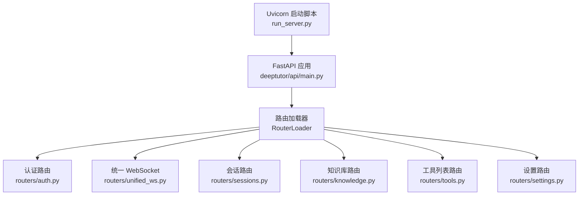
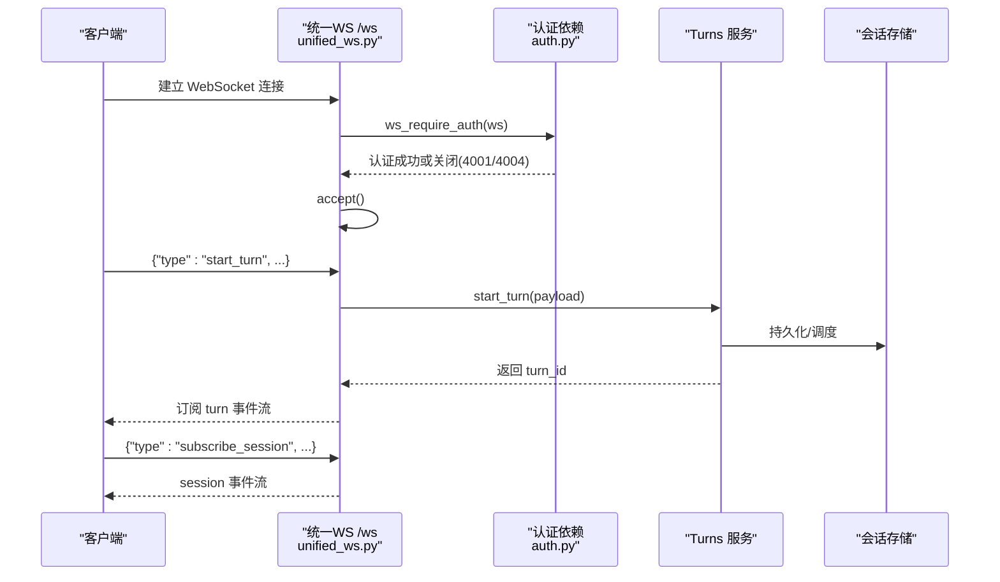
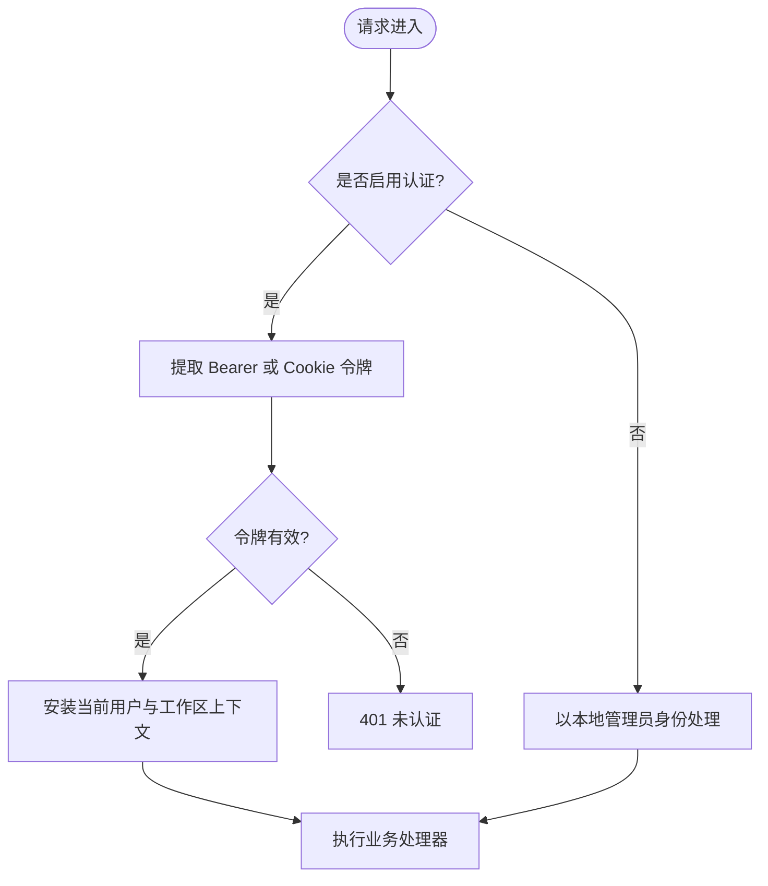
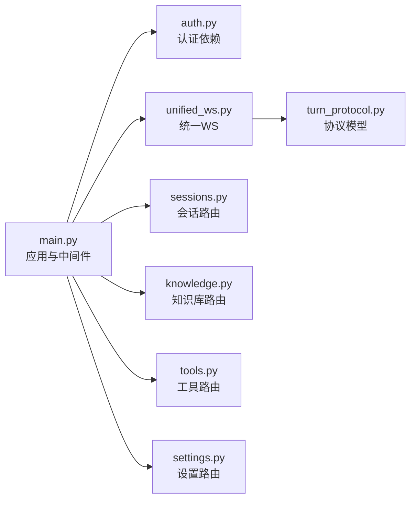

# API 参考文档

<cite>
**本文引用的文件**   
- [deeptutor/api/main.py](file://deeptutor/api/main.py)
- [deeptutor/api/run_server.py](file://deeptutor/api/run_server.py)
- [deeptutor/api/routers/auth.py](file://deeptutor/api/routers/auth.py)
- [deeptutor/api/routers/unified_ws.py](file://deeptutor/api/routers/unified_ws.py)
- [deeptutor/api/contracts/turn_protocol.py](file://deeptutor/api/contracts/turn_protocol.py)
- [deeptutor/api/routers/sessions.py](file://deeptutor/api/routers/sessions.py)
- [deeptutor/api/routers/knowledge.py](file://deeptutor/api/routers/knowledge.py)
- [deeptutor/api/routers/tools.py](file://deeptutor/api/routers/tools.py)
- [deeptutor/api/routers/settings.py](file://deeptutor/api/routers/settings.py)
</cite>

## 目录
1. [简介](#简介)
2. [项目结构](#项目结构)
3. [核心组件](#核心组件)
4. [架构总览](#架构总览)
5. [详细组件分析](#详细组件分析)
6. [依赖关系分析](#依赖关系分析)
7. [性能考虑](#性能考虑)
8. [故障排查指南](#故障排查指南)
9. [结论](#结论)
10. [附录](#附录)

## 简介
本文件为 DeepTutor 后端 API 的完整参考文档，覆盖以下范围：
- RESTful API：认证、会话、知识库、工具与设置等端点的 HTTP 方法、URL 模式、请求/响应结构与错误码。
- WebSocket API：统一连接处理、消息协议、事件类型与实时交互流程。
- 认证机制、权限控制、速率限制与跨域策略。
- 客户端实现指南、性能优化建议、调试与监控方法。
- 向后兼容性与迁移注意事项。

DeepTutor 后端基于 FastAPI，通过路由加载器动态挂载模块路由；WebSocket 提供统一的“回合”执行与可回放流式事件；认证支持内置 JWT/Cookie 与 PocketBase 两种模式，并提供设备凭证与会话中转能力。

## 项目结构
后端入口位于 `deeptutor/api/main.py`，负责应用生命周期、中间件、CORS、全局异常处理与路由加载；服务启动脚本在 `deeptutor/api/run_server.py`，负责 Uvicorn 参数与工作进程配置。

**图表来源**
- [deeptutor/api/main.py:364-517](file://deeptutor/api/main.py#L364-L517)
- [deeptutor/api/run_server.py:30-95](file://deeptutor/api/run_server.py#L30-L95)

**章节来源**
- [deeptutor/api/main.py:364-517](file://deeptutor/api/main.py#L364-L517)
- [deeptutor/api/run_server.py:30-95](file://deeptutor/api/run_server.py#L30-L95)

## 核心组件
- 应用生命周期与中间件：健康检查、CORS、访问日志、安全守卫、工作区活动追踪。
- 认证与授权：JWT Cookie/Bearer、设备凭证、会话中转、学习面访问控制。
- 统一 WebSocket 协议：v2 协议版本、命令/事件模型、订阅与取消、活跃回合查询。
- 会话管理：CRUD、搜索、组织元数据、回收站、分支选择、消息事件回溯。
- 知识库管理：创建、索引、文件上传、同步、进度与任务流。
- 工具与设置：内置工具清单、可选工具开关、界面与运行时设置。

**章节来源**
- [deeptutor/api/main.py:379-492](file://deeptutor/api/main.py#L379-L492)
- [deeptutor/api/routers/auth.py:455-619](file://deeptutor/api/routers/auth.py#L455-L619)
- [deeptutor/api/routers/unified_ws.py:43-389](file://deeptutor/api/routers/unified_ws.py#L43-L389)
- [deeptutor/api/contracts/turn_protocol.py:12-291](file://deeptutor/api/contracts/turn_protocol.py#L12-L291)
- [deeptutor/api/routers/sessions.py:251-800](file://deeptutor/api/routers/sessions.py#L251-L800)
- [deeptutor/api/routers/knowledge.py:182-800](file://deeptutor/api/routers/knowledge.py#L182-L800)
- [deeptutor/api/routers/tools.py:35-193](file://deeptutor/api/routers/tools.py#L35-L193)
- [deeptutor/api/routers/settings.py:92-200](file://deeptutor/api/routers/settings.py#L92-L200)

## 架构总览
DeepTutor API 采用分层模块化设计：
- 应用层：FastAPI 应用、中间件、全局异常处理、CORS、访问日志。
- 路由层：按功能划分的 Router（认证、会话、知识库、工具、设置、统一 WS）。
- 服务层：会话存储、知识管理、LLM 客户端、工作区上下文、事件总线、后台协调器。
- 协议层：统一 WebSocket v2 协议定义，约束客户端命令与服务端事件。

**图表来源**
- [deeptutor/api/routers/unified_ws.py:43-389](file://deeptutor/api/routers/unified_ws.py#L43-L389)
- [deeptutor/api/routers/auth.py:584-619](file://deeptutor/api/routers/auth.py#L584-L619)

## 详细组件分析

### 认证与授权 API
- 认证状态
  - GET `/api/auth/status`
  - 返回是否启用认证、当前用户信息、角色、头像、学习策略等。
- 登录/登出
  - POST `/api/auth/login`
  - POST `/api/auth/logout`
  - 支持内置 JWT Cookie 与 PocketBase 模式；Cookie 属性根据部署环境自动调整。
- 注册
  - POST `/api/auth/register`
  - 首次管理员注册受控；PocketBase 模式下仅允许首个用户注册。
- 设备凭证
  - POST `/api/auth/device-login`
  - POST `/api/auth/device/heartbeat`
  - GET `/api/auth/devices`
  - POST `/api/auth/devices`
  - DELETE `/api/auth/devices/{device_credential_id}`
- 会话中转
  - POST `/api/auth/session-handoff`
  - POST `/api/auth/session-handoff/exchange`
  - POST `/api/auth/session-handoff/complete`
- 个人资料
  - GET `/api/auth/profile`
  - PUT `/api/auth/profile`
  - PUT `/api/auth/profile/avatar`
  - DELETE `/api/auth/profile/avatar`
  - GET `/api/auth/avatar/{user_id}`
  - PUT `/api/auth/profile/password`
  - GET `/api/auth/profile/learner-profile`
  - PUT `/api/auth/profile/learner-profile`
- 管理员接口
  - GET `/api/auth/users`

认证依赖 `require_auth` 支持从 `Authorization: Bearer` 或 `dt_token` Cookie 提取令牌；当认证禁用时，所有请求视为本地管理员。WebSocket 使用 `ws_require_auth` 在升级前完成鉴权，失败则关闭连接并返回专用代码。

**图表来源**
- [deeptutor/api/routers/auth.py:455-505](file://deeptutor/api/routers/auth.py#L455-L505)
- [deeptutor/api/routers/auth.py:584-619](file://deeptutor/api/routers/auth.py#L584-L619)

**章节来源**
- [deeptutor/api/routers/auth.py:851-903](file://deeptutor/api/routers/auth.py#L851-L903)
- [deeptutor/api/routers/auth.py:906-956](file://deeptutor/api/routers/auth.py#L906-L956)
- [deeptutor/api/routers/auth.py:1207-1292](file://deeptutor/api/routers/auth.py#L1207-L1292)
- [deeptutor/api/routers/auth.py:1175-1204](file://deeptutor/api/routers/auth.py#L1175-L1204)
- [deeptutor/api/routers/auth.py:1003-1172](file://deeptutor/api/routers/auth.py#L1003-L1172)
- [deeptutor/api/routers/auth.py:1336-1471](file://deeptutor/api/routers/auth.py#L1336-L1471)
- [deeptutor/api/routers/auth.py:1487-1650](file://deeptutor/api/routers/auth.py#L1487-L1650)
- [deeptutor/api/routers/auth.py:1612-1615](file://deeptutor/api/routers/auth.py#L1612-L1615)

### 统一 WebSocket API
- 连接地址：`/ws`
- 协议版本：`2.0`
- 客户端命令类型：
  - `message` / `start_turn`：开始新回合
  - `subscribe_turn` / `resume_from`：订阅特定回合事件
  - `subscribe_session`：订阅会话事件
  - `check_active_turn`：查询会话活跃回合
  - `unsubscribe`：取消订阅
  - `cancel_turn`：取消回合
  - `submit_user_reply`：提交问答回复
  - `user_input`：向运行中的回合输入内容
  - `ping`：心跳
- 服务端事件类型：
  - `stream_event`：阶段开始/结束、思考、观察、内容、工具调用/结果、进度、来源、结果、错误、会话元信息等
  - `active_turn_info`：活跃回合信息
  - `pong`：心跳应答
  - `command_ack`：命令确认
  - `protocol_error`：协议错误

```mermaid
classDiagram
class StartTurnCommand {
+string type = "start_turn"
+string protocol_version = "2.0"
+TurnRequest payload
}
class SubscribeTurnCommand {
+string type = "subscribe_turn"
+string turn_id
+int after_seq
+string protocol_version = "2.0"
}
class SubscribeSessionCommand {
+string type = "subscribe_session"
+string session_id
+int after_seq
+string protocol_version = "2.0"
}
class ResumeTurnCommand {
+string type = "resume_from"
+string turn_id
+int seq
+string protocol_version = "2.0"
}
class UnsubscribeCommand {
+string type = "unsubscribe"
+string turn_id?
+string session_id?
+string protocol_version = "2.0"
}
class CancelTurnCommand {
+string type = "cancel_turn"
+string turn_id
+string command_id
+string protocol_version = "2.0"
}
class RegenerateCommand {
+string type = "regenerate"
+string session_id
+dict overrides
+string protocol_version = "2.0"
}
class SubmitUserReplyCommand {
+string type = "submit_user_reply"
+string turn_id
+string text?
+list answers?
+string command_id
+string protocol_version = "2.0"
}
class UserInputCommand {
+string type = "user_input"
+string turn_id
+string content
+string command_id
+string withdraw?
+string protocol_version = "2.0"
}
class CheckActiveTurnCommand {
+string type = "check_active_turn"
+string session_id
+string protocol_version = "2.0"
}
class PingCommand {
+string type = "ping"
+string protocol_version = "2.0"
}
class StreamEvent {
+string type
+string source
+string stage
+string content
+dict metadata
+string session_id
+string turn_id
+int seq
+float timestamp
+string protocol_version = "2.0"
}
class ActiveTurnInfo {
+string type = "active_turn_info"
+string turn_id
+string status
+string owner_id
+string protocol_version = "2.0"
}
class PongEvent {
+string type = "pong"
+string protocol_version = "2.0"
}
class CommandAckEvent {
+string type = "command_ack"
+string command_id
+string command_type
+bool accepted
+string turn_id
+string error_code
+string message
+string protocol_version = "2.0"
}
class ProtocolErrorEvent {
+string type = "protocol_error"
+string error_code
+string message
+bool retryable
+string session_id
+string turn_id
+string protocol_version = "2.0"
}
StartTurnCommand <|-- ClientCommand
SubscribeTurnCommand <|-- ClientCommand
SubscribeSessionCommand <|-- ClientCommand
ResumeTurnCommand <|-- ClientCommand
UnsubscribeCommand <|-- ClientCommand
CancelTurnCommand <|-- ClientCommand
RegenerateCommand <|-- ClientCommand
SubmitUserReplyCommand <|-- ClientCommand
UserInputCommand <|-- ClientCommand
CheckActiveTurnCommand <|-- ClientCommand
PingCommand <|-- ClientCommand
StreamEvent <|-- ServerEvent
ActiveTurnInfo <|-- ServerEvent
PongEvent <|-- ServerEvent
CommandAckEvent <|-- ServerEvent
ProtocolErrorEvent <|-- ServerEvent
```

**图表来源**
- [deeptutor/api/contracts/turn_protocol.py:69-178](file://deeptutor/api/contracts/turn_protocol.py#L69-L178)
- [deeptutor/api/contracts/turn_protocol.py:181-228](file://deeptutor/api/contracts/turn_protocol.py#L181-L228)

**章节来源**
- [deeptutor/api/routers/unified_ws.py:43-389](file://deeptutor/api/routers/unified_ws.py#L43-L389)
- [deeptutor/api/contracts/turn_protocol.py:12-291](file://deeptutor/api/contracts/turn_protocol.py#L12-L291)

### 会话管理 API
- 列表与搜索
  - GET `/api/sessions`
  - GET `/api/sessions/search`
- 详情与组织
  - GET `/api/sessions/{session_id}`
  - GET `/api/sessions/{session_id}/organization`
  - PATCH `/api/sessions/{session_id}`
  - PATCH `/api/sessions/{session_id}/reply-language`
  - PATCH `/api/sessions/{session_id}/organization`
- 线程与消息事件
  - GET `/api/sessions/{session_id}/threads`
  - GET `/api/sessions/{session_id}/messages/{message_id}/events`
- 回收站与恢复
  - GET `/api/sessions/recycle-bin`
  - POST `/api/sessions/{session_id}/restore`
  - DELETE `/api/sessions/{session_id}/purge`
- 其他操作
  - PUT `/api/sessions/{session_id}/branch-selection`
  - DELETE `/api/sessions/{session_id}/messages/{message_id}`
  - POST `/api/sessions/submission-replacement`
  - POST `/api/sessions/{session_id}/migrate-watching`

会话 API 提供分页、偏移、工作区过滤、搜索词长度限制、消息事件截断与私有元数据脱敏；删除会话会级联清理附件、阅读集合与任务板条目。

**章节来源**
- [deeptutor/api/routers/sessions.py:251-800](file://deeptutor/api/routers/sessions.py#L251-L800)

### 知识库管理 API
- 基础信息与枚举
  - 获取支持的 RAG 提供者、文件类型、最大文件大小等
- 知识库 CRUD
  - 创建、更新、删除、列出知识库
- 文件上传与归档
  - 单文件/多文件上传、ZIP 解压、路径校验、大小限制、重复文件名处理
- 同步与索引
  - 关联文件夹同步、增量索引、进度广播、任务日志流
- 配置与安全
  - LightRAG/PageIndex/GraphRAG 预检、索引策略冻结、提供者就绪检查

知识库路由包含大量安全校验：路径穿越防护、扩展名白名单、ZIP 炸弹防护、大小限制、并发写锁与提供者一致性检查。

**章节来源**
- [deeptutor/api/routers/knowledge.py:182-800](file://deeptutor/api/routers/knowledge.py#L182-L800)

### 工具与设置 API
- 工具清单
  - GET `/api/tools`
  - 返回内置工具名称、描述、参数、提示、别名、可用性、是否可切换、所属能力等
- 设置
  - 界面设置、语言、主题、侧边栏导航顺序、语音自动播放、聊天超时等
  - 运行时设置、模型目录、草稿、预设、隐私字段掩码

工具清单用于前端 Settings UI 渲染；设置 API 暴露非敏感界面偏好，同时保护模型目录与凭据。

**章节来源**
- [deeptutor/api/routers/tools.py:35-193](file://deeptutor/api/routers/tools.py#L35-L193)
- [deeptutor/api/routers/settings.py:92-200](file://deeptutor/api/routers/settings.py#L92-L200)

## 依赖关系分析
- 应用层依赖：
  - CORS 中间件、工作区活动中间件、JSON 错误边界、选择性访问日志、安全守卫。
- 路由层依赖：
  - 认证依赖 `require_auth` / `require_admin` / `ws_require_auth`
  - 会话路由依赖 TurnApplicationService 与 SessionStore
  - 知识库路由依赖 KnowledgeBaseManager、DocumentValidator、TaskIDManager、ProgressBroadcaster
  - 工具路由依赖内置工具定义与国际化描述
  - 设置路由依赖运行时设置服务、模型目录、界面设置服务
- 外部集成：
  - LLM 客户端池、事件总线、MCP 管理器、PocketBase、Redis（可选）

**图表来源**
- [deeptutor/api/main.py:379-517](file://deeptutor/api/main.py#L379-L517)
- [deeptutor/api/routers/unified_ws.py:43-389](file://deeptutor/api/routers/unified_ws.py#L43-L389)
- [deeptutor/api/contracts/turn_protocol.py:12-291](file://deeptutor/api/contracts/turn_protocol.py#L12-L291)

**章节来源**
- [deeptutor/api/main.py:379-517](file://deeptutor/api/main.py#L379-L517)

## 性能考虑
- 服务器启动与进程模型
  - 支持多 worker 进程；开发模式 reload 与多 worker 互斥。
  - 关闭 uvicorn 默认 access_log，使用自定义访问日志仅记录非 200 响应。
- 内存与资源管理
  - 启动时初始化 LLM 客户端池、事件总线、MCP 连接；关闭时显式释放。
  - 大文件上传走线程池避免阻塞事件循环。
- WebSocket 帧大小
  - 通过 `ws_max_size` 控制聊天附件总大小，确保 base64 上传能放入单个 WS 帧。
- 事件与负载
  - 会话消息事件对 oversized tool_result/observation 进行截断，避免 UI 卡顿。
- 并发与锁
  - 知识库写入使用写锁与索引策略快照，防止并发冲突。

**章节来源**
- [deeptutor/api/run_server.py:30-95](file://deeptutor/api/run_server.py#L30-L95)
- [deeptutor/api/main.py:170-350](file://deeptutor/api/main.py#L170-L350)
- [deeptutor/api/routers/sessions.py:299-418](file://deeptutor/api/routers/sessions.py#L299-L418)
- [deeptutor/api/routers/knowledge.py:726-800](file://deeptutor/api/routers/knowledge.py#L726-L800)

## 故障排查指南
- 全局异常处理
  - JSON 错误边界确保 500 响应始终为 JSON，并携带异常类型与详情。
  - AccessError 与 ModuleUnavailable 有专门处理器。
- 访问日志
  - 选择性访问日志仅输出非 200 响应，便于定位问题。
- WebSocket 错误
  - 协议错误、订阅失败、内部错误均返回结构化 `protocol_error`，包含错误码与重试标志。
- 认证失败
  - 缺少或无效令牌返回 401，并附带 `WWW-Authenticate: Bearer`。
  - WebSocket 认证失败关闭连接并返回专用代码（4001/4004）。
- 知识库上传失败
  - ZIP 炸弹、非法扩展名、重复文件名、大小超限均返回 400 与明确错误信息。

**章节来源**
- [deeptutor/api/main.py:379-420](file://deeptutor/api/main.py#L379-L420)
- [deeptutor/api/main.py:452-475](file://deeptutor/api/main.py#L452-L475)
- [deeptutor/api/routers/unified_ws.py:75-109](file://deeptutor/api/routers/unified_ws.py#L75-L109)
- [deeptutor/api/routers/auth.py:487-505](file://deeptutor/api/routers/auth.py#L487-L505)
- [deeptutor/api/routers/auth.py:584-619](file://deeptutor/api/routers/auth.py#L584-L619)
- [deeptutor/api/routers/knowledge.py:312-384](file://deeptutor/api/routers/knowledge.py#L312-L384)

## 结论
DeepTutor API 提供了完整的 RESTful 与 WebSocket 能力，涵盖认证、会话、知识库、工具与设置等核心领域。其架构清晰、协议规范、错误处理完善，适合构建实时交互式学习平台。客户端应严格遵循 v2 协议版本与命令/事件模型，并在认证、速率限制与跨域方面遵循部署配置。

## 附录

### 客户端实现指南
- 认证
  - 优先使用 Cookie `dt_token`；也可在 Header 中发送 `Authorization: Bearer <token>`。
  - 首次注册后，后续账户需由管理员创建。
- WebSocket
  - 连接 `/ws`，在 `accept()` 前完成鉴权。
  - 每次消息携带 `protocol_version: "2.0"`。
  - 使用 `start_turn` 发起回合，`subscribe_turn` / `subscribe_session` 订阅事件。
  - 使用 `check_active_turn` 检测会话活跃回合，避免重复提交。
  - 使用 `cancel_turn` 取消回合，`submit_user_reply` / `user_input` 与运行中回合交互。
- 速率限制
  - 会话中转接口存在速率限制，频繁请求将返回 429。
- 跨域
  - 根据认证模式决定 CORS 策略；启用认证时需显式配置允许的源。

**章节来源**
- [deeptutor/api/routers/auth.py:455-505](file://deeptutor/api/routers/auth.py#L455-L505)
- [deeptutor/api/routers/unified_ws.py:43-389](file://deeptutor/api/routers/unified_ws.py#L43-L389)
- [deeptutor/api/routers/auth.py:1003-1172](file://deeptutor/api/routers/auth.py#L1003-L1172)
- [deeptutor/api/main.py:77-105](file://deeptutor/api/main.py#L77-L105)

### 向后兼容性与迁移
- 协议版本
  - 统一 WebSocket 协议固定为 `2.0`，客户端必须匹配该版本。
- 会话迁移
  - 旧版“Watching”会话可通过 `/api/sessions/{session_id}/migrate-watching` 迁移到 Reading 模式。
- 知识库提供者
  - 空或未知提供者会被规范化为默认提供者；创建/重建时会冻结默认索引策略。
- 设置与工具
  - 界面设置与工具开关保持向前兼容；缺失的工具名忽略，默认行为保持不变。

**章节来源**
- [deeptutor/api/contracts/turn_protocol.py:12-13](file://deeptutor/api/contracts/turn_protocol.py#L12-L13)
- [deeptutor/api/routers/sessions.py:431-453](file://deeptutor/api/routers/sessions.py#L431-L453)
- [deeptutor/api/routers/knowledge.py:714-762](file://deeptutor/api/routers/knowledge.py#L714-L762)
- [deeptutor/api/routers/tools.py:160-193](file://deeptutor/api/routers/tools.py#L160-L193)