# 会话管理 API

<cite>
**本文引用的文件**   
- [deeptutor/api/routers/sessions.py](file://deeptutor/api/routers/sessions.py)
- [deeptutor/services/session/__init__.py](file://deeptutor/services/session/__init__.py)
- [deeptutor/services/session/protocol.py](file://deeptutor/services/session/protocol.py)
- [deeptutor/services/session/sqlite_store.py](file://deeptutor/services/session/sqlite_store.py)
- [deeptutor/services/session/pocketbase_store.py](file://deeptutor/services/session/pocketbase_store.py)
- [deeptutor/services/session/turn_runtime.py](file://deeptutor/services/session/turn_runtime.py)
- [deeptutor/services/session/usage_statistics.py](file://deeptutor/services/session/usage_statistics.py)
- [deeptutor/multi_user/context.py](file://deeptutor/multi_user/context.py)
</cite>

## 目录
1. [简介](#简介)
2. [项目结构](#项目结构)
3. [核心组件](#核心组件)
4. [架构总览](#架构总览)
5. [详细组件分析](#详细组件分析)
6. [依赖关系分析](#依赖关系分析)
7. [性能与容量](#性能与容量)
8. [故障排查指南](#故障排查指南)
9. [结论](#结论)
10. [附录：API 参考](#附录api-参考)

## 简介
本文件为 DeepTutor 会话管理系统的完整 API 文档，覆盖会话的创建、更新、删除、历史查询、线程组织、消息事件、测验结果记录、回收站恢复与硬删等能力；同时说明会话状态管理、上下文持久化与恢复机制、会话分析与统计、多用户隔离与权限控制，以及生命周期最佳实践与性能优化建议。

## 项目结构
会话相关代码主要分布在以下层次：
- API 路由层：对外暴露 REST 接口，负责参数校验、错误映射与跨模块协调。
- 会话存储协议与实现：统一抽象 SessionStoreProtocol，提供 SQLite 与 PocketBase 两种后端。
- 回合运行时：TurnRuntimeManager 组合请求准备、上下文组装、执行与生命周期管理。
- 多用户上下文：通过 ContextVar 维护当前用户与工作区范围，驱动数据隔离。
- 使用统计：聚合 LLM 调用与恢复的历史事件，输出按日、模型维度的用量指标。

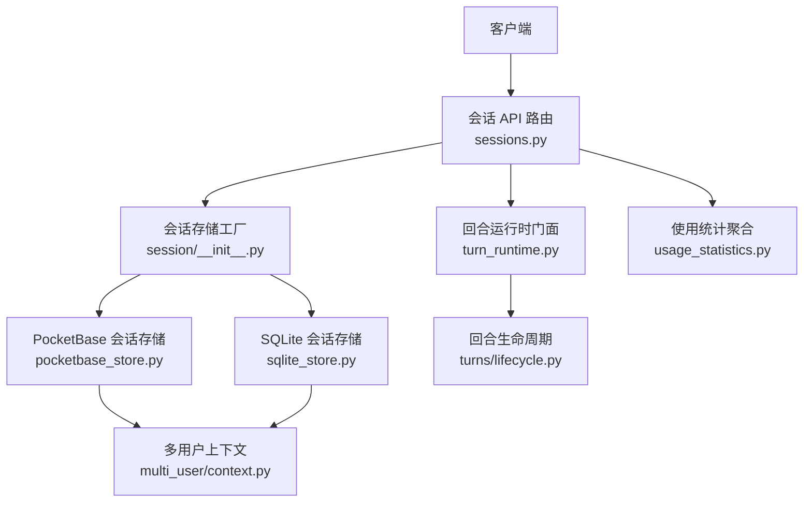

**图表来源** 
- [deeptutor/api/routers/sessions.py:1-850](file://deeptutor/api/routers/sessions.py#L1-L850)
- [deeptutor/services/session/__init__.py:1-51](file://deeptutor/services/session/__init__.py#L1-L51)
- [deeptutor/services/session/sqlite_store.py:1-800](file://deeptutor/services/session/sqlite_store.py#L1-L800)
- [deeptutor/services/session/pocketbase_store.py:1-800](file://deeptutor/services/session/pocketbase_store.py#L1-L800)
- [deeptutor/services/session/turn_runtime.py:1-56](file://deeptutor/services/session/turn_runtime.py#L1-L56)
- [deeptutor/services/session/usage_statistics.py:1-239](file://deeptutor/services/session/usage_statistics.py#L1-L239)
- [deeptutor/multi_user/context.py:1-44](file://deeptutor/multi_user/context.py#L1-L44)

**章节来源**
- [deeptutor/api/routers/sessions.py:1-850](file://deeptutor/api/routers/sessions.py#L1-L850)
- [deeptutor/services/session/__init__.py:1-51](file://deeptutor/services/session/__init__.py#L1-L51)

## 核心组件
- 会话存储协议：SessionStoreProtocol 定义统一的会话、消息、回合与事件访问接口，屏蔽 SQLite 与 PocketBase 差异。
- SQLite 会话存储：本地 WAL 模式数据库，支持软删除、回收站、消息分支、索引优化与迁移脚本。
- PocketBase 会话存储：远程集合存储，按 user_id 与 workspace_id 做行级隔离，偏好字段 JSON 合并加进程内锁防竞态。
- 回合运行时门面：TurnRuntimeManager 组合请求准备、上下文组装、学习适配、执行与标题服务，并缓存实例。
- 使用统计：从事件流中抽取 usage_summary/cost_summary，汇总到 UsageStatistics，包含按日、模型、会话、回合维度。

**章节来源**
- [deeptutor/services/session/protocol.py:1-285](file://deeptutor/services/session/protocol.py#L1-L285)
- [deeptutor/services/session/sqlite_store.py:1-800](file://deeptutor/services/session/sqlite_store.py#L1-L800)
- [deeptutor/services/session/pocketbase_store.py:1-800](file://deeptutor/services/session/pocketbase_store.py#L1-L800)
- [deeptutor/services/session/turn_runtime.py:1-56](file://deeptutor/services/session/turn_runtime.py#L1-L56)
- [deeptutor/services/session/usage_statistics.py:1-239](file://deeptutor/services/session/usage_statistics.py#L1-L239)

## 架构总览
会话 API 以 FastAPI 路由为中心，根据配置选择 SQLite 或 PocketBase 存储；对活跃回合进行并发控制，并通过工作区与用户上下文保证多租户隔离。

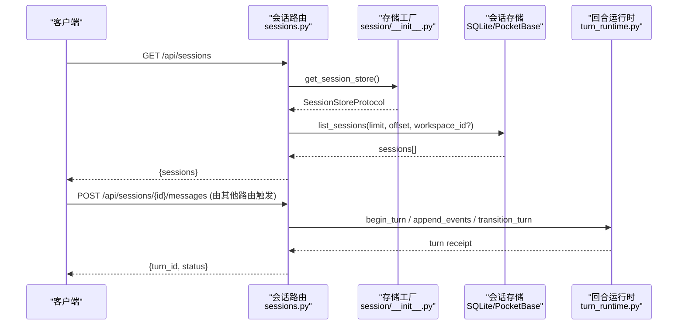

**图表来源**
- [deeptutor/api/routers/sessions.py:251-270](file://deeptutor/api/routers/sessions.py#L251-L270)
- [deeptutor/services/session/__init__.py:15-38](file://deeptutor/services/session/__init__.py#L15-L38)
- [deeptutor/services/session/turn_runtime.py:26-52](file://deeptutor/services/session/turn_runtime.py#L26-L52)

## 详细组件分析

### 会话列表与搜索
- 列出会话：GET /api/sessions
  - 参数：limit、offset、workspace_id、all_workspaces
  - 行为：默认按当前工作区列出未归档会话；all_workspaces 走导航索引用于账户设置归档页。
- 搜索会话：GET /api/sessions/search
  - 参数：q（必填）、limit、offset
  - 行为：在标题与已持久化的用户/助手消息中进行字面量匹配，返回命中摘要与分页信息。

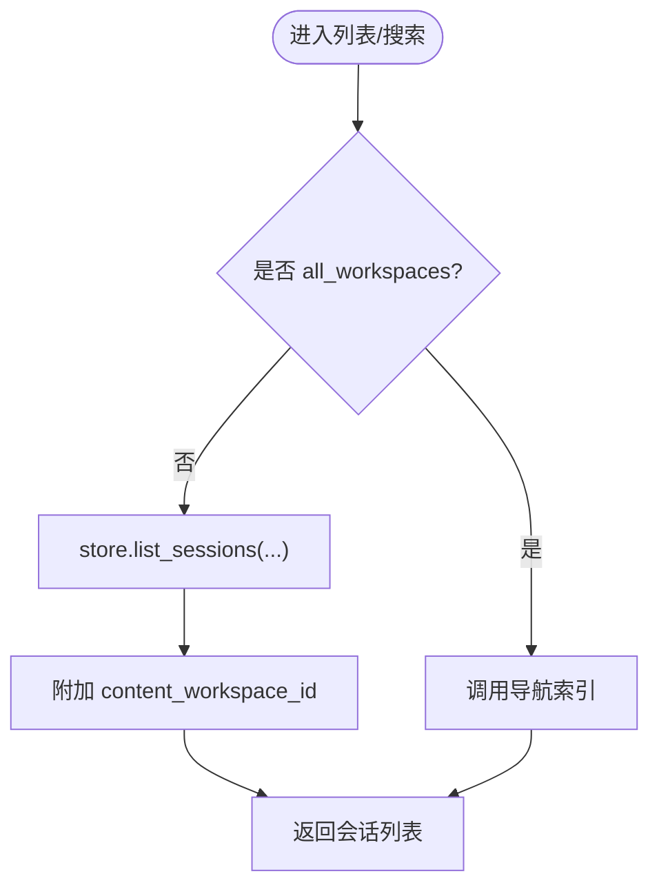

**图表来源**
- [deeptutor/api/routers/sessions.py:251-270](file://deeptutor/api/routers/sessions.py#L251-L270)

**章节来源**
- [deeptutor/api/routers/sessions.py:251-296](file://deeptutor/api/routers/sessions.py#L251-L296)

### 获取会话详情与消息事件
- 获取会话详情：GET /api/sessions/{session_id}
  - 行为：加载会话与消息，附加孤立失败回合、脱敏提供者私有元数据、截断超大事件负载。
- 获取消息事件：GET /api/sessions/{session_id}/messages/{message_id}/events
  - 参数：after_seq、limit
  - 行为：按序列号增量拉取 trace 事件，便于前端逐步渲染。

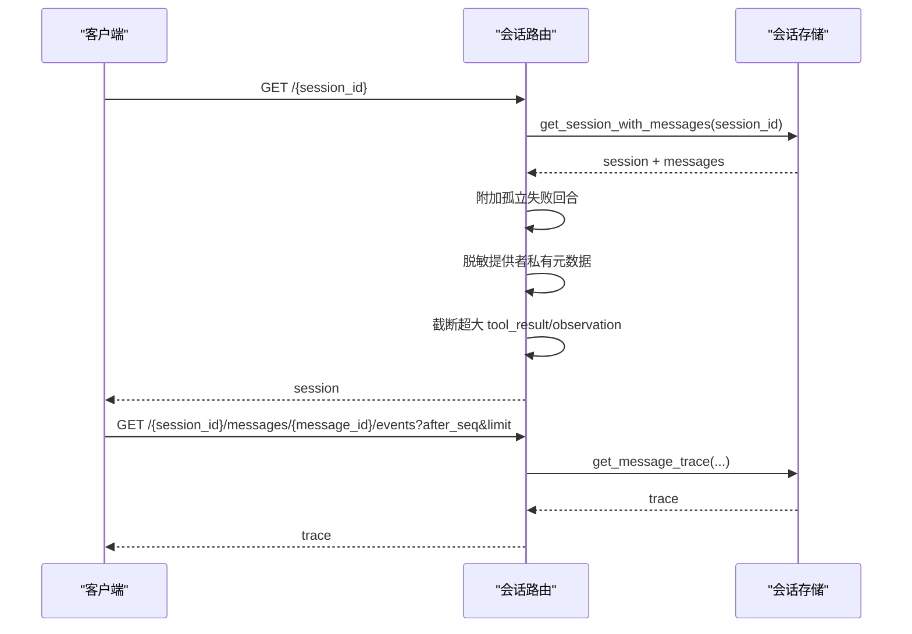

**图表来源**
- [deeptutor/api/routers/sessions.py:456-467](file://deeptutor/api/routers/sessions.py#L456-L467)
- [deeptutor/api/routers/sessions.py:515-526](file://deeptutor/api/routers/sessions.py#L515-L526)

**章节来源**
- [deeptutor/api/routers/sessions.py:456-526](file://deeptutor/api/routers/sessions.py#L456-L526)

### 会话组织与分支选择
- 获取组织信息：GET /api/sessions/{session_id}/organization
  - 行为：返回标题、状态与偏好，不携带完整对话，适合侧边栏菜单。
- 更新组织信息：PATCH /api/sessions/{session_id}/organization
  - 可更新：workspace_id、parent_session_id、session_kind、pinned、archived、tutor_source_message_id
  - 约束：
    - workspace_id 变更需校验绑定且无活跃回合；跨工作区移动走专用 move_chat 事务。
    - parent_session_id 不能自引用，子会话归属校验。
    - tutor_source_message_id 仅 selection_tutor 类型可用，且必须属于父会话的消息。
- 分支选择：PUT /api/sessions/{session_id}/branch-selection
  - 行为：保存 selected_branches 到 preferences，供编辑分支 UI 持久化。

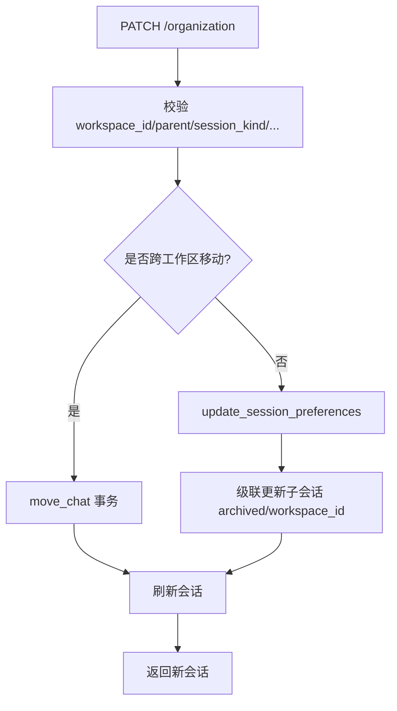

**图表来源**
- [deeptutor/api/routers/sessions.py:573-694](file://deeptutor/api/routers/sessions.py#L573-L694)

**章节来源**
- [deeptutor/api/routers/sessions.py:470-694](file://deeptutor/api/routers/sessions.py#L470-L694)

### 会话重命名与回复语言
- 重命名会话：PATCH /api/sessions/{session_id}
  - 行为：更新标题，必要时异步更新阅读目录中的会话名。
- 更新回复语言：PATCH /api/sessions/{session_id}/reply-language
  - 行为：将 reply_language_override 写入会话偏好，支持空值回退到账户默认。

**章节来源**
- [deeptutor/api/routers/sessions.py:537-570](file://deeptutor/api/routers/sessions.py#L537-L570)

### 删除与会话回收站
- 删除会话：DELETE /api/sessions/{session_id}
  - 行为：
    - 快照所有会话构建父子关系，递归收集子会话。
    - 若存储支持 list_active_turns，则先取消活跃回合。
    - 反向顺序删除会话，清理附属资源（掌握路径、附件、阅读目录）。
- 回收站列表：GET /api/sessions/recycle-bin
- 恢复会话：POST /api/sessions/{session_id}/restore
- 硬删除会话：DELETE /api/sessions/{session_id}/purge
  - 行为：从回收站永久删除，并清理任务板关联。

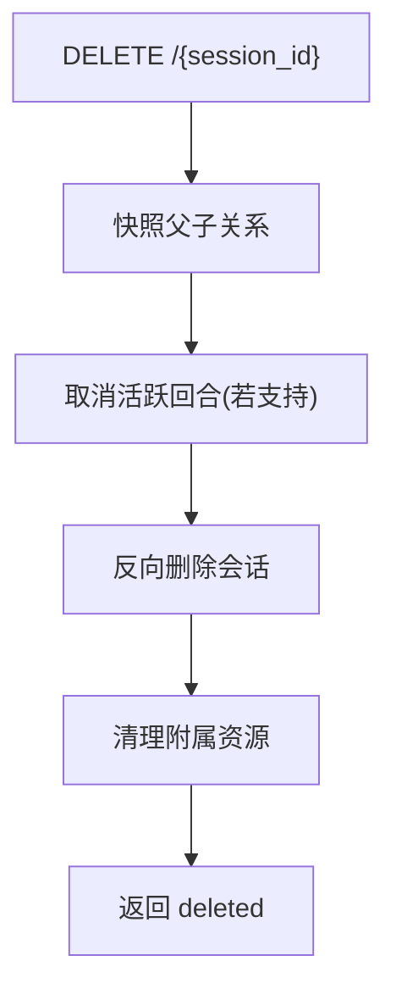

**图表来源**
- [deeptutor/api/routers/sessions.py:697-753](file://deeptutor/api/routers/sessions.py#L697-L753)

**章节来源**
- [deeptutor/api/routers/sessions.py:421-428](file://deeptutor/api/routers/sessions.py#L421-L428)
- [deeptutor/api/routers/sessions.py:697-781](file://deeptutor/api/routers/sessions.py#L697-L781)

### 提交替换与测验结果
- 提交替换：POST /api/sessions/submission-replacement
  - 行为：原子性准入后替换原始提交，启动回合；不支持时返回 501，冲突返回 409。
- 记录测验结果：POST /api/sessions/{session_id}/quiz-results
  - 行为：追加一条用户消息，并 upsert notebook_entries；返回计数与生成内容。

**章节来源**
- [deeptutor/api/routers/sessions.py:49-79](file://deeptutor/api/routers/sessions.py#L49-L79)
- [deeptutor/api/routers/sessions.py:818-849](file://deeptutor/api/routers/sessions.py#L818-L849)

### 消息删除
- 删除消息：DELETE /api/sessions/{session_id}/messages/{message_id}
  - 行为：基于 SQLite 存储删除消息，若该消息对应回合仍活跃则拒绝；随后清理附件。

**章节来源**
- [deeptutor/api/routers/sessions.py:798-815](file://deeptutor/api/routers/sessions.py#L798-L815)

### 会话状态管理与回合生命周期
- 活跃回合冲突：当会话存在未完成回合时，禁止重复开始；协议层抛出 ActiveTurnConflict。
- 回合生命周期：TurnLifecycle 管理执行队列、暂停/恢复、订阅者通知、关闭排空与受管更新阻塞。
- 存储端并发保护：
  - SQLite：通过 turns 表的部分唯一索引与 fencing_token/state_version 防止同一会话并发活跃回合。
  - PocketBase：通过 HTTP 调用与进程内偏好锁串行化 JSON 偏好写操作。

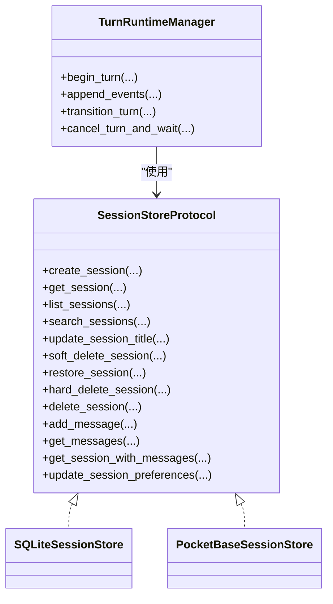

**图表来源**
- [deeptutor/services/session/protocol.py:38-276](file://deeptutor/services/session/protocol.py#L38-L276)
- [deeptutor/services/session/sqlite_store.py:245-530](file://deeptutor/services/session/sqlite_store.py#L245-L530)
- [deeptutor/services/session/pocketbase_store.py:171-258](file://deeptutor/services/session/pocketbase_store.py#L171-L258)
- [deeptutor/services/session/turn_runtime.py:26-52](file://deeptutor/services/session/turn_runtime.py#L26-L52)

**章节来源**
- [deeptutor/services/session/protocol.py:20-36](file://deeptutor/services/session/protocol.py#L20-L36)
- [deeptutor/services/session/turn_runtime.py:34-110](file://deeptutor/services/session/turn_runtime.py#L34-L110)
- [deeptutor/services/session/sqlite_store.py:572-656](file://deeptutor/services/session/sqlite_store.py#L572-L656)
- [deeptutor/services/session/pocketbase_store.py:171-198](file://deeptutor/services/session/pocketbase_store.py#L171-L198)

### 上下文持久化与恢复
- 偏好字段迁移：
  - SQLite：_migrate_workspace_preferences 将旧 deleted_at 语义转为 preferences_json.archived，保留逻辑时间戳。
  - PocketBase：migrate_workspace_preferences 批量升级偏好并补齐 session_created_at/session_updated_at。
- 导入会话：
  - PocketBase：import_legacy_session 原子式创建会话与消息，失败时回滚已创建行。
- 旧版“观看”会话迁移：
  - 路由提供 migrate-watching 端点，尝试迁移到沉浸式阅读；失败则标记 legacy_watching_unavailable。

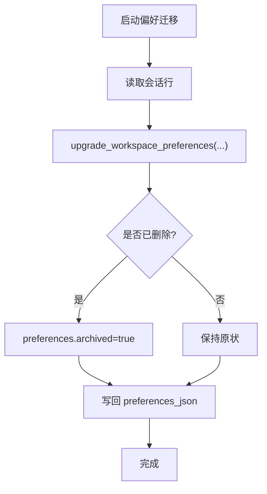

**图表来源**
- [deeptutor/services/session/sqlite_store.py:532-557](file://deeptutor/services/session/sqlite_store.py#L532-L557)
- [deeptutor/services/session/pocketbase_store.py:209-258](file://deeptutor/services/session/pocketbase_store.py#L209-L258)

**章节来源**
- [deeptutor/services/session/sqlite_store.py:532-570](file://deeptutor/services/session/sqlite_store.py#L532-L570)
- [deeptutor/services/session/pocketbase_store.py:209-258](file://deeptutor/services/session/pocketbase_store.py#L209-L258)
- [deeptutor/api/routers/sessions.py:431-453](file://deeptutor/api/routers/sessions.py#L431-L453)

### 多用户隔离与权限控制
- 当前用户上下文：ContextVar 维护当前用户与角色，单用户模式下回退到 local-admin。
- PocketBase 隔离：
  - _current_user_id 从上下文提取 user_id，所有查询附加 user_id 过滤。
  - _workspace_filter 附加 workspace_id 过滤，确保工作区边界。
- SQLite 隔离：
  - 每个用户拥有独立数据库文件；路径服务决定 db_path。

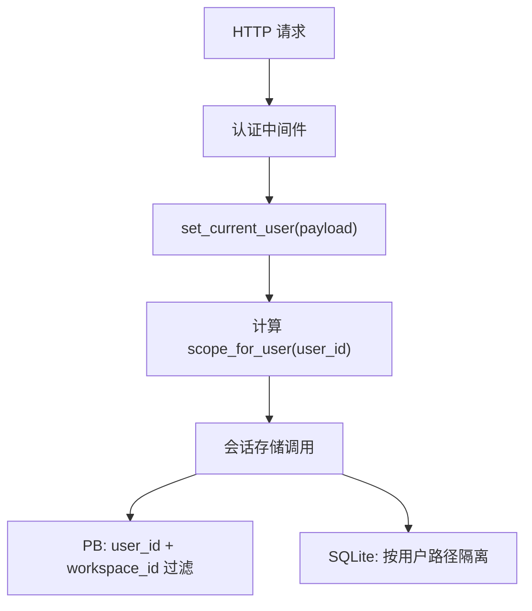

**图表来源**
- [deeptutor/multi_user/context.py:14-43](file://deeptutor/multi_user/context.py#L14-L43)
- [deeptutor/services/session/pocketbase_store.py:106-163](file://deeptutor/services/session/pocketbase_store.py#L106-L163)
- [deeptutor/services/session/sqlite_store.py:248-256](file://deeptutor/services/session/sqlite_store.py#L248-L256)

**章节来源**
- [deeptutor/multi_user/context.py:1-44](file://deeptutor/multi_user/context.py#L1-L44)
- [deeptutor/services/session/pocketbase_store.py:106-163](file://deeptutor/services/session/pocketbase_store.py#L106-L163)
- [deeptutor/services/session/sqlite_store.py:248-256](file://deeptutor/services/session/sqlite_store.py#L248-L256)

### 会话分析与统计
- 事件摘要抽取：summaries_from_events 从 result/done 事件中抽取 usage_summary/cost_summary。
- 聚合统计：aggregate_usage 按年、时区聚合 token、调用次数、TTFT、吞吐、按模型与按日分布，并统计活跃天数、会话数、回合数。

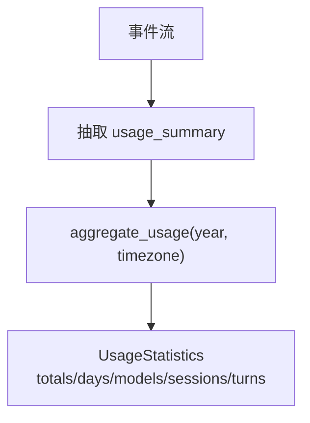

**图表来源**
- [deeptutor/services/session/usage_statistics.py:56-88](file://deeptutor/services/session/usage_statistics.py#L56-L88)
- [deeptutor/services/session/usage_statistics.py:160-238](file://deeptutor/services/session/usage_statistics.py#L160-L238)

**章节来源**
- [deeptutor/services/session/usage_statistics.py:1-239](file://deeptutor/services/session/usage_statistics.py#L1-L239)

## 依赖关系分析
- 路由层依赖：
  - 会话存储工厂：根据集成开关选择 PocketBase 或 SQLite。
  - 工作区上下文：用于附加 content_workspace_id 与校验工作区绑定。
  - 附件存储：删除会话或消息时清理附件。
  - 阅读/掌握/任务板：删除会话时异步清理关联资源。
- 存储层依赖：
  - SQLite：WAL 模式、迁移脚本、索引优化、JSON 列兼容。
  - PocketBase：HTTP 客户端、集合 CRUD、JSON 偏好合并与进程内锁。
- 运行时依赖：
  - TurnRuntimeManager 组合多个 v2 服务，按 store_scope 缓存实例。

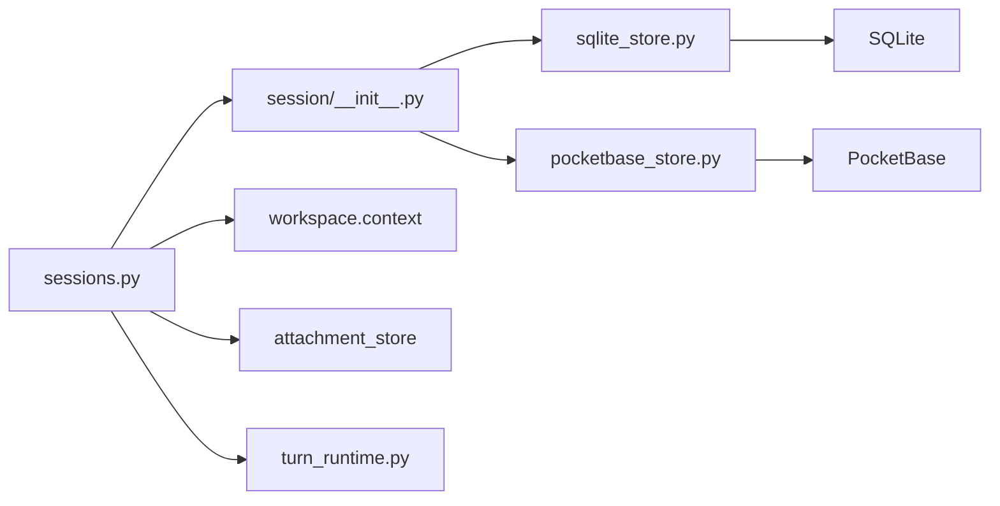

**图表来源**
- [deeptutor/api/routers/sessions.py:1-850](file://deeptutor/api/routers/sessions.py#L1-L850)
- [deeptutor/services/session/__init__.py:1-51](file://deeptutor/services/session/__init__.py#L1-L51)
- [deeptutor/services/session/sqlite_store.py:1-800](file://deeptutor/services/session/sqlite_store.py#L1-L800)
- [deeptutor/services/session/pocketbase_store.py:1-800](file://deeptutor/services/session/pocketbase_store.py#L1-L800)
- [deeptutor/services/session/turn_runtime.py:1-56](file://deeptutor/services/session/turn_runtime.py#L1-L56)

**章节来源**
- [deeptutor/api/routers/sessions.py:1-850](file://deeptutor/api/routers/sessions.py#L1-L850)
- [deeptutor/services/session/__init__.py:1-51](file://deeptutor/services/session/__init__.py#L1-L51)

## 性能与容量
- 事件负载限制：tool_result/observation 事件内容超过 1MB 会被截断，避免前端渲染压力；不影响模型输入。
- 搜索上限：单次搜索 query 长度受限，limit 最大 100，避免全量扫描。
- 分页策略：
  - PocketBase list_sessions 使用 page/skip 组合，必要时二次翻页拼接。
  - SQLite 使用索引 idx_sessions_updated_at、idx_messages_session_created 提升排序与查询效率。
- 并发与一致性：
  - SQLite 使用 WAL 与部分唯一索引保证活跃回合互斥；fencing_token/state_version 增强幂等。
  - PocketBase 偏好字段采用进程内 threading.Lock 串行化写，避免 JSON 合并丢失。
- 资源清理：删除会话时异步清理掌握路径、附件、阅读目录与任务板，降低主流程延迟。

[本节为通用指导，无需具体文件引用]

## 故障排查指南
- 404 未找到：
  - 会话不存在、消息不存在、回收站中找不到待恢复/硬删项。
- 400 参数错误：
  - 搜索词为空、父会话自引用、非 selection_tutor 设置 tutor_source_message_id、工作区绑定非法。
- 409 冲突：
  - 有活跃回合时移动会话或删除消息、删除过程中无法停止活跃回合、提交替换冲突。
- 501 不支持：
  - 底层存储不支持 submission replacement。
- 常见日志：
  - 偏好迁移失败、阅读目录重命名失败、附件清理失败、掌握路径解绑失败。

**章节来源**
- [deeptutor/api/routers/sessions.py:281-296](file://deeptutor/api/routers/sessions.py#L281-L296)
- [deeptutor/api/routers/sessions.py:573-694](file://deeptutor/api/routers/sessions.py#L573-L694)
- [deeptutor/api/routers/sessions.py:697-781](file://deeptutor/api/routers/sessions.py#L697-L781)
- [deeptutor/api/routers/sessions.py:798-815](file://deeptutor/api/routers/sessions.py#L798-L815)

## 结论
DeepTutor 会话管理系统通过统一的存储协议与双后端实现，提供了健壮的会话生命周期管理能力，涵盖创建、组织、删除、恢复、搜索、事件追踪与分析统计。在多用户环境下，通过用户与工作区双重隔离保障数据安全；在性能方面，通过事件截断、分页、索引与并发控制提升稳定性与吞吐。建议在生产环境优先使用 PocketBase 以获得更好的横向扩展能力，并在高并发场景下关注偏好字段合并锁与活跃回合互斥策略。

[本节为总结性内容，无需具体文件引用]

## 附录：API 参考
- 能力探测
  - GET /api/sessions/capabilities
    - 返回：submission_replacement 布尔
- 提交替换
  - POST /api/sessions/submission-replacement
    - 入参：original_submission_id、request(TurnRequest)
    - 出参：status=started、session_id、submission_id、turn
- 会话列表
  - GET /api/sessions
    - 参数：limit、offset、workspace_id、all_workspaces
- 会话搜索
  - GET /api/sessions/search
    - 参数：q、limit、offset
- 回收站
  - GET /api/sessions/recycle-bin
- 会话详情
  - GET /api/sessions/{session_id}
- 会话组织信息
  - GET /api/sessions/{session_id}/organization
- 会话线程
  - GET /api/sessions/{session_id}/threads
- 消息事件
  - GET /api/sessions/{session_id}/messages/{message_id}/events
    - 参数：after_seq、limit
- 提示建议
  - GET /api/sessions/{session_id}/ask-hint
- 重命名
  - PATCH /api/sessions/{session_id}
- 回复语言
  - PATCH /api/sessions/{session_id}/reply-language
- 组织更新
  - PATCH /api/sessions/{session_id}/organization
- 分支选择
  - PUT /api/sessions/{session_id}/branch-selection
- 删除会话
  - DELETE /api/sessions/{session_id}
- 恢复会话
  - POST /api/sessions/{session_id}/restore
- 硬删除会话
  - DELETE /api/sessions/{session_id}/purge
- 删除消息
  - DELETE /api/sessions/{session_id}/messages/{message_id}
- 记录测验结果
  - POST /api/sessions/{session_id}/quiz-results

**章节来源**
- [deeptutor/api/routers/sessions.py:49-849](file://deeptutor/api/routers/sessions.py#L49-L849)