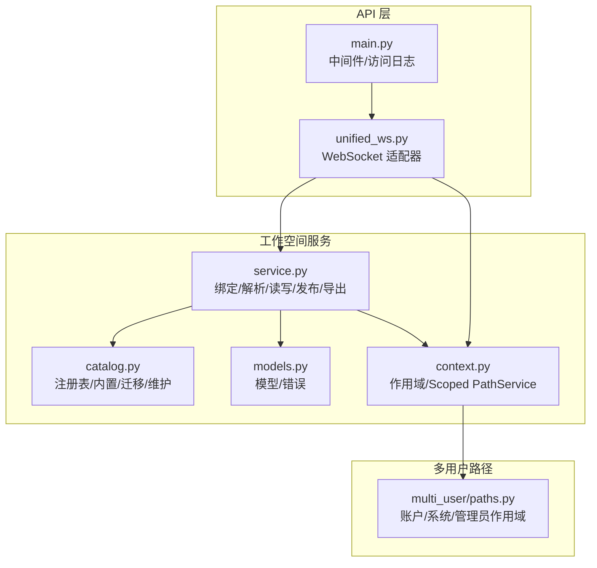
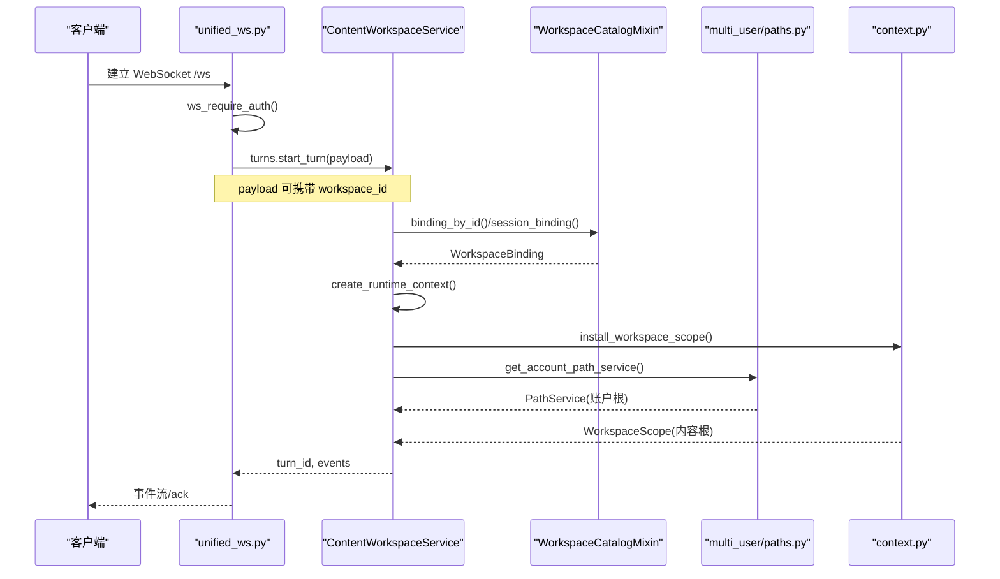
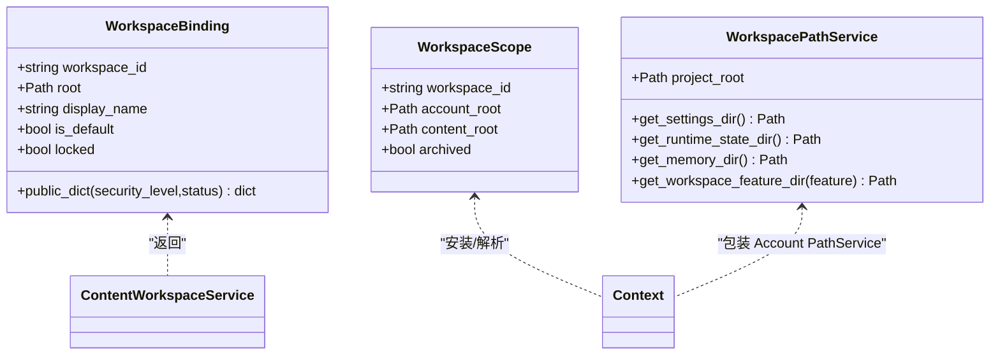
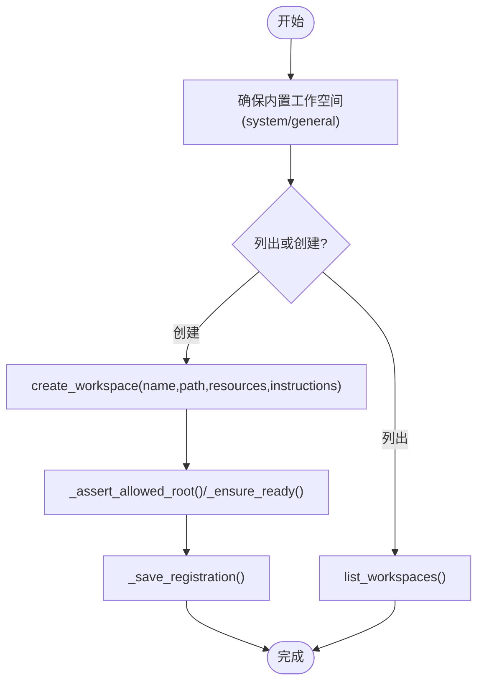
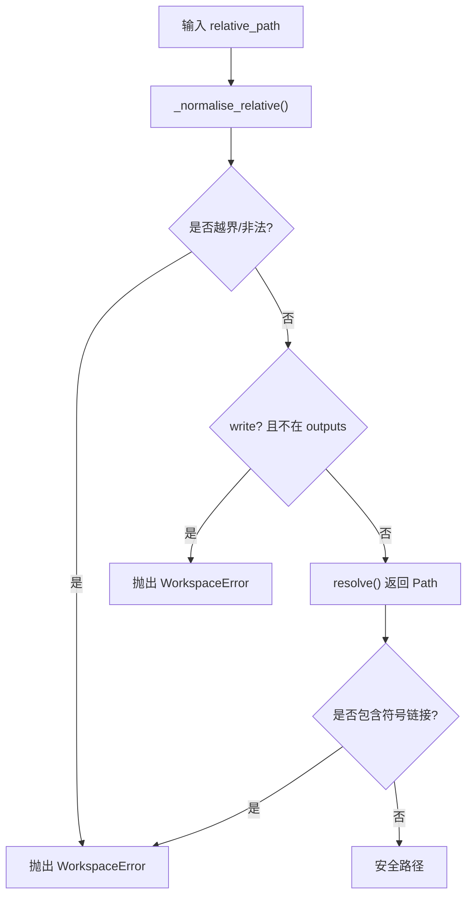
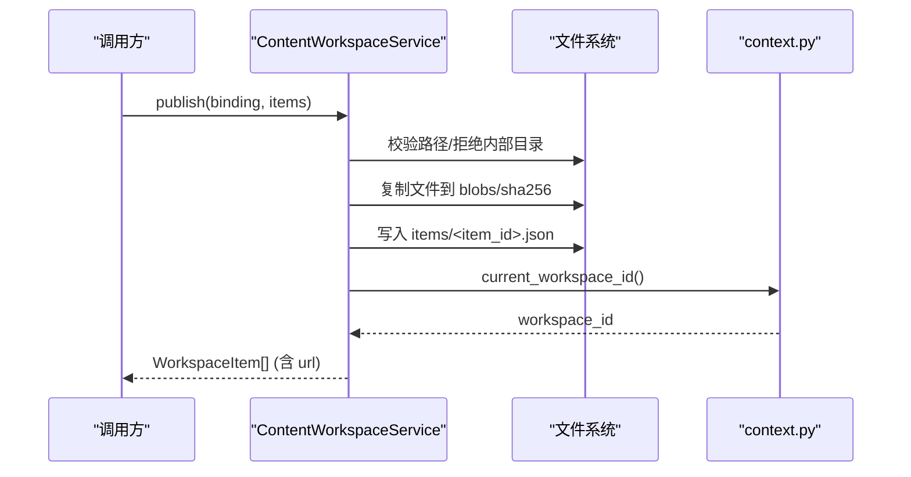
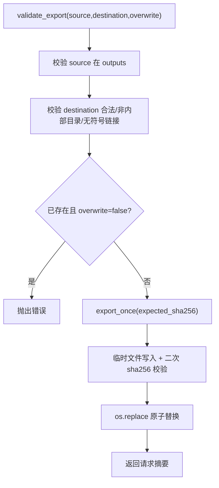
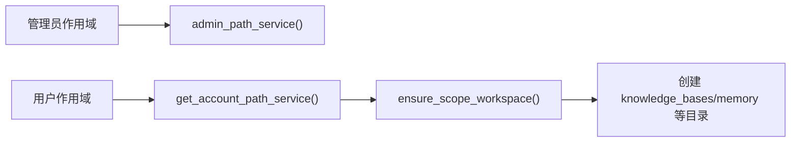
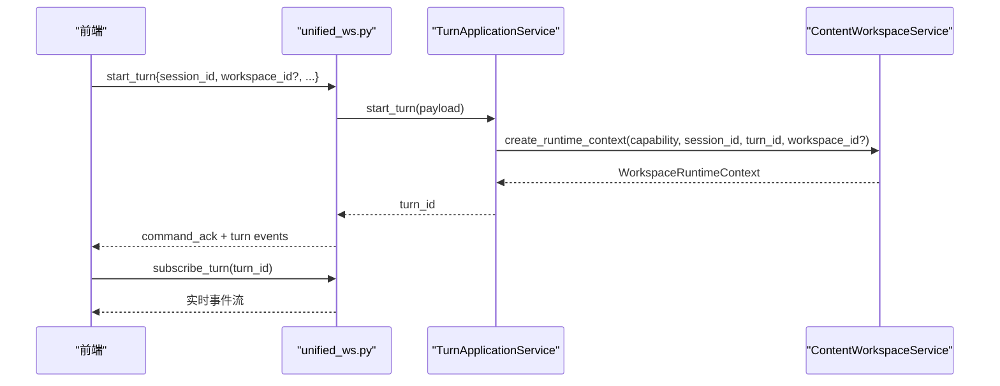
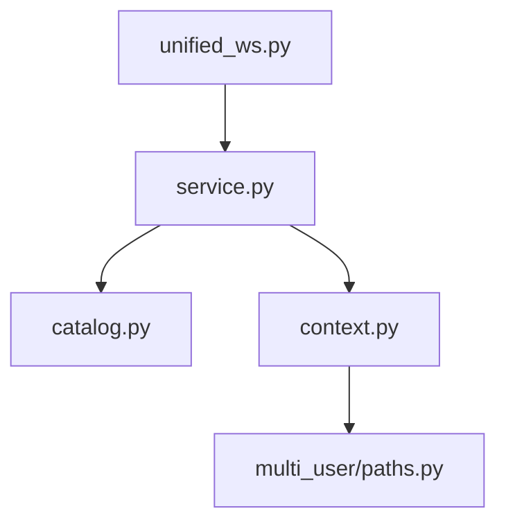

# 工作空间 API

<cite>
**本文引用的文件**   
- [deeptutor/services/workspace/service.py](file://deeptutor/services/workspace/service.py)
- [deeptutor/services/workspace/catalog.py](file://deeptutor/services/workspace/catalog.py)
- [deeptutor/services/workspace/models.py](file://deeptutor/services/workspace/models.py)
- [deeptutor/services/workspace/context.py](file://deeptutor/services/workspace/context.py)
- [deeptutor/multi_user/paths.py](file://deeptutor/multi_user/paths.py)
- [deeptutor/api/routers/unified_ws.py](file://deeptutor/api/routers/unified_ws.py)
- [deeptutor/api/main.py](file://deeptutor/api/main.py)
</cite>

## 目录
1. [简介](#简介)
2. [项目结构](#项目结构)
3. [核心组件](#核心组件)
4. [架构总览](#架构总览)
5. [详细组件分析](#详细组件分析)
6. [依赖关系分析](#依赖关系分析)
7. [性能与可扩展性](#性能与可扩展性)
8. [故障排查指南](#故障排查指南)
9. [结论](#结论)
10. [附录：API 参考](#附录api-参考)

## 简介
本文件为 DeepTutor 工作空间管理的完整 API 文档，聚焦以下目标：
- 工作空间的创建、配置、切换与归档
- 成员管理与权限控制（多租户隔离、管理员与用户边界）
- 工作空间与知识库、会话、文件的关联关系
- 团队协作能力（共享访问、角色权限与工作流）
- 工作空间迁移、备份与恢复机制
- 多租户环境下的数据隔离与安全性保障

DeepTutor 的工作空间并非单一“文件夹”，而是由“身份绑定 + 目录约束 + 运行时上下文”共同构成的安全执行域。内容写入被严格限制在 outputs 子树，公开资源通过不可变快照发布；会话默认使用通用工作空间，但输出按会话与轮次隔离。

## 项目结构
围绕工作空间的核心代码分布在服务层与多用户路径层：
- 服务层
  - service.py：工作空间绑定、路径解析、读写与发布、导出校验与执行
  - catalog.py：工作空间注册表、内置系统/通用工作空间、迁移与维护
  - models.py：WorkspaceBinding、WorkspaceItem、WorkspaceError
  - context.py：工作空间作用域、URL 绑定、Scoped PathService
- 多用户路径层
  - paths.py：账户根目录、系统目录、管理员与用户作用域、PathService 缓存
- API 层
  - unified_ws.py：统一 WebSocket 适配器，承载会话/轮次命令与事件
  - main.py：全局中间件、访问日志与安全守卫集成

**图表来源**
- [deeptutor/api/routers/unified_ws.py:43-389](file://deeptutor/api/routers/unified_ws.py#L43-L389)
- [deeptutor/services/workspace/service.py:81-800](file://deeptutor/services/workspace/service.py#L81-L800)
- [deeptutor/services/workspace/catalog.py:47-546](file://deeptutor/services/workspace/catalog.py#L47-L546)
- [deeptutor/services/workspace/models.py:12-53](file://deeptutor/services/workspace/models.py#L12-L53)
- [deeptutor/services/workspace/context.py:21-160](file://deeptutor/services/workspace/context.py#L21-L160)
- [deeptutor/multi_user/paths.py:89-165](file://deeptutor/multi_user/paths.py#L89-L165)
- [deeptutor/api/main.py:403-472](file://deeptutor/api/main.py#L403-L472)

**章节来源**
- [deeptutor/services/workspace/service.py:81-800](file://deeptutor/services/workspace/service.py#L81-L800)
- [deeptutor/services/workspace/catalog.py:47-546](file://deeptutor/services/workspace/catalog.py#L47-L546)
- [deeptutor/services/workspace/context.py:21-160](file://deeptutor/services/workspace/context.py#L21-L160)
- [deeptutor/multi_user/paths.py:89-165](file://deeptutor/multi_user/paths.py#L89-L165)
- [deeptutor/api/routers/unified_ws.py:43-389](file://deeptutor/api/routers/unified_ws.py#L43-L389)
- [deeptutor/api/main.py:403-472](file://deeptutor/api/main.py#L403-L472)

## 核心组件
- ContentWorkspaceService：负责工作空间绑定解析、路径规范化、只写 outputs、扫描/搜索、发布工件、导出校验与执行、运行时上下文构造。
- WorkspaceCatalogMixin：维护 SQLite 注册表，管理内置系统/通用工作空间、列表/创建/更新/归档、迁移与维护锁。
- WorkspaceScope/WorkspacePathService：将数据路径限定在工作空间私有目录，同时保持全局设置/内存等跨工作空间可见。
- multi_user/paths：提供账户级 root、系统目录、管理员作用域、PathService 实例缓存。
- unified_ws：统一 WebSocket 协议，承载 start_turn、subscribe_turn/session、cancel_turn、regenerate、user_input 等命令。

关键职责边界：
- 目录隔离：所有写入必须位于 outputs 下；外部写入需显式授权。
- 身份隔离：workspace_id 由 owner_id + root 派生，避免同名路径跨用户复用。
- 会话隔离：未绑定会话使用通用工作空间，但输出按 capability/session/turn 细分。
- 发布隔离：发布产物进入 workspace_presentations/<workspace_id>/blobs 与 items，带 sha256 与 URL 签名。

**章节来源**
- [deeptutor/services/workspace/service.py:81-800](file://deeptutor/services/workspace/service.py#L81-L800)
- [deeptutor/services/workspace/catalog.py:47-546](file://deeptutor/services/workspace/catalog.py#L47-L546)
- [deeptutor/services/workspace/context.py:21-160](file://deeptutor/services/workspace/context.py#L21-L160)
- [deeptutor/multi_user/paths.py:89-165](file://deeptutor/multi_user/paths.py#L89-L165)
- [deeptutor/api/routers/unified_ws.py:43-389](file://deeptutor/api/routers/unified_ws.py#L43-L389)

## 架构总览
工作空间在请求生命周期中的交互如下：

**图表来源**
- [deeptutor/api/routers/unified_ws.py:43-389](file://deeptutor/api/routers/unified_ws.py#L43-L389)
- [deeptutor/services/workspace/service.py:307-348](file://deeptutor/services/workspace/service.py#L307-L348)
- [deeptutor/services/workspace/catalog.py:168-192](file://deeptutor/services/workspace/catalog.py#L168-L192)
- [deeptutor/services/workspace/context.py:65-87](file://deeptutor/services/workspace/context.py#L65-L87)
- [deeptutor/multi_user/paths.py:153-161](file://deeptutor/multi_user/paths.py#L153-L161)

## 详细组件分析

### 工作空间绑定与作用域
- WorkspaceBinding：包含 workspace_id、root、display_name、is_default、locked，并提供 public_dict 暴露给前端。
- WorkspaceScope：封装 workspace_id、account_root、content_root，并支持 archived 标记。
- WorkspacePathService：将 feature 数据路径重定向到 content_root/.deeptutor/data，同时保留 account 的全局设置/内存目录。

**图表来源**
- [deeptutor/services/workspace/models.py:16-33](file://deeptutor/services/workspace/models.py#L16-L33)
- [deeptutor/services/workspace/context.py:21-27](file://deeptutor/services/workspace/context.py#L21-L27)
- [deeptutor/services/workspace/context.py:104-159](file://deeptutor/services/workspace/context.py#L104-L159)

**章节来源**
- [deeptutor/services/workspace/models.py:16-33](file://deeptutor/services/workspace/models.py#L16-L33)
- [deeptutor/services/workspace/context.py:21-159](file://deeptutor/services/workspace/context.py#L21-L159)

### 工作空间注册与生命周期
- 内置工作空间：system、general，自动初始化并在首次使用时写入快照。
- 用户工作空间：create_workspace/update_workspace/list_workspaces/describe_catalog。
- 归档与锁定：archived 标记禁止用于聊天；locked 表示部署锁定。
- 迁移与维护：migrate_workspace/migrate_root/maintenance/assert_available。

**图表来源**
- [deeptutor/services/workspace/catalog.py:177-240](file://deeptutor/services/workspace/catalog.py#L177-L240)
- [deeptutor/services/workspace/catalog.py:304-360](file://deeptutor/services/workspace/catalog.py#L304-L360)
- [deeptutor/services/workspace/catalog.py:362-409](file://deeptutor/services/workspace/catalog.py#L362-L409)
- [deeptutor/services/workspace/catalog.py:520-545](file://deeptutor/services/workspace/catalog.py#L520-L545)

**章节来源**
- [deeptutor/services/workspace/catalog.py:177-545](file://deeptutor/services/workspace/catalog.py#L177-L545)

### 路径解析与写入安全
- 相对路径规范化：拒绝绝对路径、空路径、越界路径与内部目录。
- 写入限制：仅允许 outputs 下写入；其他位置需要显式授权。
- 符号链接防护：遍历链路与发布目录均拒绝符号链接。
- 扫描与搜索：限制深度与条目数，避免大目录导致性能问题。

**图表来源**
- [deeptutor/services/workspace/service.py:70-79](file://deeptutor/services/workspace/service.py#L70-L79)
- [deeptutor/services/workspace/service.py:350-361](file://deeptutor/services/workspace/service.py#L350-L361)
- [deeptutor/services/workspace/service.py:371-380](file://deeptutor/services/workspace/service.py#L371-L380)
- [deeptutor/services/workspace/service.py:450-496](file://deeptutor/services/workspace/service.py#L450-L496)

**章节来源**
- [deeptutor/services/workspace/service.py:70-79](file://deeptutor/services/workspace/service.py#L70-L79)
- [deeptutor/services/workspace/service.py:350-380](file://deeptutor/services/workspace/service.py#L350-L380)
- [deeptutor/services/workspace/service.py:450-496](file://deeptutor/services/workspace/service.py#L450-L496)

### 工件发布与读取
- publish：将源文件复制到 blobs（按 sha256），生成 items 清单，返回 WorkspaceItem 列表。
- resolve_published_item：根据 workspace_id 与 workspace_item_id 定位清单与 blob，校验一致性。
- URL 绑定：workspace_url 注入 dt_workspace，保证本地资源始终指向正确数据作用域。

**图表来源**
- [deeptutor/services/workspace/service.py:625-698](file://deeptutor/services/workspace/service.py#L625-L698)
- [deeptutor/services/workspace/service.py:782-800](file://deeptutor/services/workspace/service.py#L782-L800)
- [deeptutor/services/workspace/context.py:53-62](file://deeptutor/services/workspace/context.py#L53-L62)

**章节来源**
- [deeptutor/services/workspace/service.py:625-698](file://deeptutor/services/workspace/service.py#L625-L698)
- [deeptutor/services/workspace/service.py:782-800](file://deeptutor/services/workspace/service.py#L782-L800)
- [deeptutor/services/workspace/context.py:53-62](file://deeptutor/services/workspace/context.py#L53-L62)

### 导出与迁移
- validate_export/export_once：对 outputs → workspace 的拷贝进行强校验（sha256、覆盖策略、符号链接检查）。
- migrate_workspace/migrate_root：原子化迁移单个工作空间或整个根目录，更新 follow_root 标志。
- maintenance/assert_available：防止并发迁移，支持异常进程解锁。

**图表来源**
- [deeptutor/services/workspace/service.py:700-780](file://deeptutor/services/workspace/service.py#L700-L780)
- [deeptutor/services/workspace/catalog.py:520-545](file://deeptutor/services/workspace/catalog.py#L520-L545)
- [deeptutor/services/workspace/catalog.py:466-518](file://deeptutor/services/workspace/catalog.py#L466-L518)

**章节来源**
- [deeptutor/services/workspace/service.py:700-780](file://deeptutor/services/workspace/service.py#L700-L780)
- [deeptutor/services/workspace/catalog.py:466-545](file://deeptutor/services/workspace/catalog.py#L466-L545)

### 多租户隔离与权限
- 管理员作用域：admin_scope/local_admin_user/admin_path_service。
- 用户作用域：scope_for_user/ensure_user_workspace/ensure_scope_workspace。
- 账户路径服务：get_account_path_service 根据当前用户返回对应 PathService，必要时创建用户工作空间树。
- 安全级别：sandbox 后端决定 security_level（off/best_effort/hard），影响公开信息展示。

**图表来源**
- [deeptutor/multi_user/paths.py:89-125](file://deeptutor/multi_user/paths.py#L89-L125)
- [deeptutor/multi_user/paths.py:128-165](file://deeptutor/multi_user/paths.py#L128-L165)
- [deeptutor/services/workspace/service.py:114-123](file://deeptutor/services/workspace/service.py#L114-L123)

**章节来源**
- [deeptutor/multi_user/paths.py:89-165](file://deeptutor/multi_user/paths.py#L89-L165)
- [deeptutor/services/workspace/service.py:114-123](file://deeptutor/services/workspace/service.py#L114-L123)

### 会话与工作流的协作
- unified_ws：统一 WebSocket 协议，处理消息类型 message/start_turn/ping/subscribe_turn/resume_from/subscribe_session/check_active_turn/unsubscribe/cancel_turn/submit_user_reply/regenerate/user_input。
- 工作空间传播：start_turn 时若未显式传入 workspace_id，则继承当前绑定；否则按 workspace_id 解析绑定。
- 活跃轮次：check_active_turn 返回 turn_id/status/owner_id，供前端协调协作编辑。

**图表来源**
- [deeptutor/api/routers/unified_ws.py:209-238](file://deeptutor/api/routers/unified_ws.py#L209-L238)
- [deeptutor/api/routers/unified_ws.py:244-277](file://deeptutor/api/routers/unified_ws.py#L244-L277)
- [deeptutor/services/workspace/service.py:307-348](file://deeptutor/services/workspace/service.py#L307-L348)

**章节来源**
- [deeptutor/api/routers/unified_ws.py:43-389](file://deeptutor/api/routers/unified_ws.py#L43-L389)
- [deeptutor/services/workspace/service.py:307-348](file://deeptutor/services/workspace/service.py#L307-L348)

## 依赖关系分析
- API 层依赖服务层：unified_ws 通过容器获取 turns 服务，间接依赖 ContentWorkspaceService。
- 服务层依赖多用户路径：ContentWorkspaceService 通过 get_account_path_service 获取账户级 PathService。
- 上下文解耦：WorkspaceScope 独立于认证状态，确保异步任务内仍保持正确的数据作用域。

**图表来源**
- [deeptutor/api/routers/unified_ws.py:43-389](file://deeptutor/api/routers/unified_ws.py#L43-L389)
- [deeptutor/services/workspace/service.py:81-800](file://deeptutor/services/workspace/service.py#L81-L800)
- [deeptutor/services/workspace/catalog.py:47-546](file://deeptutor/services/workspace/catalog.py#L47-L546)
- [deeptutor/services/workspace/context.py:21-160](file://deeptutor/services/workspace/context.py#L21-L160)
- [deeptutor/multi_user/paths.py:89-165](file://deeptutor/multi_user/paths.py#L89-L165)

**章节来源**
- [deeptutor/api/routers/unified_ws.py:43-389](file://deeptutor/api/routers/unified_ws.py#L43-L389)
- [deeptutor/services/workspace/service.py:81-800](file://deeptutor/services/workspace/service.py#L81-L800)
- [deeptutor/services/workspace/catalog.py:47-546](file://deeptutor/services/workspace/catalog.py#L47-L546)
- [deeptutor/services/workspace/context.py:21-160](file://deeptutor/services/workspace/context.py#L21-L160)
- [deeptutor/multi_user/paths.py:89-165](file://deeptutor/multi_user/paths.py#L89-L165)

## 性能与可扩展性
- 扫描预算：list_entries_page/search_page 限制最大深度与条目数，避免大目录拖慢响应。
- 发布去重：blobs 以 sha256 命名，重复内容不重复存储。
- 会话输出隔离：按 capability/session/turn 划分逻辑输出目录，减少冲突与竞争。
- 安全级别：security_level 由沙箱后端决定，可在公开信息中提示风险等级。

[本节为通用指导，不涉及具体文件]

## 故障排查指南
- 工作空间不可用：检查 catalog 是否存在迁移锁（migration），确认进程存活状态后重试。
- 路径越界/符号链接：确认 relative_path 未越界且不包含符号链接；outputs 外写入需显式授权。
- 导出失败：核对 expected_sha256 与实际一致；确认 destination 未被并发修改。
- 访问日志：非 200 响应会记录到专用 access logger，便于快速定位问题。

**章节来源**
- [deeptutor/services/workspace/catalog.py:466-518](file://deeptutor/services/workspace/catalog.py#L466-L518)
- [deeptutor/services/workspace/service.py:350-380](file://deeptutor/services/workspace/service.py#L350-L380)
- [deeptutor/services/workspace/service.py:700-780](file://deeptutor/services/workspace/service.py#L700-L780)
- [deeptutor/api/main.py:423-472](file://deeptutor/api/main.py#L423-L472)

## 结论
DeepTutor 的工作空间体系以“绑定 + 作用域 + 安全约束”为核心，既满足单用户的知识组织与学习产出，又为多租户、团队协作与自动化工作流提供了稳定基础。通过严格的目录隔离、不可变发布、会话输出细分以及迁移维护机制，系统在易用性与安全性之间取得平衡。

[本节为总结，不涉及具体文件]

## 附录：API 参考

### 工作空间管理（服务层方法）
- 描述与验证
  - describe_current：返回当前工作空间绑定与状态
  - validate(path)：校验路径合法性与可写性
- 绑定与选择
  - default_binding/current_binding/binding_by_id(workspace_id)
  - set_workspace(path)：切换当前工作空间（受部署锁定保护）
- 注册表操作
  - list_workspaces/create_workspace/update_workspace
  - system_binding/general_binding/workspace_instructions
  - migrate_workspace/migrate_root/maintenance/assert_available
- 文件与内容
  - list_entries/list_entries_page/read_text/search/search_page
  - publish(items)/resolve_published_item
  - validate_export/export_once

注意：上述为服务层接口说明，实际对外暴露通常由上层路由封装。

**章节来源**
- [deeptutor/services/workspace/service.py:144-305](file://deeptutor/services/workspace/service.py#L144-L305)
- [deeptutor/services/workspace/catalog.py:246-409](file://deeptutor/services/workspace/catalog.py#L246-L409)
- [deeptutor/services/workspace/catalog.py:520-545](file://deeptutor/services/workspace/catalog.py#L520-L545)
- [deeptutor/services/workspace/service.py:450-698](file://deeptutor/services/workspace/service.py#L450-L698)
- [deeptutor/services/workspace/service.py:700-800](file://deeptutor/services/workspace/service.py#L700-L800)

### WebSocket 命令（统一协议）
- 连接与鉴权
  - /ws：建立连接，ws_require_auth 校验令牌
- 命令类型
  - message/start_turn：启动一轮对话，可携带 workspace_id
  - subscribe_turn/resume_from：订阅轮次事件，支持 after_seq
  - subscribe_session：订阅会话事件
  - check_active_turn：查询活跃轮次
  - unsubscribe：取消订阅
  - cancel_turn：取消活跃轮次
  - submit_user_reply/submit_user_input：提交回复或输入
  - regenerate：重新生成上一轮
  - ping/pong：心跳
- 错误码
  - invalid_json/invalid_command/unsupported_protocol_version
  - missing_turn_id/missing_session_id
  - start_turn_rejected/regenerate_rejected
  - turn_not_active/turn_not_waiting_input
  - subscription_failed/internal_error

**章节来源**
- [deeptutor/api/routers/unified_ws.py:43-389](file://deeptutor/api/routers/unified_ws.py#L43-L389)