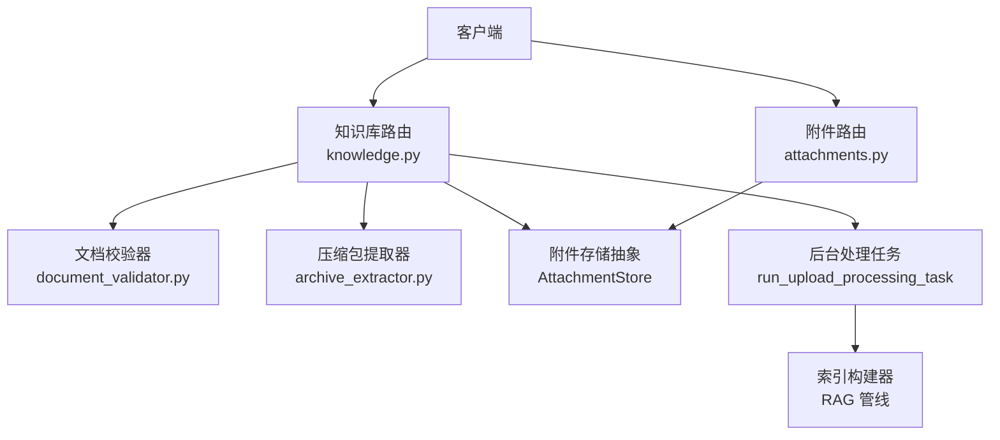
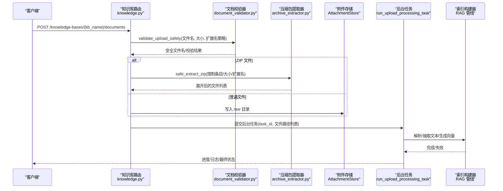
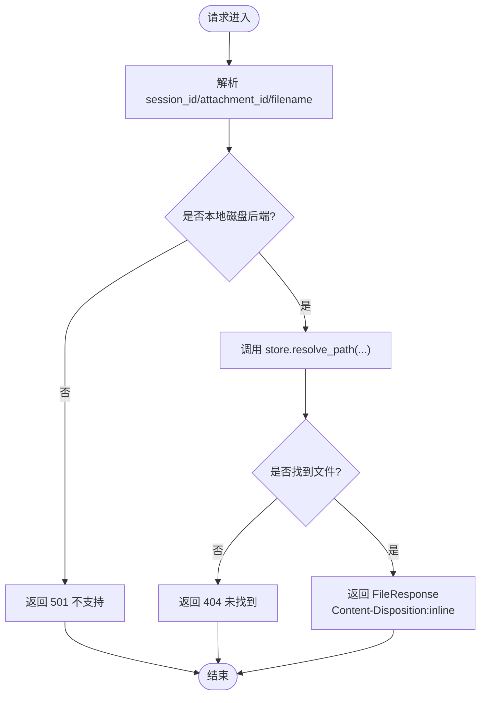
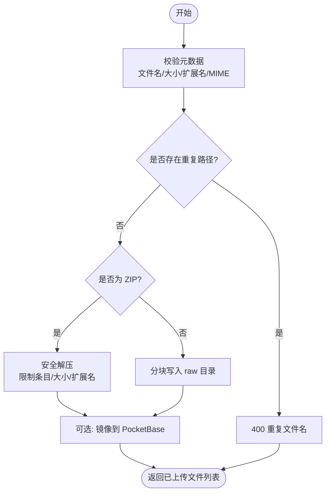
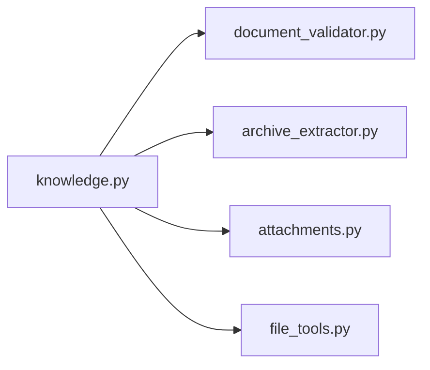

# 文件管理 API

<cite>
**本文引用的文件**   
- [attachments.py](file://deeptutor/api/routers/attachments.py)
- [knowledge.py](file://deeptutor/api/routers/knowledge.py)
- [document_validator.py](file://deeptutor/utils/document_validator.py)
- [archive_extractor.py](file://deeptutor/utils/archive_extractor.py)
- [file_tools.py](file://deeptutor/tools/file_tools.py)
- [test_knowledge_zip_upload.py](file://tests/api/test_knowledge_zip_upload.py)
</cite>

## 目录
1. [简介](#简介)
2. [项目结构](#项目结构)
3. [核心组件](#核心组件)
4. [架构总览](#架构总览)
5. [详细组件分析](#详细组件分析)
6. [依赖关系分析](#依赖关系分析)
7. [性能与扩展性](#性能与扩展性)
8. [故障排查指南](#故障排查指南)
9. [结论](#结论)
10. [附录：API 参考](#附录api-参考)

## 简介
本文件为 DeepTutor 文件管理系统的完整 API 文档，聚焦于知识库场景下的文件上传、下载、预览、删除等能力，并覆盖文件格式支持、大小限制、存储策略、元数据管理、分类标签、搜索、批量操作、进度跟踪、断点续传、安全扫描与访问控制等主题。系统后端基于 FastAPI，前端通过 REST 接口与附件服务进行交互；知识库文件以本地磁盘为主，同时提供 PocketBase 镜像同步（可选）。

## 项目结构
与文件管理相关的代码主要分布在以下模块：
- API 路由层：负责 HTTP 端点定义、参数校验、权限检查、任务编排与响应封装
- 工具与验证层：负责文件名清洗、扩展名/MIME 校验、压缩包解压与安全约束
- 存储服务层：负责附件的持久化与路径解析
- 工具集：面向工作区的文件读写工具（非 HTTP 端点）

图示来源
- [knowledge.py:1-120](file://deeptutor/api/routers/knowledge.py#L1-L120)
- [attachments.py:1-80](file://deeptutor/api/routers/attachments.py#L1-L80)
- [document_validator.py:1-207](file://deeptutor/utils/document_validator.py#L1-L207)
- [archive_extractor.py:121-147](file://deeptutor/utils/archive_extractor.py#L121-L147)

章节来源
- [knowledge.py:1-120](file://deeptutor/api/routers/knowledge.py#L1-L120)
- [attachments.py:1-80](file://deeptutor/api/routers/attachments.py#L1-L80)

## 核心组件
- 附件预览/下载路由：提供会话级附件读取，返回内联预览或下载
- 知识库上传路由：支持单文件、多文件、文件夹、ZIP 批量上传，包含严格的安全校验与体积限制
- 文档校验器：统一处理文件名清洗、扩展名白名单、MIME 类型校验与最大文件大小
- 压缩包提取器：防御 Zip Slip、zip-bomb、嵌套压缩包，限制条目数与总字节数
- 工作区文件工具：面向 Agent/脚本的文件读取、写入、编辑与目录列举（非 HTTP）

章节来源
- [attachments.py:1-80](file://deeptutor/api/routers/attachments.py#L1-L80)
- [knowledge.py:304-750](file://deeptutor/api/routers/knowledge.py#L304-L750)
- [document_validator.py:1-207](file://deeptutor/utils/document_validator.py#L1-L207)
- [archive_extractor.py:121-147](file://deeptutor/utils/archive_extractor.py#L121-L147)
- [file_tools.py:1-292](file://deeptutor/tools/file_tools.py#L1-L292)

## 架构总览
下图展示一次典型的知识库文件上传流程，包括前置校验、落盘、ZIP 解压、索引构建与状态更新。

图示来源
- [knowledge.py:304-750](file://deeptutor/api/routers/knowledge.py#L304-L750)
- [document_validator.py:71-151](file://deeptutor/utils/document_validator.py#L71-L151)
- [archive_extractor.py:121-147](file://deeptutor/utils/archive_extractor.py#L121-L147)

## 详细组件分析

### 附件预览与下载
- 端点：GET /files/attachments/{session_id}/{attachment_id}/{filename}
- 行为：
  - 根据 session_id + attachment_id + filename 解析目标路径
  - 仅支持本地磁盘后端；其他后端应返回重定向到签名 URL
  - 设置 Content-Disposition: inline，浏览器可内联预览 PDF/图片
  - 禁止中间缓存（Cache-Control: private, max-age=0, must-revalidate）
- 错误码：
  - 404：附件不存在
  - 501：附件后端不可服务（非本地磁盘）

图示来源
- [attachments.py:40-79](file://deeptutor/api/routers/attachments.py#L40-L79)

章节来源
- [attachments.py:1-80](file://deeptutor/api/routers/attachments.py#L1-L80)

### 知识库文件上传（单文件/多文件/文件夹/ZIP）
- 端点：POST /knowledge-bases/{kb_name}/documents
- 功能要点：
  - 支持单文件、多文件、文件夹（保留相对路径）、ZIP 包
  - 对每个文件执行：
    - 文件名清洗与扩展名白名单校验
    - MIME 类型校验（默认策略下）
    - 文件大小限制（全局上限）
  - ZIP 包：
    - 不持久化 zip 本身，仅保存展开成员
    - 防御 Zip Slip、zip-bomb、嵌套 zip、隐藏文件
    - 限制条目数量与总字节数
  - 可选：将文件镜像至 PocketBase（best-effort，不影响主流程）
  - 异步：大文件写入在独立线程执行，避免阻塞事件循环
- 错误码：
  - 400：文件过大、扩展名不支持、ZIP 无效、无受支持成员、重复文件名
  - 404：知识库不存在或未配置默认知识库
  - 409：知识库只读/需要重建索引/外部连接知识库不可写
  - 500：服务器内部错误

图示来源
- [knowledge.py:304-750](file://deeptutor/api/routers/knowledge.py#L304-L750)
- [document_validator.py:71-151](file://deeptutor/utils/document_validator.py#L71-L151)
- [archive_extractor.py:121-147](file://deeptutor/utils/archive_extractor.py#L121-L147)

章节来源
- [knowledge.py:304-750](file://deeptutor/api/routers/knowledge.py#L304-L750)
- [test_knowledge_zip_upload.py:52-95](file://tests/api/test_knowledge_zip_upload.py#L52-L95)

### 文件安全与格式限制
- 最大文件大小：200MB（全局常量）
- 允许扩展名（默认）：pdf、txt、md、doc、docx、rtf、html、htm、xml、json、csv、xlsx、xls、pptx、ppt、epub
- MIME 类型校验：仅在默认扩展名策略下启用
- ZIP 安全：
  - 跳过隐藏文件与系统文件
  - 拒绝嵌套 zip
  - 限制条目数量与总字节数
  - 防御 Zip Slip（路径穿越）

章节来源
- [document_validator.py:13-58](file://deeptutor/utils/document_validator.py#L13-L58)
- [document_validator.py:71-151](file://deeptutor/utils/document_validator.py#L71-L151)
- [archive_extractor.py:121-147](file://deeptutor/utils/archive_extractor.py#L121-L147)

### 批量文件操作与进度跟踪
- 批量上传：
  - 支持一次性上传多个文件与文件夹
  - 自动去重（按子目录+安全文件名）
  - 所有文件写入完成后提交后台任务
- 进度与日志：
  - 使用 TaskIDManager 与 TaskLogStream 管理任务生命周期
  - ProgressTracker 记录阶段、消息、百分比、task_id、时间戳
  - 初始化与上传处理均会更新知识库状态（ready/error/needs_reindex）

章节来源
- [knowledge.py:680-711](file://deeptutor/api/routers/knowledge.py#L680-L711)
- [knowledge.py:987-1131](file://deeptutor/api/routers/knowledge.py#L987-L1131)
- [knowledge.py:1133-1200](file://deeptutor/api/routers/knowledge.py#L1133-L1200)

### 断点续传机制
- 当前实现未提供断点续传语义。上传为端到端流式写入，失败时清理已写入文件。
- 如需断点续传，可在客户端侧实现分片上传与合并，并在服务端新增“分片暂存 + 合并”接口。

[本节为通用建议，不涉及具体源码]

### 文件元数据管理、分类标签与搜索
- 元数据：
  - 知识库配置中包含描述、提供者、嵌入模型选择等字段
  - 可通过集中配置服务获取/同步知识库配置
- 分类标签：
  - 代码中未发现统一的“标签”字段；可按需扩展 metadata 或 manifest
- 搜索：
  - 知识库内容通过 RAG 管线（LightRAG/PageIndex/GraphRAG 等）构建索引后参与检索
  - 搜索入口不在本文件范围内，通常由检索服务暴露

章节来源
- [knowledge.py:2129-2185](file://deeptutor/api/routers/knowledge.py#L2129-L2185)
- [knowledge.py:2061-2075](file://deeptutor/api/routers/knowledge.py#L2061-L2075)

### 文件安全扫描与病毒检测
- 内置安全：
  - 文件名清洗、扩展名白名单、MIME 校验
  - ZIP 安全（条目数、大小、嵌套、穿越）
- 病毒扫描：
  - 代码中未见集成第三方杀毒引擎
  - 建议在上传后、索引前增加异步扫描步骤，失败则隔离或删除文件

[本节为通用建议，不涉及具体源码]

### 访问控制
- 会话级附件访问：
  - 以 session_id 作为 ACL 边界，仅允许访问该会话内的附件
- 知识库写权限：
  - 通过 multi_user 层的 assert_writable/resolve_kb 控制
  - 连接型知识库（Obsidian vaults、linked indexes）只读，禁止本地写入与重建索引

章节来源
- [attachments.py:1-16](file://deeptutor/api/routers/attachments.py#L1-L16)
- [knowledge.py:930-955](file://deeptutor/api/routers/knowledge.py#L930-L955)

### 工作区文件工具（Agent/脚本）
- 提供 read_file、write_file、edit_file、list_dir 四个工具
- 路径必须在允许的 workspace 目录下，防止越权访问
- 适合在聊天技能/脚本工作流中读取/编辑文本文件

章节来源
- [file_tools.py:1-292](file://deeptutor/tools/file_tools.py#L1-L292)

## 依赖关系分析

图示来源
- [knowledge.py:1-120](file://deeptutor/api/routers/knowledge.py#L1-L120)
- [document_validator.py:1-207](file://deeptutor/utils/document_validator.py#L1-L207)
- [archive_extractor.py:121-147](file://deeptutor/utils/archive_extractor.py#L121-L147)
- [attachments.py:1-80](file://deeptutor/api/routers/attachments.py#L1-L80)
- [file_tools.py:1-292](file://deeptutor/tools/file_tools.py#L1-L292)

章节来源
- [knowledge.py:1-120](file://deeptutor/api/routers/knowledge.py#L1-L120)

## 性能与扩展性
- 上传写入：
  - 大文件写入在独立线程执行，避免阻塞事件循环
  - 分块写入（8KB），实时统计大小并拦截超限
- ZIP 解压：
  - 限制条目数量与总字节数，避免资源耗尽
- 可扩展点：
  - 断点续传：引入分片暂存与合并接口
  - 病毒扫描：接入异步扫描队列，失败隔离
  - 远端存储：附件后端改为对象存储，返回签名 URL

[本节为通用建议，不涉及具体源码]

## 故障排查指南
- 400 重复文件名：
  - 原因：同一子目录+安全文件名重复
  - 解决：重命名文件或调整相对路径
- 400 文件过大：
  - 原因：超过 200MB 限制
  - 解决：拆分文件或压缩后再上传（注意 ZIP 限制）
- 400 ZIP 无效/无受支持成员：
  - 原因：损坏的 ZIP 或仅包含不受支持的扩展名
  - 解决：修复 ZIP 或替换为受支持文件
- 404 附件不存在：
  - 原因：路径解析失败或文件被删除
  - 解决：确认 session_id/attachment_id/filename 是否正确
- 409 知识库只读/需要重建：
  - 原因：连接型知识库或旧索引格式
  - 解决：先重建索引或改用可写知识库

章节来源
- [knowledge.py:603-654](file://deeptutor/api/routers/knowledge.py#L603-L654)
- [knowledge.py:930-955](file://deeptutor/api/routers/knowledge.py#L930-L955)
- [attachments.py:60-79](file://deeptutor/api/routers/attachments.py#L60-L79)

## 结论
DeepTutor 的文件管理 API 围绕知识库场景提供了稳健的上传、预览与基础管理能力。系统在安全性方面实现了严格的文件名/扩展名/MIME 校验与 ZIP 防护；在可用性方面通过后台任务与进度跟踪提升用户体验。未来可考虑补充断点续传、病毒扫描与更丰富的元数据/标签体系，以满足更大规模与更强安全性的需求。

## 附录：API 参考

### 附件预览与下载
- GET /files/attachments/{session_id}/{attachment_id}/{filename}
- 成功：返回文件内容（内联预览）
- 错误：
  - 404：附件不存在
  - 501：附件后端不可服务

章节来源
- [attachments.py:40-79](file://deeptutor/api/routers/attachments.py#L40-L79)

### 知识库文件上传
- POST /knowledge-bases/{kb_name}/documents
- 入参：
  - files：单个或多个文件（支持文件夹与 ZIP）
  - rel_paths：文件夹上传时的相对路径数组（可选）
  - dest_subdir：目标子目录（可选）
- 成功：返回已上传文件名称与路径列表
- 错误：
  - 400：校验失败/ZIP 无效/无受支持成员/重复文件名
  - 404：知识库不存在
  - 409：知识库只读/需要重建索引
  - 500：服务器内部错误

章节来源
- [knowledge.py:304-750](file://deeptutor/api/routers/knowledge.py#L304-L750)

### 支持的格式与大小限制
- 最大文件大小：200MB
- 默认允许扩展名：pdf、txt、md、doc、docx、rtf、html、htm、xml、json、csv、xlsx、xls、pptx、ppt、epub
- ZIP 限制：
  - 不持久化 zip 本身
  - 限制条目数量与总字节数
  - 拒绝嵌套 zip、隐藏文件与系统文件

章节来源
- [document_validator.py:13-58](file://deeptutor/utils/document_validator.py#L13-L58)
- [document_validator.py:71-151](file://deeptutor/utils/document_validator.py#L71-L151)
- [archive_extractor.py:121-147](file://deeptutor/utils/archive_extractor.py#L121-L147)