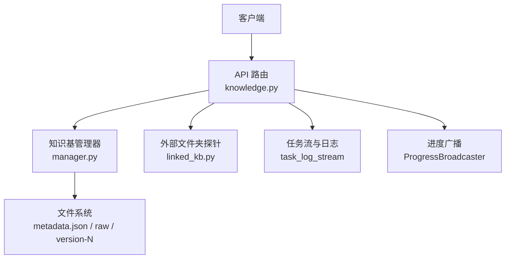
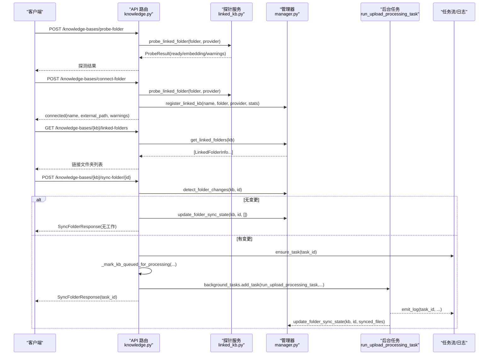
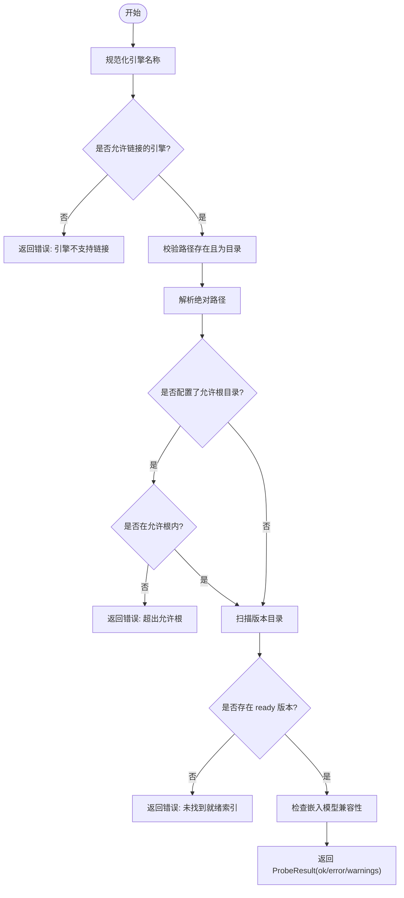
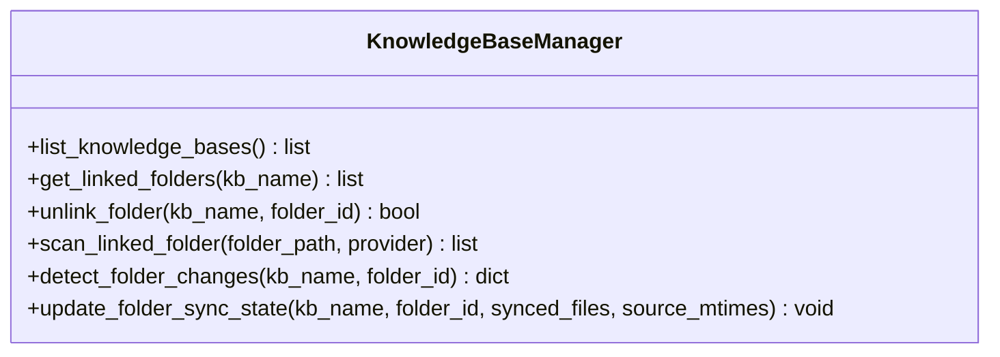
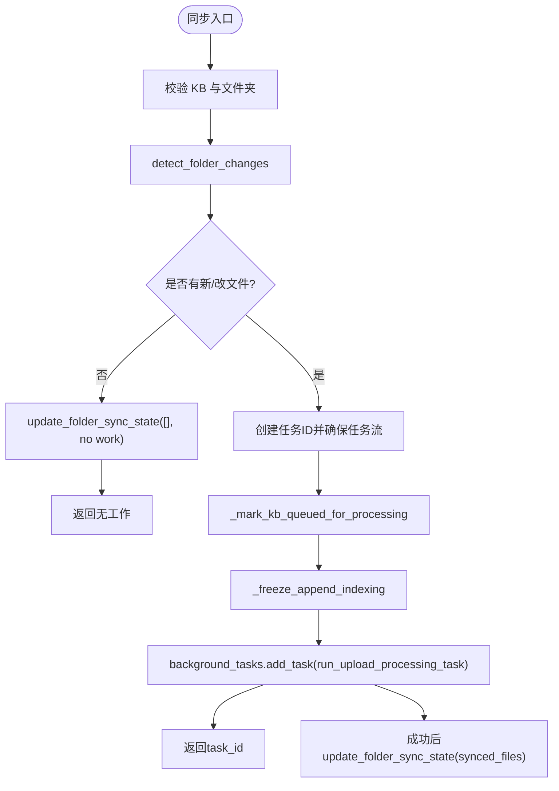
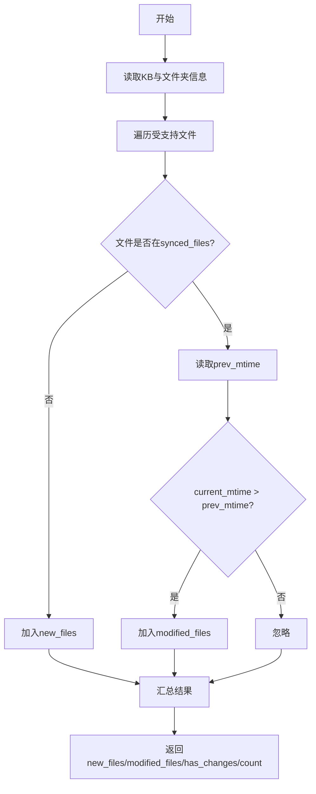
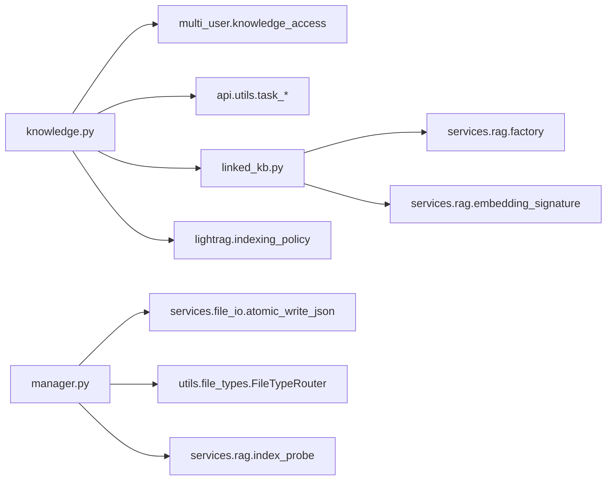

# 文件夹链接与同步

<cite>
**本文引用的文件**   
- [knowledge.py](file://deeptutor/api/routers/knowledge.py)
- [manager.py](file://deeptutor/knowledge/manager.py)
- [linked_kb.py](file://deeptutor/services/rag/linked_kb.py)
- [test_linked_folder_sync.py](file://tests/knowledge/test_linked_folder_sync.py)
</cite>

## 目录
1. [简介](#简介)
2. [项目结构](#项目结构)
3. [核心组件](#核心组件)
4. [架构总览](#架构总览)
5. [详细组件分析](#详细组件分析)
6. [依赖关系分析](#依赖关系分析)
7. [性能与并发](#性能与并发)
8. [权限、访问控制与安全](#权限访问控制与安全)
9. [同步状态监控、日志与审计](#同步状态监控日志与审计)
10. [故障排查指南](#故障排查指南)
11. [结论](#结论)

## 简介
本文件面向“将本地文件夹链接到知识库并实现双向同步”的 API 与实现细节，覆盖以下目标：
- 如何将本地文件夹链接为只读的知识库指针，以及如何在后续操作中增量同步变更。
- 文件变更检测机制（基于修改时间戳）与增量同步策略。
- 冲突处理与断点续传语义（以“已同步文件清单 + mtime 快照”为核心）。
- 同步状态监控、错误重试与任务追踪。
- 文件夹路径白名单、权限校验与访问控制。
- 同步性能优化、带宽控制与并发策略。
- 同步日志、审计追踪与问题诊断工具。

该功能由三层协作完成：
- API 路由层：暴露探测、连接、列出、解链、同步等接口。
- 管理器层：维护 KB 元数据、链接文件夹清单、变更检测与状态持久化。
- 服务层：对外部索引进行兼容性探测、嵌入模型一致性检查与路径安全校验。

## 项目结构
与“文件夹链接与同步”直接相关的代码主要分布在以下模块：
- `deeptutor/api/routers/knowledge.py`：REST API 路由、请求/响应模型、后台任务编排、进度广播与任务日志。
- `deeptutor/knowledge/manager.py`：知识基管理器的核心逻辑，包括链接文件夹注册、变更检测、状态更新与持久化。
- `deeptutor/services/rag/linked_kb.py`：外部文件夹探针、可链接引擎判定、嵌入模型兼容性检查、路径白名单校验。
- `tests/knowledge/test_linked_folder_sync.py`：验证链接文件夹同步状态的持久化、变更检测与异常场景。

**图表来源**
- [knowledge.py:2273-2340](file://deeptutor/api/routers/knowledge.py#L2273-L2340)
- [knowledge.py:4762-4891](file://deeptutor/api/routers/knowledge.py#L4762-L4891)
- [manager.py:2000-2199](file://deeptutor/knowledge/manager.py#L2000-L2199)
- [linked_kb.py:120-227](file://deeptutor/services/rag/linked_kb.py#L120-L227)

**章节来源**
- [knowledge.py:1-120](file://deeptutor/api/routers/knowledge.py#L1-L120)
- [manager.py:1-60](file://deeptutor/knowledge/manager.py#L1-L60)
- [linked_kb.py:1-44](file://deeptutor/services/rag/linked_kb.py#L1-L44)

## 核心组件
- 链接文件夹探测与连接 API
  - `/knowledge-bases/probe-folder`：在不创建 KB 的前提下，探测一个本地文件夹是否包含可链接的索引，并返回引擎类型、版本、文档数量、嵌入模型兼容性与警告。
  - `/knowledge-bases/connect-folder`：在服务器端重新探测后，注册一个只读的“linked”知识库指针，不复制索引、不重建索引。
- 链接文件夹管理 API
  - `/knowledge-bases/{kb_name}/linked-folders`：列出某个 KB 下已链接的文件夹及其状态。
  - `/knowledge-bases/{kb_name}/linked-folders/{folder_id}`：解链指定文件夹。
- 增量同步 API
  - `/knowledge-bases/{kb_name}/sync-folder/{folder_id}`：检测新增或修改的文件，进入后台任务执行上传与索引流程，成功后更新同步状态。

这些接口的关键数据结构：
- `ProbeFolderRequest`：包含 `folder_path` 与 `rag_provider`。
- `ConnectFolderRequest`：包含 `name`、`folder_path` 与 `rag_provider`。
- `LinkedFolderInfo`：包含 `id`、`path`、`added_at`、`file_count`、`last_sync`。
- `SyncFolderResponse`：包含消息、文件夹路径、文件列表、新增/修改计数、当前文件总数与任务 ID。

**章节来源**
- [knowledge.py:198-232](file://deeptutor/api/routers/knowledge.py#L198-L232)
- [knowledge.py:2262-2340](file://deeptutor/api/routers/knowledge.py#L2262-L2340)
- [knowledge.py:4762-4891](file://deeptutor/api/routers/knowledge.py#L4762-L4891)

## 架构总览
下图展示从客户端发起“链接文件夹”和“同步文件夹”的关键调用序列。

**图表来源**
- [knowledge.py:2273-2340](file://deeptutor/api/routers/knowledge.py#L2273-L2340)
- [knowledge.py:4762-4891](file://deeptutor/api/routers/knowledge.py#L4762-L4891)
- [manager.py:2113-2199](file://deeptutor/knowledge/manager.py#L2113-L2199)

## 详细组件分析

### 1. 外部文件夹探针与路径安全
探针负责回答两个关键问题：
- 该文件夹是否包含所选引擎的可就绪索引？
- 该索引使用的嵌入模型是否与当前配置兼容？

探针行为要点：
- 仅允许特定引擎被链接：默认 LlamaIndex、GraphRAG、LightRAG；PageIndex 明确不支持本地链接。
- 通过标准版本发现逻辑判断是否存在 ready 的 `version-N` 索引。
- 比较索引记录的嵌入签名与当前嵌入配置，若不一致则给出警告而非直接拒绝。
- 支持可选的环境变量白名单 `DEEPTUTOR_LINKED_FOLDER_ROOTS`，用于限制可链接的根目录，防止非管理员指向其他用户或系统路径。

**图表来源**
- [linked_kb.py:42-44](file://deeptutor/services/rag/linked_kb.py#L42-L44)
- [linked_kb.py:75-110](file://deeptutor/services/rag/linked_kb.py#L75-L110)
- [linked_kb.py:120-174](file://deeptutor/services/rag/linked_kb.py#L120-L174)
- [linked_kb.py:177-227](file://deeptutor/services/rag/linked_kb.py#L177-L227)

**章节来源**
- [linked_kb.py:1-44](file://deeptutor/services/rag/linked_kb.py#L1-L44)
- [linked_kb.py:75-110](file://deeptutor/services/rag/linked_kb.py#L75-L110)
- [linked_kb.py:120-227](file://deeptutor/services/rag/linked_kb.py#L120-L227)

### 2. 链接文件夹 API 与连接流程
- 探测接口 `/knowledge-bases/probe-folder`：
  - 先做路径白名单校验，再调用探针服务，返回引擎、版本、文档数、嵌入兼容性与警告。
- 连接接口 `/knowledge-bases/connect-folder`：
  - 服务端再次探测，确保客户端不可信。
  - 成功后调用管理器注册“linked”知识库指针，返回连接状态、外部路径、引擎与警告。

注意：连接操作不会复制索引，也不会重建索引；它只是把现有索引作为只读资源挂载。

**章节来源**
- [knowledge.py:2262-2340](file://deeptutor/api/routers/knowledge.py#L2262-L2340)

### 3. 链接文件夹管理与状态持久化
管理器负责：
- 列出某 KB 下的链接文件夹。
- 解链指定文件夹。
- 扫描链接文件夹中的受支持文件。
- 检测新增与修改文件。
- 更新同步状态，持久化到 KB 的 `metadata.json`。

关键方法：
- `get_linked_folders(kb_name)`：读取 KB 的 `metadata.json`，返回链接文件夹列表。
- `unlink_folder(kb_name, folder_id)`：移除链接记录，不删除已导入的原始文件或索引标记。
- `scan_linked_folder(folder_path, provider)`：递归收集受支持文件。
- `detect_folder_changes(kb_name, folder_id)`：对比上次同步时记录的 mtime，识别新增与修改文件。
- `update_folder_sync_state(kb_name, folder_id, synced_files, source_mtimes=None)`：写入 last_sync、synced_files 与 file_count。

**图表来源**
- [manager.py:2000-2199](file://deeptutor/knowledge/manager.py#L2000-L2199)

**章节来源**
- [manager.py:2000-2199](file://deeptutor/knowledge/manager.py#L2000-L2199)
- [test_linked_folder_sync.py:21-58](file://tests/knowledge/test_linked_folder_sync.py#L21-L58)

### 4. 增量同步流程与断点续传语义
同步接口 `/knowledge-bases/{kb_name}/sync-folder/{folder_id}` 的核心流程如下：
1. 校验 KB 可写与文件夹存在。
2. 调用 `detect_folder_changes` 获取新增与修改文件。
3. 若无变更，直接更新 last_sync 并返回成功。
4. 若有变更：
   - 生成任务 ID，确保任务流。
   - 设置 KB 为 processing 状态，携带 task_id。
   - 冻结追加索引策略，避免并发写入冲突。
   - 启动后台任务 `run_upload_processing_task`，传入待处理文件、folder_id 与 folder_root。
   - 立即返回 task_id，让前端轮询进度。
5. 后台任务完成后，调用 `update_folder_sync_state` 更新 synced_files 与 last_sync。

断点续传语义：
- 同步状态以 `metadata.json` 中的 `synced_files` 与 `last_sync` 为准。
- 如果某个文件的 mtime 无法记录（例如文件在 stat 过程中消失），该文件不会被标记为已同步，下次扫描会重新检测。
- 测试覆盖了“更新同步状态失败应可见且不伪造已同步状态”的场景。

**图表来源**
- [knowledge.py:4797-4891](file://deeptutor/api/routers/knowledge.py#L4797-L4891)
- [manager.py:2113-2199](file://deeptutor/knowledge/manager.py#L2113-L2199)
- [test_linked_folder_sync.py:69-139](file://tests/knowledge/test_linked_folder_sync.py#L69-L139)

**章节来源**
- [knowledge.py:4797-4891](file://deeptutor/api/routers/knowledge.py#L4797-L4891)
- [manager.py:2113-2199](file://deeptutor/knowledge/manager.py#L2113-L2199)
- [test_linked_folder_sync.py:69-139](file://tests/knowledge/test_linked_folder_sync.py#L69-L139)

### 5. 文件变更检测算法
变更检测基于“上次同步时记录的每个文件的 mtime”：
- 遍历链接文件夹中所有受支持文件。
- 若文件不在 `synced_files` 中，视为新增。
- 若在 `synced_files` 中，比较当前 mtime 与上次记录的 mtime，若更晚则视为修改。
- 返回新增文件列表、修改文件列表、has_changes 与计数。

**图表来源**
- [manager.py:2113-2166](file://deeptutor/knowledge/manager.py#L2113-L2166)

**章节来源**
- [manager.py:2113-2166](file://deeptutor/knowledge/manager.py#L2113-L2166)

### 6. 同步状态持久化与幂等性
- `update_folder_sync_state` 写入 KB 的 `metadata.json`，包含 `last_sync`、`synced_files` 与 `file_count`。
- 若文件夹不存在于 KB 中，不写入任何内容。
- 若单个文件的 mtime 记录失败，会记录警告，且该文件不被标记为已同步，从而在下一次扫描中被重新检测。
- 空同步（无变更）也会更新 last_sync，保证 UI 的“最近成功同步时间”始终真实。

**章节来源**
- [manager.py:2168-2199](file://deeptutor/knowledge/manager.py#L2168-L2199)
- [test_linked_folder_sync.py:39-58](file://tests/knowledge/test_linked_folder_sync.py#L39-L58)
- [test_linked_folder_sync.py:93-139](file://tests/knowledge/test_linked_folder_sync.py#L93-L139)

## 依赖关系分析
- API 路由依赖：
  - 多用户访问控制：`assert_writable`、`resolve_kb`、`manager_for_resource`。
  - 任务流与日志：`TaskIDManager`、`get_task_stream_manager`、`capture_task_stream`。
  - 进度广播：`ProgressBroadcaster`。
  - 外部探针：`probe_linked_folder`、`assert_path_allowed`。
  - 索引策略冻结：`_freeze_append_indexing`。
- 管理器依赖：
  - 原子写入：`atomic_write_json`。
  - 文件类型路由：`FileTypeRouter.collect_supported_files`。
  - 版本探测：`inspect_kb_versions`、`provider_failure_summary`。
- 探针依赖：
  - 引擎标准化：`normalize_provider_name`。
  - 嵌入签名：`signature_from_embedding_config`。

**图表来源**
- [knowledge.py:40-112](file://deeptutor/api/routers/knowledge.py#L40-L112)
- [manager.py:24-57](file://deeptutor/knowledge/manager.py#L24-L57)
- [linked_kb.py:34-40](file://deeptutor/services/rag/linked_kb.py#L34-L40)

**章节来源**
- [knowledge.py:40-112](file://deeptutor/api/routers/knowledge.py#L40-L112)
- [manager.py:24-57](file://deeptutor/knowledge/manager.py#L24-L57)
- [linked_kb.py:34-40](file://deeptutor/services/rag/linked_kb.py#L34-L40)

## 性能与并发
- 后台任务：同步使用 FastAPI 的 `BackgroundTasks`，避免阻塞事件循环。
- 任务 ID 与任务流：通过 `TaskIDManager` 生成唯一任务 ID，并通过 `get_task_stream_manager().ensure_task` 确保任务流可用。
- 进度广播：通过 `_mark_kb_queued_for_processing` 在任务开始前将 KB 状态置为 processing，并附带 stage、message、percent、task_id 与 timestamp。
- 索引策略冻结：对 LightRAG 使用 `_freeze_append_indexing` 冻结追加索引策略，避免并发写入导致的状态竞争。
- 磁盘 IO 隔离：上传与文件写入通常放在 worker 线程中执行，避免阻塞异步事件循环。

建议：
- 对于大文件夹同步，优先使用增量同步，避免全量扫描。
- 合理设置后台任务队列大小与并发度，避免过多同步任务同时写入同一 KB。
- 监控任务流日志，关注长时间未完成的任务与错误堆栈。

**章节来源**
- [knowledge.py:267-310](file://deeptutor/api/routers/knowledge.py#L267-L310)
- [knowledge.py:4847-4875](file://deeptutor/api/routers/knowledge.py#L4847-L4875)

## 权限、访问控制与安全
- 路径白名单：
  - 环境变量 `DEEPTUTOR_LINKED_FOLDER_ROOTS` 定义允许链接的根目录列表。
  - `assert_path_allowed` 会解析符号链接并检查是否在允许根内，否则抛出错误。
- 访问控制：
  - 同步接口通过 `_writable_kb` 与 `assert_writable` 确保当前用户对 KB 具有写权限。
  - 连接接口通过 `manager_for_resource` 与多用户上下文确定资源归属。
- 输入校验：
  - 文件夹路径必须非空且存在。
  - 引擎名称会被标准化，非法引擎直接拒绝。
  - 连接前服务端重新探测，不信任客户端提供的探测结果。

**章节来源**
- [linked_kb.py:75-110](file://deeptutor/services/rag/linked_kb.py#L75-L110)
- [knowledge.py:2273-2340](file://deeptutor/api/routers/knowledge.py#L2273-L2340)
- [knowledge.py:4797-4891](file://deeptutor/api/routers/knowledge.py#L4797-L4891)

## 同步状态监控、日志与审计
- 同步状态：
  - KB 状态字段包含 status、progress、updated_at。
  - 同步任务通过 task_id 关联到任务流，前端可轮询进度。
- 日志：
  - 同步入口记录正在同步的文件数量与来源文件夹。
  - 任务日志通过 `_task_log` 写入任务流与进程日志。
  - 错误堆栈通过 `_server_task_trace` 记录到服务器日志，但不暴露给浏览器。
- 审计：
  - 解链操作记录日志，包含 KB 名称与文件夹 ID。
  - 同步状态持久化到 `metadata.json`，便于跨进程恢复。

**章节来源**
- [knowledge.py:680-711](file://deeptutor/api/routers/knowledge.py#L680-L711)
- [knowledge.py:4778-4794](file://deeptutor/api/routers/knowledge.py#L4778-L4794)
- [knowledge.py:4844-4875](file://deeptutor/api/routers/knowledge.py#L4844-L4875)

## 故障排查指南
常见问题与定位方式：
- 文件夹不可链接：
  - 检查引擎是否支持链接（PageIndex 不支持本地链接）。
  - 检查文件夹是否包含 ready 的 `version-N` 索引。
  - 检查嵌入模型是否与当前配置一致，查看警告信息。
- 同步无效果：
  - 确认 `detect_folder_changes` 返回的新增/修改文件是否正确。
  - 检查 `metadata.json` 中的 `synced_files` 与 `last_sync` 是否更新。
  - 若文件在 stat 过程中消失，会记录警告且不被标记为已同步。
- 同步任务卡住：
  - 查看任务流日志与服务器错误堆栈。
  - 检查 KB 状态是否为 processing，task_id 是否有效。
  - 检查索引策略冻结是否成功，避免并发写入冲突。
- 权限错误：
  - 检查当前用户是否对 KB 具有写权限。
  - 检查文件夹路径是否在允许根内。

**章节来源**
- [linked_kb.py:120-174](file://deeptutor/services/rag/linked_kb.py#L120-L174)
- [manager.py:2113-2199](file://deeptutor/knowledge/manager.py#L2113-L2199)
- [test_linked_folder_sync.py:93-139](file://tests/knowledge/test_linked_folder_sync.py#L93-L139)

## 结论
“文件夹链接与同步”功能通过三层协作实现了安全、可控、可观测的本地文件夹与知识库集成：
- 探针层确保外部索引可用且嵌入模型兼容。
- 管理层维护链接状态、变更检测与持久化。
- API 层提供清晰的 REST 接口，并借助后台任务与任务流实现异步同步与状态监控。

在实际使用中，建议：
- 始终在服务端重新探测文件夹，不信任客户端结果。
- 使用增量同步减少重复处理。
- 监控任务流与服务器日志，及时处理错误与异常。
- 在生产环境启用路径白名单，限制可链接的根目录。