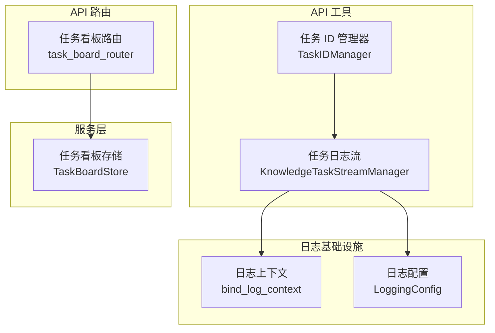
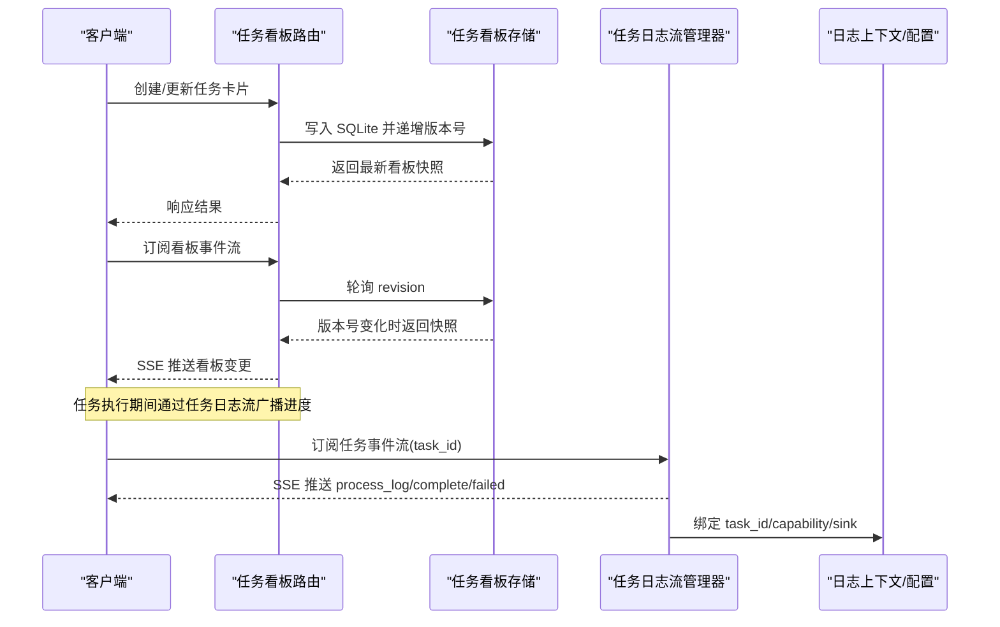
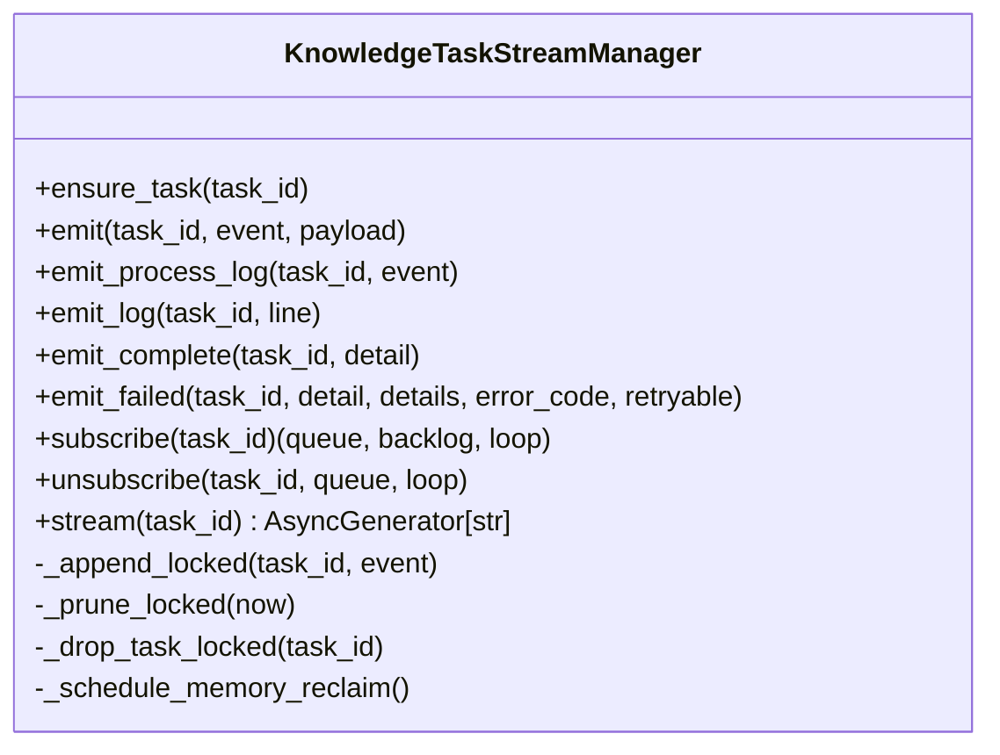
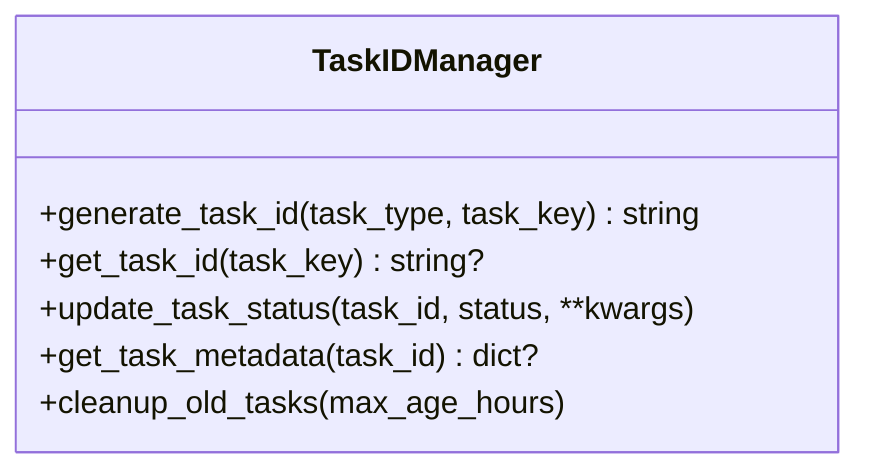
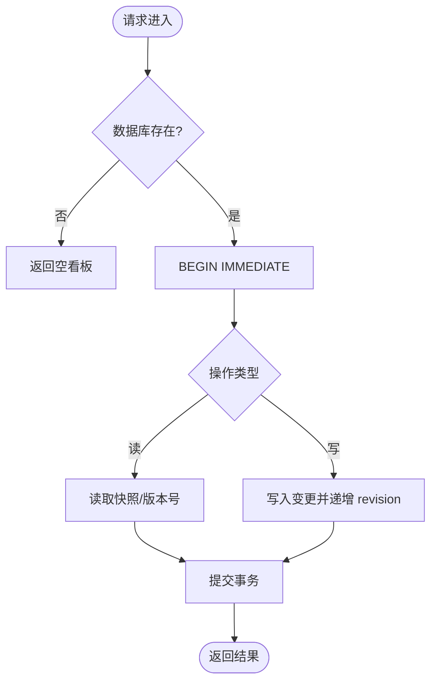
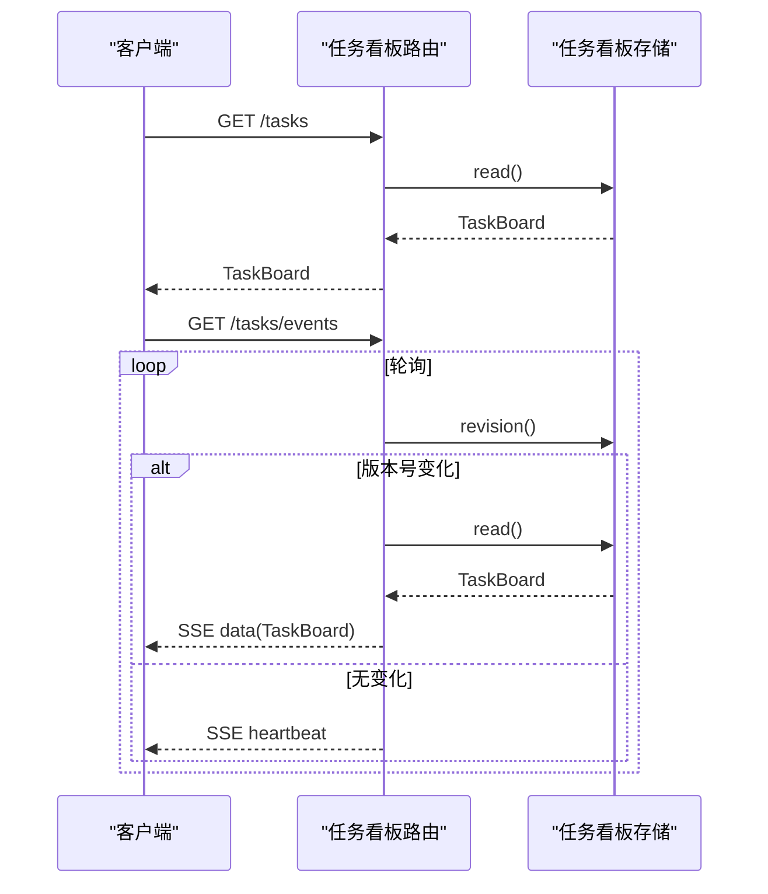
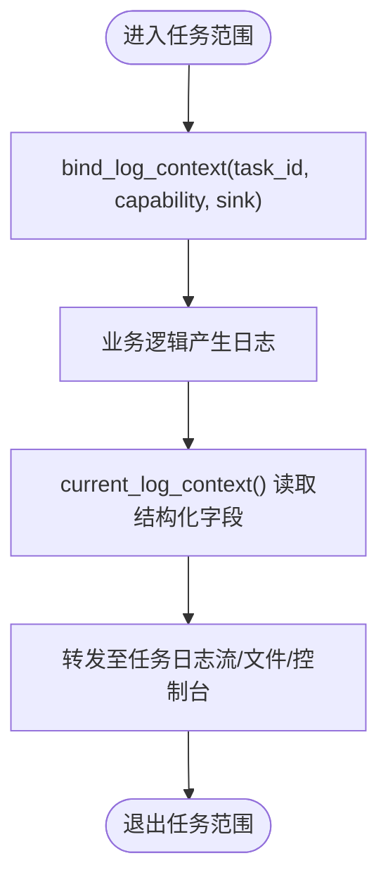
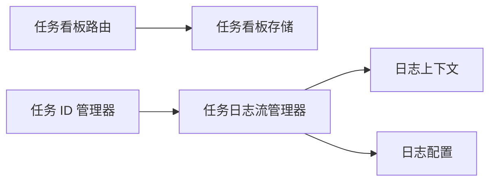

# 异步任务处理

<cite>
**本文引用的文件**   
- [task_log_stream.py](file://deeptutor/api/utils/task_log_stream.py)
- [task_id_manager.py](file://deeptutor/api/utils/task_id_manager.py)
- [task_board.py](file://deeptutor/services/task_board.py)
- [task_board_router.py](file://deeptutor/api/routers/task_board.py)
- [logging_config.py](file://deeptutor/logging/config.py)
- [logging_context.py](file://deeptutor/logging/context.py)
</cite>

## 目录
1. [简介](#简介)
2. [项目结构](#项目结构)
3. [核心组件](#核心组件)
4. [架构总览](#架构总览)
5. [详细组件分析](#详细组件分析)
6. [依赖关系分析](#依赖关系分析)
7. [性能与并发控制](#性能与并发控制)
8. [故障排查指南](#故障排查指南)
9. [结论](#结论)

## 简介
本文件面向“异步任务处理系统”的技术文档，聚焦以下目标：
- 任务队列管理机制：任务调度、优先级处理与负载均衡。
- 进度跟踪系统：实时状态更新与进度广播。
- 任务生命周期管理：从创建到完成的全流程监控。
- 错误恢复机制：重试、失败处理与补偿操作。
- 任务监控接口与日志追踪。
- 性能调优建议与并发控制策略。

该系统由三大部分组成：
- 任务标识与元数据管理：负责生成唯一任务 ID、维护任务状态与清理过期记录。
- 任务事件流与进度广播：基于内存缓冲与 SSE（Server-Sent Events）实现实时进度推送。
- 任务看板与持久化：基于 SQLite 的任务卡片、会话关联与版本化增量同步。

## 项目结构
围绕异步任务处理的相关代码主要分布在以下模块：
- API 工具层：任务日志流、任务 ID 管理器。
- 服务层：任务看板存储与模型定义。
- API 路由层：任务看板 REST 与事件流接口。
- 日志基础设施：结构化日志上下文与配置加载。

**图表来源**
- [task_log_stream.py:25-280](file://deeptutor/api/utils/task_log_stream.py#L25-L280)
- [task_id_manager.py:14-121](file://deeptutor/api/utils/task_id_manager.py#L14-L121)
- [task_board.py:121-508](file://deeptutor/services/task_board.py#L121-L508)
- [task_board_router.py:40-140](file://deeptutor/api/routers/task_board.py#L40-L140)
- [logging_context.py:10-40](file://deeptutor/logging/context.py#L10-L40)
- [logging_config.py:9-50](file://deeptutor/logging/config.py#L9-L50)

**章节来源**
- [task_log_stream.py:25-280](file://deeptutor/api/utils/task_log_stream.py#L25-L280)
- [task_id_manager.py:14-121](file://deeptutor/api/utils/task_id_manager.py#L14-L121)
- [task_board.py:121-508](file://deeptutor/services/task_board.py#L121-L508)
- [task_board_router.py:40-140](file://deeptutor/api/routers/task_board.py#L40-L140)
- [logging_context.py:10-40](file://deeptutor/logging/context.py#L10-L40)
- [logging_config.py:9-50](file://deeptutor/logging/config.py#L9-L50)

## 核心组件
- 任务日志流管理器：提供任务事件的发布/订阅、SSE 流式输出、心跳保活、内存回收与终端事件墓碑机制。
- 任务 ID 管理器：为后台任务分配唯一 ID，维护任务键映射、元数据与过期清理。
- 任务看板存储：以 SQLite 作为共享权威源，提供卡片 CRUD、颜色配置、会话与任务关联、版本化快照与增量事件流。
- 任务看板路由：暴露 REST 接口与 SSE 事件流，按工作区隔离数据并支持实时刷新。
- 日志上下文与配置：为任务绑定结构化字段（如 task_id、capability、sink），并从运行时设置加载日志级别与输出路径。

**章节来源**
- [task_log_stream.py:25-280](file://deeptutor/api/utils/task_log_stream.py#L25-L280)
- [task_id_manager.py:14-121](file://deeptutor/api/utils/task_id_manager.py#L14-L121)
- [task_board.py:121-508](file://deeptutor/services/task_board.py#L121-L508)
- [task_board_router.py:40-140](file://deeptutor/api/routers/task_board.py#L40-L140)
- [logging_context.py:10-40](file://deeptutor/logging/context.py#L10-L40)
- [logging_config.py:9-50](file://deeptutor/logging/config.py#L9-L50)

## 架构总览
下图展示任务从创建、调度、执行、进度广播到完成/失败的端到端流程，以及看板与日志的集成点。

**图表来源**
- [task_board_router.py:40-140](file://deeptutor/api/routers/task_board.py#L40-L140)
- [task_board.py:121-508](file://deeptutor/services/task_board.py#L121-L508)
- [task_log_stream.py:25-280](file://deeptutor/api/utils/task_log_stream.py#L25-L280)
- [logging_context.py:10-40](file://deeptutor/logging/context.py#L10-L40)

## 详细组件分析

### 任务日志流管理器（进度跟踪与广播）
职责与特性：
- 单例模式，线程安全的事件缓冲与订阅管理。
- 每个任务维护固定长度事件队列与字节预算，避免内存膨胀。
- 对 complete/failed 等终态事件进行墓碑保留，便于延迟订阅者获取最终状态。
- 提供 subscribe/stream 方法，以 SSE 格式向客户端推送事件；空闲时发送心跳注释保持连接。
- 将结构化日志（含 task_id、capability、sink）转发至对应任务的 SSE 流。

关键行为说明：
- ensure_task：初始化任务缓冲与订阅表项，必要时恢复终端墓碑事件。
- emit/emit_process_log/emit_log/emit_complete/emit_failed：统一事件入口，区分普通事件与终态事件。
- subscribe/unsubscribe：注册/注销消费者，返回队列与历史积压事件。
- stream：SSE 流式输出，包含心跳保活与自动取消订阅。
- _append_locked/_prune_locked/_drop_task_locked：内存裁剪、任务淘汰与墓碑清理。

**图表来源**
- [task_log_stream.py:25-280](file://deeptutor/api/utils/task_log_stream.py#L25-L280)

**章节来源**
- [task_log_stream.py:25-280](file://deeptutor/api/utils/task_log_stream.py#L25-L280)

### 任务 ID 管理器（唯一标识与元数据）
职责与特性：
- 单例模式，线程安全的任务 ID 生成与状态更新。
- 根据 task_key 去重，避免重复任务。
- 维护 task_key -> task_id 映射与 task_id -> metadata 元数据。
- 定期清理已完成/失败/取消的旧任务，限制最大保留数量。

关键行为说明：
- generate_task_id：生成形如“类型_时间戳_随机串”的唯一 ID，并写入元数据。
- get_task_id/get_task_metadata：查询现有 ID 与元数据。
- update_task_status：更新状态与结束时间。
- cleanup_old_tasks：按完成时间与上限清理。

**图表来源**
- [task_id_manager.py:14-121](file://deeptutor/api/utils/task_id_manager.py#L14-L121)

**章节来源**
- [task_id_manager.py:14-121](file://deeptutor/api/utils/task_id_manager.py#L14-L121)

### 任务看板存储与会话关联（持久化与版本化）
职责与特性：
- 使用 SQLite 作为跨标签页、工作区与 API worker 的共享权威源。
- 提供卡片增删改查、颜色配置、会话与任务关联、迁移与导入。
- 通过 board_state.revision 实现增量同步，前端可仅拉取变更。
- 支持按工作区过滤视图，保证多工作区数据隔离。

关键行为说明：
- read/revision：读取完整看板快照与轻量版本号探测。
- create/update/set_colors：事务性写入并递增版本号。
- link_tasks/link_status：建立会话与任务关联，启用/禁用状态同步。
- context_text：为模型提供任务上下文摘要。

**图表来源**
- [task_board.py:121-508](file://deeptutor/services/task_board.py#L121-L508)

**章节来源**
- [task_board.py:121-508](file://deeptutor/services/task_board.py#L121-L508)

### 任务看板路由（REST 与 SSE 事件流）
职责与特性：
- 暴露看板数据的 REST 接口（GET/PATCH/PUT）。
- 提供 /events SSE 接口，轮询 revision 并在变化时推送完整看板快照。
- 基于请求头或查询参数解析工作区，确保事件流不持有工作区活动租约。
- 会话与任务关联接口具备会话存在性与工作区有效性校验。

关键行为说明：
- get_board：返回当前工作区的看板快照。
- board_events：SSE 事件流，心跳与增量推送。
- create_card/update_card/set_colors：工作区隔离的卡片与颜色操作。
- link_tasks/link_status：会话与任务关联及状态开关。

**图表来源**
- [task_board_router.py:40-140](file://deeptutor/api/routers/task_board.py#L40-L140)
- [task_board.py:121-508](file://deeptutor/services/task_board.py#L121-L508)

**章节来源**
- [task_board_router.py:40-140](file://deeptutor/api/routers/task_board.py#L40-L140)
- [task_board.py:121-508](file://deeptutor/services/task_board.py#L121-L508)

### 日志上下文与配置（结构化追踪）
职责与特性：
- 通过 contextvars 绑定 request_id、turn_id、session_id、task_id、capability、stage、sink 等结构化字段。
- 提供 bind_log_context 上下文管理器，在任务范围内注入日志上下文。
- LoggingConfig 从运行时 main.yaml 加载日志级别、输出开关、目录与轮转策略。

关键行为说明：
- current_log_context/bind_log_context：读写当前日志上下文。
- load_logging_config/get_global_log_level：加载日志配置与全局级别。

**图表来源**
- [logging_context.py:10-40](file://deeptutor/logging/context.py#L10-L40)
- [logging_config.py:9-50](file://deeptutor/logging/config.py#L9-L50)

**章节来源**
- [logging_context.py:10-40](file://deeptutor/logging/context.py#L10-L40)
- [logging_config.py:9-50](file://deeptutor/logging/config.py#L9-L50)

## 依赖关系分析
- 任务看板路由依赖任务看板存储，用于读写 SQLite 与增量事件流。
- 任务日志流管理器依赖日志上下文与配置，将结构化日志转发到任务 SSE 流。
- 任务 ID 管理器独立于其他组件，但通常与任务日志流配合使用，以便将事件与任务 ID 关联。

**图表来源**
- [task_board_router.py:40-140](file://deeptutor/api/routers/task_board.py#L40-L140)
- [task_board.py:121-508](file://deeptutor/services/task_board.py#L121-L508)
- [task_log_stream.py:25-280](file://deeptutor/api/utils/task_log_stream.py#L25-L280)
- [task_id_manager.py:14-121](file://deeptutor/api/utils/task_id_manager.py#L14-L121)
- [logging_context.py:10-40](file://deeptutor/logging/context.py#L10-L40)
- [logging_config.py:9-50](file://deeptutor/logging/config.py#L9-L50)

**章节来源**
- [task_board_router.py:40-140](file://deeptutor/api/routers/task_board.py#L40-L140)
- [task_board.py:121-508](file://deeptutor/services/task_board.py#L121-L508)
- [task_log_stream.py:25-280](file://deeptutor/api/utils/task_log_stream.py#L25-L280)
- [task_id_manager.py:14-121](file://deeptutor/api/utils/task_id_manager.py#L14-L121)
- [logging_context.py:10-40](file://deeptutor/logging/context.py#L10-L40)
- [logging_config.py:9-50](file://deeptutor/logging/config.py#L9-L50)

## 性能与并发控制
- 事件缓冲与内存预算：
  - 每个任务最多保留固定数量的事件与字节数，超出则丢弃最旧事件，防止内存泄漏。
  - 超大终态事件会被压缩截断，确保订阅者仍能观察到任务完成/失败。
- 任务保留与墓碑机制：
  - 无订阅者的终态任务在一定 TTL 后清理，同时保留墓碑事件供延迟订阅者获取。
  - 墓碑也有数量与 TTL 限制，避免长期占用内存。
- 心跳保活：
  - SSE 流在空闲时发送注释型心跳，避免中间代理断开连接。
- 并发与线程安全：
  - 任务日志流管理器使用线程锁保护内部数据结构，并通过事件循环的 call_soon_threadsafe 将事件投递到异步队列。
  - 任务看板存储使用 SQLite 事务与 BEGIN IMMEDIATE 保证并发写入一致性。
- 增量同步：
  - 看板通过 revision 字段实现轻量级变更检测，减少不必要的数据传输。
- 建议：
  - 合理调整事件缓冲上限与字节预算，平衡实时性与内存占用。
  - 在高并发场景下，优先使用 revision 探测与增量推送，避免全量拉取。
  - 对于长耗时任务，确保定期 emit_process_log，维持前端进度反馈与连接活跃。

[本节为通用指导，不直接分析具体文件]

## 故障排查指南
常见问题与定位要点：
- 进度未更新：
  - 检查是否正确调用 emit_process_log/emit_log，并确保 task_id 一致。
  - 确认客户端已正确订阅任务事件流，且未提前断开连接。
- 连接被代理断开：
  - 确认 SSE 心跳注释正常发送，代理未缓存或压缩响应。
- 内存增长异常：
  - 检查是否存在未释放的订阅者或未退出的任务流。
  - 关注终态事件是否触发墓碑清理与内存回收。
- 看板不同步：
  - 检查 revision 是否递增，SSE 事件流是否正常推送。
  - 确认工作区解析正确，避免跨工作区数据污染。
- 日志缺失：
  - 确认 bind_log_context 已绑定 task_id/capability/sink。
  - 检查 LoggingConfig 中 console_output/file_output 是否开启。

**章节来源**
- [task_log_stream.py:25-280](file://deeptutor/api/utils/task_log_stream.py#L25-L280)
- [task_board_router.py:40-140](file://deeptutor/api/routers/task_board.py#L40-L140)
- [logging_context.py:10-40](file://deeptutor/logging/context.py#L10-L40)
- [logging_config.py:9-50](file://deeptutor/logging/config.py#L9-L50)

## 结论
该异步任务处理系统通过任务 ID 管理、任务日志流与任务看板三大组件，实现了任务标识、进度广播与持久化看板的一体化能力。其设计强调：
- 实时性：SSE 事件流与心跳保活保障前端即时反馈。
- 可靠性：终态墓碑与内存预算确保任务完成/失败可观测且不泄露资源。
- 可扩展性：SQLite 版式与 revision 增量同步支持多工作区与多实例协作。
- 可观测性：结构化日志上下文与配置加载提供完整的追踪与诊断能力。

在实际部署中，建议结合业务负载调整事件缓冲与 TTL 参数，优化 SSE 推送频率与日志输出策略，以获得更好的性能与用户体验。