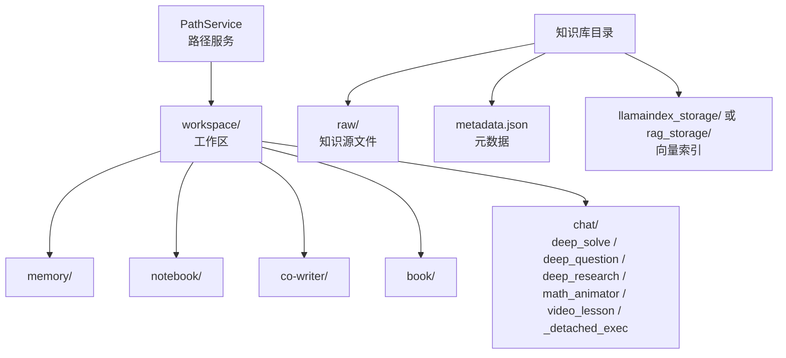
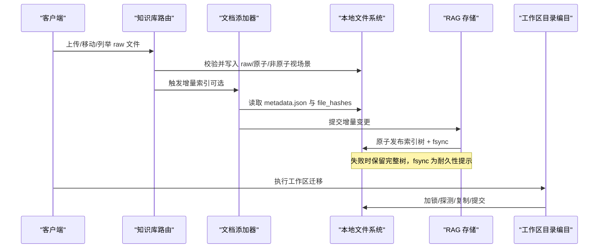
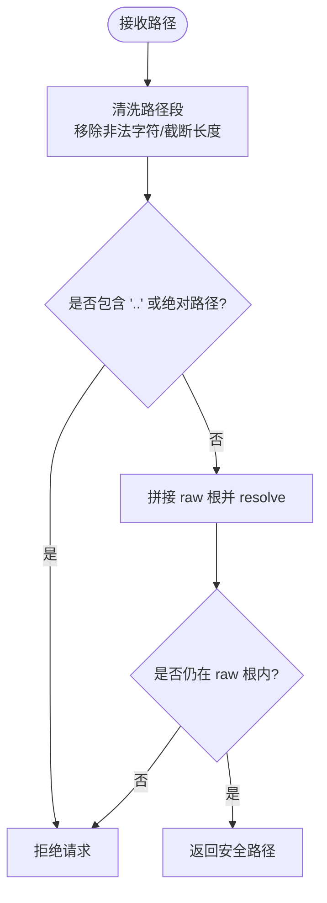
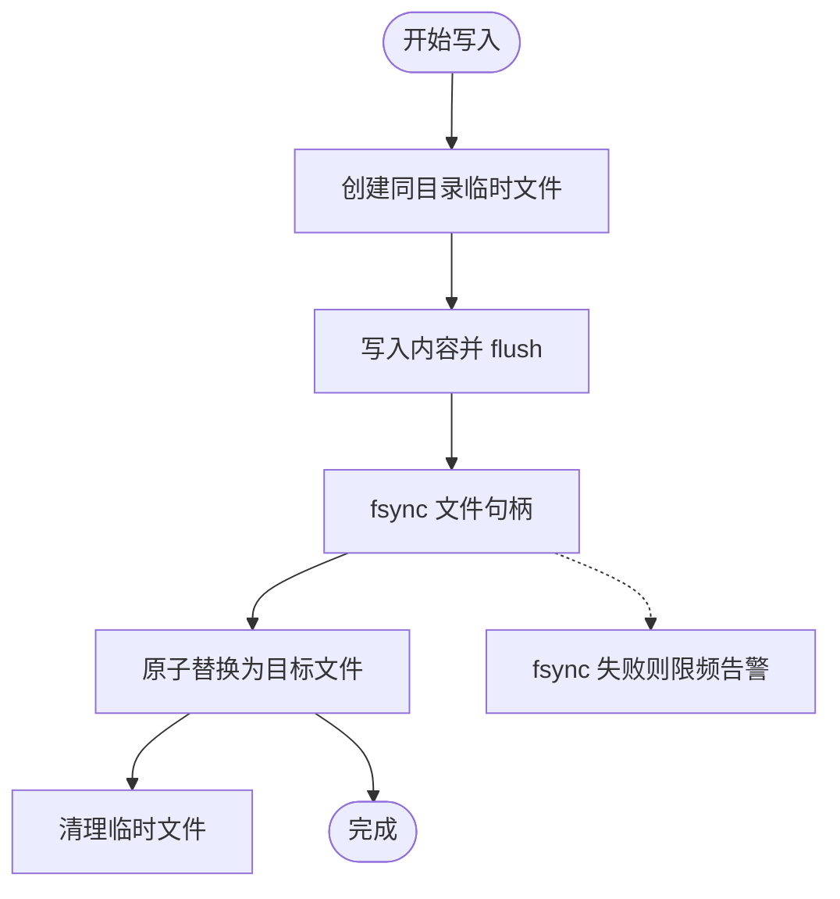
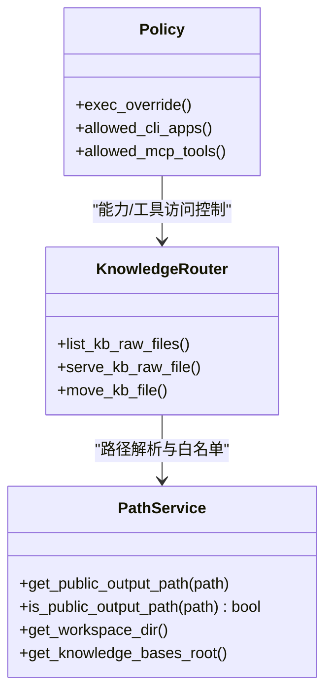
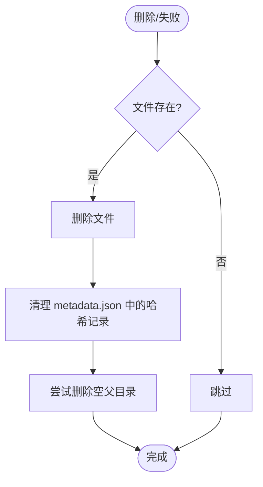
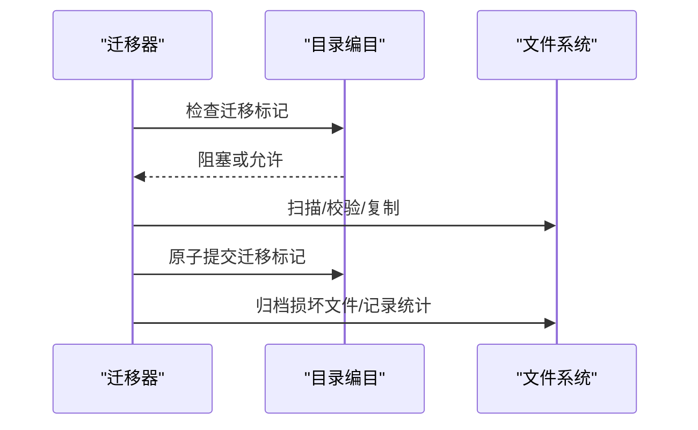
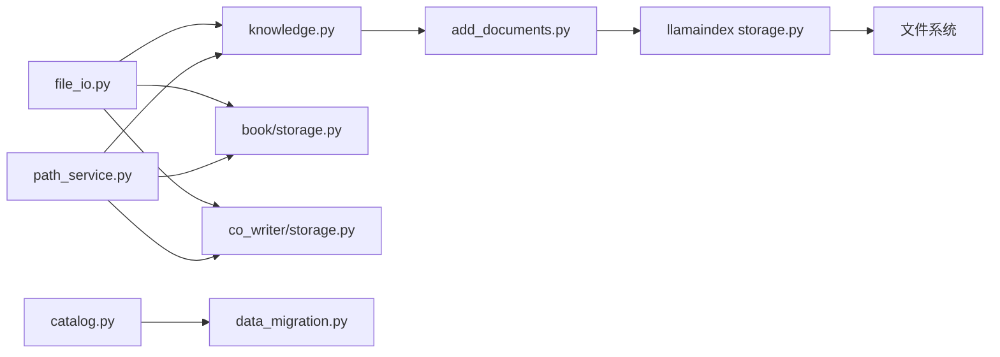

# 文件存储管理

<cite>
**本文引用的文件**   
- [file_io.py](file://deeptutor/services/file_io.py)
- [path_service.py](file://deeptutor/services/path_service.py)
- [knowledge.py](file://deeptutor/api/routers/knowledge.py)
- [add_documents.py](file://deeptutor/knowledge/add_documents.py)
- [storage.py（LlamaIndex）](file://deeptutor/services/rag/pipelines/llamaindex/storage.py)
- [file_library.py](file://deeptutor/services/storage/file_library.py)
- [catalog.py](file://deeptutor/services/workspace/catalog.py)
- [data_migration.py](file://deeptutor/services/workspace/data_migration.py)
- [migration.py（学习进度迁移）](file://deeptutor/learning/migration.py)
- [test_v2_migration.py](file://deeptutor/learning/tests/test_v2_migration.py)
</cite>

## 目录
1. [简介](#简介)
2. [项目结构](#项目结构)
3. [核心组件](#核心组件)
4. [架构总览](#架构总览)
5. [详细组件分析](#详细组件分析)
6. [依赖关系分析](#依赖关系分析)
7. [性能考虑](#性能考虑)
8. [故障排查指南](#故障排查指南)
9. [结论](#结论)
10. [附录](#附录)

## 简介
本文件面向 DeepTutor 的本地文件系统存储管理，聚焦以下目标：
- 说明本地文件系统组织结构，尤其是知识库 raw 目录布局与命名规范。
- 记录文件持久化策略：原子写入、备份机制、数据一致性保证。
- 解释文件访问控制、权限管理与安全隔离机制。
- 说明文件清理与垃圾回收策略，包括临时文件管理与存储空间优化。
- 覆盖文件迁移与版本管理功能。
- 提供存储配置选项与性能优化建议。

## 项目结构
DeepTutor 将运行时数据存储于用户工作区下，并通过 PathService 统一管理路径。典型根结构如下：
- data/user：用户数据根
  - .runtime：运行期私有状态
  - chat_history.db：聊天历史数据库
  - logs：日志
  - settings：设置
  - workspace：业务工作区
    - memory：记忆
    - notebook：笔记本
    - co-writer：协作文档
    - book：书籍
    - chat：对话与工作空间（含 deep_solve、deep_question、deep_research、math_animator、video_lesson、_detached_exec）

知识库的知识源文件统一位于每个知识库目录下的 raw 子目录中；raw 是“人类可读”的组织视图，不直接参与检索索引。

**图表来源**
- [path_service.py:66-125](file://deeptutor/services/path_service.py#L66-L125)
- [knowledge.py:3040-3069](file://deeptutor/api/routers/knowledge.py#L3040-L3069)

**章节来源**
- [path_service.py:1-125](file://deeptutor/services/path_service.py#L1-L125)

## 核心组件
- 原子写入与磁盘同步：提供 JSON 与文本的原子写入、fsync 失败降级告警、Windows 共享锁重试。
- 路径服务：集中定义运行时目录、公开输出白名单、工作区与知识库路径。
- 知识库路由：raw 目录上传、移动、列举、预览与下载，包含路径清洗与遍历防护。
- 文档添加器：raw 文件校验、去重、增量索引、哈希键规则、删除时清理已索引哈希。
- RAG 存储：快照树 fsync、候选替换与备份恢复。
- 文件库存储：内容去重（SHA-256）、SQLite 元数据、原子落盘。
- 工作区目录编目与迁移：迁移锁、进程存活探测、断点恢复。
- 数据迁移：符号链接检测、特殊文件拒绝、WAL 检查点、归档与校验。

**章节来源**
- [file_io.py:1-134](file://deeptutor/services/file_io.py#L1-L134)
- [path_service.py:66-546](file://deeptutor/services/path_service.py#L66-L546)
- [knowledge.py:386-579](file://deeptutor/api/routers/knowledge.py#L386-L579)
- [add_documents.py:84-279](file://deeptutor/knowledge/add_documents.py#L84-L279)
- [storage.py（LlamaIndex）:231-268](file://deeptutor/services/rag/pipelines/llamaindex/storage.py#L231-L268)
- [file_library.py:46-91](file://deeptutor/services/storage/file_library.py#L46-L91)
- [catalog.py:466-500](file://deeptutor/services/workspace/catalog.py#L466-L500)
- [data_migration.py:94-120](file://deeptutor/services/workspace/data_migration.py#L94-L120)

## 架构总览
下图展示从 API 到本地文件系统的端到端流程：上传进入 raw，随后由索引管线进行增量处理；RAG 层对索引树进行原子发布与 fsync；工作区迁移在目录编目保护下进行。

**图表来源**
- [knowledge.py:429-558](file://deeptutor/api/routers/knowledge.py#L429-L558)
- [add_documents.py:109-159](file://deeptutor/knowledge/add_documents.py#L109-L159)
- [storage.py（LlamaIndex）:231-268](file://deeptutor/services/rag/pipelines/llamaindex/storage.py#L231-L268)
- [catalog.py:466-500](file://deeptutor/services/workspace/catalog.py#L466-L500)

## 详细组件分析

### 本地文件系统组织与 raw 目录布局
- 知识库目录结构
  - <kb>/raw：知识源文件与文件夹（纯组织用途，不影响检索）。
  - <kb>/metadata.json：元数据，包含 file_hashes 等。
  - <kb>/llamaindex_storage 或 <kb>/rag_storage：向量索引数据。
- 命名与安全
  - 文件名与路径段会经过清洗，去除非法字符并限制长度。
  - 相对路径禁止使用 .. 与绝对路径标记，防止目录穿越。
  - 所有 raw 访问均通过“解析后校验是否在 raw 根内”的方式实现。

**图表来源**
- [knowledge.py:392-426](file://deeptutor/api/routers/knowledge.py#L392-L426)

**章节来源**
- [knowledge.py:386-426](file://deeptutor/api/routers/knowledge.py#L386-L426)
- [knowledge.py:3040-3094](file://deeptutor/api/routers/knowledge.py#L3040-L3094)

### 文件持久化策略：原子写入、备份与一致性
- 原子写入
  - JSON 与文本均采用“同目录临时文件 + fsync + 原子替换”的模式。
  - fsync 失败不会破坏写入结果，仅做限频告警。
  - Windows 上对 PermissionError 进行指数退避重试，提升鲁棒性。
- 备份与恢复
  - RAG 索引树发布前生成带时间戳的备份目录；若候选发布失败，自动回滚至最近备份。
  - 目录级 fsync 作为耐久性提示，某些文件系统可能不支持但不会中断流程。
- 一致性保证
  - 知识库 metadata.json 使用原子写入。
  - 文件库按内容 SHA-256 去重，避免重复存储。
  - 工作区目录编目在迁移期间加锁，支持进程死亡后的安全解锁。

**图表来源**
- [file_io.py:88-130](file://deeptutor/services/file_io.py#L88-L130)
- [storage.py（LlamaIndex）:231-268](file://deeptutor/services/rag/pipelines/llamaindex/storage.py#L231-L268)

**章节来源**
- [file_io.py:17-73](file://deeptutor/services/file_io.py#L17-L73)
- [file_io.py:88-130](file://deeptutor/services/file_io.py#L88-L130)
- [storage.py（LlamaIndex）:231-268](file://deeptutor/services/rag/pipelines/llamaindex/storage.py#L231-L268)
- [add_documents.py:92-106](file://deeptutor/knowledge/add_documents.py#L92-L106)
- [file_library.py:237-263](file://deeptutor/services/storage/file_library.py#L237-L263)
- [catalog.py:466-500](file://deeptutor/services/workspace/catalog.py#L466-L500)

### 文件访问控制、权限管理与安全隔离
- 路径沙箱
  - 所有 raw 文件访问均先 resolve，再校验相对路径仍位于 raw 根内，否则返回 403。
  - 公开输出路径通过白名单与后缀过滤，避免泄露敏感文件。
- 多用户与授权
  - 路径服务支持多用户工作区隔离（data/users/<uid>/）。
  - 能力与工具访问策略可限制上传、执行等能力。
- 沙箱执行
  - 执行隔离等级分为 SYSTEM、APPLICATION、OFF，普通用户仅在系统级隔离下允许 shell 执行。

**图表来源**
- [path_service.py:143-233](file://deeptutor/services/path_service.py#L143-L233)
- [knowledge.py:3072-3094](file://deeptutor/api/routers/knowledge.py#L3072-L3094)

**章节来源**
- [path_service.py:143-233](file://deeptutor/services/path_service.py#L143-L233)
- [knowledge.py:3072-3094](file://deeptutor/api/routers/knowledge.py#L3072-L3094)

### 文件清理与垃圾回收策略
- 上传失败清理
  - 单个文件写入失败时立即删除该文件；批量失败时回滚已写入文件。
- 空目录清理
  - 文件库删除文件后尝试递归删除空父目录（不超过根目录）。
- 索引与哈希清理
  - 删除 raw 文件时同时清理 metadata.json 中的 file_hashes 记录，避免后续增量误判。
- 迁移与归档
  - 学习进度 v2 迁移会将损坏的旧文件归档至 archive/failed，并记录迁移清单。
  - 工作区数据迁移拒绝符号链接与特殊文件，确保可预测行为。

**图表来源**
- [knowledge.py:539-556](file://deeptutor/api/routers/knowledge.py#L539-L556)
- [file_library.py:201-216](file://deeptutor/services/storage/file_library.py#L201-L216)
- [add_documents.py:131-159](file://deeptutor/knowledge/add_documents.py#L131-L159)
- [test_v2_migration.py:137-163](file://deeptutor/learning/tests/test_v2_migration.py#L137-L163)

**章节来源**
- [knowledge.py:539-556](file://deeptutor/api/routers/knowledge.py#L539-L556)
- [file_library.py:201-216](file://deeptutor/services/storage/file_library.py#L201-L216)
- [add_documents.py:131-159](file://deeptutor/knowledge/add_documents.py#L131-L159)
- [test_v2_migration.py:137-163](file://deeptutor/learning/tests/test_v2_migration.py#L137-L163)

### 文件迁移与版本管理
- 工作区目录编目迁移
  - 迁移过程中写入迁移标记，阻塞其他进程；进程死亡后可安全解锁。
  - 复制过程不替换源数据，提交为原子操作。
- 工作区数据迁移
  - 扫描目录与文件，拒绝符号链接与特殊文件。
  - 对 SQLite WAL 进行 checkpoint，再进行归档与校验。
- 学习进度迁移
  - 将损坏的旧版 JSON 归档至 archive/failed，并记录迁移统计。

**图表来源**
- [catalog.py:466-500](file://deeptutor/services/workspace/catalog.py#L466-L500)
- [data_migration.py:94-120](file://deeptutor/services/workspace/data_migration.py#L94-L120)
- [migration.py（学习进度迁移）:48-93](file://deeptutor/learning/migration.py#L48-L93)
- [test_v2_migration.py:137-163](file://deeptutor/learning/tests/test_v2_migration.py#L137-L163)

**章节来源**
- [catalog.py:466-500](file://deeptutor/services/workspace/catalog.py#L466-L500)
- [data_migration.py:94-120](file://deeptutor/services/workspace/data_migration.py#L94-L120)
- [migration.py（学习进度迁移）:48-93](file://deeptutor/learning/migration.py#L48-L93)
- [test_v2_migration.py:137-163](file://deeptutor/learning/tests/test_v2_migration.py#L137-L163)

## 依赖关系分析
- 低耦合 IO 抽象：file_io.py 被多处复用，提供统一的原子写入与重试语义。
- 路径服务解耦业务模块：各模块通过 PathService 获取路径，避免硬编码。
- 知识库路由与文档添加器分离职责：路由负责输入校验与 UI 友好路径，添加器负责索引与哈希。
- RAG 存储独立于上层逻辑：提供索引树的原子发布与恢复。
- 迁移子系统相互协作：目录编目与数据迁移共同保障迁移安全。

**图表来源**
- [file_io.py:88-130](file://deeptutor/services/file_io.py#L88-L130)
- [path_service.py:66-125](file://deeptutor/services/path_service.py#L66-L125)
- [knowledge.py:386-579](file://deeptutor/api/routers/knowledge.py#L386-L579)
- [add_documents.py:162-279](file://deeptutor/knowledge/add_documents.py#L162-L279)
- [storage.py（LlamaIndex）:231-268](file://deeptutor/services/rag/pipelines/llamaindex/storage.py#L231-L268)
- [catalog.py:466-500](file://deeptutor/services/workspace/catalog.py#L466-L500)
- [data_migration.py:94-120](file://deeptutor/services/workspace/data_migration.py#L94-L120)

**章节来源**
- [file_io.py:88-130](file://deeptutor/services/file_io.py#L88-L130)
- [path_service.py:66-125](file://deeptutor/services/path_service.py#L66-L125)
- [knowledge.py:386-579](file://deeptutor/api/routers/knowledge.py#L386-L579)
- [add_documents.py:162-279](file://deeptutor/knowledge/add_documents.py#L162-L279)
- [storage.py（LlamaIndex）:231-268](file://deeptutor/services/rag/pipelines/llamaindex/storage.py#L231-L268)
- [catalog.py:466-500](file://deeptutor/services/workspace/catalog.py#L466-L500)
- [data_migration.py:94-120](file://deeptutor/services/workspace/data_migration.py#L94-L120)

## 性能考虑
- 原子写入开销
  - 每次写入都会创建临时文件并进行 fsync，适合小中型配置文件与元数据；大文件建议使用流式写入与非原子追加（如日志），或使用对象存储。
- 批量上传
  - 知识库上传走线程池以避免阻塞事件循环；建议在客户端侧分片与并发控制，服务端侧限制单批大小。
- 索引与 fsync
  - RAG 索引树 fsync 为耐久性提示，在高 IOPS 环境下可评估关闭 fsync 以提升吞吐，但需接受断电风险。
- 去重与缓存
  - 文件库基于 SHA-256 去重，减少重复存储；解析缓存按 (source_hash, parser_signature) 键复用，降低重复解析成本。
- 目录遍历
  - raw 列举使用 rglob，建议在大型知识库中分页或增量更新列表，避免全量扫描。

[本节为通用指导，不直接分析具体文件]

## 故障排查指南
- 上传失败
  - 检查文件名清洗与扩展名白名单；确认文件大小未超限；查看是否因杀毒软件/索引器导致 PermissionError（已有重试机制）。
- 无法访问 raw 文件
  - 确认路径未被 .. 或绝对路径绕过；确认 KB 类型支持本地 raw 文件。
- 索引不一致
  - 检查 metadata.json 中 file_hashes 是否与 raw 文件一致；必要时重新索引。
- 迁移卡住
  - 检查工作区目录编目迁移标记是否存在且对应进程是否存活；若进程已死，可安全解锁后重试。
- 迁移后数据差异
  - 数据迁移会在提交前比对快照与源数据，若发现变化会要求人工核对。

**章节来源**
- [knowledge.py:429-558](file://deeptutor/api/routers/knowledge.py#L429-L558)
- [knowledge.py:3040-3094](file://deeptutor/api/routers/knowledge.py#L3040-L3094)
- [add_documents.py:109-159](file://deeptutor/knowledge/add_documents.py#L109-L159)
- [catalog.py:466-500](file://deeptutor/services/workspace/catalog.py#L466-L500)
- [data_migration.py:94-120](file://deeptutor/services/workspace/data_migration.py#L94-L120)

## 结论
DeepTutor 的文件存储管理以 PathService 为中心，结合原子写入、路径沙箱、内容去重与迁移保护，提供了稳健的本地文件系统方案。知识库 raw 目录用于人类可读的组织视图，配合 metadata.json 与向量索引实现稳定、可恢复的数据生命周期管理。在多用户与多能力场景中，通过路径隔离与策略控制，确保安全性与可扩展性。

[本节为总结性内容，不直接分析具体文件]

## 附录
- 关键路径参考
  - 工作区根：PathService.workspace_root
  - 知识库根：PathService.get_knowledge_bases_root()
  - raw 目录：<kb>/raw
  - 元数据：<kb>/metadata.json
  - 索引目录：<kb>/llamaindex_storage 或 <kb>/rag_storage
- 常用 API 行为
  - 列举 raw：返回相对路径与 MIME 类型，支持文件夹节点。
  - 移动 raw：仅文件系统重定位，不触发重新索引。
  - 预览/下载：受限于 KB 的 raw 目录，越权访问返回 403。

**章节来源**
- [path_service.py:124-135](file://deeptutor/services/path_service.py#L124-L135)
- [knowledge.py:3097-3135](file://deeptutor/api/routers/knowledge.py#L3097-L3135)
- [knowledge.py:3161-3198](file://deeptutor/api/routers/knowledge.py#L3161-L3198)
- [knowledge.py:3201-3237](file://deeptutor/api/routers/knowledge.py#L3201-L3237)