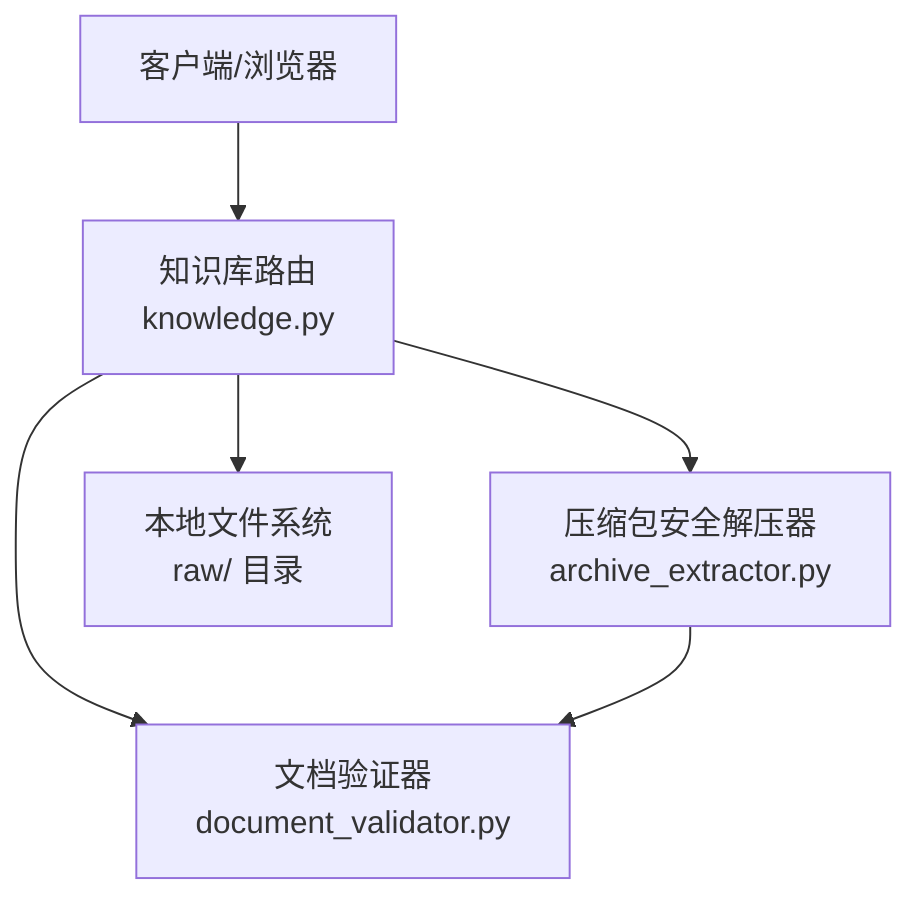
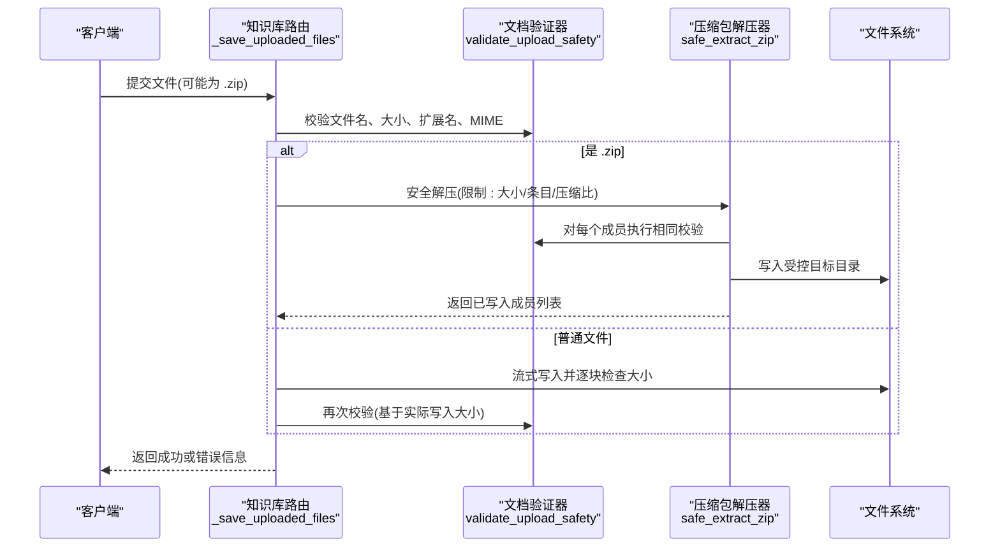
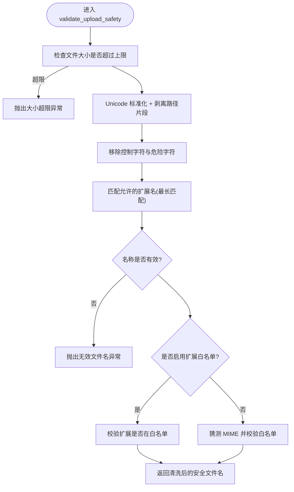
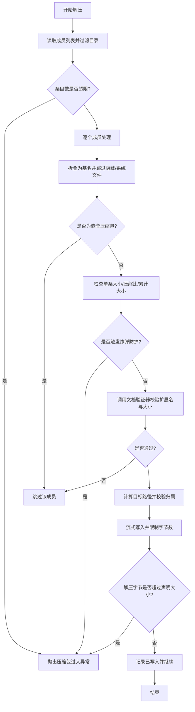
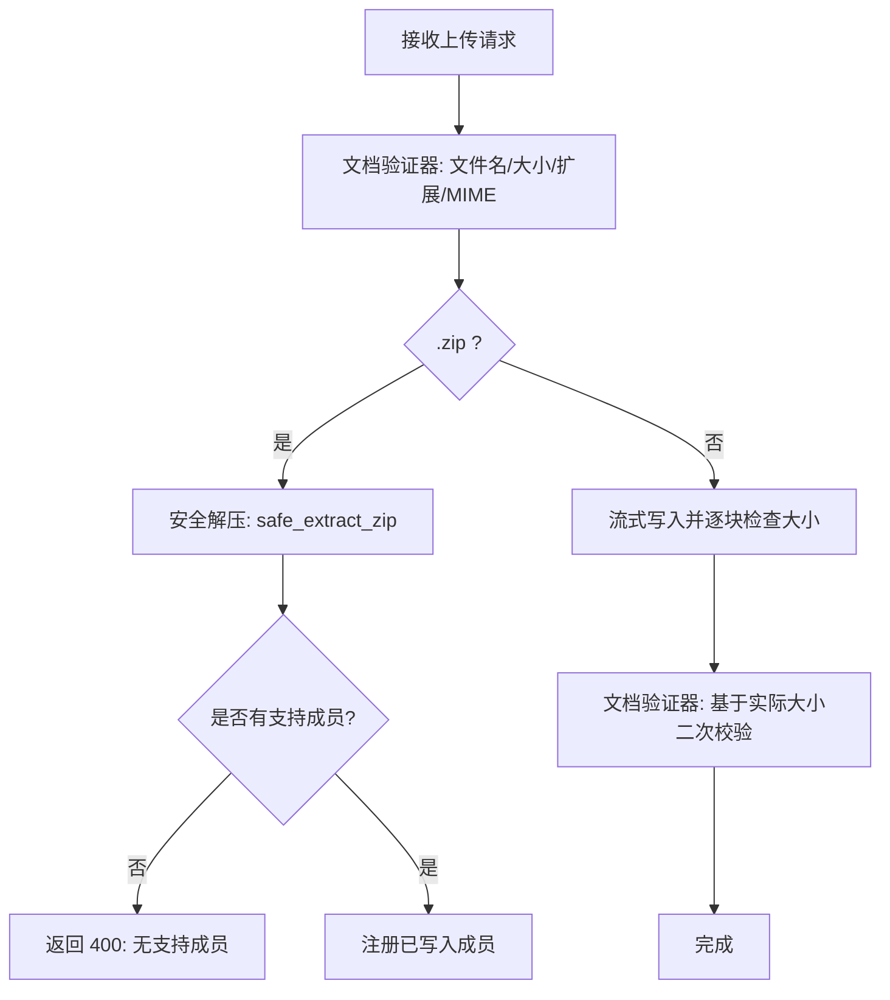
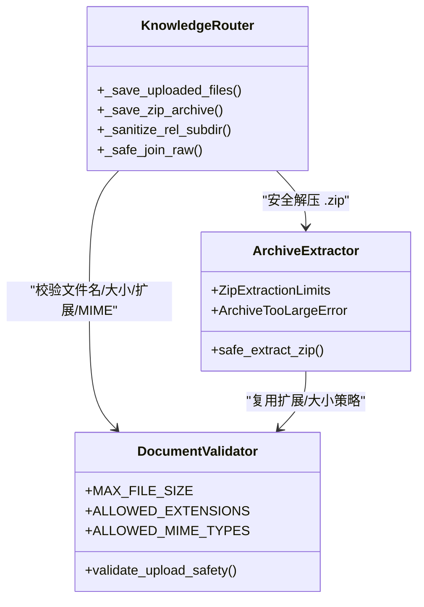

# 文件验证与安全

<cite>
**本文引用的文件**   
- [document_validator.py](file://deeptutor/utils/document_validator.py)
- [archive_extractor.py](file://deeptutor/utils/archive_extractor.py)
- [knowledge.py](file://deeptutor/api/routers/knowledge.py)
- [test_knowledge_zip_upload.py](file://tests/api/test_knowledge_zip_upload.py)
</cite>

## 目录
1. [简介](#简介)
2. [项目结构中的安全相关位置](#项目结构中的安全相关位置)
3. [核心组件](#核心组件)
4. [架构总览](#架构总览)
5. [详细组件分析](#详细组件分析)
6. [依赖关系分析](#依赖关系分析)
7. [性能与资源限制](#性能与资源限制)
8. [故障排查指南](#故障排查指南)
9. [结论与安全最佳实践](#结论与安全最佳实践)

## 简介
本文档聚焦 DeepTutor 后端在知识库上传路径中的“文件验证与安全”机制，覆盖以下方面：
- 文件类型检查、扩展名白名单与 MIME 校验
- 文件大小限制策略（单文件与压缩包）
- 恶意文件检测与防护（路径遍历、Zip Slip、压缩包炸弹）
- 文件名清洗与路径规范化
- 安全配置项与可调整边界
- 面向运维与开发者的排错建议

本说明以代码实现为依据，重点围绕文档验证器、压缩包安全解压器以及知识库路由中的上传处理逻辑展开。

## 项目结构中的安全相关位置
- 文档验证与基础安全规则集中在工具层：
  - 文档验证器负责扩展名、MIME、大小与文件名清洗。
  - 压缩包提取器提供安全的 ZIP 解压流程，内置 Zip Slip 与炸弹防护。
- 知识库路由将上述能力组合到实际上传接口中，负责：
  - 流式写入并逐块检查大小
  - 对 `.zip` 走安全解压流程
  - 对相对路径进行子目录清洗与最终路径归属校验
- 测试用例覆盖了 Zip Slip、无效压缩包、无支持成员等关键场景。

**图表来源**
- [knowledge.py:312-380](file://deeptutor/api/routers/knowledge.py#L312-L380)
- [document_validator.py:13-151](file://deeptutor/utils/document_validator.py#L13-L151)
- [archive_extractor.py:86-204](file://deeptutor/utils/archive_extractor.py#L86-L204)

**章节来源**
- [knowledge.py:312-560](file://deeptutor/api/routers/knowledge.py#L312-L560)
- [document_validator.py:13-207](file://deeptutor/utils/document_validator.py#L13-L207)
- [archive_extractor.py:1-236](file://deeptutor/utils/archive_extractor.py#L1-L236)

## 核心组件
- 文档验证器
  - 统一的大小上限、扩展名白名单、MIME 白名单。
  - 文件名清洗：Unicode 标准化、去除路径片段、控制字符过滤、危险字符替换、扩展名归一化。
  - 可选的“允许任意扩展名”模式，用于内容驱动解析场景。
- 压缩包安全解压器
  - 逐项解压，扁平化输出为安全基名。
  - 防御 Zip Slip、嵌套压缩包、系统文件与隐藏文件。
  - 压缩比、条目数、累计大小、单条最大大小等多重炸弹防护。
  - 失败时清理已写文件，避免半残留。
- 知识库路由
  - 流式写入，按块累加字节数并比较上限。
  - 对 `.zip` 调用安全解压器；非 zip 直接落盘后再做二次校验。
  - 对相对路径进行子目录清洗与最终路径归属校验，拒绝越界访问。

**章节来源**
- [document_validator.py:13-151](file://deeptutor/utils/document_validator.py#L13-L151)
- [archive_extractor.py:34-204](file://deeptutor/utils/archive_extractor.py#L34-L204)
- [knowledge.py:312-560](file://deeptutor/api/routers/knowledge.py#L312-L560)

## 架构总览
下图展示一次典型的知识库文件上传的安全处理流程，包括直接文件与压缩包两条分支。

**图表来源**
- [knowledge.py:429-558](file://deeptutor/api/routers/knowledge.py#L429-L558)
- [document_validator.py:71-151](file://deeptutor/utils/document_validator.py#L71-L151)
- [archive_extractor.py:86-204](file://deeptutor/utils/archive_extractor.py#L86-L204)

## 详细组件分析

### 文档验证器：类型、大小与文件名清洗
- 大小限制
  - 全局常量定义单文件最大字节数，所有入口均使用该值作为上限。
  - 上传过程中会先根据传入 size 判断是否超限，随后在流式写入阶段再次按块累加校验。
- 扩展名与 MIME 校验
  - 默认使用扩展名白名单；同时支持通过参数传入自定义扩展集合。
  - 当未传入扩展集合时，还会对猜测的 MIME 类型进行白名单校验，增强对伪装类型的拦截。
  - 支持多段扩展匹配（例如复合后缀），取最长匹配。
- 文件名清洗
  - Unicode NFC 标准化，消除等价字符带来的绕过风险。
  - 剥离 POSIX/Windows 路径分隔符，仅保留基名，防止路径注入。
  - 移除控制字符与危险字符，替换为下划线。
  - 对空名、`.`、`..`、纯下划线名等进行拒绝。
  - 在“允许任意扩展名”模式下，仍禁止隐藏文件（以点开头）。

**图表来源**
- [document_validator.py:71-151](file://deeptutor/utils/document_validator.py#L71-L151)

**章节来源**
- [document_validator.py:13-151](file://deeptutor/utils/document_validator.py#L13-L151)

### 压缩包安全解压器：Zip Slip 与炸弹防护
- Zip Slip 防护
  - 解压前将成员名折叠为基名，丢弃任何路径信息，从根本上消除 `../` 逃逸。
  - 额外对最终目标路径做归属校验，确保仍在目标根目录下。
- 压缩包炸弹防护
  - 条目数量上限：超过阈值直接拒绝。
  - 单条目大小上限：基于元数据预先判断。
  - 累计大小上限：防止大量小文件撑爆磁盘。
  - 压缩比上限：检测可疑的高压缩比条目。
  - 解压过程也按块计数，若解压后字节数超过声明大小，视为炸弹并清理。
- 其他安全策略
  - 跳过系统文件与隐藏文件。
  - 禁止嵌套压缩包，防止递归解压。
  - 扁平化输出，同名冲突会被跳过，避免覆盖。
  - 失败时清理已写入的成员，保证原子性语义。

**图表来源**
- [archive_extractor.py:86-204](file://deeptutor/utils/archive_extractor.py#L86-L204)
- [document_validator.py:71-151](file://deeptutor/utils/document_validator.py#L71-L151)

**章节来源**
- [archive_extractor.py:34-204](file://deeptutor/utils/archive_extractor.py#L34-L204)

### 知识库路由：上传入口与路径安全
- 直接文件上传
  - 先调用文档验证器进行初始校验。
  - 流式写入并按块累加字节数，超过上限立即拒绝。
  - 写入完成后再次调用文档验证器，基于真实写入大小进行二次校验。
- 压缩包上传
  - 识别 `.zip` 后缀后，走安全解压流程，不持久化压缩包本身。
  - 解压结果只包含支持的成员；若无支持成员则拒绝。
  - 遇到重复文件或非法压缩包，返回明确的 400 错误。
- 路径与子目录安全
  - 对相对路径进行分段清洗，拒绝 `..` 与危险字符。
  - 最终路径必须属于 `raw/` 根目录，否则拒绝访问。

**图表来源**
- [knowledge.py:312-380](file://deeptutor/api/routers/knowledge.py#L312-L380)
- [knowledge.py:429-558](file://deeptutor/api/routers/knowledge.py#L429-L558)

**章节来源**
- [knowledge.py:312-560](file://deeptutor/api/routers/knowledge.py#L312-L560)

### 测试覆盖的关键安全场景
- 仅提取支持成员，忽略不允许的类型与嵌套压缩包。
- Zip Slip 成员不会逃逸到目标目录之外。
- 非法压缩包被拒绝。
- 压缩包内无支持成员时被拒绝。
- 已有同名文件时的错误消息不包含服务器内部路径。

**章节来源**
- [test_knowledge_zip_upload.py:39-113](file://tests/api/test_knowledge_zip_upload.py#L39-L113)

## 依赖关系分析
- 路由层依赖验证器与解压器，形成“入口校验 + 中间件式安全门”的分层结构。
- 解压器复用验证器的扩展名与大小策略，保证直接上传与压缩包成员的一致性。
- 测试用例验证了路由层与解压器的集成行为，尤其是 Zip Slip 与炸弹防护。

**图表来源**
- [knowledge.py:312-560](file://deeptutor/api/routers/knowledge.py#L312-L560)
- [document_validator.py:13-151](file://deeptutor/utils/document_validator.py#L13-L151)
- [archive_extractor.py:34-204](file://deeptutor/utils/archive_extractor.py#L34-L204)

**章节来源**
- [knowledge.py:312-560](file://deeptutor/api/routers/knowledge.py#L312-L560)
- [document_validator.py:13-151](file://deeptutor/utils/document_validator.py#L13-L151)
- [archive_extractor.py:34-204](file://deeptutor/utils/archive_extractor.py#L34-L204)

## 性能与资源限制
- 单文件大小上限
  - 由文档验证器的全局常量决定，适用于直接文件与压缩包成员的元数据预检。
- 压缩包限制
  - 条目数量上限、单条目大小上限、累计大小上限、压缩比上限共同抵御炸弹攻击。
  - 解压过程按块计数，超出声明大小即判定为炸弹并清理。
- 流式写入
  - 上传采用分块读取与写入，避免一次性加载大文件到内存。
- 批量上传总大小控制
  - 当前实现针对单个文件进行大小限制；批量上传的总大小未在路由层显式聚合限制。
  - 如需限制批量总大小，可在路由层增加累计计数器并在每次写入后判断。

[本节为通用指导，不直接分析具体文件]

## 故障排查指南
- 常见错误与定位
  - “文件过大”：检查传入的文件大小与全局上限；确认流式写入阶段的累加逻辑。
  - “不支持的文件类型”：检查扩展名白名单与 MIME 白名单；必要时调整扩展集合。
  - “无效文件名”：检查文件名清洗逻辑，是否存在空名、隐藏文件或纯下划线名。
  - “压缩包过大/压缩比异常”：检查压缩包条目数、单条大小、累计大小与压缩比。
  - “Zip Slip 逃逸”：确认成员名是否被折叠为基名，以及最终路径是否属于目标根目录。
  - “无效压缩包”：确认上传的确实是合法 ZIP 文件。
  - “无支持成员”：压缩包内没有符合扩展白名单的文件。
- 日志与调试
  - 路由层在发生异常时会记录详细错误信息，便于定位原始文件名与错误原因。
  - 解压器在失败时会尝试清理已写入成员，避免残留。

**章节来源**
- [knowledge.py:539-558](file://deeptutor/api/routers/knowledge.py#L539-L558)
- [archive_extractor.py:69-84](file://deeptutor/utils/archive_extractor.py#L69-L84)

## 结论与安全最佳实践
- 已实现的安全要点
  - 统一的文件大小上限与扩展名白名单。
  - 文件名清洗与路径规范化，防止路径注入与特殊字符问题。
  - 压缩包解压的多重防护：Zip Slip、炸弹、嵌套压缩包、系统文件与隐藏文件。
  - 流式写入与分块校验，降低内存占用与提升稳定性。
- 建议的最佳实践
  - 保持扩展名白名单最小化，仅在确有需要时放宽。
  - 在生产环境开启严格的日志记录，关注“无效文件名”“不支持的文件类型”“压缩包过大”等告警。
  - 如需限制批量上传总大小，建议在路由层增加累计大小校验。
  - 定期审查与更新扩展名与 MIME 白名单，结合业务需求与威胁情报。
  - 对敏感部署环境，考虑进一步限制解压后的累计大小与条目数，以降低资源耗尽风险。

[本节为总结与建议，不直接分析具体文件]