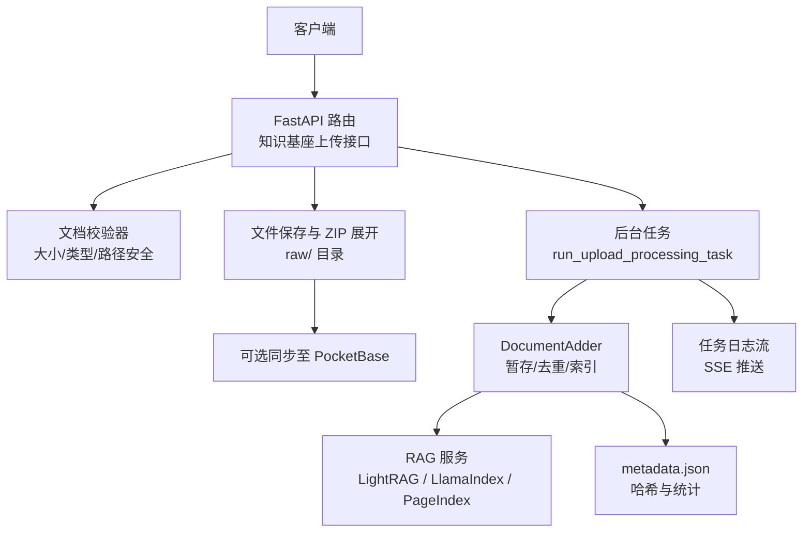
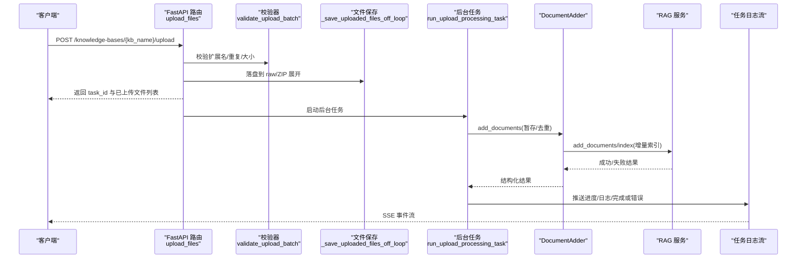
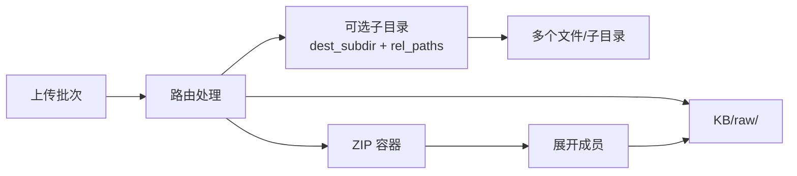
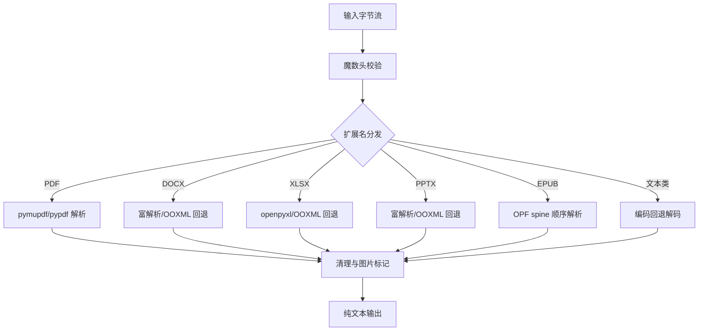
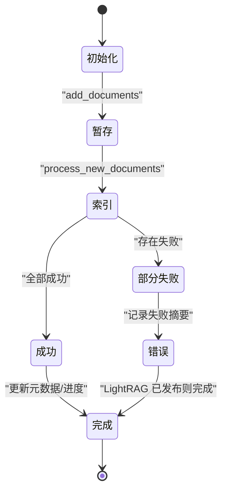
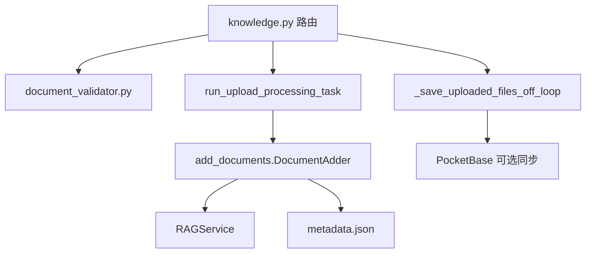

# 文档上传与处理

<cite>
**本文引用的文件**   
- [knowledge.py](file://deeptutor/api/routers/knowledge.py)
- [document_validator.py](file://deeptutor/utils/document_validator.py)
- [document_extractor.py](file://deeptutor/utils/document_extractor.py)
- [add_documents.py](file://deeptutor/knowledge/add_documents.py)
- [test_knowledge_zip_upload.py](file://tests/api/test_knowledge_zip_upload.py)
</cite>

## 目录
1. [简介](#简介)
2. [项目结构](#项目结构)
3. [核心组件](#核心组件)
4. [架构总览](#架构总览)
5. [详细组件分析](#详细组件分析)
6. [依赖关系分析](#依赖关系分析)
7. [性能与批量优化](#性能与批量优化)
8. [故障排查指南](#故障排查指南)
9. [结论](#结论)

## 简介
本文档面向“文档上传与处理”能力，覆盖以下目标：
- 提供知识库文档上传接口说明，支持 PDF、DOCX、TXT、ZIP 等多种格式的批量上传。
- 记录文件验证机制：大小限制、类型检查、路径安全与 ZIP 解压安全。
- 说明文档解析流程：文本提取、格式转换、内容清洗与图片标记。
- 描述异步任务处理：后台索引、进度跟踪、日志流与错误恢复。
- 说明文件组织结构与目录管理：raw/ 目录、子目录保留、ZIP 展开策略。
- 总结批量操作优化策略与性能注意事项。

该功能主要位于后端 FastAPI 路由层、文档校验与提取工具层，以及知识库增量索引层。

## 项目结构
与文档上传和处理直接相关的代码分布在以下模块：
- API 路由层：接收上传请求、参数校验、触发后台任务。
- 工具层：文件安全校验、扩展名与 MIME 白名单、ZIP 解压与内容提取。
- 知识库层：文件暂存、去重、增量索引、进度与元数据更新。

**图表来源**
- [knowledge.py:3411-3524](file://deeptutor/api/routers/knowledge.py#L3411-L3524)
- [knowledge.py:429-588](file://deeptutor/api/routers/knowledge.py#L429-L588)
- [knowledge.py:1133-1394](file://deeptutor/api/routers/knowledge.py#L1133-L1394)
- [add_documents.py:162-587](file://deeptutor/knowledge/add_documents.py#L162-L587)

**章节来源**
- [knowledge.py:3411-3524](file://deeptutor/api/routers/knowledge.py#L3411-L3524)
- [knowledge.py:429-588](file://deeptutor/api/routers/knowledge.py#L429-L588)
- [knowledge.py:1133-1394](file://deeptutor/api/routers/knowledge.py#L1133-L1394)
- [add_documents.py:162-587](file://deeptutor/knowledge/add_documents.py#L162-L587)

## 核心组件
- 上传路由：POST `/knowledge-bases/{kb_name}/upload`，负责权限与提供者校验、扩展名白名单、ZIP 容器处理、后台任务调度。
- 文件校验器：统一的大小上限、扩展名与 MIME 白名单、文件名清洗与路径安全。
- 文件保存与 ZIP 展开：按相对路径写入 raw/，ZIP 成员逐个校验并展开，不索引 ZIP 本身。
- 后台任务：封装 DocumentAdder，执行暂存、去重、增量索引、进度与日志流。
- 文档提取器：PDF、DOCX、XLSX、PPTX、EPUB、文本类格式的多引擎解析与图片标记。
- 知识库索引：LightRAG、LlamaIndex、PageIndex 的差异化批处理与回退策略。

**章节来源**
- [knowledge.py:3411-3524](file://deeptutor/api/routers/knowledge.py#L3411-L3524)
- [document_validator.py:13-151](file://deeptutor/utils/document_validator.py#L13-L151)
- [knowledge.py:429-588](file://deeptutor/api/routers/knowledge.py#L429-L588)
- [knowledge.py:1133-1394](file://deeptutor/api/routers/knowledge.py#L1133-L1394)
- [document_extractor.py:239-309](file://deeptutor/utils/document_extractor.py#L239-L309)
- [add_documents.py:162-587](file://deeptutor/knowledge/add_documents.py#L162-L587)

## 架构总览
上传与处理的端到端流程如下：

**图表来源**
- [knowledge.py:3411-3524](file://deeptutor/api/routers/knowledge.py#L3411-L3524)
- [knowledge.py:603-654](file://deeptutor/api/routers/knowledge.py#L603-L654)
- [knowledge.py:561-588](file://deeptutor/api/routers/knowledge.py#L561-L588)
- [knowledge.py:1133-1394](file://deeptutor/api/routers/knowledge.py#L1133-L1394)
- [add_documents.py:266-335](file://deeptutor/knowledge/add_documents.py#L266-L335)

## 详细组件分析

### 上传接口与参数
- 接口：POST `/knowledge-bases/{kb_name}/upload`
- 主要参数：
  - files：多文件上传
  - rag_provider：可选，需与 KB 绑定提供者一致
  - rel_paths：浏览器文件夹选择时携带的相对路径数组
  - dest_subdir：将整批文件挂载到 KB 下的某个子目录
  - image_analysis：是否启用图片分析（影响 LightRAG 快照）
- 行为要点：
  - 校验 KB 可写与嵌入模型绑定状态
  - 根据 KB 提供者确定允许的文件扩展名集合
  - 允许 .zip 作为容器，内部成员受扩展名白名单约束
  - 使用线程池保存文件，避免阻塞事件循环
  - 返回 task_id，供前端查询进度与日志

**章节来源**
- [knowledge.py:3411-3524](file://deeptutor/api/routers/knowledge.py#L3411-L3524)

### 文件验证机制
- 大小限制：
  - 全局最大文件大小为 200MB，逐块写入时实时累计判断。
- 类型检查：
  - 默认扩展名白名单包含 PDF、TXT、MD、DOC/DOCX、RTF、HTML/XML、JSON、CSV、XLS/XLSX、PPT/PPTX、EPUB 等。
  - 当 KB 使用自定义解析器时，可扩展为“任意扩展名”，但仍进行文件名与大小校验。
  - 对默认策略还会进行 MIME 类型猜测校验。
- 安全性校验：
  - 文件名规范化、控制字符过滤、危险字符替换。
  - 拒绝空名、仅下划线名、隐藏文件（在“允许任意扩展名”模式下仍禁止以点开头）。
  - 路径片段清洗，防止目录穿越；ZIP 解压成员同样受目标目录约束。
- ZIP 容器：
  - ZIP 本身不被索引，只展开其成员。
  - 非法 ZIP 或无受支持成员的 ZIP 会被拒绝。
  - ZIP Slip 防护：即使成员路径包含 `..`，也会被限制在目标目录内。

```mermaid
flowchart TD
Start(["开始"]) --> SizeCheck["检查文件大小"]
SizeCheck --> |超限| RejectSize["拒绝：超过大小限制"]
SizeCheck --> ExtCheck["检查扩展名/MIME"]
ExtCheck --> |不支持| RejectExt["拒绝：不支持的类型"]
ExtCheck --> NameClean["清洗文件名与路径"]
NameClean --> ZipCheck{"是否为 ZIP？"}
ZipCheck --> |是| ZipExtract["解压 ZIP 成员并逐个校验"]
ZipExtract --> SaveMembers["保存成员到 raw/"]
ZipCheck --> |否| SaveFile["分块写入文件"]
SaveMembers --> Done(["完成"])
SaveFile --> Done
RejectSize --> End(["结束"])
RejectExt --> End
```

**图表来源**
- [document_validator.py:13-151](file://deeptutor/utils/document_validator.py#L13-L151)
- [knowledge.py:429-588](file://deeptutor/api/routers/knowledge.py#L429-L588)
- [test_knowledge_zip_upload.py:52-95](file://tests/api/test_knowledge_zip_upload.py#L52-L95)

**章节来源**
- [document_validator.py:13-151](file://deeptutor/utils/document_validator.py#L13-L151)
- [knowledge.py:429-588](file://deeptutor/api/routers/knowledge.py#L429-L588)
- [test_knowledge_zip_upload.py:52-95](file://tests/api/test_knowledge_zip_upload.py#L52-L95)

### 文件组织与目录管理
- 存储位置：每个知识库目录下存在 raw/ 子目录用于存放原始文件。
- 子目录保留：
  - 通过 rel_paths 和 dest_subdir 组合，可将整批文件挂载到 KB 内的指定子目录。
  - 浏览器文件夹选择时，相对路径中的父级不会传到服务器，因此不会造成目录逃逸。
- ZIP 展开策略：
  - ZIP 被当作容器，内部成员按各自相对路径保存到 raw/。
  - ZIP 本身不会被索引，也不会持久化注册为待处理文件。
- 可选同步：
  - 若启用 PocketBase，会在本地写入成功后尝试将文件镜像到远程记录（尽力而为，不影响主流程）。

**图表来源**
- [knowledge.py:429-588](file://deeptutor/api/routers/knowledge.py#L429-L588)

**章节来源**
- [knowledge.py:429-588](file://deeptutor/api/routers/knowledge.py#L429-L588)

### 文档解析与内容提取
- 支持的格式族：
  - 二进制 Office：PDF、DOCX、XLSX、PPTX
  - EPUB：基于标准库解析 OPF spine 顺序
  - 文本类：纯文本、Markdown、源码、JSON、XML、CSV 等
- 解析流程：
  - 先进行魔数头校验，防止扩展名欺骗。
  - 根据扩展名分发到对应解析器。
  - PDF 优先使用 pymupdf，失败回退 pypdf；DOCX/PPTX/XLSX 优先富解析，再回退 OOXML 或第三方库。
  - 文本类使用统一的编码回退链解码。
  - 输出为纯文本，必要时插入图片标记以便后续视觉模型处理。
- 容量限制：
  - 单文档字节上限与每文档字符上限可配置；聊天场景有更严格的每轮限制。
  - 超长文本会截断并附加提示。

**图表来源**
- [document_extractor.py:239-309](file://deeptutor/utils/document_extractor.py#L239-L309)
- [document_extractor.py:369-613](file://deeptutor/utils/document_extractor.py#L369-L613)

**章节来源**
- [document_extractor.py:239-309](file://deeptutor/utils/document_extractor.py#L239-L309)
- [document_extractor.py:369-613](file://deeptutor/utils/document_extractor.py#L369-L613)

### 异步任务处理、进度跟踪与错误恢复
- 后台任务入口：
  - 路由调用 BackgroundTasks 启动 run_upload_processing_task。
  - 任务初始化 ProgressTracker 与任务日志流管理器。
- 处理阶段：
  - 验证与暂存：计算文件哈希、复制/链接到 raw/，保留目录结构。
  - 增量索引：根据 RAG 提供者选择批处理或逐文件处理。
  - 元数据更新：记录已处理文件哈希、时间戳与统计信息。
  - 进度与日志：通过 SSE 流推送阶段消息、错误详情与完成信号。
- 错误恢复：
  - 部分文件失败会汇总失败摘要，任务状态标记为 error。
  - LightRAG 若已发布索引变更但后续簿记失败，任务仍标记 completed，并在日志中记录需要 reconciling。
  - 权限错误会转换为数据卷权限异常，便于上层提示修复挂载。

**图表来源**
- [knowledge.py:1133-1394](file://deeptutor/api/routers/knowledge.py#L1133-L1394)
- [add_documents.py:321-547](file://deeptutor/knowledge/add_documents.py#L321-L547)

**章节来源**
- [knowledge.py:1133-1394](file://deeptutor/api/routers/knowledge.py#L1133-L1394)
- [add_documents.py:321-547](file://deeptutor/knowledge/add_documents.py#L321-L547)

## 依赖关系分析
- 路由层依赖：
  - 校验器：DocumentValidator 提供统一的安全校验。
  - 文件保存：_save_uploaded_files/_save_uploaded_files_off_loop 负责落盘与 ZIP 展开。
  - 后台任务：run_upload_processing_task 协调 DocumentAdder 与 RAG 服务。
- 知识库层依赖：
  - DocumentAdder 封装暂存、去重与索引逻辑，适配不同 RAG 提供者。
  - metadata.json 维护 file_hashes、last_updated、last_indexed_count 等。
- 外部集成：
  - PocketBase：可选文件镜像。
  - RAG 服务：LightRAG/LlamaIndex/PageIndex 的索引实现。

**图表来源**
- [knowledge.py:3411-3524](file://deeptutor/api/routers/knowledge.py#L3411-L3524)
- [knowledge.py:429-588](file://deeptutor/api/routers/knowledge.py#L429-L588)
- [knowledge.py:1133-1394](file://deeptutor/api/routers/knowledge.py#L1133-L1394)
- [add_documents.py:162-587](file://deeptutor/knowledge/add_documents.py#L162-L587)

**章节来源**
- [knowledge.py:3411-3524](file://deeptutor/api/routers/knowledge.py#L3411-L3524)
- [knowledge.py:429-588](file://deeptutor/api/routers/knowledge.py#L429-L588)
- [knowledge.py:1133-1394](file://deeptutor/api/routers/knowledge.py#L1133-L1394)
- [add_documents.py:162-587](file://deeptutor/knowledge/add_documents.py#L162-L587)

## 性能与批量优化
- 事件循环保护：
  - 文件保存与 ZIP 展开在 worker 线程执行，避免阻塞 FastAPI 事件循环。
  - 暂存阶段的哈希计算与文件拷贝也通过 asyncio.to_thread 执行。
- 批量索引策略：
  - LlamaIndex：优先一次 publish 整个批次，失败时回退到逐文件处理。
  - LightRAG：持有原生写所有权跨整个接受批次，减少版本碎片。
  - PageIndex/GraphRAG：逐文件处理，保证单个文件失败不影响其他文件。
- 去重与增量：
  - 基于 content_hash 的去重，避免重复索引。
  - metadata.json 记录已索引文件的哈希键值，支持增量同步。
- 资源限制：
  - 上传大小上限 200MB，解析阶段有每文档与每轮字符上限。
  - EPUB 成员数量与解压总量有限制，防止恶意压缩包耗尽内存。

**章节来源**
- [knowledge.py:561-588](file://deeptutor/api/routers/knowledge.py#L561-L588)
- [knowledge.py:1133-1394](file://deeptutor/api/routers/knowledge.py#L1133-L1394)
- [add_documents.py:321-547](file://deeptutor/knowledge/add_documents.py#L321-L547)
- [document_extractor.py:69-81](file://deeptutor/utils/document_extractor.py#L69-L81)
- [document_extractor.py:112-118](file://deeptutor/utils/document_extractor.py#L112-L118)

## 故障排查指南
- 常见错误与定位：
  - 文件过大：检查 MAX_FILE_SIZE 与上传分块累计逻辑。
  - 类型不支持：确认扩展名是否在白名单或 KB 解析器允许范围。
  - ZIP 非法或无受支持成员：检查 ZIP 结构与成员扩展名。
  - 权限错误：检查数据卷挂载权限与 KB 目录可写性。
  - 索引失败：查看任务日志流与失败摘要，确认 RAG 提供者状态。
- 调试建议：
  - 使用任务日志流 SSE 接口获取实时日志。
  - 检查 metadata.json 中的 file_hashes 与 last_indexed_count。
  - 对于 LightRAG，关注是否已发布索引变更但簿记失败的情况。

**章节来源**
- [knowledge.py:1133-1394](file://deeptutor/api/routers/knowledge.py#L1133-L1394)
- [add_documents.py:549-587](file://deeptutor/knowledge/add_documents.py#L549-L587)

## 结论
本系统围绕 FastAPI 路由、文档校验与提取、知识库增量索引三大层次构建文档上传与处理能力。通过严格的安全校验、灵活的 ZIP 容器支持、线程化的 I/O 与批量化索引策略，系统在保障安全性的同时实现了高吞吐与可观测性。未来可在以下方面继续优化：
- 提供更细粒度的扩展名与 MIME 白名单配置界面。
- 增强 ZIP 解压的资源监控与配额控制。
- 完善 LightRAG 发布后簿记失败的自动修复流程。
- 增加更丰富的解析器回退与诊断日志。