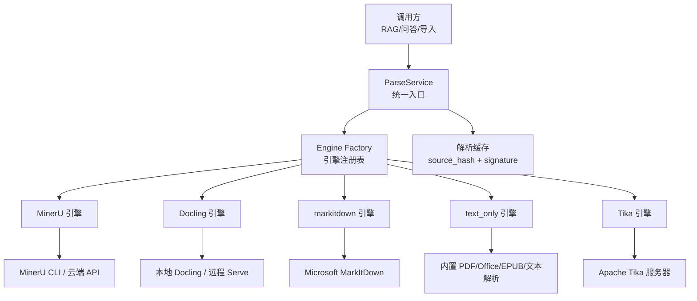
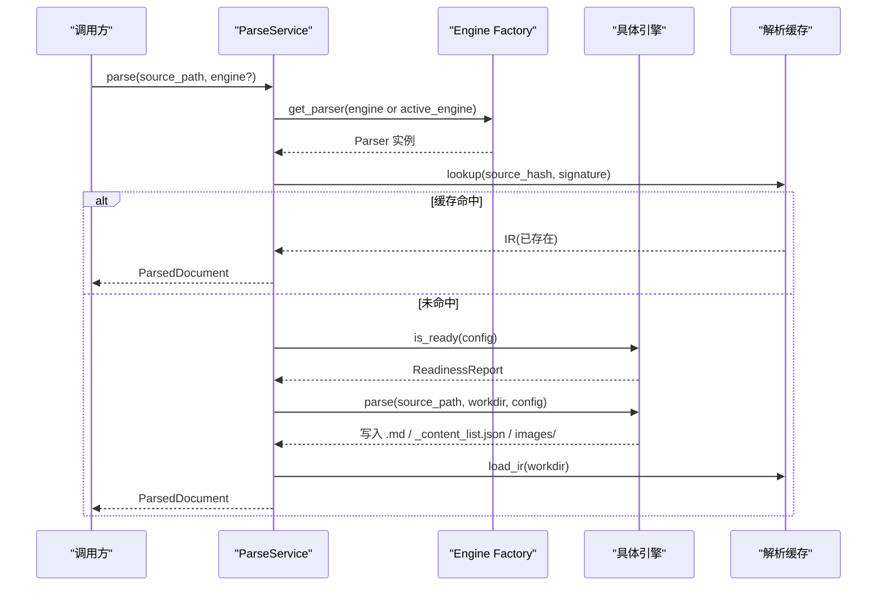
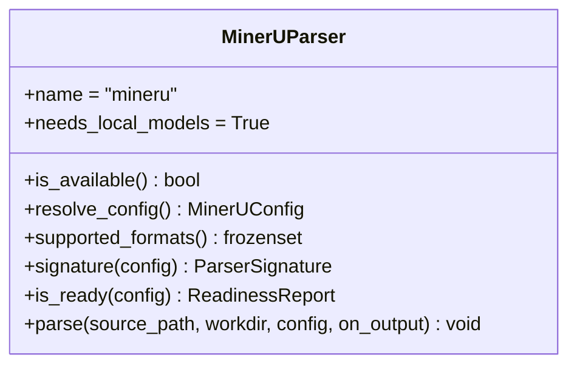
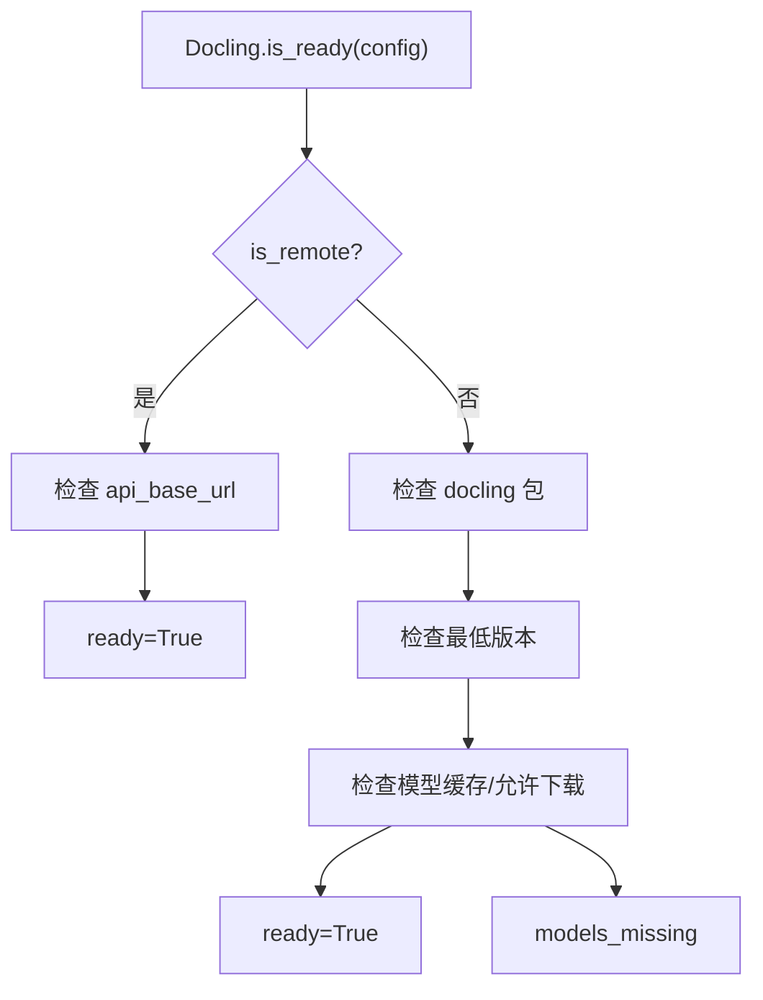
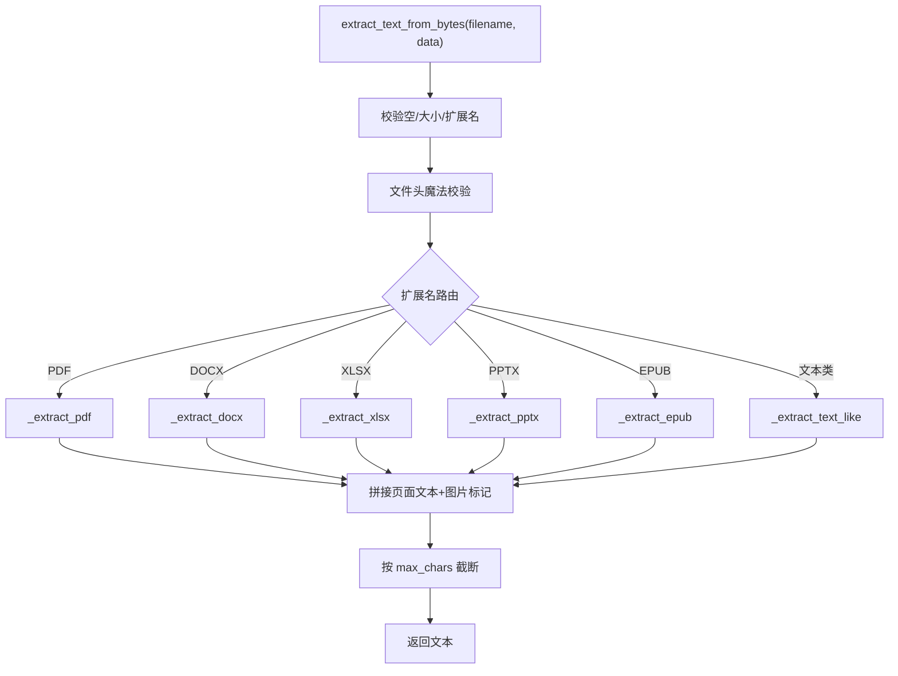
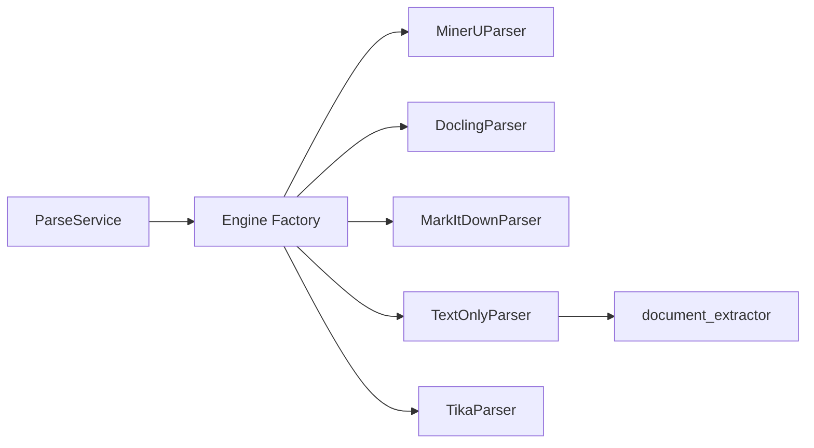
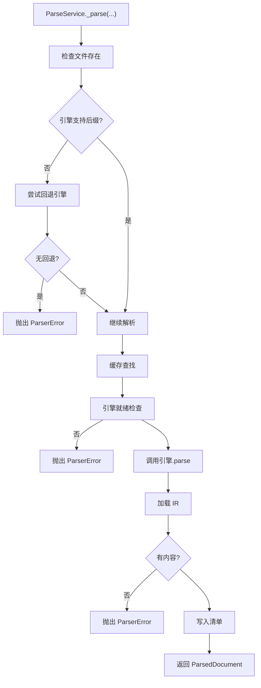

# 文档解析与提取

<cite>
**本文引用的文件**   
- [document_extractor.py](file://deeptutor/utils/document_extractor.py)
- [service.py](file://deeptutor/services/parsing/service.py)
- [base.py](file://deeptutor/services/parsing/base.py)
- [types.py](file://deeptutor/services/parsing/types.py)
- [factory.py](file://deeptutor/services/parsing/engines/factory.py)
- [engine.py（MinerU）](file://deeptutor/services/parsing/engines/mineru/engine.py)
- [engine.py（Docling）](file://deeptutor/services/parsing/engines/docling/engine.py)
- [engine.py（markitdown）](file://deeptutor/services/parsing/engines/markitdown/engine.py)
- [engine.py（text_only）](file://deeptutor/services/parsing/engines/text_only/engine.py)
- [engine.py（Tika）](file://deeptutor/services/parsing/engines/tika/engine.py)
</cite>

## 目录
1. [简介](#简介)
2. [项目结构](#项目结构)
3. [核心组件](#核心组件)
4. [架构总览](#架构总览)
5. [详细组件分析](#详细组件分析)
6. [依赖关系分析](#依赖关系分析)
7. [性能与配置](#性能与配置)
8. [错误处理与重试](#错误处理与重试)
9. [常见问题与调试](#常见问题与调试)
10. [结论](#结论)

## 简介
本文件面向“文档解析与内容提取”能力，覆盖以下目标：
- 支持的文档格式及解析策略：PDF、DOCX、XLSX、PPTX、EPUB、HTML/文本类。
- 文本提取算法：内置二进制文档解析、编码检测、图像标记、表格与结构化数据提取。
- OCR 支持：MinerU、Docling、PyMuPDF4LLM、Tika 等引擎的 OCR 能力说明。
- 预处理与后处理：文件头校验、大小限制、编码解码、文本清洗、Markdown 标准化输出。
- 解析器配置与性能参数：引擎选择、缓存、并发、隔离进程、模型下载控制。
- 错误处理与重试：异常分类、隔离进程错误映射、失败清理与可观测性。
- 故障排查：常见解析失败原因与定位技巧。

## 项目结构
文档解析由两层组成：
- 轻量级字节到文本提取：用于聊天附件和快速路径，直接返回纯文本或带图片标记的文本。
- 统一解析服务：通过“引擎工厂 + 多后端”将任意输入转换为统一的中间表示（Markdown + 可选结构化 blocks）。

**图表来源**
- [service.py:74-242](file://deeptutor/services/parsing/service.py#L74-L242)
- [factory.py:69-175](file://deeptutor/services/parsing/engines/factory.py#L69-L175)
- [engine.py（MinerU）:20-84](file://deeptutor/services/parsing/engines/mineru/engine.py#L20-L84)
- [engine.py（Docling）:78-170](file://deeptutor/services/parsing/engines/docling/engine.py#L78-L170)
- [engine.py（markitdown）:22-85](file://deeptutor/services/parsing/engines/markitdown/engine.py#L22-L85)
- [engine.py（text_only）:17-66](file://deeptutor/services/parsing/engines/text_only/engine.py#L17-L66)
- [engine.py（Tika）:18-65](file://deeptutor/services/parsing/engines/tika/engine.py#L18-L65)

**章节来源**
- [service.py:1-257](file://deeptutor/services/parsing/service.py#L1-L257)
- [factory.py:1-217](file://deeptutor/services/parsing/engines/factory.py#L1-L217)

## 核心组件
- ParseService：统一入口，负责引擎选择、缓存命中、就绪检查、工作目录写入与 IR 加载。
- Parser 协议：所有解析引擎必须实现的接口，包括配置、支持格式、签名、就绪检查与 parse。
- ParsedDocument：统一解析结果，包含 Markdown、可选结构化 blocks、资源目录、来源哈希、引擎签名与工作目录。
- Engine Factory：引擎名称到类的映射，提供可用性与列表查询。
- 内置 document_extractor：轻量级字节到文本提取，支撑 text_only 引擎与聊天附件场景。

**章节来源**
- [service.py:74-242](file://deeptutor/services/parsing/service.py#L74-L242)
- [base.py:19-84](file://deeptutor/services/parsing/base.py#L19-L84)
- [types.py:16-52](file://deeptutor/services/parsing/types.py#L16-L52)
- [factory.py:153-213](file://deeptutor/services/parsing/engines/factory.py#L153-L213)
- [document_extractor.py:239-310](file://deeptutor/utils/document_extractor.py#L239-L310)

## 架构总览
ParseService 是对外暴露的解析服务；它根据当前设置选择默认引擎，若该引擎不支持某后缀则尝试回退引擎；随后计算 source_hash 与 parser_signature，命中缓存则直接返回，否则执行 is_ready 检查并调用具体引擎的 parse，最后从工作目录加载 IR 并持久化清单。

**图表来源**
- [service.py:104-242](file://deeptutor/services/parsing/service.py#L104-L242)
- [base.py:30-84](file://deeptutor/services/parsing/base.py#L30-L84)
- [types.py:23-52](file://deeptutor/services/parsing/types.py#L23-L52)

## 详细组件分析

### 统一解析服务 ParseService
职责：
- 解析当前活动引擎与用户指定引擎。
- 对不支持的文件后缀进行回退引擎选择（优先 text_only，其次 markitdown，再次 tika）。
- 基于 source_hash 与 parser_signature 做缓存命中。
- 调用引擎 is_ready 检查模型/服务端配置。
- 调用引擎 parse 写入工作目录，再加载 IR 返回。

关键点：
- 当显式指定引擎且不支持时，抛出 ParserError；未指定时自动回退并记录警告。
- 缓存无效（无内容或损坏）会删除清单并重试。
- 解析完成后写入 manifest，包含 engine、signature、source_hash、source_name。

**章节来源**
- [service.py:28-71](file://deeptutor/services/parsing/service.py#L28-L71)
- [service.py:104-242](file://deeptutor/services/parsing/service.py#L104-L242)

### 解析协议与类型
- Parser 协议：定义 name、needs_local_models、resolve_config、supported_formats、signature、is_ready、parse。
- ReadinessReport：ready、reason、message，用于 UI 提示与流程门控。
- ParsedDocument：markdown、blocks、asset_dir、source_hash、parser_signature、engine、workdir。

**章节来源**
- [base.py:19-84](file://deeptutor/services/parsing/base.py#L19-L84)
- [types.py:16-52](file://deeptutor/services/parsing/types.py#L16-L52)

### 引擎工厂与元信息
- 引擎名映射：text_only、mineru、docling、markitdown、liteparse、pymupdf4llm、tika。
- list_engines 返回 UI 展示所需元信息（名称、描述、是否需要本地模型、是否可用）。
- get_parser 在模块启用检查失败时抛出 ParserError，引导安装或启用模块。

**章节来源**
- [factory.py:69-175](file://deeptutor/services/parsing/engines/factory.py#L69-L175)
- [factory.py:178-213](file://deeptutor/services/parsing/engines/factory.py#L178-L213)

### MinerU 引擎
特点：
- 最高保真度的多模态解析（布局、表格、公式），支持 PDF、常见图片、DOCX、PPTX、XLSX。
- 本地 CLI 需要下载模型；也可使用托管云 API。
- signature 包含模式、模型版本、语言、公式/表格开关、OCR 标志、分片参数等。
- is_ready 通过 readiness 模块检查本地模型或云端配置。

**图表来源**
- [engine.py（MinerU）:20-84](file://deeptutor/services/parsing/engines/mineru/engine.py#L20-L84)

**章节来源**
- [engine.py（MinerU）:20-84](file://deeptutor/services/parsing/engines/mineru/engine.py#L20-L84)

### Docling 引擎
特点：
- 结构化转换，导出 Markdown；结构化 content_list 映射延后实现。
- 支持本地运行或远程 Serve；本地需模型缓存。
- is_ready 检查包可用性、最低版本、模型是否存在或允许自动下载。
- verify 提供远程连通性测试。

**图表来源**
- [engine.py（Docling）:102-139](file://deeptutor/services/parsing/engines/docling/engine.py#L102-L139)

**章节来源**
- [engine.py（Docling）:78-170](file://deeptutor/services/parsing/engines/docling/engine.py#L78-L170)

### markitdown 引擎
特点：
- 多格式转 Markdown，无需本地模型。
- is_ready 检查包可用性与最低版本。
- parse 调用 MarkItDown 转换器，将 text_content/markdown 写入 .md。

**章节来源**
- [engine.py（markitdown）:22-85](file://deeptutor/services/parsing/engines/markitdown/engine.py#L22-L85)

### text_only 引擎
特点：
- 内置 PDF/Office/EPUB/文本解析，无外部引擎依赖。
- supported_formats 来自内置 SUPPORTED_DOC_EXTENSIONS。
- parse 通过隔离进程调用 worker_tasks 生成 .md，避免阻塞主进程。

**章节来源**
- [engine.py（text_only）:17-66](file://deeptutor/services/parsing/engines/text_only/engine.py#L17-L66)

### Tika 引擎
特点：
- 远程 Apache Tika 4 服务器，内容嗅探能力强，支持上千种类型。
- supported_formats 为空，表示将支持判断交给引擎自身。
- is_ready 要求配置 server_url；verify 提供连通性测试。

**章节来源**
- [engine.py（Tika）:18-65](file://deeptutor/services/parsing/engines/tika/engine.py#L18-L65)

### 内置文档提取器（聊天附件与快速路径）
功能：
- 支持 PDF、DOCX、XLSX、PPTX、EPUB 以及文本类扩展。
- 文件头魔法校验（PDF、OOXML、EPUB）。
- 大小限制与字符截断。
- PDF：优先 pymupdf，失败回退 pypdf；提取页面文本与图片标记。
- DOCX：优先 rich OOXML 解析，失败回退 python-docx 与原始 OOXML；保留表格与图片标记。
- XLSX：优先 openpyxl，失败回退原始 OOXML；按 sheet 与行输出。
- PPTX：优先 rich 解析，失败回退 python-pptx 与原始 OOXML；按 slide 输出。
- 文本类：复用 FileTypeRouter.decode_bytes 的多编码回退链。

**图表来源**
- [document_extractor.py:239-310](file://deeptutor/utils/document_extractor.py#L239-L310)
- [document_extractor.py:369-613](file://deeptutor/utils/document_extractor.py#L369-L613)

**章节来源**
- [document_extractor.py:239-310](file://deeptutor/utils/document_extractor.py#L239-L310)
- [document_extractor.py:369-613](file://deeptutor/utils/document_extractor.py#L369-L613)

## 依赖关系分析
- ParseService 依赖 Engine Factory 获取具体引擎实例。
- 各引擎通过 base.Parser 协议与 types.ParsedDocument 解耦。
- text_only 引擎依赖内置 document_extractor 与隔离进程。
- MinerU/Docling/Tika/markitdown 各自封装第三方依赖，并通过 is_ready 管理模型/服务端状态。

**图表来源**
- [service.py:74-242](file://deeptutor/services/parsing/service.py#L74-L242)
- [factory.py:69-175](file://deeptutor/services/parsing/engines/factory.py#L69-L175)
- [engine.py（text_only）:17-66](file://deeptutor/services/parsing/engines/text_only/engine.py#L17-L66)

**章节来源**
- [service.py:74-242](file://deeptutor/services/parsing/service.py#L74-L242)
- [factory.py:69-175](file://deeptutor/services/parsing/engines/factory.py#L69-L175)

## 性能与配置
- 引擎选择：可通过设置选择默认引擎；未指定引擎时，对不支持的后缀自动回退（text_only → markitdown → tika）。
- 缓存：基于 source_hash 与 parser_signature 的磁盘缓存；命中直接返回 IR，避免重复解析。
- 隔离进程：text_only 引擎通过隔离进程执行解析，避免阻塞主事件循环。
- 模型下载：MinerU 与 Docling 本地模式需要模型；Docling 支持允许自动下载或预取。
- 并发与限制：内置提取器支持 per-file 与 per-turn 的字节/字符上限；聊天附件还限制每轮嵌入图片数量与总字节数。
- 远程引擎：Docling Serve 与 Tika 服务器无需本地模型，但需正确配置 URL。

建议优化：
- 批量解析时尽量复用 ParseService 实例以利用缓存。
- 对大文档优先使用 MinerU 或 Docling 的结构化输出，减少后续 RAG 处理的噪声。
- 对纯文本/代码类文件使用 text_only 或 markitdown，避免不必要的模型开销。
- 合理设置 OCR 与表格开关，仅在必要时开启以提升速度。

**章节来源**
- [service.py:43-71](file://deeptutor/services/parsing/service.py#L43-L71)
- [service.py:180-242](file://deeptutor/services/parsing/service.py#L180-L242)
- [engine.py（text_only）:51-66](file://deeptutor/services/parsing/engines/text_only/engine.py#L51-L66)
- [engine.py（Docling）:129-139](file://deeptutor/services/parsing/engines/docling/engine.py#L129-L139)
- [document_extractor.py:67-81](file://deeptutor/utils/document_extractor.py#L67-L81)

## 错误处理与重试
- 内置提取器异常：
  - UnsupportedDocumentError：不支持的扩展名。
  - CorruptDocumentError：文件头不匹配、加密 PDF、读取失败。
  - EmptyDocumentError：空文件或无可提取文本。
  - DocumentTooLargeError：超过文件大小限制。
- 解析服务异常：
  - ParserError：引擎不可用、模型缺失、服务端未配置、引擎不支持后缀、解析结果为空。
- 隔离进程异常：
  - IsolatedWorkerError 被映射为对应的 DocumentExtractionError 子类，保持公共错误语义。
- 失败清理：
  - 解析失败时清理工作目录，避免脏缓存。
- 可观测性：
  - 通过 current_run 记录阶段与文档状态（parsing/parsed/failed），便于追踪。

**图表来源**
- [service.py:132-242](file://deeptutor/services/parsing/service.py#L132-L242)
- [document_extractor.py:239-310](file://deeptutor/utils/document_extractor.py#L239-L310)

**章节来源**
- [service.py:132-242](file://deeptutor/services/parsing/service.py#L132-L242)
- [document_extractor.py:150-171](file://deeptutor/utils/document_extractor.py#L150-L171)
- [document_extractor.py:312-366](file://deeptutor/utils/document_extractor.py#L312-L366)

## 常见问题与调试
- 无法识别文件格式：
  - 检查扩展名是否正确；内置提取器会对 PDF/Office/EPUB 进行文件头校验。
  - 若显式指定引擎且不支持，请更换引擎或在设置中选择合适引擎。
- PDF 加密或损坏：
  - 加密 PDF 会被拒绝；损坏文件会抛出 CorruptDocumentError。
  - 建议使用 MinerU 或 Docling 提升鲁棒性。
- DOCX/XLSX/PPTX 解析失败：
  - 优先 rich OOXML 解析失败时会回退到 python-docx/openpyxl/python-pptx 与原始 OOXML。
  - 若仍失败，检查文件是否损坏或依赖库是否安装。
- 文本编码问题：
  - 文本类文件使用 FileTypeRouter.decode_bytes 的多编码回退链；若仍失败，检查文件编码。
- MinerU/Docling 模型缺失：
  - 本地模式需要模型；可在设置中允许自动下载或使用 docling-tools models download 预取。
- Tika/Docling 远程连接失败：
  - 检查 server_url/api_base_url 配置；使用引擎的 verify 方法测试连通性。
- 解析结果为空：
  - 可能是文档确实无可提取文本；检查源文件内容与引擎支持范围。
- 性能瓶颈：
  - 对大文档启用结构化解析（MinerU/Docling）以减少后续处理成本。
  - 合理使用 OCR 与表格开关，避免不必要的计算。

**章节来源**
- [document_extractor.py:213-287](file://deeptutor/utils/document_extractor.py#L213-L287)
- [document_extractor.py:369-613](file://deeptutor/utils/document_extractor.py#L369-L613)
- [engine.py（Docling）:102-148](file://deeptutor/services/parsing/engines/docling/engine.py#L102-L148)
- [engine.py（Tika）:40-53](file://deeptutor/services/parsing/engines/tika/engine.py#L40-L53)

## 结论
DeepTutor 的文档解析与提取体系通过“统一解析服务 + 多引擎工厂 + 内置轻量提取器”实现了高可扩展性与强兼容性。对于聊天附件与快速路径，内置提取器提供稳定高效的文本抽取；对于复杂文档与多模态需求，MinerU、Docling、markitdown、Tika 等引擎提供了丰富的解析能力与 OCR/表格/结构化数据支持。通过缓存、隔离进程、就绪检查与清晰的错误分类，系统在保证性能的同时具备良好的可观测性与可维护性。