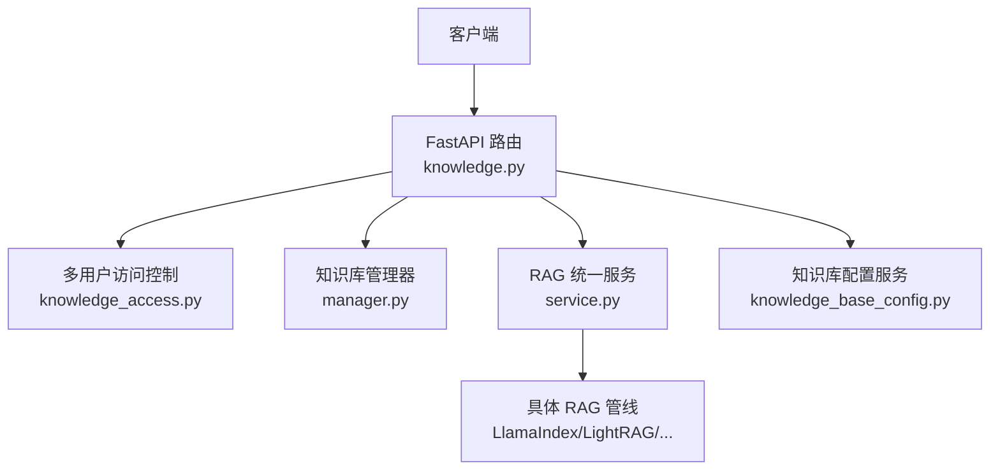
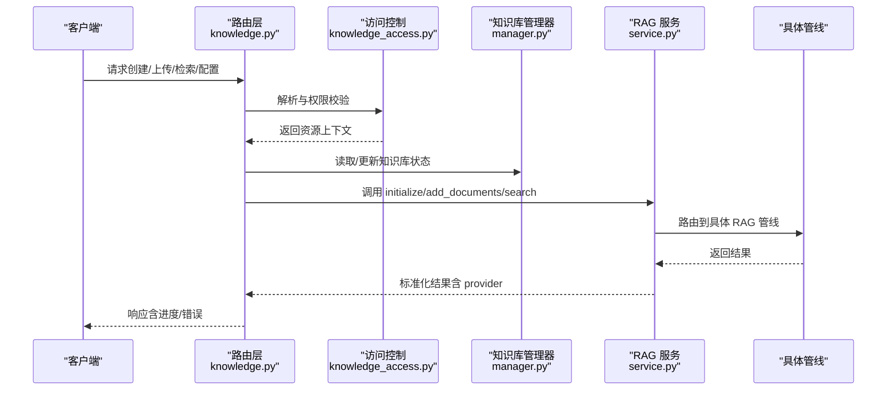
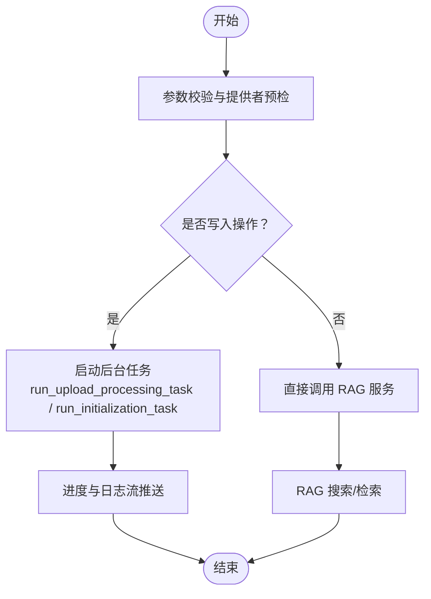
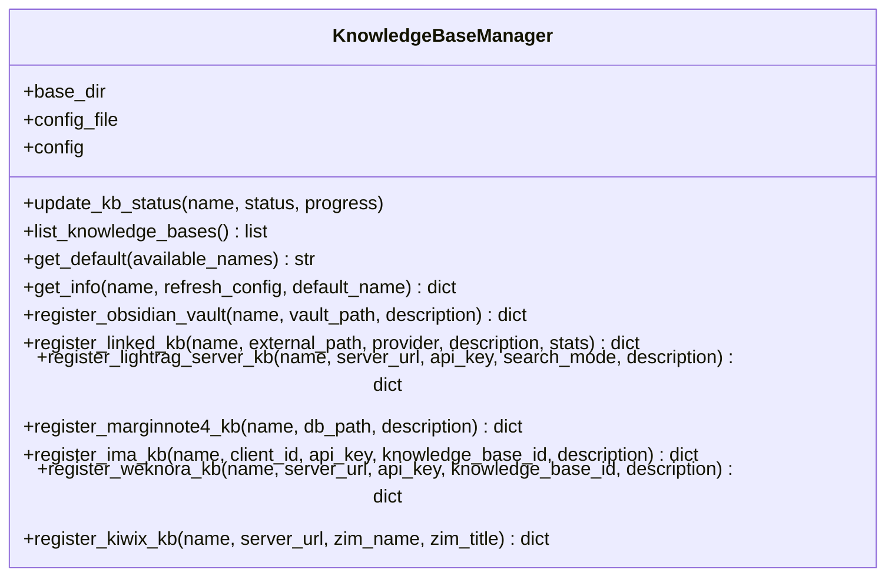
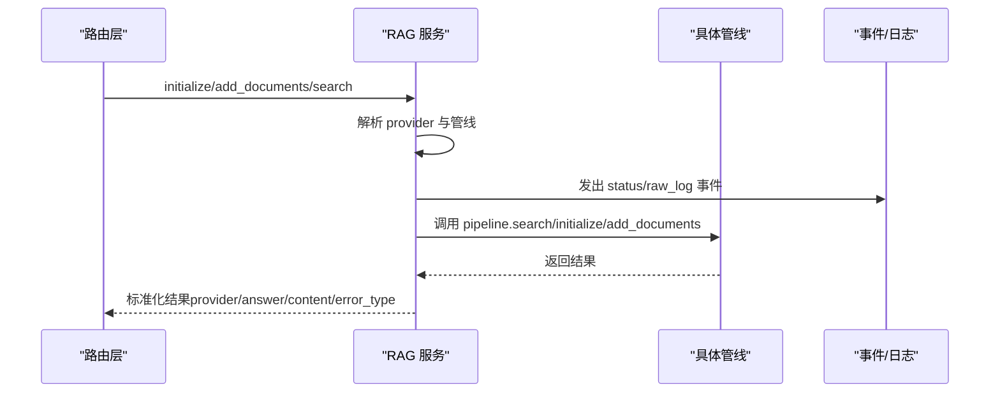
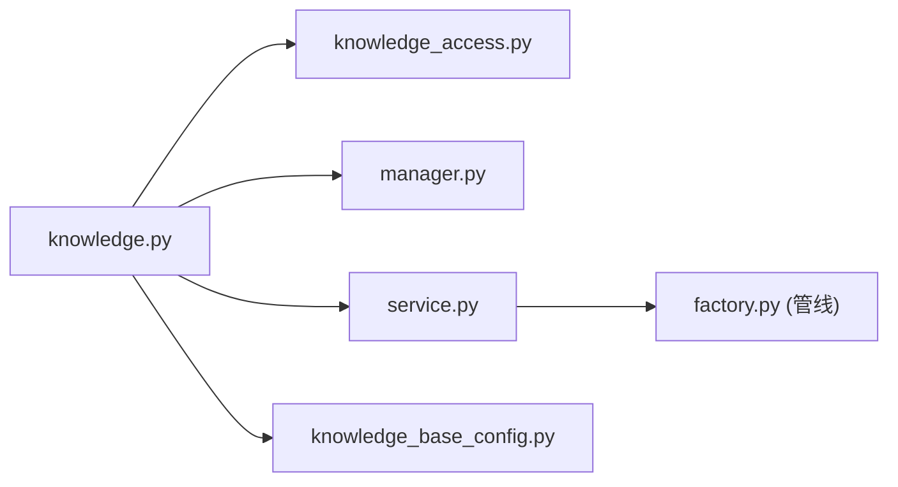

# 知识库 API

<cite>
**本文引用的文件**   
- [knowledge.py](file://deeptutor/api/routers/knowledge.py)
- [manager.py](file://deeptutor/knowledge/manager.py)
- [service.py](file://deeptutor/services/rag/service.py)
- [smart_retriever.py](file://deeptutor/services/rag/smart_retriever.py)
- [errors.py](file://deeptutor/services/rag/pipelines/llamaindex/errors.py)
- [knowledge_access.py](file://deeptutor/multi_user/knowledge_access.py)
- [knowledge_base_config.py](file://deeptutor/services/config/knowledge_base_config.py)
</cite>

## 目录
1. [简介](#简介)
2. [项目结构](#项目结构)
3. [核心组件](#核心组件)
4. [架构总览](#架构总览)
5. [详细组件分析](#详细组件分析)
6. [依赖关系分析](#依赖关系分析)
7. [性能与优化](#性能与优化)
8. [故障排查指南](#故障排查指南)
9. [结论](#结论)
10. [附录：API 参考](#附录api-参考)

## 简介
本文件为 DeepTutor 知识库管理系统的完整 API 文档，覆盖知识库的创建、配置、文档导入、索引构建、RAG 检索、批量操作、进度跟踪与错误处理，并提供优化与调优建议。系统通过 FastAPI 路由暴露接口，后端由知识库管理器与 RAG 服务编排，支持多种 RAG 引擎（如 LlamaIndex、LightRAG、GraphRAG、PageIndex、IMA、WeKnora、Kiwix 等），并具备多用户权限隔离、工作区与账户库路径、以及连接外部资源（Obsidian、MarginNote 4、外部 LightRAG Server）的能力。

## 项目结构
知识库相关代码主要分布在以下模块：
- API 路由层：`deeptutor/api/routers/knowledge.py`
- 知识库元数据与生命周期管理：`deeptutor/knowledge/manager.py`
- RAG 统一入口与检索编排：`deeptutor/services/rag/service.py`
- 智能检索聚合：`deeptutor/services/rag/smart_retriever.py`
- 多用户访问控制与 KB 解析：`deeptutor/multi_user/knowledge_access.py`
- 知识库集中式配置读写：`deeptutor/services/config/knowledge_base_config.py`
- LlamaIndex 错误语义化：`deeptutor/services/rag/pipelines/llamaindex/errors.py`

**图表来源**
- [knowledge.py:118-119](file://deeptutor/api/routers/knowledge.py#L118-L119)
- [knowledge_access.py:92-116](file://deeptutor/multi_user/knowledge_access.py#L92-L116)
- [manager.py:322-334](file://deeptutor/knowledge/manager.py#L322-L334)
- [service.py:22-65](file://deeptutor/services/rag/service.py#L22-L65)
- [knowledge_base_config.py:133-163](file://deeptutor/services/config/knowledge_base_config.py#L133-L163)

**章节来源**
- [knowledge.py:1-119](file://deeptutor/api/routers/knowledge.py#L1-L119)
- [manager.py:322-334](file://deeptutor/knowledge/manager.py#L322-L334)
- [service.py:22-65](file://deeptutor/services/rag/service.py#L22-L65)

## 核心组件
- 知识库路由层：提供知识库 CRUD、上传、初始化、配置、预检、模型选项、受支持文件类型、默认库设置、连接外部资源等接口。
- 知识库管理器：负责 kb_config.json 的加载、合并、缓存、状态更新、自动发现与清理、默认库选择、路径解析、连接型知识库注册等。
- RAG 服务：按知识库绑定引擎路由到具体管线，封装 initialize/add_documents/search/delete/smart_retrieve，统一事件与日志捕获。
- 智能检索器：对查询进行变体生成与并发检索，聚合结果。
- 多用户访问控制：解析 KB 引用、权限校验、读写保护、工作区与账户库路径。
- 配置服务：集中式知识库配置读写，合并默认值与引擎模式。

**章节来源**
- [knowledge.py:118-119](file://deeptutor/api/routers/knowledge.py#L118-L119)
- [manager.py:322-334](file://deeptutor/knowledge/manager.py#L322-L334)
- [service.py:22-65](file://deeptutor/services/rag/service.py#L22-L65)
- [smart_retriever.py:16-44](file://deeptutor/services/rag/smart_retriever.py#L16-L44)
- [knowledge_access.py:92-116](file://deeptutor/multi_user/knowledge_access.py#L92-L116)
- [knowledge_base_config.py:133-163](file://deeptutor/services/config/knowledge_base_config.py#L133-L163)

## 架构总览
知识库 API 的请求流程如下：
- 客户端调用路由接口。
- 路由层进行参数校验、提供者预检、权限与可写性检查。
- 对于写入类操作（创建、上传、同步文件夹、连接外部资源），路由触发后台任务，使用任务 ID 管理与日志流推送进度。
- 知识库管理器维护 kb_config.json 的状态与元信息。
- RAG 服务根据知识库绑定的引擎执行索引或检索。
- 配置服务提供全局与单库配置读写。

**图表来源**
- [knowledge.py:987-1131](file://deeptutor/api/routers/knowledge.py#L987-L1131)
- [knowledge_access.py:92-116](file://deeptutor/multi_user/knowledge_access.py#L92-L116)
- [manager.py:500-625](file://deeptutor/knowledge/manager.py#L500-L625)
- [service.py:67-124](file://deeptutor/services/rag/service.py#L67-L124)

## 详细组件分析

### 知识库路由层（knowledge.py）
职责概览：
- 健康检查、RAG 提供者列表与模式设置、各引擎配置读写（LlamaIndex、GraphRAG、LightRAG、LightRAG Server、PageIndex、IMA）。
- 模型选项与活跃模型切换、受支持文件类型、知识库配置读写、默认库设置。
- 连接外部资源：Obsidian、MarginNote 4、本地文件夹（已构建索引）、LightRAG Server、WeKnora。
- 上传与初始化：批量文件保存、ZIP 解压、安全校验、异步任务调度、进度与日志流。
- 预检与兼容性测试：engine_preflight、GraphRAG 模型兼容性探测。

关键流程：
- 初始化任务：run_initialization_task 负责创建知识库、处理文档、更新进度与最终状态。
- 上传处理任务：run_upload_processing_task 负责分片保存、去重、增量索引、失败汇总、文件夹同步状态更新。
- 提供者预检：_assert_provider_ready 校验 PageIndex、GraphRAG、LightRAG 的环境依赖。
- 配置更新：各引擎配置端点支持部分更新，避免覆盖未传字段；LightRAG 支持 role_models 与旧版 llm_profile_id/model_id 互斥校验。

**图表来源**
- [knowledge.py:987-1131](file://deeptutor/api/routers/knowledge.py#L987-L1131)
- [knowledge.py:1133-1395](file://deeptutor/api/routers/knowledge.py#L1133-L1395)
- [knowledge.py:1840-1853](file://deeptutor/api/routers/knowledge.py#L1840-L1853)
- [knowledge.py:1723-1785](file://deeptutor/api/routers/knowledge.py#L1723-L1785)

**章节来源**
- [knowledge.py:1397-1447](file://deeptutor/api/routers/knowledge.py#L1397-L1447)
- [knowledge.py:1456-1479](file://deeptutor/api/routers/knowledge.py#L1456-L1479)
- [knowledge.py:1499-1527](file://deeptutor/api/routers/knowledge.py#L1499-L1527)
- [knowledge.py:1552-1583](file://deeptutor/api/routers/knowledge.py#L1552-L1583)
- [knowledge.py:1606-1649](file://deeptutor/api/routers/knowledge.py#L1606-L1649)
- [knowledge.py:1660-1684](file://deeptutor/api/routers/knowledge.py#L1660-L1684)
- [knowledge.py:1723-1785](file://deeptutor/api/routers/knowledge.py#L1723-L1785)
- [knowledge.py:1808-1837](file://deeptutor/api/routers/knowledge.py#L1808-L1837)
- [knowledge.py:1840-1853](file://deeptutor/api/routers/knowledge.py#L1840-L1853)
- [knowledge.py:1903-1913](file://deeptutor/api/routers/knowledge.py#L1903-L1913)
- [knowledge.py:1916-1958](file://deeptutor/api/routers/knowledge.py#L1916-L1958)
- [knowledge.py:1977-1989](file://deeptutor/api/routers/knowledge.py#L1977-L1989)
- [knowledge.py:2000-2035](file://deeptutor/api/routers/knowledge.py#L2000-L2035)
- [knowledge.py:2038-2058](file://deeptutor/api/routers/knowledge.py#L2038-L2058)
- [knowledge.py:2061-2161](file://deeptutor/api/routers/knowledge.py#L2061-L2161)
- [knowledge.py:2164-2192](file://deeptutor/api/routers/knowledge.py#L2164-L2192)
- [knowledge.py:2200-2224](file://deeptutor/api/routers/knowledge.py#L2200-L2224)
- [knowledge.py:2233-2259](file://deeptutor/api/routers/knowledge.py#L2233-L2259)
- [knowledge.py:2273-2340](file://deeptutor/api/routers/knowledge.py#L2273-L2340)
- [knowledge.py:2369-2399](file://deeptutor/api/routers/knowledge.py#L2369-L2399)

### 知识库管理器（manager.py）
职责概览：
- 加载与合并 kb_config.json，带共享锁与缓存，防止竞态与脏读。
- 自动发现与清理孤儿条目，兼容历史 rag_storage 布局。
- 更新知识库状态与进度，记录最后完成时间、索引计数与动作。
- 提供默认库选择、路径解析（raw/images/content_list/rag_storage）。
- 注册连接型知识库（Obsidian、Linked Index、LightRAG Server、MarginNote 4、IMA、WeKnora、Kiwix、Subagent）。

关键方法：
- update_kb_status：持久化状态与进度，必要时清理 PageIndex 相关的 embedding 字段，刷新 index_versions。
- list_knowledge_bases：列出所有知识库，清理孤儿，自动注册有效目录。
- get_info/_get_info：组装详细信息，包含状态、版本、错误摘要、连接型字段。
- register_*：各类连接型知识库注册，保证名称唯一性与路径有效性。

**图表来源**
- [manager.py:322-334](file://deeptutor/knowledge/manager.py#L322-L334)
- [manager.py:500-625](file://deeptutor/knowledge/manager.py#L500-L625)
- [manager.py:651-740](file://deeptutor/knowledge/manager.py#L651-L740)
- [manager.py:814-831](file://deeptutor/knowledge/manager.py#L814-L831)
- [manager.py:860-891](file://deeptutor/knowledge/manager.py#L860-L891)
- [manager.py:893-944](file://deeptutor/knowledge/manager.py#L893-L944)
- [manager.py:989-1037](file://deeptutor/knowledge/manager.py#L989-L1037)
- [manager.py:1039-1090](file://deeptutor/knowledge/manager.py#L1039-L1090)
- [manager.py:1112-1168](file://deeptutor/knowledge/manager.py#L1112-L1168)
- [manager.py:1170-1211](file://deeptutor/knowledge/manager.py#L1170-L1211)
- [manager.py:1213-1251](file://deeptutor/knowledge/manager.py#L1213-L1251)

**章节来源**
- [manager.py:322-334](file://deeptutor/knowledge/manager.py#L322-L334)
- [manager.py:500-625](file://deeptutor/knowledge/manager.py#L500-L625)
- [manager.py:651-740](file://deeptutor/knowledge/manager.py#L651-L740)
- [manager.py:814-831](file://deeptutor/knowledge/manager.py#L814-L831)
- [manager.py:860-891](file://deeptutor/knowledge/manager.py#L860-L891)
- [manager.py:893-944](file://deeptutor/knowledge/manager.py#L893-L944)
- [manager.py:989-1037](file://deeptutor/knowledge/manager.py#L989-L1037)
- [manager.py:1039-1090](file://deeptutor/knowledge/manager.py#L1039-L1090)
- [manager.py:1112-1168](file://deeptutor/knowledge/manager.py#L1112-L1168)
- [manager.py:1170-1211](file://deeptutor/knowledge/manager.py#L1170-L1211)
- [manager.py:1213-1251](file://deeptutor/knowledge/manager.py#L1213-L1251)

### RAG 服务（service.py）
职责概览：
- 统一入口：initialize、add_documents、search、delete、smart_retrieve。
- 按知识库绑定引擎选择管线，封装索引运行上下文与进度回调。
- 对 PageIndex 引擎提示“推理即检索”，需通过工具在代理循环中读取。
- 查询重写层可选，输出 rewrite_outcome 供追踪。
- 事件与原始日志捕获，便于前端展示检索过程。

关键流程：
- _index：包装 IndexingRun，记录文档状态、阶段、最终版本与可用性。
- search：注入 query_rewrite，标准化 answer/content/provider，标记 error_type/needs_reindex。
- smart_retrieve：基于 SmartRetriever 生成多个查询变体并发检索并聚合。

**图表来源**
- [service.py:67-124](file://deeptutor/services/rag/service.py#L67-L124)
- [service.py:126-250](file://deeptutor/services/rag/service.py#L126-L250)
- [service.py:350-364](file://deeptutor/services/rag/service.py#L350-L364)

**章节来源**
- [service.py:22-65](file://deeptutor/services/rag/service.py#L22-L65)
- [service.py:67-124](file://deeptutor/services/rag/service.py#L67-L124)
- [service.py:126-250](file://deeptutor/services/rag/service.py#L126-L250)
- [service.py:350-364](file://deeptutor/services/rag/service.py#L350-L364)

### 智能检索器（smart_retriever.py）
职责概览：
- 基于上下文生成查询变体，并发调用底层 search，聚合内容与来源。
- 适用于需要多角度检索的场景，提升召回质量。

**章节来源**
- [smart_retriever.py:16-44](file://deeptutor/services/rag/smart_retriever.py#L16-L44)

### 多用户访问控制（knowledge_access.py）
职责概览：
- 解析知识库引用（admin/user/别名/工作区），返回 KnowledgeResource。
- 非管理员不可写分配的管理员知识库，限制写入权限。
- 默认库别名映射（如 default/current/selected/默认/当前知识库）。

**章节来源**
- [knowledge_access.py:41-65](file://deeptutor/multi_user/knowledge_access.py#L41-L65)
- [knowledge_access.py:92-116](file://deeptutor/multi_user/knowledge_access.py#L92-L116)
- [knowledge_access.py:119-188](file://deeptutor/multi_user/knowledge_access.py#L119-L188)

### 知识库配置服务（knowledge_base_config.py）
职责概览：
- 合并 defaults 与单库配置，规范化 rag_provider 与 search_mode。
- 提供 get/set 单库配置与 provider/search_mode 便捷方法。

**章节来源**
- [knowledge_base_config.py:133-163](file://deeptutor/services/config/knowledge_base_config.py#L133-L163)

## 依赖关系分析
- 路由层依赖访问控制以解析资源与权限，依赖知识库管理器进行状态与元信息读写，依赖 RAG 服务进行索引与检索。
- RAG 服务依赖管线工厂与引擎绑定，按知识库绑定选择具体实现。
- 配置服务与运行时设置服务共同支撑引擎参数与知识库元数据。

**图表来源**
- [knowledge.py:118-119](file://deeptutor/api/routers/knowledge.py#L118-L119)
- [knowledge_access.py:92-116](file://deeptutor/multi_user/knowledge_access.py#L92-L116)
- [manager.py:322-334](file://deeptutor/knowledge/manager.py#L322-L334)
- [service.py:22-65](file://deeptutor/services/rag/service.py#L22-L65)
- [knowledge_base_config.py:133-163](file://deeptutor/services/config/knowledge_base_config.py#L133-L163)

**章节来源**
- [knowledge.py:118-119](file://deeptutor/api/routers/knowledge.py#L118-L119)
- [knowledge_access.py:92-116](file://deeptutor/multi_user/knowledge_access.py#L92-L116)
- [manager.py:322-334](file://deeptutor/knowledge/manager.py#L322-L334)
- [service.py:22-65](file://deeptutor/services/rag/service.py#L22-L65)
- [knowledge_base_config.py:133-163](file://deeptutor/services/config/knowledge_base_config.py#L133-L163)

## 性能与优化
- 上传与索引异步化：
  - 使用后台任务与线程池避免阻塞事件循环（例如 _save_uploaded_files_off_loop、asyncio.to_thread）。
  - 进度与日志流通过 TaskIDManager 与 TaskLogStream 实时推送。
- 配置与目录缓存：
  - 知识库管理器对 kb_config.json 使用共享锁与短期缓存，减少频繁 IO。
- 引擎参数优化：
  - LlamaIndex：retrieval_profile、top_k、BM25 与向量乘数、reranker、HNSW 参数、chunk_size/overlap。
  - LightRAG：role_models、top_k、response_type、并发与超时、实体抽取次数。
  - GraphRAG：response_type、community_level、dynamic_community_selection。
  - PageIndex/IMA：凭证配置与预检，确保可用后再创建知识库。
- 索引版本与嵌入签名：
  - 当嵌入模型或维度变化时，知识库标记 needs_reindex/embedding_mismatch，UI 提示重建索引。
- 批量操作与去重：
  - 上传前校验文件名与大小，ZIP 解压安全校验，重复文件拒绝或跳过。
- 检索优化：
  - 使用 SmartRetriever 生成多查询变体并发检索，提高召回率。
  - 查询重写层可选，保留 trace 以便分析。

[本节为通用指导，不直接分析具体文件]

## 故障排查指南
常见问题与定位：
- 索引损坏或嵌入向量无效：
  - LlamaIndex 错误会返回 error_type=invalid_embedding_index 与 needs_reindex=True，需重建索引。
- 引擎不可用或环境缺失：
  - PageIndex 缺少 API Key、GraphRAG 未安装、LightRAG 未安装，预检端点会返回失败详情。
- 权限不足：
  - 非管理员访问管理员知识库或尝试写入只读分配知识库，将返回 403。
- 配置冲突：
  - 更改 rag_provider 但已有就绪索引，需显式重建；LightRAG 新旧模型选择字段互斥。
- 进度与任务状态不一致：
  - 后台任务异常时会记录服务器堆栈，同时更新任务状态为 error，知识库状态为 error。

**章节来源**
- [errors.py:30-59](file://deeptutor/services/rag/pipelines/llamaindex/errors.py#L30-L59)
- [knowledge.py:764-843](file://deeptutor/api/routers/knowledge.py#L764-L843)
- [knowledge.py:1840-1853](file://deeptutor/api/routers/knowledge.py#L1840-L1853)
- [knowledge.py:2088-2147](file://deeptutor/api/routers/knowledge.py#L2088-L2147)
- [knowledge.py:987-1131](file://deeptutor/api/routers/knowledge.py#L987-L1131)
- [knowledge.py:1133-1395](file://deeptutor/api/routers/knowledge.py#L1133-L1395)

## 结论
DeepTutor 知识库 API 提供了完整的知识库生命周期管理能力，涵盖创建、配置、文档导入、索引构建、RAG 检索与外部资源连接。通过多用户访问控制、异步任务与进度流、引擎预检与兼容性测试，系统在易用性与健壮性之间取得平衡。结合引擎参数优化与索引版本管理，可满足大规模知识检索与增强生成的需求。

[本节为总结，不直接分析具体文件]

## 附录：API 参考
以下为知识库相关的主要 API 分组与说明（仅列端点与用途，具体请求/响应字段请参考对应路由定义）：

- 健康与提供者
  - GET /api/knowledge-bases/health：知识库健康检查
  - GET /api/knowledge-bases/rag-providers：列出可用 RAG 提供者
  - PUT /api/knowledge-bases/rag-providers/{provider}/mode：设置引擎默认检索模式

- 引擎配置
  - GET/PUT /api/knowledge-bases/rag-pipelines/pageindex/config：PageIndex 凭证
  - GET/PUT /api/knowledge-bases/rag-pipelines/ima/config：IMA 凭证
  - GET/PUT /api/knowledge-bases/rag-pipelines/llamaindex/config：LlamaIndex 检索与分块参数
  - GET/PUT /api/knowledge-bases/rag-pipelines/graphrag/config：GraphRAG 查询参数
  - GET/PUT /api/knowledge-bases/rag-pipelines/lightrag/config：LightRAG 查询与索引参数
  - GET/PUT /api/knowledge-bases/rag-pipelines/lightrag-server/config：LightRAG Server 默认值

- 模型与兼容性
  - GET /api/knowledge-bases/rag-pipelines/lightrag/model-options：LightRAG 模型选项
  - GET /api/knowledge-bases/rag-pipelines/model-options：引擎模型选项（llm/embedding）
  - GET /api/knowledge-bases/embedding-usage：账户内嵌入模型使用情况
  - POST /api/knowledge-bases/rag-pipelines/graphrag/model-compatibility：GraphRAG 模型兼容性测试
  - PUT /api/knowledge-bases/rag-pipelines/active-model：设置活跃模型（llm/embedding）

- 知识库配置与默认库
  - GET /api/knowledge-bases/configs：获取所有知识库配置
  - GET /api/knowledge-bases/{kb_name}/config：获取单库配置
  - PUT /api/knowledge-bases/{kb_name}/config：更新单库配置
  - POST /api/knowledge-bases/configs/sync：从 metadata 同步配置
  - GET /api/knowledge-bases/default：获取默认知识库
  - PUT /api/knowledge-bases/default/{kb_name}：设置默认知识库

- 连接外部资源
  - POST /api/knowledge-bases/connect-obsidian：连接 Obsidian 仓库
  - POST /api/knowledge-bases/connect-marginnote4：连接 MarginNote 4 库
  - POST /api/knowledge-bases/probe-folder：探测本地文件夹索引
  - POST /api/knowledge-bases/connect-folder：挂载本地索引为只读知识库
  - POST /api/knowledge-bases/probe-lightrag-server：探测 LightRAG Server
  - POST /api/knowledge-bases/connect-lightrag-server：连接 LightRAG Server

- 文件与上传
  - GET /api/knowledge-bases/supported-file-types：受支持文件类型与大小限制
  - （上传与初始化）POST /api/knowledge-bases/*：创建知识库、上传文件、ZIP 解压、异步任务进度

- RAG 检索
  - 通过 RAGService.search 与 SmartRetriever.retrieve 实现语义搜索、向量相似度匹配与结果过滤；具体查询参数由各引擎管线决定。

[本节为参考清单，不直接分析具体文件]