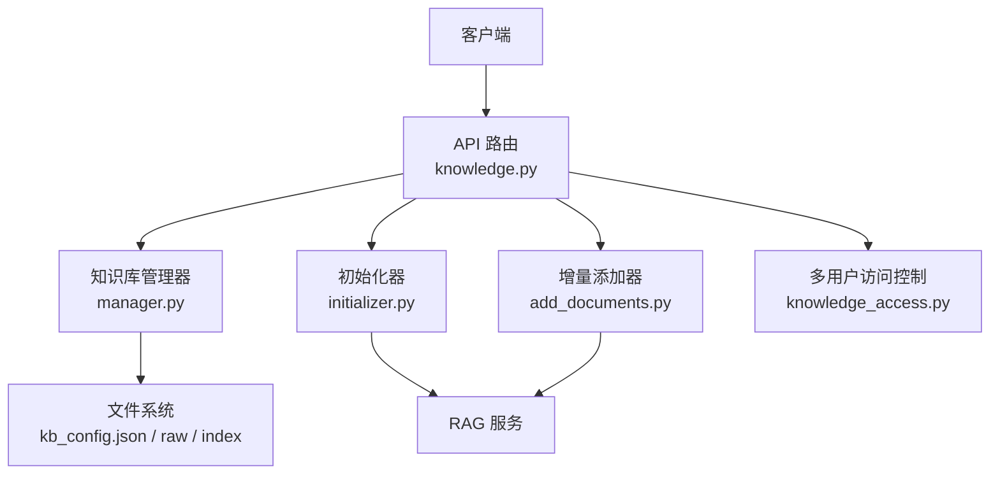
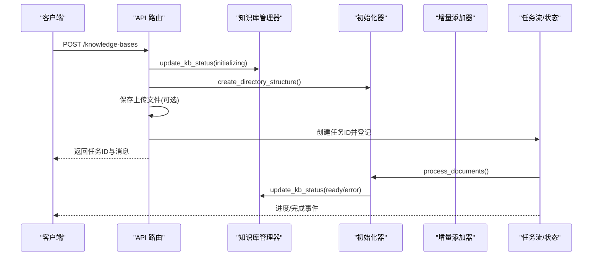
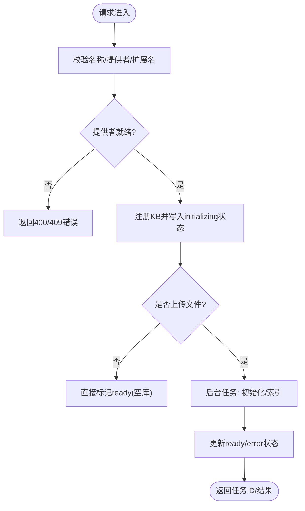
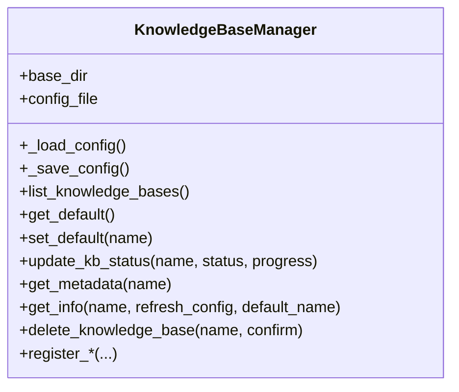
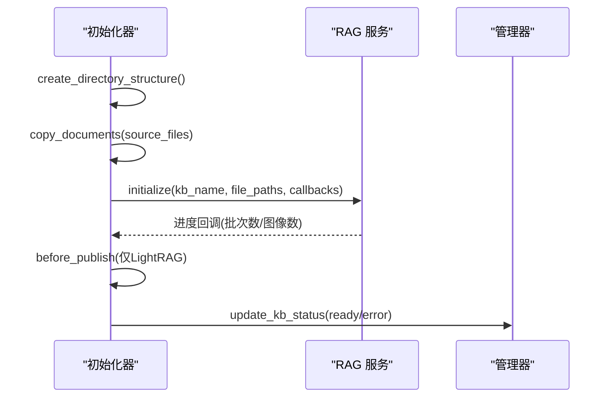
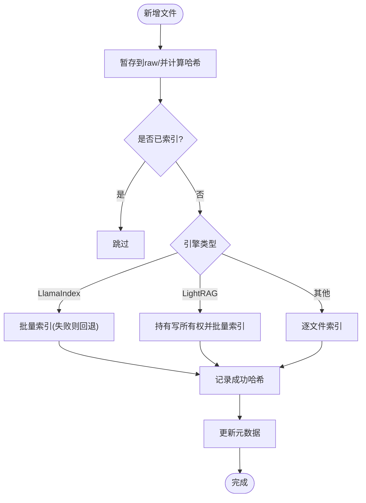
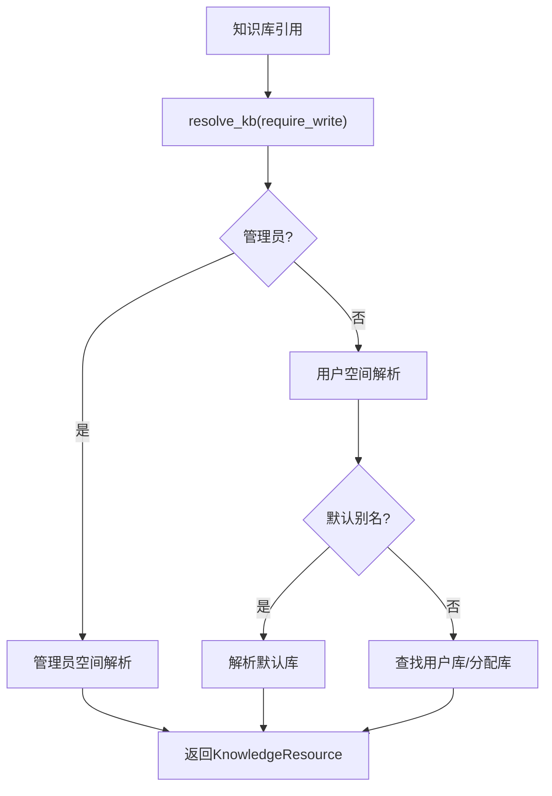
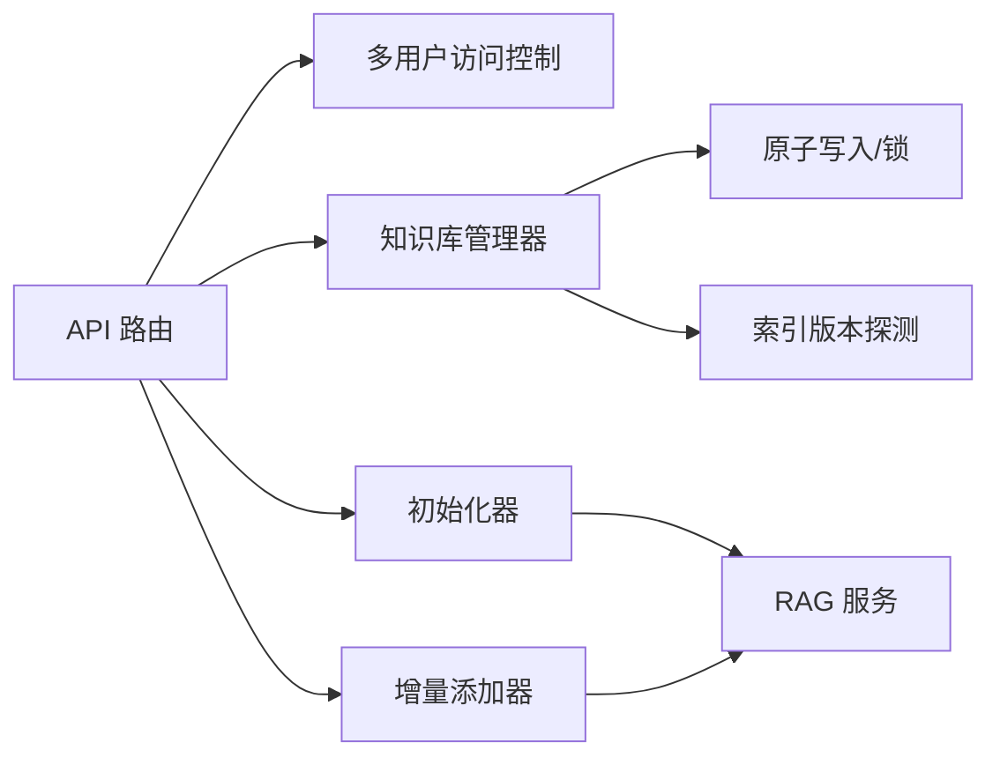
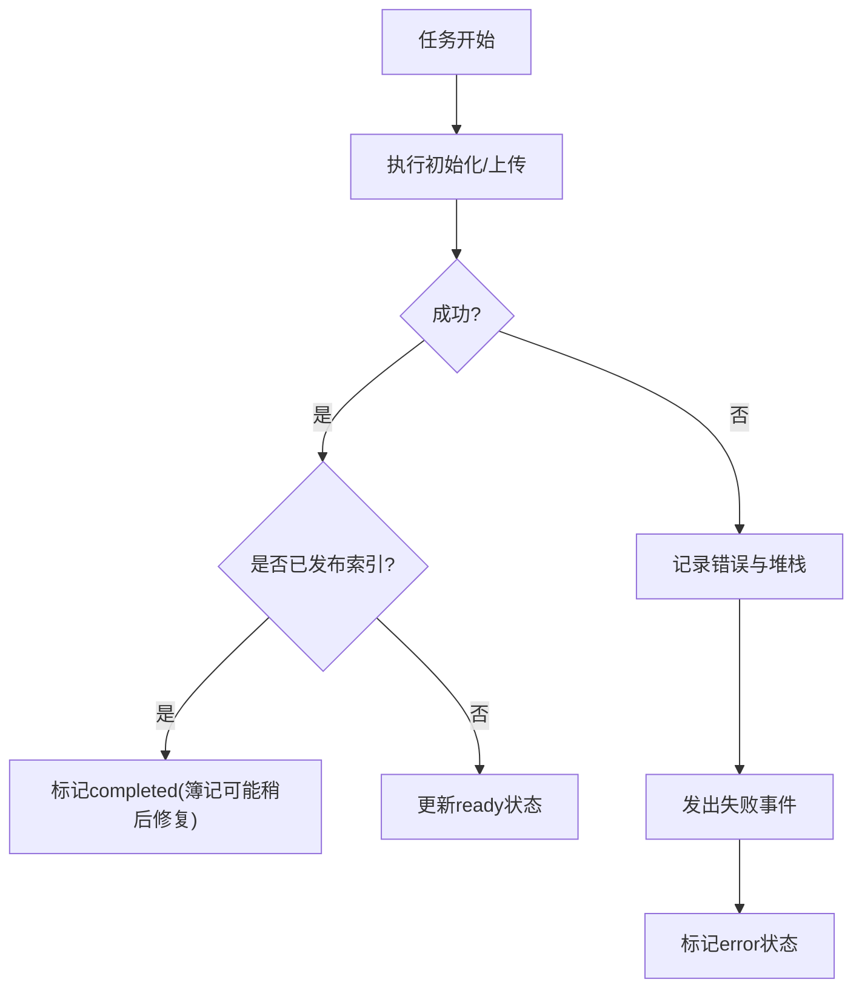

# 知识库管理

<cite>
**本文引用的文件**   
- [knowledge.py](file://deeptutor/api/routers/knowledge.py)
- [manager.py](file://deeptutor/knowledge/manager.py)
- [initializer.py](file://deeptutor/knowledge/initializer.py)
- [add_documents.py](file://deeptutor/knowledge/add_documents.py)
- [knowledge_access.py](file://deeptutor/multi_user/knowledge_access.py)
</cite>

## 目录
1. [简介](#简介)
2. [项目结构](#项目结构)
3. [核心组件](#核心组件)
4. [架构总览](#架构总览)
5. [详细组件分析](#详细组件分析)
6. [依赖关系分析](#依赖关系分析)
7. [性能与容量特性](#性能与容量特性)
8. [错误处理与异常恢复](#错误处理与异常恢复)
9. [多用户权限与访问控制](#多用户权限与访问控制)
10. [配置、存储路径与调优参数](#配置存储路径与调优参数)
11. [故障排查指南](#故障排查指南)
12. [结论](#结论)

## 简介
本文件为 DeepTutor 知识库管理模块的 API 与实现文档，覆盖知识库的创建、删除、更新、查询、元数据管理、状态监控、生命周期（从初始化到索引构建）、多用户权限控制、配置选项、存储路径管理与性能调优。读者可据此理解后端路由、管理器、初始化器、增量添加器以及多用户访问控制的协作方式。

## 项目结构
知识库相关代码主要分布在以下位置：
- API 路由层：`deeptutor/api/routers/knowledge.py`
- 知识库管理器：`deeptutor/knowledge/manager.py`
- 初始化流程：`deeptutor/knowledge/initializer.py`
- 增量文档添加：`deeptutor/knowledge/add_documents.py`
- 多用户访问控制：`deeptutor/multi_user/knowledge_access.py`

**图示来源**
- [knowledge.py:3527-3603](file://deeptutor/api/routers/knowledge.py#L3527-L3603)
- [manager.py:322-335](file://deeptutor/knowledge/manager.py#L322-L335)
- [initializer.py:35-63](file://deeptutor/knowledge/initializer.py#L35-L63)
- [add_documents.py:162-185](file://deeptutor/knowledge/add_documents.py#L162-L185)
- [knowledge_access.py:92-116](file://deeptutor/multi_user/knowledge_access.py#L92-L116)

**章节来源**
- [knowledge.py:1-118](file://deeptutor/api/routers/knowledge.py#L1-L118)
- [manager.py:1-59](file://deeptutor/knowledge/manager.py#L1-L59)

## 核心组件
- API 路由层
  - 负责接收 HTTP 请求、校验输入、执行权限检查、调度后台任务、返回结构化响应。
  - 关键能力：创建知识库、上传文件、列出知识库、删除知识库、查询健康与提供者、更新引擎配置等。
- 知识库管理器
  - 维护 `kb_config.json`，提供注册、列表、默认库、状态更新、元数据读取、路径解析等方法。
  - 负责清理孤儿条目、自动发现并注册有效知识库目录。
- 初始化器
  - 负责创建目录结构、复制源文档、调用 RAG 服务进行索引构建，并持久化进度与最终状态。
- 增量添加器
  - 负责将新文件安全地暂存到 `raw/`，按绑定引擎进行增量索引，记录哈希以去重，更新元数据。
- 多用户访问控制
  - 基于当前用户与工作区上下文解析知识库资源，区分管理员与用户空间，支持只读分配库与写保护。

**章节来源**
- [knowledge.py:182-248](file://deeptutor/api/routers/knowledge.py#L182-L248)
- [manager.py:322-335](file://deeptutor/knowledge/manager.py#L322-L335)
- [initializer.py:35-63](file://deeptutor/knowledge/initializer.py#L35-L63)
- [add_documents.py:162-185](file://deeptutor/knowledge/add_documents.py#L162-L185)
- [knowledge_access.py:92-116](file://deeptutor/multi_user/knowledge_access.py#L92-L116)

## 架构总览
知识库管理的端到端流程如下：
- 创建知识库：路由校验名称与提供者 → 写入初始状态 → 创建目录结构 → 可选保存上传文件 → 后台任务执行初始化与索引 → 更新完成状态。
- 增量添加：路由校验与权限检查 → 文件验证与安全保存 → 后台任务暂存与索引 → 更新元数据与状态。
- 删除知识库：路由校验 → 管理器删除目录与配置项 → 清理默认库引用。
- 查询与监控：路由通过管理器获取列表、详情、健康信息；后台任务通过任务流管理器广播进度。

**图示来源**
- [knowledge.py:3527-3603](file://deeptutor/api/routers/knowledge.py#L3527-L3603)
- [knowledge.py:987-1131](file://deeptutor/api/routers/knowledge.py#L987-L1131)
- [initializer.py:132-153](file://deeptutor/knowledge/initializer.py#L132-L153)
- [initializer.py:179-323](file://deeptutor/knowledge/initializer.py#L179-L323)

**章节来源**
- [knowledge.py:3527-3603](file://deeptutor/api/routers/knowledge.py#L3527-L3603)
- [knowledge.py:987-1131](file://deeptutor/api/routers/knowledge.py#L987-L1131)

## 详细组件分析

### API 路由层（知识库）
职责与要点：
- 创建知识库
  - 校验知识库名称与提供者可用性，必要时冻结 LightRAG 索引策略快照。
  - 立即写入“initializing”状态，创建目录结构，保存上传文件（若存在），启动后台初始化任务。
  - 返回任务 ID，供前端轮询或订阅进度。
- 删除知识库
  - 支持路径参数与请求体两种删除入口，避免 URL 编码导致的名称限制问题。
  - 委托管理器执行删除逻辑，确保配置与目录一致性。
- 列出知识库
  - 通过工作区与资源选择上下文过滤可见知识库，结合多用户访问控制返回结果。
- 健康与提供者
  - 健康接口快速统计已注册知识库数量，避免昂贵目录探测。
  - 提供者接口返回可用引擎及其模式，支持设置默认检索模式。
- 引擎配置
  - PageIndex、LightRAG、IMA 等引擎的配置读写，密钥以布尔掩码形式暴露给前端。

**图示来源**
- [knowledge.py:3527-3603](file://deeptutor/api/routers/knowledge.py#L3527-L3603)
- [knowledge.py:3606-3815](file://deeptutor/api/routers/knowledge.py#L3606-L3815)
- [knowledge.py:3374-3396](file://deeptutor/api/routers/knowledge.py#L3374-L3396)
- [knowledge.py:1397-1424](file://deeptutor/api/routers/knowledge.py#L1397-L1424)
- [knowledge.py:1426-1480](file://deeptutor/api/routers/knowledge.py#L1426-L1480)

**章节来源**
- [knowledge.py:3527-3603](file://deeptutor/api/routers/knowledge.py#L3527-L3603)
- [knowledge.py:3606-3815](file://deeptutor/api/routers/knowledge.py#L3606-L3815)
- [knowledge.py:3374-3396](file://deeptutor/api/routers/knowledge.py#L3374-L3396)
- [knowledge.py:1397-1424](file://deeptutor/api/routers/knowledge.py#L1397-L1424)
- [knowledge.py:1426-1480](file://deeptutor/api/routers/knowledge.py#L1426-L1480)

### 知识库管理器
职责与要点：
- 配置加载与缓存
  - 使用原子写入与共享锁保证并发安全，带短期缓存减少重复扫描。
- 列表与孤儿清理
  - 清理无目录的孤儿条目，自动发现并注册有效的知识库目录。
- 状态与元数据
  - 提供状态更新、元数据读取、默认库设置与解析、路径解析（含外部连接库）。
- 连接型知识库
  - 支持 Obsidian vault、Linked Index、LightRAG Server、MarginNote 4、IMA、WeKnora、Kiwix 等指针类型，不触发本地索引。

**图示来源**
- [manager.py:322-335](file://deeptutor/knowledge/manager.py#L322-L335)
- [manager.py:651-740](file://deeptutor/knowledge/manager.py#L651-L740)
- [manager.py:1316-1360](file://deeptutor/knowledge/manager.py#L1316-L1360)
- [manager.py:1374-1427](file://deeptutor/knowledge/manager.py#L1374-L1427)
- [manager.py:1777-1873](file://deeptutor/knowledge/manager.py#L1777-L1873)

**章节来源**
- [manager.py:322-335](file://deeptutor/knowledge/manager.py#L322-L335)
- [manager.py:651-740](file://deeptutor/knowledge/manager.py#L651-L740)
- [manager.py:1316-1360](file://deeptutor/knowledge/manager.py#L1316-L1360)
- [manager.py:1374-1427](file://deeptutor/knowledge/manager.py#L1374-L1427)
- [manager.py:1777-1873](file://deeptutor/knowledge/manager.py#L1777-L1873)

### 初始化器
职责与要点：
- 目录结构与元数据
  - 创建 `raw/` 目录，写入 `metadata.json`，注册到配置并标记“initializing”。
- 文档处理
  - 收集受支持文件，调用 RAG 服务进行索引构建，回调进度与图像描述进度。
- 发布与收尾
  - 对 LightRAG 在发布前更新元数据，完成后记录统计信息，最终状态由后台任务统一更新。

**图示来源**
- [initializer.py:132-153](file://deeptutor/knowledge/initializer.py#L132-L153)
- [initializer.py:179-323](file://deeptutor/knowledge/initializer.py#L179-L323)
- [initializer.py:345-401](file://deeptutor/knowledge/initializer.py#L345-L401)

**章节来源**
- [initializer.py:132-153](file://deeptutor/knowledge/initializer.py#L132-L153)
- [initializer.py:179-323](file://deeptutor/knowledge/initializer.py#L179-L323)
- [initializer.py:345-401](file://deeptutor/knowledge/initializer.py#L345-L401)

### 增量添加器
职责与要点：
- 文件暂存与去重
  - 计算内容哈希，跳过已索引文件，保留文件夹结构。
- 批量与单文件索引
  - LlamaIndex 优先批量发布，失败时回退到逐文件；LightRAG 持有写所有权进行批次发布。
- 元数据更新
  - 成功后更新 `last_indexed_at/count/action` 与 `file_hashes`，便于后续同步与增量检测。

**图示来源**
- [add_documents.py:266-319](file://deeptutor/knowledge/add_documents.py#L266-L319)
- [add_documents.py:321-335](file://deeptutor/knowledge/add_documents.py#L321-L335)
- [add_documents.py:337-425](file://deeptutor/knowledge/add_documents.py#L337-L425)
- [add_documents.py:427-493](file://deeptutor/knowledge/add_documents.py#L427-L493)
- [add_documents.py:495-547](file://deeptutor/knowledge/add_documents.py#L495-L547)
- [add_documents.py:549-586](file://deeptutor/knowledge/add_documents.py#L549-L586)

**章节来源**
- [add_documents.py:266-319](file://deeptutor/knowledge/add_documents.py#L266-L319)
- [add_documents.py:321-335](file://deeptutor/knowledge/add_documents.py#L321-L335)
- [add_documents.py:337-425](file://deeptutor/knowledge/add_documents.py#L337-L425)
- [add_documents.py:427-493](file://deeptutor/knowledge/add_documents.py#L427-L493)
- [add_documents.py:495-547](file://deeptutor/knowledge/add_documents.py#L495-L547)
- [add_documents.py:549-586](file://deeptutor/knowledge/add_documents.py#L549-L586)

### 多用户访问控制
职责与要点：
- 资源解析
  - 根据当前用户与工作区上下文解析知识库引用，支持默认别名、管理员分配库、用户库。
- 可见性列表
  - 合并用户自有库与管理员分配库，标注只读与来源标签。
- 写保护
  - 管理员分配库为只读，禁止写操作；普通用户库允许写入。

**图示来源**
- [knowledge_access.py:92-116](file://deeptutor/multi_user/knowledge_access.py#L92-L116)
- [knowledge_access.py:119-201](file://deeptutor/multi_user/knowledge_access.py#L119-L201)
- [knowledge_access.py:221-261](file://deeptutor/multi_user/knowledge_access.py#L221-L261)
- [knowledge_access.py:296-341](file://deeptutor/multi_user/knowledge_access.py#L296-L341)

**章节来源**
- [knowledge_access.py:92-116](file://deeptutor/multi_user/knowledge_access.py#L92-L116)
- [knowledge_access.py:119-201](file://deeptutor/multi_user/knowledge_access.py#L119-L201)
- [knowledge_access.py:221-261](file://deeptutor/multi_user/knowledge_access.py#L221-L261)
- [knowledge_access.py:296-341](file://deeptutor/multi_user/knowledge_access.py#L296-L341)

## 依赖关系分析
- API 路由依赖
  - 多用户访问控制：用于权限校验与资源解析。
  - 知识库管理器：用于状态更新、元数据与路径解析。
  - 初始化器与增量添加器：分别负责首次索引与增量索引。
  - RAG 工厂与服务：用于提供者枚举、模式设置与索引构建。
- 管理器依赖
  - 文件 IO 原子写入：保证配置并发安全。
  - 索引版本探测：用于状态推断与兼容性检查。
- 初始化器与增量添加器依赖
  - RAG 服务：封装不同引擎的索引构建与增量添加。
  - 文件类型路由器：识别受支持的文件格式。

**图示来源**
- [knowledge.py:40-111](file://deeptutor/api/routers/knowledge.py#L40-L111)
- [manager.py:37-57](file://deeptutor/knowledge/manager.py#L37-L57)
- [initializer.py:18-30](file://deeptutor/knowledge/initializer.py#L18-L30)
- [add_documents.py:15-33](file://deeptutor/knowledge/add_documents.py#L15-L33)

**章节来源**
- [knowledge.py:40-111](file://deeptutor/api/routers/knowledge.py#L40-L111)
- [manager.py:37-57](file://deeptutor/knowledge/manager.py#L37-L57)
- [initializer.py:18-30](file://deeptutor/knowledge/initializer.py#L18-L30)
- [add_documents.py:15-33](file://deeptutor/knowledge/add_documents.py#L15-L33)

## 性能与容量特性
- 上传与索引
  - 大文件与批量上传通过线程池执行，避免阻塞事件循环。
  - LlamaIndex 批量索引失败时回退到逐文件索引，提高容错性。
  - LightRAG 在批次索引期间持有写所有权，保证发布一致性。
- 配置与目录扫描
  - 管理器对配置加载进行短期缓存，减少频繁磁盘扫描。
  - 健康接口仅统计已注册知识库数量，避免昂贵探测。
- 容量限制
  - 单个文件与压缩包大小受 DocumentValidator 限制，防止 zip-bomb 与超大文件。
  - 文件名与路径段经过清洗与校验，防止目录穿越与非法字符。

**章节来源**
- [knowledge.py:561-588](file://deeptutor/api/routers/knowledge.py#L561-L588)
- [knowledge.py:312-380](file://deeptutor/api/routers/knowledge.py#L312-L380)
- [knowledge.py:429-558](file://deeptutor/api/routers/knowledge.py#L429-L558)
- [knowledge.py:1397-1424](file://deeptutor/api/routers/knowledge.py#L1397-L1424)
- [manager.py:343-376](file://deeptutor/knowledge/manager.py#L343-L376)

## 错误处理与异常恢复
- 初始化与上传任务
  - 捕获异常后记录任务日志与服务器堆栈，更新任务状态为 error，并通过任务流管理器发出失败事件。
  - 若 LightRAG 已发布索引但后续簿记失败，任务仍标记为 completed，避免 UI 长期显示处理中。
- 权限与提供者准备
  - 未安装或未配置的引擎（如 GraphRAG、PageIndex、LightRAG）会返回明确的 400/409 错误。
- 删除与目录清理
  - 删除时尝试 chmod 重试，即使 rmtree 失败也会清理配置条目，避免僵尸知识库。
- 增量索引失败
  - 记录每个文件的失败原因，汇总摘要返回给调用方，便于定位问题。

**图示来源**
- [knowledge.py:987-1131](file://deeptutor/api/routers/knowledge.py#L987-L1131)
- [knowledge.py:1133-1394](file://deeptutor/api/routers/knowledge.py#L1133-L1394)
- [manager.py:1777-1873](file://deeptutor/knowledge/manager.py#L1777-L1873)
- [add_documents.py:427-493](file://deeptutor/knowledge/add_documents.py#L427-L493)

**章节来源**
- [knowledge.py:987-1131](file://deeptutor/api/routers/knowledge.py#L987-L1131)
- [knowledge.py:1133-1394](file://deeptutor/api/routers/knowledge.py#L1133-L1394)
- [manager.py:1777-1873](file://deeptutor/knowledge/manager.py#L1777-L1873)
- [add_documents.py:427-493](file://deeptutor/knowledge/add_documents.py#L427-L493)

## 多用户权限与访问控制
- 资源解析规则
  - 管理员可直接访问管理员空间；普通用户只能访问用户空间与已分配的管理员库（只读）。
  - 支持默认别名（如“默认”、“当前”）与工作区上下文下的资源选择。
- 可见性与审计
  - 列出可见知识库时合并用户库与分配库，标注来源与只读属性。
  - 对分配库的 RAG 查询进行使用审计。
- 写保护
  - 管理员分配库禁止写操作，普通用户库允许写入。

**章节来源**
- [knowledge_access.py:92-116](file://deeptutor/multi_user/knowledge_access.py#L92-L116)
- [knowledge_access.py:119-201](file://deeptutor/multi_user/knowledge_access.py#L119-L201)
- [knowledge_access.py:221-261](file://deeptutor/multi_user/knowledge_access.py#L221-L261)
- [knowledge_access.py:296-341](file://deeptutor/multi_user/knowledge_access.py#L296-L341)

## 配置、存储路径与调优参数
- 存储路径
  - 知识库根目录：`data/knowledge_bases`（可通过管理器 base_dir 调整）。
  - 每个知识库包含 `raw/`（原始文档）、`llamaindex_storage/`（历史兼容）、版本化索引目录。
- 配置项
  - `kb_config.json`：权威配置，包含知识库列表、状态、最后索引时间、提供者、嵌入模型指纹等。
  - `metadata.json`：知识库元数据，包含提供者、最后更新时间、索引计数、文件哈希等。
- 引擎配置
  - PageIndex：API Key 配置，UI 中以布尔掩码暴露。
  - LightRAG：角色模型与默认索引策略，支持冻结快照与写所有权。
  - IMA：账户级 Client ID 与 API Key，支持按库覆盖。
- 性能调优
  - 批量索引与逐文件回退策略。
  - 线程池执行上传与哈希计算，避免阻塞事件循环。
  - 配置缓存与目录扫描优化。

**章节来源**
- [manager.py:322-335](file://deeptutor/knowledge/manager.py#L322-L335)
- [manager.py:378-457](file://deeptutor/knowledge/manager.py#L378-L457)
- [manager.py:1374-1427](file://deeptutor/knowledge/manager.py#L1374-L1427)
- [knowledge.py:1482-1583](file://deeptutor/api/routers/knowledge.py#L1482-L1583)
- [knowledge.py:1751-1785](file://deeptutor/api/routers/knowledge.py#L1751-L1785)

## 故障排查指南
- 无法创建知识库
  - 检查名称合法性与提供者是否已安装与配置。
  - 确认工作区未被归档且存储空间可写。
- 索引构建失败
  - 查看任务日志与服务器堆栈，确认 RAG 服务与嵌入模型配置。
  - LightRAG 已发布但簿记失败时，等待下次状态收敛。
- 增量添加失败
  - 检查文件格式与大小限制，确认文件哈希去重逻辑。
  - 批量索引失败时会回退到逐文件索引，查看具体文件错误。
- 删除知识库失败
  - 若目录不可删除，管理器仍会清理配置条目；检查权限与文件句柄占用。
- 多用户访问被拒绝
  - 确认当前用户是否为管理员或已被分配该知识库。
  - 管理员分配库为只读，无法写入。

**章节来源**
- [knowledge.py:3527-3603](file://deeptutor/api/routers/knowledge.py#L3527-L3603)
- [knowledge.py:987-1131](file://deeptutor/api/routers/knowledge.py#L987-L1131)
- [knowledge.py:1133-1394](file://deeptutor/api/routers/knowledge.py#L1133-L1394)
- [manager.py:1777-1873](file://deeptutor/knowledge/manager.py#L1777-L1873)
- [knowledge_access.py:119-201](file://deeptutor/multi_user/knowledge_access.py#L119-L201)

## 结论
DeepTutor 的知识库管理模块通过清晰的分层设计实现了完整的生命周期管理：从创建、初始化、增量索引到删除与查询，配合多用户权限控制与丰富的引擎配置选项，满足多租户与多引擎场景的需求。系统在性能与可靠性方面采用线程池、原子写入、写所有权与回退策略，确保在高并发与复杂环境下稳定运行。