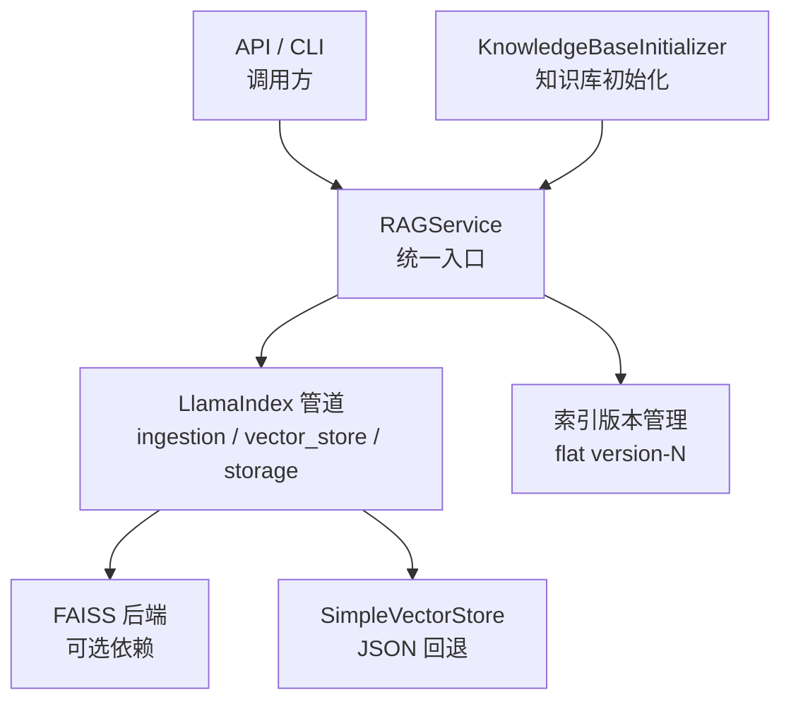
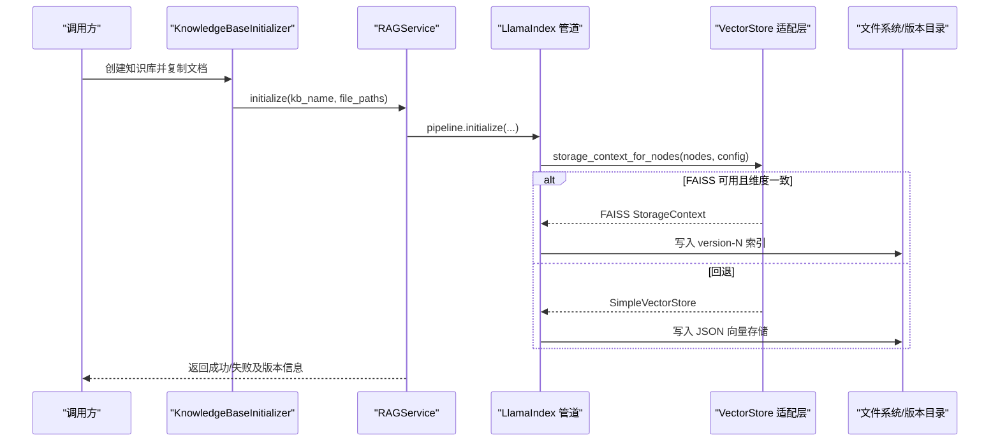
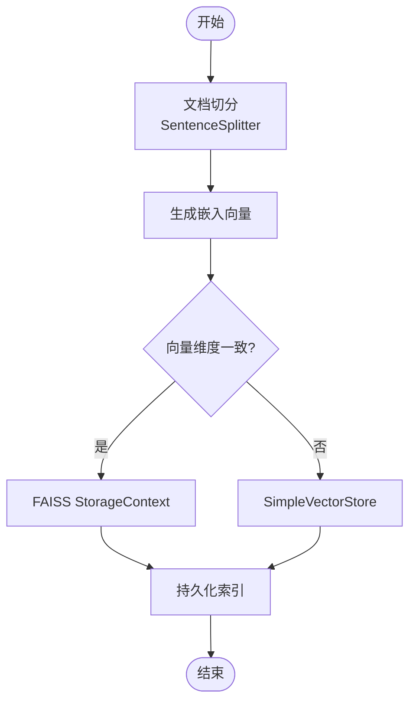
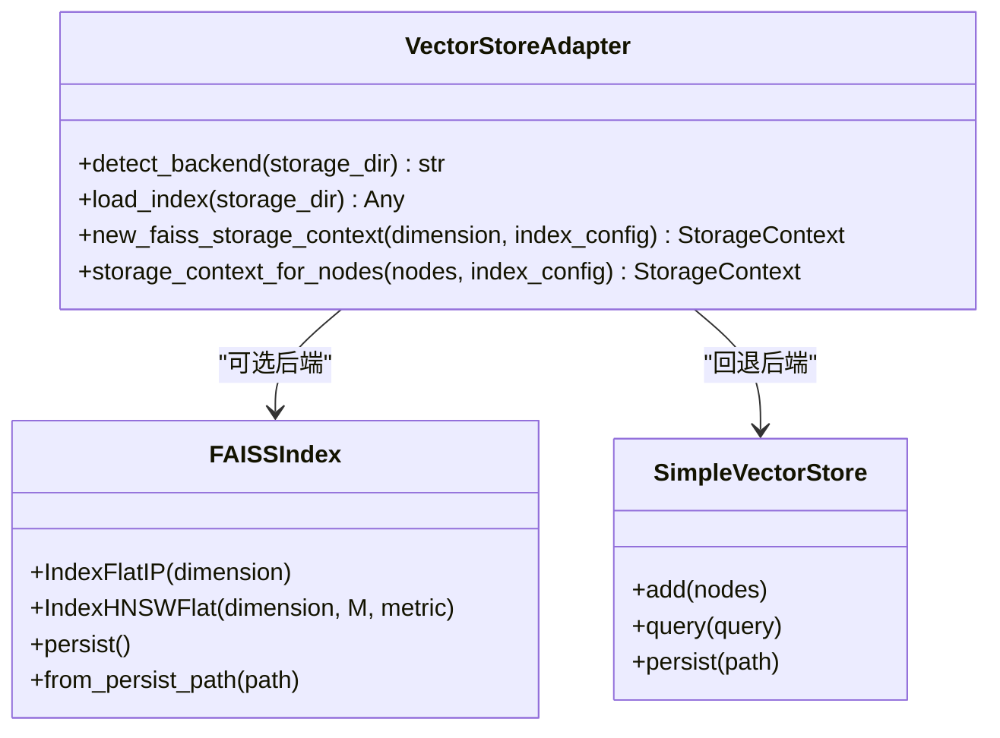
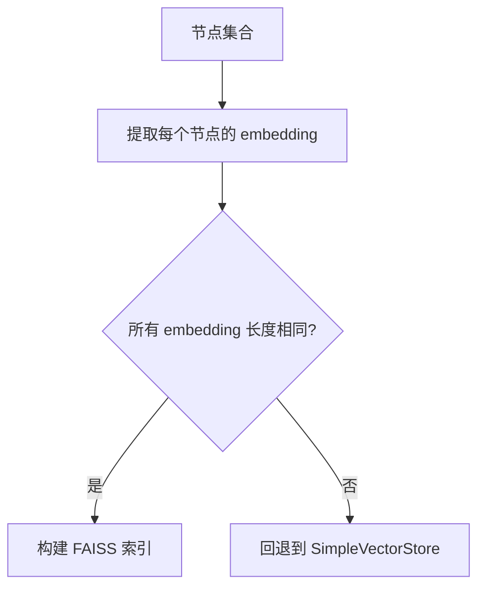
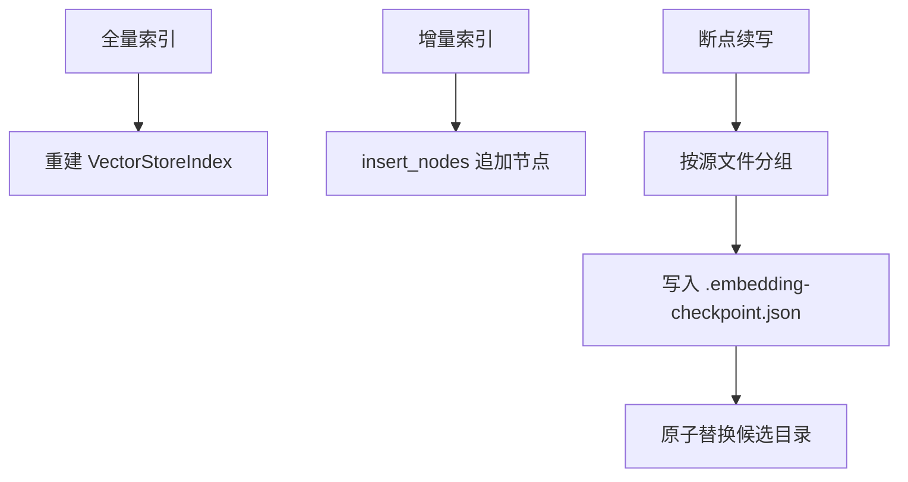
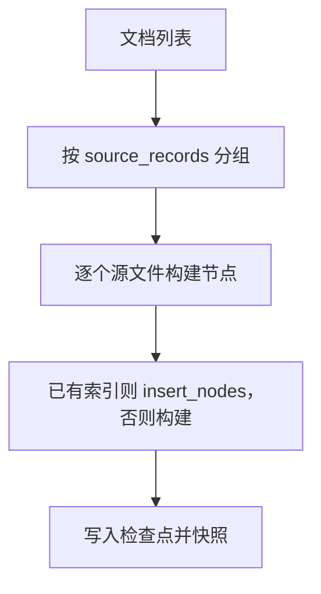
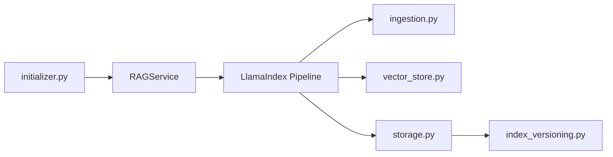

# 向量索引创建

<cite>
**本文引用的文件**   
- [vector_store.py](file://deeptutor/services/rag/pipelines/llamaindex/vector_store.py)
- [ingestion.py](file://deeptutor/services/rag/pipelines/llamaindex/ingestion.py)
- [config.py](file://deeptutor/services/rag/pipelines/llamaindex/config.py)
- [storage.py](file://deeptutor/services/rag/pipelines/llamaindex/storage.py)
- [service.py](file://deeptutor/services/rag/service.py)
- [index_versioning.py](file://deeptutor/services/rag/index_versioning.py)
- [initializer.py](file://deeptutor/knowledge/initializer.py)
</cite>

## 目录
1. [引言](#引言)
2. [项目结构与定位](#项目结构与定位)
3. [核心组件](#核心组件)
4. [架构总览](#架构总览)
5. [详细组件分析](#详细组件分析)
6. [依赖关系分析](#依赖关系分析)
7. [性能与优化建议](#性能与优化建议)
8. [故障排查指南](#故障排查指南)
9. [结论](#结论)

## 引言
本文面向 DeepTutor 中“向量索引创建”的完整实现，重点说明 LlamaIndex RAG 引擎在该项目中的索引构建流程、配置项、相似度算法选择、向量维度约束、索引存储格式，以及增量索引与全量索引策略。同时给出分片与并行处理机制、缓存与持久化设计，以及可操作的性能优化建议和最佳实践。

需要特别说明：当前仓库主要实现了 LlamaIndex + FAISS 的向量索引路径；FAISS 和 ChromaDB 等外部库以可选依赖或回退方式存在，ChromaDB 在本仓库未出现直接实现。因此本文将以代码实际实现为依据进行说明，避免臆测未实现的特性。

## 项目结构与定位
DeepTutor 将 RAG 能力抽象为统一服务入口，并通过不同管道（pipeline）对接具体引擎。与向量索引创建最相关的代码集中在以下位置：
- 统一 RAG 服务：`deeptutor/services/rag/service.py`
- LlamaIndex 管道：`deeptutor/services/rag/pipelines/llamaindex/`
- 知识库初始化器：`deeptutor/knowledge/initializer.py`
- 索引版本管理：`deeptutor/services/rag/index_versioning.py`



**图表来源**
- [service.py:22-65](file://deeptutor/services/rag/service.py#L22-L65)
- [ingestion.py:22-38](file://deeptutor/services/rag/pipelines/llamaindex/ingestion.py#L22-L38)
- [vector_store.py:1-26](file://deeptutor/services/rag/pipelines/llamaindex/vector_store.py#L1-L26)
- [index_versioning.py:1-23](file://deeptutor/services/rag/index_versioning.py#L1-L23)

**章节来源**
- [service.py:22-65](file://deeptutor/services/rag/service.py#L22-L65)
- [initializer.py:35-62](file://deeptutor/knowledge/initializer.py#L35-L62)

## 核心组件
- **RAGService**：统一路由到具体 RAG 提供者（如 llamaindex），封装 initialize/add_documents/search 等方法，并负责任务上下文、进度回调、错误类型标准化。
- **LlamaIndex Ingestion**：文档切分、嵌入生成、节点构建，最终写入 VectorStoreIndex。
- **Vector Store 适配层**：在 FAISS 与 SimpleVectorStore 之间切换，保证检索行为一致（余弦相似度等价）。
- **Storage 层**：负责索引创建、增量插入、检查点与快照、BM25 检索器持久化、页面目录持久化、索引缓存与验证。
- **Index Versioning**：扁平化 `version-N` 索引版本管理，支持签名匹配、就绪状态判断、读写路径分离。
- **KnowledgeBaseInitializer**：知识库目录结构创建、源文件拷贝、调用 RAGService 完成初始化，并更新元数据与进度。

**章节来源**
- [service.py:22-124](file://deeptutor/services/rag/service.py#L22-L124)
- [ingestion.py:22-121](file://deeptutor/services/rag/pipelines/llamaindex/ingestion.py#L22-L121)
- [vector_store.py:44-289](file://deeptutor/services/rag/pipelines/llamaindex/vector_store.py#L44-L289)
- [storage.py:33-401](file://deeptutor/services/rag/pipelines/llamaindex/storage.py#L33-L401)
- [index_versioning.py:46-388](file://deeptutor/services/rag/index_versioning.py#L46-L388)
- [initializer.py:35-121](file://deeptutor/knowledge/initializer.py#L35-L121)

## 架构总览
下图展示从知识库初始化到向量索引创建的端到端流程，包括 LlamaIndex 管道、FAISS 后端选择、索引版本管理与持久化。



**图表来源**
- [initializer.py:179-323](file://deeptutor/knowledge/initializer.py#L179-L323)
- [service.py:67-124](file://deeptutor/services/rag/service.py#L67-L124)
- [ingestion.py:91-112](file://deeptutor/services/rag/pipelines/llamaindex/ingestion.py#L91-L112)
- [vector_store.py:202-235](file://deeptutor/services/rag/pipelines/llamaindex/vector_store.py#L202-L235)
- [index_versioning.py:349-388](file://deeptutor/services/rag/index_versioning.py#L349-L388)

## 详细组件分析

### LlamaIndex 索引创建流程
- 文档进入 ingestion 管线后，先按配置的 chunk_size/chunk_overlap 切分为句子块，再调用当前 embedding 适配器生成向量。
- 若所有节点共享同一向量维度且 FAISS 可用，则使用 FAISS-backed StorageContext；否则回退到 SimpleVectorStore。
- 最终通过 VectorStoreIndex 持久化到指定 storage_dir，并额外持久化 BM25 检索器和页面目录。



**图表来源**
- [ingestion.py:22-38](file://deeptutor/services/rag/pipelines/llamaindex/ingestion.py#L22-L38)
- [ingestion.py:65-112](file://deeptutor/services/rag/pipelines/llamaindex/ingestion.py#L65-L112)
- [vector_store.py:170-235](file://deeptutor/services/rag/pipelines/llamaindex/vector_store.py#L170-L235)

**章节来源**
- [ingestion.py:22-121](file://deeptutor/services/rag/pipelines/llamaindex/ingestion.py#L22-L121)

### 向量存储后端与相似度算法
- 默认使用 FAISS 的 Inner Product 索引（IndexFlatIP），并对向量做 L2 归一化，使内积等价于余弦相似度，从而与 SimpleVectorStore 的行为保持一致。
- 当 FAISS 不可用时，自动回退到 SimpleVectorStore（JSON 存储，O(N) 线性扫描）。
- 支持两种 FAISS 索引类型：
  - flat（默认）：精确搜索，适合中小规模语料。
  - hnsw：近似最近邻，适合大规模语料，可通过 HNSW 参数调优。



**图表来源**
- [vector_store.py:44-289](file://deeptutor/services/rag/pipelines/llamaindex/vector_store.py#L44-L289)

**章节来源**
- [vector_store.py:44-289](file://deeptutor/services/rag/pipelines/llamaindex/vector_store.py#L44-L289)

### 向量维度设置与混合模态限制
- 系统会检查所有节点的 embedding 长度是否一致；若不一致（例如文本与多模态图像向量混用），则无法使用固定维度的 FAISS 索引，自动回退到 SimpleVectorStore。
- 该检查确保 FAISS 索引的内存布局与查询效率。



**图表来源**
- [vector_store.py:170-185](file://deeptutor/services/rag/pipelines/llamaindex/vector_store.py#L170-L185)

**章节来源**
- [vector_store.py:170-185](file://deeptutor/services/rag/pipelines/llamaindex/vector_store.py#L170-L185)

### 索引存储格式与兼容性
- 默认向量存储文件名固定，首个字节用于区分 JSON（SimpleVectorStore）与二进制（FAISS）。
- FAISS 索引通过 Python 序列化字节流写入，解决 Windows 非 ASCII 路径问题，并与原生 FAISS 输出兼容。
- 旧版 SimpleVectorStore 索引仍可读取，升级时可通过重建转为 FAISS 以获得性能提升。

```mermaid
flowchart TD
Detect["检测首字节"] --> |'{'| JSON["SimpleVectorStore JSON"]
Detect --> |其他| Binary["FAISS 二进制索引"]
JSON --> Readable["可读并可查询"]
Binary --> LoadFAISS["加载 FAISS 索引"]
```

**图表来源**
- [vector_store.py:47-50](file://deeptutor/services/rag/pipelines/llamaindex/vector_store.py#L47-L50)
- [vector_store.py:80-111](file://deeptutor/services/rag/pipelines/llamaindex/vector_store.py#L80-L111)
- [vector_store.py:238-274](file://deeptutor/services/rag/pipelines/llamaindex/vector_store.py#L238-L274)

**章节来源**
- [vector_store.py:47-111](file://deeptutor/services/rag/pipelines/llamaindex/vector_store.py#L47-L111)
- [vector_store.py:238-274](file://deeptutor/services/rag/pipelines/llamaindex/vector_store.py#L238-L274)

### 增量索引与全量索引策略
- **全量索引**：create_index_from_documents 会重新构建整个索引，适用于首次创建或重建。
- **增量索引**：insert_documents_into_index 对已有索引插入新节点；create_resumable_index 支持按源文件分组、断点续写与检查点快照。
- 版本管理采用扁平 `version-N` 目录，新建索引写入候选目录，成功后原子替换，失败保留旧版本以便诊断。



**图表来源**
- [ingestion.py:91-121](file://deeptutor/services/rag/pipelines/llamaindex/ingestion.py#L91-L121)
- [storage.py:335-401](file://deeptutor/services/rag/pipelines/llamaindex/storage.py#L335-L401)
- [index_versioning.py:349-388](file://deeptutor/services/rag/index_versioning.py#L349-L388)

**章节来源**
- [ingestion.py:91-121](file://deeptutor/services/rag/pipelines/llamaindex/ingestion.py#L91-L121)
- [storage.py:335-401](file://deeptutor/services/rag/pipelines/llamaindex/storage.py#L335-L401)
- [index_versioning.py:349-388](file://deeptutor/services/rag/index_versioning.py#L349-L388)

### 索引分片与并行处理机制
- 分片：create_resumable_index 按源文件键分组 documents，逐源构建并写入检查点，天然形成“按源分片”的处理单元。
- 并行：代码未显式引入多线程/多进程并行嵌入；嵌入过程由 LlamaIndex IngestionPipeline 驱动，通常受限于 embedding 服务的并发与批处理能力。
- 缓存：storage.py 维护进程内索引缓存（最多 2 个条目，空闲 10 分钟清理），减少重复加载与验证开销。



**图表来源**
- [storage.py:173-228](file://deeptutor/services/rag/pipelines/llamaindex/storage.py#L173-L228)
- [storage.py:335-388](file://deeptutor/services/rag/pipelines/llamaindex/storage.py#L335-L388)

**章节来源**
- [storage.py:173-228](file://deeptutor/services/rag/pipelines/llamaindex/storage.py#L173-L228)
- [storage.py:335-388](file://deeptutor/services/rag/pipelines/llamaindex/storage.py#L335-L388)
- [storage.py:529-602](file://deeptutor/services/rag/pipelines/llamaindex/storage.py#L529-L602)

### 配置参数与可调项
- 检索配置（RetrievalConfig）：profile（vector/hybrid）、top_k 倍数、reranker_model、rerank_top_k 等。
- 向量索引配置（VectorIndexConfig）：type（flat/hnsw）、hnsw_m、hnsw_ef_construction、hnsw_ef_search。
- 分块几何（chunk_geometry）：chunk_size、chunk_overlap。
- 图像描述批大小与并发超时：image_description_batch_size、image_description_limits。

这些配置可从环境变量或运行时设置加载，并提供规范化与默认值保护。

**章节来源**
- [config.py:30-61](file://deeptutor/services/rag/pipelines/llamaindex/config.py#L30-L61)
- [config.py:107-139](file://deeptutor/services/rag/pipelines/llamaindex/config.py#L107-L139)
- [config.py:142-179](file://deeptutor/services/rag/pipelines/llamaindex/config.py#L142-L179)

## 依赖关系分析
- RAGService 作为统一入口，根据 KB 绑定解析 provider，并缓存对应 pipeline。
- LlamaIndex 管道依赖 embedding_adapter 获取当前 embedding 模型，依赖 vector_store 选择后端，依赖 ingestion 执行切分与嵌入。
- storage 层依赖 index_versioning 确定读写路径，依赖 retrievers 持久化 BM25 检索器，依赖 source_pages 持久化页面目录。
- initializer 负责知识库生命周期管理，协调 RAGService 与进度跟踪。



**图表来源**
- [service.py:22-65](file://deeptutor/services/rag/service.py#L22-L65)
- [ingestion.py:17-19](file://deeptutor/services/rag/pipelines/llamaindex/ingestion.py#L17-L19)
- [storage.py:22-29](file://deeptutor/services/rag/pipelines/llamaindex/storage.py#L22-L29)
- [initializer.py:23-24](file://deeptutor/knowledge/initializer.py#L23-L24)

**章节来源**
- [service.py:22-65](file://deeptutor/services/rag/service.py#L22-L65)
- [storage.py:22-29](file://deeptutor/services/rag/pipelines/llamaindex/storage.py#L22-L29)
- [initializer.py:23-24](file://deeptutor/knowledge/initializer.py#L23-L24)

## 性能与优化建议
- 优先使用 FAISS 后端：
  - 确保所有节点向量维度一致，避免回退到 O(N) 线性扫描。
  - 对于大规模语料，考虑启用 HNSW 索引并调整 M、efConstruction、efSearch 参数以平衡召回率与延迟。
- 合理设置分块几何：
  - 增大 chunk_size 可减少嵌入次数，但可能降低检索精度；适当 overlap 有助于跨块语义连贯。
- 利用索引缓存：
  - 进程内缓存已加载索引，减少重复 IO 与校验开销；在多 KB 场景下注意缓存上限与空闲清理。
- 增量索引优于全量重建：
  - 新增文档优先使用 insert_documents；仅在 embedding 模型变更或需要一致性重建时使用 create_resumable_index。
- 控制图像描述并发与超时：
  - image_description_concurrency 与 timeout_seconds 需结合 VLM 服务容量调优，避免请求风暴。
- 监控与日志：
  - 使用 ProgressTracker 与 RAGService 的事件回调观察嵌入批次进度与错误类型，便于快速定位瓶颈。

[本节为通用指导，不直接分析具体文件]

## 故障排查指南
- 索引包含无效嵌入向量：
  - 现象：检索时报错提示索引包含无效嵌入向量，需重建索引。
  - 原因：持久化的向量数据损坏或与当前 embedding 模型不兼容。
  - 处理：使用知识库的“重建索引”动作，确保使用当前 embedding 提供者/模型。
- FAISS 缺失导致无法加载：
  - 现象：FAISS 索引存在但缺少 faiss-cpu 包，加载时报错。
  - 处理：安装 faiss-cpu 或重建索引为 SimpleVectorStore。
- 路径非 ASCII 导致写入失败：
  - 现象：Windows 上非 ASCII 路径无法打开 FAISS 索引文件。
  - 处理：使用项目提供的 faiss_write_index/faiss_read_index，它们通过 Python 字节流绕过 SWIG 窄路径 API。
- 权限错误：
  - 现象：处理文档时抛出 DataVolumePermissionError。
  - 处理：检查 data volume 可写权限，确保知识库目录可写。

**章节来源**
- [storage.py:506-527](file://deeptutor/services/rag/pipelines/llamaindex/storage.py#L506-L527)
- [vector_store.py:259-274](file://deeptutor/services/rag/pipelines/llamaindex/vector_store.py#L259-L274)
- [vector_store.py:80-111](file://deeptutor/services/rag/pipelines/llamaindex/vector_store.py#L80-L111)
- [initializer.py:293-310](file://deeptutor/knowledge/initializer.py#L293-L310)

## 结论
DeepTutor 的向量索引创建以 LlamaIndex 为核心，通过 FAISS 提供高性能检索，并在不可用时优雅回退到 SimpleVectorStore。系统通过扁平版本目录、检查点与快照机制保障索引构建的可靠性与可恢复性；通过统一的 RAGService 与配置体系，使检索策略、分块几何、图像描述并发等关键参数可观测、可调优。对于大规模知识图谱，建议优先使用 FAISS HNSW 索引并结合增量索引策略，配合索引缓存与合理的分块参数，以获得稳定且高效的检索体验。

[本节为总结性内容，不直接分析具体文件]