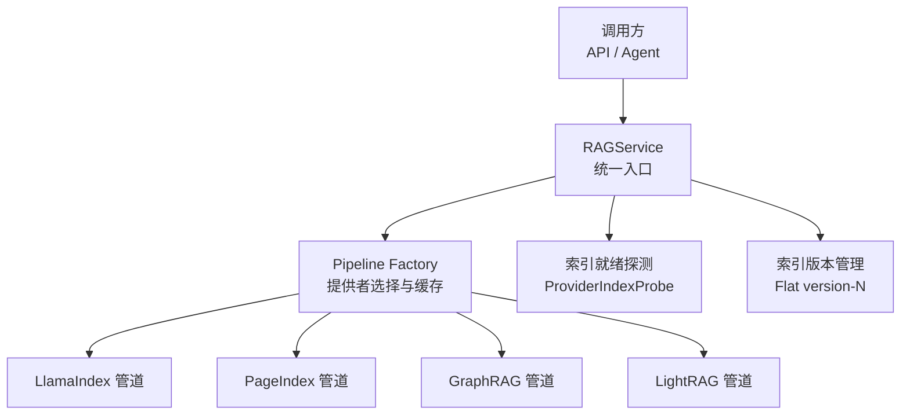
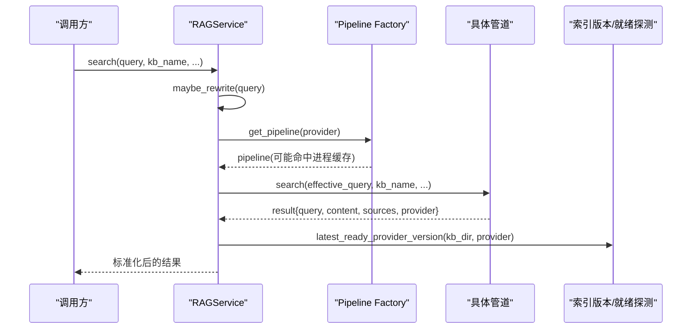
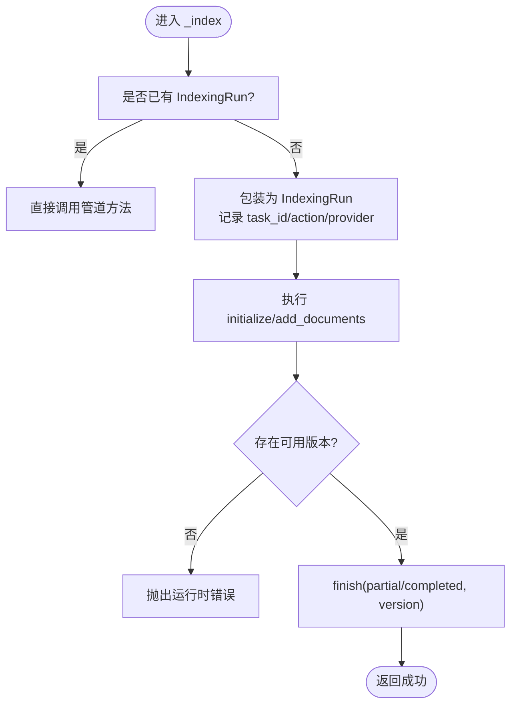
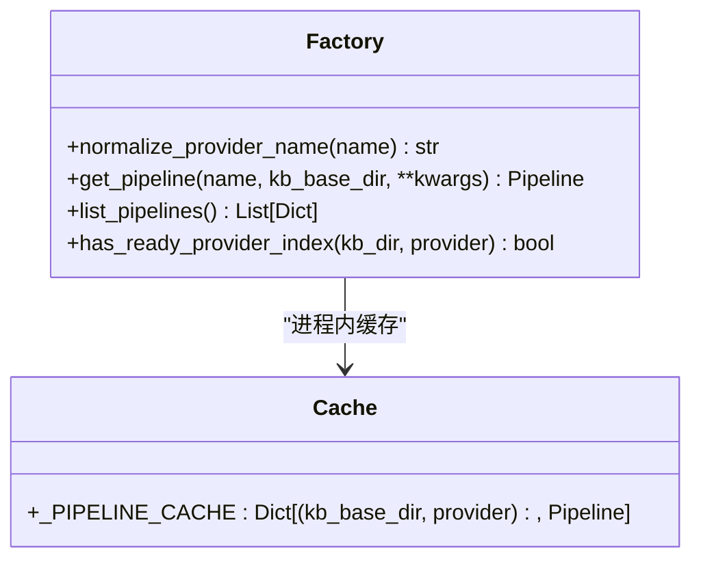
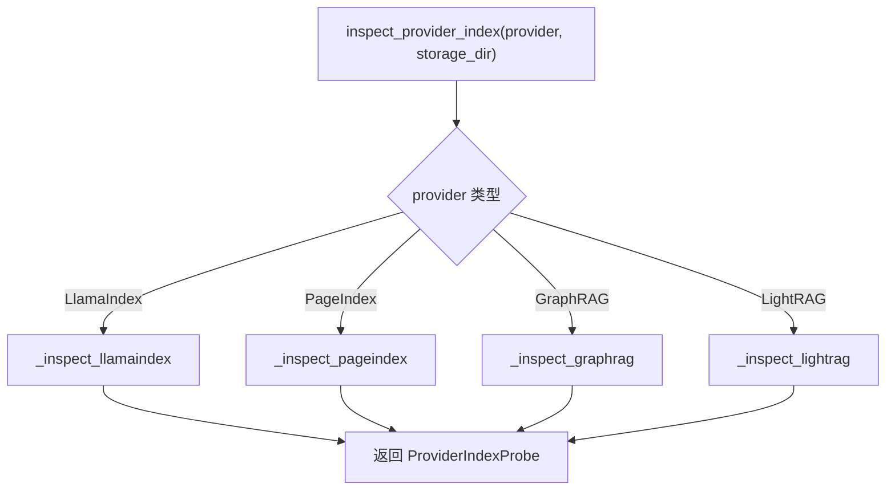
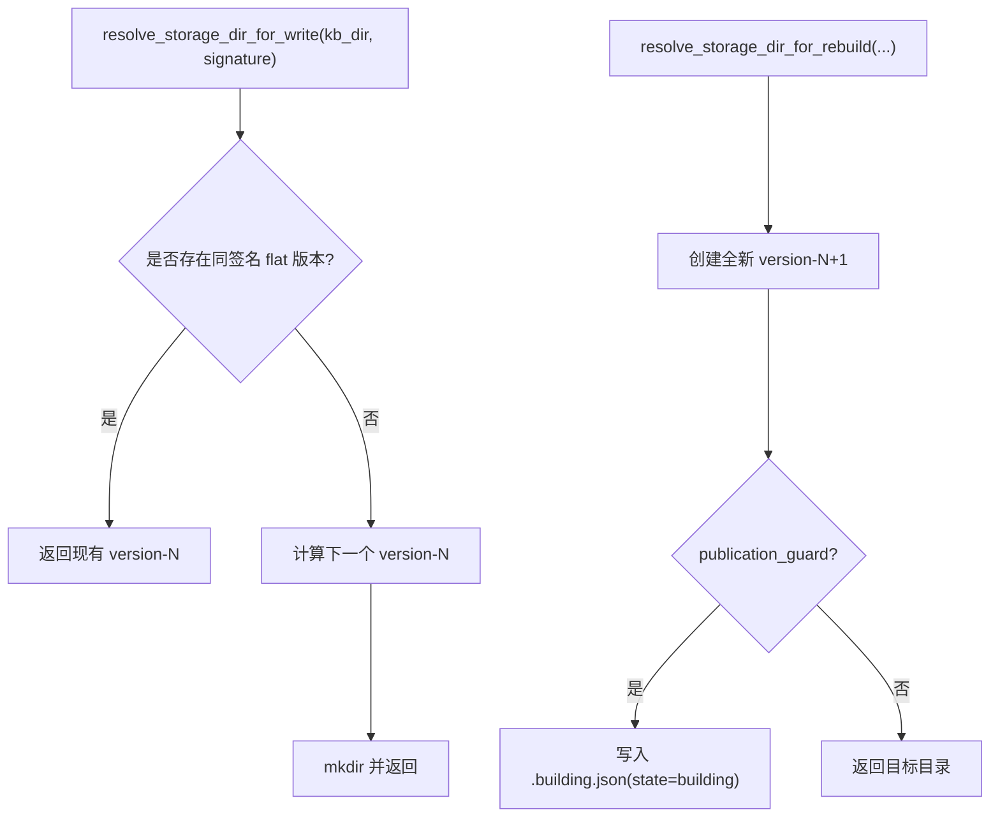
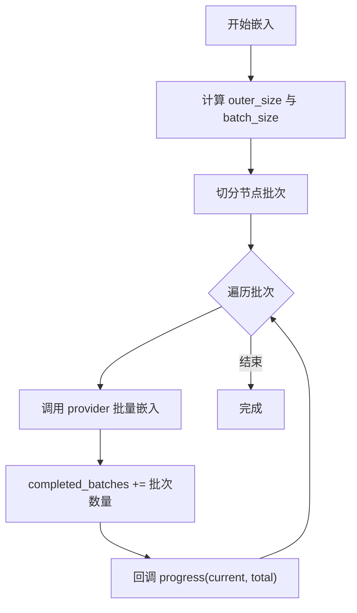
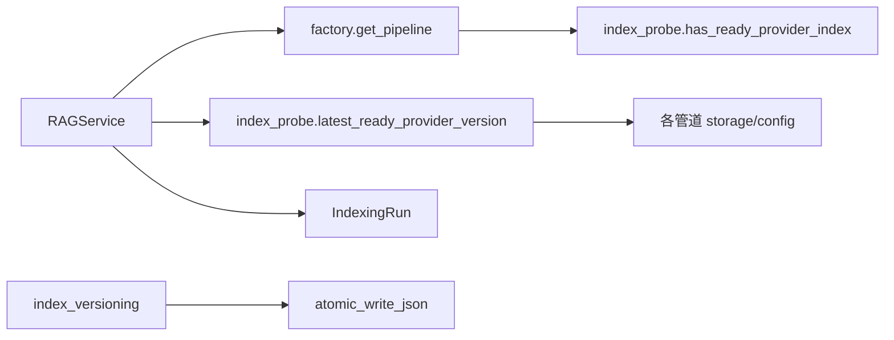

# 索引性能优化

<cite>
**本文引用的文件**   
- [RAG 服务入口 service.py](file://deeptutor/services/rag/service.py)
- [RAG 管道工厂 factory.py](file://deeptutor/services/rag/factory.py)
- [RAG 管道协议 base.py](file://deeptutor/services/rag/pipelines/base.py)
- [索引就绪探测 index_probe.py](file://deeptutor/services/rag/index_probe.py)
- [索引版本管理 index_versioning.py](file://deeptutor/services/rag/index_versioning.py)
- [LlamaIndex 嵌入适配器 embedding_adapter.py](file://deeptutor/services/rag/pipelines/llamaindex/embedding_adapter.py)
</cite>

## 目录
1. [引言](#引言)
2. [项目结构](#项目结构)
3. [核心组件](#核心组件)
4. [架构总览](#架构总览)
5. [详细组件分析](#详细组件分析)
6. [依赖关系分析](#依赖关系分析)
7. [性能考量与调优参数](#性能考量与调优参数)
8. [故障排查指南](#故障排查指南)
9. [结论](#结论)
10. [附录：基准测试方法](#附录基准测试方法)

## 引言
本文面向 DeepTutor 的检索增强生成（RAG）索引子系统，围绕“索引缓存策略、查询优化、内存管理、批量处理、异步索引构建、分布式索引同步、索引压缩、分片策略与负载均衡配置”等主题，给出可落地的优化方案。内容基于仓库中 RAG 服务、管道工厂、索引就绪探测、索引版本管理与 LlamaIndex 嵌入适配器等实现进行归纳，并补充通用工程实践建议。

## 项目结构
DeepTutor 的索引与检索能力集中在 `deeptutor/services/rag` 下，采用“统一服务 + 多提供者管道”的架构：
- RAGService：对外统一入口，负责按知识库绑定选择提供者、封装索引生命周期、查询重写与事件上报。
- Pipeline Factory：根据提供者名称创建具体管道实例，并对无参构造进行进程内缓存。
- Provider Index Probe：以只读方式探测各提供者的索引是否真正可用，屏蔽底层存储差异。
- Index Versioning：维护扁平化索引版本目录，支持回滚、并发重建与原子发布。
- LlamaIndex Pipeline：默认本地向量检索，包含嵌入批处理、BM25 混合检索等实现。

**图表来源**
- [RAG 服务入口 service.py:22-124](file://deeptutor/services/rag/service.py#L22-L124)
- [RAG 管道工厂 factory.py:63-209](file://deeptutor/services/rag/factory.py#L63-L209)
- [索引就绪探测 index_probe.py:28-133](file://deeptutor/services/rag/index_probe.py#L28-L133)
- [索引版本管理 index_versioning.py:141-236](file://deeptutor/services/rag/index_versioning.py#L141-L236)

**章节来源**
- [RAG 服务入口 service.py:22-124](file://deeptutor/services/rag/service.py#L22-L124)
- [RAG 管道工厂 factory.py:1-61](file://deeptutor/services/rag/factory.py#L1-L61)

## 核心组件
- RAGService
  - 按知识库解析提供者，复用已创建的管道实例。
  - 封装 initialize/add_documents/search/delete/smart_retrieve。
  - 将索引任务纳入 IndexingRun，记录文档状态、进度与最终可用版本。
  - 对非 LLM 类日志做降噪过滤，避免干扰检索路径。
- Pipeline Factory
  - 通过 normalize_provider_name 归一化提供者名。
  - get_pipeline 在无自定义参数时对 (kb_base_dir, provider) 键进行进程内缓存。
  - list_pipelines 暴露 UI 可用的提供者清单及就绪信息。
- ProviderIndexProbe
  - 针对 LlamaIndex、PageIndex、GraphRAG、LightRAG 分别检查关键产物。
  - 为 LlamaIndex docstore.json 计数使用 lru_cache，降低大文件扫描开销。
- IndexVersioning
  - 扁平化 version-N 布局，支持 legacy 兼容读取。
  - 写路径 resolve_storage_dir_for_write 保证新写入不覆盖旧版本。
  - 重建流程 resolve_storage_dir_for_rebuild 支持 .building.json 原子发布。
- LlamaIndex EmbeddingAdapter
  - 计算 provider 批大小与外层节点批大小，统计 total_batches 并回调进度。
  - 限制 batch_size 不超过 provider.max_batch_items，避免超限。

**章节来源**
- [RAG 服务入口 service.py:22-124](file://deeptutor/services/rag/service.py#L22-L124)
- [RAG 管道工厂 factory.py:63-209](file://deeptutor/services/rag/factory.py#L63-L209)
- [索引就绪探测 index_probe.py:136-284](file://deeptutor/services/rag/index_probe.py#L136-L284)
- [索引版本管理 index_versioning.py:309-387](file://deeptutor/services/rag/index_versioning.py#L309-L387)
- [LlamaIndex 嵌入适配器 embedding_adapter.py:109-174](file://deeptutor/services/rag/pipelines/llamaindex/embedding_adapter.py#L109-L174)

## 架构总览
下图展示一次搜索请求从 API 到具体管道的完整调用链，以及查询重写、事件上报与结果规范化过程。

**图表来源**
- [RAG 服务入口 service.py:127-250](file://deeptutor/services/rag/service.py#L127-L250)
- [RAG 管道工厂 factory.py:193-209](file://deeptutor/services/rag/factory.py#L193-L209)
- [索引就绪探测 index_probe.py:96-108](file://deeptutor/services/rag/index_probe.py#L96-L108)

## 详细组件分析

### RAGService：索引与查询的统一编排
- 索引生命周期
  - initialize/add_documents 均走 _index，自动包装为 IndexingRun，记录文档状态、进度与最终可用版本。
  - 若当前已有运行上下文，直接委托给管道；否则分配 task_id 并推进 embedding 阶段进度。
  - 完成后校验 latest_ready_provider_version，失败则抛出运行时错误。
- 查询路径
  - 对 PageIndex 提供者返回“推理即检索”提示，引导在智能体循环中使用工具。
  - 可选 query rewrite 层，附带 trace 元数据。
  - 捕获底层日志并过滤噪声，仅透传必要 raw_log。
- 删除与智能检索
  - delete 优先调用管道自有实现，否则回退到目录删除。
  - smart_retrieve 通过 SmartRetriever 扩展多查询召回。

**图表来源**
- [RAG 服务入口 service.py:75-124](file://deeptutor/services/rag/service.py#L75-L124)

**章节来源**
- [RAG 服务入口 service.py:67-124](file://deeptutor/services/rag/service.py#L67-L124)
- [RAG 服务入口 service.py:127-250](file://deeptutor/services/rag/service.py#L127-L250)
- [RAG 服务入口 service.py:335-364](file://deeptutor/services/rag/service.py#L335-L364)

### Pipeline Factory：提供者选择与进程内缓存
- 提供者归一化与已知集合
  - normalize_provider_name 将未知/废弃字符串回退到默认提供者，避免配置漂移导致不可用。
- 管道实例缓存
  - get_pipeline 在无自定义参数时，以 (kb_base_dir, provider) 为键缓存实例，减少重复初始化成本。
  - 传入自定义参数（如注入客户端）时跳过缓存，确保覆盖生效。
- 列表与就绪探测
  - list_pipelines 动态探测 PageIndex OSS、IMA、GraphRAG、LightRAG 等依赖可用性。
  - has_ready_provider_index/version_has_provider_output 委托 index_probe 完成真实产物检查。

**图表来源**
- [RAG 管道工厂 factory.py:63-209](file://deeptutor/services/rag/factory.py#L63-L209)

**章节来源**
- [RAG 管道工厂 factory.py:67-108](file://deeptutor/services/rag/factory.py#L67-L108)
- [RAG 管道工厂 factory.py:193-209](file://deeptutor/services/rag/factory.py#L193-L209)
- [RAG 管道工厂 factory.py:212-348](file://deeptutor/services/rag/factory.py#L212-L348)

### ProviderIndexProbe：跨提供者的索引就绪探测
- LlamaIndex
  - 检查 meta.json/.building.json/docstore.json/index_store.json 与 vector store 文件。
  - 对 docstore.json 计数使用 lru_cache，键为 (path, size, mtime_ns)，避免频繁解析大文件。
- PageIndex
  - 读取 manifest，校验文档 ID 与 OSS 本地库 artifacts。
- GraphRAG/LightRAG
  - 检查 parquet 表或 kv_store_doc_status.json 等输出标志。

**图表来源**
- [索引就绪探测 index_probe.py:40-54](file://deeptutor/services/rag/index_probe.py#L40-L54)
- [索引就绪探测 index_probe.py:136-284](file://deeptutor/services/rag/index_probe.py#L136-L284)

**章节来源**
- [索引就绪探测 index_probe.py:28-133](file://deeptutor/services/rag/index_probe.py#L28-L133)
- [索引就绪探测 index_probe.py:136-284](file://deeptutor/services/rag/index_probe.py#L136-L284)

### IndexVersioning：扁平版本与原子发布
- 布局
  - 新版 flat layout：KB 根目录下 version-1、version-2... 直接存放索引产物与 meta.json。
  - 兼容旧版 nested/root layout，仍可读取但不用于新写入。
- 读写分离
  - resolve_storage_dir_for_read：优先匹配签名对应的 ready 版本，否则回退到最新 flat 或 legacy。
  - resolve_storage_dir_for_write：复用同签名的 flat 版本，否则递增新建。
  - resolve_storage_dir_for_rebuild：始终新建更高编号目录，避免覆盖旧版本；支持 publication_guard 写入 .building.json。
- 就绪判定
  - 对 LightRAG 原生输出，检查 kv_store_doc_status.json 中 processed/chunks_list。
  - 对 LlamaIndex，要求 meta.state=published 且 readiness_verified。

**图表来源**
- [索引版本管理 index_versioning.py:309-387](file://deeptutor/services/rag/index_versioning.py#L309-L387)

**章节来源**
- [索引版本管理 index_versioning.py:141-236](file://deeptutor/services/rag/index_versioning.py#L141-L236)
- [索引版本管理 index_versioning.py:260-306](file://deeptutor/services/rag/index_versioning.py#L260-L306)
- [索引版本管理 index_versioning.py:309-387](file://deeptutor/services/rag/index_versioning.py#L309-L387)

### LlamaIndex EmbeddingAdapter：批量嵌入与进度反馈
- 批大小计算
  - 外层节点批大小由 embed_batch_size 决定。
  - 内层 provider 批大小取 min(batch_size, provider.max_batch_items)。
  - 统计 total_batches 并在每个 provider 批次完成时回调 progress。
- 查询与文本嵌入
  - _aget_query_embedding/_aget_text_embedding/_aget_text_embeddings 统一经 validate_embedding_batch 校验。
- 进度回调
  - 通过 _IndexingProgress.completed_batches 累计，结合 offset 向上传递整体进度。

**图表来源**
- [LlamaIndex 嵌入适配器 embedding_adapter.py:109-174](file://deeptutor/services/rag/pipelines/llamaindex/embedding_adapter.py#L109-L174)

**章节来源**
- [LlamaIndex 嵌入适配器 embedding_adapter.py:109-174](file://deeptutor/services/rag/pipelines/llamaindex/embedding_adapter.py#L109-L174)

## 依赖关系分析
- RAGService 依赖：
  - factory.get_pipeline：获取具体管道实例。
  - index_probe.latest_ready_provider_version：校验最终可用版本。
  - kb_paths.resolve_kb_dir：解析 KB 目录。
  - knowledge.indexing_run.IndexingRun：追踪索引任务与文档状态。
- Pipeline Factory 依赖：
  - 各管道模块按需导入，避免冷启动开销。
  - index_probe.has_ready_provider_index/version_has_provider_output：探测就绪。
- ProviderIndexProbe 依赖：
  - 各管道 storage/config 模块，读取各自产物。
- IndexVersioning 依赖：
  - file_io.atomic_write_json：原子写入 meta.json。

**图表来源**
- [RAG 服务入口 service.py:75-124](file://deeptutor/services/rag/service.py#L75-L124)
- [RAG 管道工厂 factory.py:110-133](file://deeptutor/services/rag/factory.py#L110-L133)
- [索引就绪探测 index_probe.py:77-133](file://deeptutor/services/rag/index_probe.py#L77-L133)
- [索引版本管理 index_versioning.py:309-326](file://deeptutor/services/rag/index_versioning.py#L309-L326)

**章节来源**
- [RAG 服务入口 service.py:75-124](file://deeptutor/services/rag/service.py#L75-L124)
- [RAG 管道工厂 factory.py:110-133](file://deeptutor/services/rag/factory.py#L110-L133)
- [索引就绪探测 index_probe.py:77-133](file://deeptutor/services/rag/index_probe.py#L77-L133)
- [索引版本管理 index_versioning.py:309-326](file://deeptutor/services/rag/index_versioning.py#L309-L326)

## 性能考量与调优参数
以下建议结合仓库现有实现与通用工程实践，帮助在不同规模与负载下获得更优的索引与查询性能。

- 索引缓存策略
  - 进程内管道缓存：get_pipeline 对无参构造进行 (kb_base_dir, provider) 键缓存，避免重复初始化底层引擎与模型加载。
  - 就绪探测缓存：LlamaIndex docstore.json 计数使用 lru_cache，键为 (path, size, mtime_ns)，显著降低大文件解析开销。
  - 建议：在多租户或多 KB 场景下，尽量复用 RAGService 实例，避免频繁重建管道。

- 查询优化
  - 查询重写：search 支持 maybe_rewrite，可在开启时附加 rewrite_outcome 与 trace 元数据，便于观测改写效果。
  - 日志降噪：过滤 nano-vectordb 与 embedding 生成日志，减少 I/O 与序列化开销。
  - 建议：对高频短查询，启用上层应用级缓存（例如按 query+kb_name 缓存最近 N 条结果），并结合 rewrite 开关控制。

- 内存管理
  - 嵌入批处理：embedding_adapter 限制 batch_size 不超过 provider.max_batch_items，避免单次请求过大导致 OOM。
  - 建议：在高并发环境下，适当增大外层节点批大小但保持 provider 批大小受控；必要时引入对象池与显式释放。

- 批量处理
  - 索引阶段：add_documents 与 initialize 均通过 IndexingRun 跟踪文档状态与进度，支持 partial/completed 两种终态。
  - 建议：对大批量文档，优先使用 add_documents 增量更新，减少全量重建成本。

- 异步索引构建
  - IndexingRun 抽象了任务生命周期，支持 task_id 与进度回调；RAGService._index 在外部无运行上下文时自动包装。
  - 建议：在 Web/API 场景中，将 task_id 暴露给前端轮询或 WebSocket 推送，提升用户体验。

- 分布式索引同步
  - 当前代码未内置分布式同步机制；建议在外部编排层（如 Kubernetes Job/Cron）协调多副本的重建与切换。
  - 利用 version-N 与 .building.json 的原子发布语义，在外部完成“构建 -> 验证 -> 切换”三段式流程。

- 索引压缩
  - 仓库未直接实现索引压缩；可考虑在外部归档旧版本（如 tar.gz）并清理不再使用的 version-N，以降低磁盘占用。
  - 注意：保留至少一个 ready 版本，避免服务不可用。

- 分片策略
  - 当前版本未见显式分片逻辑；可按业务维度（如领域/语言/用户组）拆分多个 KB，配合不同提供者以获得更好的隔离与扩展性。
  - 对于超大 KB，建议拆分为多个子 KB，并通过上层路由聚合查询。

- 负载均衡配置
  - 进程内缓存适合单进程；多进程部署时，每个进程会独立缓存管道实例。
  - 建议：在反向代理层按 KB 或提供者进行请求分发，避免热点 KB 集中到单一进程。

**章节来源**
- [RAG 管道工厂 factory.py:193-209](file://deeptutor/services/rag/factory.py#L193-L209)
- [索引就绪探测 index_probe.py:263-284](file://deeptutor/services/rag/index_probe.py#L263-L284)
- [RAG 服务入口 service.py:127-250](file://deeptutor/services/rag/service.py#L127-L250)
- [LlamaIndex 嵌入适配器 embedding_adapter.py:109-174](file://deeptutor/services/rag/pipelines/llamaindex/embedding_adapter.py#L109-L174)

## 故障排查指南
- 索引未就绪
  - 现象：search 或 initialize 后无法找到可用版本。
  - 排查：
    - 使用 inspect_kb_versions 查看各版本的 ready 与 failure_summary。
    - 对 LlamaIndex，确认 docstore.json/index_store.json 存在且 meta.state=published。
    - 对 PageIndex，确认 manifest 有文档 ID 且 OSS 本地库 artifacts 完整。
    - 对 GraphRAG/LightRAG，检查对应输出表或状态文件。
- 部分文档失败
  - 现象：run.finish 标记为 partial。
  - 排查：检查 run.data.documents 中 failed/unknown/pending/parsing 状态的文档，定位解析或嵌入失败原因。
- 日志噪音过多
  - 现象：检索路径出现大量底层日志。
  - 排查：确认 _capture_raw_logs 的过滤规则是否生效，必要时调整 should_skip_noisy_retrieve_log。

**章节来源**
- [索引就绪探测 index_probe.py:77-133](file://deeptutor/services/rag/index_probe.py#L77-L133)
- [RAG 服务入口 service.py:112-124](file://deeptutor/services/rag/service.py#L112-L124)
- [RAG 服务入口 service.py:263-333](file://deeptutor/services/rag/service.py#L263-L333)

## 结论
DeepTutor 的 RAG 子系统通过统一服务、多提供者管道、就绪探测与扁平版本管理，形成了可扩展、可回滚、可观测的索引与检索体系。结合进程内管道缓存、嵌入批大小限制、查询重写与日志降噪，可在单机与多进程环境中获得稳定性能。对于分布式与大规模场景，建议在外层编排层实现分片、同步与负载均衡，并利用版本原子发布保障零停机切换。

## 附录：基准测试方法
以下为通用基准测试步骤，适用于评估索引构建与查询性能：

- 数据集准备
  - 准备不同规模与类型的文档集（PDF/Markdown/Office），覆盖常见语言与领域。
  - 划分训练/验证/测试集，固定随机种子以保证可重复性。
- 指标定义
  - 索引构建：吞吐（文档/秒）、延迟（首字节/完成时间）、内存峰值、CPU 利用率。
  - 查询检索：QPS、P50/P95/P99 延迟、召回率、准确率（如有标注）。
- 实验设计
  - 变量：batch_size、embed_batch_size、rewrite 开关、提供者（LlamaIndex/PageIndex/GraphRAG/LightRAG）。
  - 环境：固定 CPU/内存/GPU 配置，关闭无关后台进程。
- 执行流程
  - 预热：首次加载模型与管道，忽略首次耗时。
  - 构建：对每个配置执行 initialize/add_documents，记录指标。
  - 查询：对测试集执行 search/smart_retrieve，记录指标。
- 分析与回归
  - 对比不同配置的吞吐与延迟，识别瓶颈（I/O、嵌入、检索）。
  - 建立回归阈值，当 QPS 下降或延迟上升超过阈值时触发告警。

[本节为通用指导，不直接分析具体源码文件]