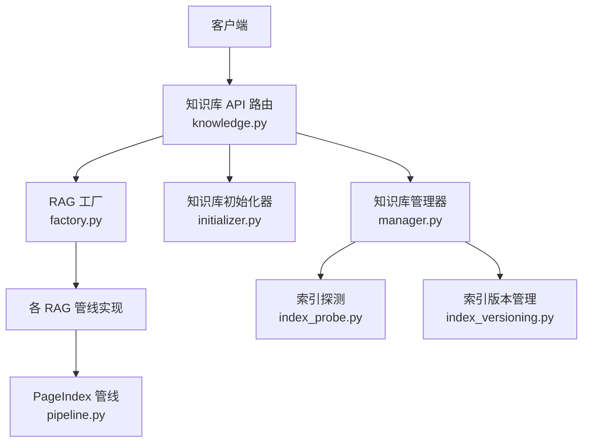
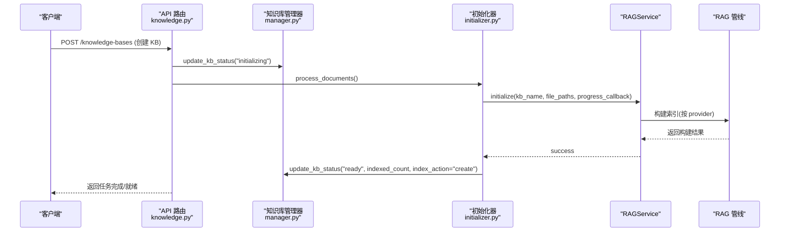
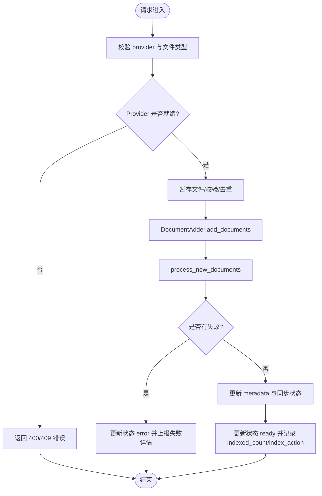
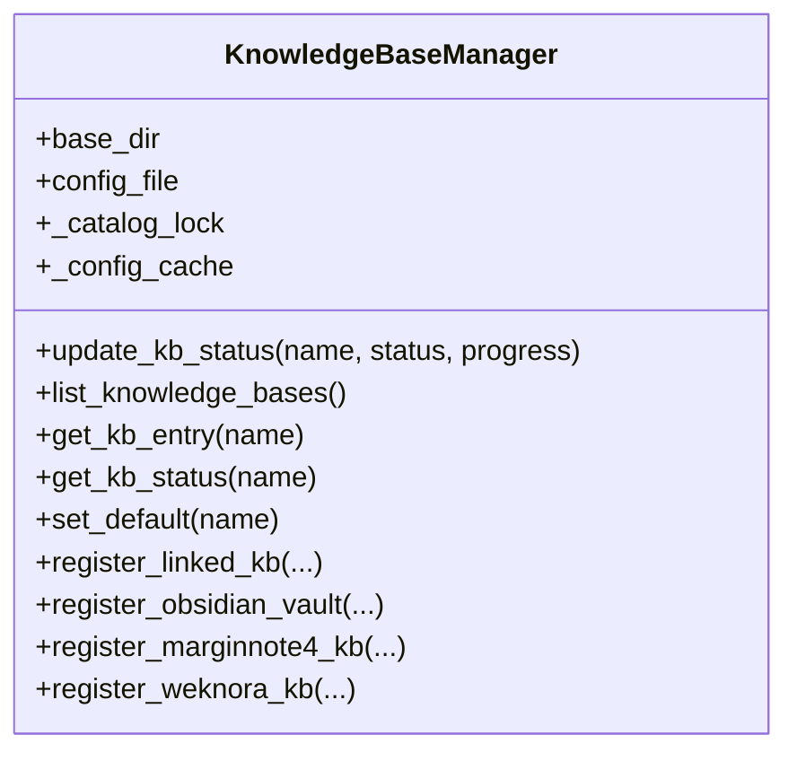
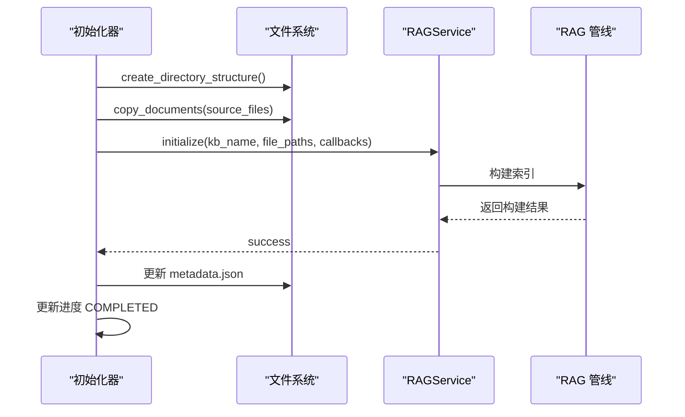
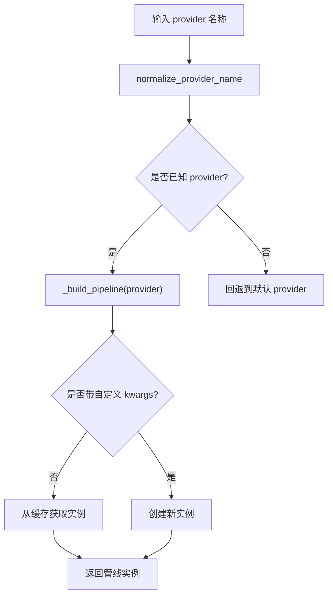
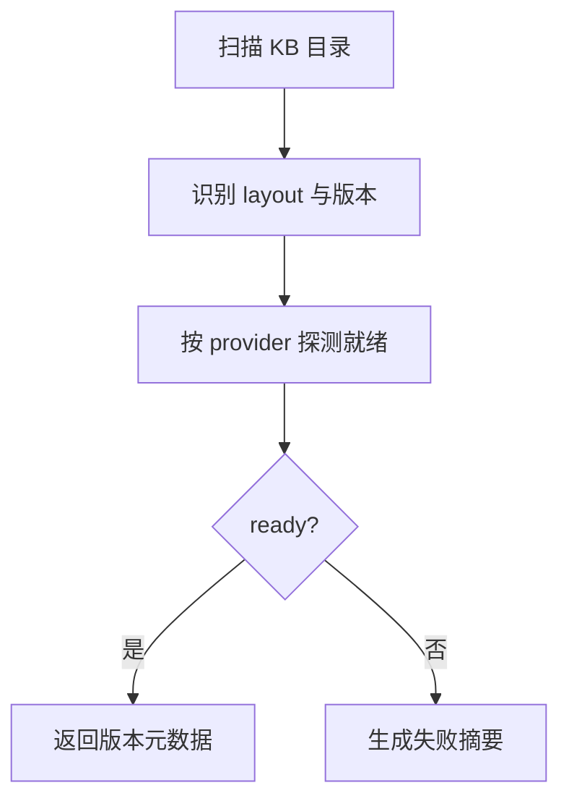
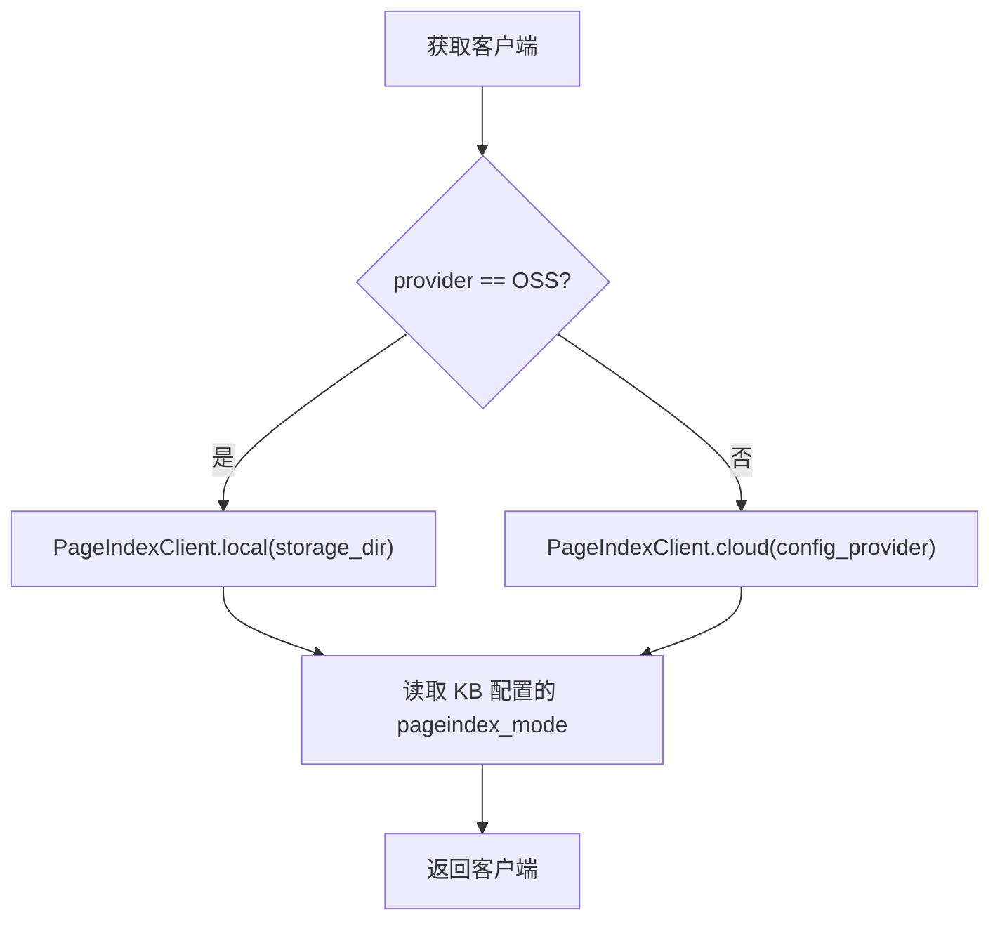
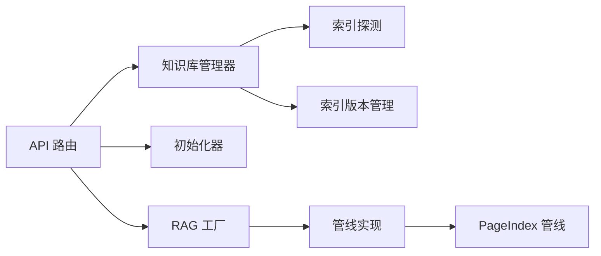

# 索引构建与管理

<cite>
**本文引用的文件**   
- [knowledge.py](file://deeptutor/api/routers/knowledge.py)
- [manager.py](file://deeptutor/knowledge/manager.py)
- [initializer.py](file://deeptutor/knowledge/initializer.py)
- [factory.py](file://deeptutor/services/rag/factory.py)
- [index_versioning.py](file://deeptutor/services/rag/index_versioning.py)
- [index_probe.py](file://deeptutor/services/rag/index_probe.py)
- [pipeline.py](file://deeptutor/services/rag/pipelines/pageindex/pipeline.py)
</cite>

## 目录
1. [引言](#引言)
2. [项目结构](#项目结构)
3. [核心组件](#核心组件)
4. [架构总览](#架构总览)
5. [详细组件分析](#详细组件分析)
6. [依赖关系分析](#依赖关系分析)
7. [性能与优化](#性能与优化)
8. [故障排查指南](#故障排查指南)
9. [结论](#结论)
10. [附录：API 参考](#附录api-参考)

## 引言
本文件面向“向量索引的创建、更新、重建”以及“不同 RAG 引擎配置、版本管理、健康检查与监控接口”的系统性说明。DeepTutor 的知识库（KB）通过统一的 API 路由层暴露能力，由知识库管理器负责持久化状态与元数据，初始化器驱动文档处理与索引构建，RAG 工厂根据引擎类型选择具体管线。系统支持多种后端引擎（LlamaIndex、PageIndex、GraphRAG、LightRAG、LightRAG Server、IMA、WeKnora、Kiwix），并提供版本化索引、增量索引、预检、健康检查与统计信息接口。

## 项目结构
围绕索引构建与管理的关键代码分布在以下模块：
- API 路由层：统一暴露知识库创建、上传、同步、配置、健康检查等接口
- 知识库管理器：维护 kb_config.json、状态机、嵌入指纹、版本列表与缓存
- 初始化器：编排目录结构、文档复制、调用 RAGService 完成索引构建
- RAG 工厂：按 provider 选择管线实例并描述可用引擎
- 索引版本与探测：扫描磁盘上的版本目录、判断就绪状态、汇总失败原因
- PageIndex 管线：区分云端与本地 OSS 模式，读取 KB 配置中的 pageindex_mode

**图示来源**
- [knowledge.py:1-120](file://deeptutor/api/routers/knowledge.py#L1-L120)
- [manager.py:322-376](file://deeptutor/knowledge/manager.py#L322-L376)
- [initializer.py:35-63](file://deeptutor/knowledge/initializer.py#L35-L63)
- [factory.py:1-61](file://deeptutor/services/rag/factory.py#L1-L61)
- [index_probe.py:233-273](file://deeptutor/services/rag/index_probe.py#L233-L273)
- [index_versioning.py:165-204](file://deeptutor/services/rag/index_versioning.py#L165-L204)
- [pipeline.py:77-101](file://deeptutor/services/rag/pipelines/pageindex/pipeline.py#L77-L101)

**章节来源**
- [knowledge.py:1-120](file://deeptutor/api/routers/knowledge.py#L1-L120)
- [manager.py:322-376](file://deeptutor/knowledge/manager.py#L322-L376)
- [initializer.py:35-63](file://deeptutor/knowledge/initializer.py#L35-L63)
- [factory.py:1-61](file://deeptutor/services/rag/factory.py#L1-L61)

## 核心组件
- 知识库 API 路由：提供知识库 CRUD、文件上传、连接外部资源、引擎配置、健康检查、模型选项等接口；封装后台任务、进度广播、日志流和权限控制。
- 知识库管理器：维护 kb_config.json，负责注册、发现、清理孤儿项、嵌入指纹对齐、版本列表刷新、默认知识库设置、PocketBase 同步等。
- 初始化器：创建目录结构、拷贝文档、调用 RAGService 执行索引构建，并在 LightRAG 场景下发布索引快照。
- RAG 工厂：规范化 provider、列出可用管线、按 provider 构建对应管线实例。
- 索引版本与探测：扫描 version-N 目录、判定 ready、汇总失败原因、统计文档数。
- PageIndex 管线：在 OSS 模式下从 KB 配置读取 pageindex_mode，决定本地 SDK 行为。

**章节来源**
- [knowledge.py:1149-1599](file://deeptutor/api/routers/knowledge.py#L1149-L1599)
- [manager.py:322-626](file://deeptutor/knowledge/manager.py#L322-L626)
- [initializer.py:35-323](file://deeptutor/knowledge/initializer.py#L35-L323)
- [factory.py:67-209](file://deeptutor/services/rag/factory.py#L67-L209)
- [index_probe.py:233-273](file://deeptutor/services/rag/index_probe.py#L233-L273)
- [index_versioning.py:165-204](file://deeptutor/services/rag/index_versioning.py#L165-L204)
- [pipeline.py:77-101](file://deeptutor/services/rag/pipelines/pageindex/pipeline.py#L77-L101)

## 架构总览
下图展示一次“新建知识库 + 上传文档 + 构建索引”的典型流程，包括后台任务、进度追踪、状态持久化和最终就绪。

**图示来源**
- [knowledge.py:987-1131](file://deeptutor/api/routers/knowledge.py#L987-L1131)
- [initializer.py:179-323](file://deeptutor/knowledge/initializer.py#L179-L323)
- [manager.py:500-626](file://deeptutor/knowledge/manager.py#L500-L626)

## 详细组件分析

### 知识库 API 路由（索引创建、更新、重建与健康检查）
- 创建与初始化
  - 校验 provider 可用性（PageIndex、GraphRAG、LightRAG 等），必要时执行 engine_preflight。
  - 将 KB 标记为 processing/initializing，启动后台任务 run_initialization_task。
  - 后台任务调用 initializer.process_documents，完成后更新状态为 ready，记录 indexed_count 与 index_action。
- 增量索引（上传文件）
  - 使用 DocumentAdder 对文件进行去重、校验、暂存到 raw/，再调用 process_new_documents 增量构建。
  - 成功时更新 metadata 与文件夹同步状态，记录 index_changed 与 index_action="upload"。
- 重建与迁移
  - 当 provider 变更或检测到 legacy 存储布局时，标记 needs_reindex 并将状态置为 needs_reindex。
  - 提供 connect-folder/probe-folder 等接口以挂载已有索引目录（只读）。
- 健康检查与统计
  - GET /knowledge-bases/health 快速统计已注册 KB 数量与配置文件存在性。
  - GET /knowledge-bases/supported-file-types 返回当前支持的上传扩展与大小限制。
  - GET /knowledge-bases/{kb_name}/config 与 PUT /knowledge-bases/{kb_name}/config 用于查询与更新 KB 配置。
- 引擎配置
  - LlamaIndex、GraphRAG、LightRAG、LightRAG Server、PageIndex、IMA 等均有独立的 GET/PUT 配置端点。
  - GET /knowledge-bases/rag-providers 列出可用引擎及其 modes/default_mode/linkable。
  - GET /knowledge-bases/rag-pipelines/{provider}/preflight 返回包安装、凭据、模型要求等检查结果。

**图示来源**
- [knowledge.py:714-843](file://deeptutor/api/routers/knowledge.py#L714-L843)
- [knowledge.py:1133-1395](file://deeptutor/api/routers/knowledge.py#L1133-L1395)
- [knowledge.py:1397-1424](file://deeptutor/api/routers/knowledge.py#L1397-L1424)
- [knowledge.py:1600-1649](file://deeptutor/api/routers/knowledge.py#L1600-L1649)
- [knowledge.py:1660-1785](file://deeptutor/api/routers/knowledge.py#L1660-L1785)
- [knowledge.py:1808-1837](file://deeptutor/api/routers/knowledge.py#L1808-L1837)
- [knowledge.py:1840-1853](file://deeptutor/api/routers/knowledge.py#L1840-L1853)

**章节来源**
- [knowledge.py:714-843](file://deeptutor/api/routers/knowledge.py#L714-L843)
- [knowledge.py:1133-1395](file://deeptutor/api/routers/knowledge.py#L1133-L1395)
- [knowledge.py:1397-1424](file://deeptutor/api/routers/knowledge.py#L1397-L1424)
- [knowledge.py:1600-1649](file://deeptutor/api/routers/knowledge.py#L1600-L1649)
- [knowledge.py:1660-1785](file://deeptutor/api/routers/knowledge.py#L1660-L1785)
- [knowledge.py:1808-1837](file://deeptutor/api/routers/knowledge.py#L1808-L1837)
- [knowledge.py:1840-1853](file://deeptutor/api/routers/knowledge.py#L1840-L1853)

### 知识库管理器（状态、版本与嵌入指纹）
- 配置加载与缓存
  - 使用 _catalog_lock 串行化加载，结合 stat 与时间戳缓存，避免频繁解析 kb_config.json。
  - 原子写入 atomic_write_json，保证并发读取一致性。
- 嵌入指纹与版本对齐
  - _reconcile_embedding_flags 对比当前 embedding 配置与磁盘版本，设置 needs_reindex/embedding_mismatch。
  - 对 LightRAG 等引擎，使用 binding_status 与 entry_signature 判断 published 根目录是否匹配。
- 状态更新与统计
  - update_kb_status 在 ready 时清除临时进度字段，记录 last_completed_at/last_indexed_at/count/action。
  - list_knowledge_bases 自动清理孤儿项并发现未注册的 KB 目录。
- PocketBase 同步
  - 每次保存配置后尝试镜像到 PocketBase（best-effort）。

**图示来源**
- [manager.py:322-626](file://deeptutor/knowledge/manager.py#L322-L626)
- [manager.py:651-740](file://deeptutor/knowledge/manager.py#L651-L740)
- [manager.py:1137-1167](file://deeptutor/knowledge/manager.py#L1137-L1167)

**章节来源**
- [manager.py:322-626](file://deeptutor/knowledge/manager.py#L322-L626)
- [manager.py:651-740](file://deeptutor/knowledge/manager.py#L651-L740)
- [manager.py:1137-1167](file://deeptutor/knowledge/manager.py#L1137-L1167)

### 初始化器（文档处理与索引构建）
- 目录结构与元数据
  - create_directory_structure 创建 raw/ 并写入 metadata.json，同时注册 KB 到 kb_config.json。
- 文档复制
  - copy_documents 将源文件去重后复制到 raw/，保留同名冲突时的唯一命名策略。
- 索引构建
  - process_documents 收集 supported files，构造 RAGService 并调用 initialize。
  - 对 LightRAG，before_publish 回调中更新 metadata 并发布索引快照。
  - 异常路径上记录 DataVolumePermissionError 并更新进度为 ERROR。

**图示来源**
- [initializer.py:132-177](file://deeptutor/knowledge/initializer.py#L132-L177)
- [initializer.py:179-323](file://deeptutor/knowledge/initializer.py#L179-L323)

**章节来源**
- [initializer.py:132-177](file://deeptutor/knowledge/initializer.py#L132-L177)
- [initializer.py:179-323](file://deeptutor/knowledge/initializer.py#L179-L323)

### RAG 工厂（引擎选择与能力描述）
- 规范化 provider 名称，未知值回退到默认引擎。
- 提供 has_ready_provider_index、version_has_provider_output、provider_failure_summary 等工具方法。
- list_pipelines 返回各引擎的描述、modes、default_mode、是否需 API key、是否 linkable 等。

**图示来源**
- [factory.py:67-86](file://deeptutor/services/rag/factory.py#L67-L86)
- [factory.py:136-209](file://deeptutor/services/rag/factory.py#L136-L209)
- [factory.py:212-348](file://deeptutor/services/rag/factory.py#L212-L348)

**章节来源**
- [factory.py:67-86](file://deeptutor/services/rag/factory.py#L67-L86)
- [factory.py:136-209](file://deeptutor/services/rag/factory.py#L136-L209)
- [factory.py:212-348](file://deeptutor/services/rag/factory.py#L212-L348)

### 索引版本管理与探测
- 版本扫描
  - index_versioning 扫描 flat/nested_legacy/root_legacy 布局，生成 ready/storage_path/version_path/layout 等元数据。
- 就绪判定
  - index_probe 针对 GraphRAG/LightRAG/LlamaIndex 分别检查输出表/文档计数/存储就绪。
- 失败摘要
  - 提供 provider_failure_summary 帮助 UI 显示简短诊断信息。

**图示来源**
- [index_versioning.py:165-204](file://deeptutor/services/rag/index_versioning.py#L165-L204)
- [index_probe.py:233-273](file://deeptutor/services/rag/index_probe.py#L233-L273)

**章节来源**
- [index_versioning.py:165-204](file://deeptutor/services/rag/index_versioning.py#L165-L204)
- [index_probe.py:233-273](file://deeptutor/services/rag/index_probe.py#L233-L273)

### PageIndex 管线（OSS 与 Cloud 模式）
- 客户端选择
  - 若 provider 为 OSS，则通过 Local Library 路径构造本地客户端；否则使用云端配置。
- 处理模式
  - OSS 模式下从 KB 配置的 pageindex_mode 读取处理模式，影响检索行为。

**图示来源**
- [pipeline.py:77-101](file://deeptutor/services/rag/pipelines/pageindex/pipeline.py#L77-L101)

**章节来源**
- [pipeline.py:77-101](file://deeptutor/services/rag/pipelines/pageindex/pipeline.py#L77-L101)

## 依赖关系分析
- API 路由依赖：
  - 知识库管理器（状态与元数据）
  - 初始化器（文档处理与索引构建）
  - RAG 工厂（管线选择）
  - 索引探测与版本管理（就绪判定与诊断）
- 管理器依赖：
  - 索引探测（has_ready_provider_index、inspect_provider_version）
  - 版本管理（list_kb_versions、find_matching_version）
  - 嵌入签名与绑定（embedding_binding、embedding_signature）
- 管线依赖：
  - PageIndex 管线依赖 KB 配置服务与 SDK 配置解析

**图示来源**
- [knowledge.py:1-120](file://deeptutor/api/routers/knowledge.py#L1-L120)
- [manager.py:322-626](file://deeptutor/knowledge/manager.py#L322-L626)
- [factory.py:136-209](file://deeptutor/services/rag/factory.py#L136-L209)
- [index_probe.py:233-273](file://deeptutor/services/rag/index_probe.py#L233-L273)
- [index_versioning.py:165-204](file://deeptutor/services/rag/index_versioning.py#L165-L204)
- [pipeline.py:77-101](file://deeptutor/services/rag/pipelines/pageindex/pipeline.py#L77-L101)

**章节来源**
- [knowledge.py:1-120](file://deeptutor/api/routers/knowledge.py#L1-L120)
- [manager.py:322-626](file://deeptutor/knowledge/manager.py#L322-L626)
- [factory.py:136-209](file://deeptutor/services/rag/factory.py#L136-L209)
- [index_probe.py:233-273](file://deeptutor/services/rag/index_probe.py#L233-L273)
- [index_versioning.py:165-204](file://deeptutor/services/rag/index_versioning.py#L165-L204)
- [pipeline.py:77-101](file://deeptutor/services/rag/pipelines/pageindex/pipeline.py#L77-L101)

## 性能与优化
- 后台任务与事件循环保护
  - 上传与初始化均通过 BackgroundTasks/异步线程池执行，避免阻塞事件循环（例如 _save_uploaded_files_off_loop）。
- 配置缓存
  - 知识库管理器对 kb_config.json 使用基于 stat/mtime/size 的缓存，减少重复解析开销。
- 文档计数缓存
  - LlamaIndex docstore 计数使用 lru_cache 按 size+mtime 缓存，降低探针成本。
- 增量索引
  - 通过 DocumentAdder 的去重与 staged 机制，仅对新文件或变更文件构建索引，减少全量重建。
- 引擎参数调优
  - LlamaIndex：retrieval_profile、top_k、BM25/vector 乘数、chunk_size/overlap、图像描述并发/批大小/超时。
  - LightRAG：role_models、top_k、response_type、max_concurrent_files、llm_model_max_async、entity_extract_max_gleaning、llm_timeout、llm_profile_id/model_id。
  - GraphRAG：response_type、community_level、dynamic_community_selection。
  - PageIndex：pageindex_mode（OSS 模式）、API Key（Cloud 模式）。

[本节为通用指导，不直接分析具体文件]

## 故障排查指南
- 常见错误与提示
  - 缺失可选依赖：GraphRAG/LightRAG 未安装时返回 400，提示安装命令。
  - 无效索引向量：LlamaIndex 报错 invalid_embedding_index，建议重新索引。
  - 权限问题：DataVolumePermissionError 提示数据卷不可写。
  - 文件类型不支持：PageIndex 拒绝非允许扩展名。
- 健康检查
  - GET /knowledge-bases/health 返回 status/base_dir/config_exists/knowledge_bases_count。
- 预检与诊断
  - GET /knowledge-bases/rag-pipelines/{provider}/preflight 返回 checks 列表，包含 optional/ok/detail。
  - 通过 manager.update_kb_status 的错误分支查看 last_error/last_error_at。
- 版本与嵌入不匹配
  - 若 needs_reindex/embedding_mismatch 被设置，UI 应引导用户执行重建。

**章节来源**
- [knowledge.py:800-843](file://deeptutor/api/routers/knowledge.py#L800-L843)
- [knowledge.py:1397-1424](file://deeptutor/api/routers/knowledge.py#L1397-L1424)
- [knowledge.py:1840-1853](file://deeptutor/api/routers/knowledge.py#L1840-L1853)
- [initializer.py:293-310](file://deeptutor/knowledge/initializer.py#L293-L310)
- [manager.py:578-626](file://deeptutor/knowledge/manager.py#L578-L626)

## 结论
DeepTutor 的知识库索引体系通过统一的 API 路由层暴露能力，结合知识库管理器、初始化器与 RAG 工厂，实现了多引擎、版本化、可观测的索引构建与管理。系统支持增量索引与全量重建，提供健康检查、预检、统计信息与丰富的引擎配置接口。对于分布式与一致性保障，当前实现侧重于单进程内的并发安全（原子写入、共享锁、缓存失效）与外部资源只读挂载；跨节点一致性不在本仓库范围内体现。

[本节为总结性内容，不直接分析具体文件]

## 附录：API 参考
- 健康与统计
  - GET /knowledge-bases/health
  - GET /knowledge-bases/supported-file-types
- 引擎与配置
  - GET /knowledge-bases/rag-providers
  - PUT /knowledge-bases/rag-providers/{provider}/mode
  - GET/PUT /knowledge-bases/rag-pipelines/{provider}/config（LlamaIndex、GraphRAG、LightRAG、LightRAG Server、PageIndex、IMA）
  - GET /knowledge-bases/rag-pipelines/{provider}/preflight
  - GET /knowledge-bases/rag-pipelines/model-options
  - PUT /knowledge-bases/rag-pipelines/active-model
- 知识库配置
  - GET /knowledge-bases/configs
  - GET /knowledge-bases/{kb_name}/config
  - PUT /knowledge-bases/{kb_name}/config
  - POST /knowledge-bases/configs/sync
- 默认知识库
  - GET /knowledge-bases/default
  - PUT /knowledge-bases/default/{kb_name}
- 连接外部资源
  - POST /knowledge-bases/connect-obsidian
  - POST /knowledge-bases/connect-marginnote4
  - POST /knowledge-bases/probe-folder
  - POST /knowledge-bases/connect-folder
  - POST /knowledge-bases/probe-lightrag-server
  - POST /knowledge-bases/connect-lightrag-server
  - POST /knowledge-bases/probe-weknora
  - POST /knowledge-bases/connect-weknora

**章节来源**
- [knowledge.py:1397-1424](file://deeptutor/api/routers/knowledge.py#L1397-L1424)
- [knowledge.py:1426-1480](file://deeptutor/api/routers/knowledge.py#L1426-L1480)
- [knowledge.py:1482-1583](file://deeptutor/api/routers/knowledge.py#L1482-L1583)
- [knowledge.py:1600-1649](file://deeptutor/api/routers/knowledge.py#L1600-L1649)
- [knowledge.py:1660-1785](file://deeptutor/api/routers/knowledge.py#L1660-L1785)
- [knowledge.py:1788-1837](file://deeptutor/api/routers/knowledge.py#L1788-L1837)
- [knowledge.py:1840-1853](file://deeptutor/api/routers/knowledge.py#L1840-L1853)
- [knowledge.py:1903-1958](file://deeptutor/api/routers/knowledge.py#L1903-L1958)
- [knowledge.py:2000-2035](file://deeptutor/api/routers/knowledge.py#L2000-L2035)
- [knowledge.py:2038-2058](file://deeptutor/api/routers/knowledge.py#L2038-L2058)
- [knowledge.py:2061-2161](file://deeptutor/api/routers/knowledge.py#L2061-L2161)
- [knowledge.py:2164-2192](file://deeptutor/api/routers/knowledge.py#L2164-L2192)
- [knowledge.py:2200-2259](file://deeptutor/api/routers/knowledge.py#L2200-L2259)
- [knowledge.py:2273-2340](file://deeptutor/api/routers/knowledge.py#L2273-L2340)
- [knowledge.py:2369-2399](file://deeptutor/api/routers/knowledge.py#L2369-L2399)
- [knowledge.py:2460-2509](file://deeptutor/api/routers/knowledge.py#L2460-L2509)