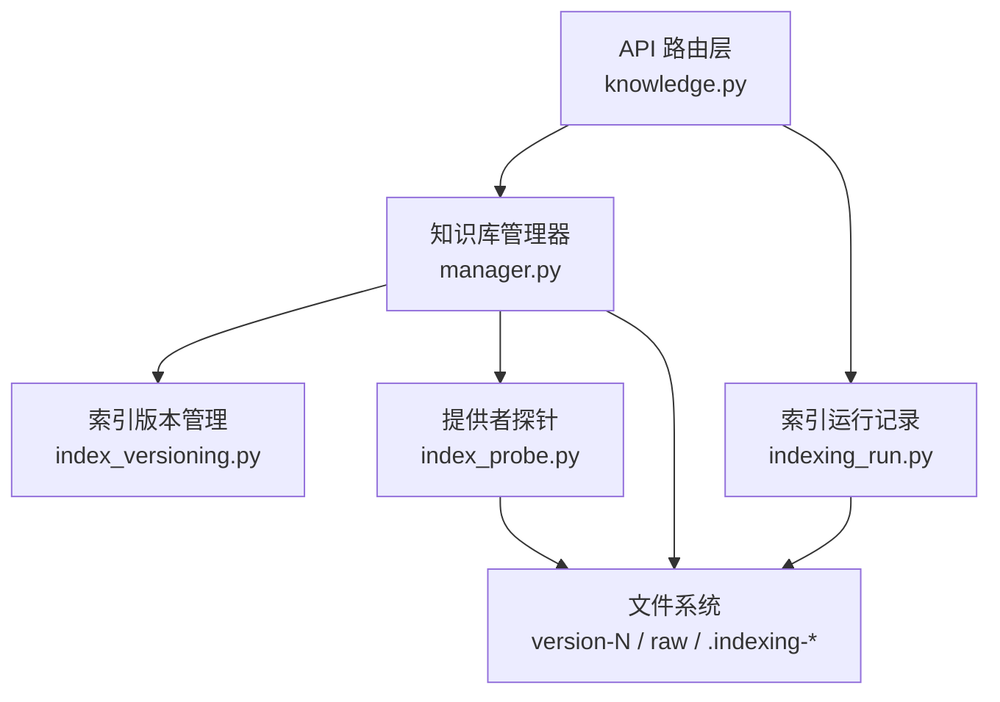
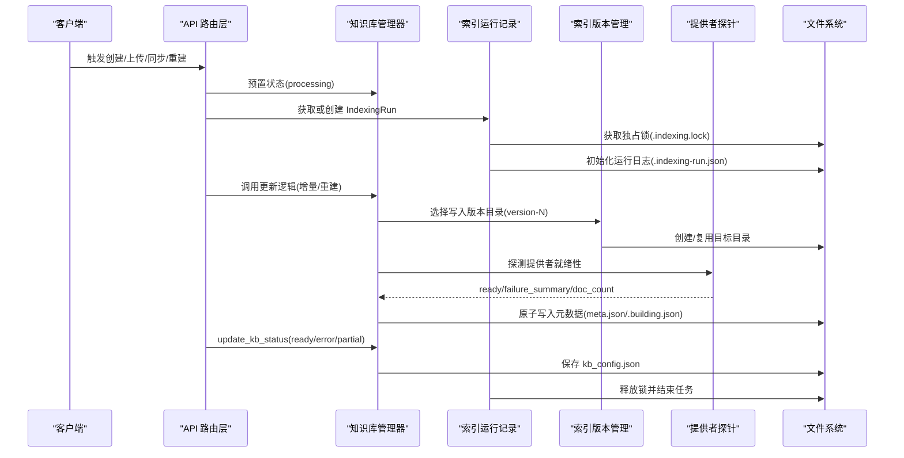
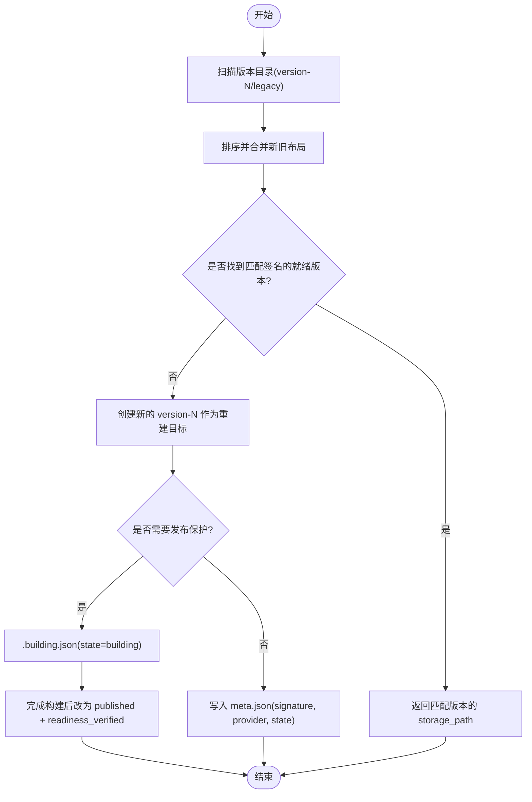
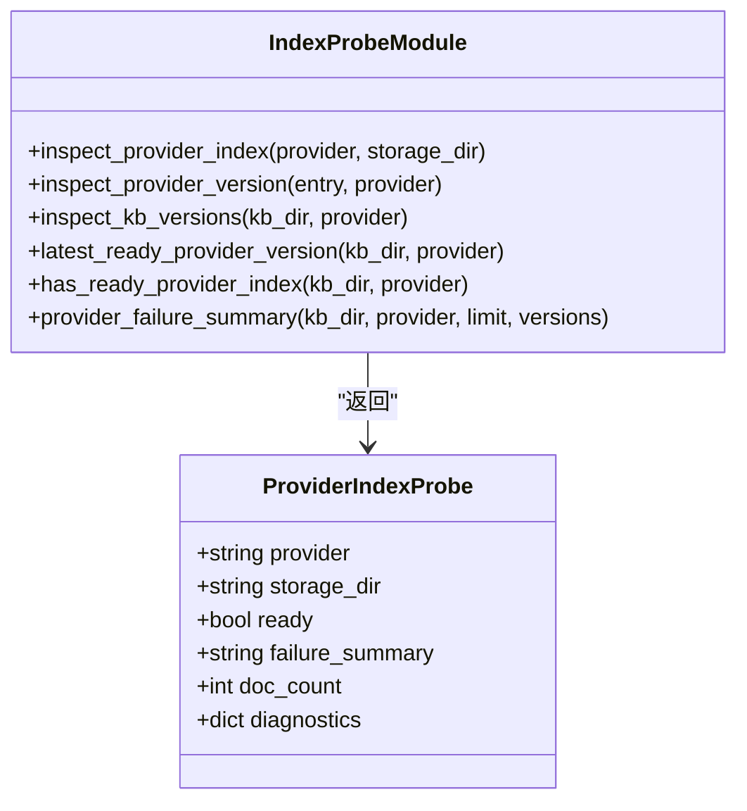
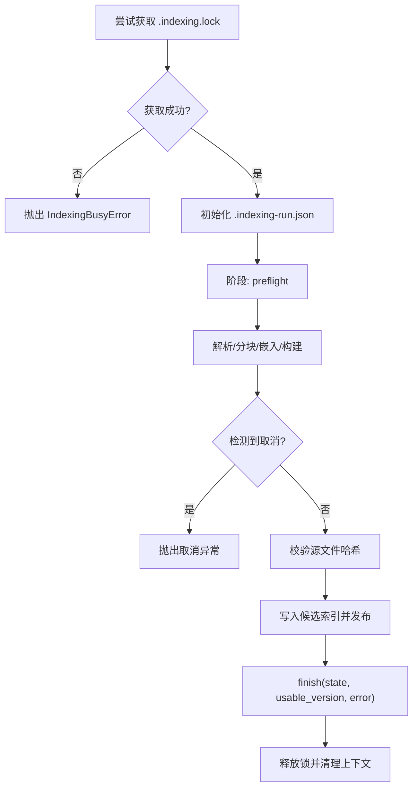
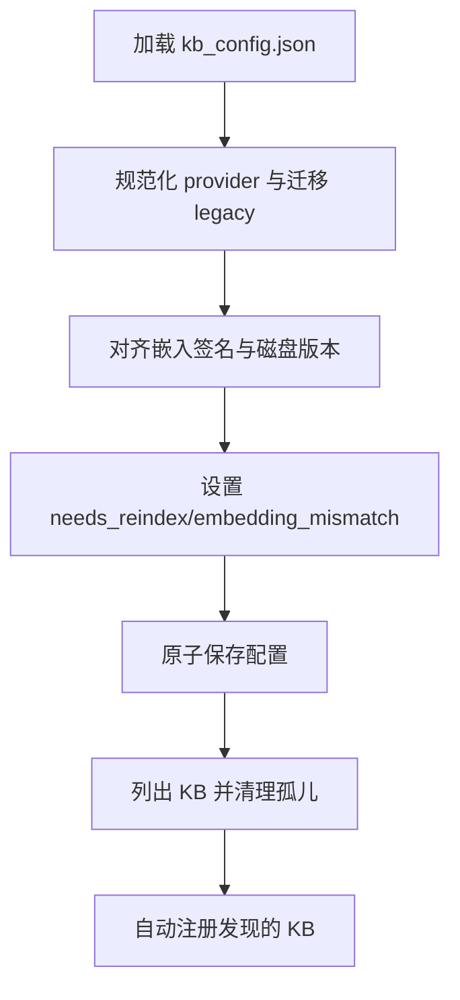
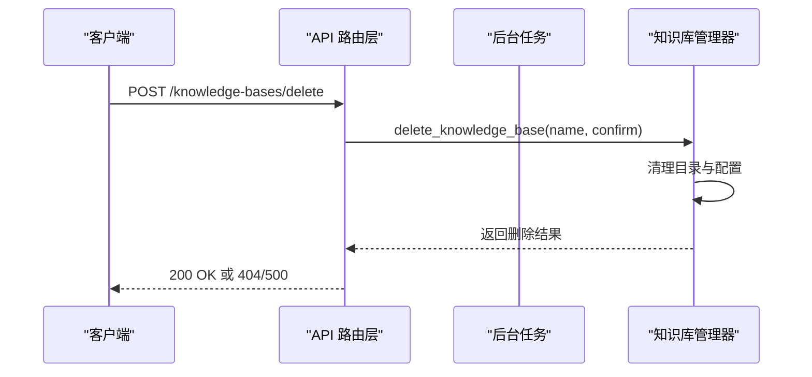
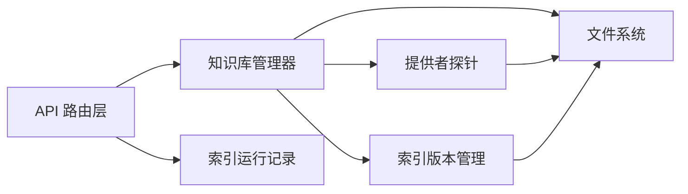

# 索引维护与更新

<cite>
**本文引用的文件**   
- [deeptutor/knowledge/manager.py](file://deeptutor/knowledge/manager.py)
- [deeptutor/knowledge/indexing_run.py](file://deeptutor/knowledge/indexing_run.py)
- [deeptutor/services/rag/index_versioning.py](file://deeptutor/services/rag/index_versioning.py)
- [deeptutor/services/rag/index_probe.py](file://deeptutor/services/rag/index_probe.py)
- [deeptutor/api/routers/knowledge.py](file://deeptutor/api/routers/knowledge.py)
</cite>

## 目录
1. [引言](#引言)
2. [项目结构](#项目结构)
3. [核心组件](#核心组件)
4. [架构总览](#架构总览)
5. [详细组件分析](#详细组件分析)
6. [依赖关系分析](#依赖关系分析)
7. [性能考虑](#性能考虑)
8. [故障排查指南](#故障排查指南)
9. [结论](#结论)
10. [附录：维护计划与优化建议](#附录维护计划与优化建议)

## 引言
本文件面向 DeepTutor 的知识库索引维护与更新，覆盖以下主题：
- 增量更新、重建与清理操作
- 索引版本管理与回滚机制
- 数据一致性保证
- 索引健康检查、性能监控与故障恢复策略
- 索引优化建议与维护计划制定指南

DeepTutor 的索引体系以“按嵌入配置签名”的扁平化版本目录为核心，结合进程级锁、原子写入和持久化运行日志，确保在并发、中断和异常场景下的可恢复性与可观测性。

## 项目结构
围绕索引维护的关键代码分布在以下模块：
- 知识库管理器：负责注册、发现、状态同步、嵌入签名对齐与元数据刷新
- 索引运行记录：记录单次索引任务的生命周期、文档级进度、取消与恢复语义
- 索引版本管理：定义扁平 version-N 布局、旧布局兼容、版本扫描与读写路径选择
- 提供者探针：对 LlamaIndex、LightRAG、GraphRAG、PageIndex 等提供者的就绪性进行探测
- API 路由层：暴露创建、上传、同步、删除等接口，并驱动后台任务与状态广播

图表来源
- [deeptutor/api/routers/knowledge.py:1-120](file://deeptutor/api/routers/knowledge.py#L1-L120)
- [deeptutor/knowledge/manager.py:322-470](file://deeptutor/knowledge/manager.py#L322-L470)
- [deeptutor/services/rag/index_versioning.py:1-43](file://deeptutor/services/rag/index_versioning.py#L1-L43)
- [deeptutor/services/rag/index_probe.py:1-55](file://deeptutor/services/rag/index_probe.py#L1-L55)
- [deeptutor/knowledge/indexing_run.py:134-224](file://deeptutor/knowledge/indexing_run.py#L134-L224)

章节来源
- [deeptutor/api/routers/knowledge.py:1-120](file://deeptutor/api/routers/knowledge.py#L1-L120)
- [deeptutor/knowledge/manager.py:322-470](file://deeptutor/knowledge/manager.py#L322-L470)
- [deeptutor/services/rag/index_versioning.py:1-43](file://deeptutor/services/rag/index_versioning.py#L1-L43)
- [deeptutor/services/rag/index_probe.py:1-55](file://deeptutor/services/rag/index_probe.py#L1-L55)
- [deeptutor/knowledge/indexing_run.py:134-224](file://deeptutor/knowledge/indexing_run.py#L134-L224)

## 核心组件
- 知识库管理器（KnowledgeBaseManager）
  - 加载与协调 kb_config.json，处理未知/废弃 provider 归一化与重建标记
  - 根据当前嵌入配置签名与磁盘版本比对，设置 needs_reindex/embedding_mismatch
  - 更新 KB 状态时刷新 embedding_signature 与 index_versions，供 UI 展示
  - 列表发现与孤儿清理，自动注册未登记但有效的 KB
- 索引运行记录（IndexingRun）
  - 使用 .indexing.lock 实现跨平台独占锁，避免重复索引
  - 持久化 .indexing-run.json 记录任务、阶段、文档状态、错误码与可用版本
  - 支持取消请求、中断恢复、源文件变更校验
- 索引版本管理（index_versioning）
  - 扁平 version-N 布局为主，兼容 legacy nested/root 布局
  - 提供 find_matching_version、resolve_storage_dir_for_write/rebuild/read 等关键方法
  - 通过 meta.json 与 .building.json 控制候选索引的发布与就绪判定
- 提供者探针（index_probe）
  - 针对 LlamaIndex/LightRAG/GraphRAG/PageIndex 提供 ready/failure_summary/doc_count
  - 为 list_kb_versions 注入 provider-ready 标注，支撑健康检查与失败摘要
- API 路由层（knowledge.py）
  - 暴露创建、上传、同步、默认库设置、连接外部知识库、删除等接口
  - 使用后台任务与进度广播，驱动索引生命周期并更新 KB 状态

章节来源
- [deeptutor/knowledge/manager.py:158-319](file://deeptutor/knowledge/manager.py#L158-L319)
- [deeptutor/knowledge/manager.py:500-625](file://deeptutor/knowledge/manager.py#L500-L625)
- [deeptutor/knowledge/indexing_run.py:134-433](file://deeptutor/knowledge/indexing_run.py#L134-L433)
- [deeptutor/services/rag/index_versioning.py:214-388](file://deeptutor/services/rag/index_versioning.py#L214-L388)
- [deeptutor/services/rag/index_probe.py:40-133](file://deeptutor/services/rag/index_probe.py#L40-L133)
- [deeptutor/api/routers/knowledge.py:267-300](file://deeptutor/api/routers/knowledge.py#L267-L300)

## 架构总览
下图展示了从 API 到存储层的索引维护流程，包括增量更新、重建与清理。

图表来源
- [deeptutor/api/routers/knowledge.py:267-300](file://deeptutor/api/routers/knowledge.py#L267-L300)
- [deeptutor/knowledge/indexing_run.py:179-258](file://deeptutor/knowledge/indexing_run.py#L179-L258)
- [deeptutor/services/rag/index_versioning.py:309-388](file://deeptutor/services/rag/index_versioning.py#L309-L388)
- [deeptutor/services/rag/index_probe.py:77-133](file://deeptutor/services/rag/index_probe.py#L77-L133)
- [deeptutor/knowledge/manager.py:500-625](file://deeptutor/knowledge/manager.py#L500-L625)

## 详细组件分析

### 索引版本管理与回滚机制
- 扁平版本布局
  - 每个 KB 下存在 version-1、version-2 等目录，包含 docstore.json、index_store.json、vector_store.json 及 meta.json
  - meta.json 包含 signature、provider、state、created_at 等字段；.building.json 用于候选索引的构建中保护
- 版本扫描与排序
  - list_kb_versions 同时收集 flat/nested_legacy/root_legacy 布局，并按 created_at/layout/version 排序
  - _sort_versions 优先返回 flat 布局，便于新索引优先被识别
- 匹配与选择
  - find_matching_version 根据 EmbeddingSignature.hash() 查找 ready 且匹配的 flat 版本
  - resolve_storage_dir_for_read/write/rebuild 分别用于读取、写入与全量重建的目标目录选择
- 回滚与发布
  - 全量重建使用 resolve_storage_dir_for_rebuild 创建全新 version-N，不覆盖旧版本
  - 当 .building.json.state=published 且 readiness_verified=true 时，候选索引被视为已发布
  - 若需要回滚，只需切换读取路径至上一版本目录即可

图表来源
- [deeptutor/services/rag/index_versioning.py:214-388](file://deeptutor/services/rag/index_versioning.py#L214-L388)

章节来源
- [deeptutor/services/rag/index_versioning.py:1-43](file://deeptutor/services/rag/index_versioning.py#L1-L43)
- [deeptutor/services/rag/index_versioning.py:214-388](file://deeptutor/services/rag/index_versioning.py#L214-L388)

### 索引健康检查与提供者就绪性
- 提供者探针统一封装了不同引擎的就绪判断：
  - LlamaIndex：检查 docstore.json、index_store.json 与 vector store 文件，并对 .building.json 做发布校验
  - LightRAG：调用 storage.has_output/failure_summary/doc_count
  - GraphRAG：检查 parquet 输出表是否存在
  - PageIndex：校验 manifest 与文档 artifacts（OSS 模式额外检查 docs 目录）
- inspect_kb_versions 将 provider-ready 信息注入版本条目，并提供 failure_summary 与 doc_count
- has_ready_provider_index 与 latest_ready_provider_version 用于快速判断是否有可用的索引

图表来源
- [deeptutor/services/rag/index_probe.py:28-133](file://deeptutor/services/rag/index_probe.py#L28-L133)

章节来源
- [deeptutor/services/rag/index_probe.py:40-133](file://deeptutor/services/rag/index_probe.py#L40-L133)

### 索引运行记录与并发控制
- 独占锁
  - 使用 .indexing.lock 与 fcntl/msvcrt 实现跨平台独占锁，防止多个索引任务同时操作同一 KB
- 运行日志
  - .indexing-run.json 记录 task_id、action、provider、pid、state、phase、documents、usable_version、error_code 等
  - visible_run/load_run 处理进程存活检测与中断恢复，将未完成文档状态置为 unknown
- 取消与恢复
  - request_cancel 写入 .indexing-cancel.json，IndexingRun.check 检测到取消则抛出取消异常
  - finish 将未完成文档状态重置为 unknown，并记录 usable_version 与 error_code
- 源文件校验
  - verify_sources 对比 source_hash，防止索引过程中源文件被替换导致不一致

图表来源
- [deeptutor/knowledge/indexing_run.py:82-131](file://deeptutor/knowledge/indexing_run.py#L82-L131)
- [deeptutor/knowledge/indexing_run.py:179-258](file://deeptutor/knowledge/indexing_run.py#L179-L258)
- [deeptutor/knowledge/indexing_run.py:329-433](file://deeptutor/knowledge/indexing_run.py#L329-L433)

章节来源
- [deeptutor/knowledge/indexing_run.py:50-131](file://deeptutor/knowledge/indexing_run.py#L50-L131)
- [deeptutor/knowledge/indexing_run.py:179-258](file://deeptutor/knowledge/indexing_run.py#L179-L258)
- [deeptutor/knowledge/indexing_run.py:329-433](file://deeptutor/knowledge/indexing_run.py#L329-L433)

### 知识库管理器与状态同步
- 配置加载与协调
  - _read_and_reconcile_config 规范化 rag_provider，标记未知 provider 为 needs_reindex
  - 迁移 legacy rag_storage 并标记需要重建
  - 调用 _reconcile_embedding_flags 对齐嵌入签名与磁盘版本
- 嵌入签名对齐
  - 比较当前嵌入模型与维度与 KB 记录的 embedding_model/embedding_dim
  - 若存在 mismatch，设置 embedding_mismatch 与 needs_reindex
  - LightRAG 特殊处理：绑定配置变化或 published 根不匹配时触发重建提示
- 状态更新
  - update_kb_status 在 ready 时清除 progress/last_error，记录 last_completed_at/last_indexed_at/count/action
  - 刷新 embedding_signature 与 index_versions，供 UI 渲染版本标签
- 列表与孤儿清理
  - list_knowledge_bases 清理无目录的孤儿条目，自动注册发现的合法 KB

图表来源
- [deeptutor/knowledge/manager.py:378-457](file://deeptutor/knowledge/manager.py#L378-L457)
- [deeptutor/knowledge/manager.py:158-319](file://deeptutor/knowledge/manager.py#L158-L319)
- [deeptutor/knowledge/manager.py:651-740](file://deeptutor/knowledge/manager.py#L651-L740)

章节来源
- [deeptutor/knowledge/manager.py:378-457](file://deeptutor/knowledge/manager.py#L378-L457)
- [deeptutor/knowledge/manager.py:158-319](file://deeptutor/knowledge/manager.py#L158-L319)
- [deeptutor/knowledge/manager.py:651-740](file://deeptutor/knowledge/manager.py#L651-L740)

### API 路由与后台任务
- 预调度状态更新
  - _mark_kb_queued_for_processing 在后台任务启动前将 KB 状态设为 processing，避免 UI 显示 stale ready
- 任务追踪与日志
  - 使用 TaskIDManager 生成唯一任务 ID，ProgressBroadcaster 推送进度，task_log_stream 捕获日志
- 删除接口
  - delete_knowledge_base_by_name 与 delete_knowledge_base(path) 均委托给 _delete_kb，最终调用 manager.delete_knowledge_base
  - 删除逻辑会清理目录、移除配置项、更新默认库指针，并处理权限与只读位问题

图表来源
- [deeptutor/api/routers/knowledge.py:3374-3396](file://deeptutor/api/routers/knowledge.py#L3374-L3396)
- [deeptutor/knowledge/manager.py:1777-1873](file://deeptutor/knowledge/manager.py#L1777-L1873)

章节来源
- [deeptutor/api/routers/knowledge.py:267-300](file://deeptutor/api/routers/knowledge.py#L267-L300)
- [deeptutor/api/routers/knowledge.py:3374-3396](file://deeptutor/api/routers/knowledge.py#L3374-L3396)
- [deeptutor/knowledge/manager.py:1777-1873](file://deeptutor/knowledge/manager.py#L1777-L1873)

## 依赖关系分析
- 耦合与内聚
  - API 路由层仅负责请求解析、权限校验与后台任务编排，业务逻辑下沉至 KnowledgeBaseManager
  - KnowledgeBaseManager 依赖 index_versioning 与 index_probe 进行版本选择与健康检查
  - IndexingRun 独立于其他模块，专注于单 KB 的索引生命周期与并发控制
- 外部依赖
  - 各 RAG 提供者（LlamaIndex/LightRAG/GraphRAG/PageIndex）通过 probe 模块抽象其就绪性
  - PocketBase 可选同步 KB 元数据，非阻塞且不影响本地 JSON 主数据源

图表来源
- [deeptutor/api/routers/knowledge.py:1-120](file://deeptutor/api/routers/knowledge.py#L1-L120)
- [deeptutor/knowledge/manager.py:322-470](file://deeptutor/knowledge/manager.py#L322-L470)
- [deeptutor/services/rag/index_versioning.py:1-43](file://deeptutor/services/rag/index_versioning.py#L1-L43)
- [deeptutor/services/rag/index_probe.py:1-55](file://deeptutor/services/rag/index_probe.py#L1-L55)
- [deeptutor/knowledge/indexing_run.py:134-224](file://deeptutor/knowledge/indexing_run.py#L134-L224)

章节来源
- [deeptutor/api/routers/knowledge.py:1-120](file://deeptutor/api/routers/knowledge.py#L1-L120)
- [deeptutor/knowledge/manager.py:322-470](file://deeptutor/knowledge/manager.py#L322-L470)
- [deeptutor/services/rag/index_versioning.py:1-43](file://deeptutor/services/rag/index_versioning.py#L1-L43)
- [deeptutor/services/rag/index_probe.py:1-55](file://deeptutor/services/rag/index_probe.py#L1-L55)
- [deeptutor/knowledge/indexing_run.py:134-224](file://deeptutor/knowledge/indexing_run.py#L134-L224)

## 性能考虑
- 配置缓存与单飞协调
  - _catalog_revision 基于 ino/mtime_ns/size 与嵌入签名、用户与工作区标识计算缓存键
  - _load_config 使用 RLock 保护，并在短时间内复用配置快照，降低慢盘开销
- 文档计数缓存
  - _llamaindex_doc_count_cached 基于文件大小与 mtime_ns 缓存 docstore.json 的文档数量，减少大文件解析成本
- 原子写入
  - atomic_write_json 通过临时文件+os.replace 保证并发读者始终看到完整的前一或新版本
- 版本扫描优化
  - list_kb_versions 优先返回 flat 布局，减少不必要的 legacy 解析
  - provider_failure_summary 支持传入预计算的 versions，避免重复扫描

[本节为通用性能讨论，无需具体文件分析]

## 故障排查指南
- 索引繁忙
  - 现象：IndexingBusyError
  - 原因：.indexing.lock 已被占用
  - 处理：等待现有任务完成或确认进程崩溃后由 visible_run 将状态置为 interrupted
- 索引中断恢复
  - 现象：state=interrupted，部分文档 status=unknown
  - 原因：进程崩溃或强制终止
  - 处理：重新发起索引，IndexingRun 会重用已验证的解析输出与可恢复的检查点
- 源文件变更
  - 现象：verify_sources 抛出运行时错误
  - 原因：索引过程中源文件被修改
  - 处理：重试并使用当前源文件
- 提供者就绪失败
  - 现象：ProviderIndexProbe.ready=false，failure_summary 非空
  - 原因：缺少必要文件或输出不完整
  - 处理：查看 failure_summary 与 diagnostics，修复缺失文件或重新构建
- 嵌入签名不匹配
  - 现象：embedding_mismatch=true，needs_reindex=true
  - 原因：当前嵌入模型/维度与 KB 记录不一致
  - 处理：执行重建以生成匹配的新版本

章节来源
- [deeptutor/knowledge/indexing_run.py:50-131](file://deeptutor/knowledge/indexing_run.py#L50-L131)
- [deeptutor/knowledge/indexing_run.py:329-433](file://deeptutor/knowledge/indexing_run.py#L329-L433)
- [deeptutor/services/rag/index_probe.py:136-284](file://deeptutor/services/rag/index_probe.py#L136-L284)
- [deeptutor/knowledge/manager.py:158-319](file://deeptutor/knowledge/manager.py#L158-L319)

## 结论
DeepTutor 的索引维护体系通过扁平版本目录、提供者探针、进程级独占锁与持久化运行日志，实现了高可靠、可恢复、可观测的索引生命周期管理。增量更新与全量重建分离，回滚通过版本切换实现；健康检查与失败摘要帮助快速定位问题；配置缓存与原子写入保障并发安全与性能。

[本节为总结性内容，无需具体文件分析]

## 附录：维护计划与优化建议
- 维护计划
  - 定期巡检：检查 KB 的 status、progress、last_completed_at、last_indexed_at/count/action
  - 嵌入配置变更：当更换嵌入模型或维度时，主动触发重建并验证 new version 的 ready 状态
  - 清理策略：删除不再使用的 KB，确保 kb_config.json 与磁盘目录一致
- 优化建议
  - 使用扁平 version-N 布局，避免 legacy 布局带来的解析开销
  - 合理设置后台任务并发度，避免多 KB 同时重建造成资源争用
  - 关注 provider_failure_summary 与 diagnostics，及时修复缺失文件或输出不完整的问题
  - 利用 ProgressBroadcaster 与 task_log_stream 监控长耗时任务，提升可观测性

[本节为通用指导，无需具体文件分析]