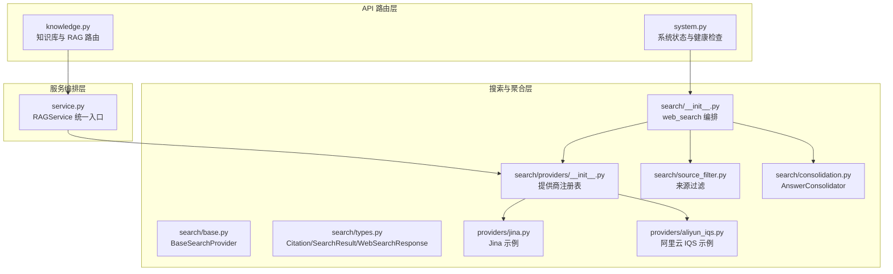
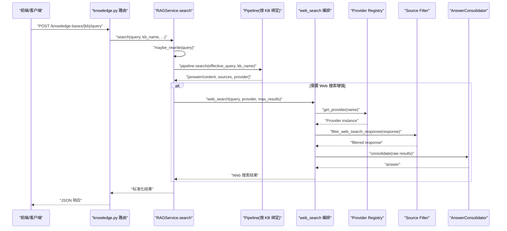
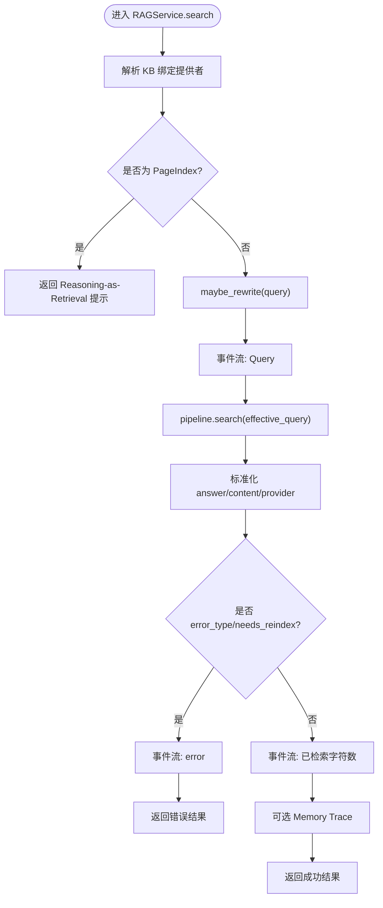
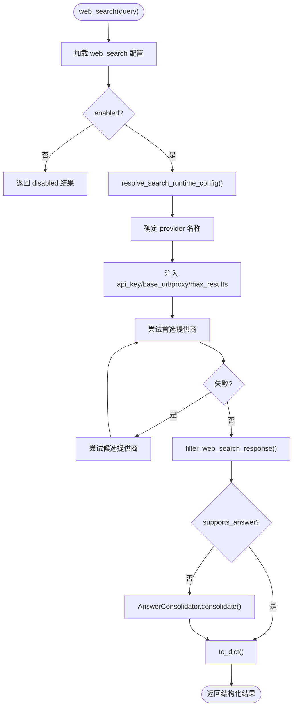
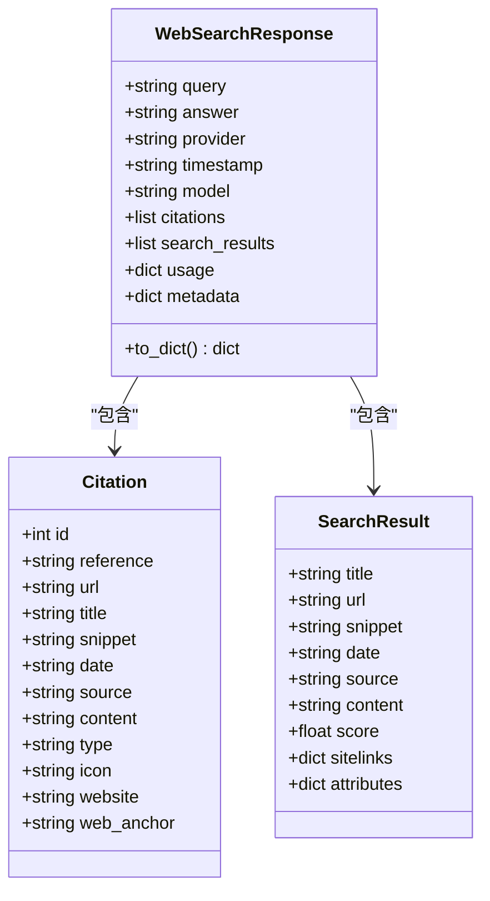
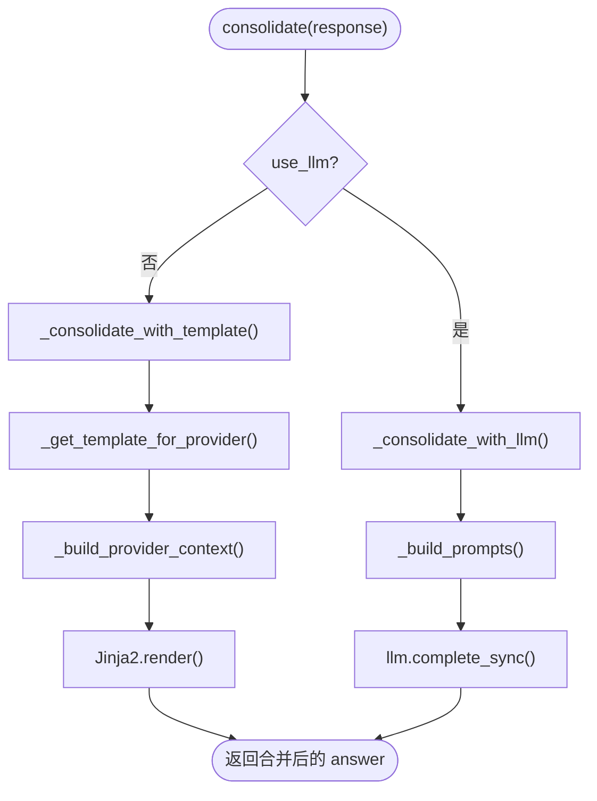
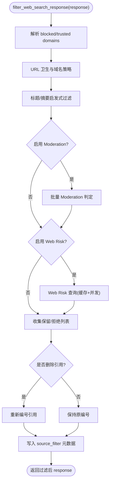
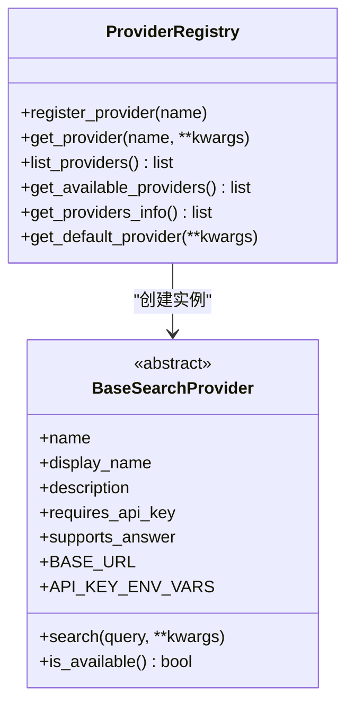
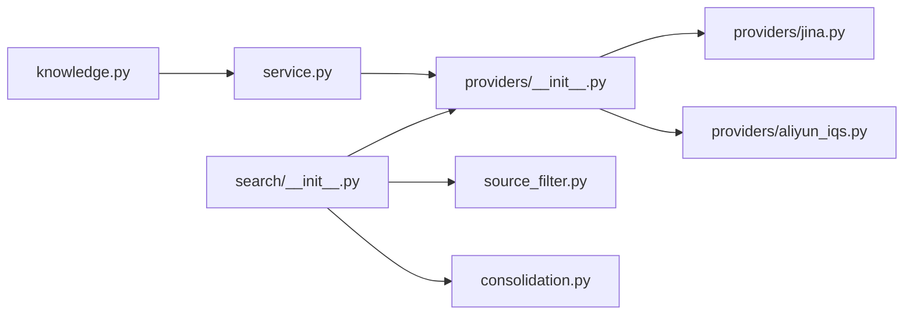
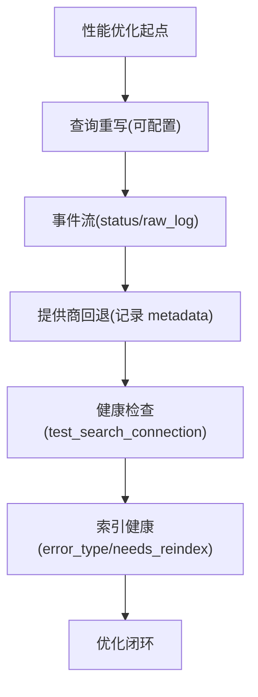

# 语义搜索接口

<cite>
**本文引用的文件**   
- [knowledge.py](file://deeptutor/api/routers/knowledge.py)
- [system.py](file://deeptutor/api/routers/system.py)
- [service.py](file://deeptutor/services/rag/service.py)
- [__init__.py](file://deeptutor/services/search/__init__.py)
- [base.py](file://deeptutor/services/search/base.py)
- [types.py](file://deeptutor/services/search/types.py)
- [consolidation.py](file://deeptutor/services/search/consolidation.py)
- [source_filter.py](file://deeptutor/services/search/source_filter.py)
- [providers/__init__.py](file://deeptutor/services/search/providers/__init__.py)
- [jina.py](file://deeptutor/services/search/providers/jina.py)
- [aliyun_iqs.py](file://deeptutor/services/search/providers/aliyun_iqs.py)
</cite>

## 目录
1. [简介](#简介)
2. [项目结构](#项目结构)
3. [核心组件](#核心组件)
4. [架构总览](#架构总览)
5. [详细组件分析](#详细组件分析)
6. [依赖关系分析](#依赖关系分析)
7. [性能与实时优化](#性能与实时优化)
8. [故障排查指南](#故障排查指南)
9. [结论](#结论)
10. [附录：API 契约](#附录api-契约)

## 简介
本文件为 DeepTutor 的“语义搜索接口”完整 API 文档，覆盖以下能力：
- 基于向量的相似度检索（RAG）：查询构建、结果排序、过滤条件、错误处理。
- 混合搜索模式：结合关键词匹配与语义理解，支持多搜索引擎提供商与自动回退。
- 相关性评分、分页与结果合并：统一数据结构、引用编号重排、答案生成策略。
- 搜索上下文注入、来源引用与结果高亮：通过事件流、元数据与模板渲染实现。
- 性能监控、查询分析与优化建议：健康检查、耗时统计、降级与回退路径。
- 多语言支持与跨知识库检索：按知识库绑定引擎、可配置重写层与智能检索。

## 项目结构
语义搜索相关代码分布在三层：
- API 路由层：对外暴露 RAG 与系统状态接口。
- 服务编排层：统一 RAG 入口、查询重写、事件追踪与提供者选择。
- 搜索与聚合层：Web 搜索提供商、结果过滤、答案合并与标准化类型。

**图表来源**
- [knowledge.py:1397-1499](file://deeptutor/api/routers/knowledge.py#L1397-L1499)
- [system.py:585-633](file://deeptutor/api/routers/system.py#L585-L633)
- [service.py:127-250](file://deeptutor/services/rag/service.py#L127-L250)
- [__init__.py:131-260](file://deeptutor/services/search/__init__.py#L131-L260)
- [base.py:20-86](file://deeptutor/services/search/base.py#L20-L86)
- [types.py:12-114](file://deeptutor/services/search/types.py#L12-L114)
- [consolidation.py:138-190](file://deeptutor/services/search/consolidation.py#L138-L190)
- [source_filter.py:352-536](file://deeptutor/services/search/source_filter.py#L352-L536)
- [providers/__init__.py:27-84](file://deeptutor/services/search/providers/__init__.py#L27-L84)
- [jina.py:77-98](file://deeptutor/services/search/providers/jina.py#L77-L98)
- [aliyun_iqs.py:63-87](file://deeptutor/services/search/providers/aliyun_iqs.py#L63-L87)

**章节来源**
- [knowledge.py:1397-1499](file://deeptutor/api/routers/knowledge.py#L1397-L1499)
- [system.py:585-633](file://deeptutor/api/routers/system.py#L585-L633)
- [service.py:127-250](file://deeptutor/services/rag/service.py#L127-L250)
- [__init__.py:131-260](file://deeptutor/services/search/__init__.py#L131-L260)

## 核心组件
- RAGService：统一 RAG 入口，负责按知识库解析提供者、查询重写、事件流、日志捕获与结果规范化。
- web_search：Web 搜索编排器，负责提供商选择、凭据注入、失败回退、来源过滤与答案合并。
- BaseSearchProvider：所有 Web 搜索提供商的抽象基类，定义 search 接口与可用性检测。
- WebSearchResponse/Citation/SearchResult：统一的搜索结果数据结构。
- AnswerConsolidator：将原始 SERP 结果合并为可读答案，支持模板或 LLM 合成。
- Source Filter：对 URL、域名、内容、Moderation 与 Web Risk 进行多级过滤，并记录审计元数据。
- Provider Registry：提供商注册、可用性与信息展示。

**章节来源**
- [service.py:22-65](file://deeptutor/services/rag/service.py#L22-L65)
- [service.py:127-250](file://deeptutor/services/rag/service.py#L127-L250)
- [__init__.py:131-260](file://deeptutor/services/search/__init__.py#L131-L260)
- [base.py:20-86](file://deeptutor/services/search/base.py#L20-L86)
- [types.py:12-114](file://deeptutor/services/search/types.py#L12-L114)
- [consolidation.py:138-190](file://deeptutor/services/search/consolidation.py#L138-L190)
- [source_filter.py:352-536](file://deeptutor/services/search/source_filter.py#L352-L536)
- [providers/__init__.py:27-84](file://deeptutor/services/search/providers/__init__.py#L27-L84)

## 架构总览
下图展示一次典型“语义搜索 + 知识检索”的请求流程：前端调用 RAG 路由，后端通过 RAGService 解析知识库提供者，执行查询重写与检索，再根据是否需要 Web 搜索进行混合增强，最终返回结构化结果与引用。

**图表来源**
- [knowledge.py:2353-2434](file://deeptutor/api/routers/knowledge.py#L2353-L2434)
- [service.py:127-250](file://deeptutor/services/rag/service.py#L127-L250)
- [__init__.py:131-260](file://deeptutor/services/search/__init__.py#L131-L260)
- [providers/__init__.py:60-84](file://deeptutor/services/search/providers/__init__.py#L60-L84)
- [source_filter.py:352-536](file://deeptutor/services/search/source_filter.py#L352-L536)
- [consolidation.py:138-190](file://deeptutor/services/search/consolidation.py#L138-L190)

## 详细组件分析

### RAGService：统一语义检索入口
- 职责
  - 按知识库解析实际提供者（LightRAG、GraphRAG、LLamaIndex、PageIndex 等）。
  - 可选查询重写层，输出重写轨迹。
  - 捕获底层日志并通过事件流上报。
  - 标准化结果字段（answer/content/provider/query_rewrite）。
- 关键行为
  - PageIndex 使用“推理即检索”，禁止直接调用 RAGService.search。
  - 若索引无效或需重建，返回 error_type 与 needs_reindex 标记。
  - 提供 smart_retrieve 以上下文驱动的多查询检索。

**图表来源**
- [service.py:127-250](file://deeptutor/services/rag/service.py#L127-L250)

**章节来源**
- [service.py:22-65](file://deeptutor/services/rag/service.py#L22-L65)
- [service.py:127-250](file://deeptutor/services/rag/service.py#L127-L250)

### Web Search 编排：web_search
- 职责
  - 读取运行时配置与提供商信息。
  - 注入凭据、代理与最大结果数。
  - 失败回退到候选提供商，记录 fallback 元数据。
  - 应用来源过滤，必要时触发答案合并。
- 关键行为
  - 当 supports_answer=False 时自动合并；可通过 consolidation_llm_model 启用 LLM 合成。
  - 若来源过滤导致答案失效，强制走安全合并路径。

**图表来源**
- [__init__.py:131-260](file://deeptutor/services/search/__init__.py#L131-L260)
- [consolidation.py:138-190](file://deeptutor/services/search/consolidation.py#L138-L190)
- [source_filter.py:352-536](file://deeptutor/services/search/source_filter.py#L352-L536)

**章节来源**
- [__init__.py:131-260](file://deeptutor/services/search/__init__.py#L131-L260)

### 搜索结果类型与引用
- Citation：引用条目，包含 id、reference、url、title、snippet、content 等。
- SearchResult：单条搜索结果，包含 title、url、snippet、score、attributes 等。
- WebSearchResponse：统一响应体，包含 query、answer、provider、citations、search_results、usage、metadata。
- to_dict：向后兼容序列化，保留 metadata 扩展字段。

**图表来源**
- [types.py:12-114](file://deeptutor/services/search/types.py#L12-L114)

**章节来源**
- [types.py:12-114](file://deeptutor/services/search/types.py#L12-L114)

### 答案合并与模板
- AnswerConsolidator
  - 支持模板渲染（按提供商选择模板）或 LLM 合成。
  - 构建模板上下文，包含 results、citations、provider 特定字段。
  - 在模板渲染失败时抛出异常，便于上层诊断。
- PROVIDER_TEMPLATES
  - 针对 serper、jina、serper_scholar 等提供专用模板。
  - 无模板时使用通用格式。

**图表来源**
- [consolidation.py:138-190](file://deeptutor/services/search/consolidation.py#L138-L190)
- [consolidation.py:192-292](file://deeptutor/services/search/consolidation.py#L192-L292)
- [consolidation.py:294-345](file://deeptutor/services/search/consolidation.py#L294-L345)

**章节来源**
- [consolidation.py:138-190](file://deeptutor/services/search/consolidation.py#L138-L190)
- [consolidation.py:192-292](file://deeptutor/services/search/consolidation.py#L192-L292)
- [consolidation.py:294-345](file://deeptutor/services/search/consolidation.py#L294-L345)

### 来源过滤与安全策略
- filter_web_search_response
  - 阶段顺序：URL 卫生/域名策略 → 标题/摘要启发式 → OpenAI Moderation（可选）→ Google Web Risk（可选）。
  - 删除被拒绝的引用与结果，必要时重新编号引用。
  - 若删除了引用且存在 provider-authored answer，则清空答案，迫使上层用安全结果重建。
- 配置项
  - enabled、blocked_domains、trusted_domains、content_filtering、use_educational_trusted_domains。
  - use_moderation/moderation_api_key、use_web_risk/web_risk_api_key。
- 审计元数据
  - removed_citations、removed_search_results、rejected_hosts、rejected_reasons、answer_invalidated、citations_renumbered。

**图表来源**
- [source_filter.py:352-536](file://deeptutor/services/search/source_filter.py#L352-L536)

**章节来源**
- [source_filter.py:352-536](file://deeptutor/services/search/source_filter.py#L352-L536)

### 提供商注册与选择
- providers/__init__.py
  - register_provider 装饰器将具体提供商类注册到全局映射。
  - get_provider/get_available_providers/get_providers_info 提供实例化、可用性与信息展示。
  - get_default_provider 从运行时配置中选择默认提供商。
- 内置提供商
  - 包括 aliyun_iqs、bocha、brave、doubao、duckduckgo、firecrawl、google_browser_scraper、jina、perplexity、qianfan、searxng、serper、serply、tavily、youcom、zhipu 等。

**图表来源**
- [providers/__init__.py:27-84](file://deeptutor/services/search/providers/__init__.py#L27-L84)
- [providers/__init__.py:150-167](file://deeptutor/services/search/providers/__init__.py#L150-L167)
- [base.py:20-86](file://deeptutor/services/search/base.py#L20-L86)

**章节来源**
- [providers/__init__.py:27-84](file://deeptutor/services/search/providers/__init__.py#L27-L84)
- [providers/__init__.py:150-167](file://deeptutor/services/search/providers/__init__.py#L150-L167)
- [base.py:20-86](file://deeptutor/services/search/base.py#L20-L86)

### 示例提供商：Jina 与阿里云 IQS
- Jina
  - 对查询进行 URL 编码，发起 HTTP GET，限制返回数量，提取 citations 与 search_results。
- 阿里云 IQS
  - 校验 time_range 与 industry 参数，支持 enable_rerank 语义重排开关。

**章节来源**
- [jina.py:77-98](file://deeptutor/services/search/providers/jina.py#L77-L98)
- [aliyun_iqs.py:63-87](file://deeptutor/services/search/providers/aliyun_iqs.py#L63-L87)

## 依赖关系分析
- RAGService 依赖 pipeline 工厂与嵌入绑定，按知识库解析提供者。
- web_search 依赖提供商注册表、来源过滤与答案合并。
- 提供商实现依赖各自的网络库与外部 API。
- 路由层依赖 RAGService 与系统状态模块。

**图表来源**
- [knowledge.py:1397-1499](file://deeptutor/api/routers/knowledge.py#L1397-L1499)
- [service.py:127-250](file://deeptutor/services/rag/service.py#L127-L250)
- [__init__.py:131-260](file://deeptutor/services/search/__init__.py#L131-L260)
- [providers/__init__.py:27-84](file://deeptutor/services/search/providers/__init__.py#L27-L84)
- [source_filter.py:352-536](file://deeptutor/services/search/source_filter.py#L352-L536)
- [consolidation.py:138-190](file://deeptutor/services/search/consolidation.py#L138-L190)
- [jina.py:77-98](file://deeptutor/services/search/providers/jina.py#L77-L98)
- [aliyun_iqs.py:63-87](file://deeptutor/services/search/providers/aliyun_iqs.py#L63-L87)

**章节来源**
- [service.py:127-250](file://deeptutor/services/rag/service.py#L127-L250)
- [__init__.py:131-260](file://deeptutor/services/search/__init__.py#L131-L260)
- [providers/__init__.py:27-84](file://deeptutor/services/search/providers/__init__.py#L27-L84)

## 性能与实时优化
- 查询重写
  - maybe_rewrite 支持运行时开关与显式覆盖，输出 rewrite_outcome 供 UI 展示。
- 事件流与日志
  - RAGService 通过 event_sink 发送 status/raw_log 事件，便于前端实时进度与调试。
  - 捕获 lightrag/graphrag 等第三方日志，过滤噪音日志。
- 提供商回退
  - web_search 支持按配置的候选提供商依次尝试，记录 search_fallback 元数据。
- 健康检查
  - system.py 提供 test_search_connection，测量响应时间并报告模型与状态。
- 索引健康
  - RAG 错误分类（invalid_embedding_index、embedding provider returned invalid）提示重建索引。

**图表来源**
- [service.py:152-177](file://deeptutor/services/rag/service.py#L152-L177)
- [service.py:252-333](file://deeptutor/services/rag/service.py#L252-L333)
- [__init__.py:194-227](file://deeptutor/services/search/__init__.py#L194-L227)
- [system.py:585-633](file://deeptutor/api/routers/system.py#L585-L633)

**章节来源**
- [service.py:152-177](file://deeptutor/services/rag/service.py#L152-L177)
- [service.py:252-333](file://deeptutor/services/rag/service.py#L252-L333)
- [__init__.py:194-227](file://deeptutor/services/search/__init__.py#L194-L227)
- [system.py:585-633](file://deeptutor/api/routers/system.py#L585-L633)

## 故障排查指南
- 搜索不可用
  - 检查 web_search.enabled 与 provider 配置；none 表示未配置。
- 提供商凭据缺失
  - 软回退提供商会降级到 duckduckgo；硬要求提供商会抛出 ValueError。
- 所有候选提供商失败
  - 抛出异常并附带各提供商失败原因；检查网络、代理与配额。
- 来源过滤导致答案失效
  - 查看 metadata.source_filter.answer_invalidated 与 rejected_reasons；必要时调整 trusted_domains 或关闭 content_filtering。
- 索引无效或需重建
  - 出现 invalid_embedding_index 或 needs_reindex 时，重新索引知识库。

**章节来源**
- [__init__.py:146-184](file://deeptutor/services/search/__init__.py#L146-L184)
- [__init__.py:211-227](file://deeptutor/services/search/__init__.py#L211-L227)
- [source_filter.py:498-536](file://deeptutor/services/search/source_filter.py#L498-L536)
- [service.py:203-217](file://deeptutor/services/rag/service.py#L203-L217)

## 结论
DeepTutor 的语义搜索接口通过 RAGService 与 web_search 编排，实现了知识库向量检索与 Web 搜索的混合增强。系统具备：
- 清晰的查询构建与重写机制。
- 多提供商选择与自动回退。
- 严格的安全过滤与审计元数据。
- 灵活的答案合并与模板/LLM 合成。
- 完善的事件流、健康检查与性能观测。
这些能力共同支撑了稳定、可观测、可扩展的语义搜索体验。

## 附录：API 契约

### RAG 查询接口（按知识库）
- 端点
  - POST /knowledge-bases/{kb_name}/query
- 请求体关键字段
  - query: string
  - top_k: int（可选）
  - response_type: string（可选）
  - search_mode: string（可选，受引擎支持）
  - event_sink: 用于接收 status/raw_log 事件（可选）
- 响应关键字段
  - query: string
  - answer/content: string
  - sources: list（来源片段）
  - provider: string（实际运行引擎）
  - query_rewrite: object（可选，重写轨迹）
  - error_type: string（可选）
  - needs_reindex: boolean（可选）

**章节来源**
- [knowledge.py:2353-2434](file://deeptutor/api/routers/knowledge.py#L2353-L2434)
- [service.py:127-250](file://deeptutor/services/rag/service.py#L127-L250)

### 系统状态与健康检查
- 端点
  - GET /status
  - GET /test-search-connection
- 功能
  - /status 返回 backend/llm/embeddings/search 状态。
  - /test-search-connection 验证搜索连通性，返回 response_time_ms 与模型信息。

**章节来源**
- [system.py:318-334](file://deeptutor/api/routers/system.py#L318-L334)
- [system.py:585-633](file://deeptutor/api/routers/system.py#L585-L633)

### Web 搜索接口（通用）
- 函数
  - web_search(query, output_dir=None, verbose=False, provider=None, consolidation_custom_template=None, consolidation_llm_model=None, **provider_kwargs)
- 输入
  - query: string
  - provider: string（可选，覆盖默认提供商）
  - max_results: int（由运行时配置注入）
  - base_url/proxy/api_key: 由运行时配置注入
- 输出
  - timestamp/query/model/provider/answer/response/citations/search_results/usage/metadata
  - result_file: 当指定 output_dir 时返回保存路径
  - error_code: 当搜索被禁用或未配置提供商时返回

**章节来源**
- [__init__.py:131-260](file://deeptutor/services/search/__init__.py#L131-L260)

### 搜索结果数据结构
- Citation
  - id/reference/url/title/snippet/date/source/content/type/icon/website/web_anchor
- SearchResult
  - title/url/snippet/date/source/content/score/sitelinks/attributes
- WebSearchResponse
  - query/answer/provider/timestamp/model/citations/search_results/usage/metadata
  - to_dict(): 向后兼容序列化

**章节来源**
- [types.py:12-114](file://deeptutor/services/search/types.py#L12-L114)

### 来源过滤配置
- 配置键
  - tools.web_search.source_filtering.*
- 选项
  - enabled: boolean
  - blocked_domains: list<string>
  - trusted_domains: list<string>
  - content_filtering: boolean
  - use_educational_trusted_domains: boolean
  - use_moderation: boolean
  - moderation_api_key: string（环境变量 OPENAI_API_KEY/DEEPTUTOR_OPENAI_API_KEY）
  - use_web_risk: boolean
  - web_risk_api_key: string（环境变量 GOOGLE_WEB_RISK_API_KEY/WEB_RISK_API_KEY）

**章节来源**
- [source_filter.py:557-578](file://deeptutor/services/search/source_filter.py#L557-L578)

### 提供商信息与可用性
- 函数
  - get_providers_info(): 返回 id/name/description/supports_answer/requires_api_key/requires_base_url/status
  - get_available_providers(): 当前可用的提供商列表
  - get_default_provider(): 从运行时配置获取默认提供商实例

**章节来源**
- [providers/__init__.py:113-167](file://deeptutor/services/search/providers/__init__.py#L113-L167)