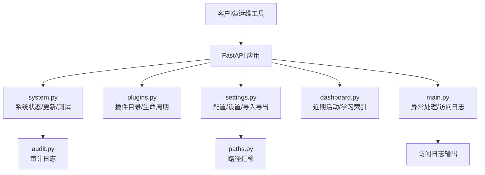
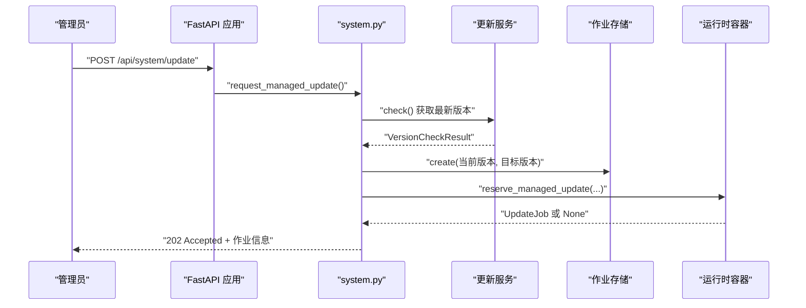
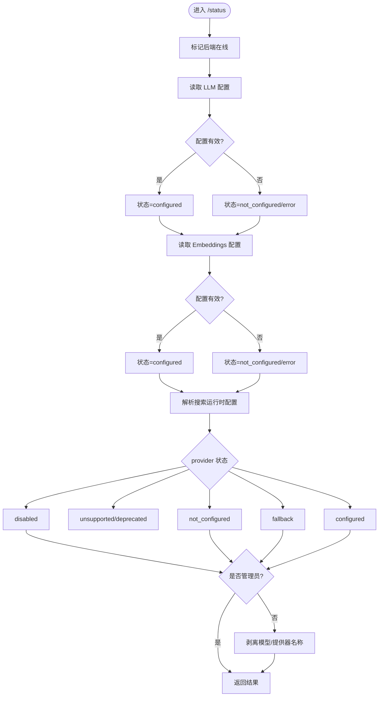
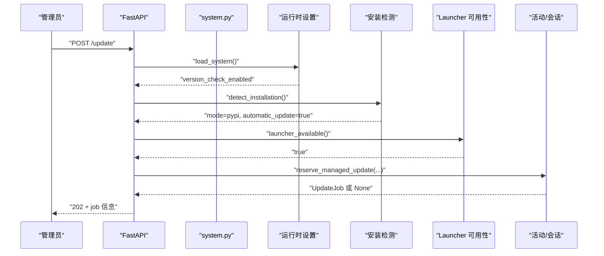
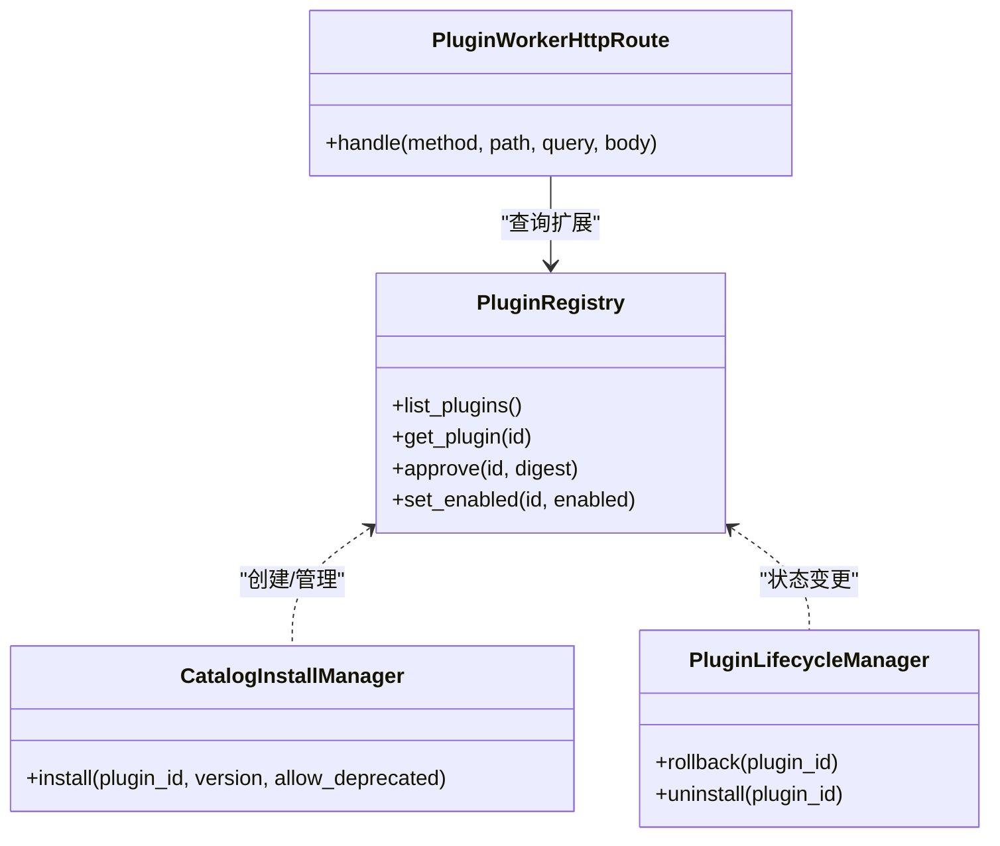
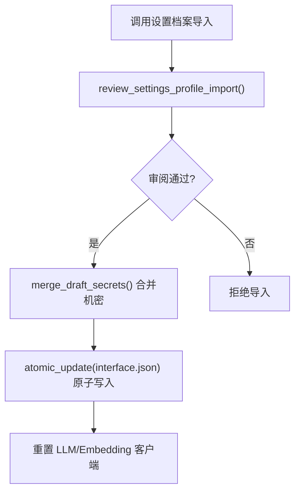
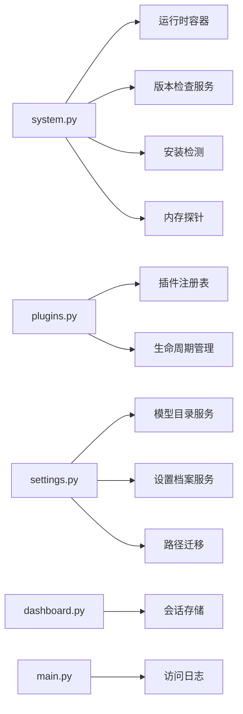
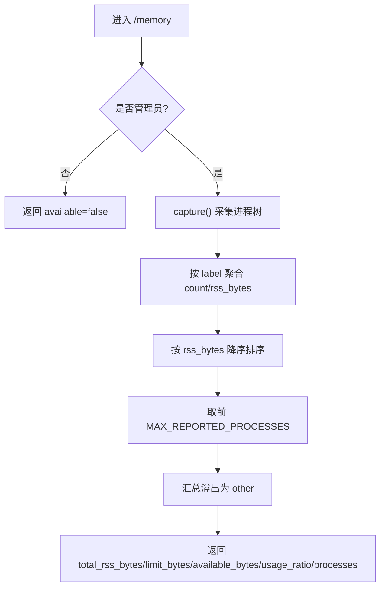

# 系统管理 API

<cite>
**本文引用的文件**   
- [deeptutor/api/routers/system.py](file://deeptutor/api/routers/system.py)
- [deeptutor/api/routers/plugins.py](file://deeptutor/api/routers/plugins.py)
- [deeptutor/api/routers/settings.py](file://deeptutor/api/routers/settings.py)
- [deeptutor/api/routers/dashboard.py](file://deeptutor/api/routers/dashboard.py)
- [deeptutor/api/main.py](file://deeptutor/api/main.py)
- [deeptutor/multi_user/audit.py](file://deeptutor/multi_user/audit.py)
- [deeptutor/multi_user/paths.py](file://deeptutor/multi_user/paths.py)
</cite>

## 目录
1. [简介](#简介)
2. [项目结构](#项目结构)
3. [核心组件](#核心组件)
4. [架构总览](#架构总览)
5. [详细组件分析](#详细组件分析)
6. [依赖关系分析](#依赖关系分析)
7. [性能与监控](#性能与监控)
8. [故障诊断与排错](#故障诊断与排错)
9. [结论](#结论)
10. [附录：运维最佳实践](#附录运维最佳实践)

## 简介
本文件为 DeepTutor 系统管理功能的完整 API 文档，聚焦运维与管理能力，包括：
- 系统健康检查、运行时状态、模型连接测试
- 监控指标与内存使用统计
- 日志访问与审计记录
- 模块与插件管理（安装、启用、禁用、回滚、卸载）
- 版本升级与更新策略
- 系统配置备份恢复、数据迁移与多用户路径迁移
- 性能监控、资源使用统计与告警通知机制说明
- 系统维护最佳实践与故障排除指南

## 项目结构
系统管理相关 API 主要分布在以下路由与服务中：
- 系统与运行态：`deeptutor/api/routers/system.py`
- 插件管理：`deeptutor/api/routers/plugins.py`
- 设置与配置：`deeptutor/api/routers/settings.py`
- 仪表盘与近期活动：`deeptutor/api/routers/dashboard.py`
- 全局中间件与访问日志：`deeptutor/api/main.py`
- 审计日志写入：`deeptutor/multi_user/audit.py`
- 多用户数据路径迁移：`deeptutor/multi_user/paths.py`

图表来源
- [deeptutor/api/routers/system.py:116-456](file://deeptutor/api/routers/system.py#L116-L456)
- [deeptutor/api/routers/plugins.py:168-386](file://deeptutor/api/routers/plugins.py#L168-L386)
- [deeptutor/api/routers/settings.py:510-613](file://deeptutor/api/routers/settings.py#L510-L613)
- [deeptutor/api/routers/dashboard.py:47-103](file://deeptutor/api/routers/dashboard.py#L47-L103)
- [deeptutor/api/main.py:403-472](file://deeptutor/api/main.py#L403-L472)
- [deeptutor/multi_user/audit.py:18-32](file://deeptutor/multi_user/audit.py#L18-L32)
- [deeptutor/multi_user/paths.py:51-86](file://deeptutor/multi_user/paths.py#L51-L86)

章节来源
- [deeptutor/api/routers/system.py:116-456](file://deeptutor/api/routers/system.py#L116-L456)
- [deeptutor/api/routers/plugins.py:168-386](file://deeptutor/api/routers/plugins.py#L168-L386)
- [deeptutor/api/routers/settings.py:510-613](file://deeptutor/api/routers/settings.py#L510-L613)
- [deeptutor/api/routers/dashboard.py:47-103](file://deeptutor/api/routers/dashboard.py#L47-L103)
- [deeptutor/api/main.py:403-472](file://deeptutor/api/main.py#L403-L472)
- [deeptutor/multi_user/audit.py:18-32](file://deeptutor/multi_user/audit.py#L18-L32)
- [deeptutor/multi_user/paths.py:51-86](file://deeptutor/multi_user/paths.py#L51-L86)

## 核心组件
- 系统健康与运行时状态
  - GET /api/system/runtime：返回协调器与工作节点诊断信息，包含协议版本。
  - GET /api/system/status：后端、LLM、Embeddings、Search 的配置与状态摘要。
  - GET /api/system/memory：进程树内存占用统计（管理员）。
  - POST /api/system/test/llm、POST /api/system/test/embeddings、POST /api/system/test/search：连接性探测接口。
- 版本与更新
  - GET /api/system/update：当前版本、可用更新、安装模式、是否可自动更新。
  - POST /api/system/update/check：强制检查更新（管理员）。
  - PUT /api/system/update/settings：开启/关闭版本检查（管理员）。
  - GET /api/system/update/job：查询已预留的受管更新任务。
  - POST /api/system/update：申请受管更新（管理员，需满足 PyPI 自动更新条件）。
- 插件管理
  - GET /api/plugins/extensions：列出已启用的托管插件扩展。
  - GET /api/plugins/catalog：插件目录。
  - GET /api/plugins/state：插件注册表状态。
  - GET /api/plugins/{id}/info：插件详情。
  - POST /api/plugins/{id}/approve：审批快照。
  - POST /api/plugins/{id}/enable、POST /api/plugins/{id}/disable：启用/禁用。
  - POST /api/plugins/{id}/install：从目录安装（可能需审批）。
  - POST /api/plugins/{id}/rollback：回滚到上一版本（可能需审批）。
  - DELETE /api/plugins/{id}/installation：卸载。
  - 动态转发：GET/POST/PUT/PATCH/DELETE /api/plugins/{plugin_id}/{plugin_path}：将请求转发至插件工作进程。
- 设置与配置
  - 界面设置读写（主题、语言、响应语言等）。
  - 模型目录与提供者编辑（含密码掩码与原子写入）。
  - 设置草稿与预设、网络设置、聊天附件策略、文档解析引擎配置。
  - 设置档案导入/导出（用于备份恢复）。
- 仪表盘与近期活动
  - GET /api/dashboard/recent：近期会话列表。
  - GET /api/dashboard/suggestions、POST /api/dashboard/suggestions/refresh：首页建议生成与刷新。
  - GET /api/dashboard/learning-index、GET /api/dashboard/source-library/{kind}、GET /api/dashboard/learning-library/{kind}：学习入口与资料库索引。
  - GET /api/dashboard/{entry_id}：会话详情。

章节来源
- [deeptutor/api/routers/system.py:116-456](file://deeptutor/api/routers/system.py#L116-L456)
- [deeptutor/api/routers/plugins.py:168-386](file://deeptutor/api/routers/plugins.py#L168-L386)
- [deeptutor/api/routers/settings.py:510-613](file://deeptutor/api/routers/settings.py#L510-L613)
- [deeptutor/api/routers/dashboard.py:47-103](file://deeptutor/api/routers/dashboard.py#L47-L103)

## 架构总览
系统管理 API 通过 FastAPI 路由组织，结合认证依赖、服务层与持久化存储，形成“路由-服务-存储”的分层结构。关键流程如下：

图表来源
- [deeptutor/api/routers/system.py:263-315](file://deeptutor/api/routers/system.py#L263-L315)

章节来源
- [deeptutor/api/routers/system.py:263-315](file://deeptutor/api/routers/system.py#L263-L315)

## 详细组件分析

### 系统健康与运行时状态
- GET /api/system/runtime
  - 功能：返回运行时状态、协调器健康、协议版本。
  - 权限：无需凭据（面向协调与诊断）。
  - 关键点：若应用容器未启动则自动启动；合并 leader 健康与协议版本字段。
- GET /api/system/status
  - 功能：汇总后端、LLM、Embeddings、Search 的状态与配置提示。
  - 权限：非管理员会隐藏敏感字段（模型名、搜索提供器等）。
- GET /api/system/memory
  - 功能：采集进程树 RSS 内存并分组聚合，限制上报数量。
  - 权限：仅管理员。
- POST /api/system/test/*
  - LLM/Embeddings/Search 连接性测试，返回成功/失败、耗时与错误信息。

图表来源
- [deeptutor/api/routers/system.py:318-402](file://deeptutor/api/routers/system.py#L318-L402)

章节来源
- [deeptutor/api/routers/system.py:116-138](file://deeptutor/api/routers/system.py#L116-L138)
- [deeptutor/api/routers/system.py:318-402](file://deeptutor/api/routers/system.py#L318-L402)
- [deeptutor/api/routers/system.py:405-456](file://deeptutor/api/routers/system.py#L405-L456)
- [deeptutor/api/routers/system.py:459-633](file://deeptutor/api/routers/system.py#L459-L633)

### 版本与更新
- GET /api/system/update
  - 功能：展示当前版本、缓存检查结果、安装模式、是否可自动更新、是否有新版本。
- POST /api/system/update/check
  - 功能：管理员强制检查更新。
- PUT /api/system/update/settings
  - 功能：开启/关闭版本检查。
- GET /api/system/update/job
  - 功能：查询受管更新作业。
- POST /api/system/update
  - 功能：在满足 PyPI 自动更新、launcher 可用、无 systemd 接管、无活跃对话等条件下，预留一次安全更新。

图表来源
- [deeptutor/api/routers/system.py:263-315](file://deeptutor/api/routers/system.py#L263-L315)

章节来源
- [deeptutor/api/routers/system.py:236-315](file://deeptutor/api/routers/system.py#L236-L315)

### 插件管理
- 插件目录与状态
  - GET /api/plugins/extensions：列出已启用的托管插件及其扩展。
  - GET /api/plugins/catalog：插件目录条目。
  - GET /api/plugins/state：插件注册表状态。
  - GET /api/plugins/{id}/info：插件详情。
- 插件生命周期
  - POST /api/plugins/{id}/approve：审批快照（管理员）。
  - POST /api/plugins/{id}/enable/disable：启用/禁用（管理员）。
  - POST /api/plugins/{id}/install：从目录安装（可能需审批）。
  - POST /api/plugins/{id}/rollback：回滚（可能需审批）。
  - DELETE /api/plugins/{id}/installation：卸载（管理员）。
- 插件 HTTP 路由转发
  - 动态匹配 /api/plugins/{plugin_id}/{plugin_path}，按扩展声明的方法转发请求至插件工作进程，并对请求体大小进行限制。

图表来源
- [deeptutor/api/routers/plugins.py:168-386](file://deeptutor/api/routers/plugins.py#L168-L386)

章节来源
- [deeptutor/api/routers/plugins.py:168-386](file://deeptutor/api/routers/plugins.py#L168-L386)

### 设置与配置（备份恢复与数据迁移）
- 设置档案导入/导出
  - 通过设置档案服务实现配置的导出与审阅式导入，便于备份与恢复。
- 模型目录与提供者编辑
  - 支持对 LLM/Embedding/Search/TTS/STT/ImageGen/VideoGen 等服务的提供者与模型进行编辑，并在保存时重置全局客户端以生效。
- 界面设置
  - 主题、语言、响应语言、侧边栏描述与导航顺序、代码块样式等。
- 网络设置与聊天附件策略
  - 端口、公共 API Base、CORS 源、聊天附件大小与字符上限等。
- 文档解析引擎
  - MinerU、Docling、Tika 等引擎的配置与一键安装。
- 多用户路径迁移
  - 首次访问时将旧版 multi-user/_system 迁移至 data/system，其他子目录迁移至 data/users/<uid>，保留遗留项并记录警告。

图表来源
- [deeptutor/api/routers/settings.py:510-613](file://deeptutor/api/routers/settings.py#L510-L613)

章节来源
- [deeptutor/api/routers/settings.py:510-613](file://deeptutor/api/routers/settings.py#L510-L613)
- [deeptutor/multi_user/paths.py:51-86](file://deeptutor/multi_user/paths.py#L51-L86)

### 仪表盘与近期活动
- GET /api/dashboard/recent：分页返回最近会话，支持按类型过滤。
- GET /api/dashboard/suggestions：返回首页建议（异步生成）。
- POST /api/dashboard/suggestions/refresh：立即重新生成建议。
- GET /api/dashboard/learning-index：聚合书籍、掌握路径、阅读空间、沉浸式观看、练习等入口。
- GET /api/dashboard/source-library/{kind}、GET /api/dashboard/learning-library/{kind}：按类型返回资料库索引。
- GET /api/dashboard/{entry_id}：根据 ID 获取会话内容与消息。

章节来源
- [deeptutor/api/routers/dashboard.py:47-103](file://deeptutor/api/routers/dashboard.py#L47-L103)
- [deeptutor/api/routers/dashboard.py:106-166](file://deeptutor/api/routers/dashboard.py#L106-L166)
- [deeptutor/api/routers/dashboard.py:169-211](file://deeptutor/api/routers/dashboard.py#L169-L211)
- [deeptutor/api/routers/dashboard.py:214-269](file://deeptutor/api/routers/dashboard.py#L214-L269)
- [deeptutor/api/routers/dashboard.py:272-293](file://deeptutor/api/routers/dashboard.py#L272-L293)

## 依赖关系分析
- 路由层
  - system.py：依赖运行时容器、版本检查服务、安装检测、Launcher 可用性、内存探针。
  - plugins.py：依赖插件目录、生命周期管理器、注册表、HTTP 路由分发。
  - settings.py：依赖模型目录服务、设置档案服务、界面设置服务、路径服务。
  - dashboard.py：依赖会话存储、工作区服务、学习入口服务。
- 中间件与日志
  - main.py：统一异常处理、选择性访问日志（仅非 200 输出）、安全守卫集成。
- 审计与路径
  - audit.py：写入 usage.jsonl，保证审计不中断请求。
  - paths.py：多用户路径迁移逻辑，幂等且带日志。

图表来源
- [deeptutor/api/routers/system.py:116-456](file://deeptutor/api/routers/system.py#L116-L456)
- [deeptutor/api/routers/plugins.py:168-386](file://deeptutor/api/routers/plugins.py#L168-L386)
- [deeptutor/api/routers/settings.py:510-613](file://deeptutor/api/routers/settings.py#L510-L613)
- [deeptutor/api/routers/dashboard.py:47-103](file://deeptutor/api/routers/dashboard.py#L47-L103)
- [deeptutor/api/main.py:403-472](file://deeptutor/api/main.py#L403-L472)
- [deeptutor/multi_user/paths.py:51-86](file://deeptutor/multi_user/paths.py#L51-L86)

章节来源
- [deeptutor/api/routers/system.py:116-456](file://deeptutor/api/routers/system.py#L116-L456)
- [deeptutor/api/routers/plugins.py:168-386](file://deeptutor/api/routers/plugins.py#L168-L386)
- [deeptutor/api/routers/settings.py:510-613](file://deeptutor/api/routers/settings.py#L510-L613)
- [deeptutor/api/routers/dashboard.py:47-103](file://deeptutor/api/routers/dashboard.py#L47-L103)
- [deeptutor/api/main.py:403-472](file://deeptutor/api/main.py#L403-L472)
- [deeptutor/multi_user/paths.py:51-86](file://deeptutor/multi_user/paths.py#L51-L86)

## 性能与监控
- 内存监控
  - GET /api/system/memory：返回进程树 RSS 总量、限制、可用量、使用比例、按角色聚合的前 N 个进程及溢出汇总。
- 访问日志
  - main.py 中的选择性访问日志仅记录非 200 响应，避免高频轮询污染日志。
- 审计日志
  - audit.py 将使用与操作写入 usage.jsonl，确保审计失败不影响业务请求。

图表来源
- [deeptutor/api/routers/system.py:405-456](file://deeptutor/api/routers/system.py#L405-L456)

章节来源
- [deeptutor/api/routers/system.py:405-456](file://deeptutor/api/routers/system.py#L405-L456)
- [deeptutor/api/main.py:403-472](file://deeptutor/api/main.py#L403-L472)
- [deeptutor/multi_user/audit.py:18-32](file://deeptutor/multi_user/audit.py#L18-L32)

## 故障诊断与排错
- 模型连接问题
  - 使用 POST /api/system/test/llm、/test/embeddings、/test/search 进行连通性测试，查看 response_time_ms 与 error 字段定位问题。
- 更新失败
  - 检查 GET /api/system/update 的 check_error 与 installation.reason；确认 launcher_available 与安装模式为 pypi 且允许自动更新。
  - 若处于 systemd 服务下，受管更新会被拒绝。
- 插件路由失败
  - 检查插件扩展声明的方法与路径；注意请求体大小限制（最大 1MB），以及 JSON 格式要求。
- 设置保存失败
  - 文件系统权限被拒时会返回 503，提示检查设置文件夹权限与锁竞争。
- 访问日志与审计
  - 非 200 响应会进入访问日志；审计写入失败不会中断请求，但需关注 usage.jsonl 是否存在。

章节来源
- [deeptutor/api/routers/system.py:459-633](file://deeptutor/api/routers/system.py#L459-L633)
- [deeptutor/api/routers/plugins.py:235-287](file://deeptutor/api/routers/plugins.py#L235-L287)
- [deeptutor/api/routers/settings.py:510-564](file://deeptutor/api/routers/settings.py#L510-L564)
- [deeptutor/api/main.py:403-472](file://deeptutor/api/main.py#L403-L472)
- [deeptutor/multi_user/audit.py:18-32](file://deeptutor/multi_user/audit.py#L18-L32)

## 结论
DeepTutor 的系统管理 API 提供了完善的运维能力：
- 健康检查与连接测试帮助快速定位外部依赖问题。
- 内存监控与访问日志为性能分析与排障提供基础。
- 插件管理与版本更新支持安全的扩展与升级流程。
- 设置档案与路径迁移保障配置的可移植性与数据一致性。
建议在生产环境中结合访问日志与审计日志建立告警规则，并通过插件白名单与审批流程控制扩展风险。

## 附录：运维最佳实践
- 定期执行模型连接测试，确保 LLM/Embeddings/Search 配置正确。
- 在低峰期执行版本更新，并确保 launcher 可用且安装模式允许自动更新。
- 使用插件目录与审批流程管控第三方扩展，避免未经验证的代码执行。
- 通过设置档案导出/导入实现配置备份与恢复，避免手动编辑导致不一致。
- 关注内存使用趋势，必要时调整沙箱与并发策略。
- 利用访问日志与审计日志建立告警阈值，及时发现异常请求与权限问题。