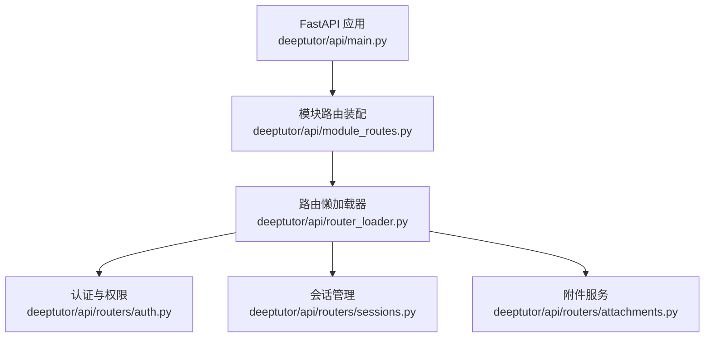
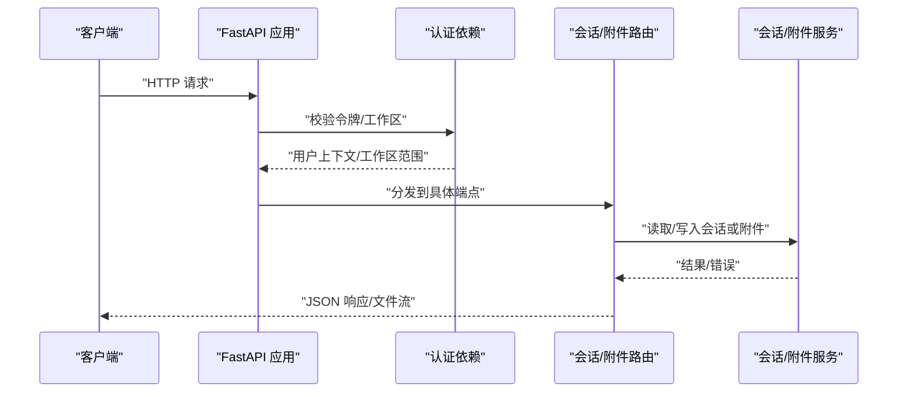
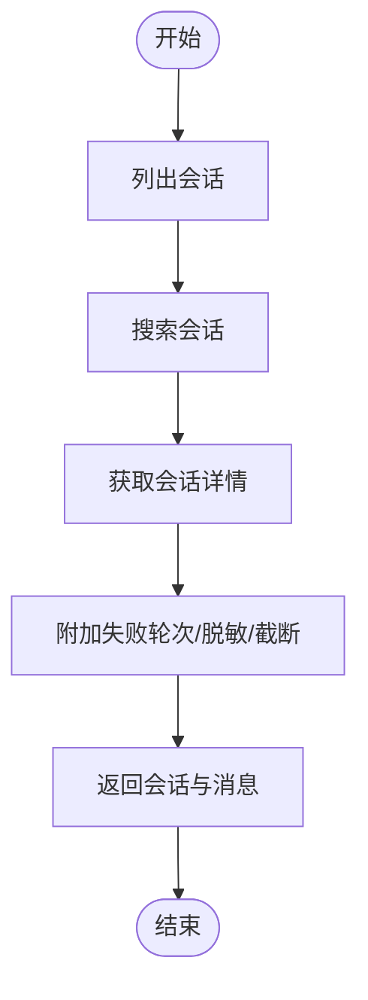
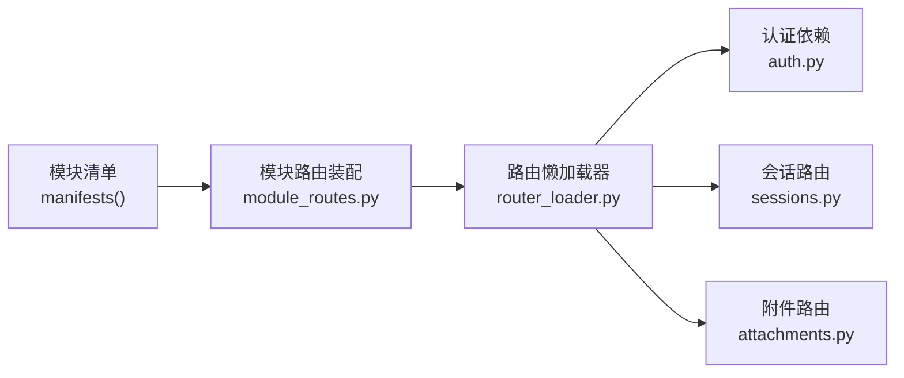

# REST 聊天端点

<cite>
**本文引用的文件**   
- [main.py](file://deeptutor/api/main.py)
- [module_routes.py](file://deeptutor/api/module_routes.py)
- [router_loader.py](file://deeptutor/api/router_loader.py)
- [auth.py](file://deeptutor/api/routers/auth.py)
- [sessions.py](file://deeptutor/api/routers/sessions.py)
- [attachments.py](file://deeptutor/api/routers/attachments.py)
</cite>

## 目录
1. [简介](#简介)
2. [项目结构](#项目结构)
3. [核心组件](#核心组件)
4. [架构总览](#架构总览)
5. [详细端点说明](#详细端点说明)
6. [依赖关系分析](#依赖关系分析)
7. [性能与流式响应](#性能与流式响应)
8. [故障排查指南](#故障排查指南)
9. [结论](#结论)
10. [附录：客户端集成与最佳实践](#附录客户端集成与最佳实践)

## 简介
本文件面向 DeepTutor 的 RESTful 聊天 API，聚焦会话管理、消息发送、附件下载预览、认证与权限控制等能力。文档覆盖以下目标：
- 列出所有与聊天相关的 HTTP 接口（URL、方法、参数、响应、错误码）。
- 说明认证机制、权限模型与工作区隔离。
- 解释会话状态管理、上下文保持与流式响应的实现方式。
- 提供常见场景的请求/响应示例与客户端集成建议。

## 项目结构
DeepTutor 后端基于 FastAPI，采用“模块路由 + 懒加载”的方式挂载业务路由。聊天相关能力主要分布在以下位置：
- 应用入口与全局中间件：`deeptutor/api/main.py`
- 模块路由装配：`deeptutor/api/module_routes.py`
- 路由懒加载器：`deeptutor/api/router_loader.py`
- 认证与权限：`deeptutor/api/routers/auth.py`
- 会话历史与管理：`deeptutor/api/routers/sessions.py`
- 附件下载/预览：`deeptutor/api/routers/attachments.py`

**图表来源**
- [main.py:364-392](file://deeptutor/api/main.py#L364-L392)
- [module_routes.py:9-43](file://deeptutor/api/module_routes.py#L9-L43)
- [router_loader.py:92-141](file://deeptutor/api/router_loader.py#L92-L141)

**章节来源**
- [main.py:364-392](file://deeptutor/api/main.py#L364-L392)
- [module_routes.py:9-43](file://deeptutor/api/module_routes.py#L9-L43)
- [router_loader.py:92-141](file://deeptutor/api/router_loader.py#L92-L141)

## 核心组件
- 应用生命周期与中间件
  - 启动时初始化容器、事件总线、LLM 客户端、后台任务协调器等。
  - 统一 JSON 错误边界、访问日志、CORS、工作区活动中间件。
- 模块路由装配
  - 根据模块清单动态挂载路由，并注入认证策略（公开、已认证、学习模式、管理员）。
- 路由懒加载
  - 在实验性原生引擎模式下延迟加载路由，减少 OpenAPI 生成开销。
- 认证与权限
  - 支持 Cookie 与 Bearer Token 两种认证方式；提供 require_auth、require_admin、ws_require_auth 等依赖。
  - 工作区范围解析与学习账户表面限制。
- 会话管理
  - 会话列表、搜索、详情、组织元数据、线程、回收站、恢复/硬删、分支选择、消息事件追踪等。
- 附件服务
  - 按会话维度的附件下载/预览，仅本地磁盘后端直接返回文件，远端后端应签发重定向 URL。

**章节来源**
- [main.py:108-360](file://deeptutor/api/main.py#L108-L360)
- [module_routes.py:9-43](file://deeptutor/api/module_routes.py#L9-L43)
- [router_loader.py:38-90](file://deeptutor/api/router_loader.py#L38-L90)
- [auth.py:455-505](file://deeptutor/api/routers/auth.py#L455-L505)
- [sessions.py:45-80](file://deeptutor/api/routers/sessions.py#L45-L80)
- [attachments.py:40-79](file://deeptutor/api/routers/attachments.py#L40-L79)

## 架构总览
聊天 API 的整体调用链如下：
- 客户端发起请求 → FastAPI 中间件（安全守卫、CORS、访问日志）→ 认证依赖 → 路由处理器 → 会话/附件服务 → 存储或外部系统。

**图表来源**
- [main.py:379-492](file://deeptutor/api/main.py#L379-L492)
- [auth.py:455-505](file://deeptutor/api/routers/auth.py#L455-L505)
- [sessions.py:251-296](file://deeptutor/api/routers/sessions.py#L251-L296)
- [attachments.py:40-79](file://deeptutor/api/routers/attachments.py#L40-L79)

## 详细端点说明

### 认证与权限
- 认证方式
  - Cookie：`dt_token`
  - Header：`Authorization: Bearer <token>`
- 关键依赖
  - `require_auth`：当启用认证时，必须携带有效令牌；否则返回 401。
  - `require_admin`：要求管理员角色；非管理员返回 403。
  - `ws_require_auth`：WebSocket 升级前鉴权，失败关闭连接。
- 工作区范围
  - 通过请求头 `x-deeptutor-workspace` 或查询参数 `dt_workspace` 指定。
  - 冲突的工作区范围会返回 400。
- 学习账户限制
  - 部分路径对“学习账户”进行默认拒绝，需满足学习表面白名单。

| 端点 | 方法 | 描述 | 请求体/参数 | 响应 | 错误码 |
| --- | --- | --- | --- | --- | --- |
| `/api/auth/status` | GET | 获取当前认证状态与用户信息 | 无 | 包含 enabled、authenticated、user_id、username、role、is_admin、avatar、preset、learning_policy | 无 |
| `/api/auth/login` | POST | 用户名密码登录 | username、password | 设置 Cookie `dt_token`，返回认证结果 | 400/401 |
| `/api/auth/logout` | POST | 登出，清除 Cookie | 无 | 成功 | 无 |
| `/api/auth/register` | POST | 注册新用户 | username、password | 创建用户 | 400/401 |
| `/api/auth/profile` | PUT | 更新头像等个人信息 | avatar | 返回更新后的用户信息 | 400/401 |
| `/api/auth/users` | GET | 列出用户（管理员） | 分页参数 | 用户列表 | 403 |
| `/api/auth/users/{username}` | DELETE | 删除用户（管理员） | 用户名 | 删除结果 | 403/404 |

**章节来源**
- [auth.py:189-245](file://deeptutor/api/routers/auth.py#L189-L245)
- [auth.py:340-400](file://deeptutor/api/routers/auth.py#L340-L400)
- [auth.py:455-505](file://deeptutor/api/routers/auth.py#L455-L505)
- [auth.py:622-643](file://deeptutor/api/routers/auth.py#L622-L643)
- [auth.py:584-619](file://deeptutor/api/routers/auth.py#L584-L619)
- [auth.py:508-574](file://deeptutor/api/routers/auth.py#L508-L574)

### 会话管理
会话管理涵盖会话列表、搜索、详情、组织元数据、线程、回收站、恢复/硬删、分支选择、消息事件追踪等。

| 端点 | 方法 | 描述 | 请求体/参数 | 响应 | 错误码 |
| --- | --- | --- | --- | --- | --- |
| `/api/sessions` | GET | 列出会话 | limit、offset、workspace_id、all_workspaces | `{ sessions }` | 无 |
| `/api/sessions/search` | GET | 搜索会话标题与消息 | q、limit、offset | `{ sessions, total, limit, offset }` | 400 |
| `/api/sessions/recycle-bin` | GET | 回收站中的会话 | limit、offset | `{ sessions }` | 无 |
| `/api/sessions/{session_id}` | GET | 获取会话详情（含消息） | session_id | 会话对象（消息、事件、偏好） | 404 |
| `/api/sessions/{session_id}/organization` | GET | 获取会话组织元数据 | session_id | `{ session }` | 404 |
| `/api/sessions/{session_id}/threads` | GET | 列出该会话下的子线程 | session_id | `{ threads }` | 404 |
| `/api/sessions/{session_id}/messages/{message_id}/events` | GET | 获取消息事件轨迹 | after_seq、limit | 事件轨迹 | 404 |
| `/api/sessions/{session_id}/ask-hint` | GET | 获取下一条提示语 | session_id | 提示语 | 无 |
| `/api/sessions/{session_id}` | PATCH | 重命名会话 | title | `{ session }` | 404 |
| `/api/sessions/{session_id}/reply-language` | PATCH | 设置回复语言 | language | `{ session }` | 404 |
| `/api/sessions/{session_id}/organization` | PATCH | 更新组织元数据 | workspace_id、parent_session_id、session_kind、pinned、archived、tutor_source_message_id | `{ session }` | 400/404/409 |
| `/api/sessions/{session_id}` | DELETE | 删除会话 | session_id | `{ deleted, session_id }` | 404/409 |
| `/api/sessions/{session_id}/restore` | POST | 从回收站恢复 | session_id | `{ restored, session }` | 404 |
| `/api/sessions/{session_id}/purge` | DELETE | 彻底删除会话 | session_id | `{ purged, session_id }` | 404 |
| `/api/sessions/{session_id}/branch-selection` | PUT | 更新分支选择 | selected_branches | `{ selected_branches }` | 404 |
| `/api/sessions/{session_id}/messages/{message_id}` | DELETE | 按消息删除轮次 | message_id | 删除结果 | 404 |
| `/api/sessions/capabilities` | GET | 查询存储能力 | 无 | `{ submission_replacement }` | 无 |
| `/api/sessions/submission-replacement` | POST | 原子替换提交 | original_submission_id、request | `{ status, session_id, submission_id, turn }` | 409/501 |

说明：
- 会话详情返回的消息中可能包含 provider-only 的私有元数据，服务端会在跨 API 前进行脱敏。
- 对于超大 tool_result/observation 事件，服务端会截断并在事件中附加 `_truncated` 标记。
- 删除会话时会尝试取消活跃轮次，若失败则返回 409。

**章节来源**
- [sessions.py:45-80](file://deeptutor/api/routers/sessions.py#L45-L80)
- [sessions.py:251-296](file://deeptutor/api/routers/sessions.py#L251-L296)
- [sessions.py:421-467](file://deeptutor/api/routers/sessions.py#L421-L467)
- [sessions.py:470-527](file://deeptutor/api/routers/sessions.py#L470-L527)
- [sessions.py:537-695](file://deeptutor/api/routers/sessions.py#L537-L695)
- [sessions.py:697-795](file://deeptutor/api/routers/sessions.py#L697-L795)

### 附件下载与预览
- URL 模式：`GET /files/attachments/{session_id}/{attachment_id}/{filename:path}`
- 行为：
  - 仅本地磁盘后端可直接返回文件；远端后端应在此处返回签名 URL 的重定向。
  - 使用 `Content-Disposition: inline` 以便浏览器内联预览 PDF/图片。
  - 未知类型回退为 `application/octet-stream`。
  - 设置 `Cache-Control: private, max-age=0, must-revalidate` 避免中间缓存。

| 端点 | 方法 | 描述 | 路径参数 | 响应 | 错误码 |
| --- | --- | --- | --- | --- | --- |
| `/files/attachments/{session_id}/{attachment_id}/{filename}` | GET | 下载/预览聊天附件 | session_id、attachment_id、filename | 文件流 | 404/501 |

**章节来源**
- [attachments.py:1-16](file://deeptutor/api/routers/attachments.py#L1-L16)
- [attachments.py:40-79](file://deeptutor/api/routers/attachments.py#L40-L79)

### 消息发送与会话轮次
- 消息发送与多轮对话由“会话轮次（turn）”驱动，通常通过 WebSocket 或流式 HTTP 接口完成。
- 会话层提供：
  - 会话列表与搜索
  - 会话详情与消息事件轨迹
  - 组织元数据（工作区、父会话、会话种类、置顶/归档、Little Tutor 源消息）
  - 分支选择（编辑分支 UI 状态）
  - 提交替换（原子替换未确认的提交）
- 流式响应：
  - 前端通过事件轨迹（tool_result、observation 等）增量渲染。
  - 服务端对超大事件进行截断，避免 UI 卡顿。

**图表来源**
- [sessions.py:251-296](file://deeptutor/api/routers/sessions.py#L251-L296)
- [sessions.py:314-419](file://deeptutor/api/routers/sessions.py#L314-L419)
- [sessions.py:456-467](file://deeptutor/api/routers/sessions.py#L456-L467)

**章节来源**
- [sessions.py:251-296](file://deeptutor/api/routers/sessions.py#L251-L296)
- [sessions.py:314-419](file://deeptutor/api/routers/sessions.py#L314-L419)
- [sessions.py:456-467](file://deeptutor/api/routers/sessions.py#L456-L467)

## 依赖关系分析
- 模块路由装配将各模块的路由以声明方式挂载，并注入认证策略。
- 路由懒加载器在实验性原生引擎模式下延迟加载路由，OpenAPI 生成时再展开。
- 认证依赖贯穿所有需要鉴权的端点，确保用户上下文与工作区范围正确安装。

**图表来源**
- [module_routes.py:9-43](file://deeptutor/api/module_routes.py#L9-L43)
- [router_loader.py:92-141](file://deeptutor/api/router_loader.py#L92-L141)
- [auth.py:455-505](file://deeptutor/api/routers/auth.py#L455-L505)

**章节来源**
- [module_routes.py:9-43](file://deeptutor/api/module_routes.py#L9-L43)
- [router_loader.py:92-141](file://deeptutor/api/router_loader.py#L92-L141)
- [auth.py:455-505](file://deeptutor/api/routers/auth.py#L455-L505)

## 性能与流式响应
- 会话详情返回的消息中，tool_result/observation 等大体积事件会被截断，避免前端渲染压力。
- 附件下载使用 `FileResponse`，并设置合适的 `Content-Disposition` 与缓存策略。
- 全局 JSON 错误边界确保 500 错误也返回 JSON，便于跨域调试。
- CORS 配置区分认证开启/关闭模式，避免凭据跨域问题。

**章节来源**
- [sessions.py:388-419](file://deeptutor/api/routers/sessions.py#L388-L419)
- [attachments.py:68-79](file://deeptutor/api/routers/attachments.py#L68-L79)
- [main.py:392-421](file://deeptutor/api/main.py#L392-L421)
- [main.py:478-492](file://deeptutor/api/main.py#L478-L492)

## 故障排查指南
- 401 未认证
  - 检查是否携带 `Authorization: Bearer <token>` 或 `dt_token` Cookie。
  - 确认令牌未过期且有效。
- 403 禁止访问
  - 管理员操作需管理员角色。
  - 学习账户访问受限路径需满足学习表面白名单。
- 404 资源不存在
  - 会话/消息/附件 ID 不正确或已被删除。
- 409 冲突
  - 删除会话时存在活跃轮次无法停止。
  - 移动会话时存在并发写或父子关系不合法。
- 501 不支持
  - 附件后端非本地磁盘后端，无法直接服务文件。

**章节来源**
- [auth.py:455-505](file://deeptutor/api/routers/auth.py#L455-L505)
- [auth.py:622-643](file://deeptutor/api/routers/auth.py#L622-L643)
- [sessions.py:697-795](file://deeptutor/api/routers/sessions.py#L697-L795)
- [attachments.py:54-58](file://deeptutor/api/routers/attachments.py#L54-L58)

## 结论
DeepTutor 的聊天 API 围绕会话管理与附件服务构建，结合统一的认证与权限模型，提供稳定的 REST 接口。会话层支持丰富的组织元数据、线程与事件轨迹，适合多轮对话与复杂交互场景。附件服务在当前版本以本地磁盘为主，未来可扩展为远端签名 URL 模式。

## 附录：客户端集成与最佳实践
- 认证
  - 优先使用 Cookie `dt_token`；在无 Cookie 环境使用 `Authorization: Bearer <token>`。
  - 登出后务必清除 Cookie。
- 工作区
  - 通过请求头 `x-deeptutor-workspace` 或查询参数 `dt_workspace` 指定工作区，避免冲突。
- 会话
  - 列表与搜索时使用分页参数 limit/offset。
  - 获取会话详情后，注意处理 `_truncated` 标记与大体积事件。
  - 删除会话前先检查是否有活跃轮次，必要时等待或取消。
- 附件
  - 使用 `/files/attachments/{session_id}/{attachment_id}/{filename}` 下载/预览。
  - 远端后端部署时，应在该端点返回签名 URL 的重定向。
- 流式响应
  - 前端通过事件轨迹增量渲染，注意处理 tool_result/observation 的大体积内容。
  - 对超时与中断进行重试与幂等处理。