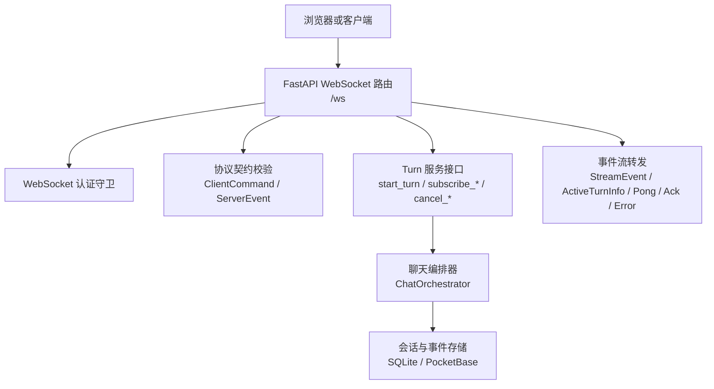
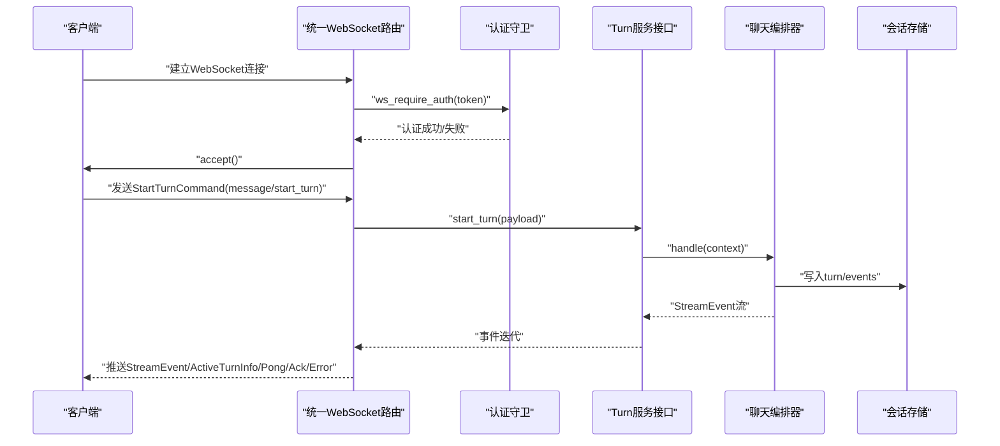
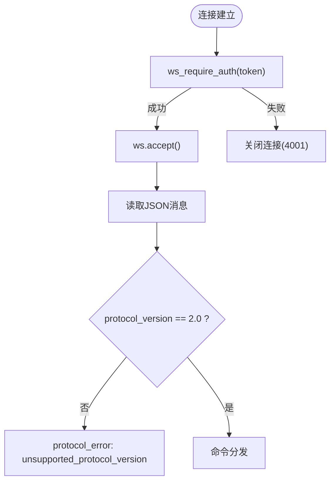
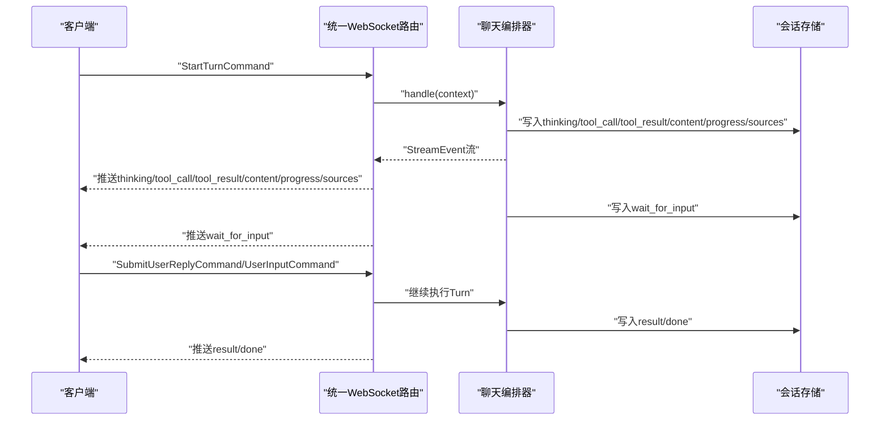
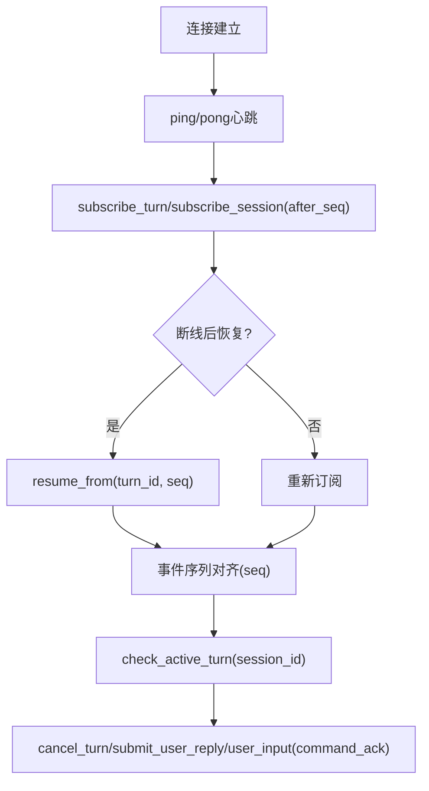
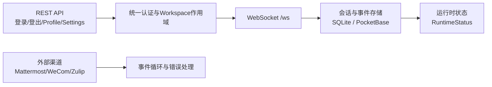
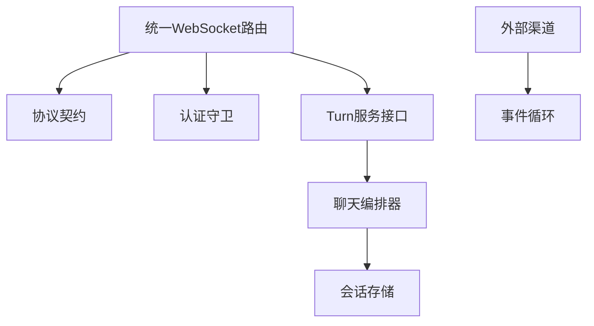

# WebSocket 实时通信协议

<cite>
**本文引用的文件**   
- [unified_ws.py](file://deeptutor/api/routers/unified_ws.py)
- [turn_protocol.py](file://deeptutor/api/contracts/turn_protocol.py)
- [auth.py](file://deeptutor/api/routers/auth.py)
- [orchestrator.py](file://deeptutor/runtime/orchestrator.py)
- [sqlite_store.py](file://deeptutor/services/session/sqlite_store.py)
- [pocketbase_store.py](file://deeptutor/services/session/pocketbase_store.py)
- [opencode_family.py](file://deeptutor/services/subagent/opencode_family.py)
- [mattermost.py](file://deeptutor/partners/channels/mattermost.py)
- [wecom.py](file://deeptutor/partners/channels/wecom.py)
- [zulip.py](file://deeptutor/partners/channels/zulip.py)
- [stream.ts](file://web/lib/stream.ts)
- [turn-reconcile.ts](file://web/lib/turn-reconcile.ts)
</cite>

## 目录
1. [引言](#引言)
2. [项目结构](#项目结构)
3. [核心组件](#核心组件)
4. [架构总览](#架构总览)
5. [详细组件分析](#详细组件分析)
6. [依赖关系分析](#依赖关系分析)
7. [性能与可靠性](#性能与可靠性)
8. [故障排查指南](#故障排查指南)
9. [结论](#结论)
10. [附录：客户端 SDK 使用与调试建议](#附录客户端-sdk-使用与调试建议)

## 引言
本文件面向 DeepTutor 的 WebSocket 实时通信协议，聚焦统一会话轮次（Turn）执行、可回放流式事件、智能体对话交互、断线重连、消息队列与状态同步、错误处理与超时控制，以及与 REST API 的协作模式和数据一致性保证。读者无需深入源码即可理解连接建立、握手认证、事件类型、数据格式、重试与恢复策略，以及前端 SDK 的使用要点。

## 项目结构
DeepTutor 的 WebSocket 能力由后端 FastAPI 路由、协议契约模型、认证守卫、运行时编排器、会话存储以及前端 SDK 共同组成：
- 后端入口：统一 WebSocket 路由负责鉴权、命令解析、订阅转发和错误上报。
- 协议契约：定义客户端命令、服务端事件、状态枚举、版本号和运行时状态。
- 认证守卫：在 WebSocket 升级前完成令牌校验与用户上下文注入。
- 运行时编排：将 Turn 请求分发到具体能力（如聊天、数学动画等），并产出流式事件。
- 会话存储：持久化 Turn、事件与 Session，支持迁移与并发安全。
- 前端 SDK：实现连接管理、心跳、重连、去抖、事件合并与会话对齐。

图表来源
- [unified_ws.py:43-389](file://deeptutor/api/routers/unified_ws.py#L43-L389)
- [turn_protocol.py:12-228](file://deeptutor/api/contracts/turn_protocol.py#L12-L228)
- [auth.py:584-619](file://deeptutor/api/routers/auth.py#L584-L619)
- [orchestrator.py:54-81](file://deeptutor/runtime/orchestrator.py#L54-L81)
- [sqlite_store.py:572-616](file://deeptutor/services/session/sqlite_store.py#L572-L616)
- [pocketbase_store.py:472-539](file://deeptutor/services/session/pocketbase_store.py#L472-L539)

章节来源
- [unified_ws.py:1-389](file://deeptutor/api/routers/unified_ws.py#L1-L389)
- [turn_protocol.py:1-314](file://deeptutor/api/contracts/turn_protocol.py#L1-L314)
- [auth.py:407-619](file://deeptutor/api/routers/auth.py#L407-L619)
- [orchestrator.py:54-81](file://deeptutor/runtime/orchestrator.py#L54-L81)

## 核心组件
- 统一 WebSocket 路由：提供 /ws 端点，负责鉴权、协议版本检查、命令分发、订阅管理与错误封装。
- 协议契约：定义 v2.0 协议版本、客户端命令集合、服务端事件集合、Turn 状态与失败码、运行时状态描述。
- WebSocket 认证守卫：在 accept() 之前完成 token 校验，设置当前用户上下文，并在异常时关闭连接。
- 聊天编排器：根据上下文选择能力执行 Turn，产出 StreamEvent 流，包含思考、工具调用、内容增量、进度、结果等。
- 会话存储：维护 session、turn、turn_events 等实体，支持列迁移、唯一索引与并发保护。
- 外部渠道集成：Mattermost、WeCom、Zulip 等渠道通过自身 WebSocket 或事件循环与系统对接，体现通用事件处理模式。

章节来源
- [unified_ws.py:43-389](file://deeptutor/api/routers/unified_ws.py#L43-L389)
- [turn_protocol.py:12-228](file://deeptutor/api/contracts/turn_protocol.py#L12-L228)
- [auth.py:584-619](file://deeptutor/api/routers/auth.py#L584-L619)
- [orchestrator.py:54-81](file://deeptutor/runtime/orchestrator.py#L54-L81)
- [sqlite_store.py:572-616](file://deeptutor/services/session/sqlite_store.py#L572-L616)
- [pocketbase_store.py:472-539](file://deeptutor/services/session/pocketbase_store.py#L472-L539)

## 架构总览
下图展示从客户端发起 Turn 到事件回传的整体流程，包括认证、命令校验、Turn 启动、订阅转发与错误处理。

图表来源
- [unified_ws.py:43-389](file://deeptutor/api/routers/unified_ws.py#L43-L389)
- [turn_protocol.py:69-178](file://deeptutor/api/contracts/turn_protocol.py#L69-L178)
- [auth.py:584-619](file://deeptutor/api/routers/auth.py#L584-L619)
- [orchestrator.py:64-81](file://deeptutor/runtime/orchestrator.py#L64-L81)

## 详细组件分析

### 连接建立与握手认证
- 连接入口：/ws。
- 认证阶段：在 ws.accept() 之前调用 ws_require_auth，从查询参数或 Cookie 中读取 token；若未启用认证则允许匿名；否则校验失败直接关闭连接（4001）。
- 工作区上下文：认证通过后安装 workspace scope，确保后续操作基于正确的租户/空间。
- 协议版本：所有消息必须携带 protocol_version=2.0，否则返回 unsupported_protocol_version。

图表来源
- [auth.py:584-619](file://deeptutor/api/routers/auth.py#L584-L619)
- [unified_ws.py:43-74](file://deeptutor/api/routers/unified_ws.py#L43-L74)
- [unified_ws.py:194-207](file://deeptutor/api/routers/unified_ws.py#L194-L207)

章节来源
- [auth.py:584-619](file://deeptutor/api/routers/auth.py#L584-L619)
- [unified_ws.py:43-74](file://deeptutor/api/routers/unified_ws.py#L43-L74)
- [unified_ws.py:194-207](file://deeptutor/api/routers/unified_ws.py#L194-L207)

### 客户端命令与服务端事件
- 客户端命令（type 字段区分）：
  - message/start_turn：启动一轮 Turn，携带 TurnRequest 负载。
  - subscribe_turn/resume_from：按 turn_id 订阅或从 seq 恢复。
  - subscribe_session：按 session_id 订阅。
  - unsubscribe：取消订阅。
  - check_active_turn：查询活跃 Turn 信息。
  - ping/pong：心跳保活。
  - cancel_turn：取消 Turn。
  - submit_user_reply：提交用户回复（文本或结构化答案）。
  - user_input：向运行中的 Turn 投递输入（支持撤回）。
- 服务端事件：
  - StreamEvent：包含 thinking、tool_call、tool_result、content、progress、sources、result、error、session、done 等。
  - ActiveTurnInfo：活跃 Turn 的状态与拥有者。
  - Pong：心跳响应。
  - CommandAck：命令确认（cancel_turn、submit_user_reply、user_input）。
  - ProtocolError：协议级错误（含 error_code、retryable、session_id、turn_id）。

图表来源
- [turn_protocol.py:12-228](file://deeptutor/api/contracts/turn_protocol.py#L12-L228)

章节来源
- [turn_protocol.py:12-228](file://deeptutor/api/contracts/turn_protocol.py#L12-L228)

### 智能体对话实时交互流程
- 思考过程展示：StreamEvent.type=thinking 用于展示推理片段，便于 UI 逐步呈现。
- 工具调用反馈：tool_call 与 tool_result 成对出现，反映工具执行与结果回传。
- 流式输出：content 增量推送，配合 seq 与 merge_id 进行前端合并与排序。
- 进度与来源：progress 与 sources 提供任务进度与参考来源。
- 结果与结束：result 与 done 标志 Turn 完成。
- 等待输入：wait_for_input 表示需要用户回复，客户端需触发 submit_user_reply 或 user_input。

图表来源
- [unified_ws.py:220-238](file://deeptutor/api/routers/unified_ws.py#L220-L238)
- [unified_ws.py:308-329](file://deeptutor/api/routers/unified_ws.py#L308-L329)
- [unified_ws.py:350-372](file://deeptutor/api/routers/unified_ws.py#L350-L372)
- [turn_protocol.py:47-63](file://deeptutor/api/contracts/turn_protocol.py#L47-L63)
- [orchestrator.py:64-81](file://deeptutor/runtime/orchestrator.py#L64-L81)

章节来源
- [unified_ws.py:220-238](file://deeptutor/api/routers/unified_ws.py#L220-L238)
- [unified_ws.py:308-329](file://deeptutor/api/routers/unified_ws.py#L308-L329)
- [unified_ws.py:350-372](file://deeptutor/api/routers/unified_ws.py#L350-L372)
- [turn_protocol.py:47-63](file://deeptutor/api/contracts/turn_protocol.py#L47-L63)
- [orchestrator.py:64-81](file://deeptutor/runtime/orchestrator.py#L64-L81)

### 断线重连、消息队列与状态同步
- 心跳保活：客户端发送 ping，服务器返回 pong。
- 订阅恢复：
  - resume_from：指定 turn_id 与 seq，从断点续传。
  - subscribe_turn/subscribe_session：after_seq 用于增量拉取。
- 活跃 Turn 检查：check_active_turn 返回 turn_id、status、owner_id，帮助客户端判断是否抢占或等待。
- 命令确认：cancel_turn、submit_user_reply、user_input 均返回 command_ack，指示 accepted 与错误码。
- 错误与重试：protocol_error 包含 retryable 标志，客户端据此决定是否指数退避重连。

图表来源
- [unified_ws.py:240-277](file://deeptutor/api/routers/unified_ws.py#L240-L277)
- [unified_ws.py:288-372](file://deeptutor/api/routers/unified_ws.py#L288-L372)
- [turn_protocol.py:88-178](file://deeptutor/api/contracts/turn_protocol.py#L88-L178)

章节来源
- [unified_ws.py:240-277](file://deeptutor/api/routers/unified_ws.py#L240-L277)
- [unified_ws.py:288-372](file://deeptutor/api/routers/unified_ws.py#L288-L372)
- [turn_protocol.py:88-178](file://deeptutor/api/contracts/turn_protocol.py#L88-L178)

### 错误处理与超时控制
- 协议错误：invalid_json、unsupported_protocol_version、invalid_command、unknown_message_type、missing_turn_id、missing_session_id、subscription_failed、start_turn_rejected、regenerate_rejected、internal_error。
- 业务错误：turn_not_active、turn_not_waiting_input、worker_lost、lease_lost、coordination_unavailable、provider_error、server_shutdown。
- 重试策略：retryable=true 时客户端应实施指数退避与最大重试次数限制；terminal=true 表示不可恢复，应提示用户或降级。
- 超时控制：建议在客户端实现心跳超时与命令超时，避免长时间阻塞；服务端侧可通过 Turn 状态与 lease TTL 检测空闲或丢失。

章节来源
- [unified_ws.py:75-109](file://deeptutor/api/routers/unified_ws.py#L75-L109)
- [unified_ws.py:180-207](file://deeptutor/api/routers/unified_ws.py#L180-L207)
- [unified_ws.py:220-238](file://deeptutor/api/routers/unified_ws.py#L220-L238)
- [unified_ws.py:240-372](file://deeptutor/api/routers/unified_ws.py#L240-L372)
- [turn_protocol.py:37-45](file://deeptutor/api/contracts/turn_protocol.py#L37-L45)

### 与 REST API 的协作模式与数据一致性
- 身份与权限：REST 登录/登出、Profile 管理等通过 auth.py 提供的 require_auth 与 ws_require_auth 保持一致的用户上下文与 workspace scope。
- 会话与 Turn 持久化：SQLite 与 PocketBase 存储层维护 sessions、turns、turn_events 等表/集合，支持列迁移与唯一索引，保障并发安全与数据一致性。
- 跨进程协调：RuntimeStatus 暴露 worker_count、coordination_mode、redis_status、leader_healthy、recovery_backlog、lease_ttl_seconds 等指标，便于上层监控与自愈。
- 外部渠道：Mattermost、WeCom、Zulip 等渠道通过各自的事件循环与 WebSocket 接入，遵循统一的错误与状态管理模式。

图表来源
- [auth.py:455-505](file://deeptutor/api/routers/auth.py#L455-L505)
- [auth.py:584-619](file://deeptutor/api/routers/auth.py#L584-L619)
- [sqlite_store.py:572-616](file://deeptutor/services/session/sqlite_store.py#L572-L616)
- [pocketbase_store.py:472-539](file://deeptutor/services/session/pocketbase_store.py#L472-L539)
- [mattermost.py:218-247](file://deeptutor/partners/channels/mattermost.py#L218-L247)
- [wecom.py:131-153](file://deeptutor/partners/channels/wecom.py#L131-L153)
- [zulip.py:462-499](file://deeptutor/partners/channels/zulip.py#L462-L499)

章节来源
- [auth.py:455-505](file://deeptutor/api/routers/auth.py#L455-L505)
- [auth.py:584-619](file://deeptutor/api/routers/auth.py#L584-L619)
- [sqlite_store.py:572-616](file://deeptutor/services/session/sqlite_store.py#L572-L616)
- [pocketbase_store.py:472-539](file://deeptutor/services/session/pocketbase_store.py#L472-L539)
- [mattermost.py:218-247](file://deeptutor/partners/channels/mattermost.py#L218-L247)
- [wecom.py:131-153](file://deeptutor/partners/channels/wecom.py#L131-L153)
- [zulip.py:462-499](file://deeptutor/partners/channels/zulip.py#L462-L499)

## 依赖关系分析
- 路由层依赖协议契约进行命令与事件校验。
- 路由层依赖认证守卫完成用户与工作区上下文。
- 路由层依赖 Turn 服务接口进行 Turn 生命周期管理。
- 编排器依赖能力注册表与工具注册表，产出标准化事件。
- 存储层提供会话与事件的持久化与迁移能力。
- 外部渠道复用通用的事件处理与错误上报模式。

图表来源
- [unified_ws.py:43-389](file://deeptutor/api/routers/unified_ws.py#L43-L389)
- [turn_protocol.py:12-228](file://deeptutor/api/contracts/turn_protocol.py#L12-L228)
- [auth.py:584-619](file://deeptutor/api/routers/auth.py#L584-L619)
- [orchestrator.py:54-81](file://deeptutor/runtime/orchestrator.py#L54-L81)

章节来源
- [unified_ws.py:43-389](file://deeptutor/api/routers/unified_ws.py#L43-L389)
- [turn_protocol.py:12-228](file://deeptutor/api/contracts/turn_protocol.py#L12-L228)
- [auth.py:584-619](file://deeptutor/api/routers/auth.py#L584-L619)
- [orchestrator.py:54-81](file://deeptutor/runtime/orchestrator.py#L54-L81)

## 性能与可靠性
- 流式事件优化：
  - 使用 seq 与 merge_id 在前端合并增量内容，减少重绘与抖动。
  - 对 thinking 与 content 分别渲染，提升可读性与性能。
- 连接与订阅管理：
  - 单连接多订阅，通过 subscription_tasks 管理 turn 与 session 订阅的生命周期。
  - 断开时清理任务，避免资源泄漏。
- 存储与并发：
  - SQLite 层增加 owner_id、fencing_token、state_version、failure_code、retryable 等列，增强并发与恢复能力。
  - 唯一索引防止重复 assistant_message_id，保障数据一致性。
- 外部渠道健壮性：
  - Mattermost 事件循环忽略非 JSON 帧，捕获处理异常。
  - WeCom 在连接、认证、断开、错误等事件中更新状态机，便于监控与重试。
  - Zulip 在消息处理中异步派发 typing 与消息处理，避免阻塞。

章节来源
- [unified_ws.py:55-74](file://deeptutor/api/routers/unified_ws.py#L55-L74)
- [unified_ws.py:130-178](file://deeptutor/api/routers/unified_ws.py#L130-L178)
- [sqlite_store.py:572-616](file://deeptutor/services/session/sqlite_store.py#L572-L616)
- [mattermost.py:218-247](file://deeptutor/partners/channels/mattermost.py#L218-L247)
- [wecom.py:131-153](file://deeptutor/partners/channels/wecom.py#L131-L153)
- [zulip.py:462-499](file://deeptutor/partners/channels/zulip.py#L462-L499)

## 故障排查指南
- 连接失败：
  - 检查 token 是否有效，ws_require_auth 是否返回 4001。
  - 确认 AUTH_ENABLED 配置与 cookie_secure/SameSite 设置。
- 协议不匹配：
  - 检查 protocol_version 是否为 2.0。
  - 检查命令结构是否符合 ClientCommand 契约。
- Turn 无法启动：
  - 检查 start_turn_rejected 错误码与 WorkspaceError。
  - 检查工作区绑定与权限。
- 订阅失效：
  - 检查 subscription_failed 错误码与 after_seq 是否正确。
  - 使用 resume_from 从断点续传。
- 命令无响应：
  - 检查 command_ack 的 accepted 与 error_code。
  - 对于 user_input 与 submit_user_reply，确认 turn 处于 waiting_input 或 active 状态。
- 外部渠道问题：
  - Mattermost：检查 posted 事件与 JSON 解析。
  - WeCom：检查连接、认证、断开与错误事件。
  - Zulip：检查消息派发与 typing 状态。

章节来源
- [auth.py:584-619](file://deeptutor/api/routers/auth.py#L584-L619)
- [unified_ws.py:75-109](file://deeptutor/api/routers/unified_ws.py#L75-L109)
- [unified_ws.py:180-207](file://deeptutor/api/routers/unified_ws.py#L180-L207)
- [unified_ws.py:220-238](file://deeptutor/api/routers/unified_ws.py#L220-L238)
- [unified_ws.py:240-372](file://deeptutor/api/routers/unified_ws.py#L240-L372)
- [mattermost.py:218-247](file://deeptutor/partners/channels/mattermost.py#L218-L247)
- [wecom.py:131-153](file://deeptutor/partners/channels/wecom.py#L131-L153)
- [zulip.py:462-499](file://deeptutor/partners/channels/zulip.py#L462-L499)

## 结论
DeepTutor 的 WebSocket 实时通信协议以 v2.0 为契约，围绕 Turn 生命周期构建连接、认证、命令、事件与恢复机制。通过统一的协议模型、严格的校验与错误分类、可扩展的编排器与存储层，以及前端 SDK 的重连与对齐能力，系统在复杂交互场景下具备高可用性与良好体验。外部渠道复用一致的错误与状态模式，进一步增强了整体系统的健壮性。

## 附录：客户端 SDK 使用与调试建议
- 连接与认证：
  - 在浏览器环境中优先使用 Cookie 或 Authorization Bearer 传递 token。
  - 在 ws_require_auth 成功后再 accept 连接。
- 心跳与保活：
  - 定期发送 ping，监听 pong，实现超时重连。
- 订阅与恢复：
  - 首次使用 subscribe_turn/subscribe_session 并记录 last_seq。
  - 断线后使用 resume_from 从 last_seq 恢复。
- 事件处理：
  - 对 thinking 与 content 分别渲染，使用 merge_id 合并增量。
  - 对 tool_call 与 tool_result 成对显示，展示工具执行过程。
  - 对 wait_for_input 触发用户输入界面，提交 submit_user_reply 或 user_input。
- 命令确认：
  - 对 cancel_turn、submit_user_reply、user_input 监听 command_ack，处理 accepted 与 error_code。
- 调试技巧：
  - 打印 protocol_error 的 error_code、message、retryable、session_id、turn_id。
  - 使用 check_active_turn 获取活跃 Turn 状态，辅助定位竞态与抢占问题。
  - 观察 RuntimeStatus 的 leader_healthy、recovery_backlog、lease_ttl_seconds 等指标，评估集群健康度。

章节来源
- [stream.ts](file://web/lib/stream.ts)
- [turn-reconcile.ts](file://web/lib/turn-reconcile.ts)
- [unified_ws.py:240-277](file://deeptutor/api/routers/unified_ws.py#L240-L277)
- [unified_ws.py:288-372](file://deeptutor/api/routers/unified_ws.py#L288-L372)
- [turn_protocol.py:194-228](file://deeptutor/api/contracts/turn_protocol.py#L194-L228)