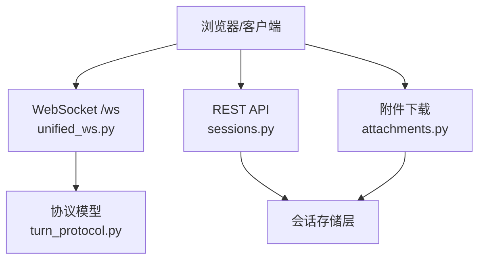
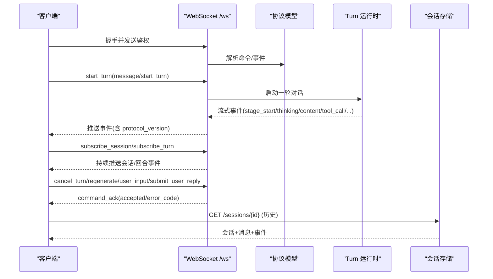
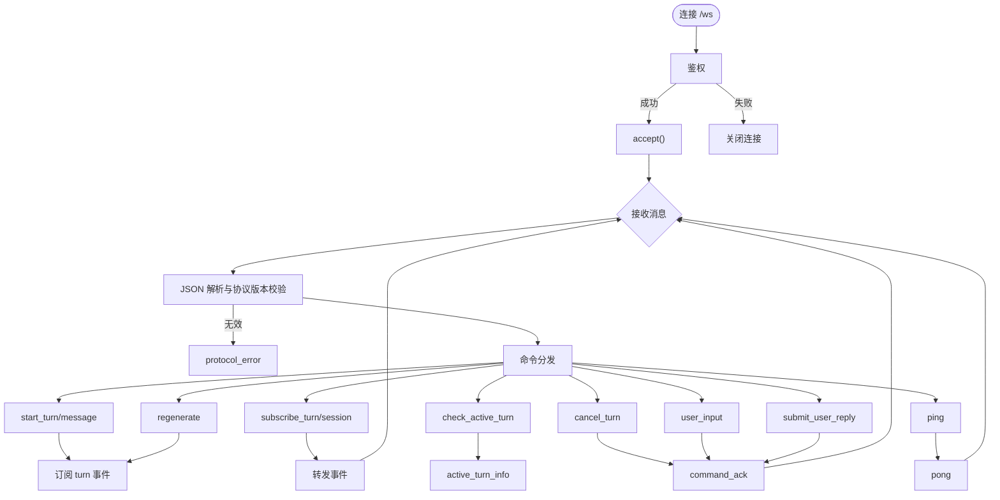
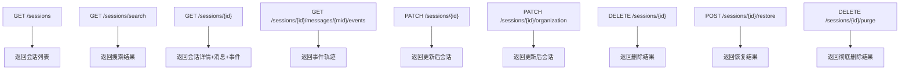
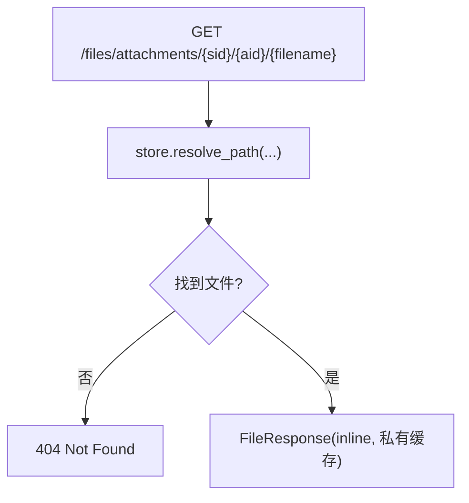
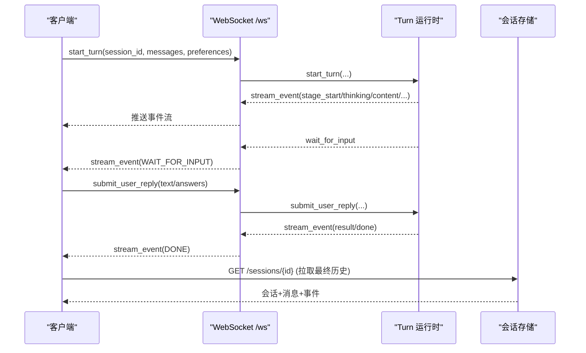
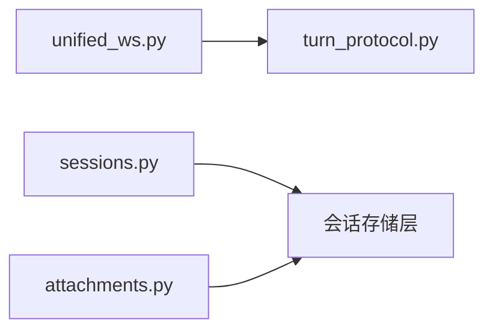

# 聊天 API

<cite>
**本文引用的文件**   
- [deeptutor/api/routers/unified_ws.py](file://deeptutor/api/routers/unified_ws.py)
- [deeptutor/api/contracts/turn_protocol.py](file://deeptutor/api/contracts/turn_protocol.py)
- [deeptutor/api/routers/sessions.py](file://deeptutor/api/routers/sessions.py)
- [deeptutor/api/routers/attachments.py](file://deeptutor/api/routers/attachments.py)
</cite>

## 目录
1. [简介](#简介)
2. [项目结构](#项目结构)
3. [核心组件](#核心组件)
4. [架构总览](#架构总览)
5. [详细组件分析](#详细组件分析)
6. [依赖关系分析](#依赖关系分析)
7. [性能与可靠性建议](#性能与可靠性建议)
8. [故障排查指南](#故障排查指南)
9. [结论](#结论)
10. [附录：客户端实现要点](#附录客户端实现要点)

## 简介
本文件为 DeepTutor 聊天功能的完整 API 文档，覆盖以下能力：
- RESTful 会话管理：创建、查询、搜索、删除、恢复、归档等。
- 消息历史与事件回放：按会话或单条消息拉取历史，支持增量回放。
- WebSocket 实时通信：统一协议 v2.0，包含连接建立、命令类型、流式事件、断线重连与命令确认。
- 智能体对话流程：多轮对话、上下文管理、工具调用、用户交互等待、流式响应。
- 附件处理：上传后通过专用端点预览和下载，具备路径安全校验。
- 客户端实现指南：消息队列、错误重试、性能优化与最佳实践。

## 项目结构
DeepTutor 的聊天相关后端主要位于 `deeptutor/api` 下：
- `routers/unified_ws.py`：WebSocket 统一入口，负责认证、命令分发、订阅管理与事件转发。
- `api/contracts/turn_protocol.py`：定义统一的 v2.0 协议模型（命令、事件、状态、错误）。
- `routers/sessions.py`：RESTful 会话与消息历史接口。
- `routers/attachments.py`：附件预览与下载接口。

图表来源
- [deeptutor/api/routers/unified_ws.py:43-389](file://deeptutor/api/routers/unified_ws.py#L43-L389)
- [deeptutor/api/contracts/turn_protocol.py:12-291](file://deeptutor/api/contracts/turn_protocol.py#L12-L291)
- [deeptutor/api/routers/sessions.py:251-800](file://deeptutor/api/routers/sessions.py#L251-L800)
- [deeptutor/api/routers/attachments.py:40-79](file://deeptutor/api/routers/attachments.py#L40-L79)

章节来源
- [deeptutor/api/routers/unified_ws.py:1-389](file://deeptutor/api/routers/unified_ws.py#L1-L389)
- [deeptutor/api/contracts/turn_protocol.py:1-314](file://deeptutor/api/contracts/turn_protocol.py#L1-L314)
- [deeptutor/api/routers/sessions.py:1-850](file://deeptutor/api/routers/sessions.py#L1-L850)
- [deeptutor/api/routers/attachments.py:1-80](file://deeptutor/api/routers/attachments.py#L1-L80)

## 核心组件
- WebSocket 统一适配器：负责鉴权、命令解析、订阅生命周期、事件转发与错误上报。
- 协议契约：定义客户端命令与服务端事件的统一数据结构、版本控制与错误信封。
- 会话服务：提供会话列表、详情、搜索、组织信息、消息事件回放、删除与恢复等。
- 附件服务：基于本地磁盘存储器的安全文件读取与预览下载。

章节来源
- [deeptutor/api/routers/unified_ws.py:1-389](file://deeptutor/api/routers/unified_ws.py#L1-L389)
- [deeptutor/api/contracts/turn_protocol.py:1-314](file://deeptutor/api/contracts/turn_protocol.py#L1-L314)
- [deeptutor/api/routers/sessions.py:1-850](file://deeptutor/api/routers/sessions.py#L1-L850)
- [deeptutor/api/routers/attachments.py:1-80](file://deeptutor/api/routers/attachments.py#L1-L80)

## 架构总览
聊天系统采用“REST + WebSocket”混合架构：
- REST 用于会话元数据、历史查询、组织管理等非实时操作。
- WebSocket 用于启动对话、流式输出、交互式问答、取消与重新生成等实时操作。
- 附件通过独立 HTTP 端点提供安全的预览与下载。

图表来源
- [deeptutor/api/routers/unified_ws.py:43-389](file://deeptutor/api/routers/unified_ws.py#L43-L389)
- [deeptutor/api/contracts/turn_protocol.py:12-291](file://deeptutor/api/contracts/turn_protocol.py#L12-L291)
- [deeptutor/api/routers/sessions.py:456-526](file://deeptutor/api/routers/sessions.py#L456-L526)

## 详细组件分析

### WebSocket 实时通信协议
- 端点：`/ws`
- 鉴权：连接前需完成鉴权；失败则不 accept。
- 协议版本：所有消息必须携带 `protocol_version = "2.0"`。
- 命令类型（客户端 → 服务端）：
  - `message` / `start_turn`：启动一轮对话，返回 turn_id 并开始订阅。
  - `subscribe_turn` / `resume_from`：订阅指定 turn 的事件，支持从 seq 恢复。
  - `subscribe_session`：订阅会话级事件，支持 after_seq。
  - `check_active_turn`：检查会话当前活跃 turn 的状态。
  - `unsubscribe`：取消对 turn 或 session 的订阅。
  - `cancel_turn`：取消正在运行的 turn。
  - `regenerate`：根据 session_id 重新生成最后一轮。
  - `user_input`：向运行中的 turn 提交输入（可撤回更早的 user_input）。
  - `submit_user_reply`：在 WAITING_INPUT 状态下提交文本或多项答案。
  - `ping`：心跳检测，服务端回 `pong`。
- 事件类型（服务端 → 客户端）：
  - `stream_event`：阶段开始/结束、思考、观察、内容增量、工具调用/结果、进度、来源、结果、错误、会话元信息等。
  - `active_turn_info`：活跃 turn 信息。
  - `command_ack`：命令确认（接受/拒绝及错误码）。
  - `protocol_error`：协议级错误（含 error_code、retryable、session_id、turn_id）。
  - `pong`：心跳应答。
- 断线与重连：
  - 客户端应监听 `protocol_error`，当 `retryable=true` 时进行指数退避重连。
  - 使用 `subscribe_turn` 的 `after_seq` 或 `resume_from` 的 `seq` 实现增量回放，避免丢失事件。
  - 使用 `check_active_turn` 判断是否已有活跃 turn，避免重复启动。

图表来源
- [deeptutor/api/routers/unified_ws.py:43-389](file://deeptutor/api/routers/unified_ws.py#L43-L389)
- [deeptutor/api/contracts/turn_protocol.py:12-291](file://deeptutor/api/contracts/turn_protocol.py#L12-L291)

章节来源
- [deeptutor/api/routers/unified_ws.py:43-389](file://deeptutor/api/routers/unified_ws.py#L43-L389)
- [deeptutor/api/contracts/turn_protocol.py:12-291](file://deeptutor/api/contracts/turn_protocol.py#L12-L291)

### RESTful 会话与历史 API
- 会话列表：GET `/sessions`
  - 参数：limit、offset、workspace_id、all_workspaces
  - 返回：会话列表，附带 content_workspace_id
- 会话搜索：GET `/sessions/search`
  - 参数：q、limit、offset
  - 返回：匹配会话、总数、分页信息
- 回收站：GET `/sessions/recycle-bin`
  - 返回：已删除会话列表
- 获取会话详情：GET `/sessions/{session_id}`
  - 返回：会话基本信息、消息列表、偏好设置；会附加孤立失败 turn 并脱敏 provider 私有字段，并对超大事件做截断标记。
- 获取会话组织信息：GET `/sessions/{session_id}/organization`
  - 返回：标题、状态、偏好等轻量信息。
- 获取线程列表：GET `/sessions/{session_id}/threads`
  - 返回：与该会话关联的子线程（如 Little Tutor 线程），按更新时间倒序。
- 获取消息事件轨迹：GET `/sessions/{session_id}/messages/{message_id}/events`
  - 参数：after_seq、limit
  - 返回：该消息的事件轨迹，支持增量回放。
- 重命名会话：PATCH `/sessions/{session_id}`
  - 请求体：title
  - 返回：更新后的会话
- 修改回复语言：PATCH `/sessions/{session_id}/reply-language`
  - 请求体：language（可选，受支持语言校验）
  - 返回：更新后的会话
- 修改组织属性：PATCH `/sessions/{session_id}/organization`
  - 支持 workspace_id、parent_session_id、session_kind、pinned、archived、tutor_source_message_id 等字段变更。
- 删除会话：DELETE `/sessions/{session_id}`
  - 行为：停止活跃 turn、软删除会话、清理附件与外部索引。
- 恢复会话：POST `/sessions/{session_id}/restore`
- 彻底删除：DELETE `/sessions/{session_id}/purge`
- 分支选择：PUT `/sessions/{session_id}/branch-selection`
- 删除某条消息对应的轮次：DELETE `/sessions/{session_id}/messages/{message_id}`

图表来源
- [deeptutor/api/routers/sessions.py:251-800](file://deeptutor/api/routers/sessions.py#L251-L800)

章节来源
- [deeptutor/api/routers/sessions.py:251-800](file://deeptutor/api/routers/sessions.py#L251-L800)

### 附件处理
- 预览/下载：GET `/files/attachments/{session_id}/{attachment_id}/{filename:path}`
  - 仅支持本地磁盘存储后端；其他后端应返回重定向到签名 URL。
  - 返回 Content-Disposition: inline，便于浏览器内预览；未知类型回退为 application/octet-stream。
  - 缓存策略：private, max-age=0, must-revalidate。
  - 安全性：路径经 store.resolve_path 校验，防止目录穿越。

图表来源
- [deeptutor/api/routers/attachments.py:40-79](file://deeptutor/api/routers/attachments.py#L40-L79)

章节来源
- [deeptutor/api/routers/attachments.py:1-80](file://deeptutor/api/routers/attachments.py#L1-L80)

### 智能体对话交互流程
- 启动对话：客户端发送 `start_turn` 或 `message`，服务端返回 turn_id 并推送事件流。
- 流式输出：服务端推送 stage_start、thinking、content、tool_call、tool_result、progress、sources、result、done 等事件。
- 用户交互等待：当 turn 进入 WAITING_INPUT，客户端可通过 `submit_user_reply` 提交文本或结构化答案。
- 运行中补充输入：通过 `user_input` 追加输入，支持 withdraw 撤回更早的未消费输入。
- 取消与重新生成：`cancel_turn` 终止当前 turn；`regenerate` 基于 session_id 重新生成最后一轮。
- 上下文管理：会话偏好（preferences）保存语言、工作区、父会话等上下文；消息事件中包含 tool_metadata、observation 等上下文信息。

图表来源
- [deeptutor/api/routers/unified_ws.py:220-348](file://deeptutor/api/routers/unified_ws.py#L220-L348)
- [deeptutor/api/contracts/turn_protocol.py:47-62](file://deeptutor/api/contracts/turn_protocol.py#L47-L62)
- [deeptutor/api/routers/sessions.py:456-526](file://deeptutor/api/routers/sessions.py#L456-L526)

章节来源
- [deeptutor/api/routers/unified_ws.py:220-348](file://deeptutor/api/routers/unified_ws.py#L220-L348)
- [deeptutor/api/contracts/turn_protocol.py:47-62](file://deeptutor/api/contracts/turn_protocol.py#L47-L62)
- [deeptutor/api/routers/sessions.py:456-526](file://deeptutor/api/routers/sessions.py#L456-L526)

## 依赖关系分析
- unified_ws 依赖 turn_protocol 定义的命令与事件模型，确保前后端一致性。
- sessions 路由依赖会话存储层，提供持久化查询与组织管理。
- attachments 路由依赖本地磁盘附件存储器，提供安全的文件访问。

图表来源
- [deeptutor/api/routers/unified_ws.py:1-389](file://deeptutor/api/routers/unified_ws.py#L1-L389)
- [deeptutor/api/contracts/turn_protocol.py:1-314](file://deeptutor/api/contracts/turn_protocol.py#L1-L314)
- [deeptutor/api/routers/sessions.py:1-850](file://deeptutor/api/routers/sessions.py#L1-L850)
- [deeptutor/api/routers/attachments.py:1-80](file://deeptutor/api/routers/attachments.py#L1-L80)

章节来源
- [deeptutor/api/routers/unified_ws.py:1-389](file://deeptutor/api/routers/unified_ws.py#L1-L389)
- [deeptutor/api/contracts/turn_protocol.py:1-314](file://deeptutor/api/contracts/turn_protocol.py#L1-L314)
- [deeptutor/api/routers/sessions.py:1-850](file://deeptutor/api/routers/sessions.py#L1-L850)
- [deeptutor/api/routers/attachments.py:1-80](file://deeptutor/api/routers/attachments.py#L1-L80)

## 性能与可靠性建议
- 事件回放：优先使用 `subscribe_turn` 的 `after_seq` 或 `resume_from` 的 `seq` 增量回放，减少全量拉取。
- 批量订阅：同时订阅 session 与 turn，但注意 unsubscribe 及时释放资源。
- 心跳保活：定期发送 `ping`，服务端回 `pong`，用于检测连接健康。
- 错误重试：对 `protocol_error` 且 `retryable=true` 的消息执行指数退避重连，并在重连后使用 seq 恢复。
- 大事件裁剪：服务端会对 oversized 的 tool_result/observation 事件进行截断并标记 `_truncated`，客户端应提示用户查看完整日志。
- 附件缓存：附件下载使用私有缓存策略，前端应避免频繁重复请求，必要时使用本地缓存。

[本节为通用指导，无需引用具体文件]

## 故障排查指南
- 协议版本不匹配：检查客户端是否携带 `protocol_version="2.0"`。
- 无效 JSON 或命令：服务端返回 `invalid_json` 或 `invalid_command`，请检查消息结构与必填字段。
- 缺少必要 ID：如 missing_turn_id、missing_session_id，请补全对应字段。
- 活跃 turn 冲突：`turn_not_active` 表示目标 turn 已结束或不可恢复；先 check_active_turn 再操作。
- 等待输入状态：`turn_not_waiting_input` 表示 turn 未处于 WAITING_INPUT；仅在收到 WAIT_FOR_INPUT 事件后提交 reply。
- 附件 404：确认 session_id、attachment_id、filename 正确，且文件未被清理。
- 会话 404：确认会话存在且未被删除；若被删除，请先恢复或从回收站恢复。

章节来源
- [deeptutor/api/routers/unified_ws.py:180-389](file://deeptutor/api/routers/unified_ws.py#L180-L389)
- [deeptutor/api/routers/attachments.py:40-79](file://deeptutor/api/routers/attachments.py#L40-L79)
- [deeptutor/api/routers/sessions.py:456-800](file://deeptutor/api/routers/sessions.py#L456-L800)

## 结论
DeepTutor 聊天 API 通过 REST 与 WebSocket 的组合，提供了完整的会话管理、消息历史、实时流式对话与附件处理能力。协议 v2.0 明确了命令与事件结构，配合序列号机制实现了可靠的重放与恢复。客户端应遵循协议规范，实现健壮的连接管理、错误重试与增量回放，以获得稳定流畅的多轮对话体验。

[本节为总结性内容，无需引用具体文件]

## 附录：客户端实现要点
- 连接建立
  - 建立 WebSocket 连接至 `/ws`，完成鉴权。
  - 每次发送消息携带 `protocol_version="2.0"`。
- 消息队列管理
  - 维护待发送命令队列，按顺序发送并记录 command_id。
  - 对每个命令维护 ack 状态，超时未收到 `command_ack` 时重试。
- 错误重试机制
  - 对 `protocol_error` 且 `retryable=true` 的消息进行指数退避重连。
  - 重连后使用 `subscribe_turn` 的 `after_seq` 或 `resume_from` 的 `seq` 恢复事件流。
- 性能优化
  - 使用 `check_active_turn` 避免重复启动 turn。
  - 合理设置 `limit` 与 `after_seq`，避免全量拉取。
  - 对大事件进行本地缓存与懒加载。
- 附件处理
  - 使用 `/files/attachments/{session_id}/{attachment_id}/{filename}` 预览与下载。
  - 尊重私有缓存策略，避免频繁重复请求。

[本节为通用指导，无需引用具体文件]