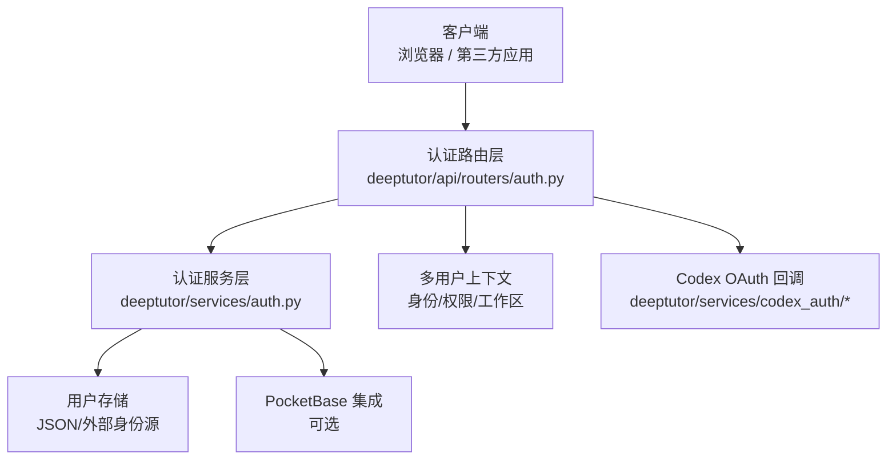
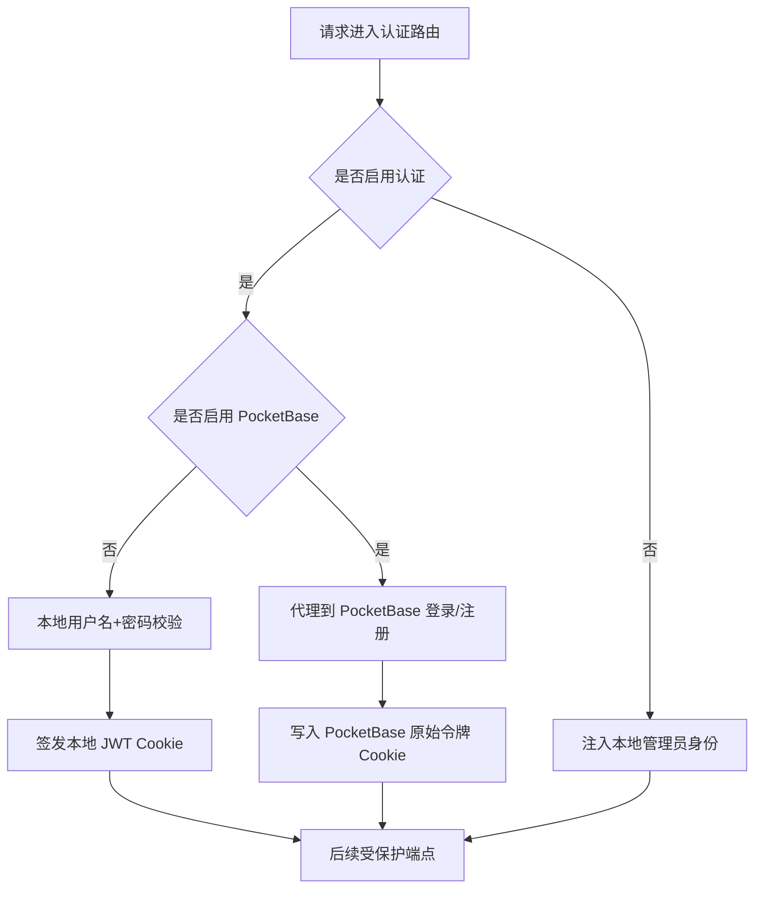
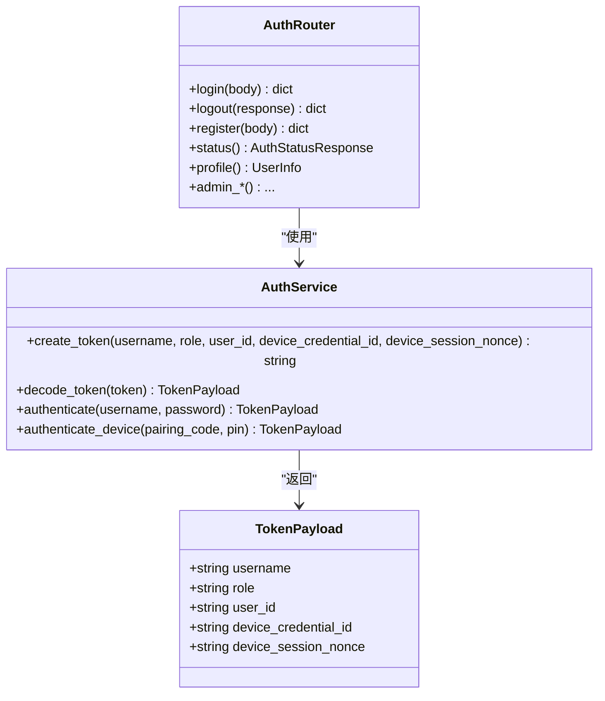
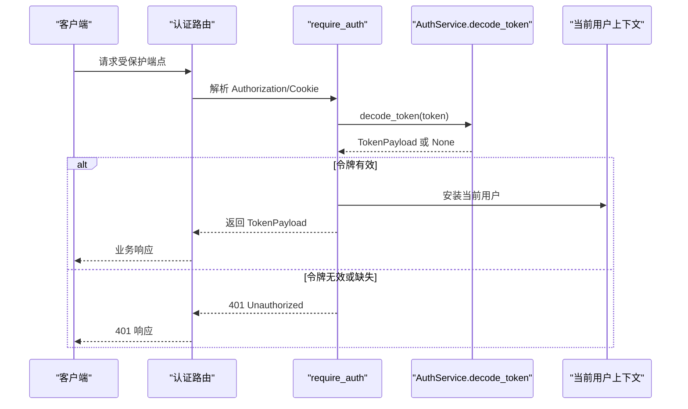
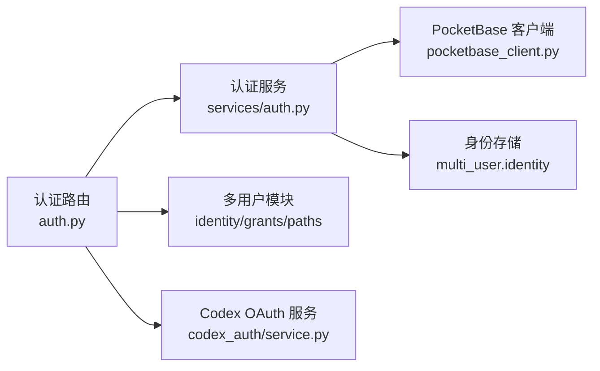

# 认证 API

<cite>
**本文引用的文件**   
- [deeptutor/api/routers/auth.py](file://deeptutor/api/routers/auth.py)
- [deeptutor/services/auth.py](file://deeptutor/services/auth.py)
- [deeptutor/services/codex_auth/service.py](file://deeptutor/services/codex_auth/service.py)
- [deeptutor/services/codex_auth/oauth.py](file://deeptutor/services/codex_auth/oauth.py)
</cite>

## 目录
1. [简介](#简介)
2. [项目结构与入口](#项目结构与入口)
3. [核心组件](#核心组件)
4. [架构总览](#架构总览)
5. [详细端点文档](#详细端点文档)
6. [JWT、会话与权限模型](#jwt会话与权限模型)
7. [依赖关系分析](#依赖关系分析)
8. [性能与扩展性](#性能与扩展性)
9. [故障排查](#故障排查)
10. [安全最佳实践](#安全最佳实践)
11. [结论](#结论)

## 简介
本文件是 DeepTutor 认证系统的完整 API 文档，覆盖用户注册、登录、登出、密码修改/重置、设备凭证、会话中转、头像管理、学习者档案以及管理员用户管理等认证相关 RESTful 端点。文档同时说明 JWT 令牌机制、Cookie 会话管理、权限验证流程、OAuth 集成（Codex）和多因素认证（设备配对码 + PIN），并提供请求/响应结构、错误格式和状态码说明。

## 项目结构与入口
认证功能主要由以下两部分组成：
- FastAPI 路由层：定义所有认证相关 HTTP 端点，处理请求参数校验、鉴权依赖、Cookie 设置与返回体构造。
- 认证服务层：封装用户存储、密码哈希、JWT 签发与解码、PocketBase 模式适配和设备凭证逻辑。

**图表来源**
- [deeptutor/api/routers/auth.py:1-120](file://deeptutor/api/routers/auth.py#L1-L120)
- [deeptutor/services/auth.py:1-62](file://deeptutor/services/auth.py#L1-L62)
- [deeptutor/services/codex_auth/service.py:434-469](file://deeptutor/services/codex_auth/service.py#L434-L469)

**章节来源**
- [deeptutor/api/routers/auth.py:1-120](file://deeptutor/api/routers/auth.py#L1-L120)
- [deeptutor/services/auth.py:1-62](file://deeptutor/services/auth.py#L1-L62)

## 核心组件
- 认证路由模块：提供 `/api/auth` 下的全部认证端点，包括公开端点、受保护端点和管理员端点。
- 认证服务模块：提供用户增删改查、密码哈希、JWT 创建与解码、PocketBase 登录/注册适配、设备凭证登录等能力。
- 依赖守卫：`require_auth`、`require_admin`、`ws_require_auth` 用于统一鉴权和当前用户注入。
- 数据模型：Pydantic 请求/响应模型，如 `LoginRequest`、`RegisterRequest`、`UserInfo`、`AuthStatusResponse` 等。

**章节来源**
- [deeptutor/api/routers/auth.py:189-400](file://deeptutor/api/routers/auth.py#L189-L400)
- [deeptutor/services/auth.py:69-89](file://deeptutor/services/auth.py#L69-L89)
- [deeptutor/services/auth.py:148-252](file://deeptutor/services/auth.py#L148-L252)

## 架构总览
认证系统支持两种主要运行模式：
- 内置模式：使用本地 JSON 用户存储与 bcrypt 密码哈希，通过 HS256 算法签发本地 JWT。
- PocketBase 模式：当配置了外部 PocketBase 地址时，登录/注册代理到 PocketBase，令牌校验委托给 PocketBase 的刷新接口。

**图表来源**
- [deeptutor/services/auth.py:43-62](file://deeptutor/services/auth.py#L43-L62)
- [deeptutor/services/auth.py:260-345](file://deeptutor/services/auth.py#L260-L345)
- [deeptutor/api/routers/auth.py:906-956](file://deeptutor/api/routers/auth.py#L906-L956)

**章节来源**
- [deeptutor/services/auth.py:43-62](file://deeptutor/services/auth.py#L43-L62)
- [deeptutor/services/auth.py:260-345](file://deeptutor/services/auth.py#L260-L345)
- [deeptutor/api/routers/auth.py:906-956](file://deeptutor/api/routers/auth.py#L906-L956)

## 详细端点文档

### 公开端点（无需认证）

#### GET /api/auth/status
- 作用：查询认证是否启用、当前请求是否已认证，以及当前用户基本信息和学习策略。
- 认证：不需要；若启用了认证且携带有效令牌，则返回当前用户信息。
- 请求头：
  - `Authorization: Bearer <token>`（可选）
  - Cookie `dt_token=<token>`（可选）
- 响应体字段：
  - `enabled`: 是否启用认证
  - `authenticated`: 是否已认证
  - `user_id`: 用户 ID
  - `username`: 用户名
  - `role`: 角色
  - `is_admin`: 是否管理员
  - `avatar`: 头像标记
  - `preset`: 账户预设
  - `learning_policy`: 学习策略对象
- 状态码：
  - `200 OK`：成功
  - `401 Unauthorized`：未携带或无效令牌（仅在需要令牌但缺失/无效时）

**章节来源**
- [deeptutor/api/routers/auth.py:851-903](file://deeptutor/api/routers/auth.py#L851-L903)

#### POST /api/auth/register
- 作用：首次注册用户（仅当用户存储为空时开放）。在 PocketBase 模式下，首次注册会调用外部服务创建用户。
- 认证：不需要。
- 请求体：
  - `username`: 用户名或邮箱（取决于后端模式）
  - `password`: 至少 8 位字符
- 响应体：
  - `ok`: 布尔
  - `user_id`: 用户 ID
  - `username`: 用户名
  - `role`: 角色
  - `is_first_user`: 是否首个用户
  - `is_admin`: 是否管理员
- 状态码：
  - `201 Created`：注册成功
  - `400 Bad Request`：认证未启用
  - `403 Forbidden`：自注册已关闭
  - `409 Conflict`：用户名或邮箱已被占用

**章节来源**
- [deeptutor/api/routers/auth.py:1218-1292](file://deeptutor/api/routers/auth.py#L1218-L1292)

#### GET /api/auth/is_first_user
- 作用：判断用户存储是否为空，供前端决定是否显示注册界面。
- 认证：不需要。
- 响应体：
  - `is_first_user`: 布尔

**章节来源**
- [deeptutor/api/routers/auth.py:1295-1298](file://deeptutor/api/routers/auth.py#L1295-L1298)

#### GET /api/auth/openai-codex/callback
- 作用：接收 Codex OAuth 回调，完成第三方授权流程。
- 认证：不需要。
- 查询参数：
  - `code`: 授权码
  - `state`: 状态值
  - `error`: 错误信息
- 响应体：HTML 页面，提示认证成功或失败。
- 状态码：
  - `200 OK`：回调成功
  - `400 Bad Request`：回调无效

**章节来源**
- [deeptutor/api/routers/auth.py:822-848](file://deeptutor/api/routers/auth.py#L822-L848)
- [deeptutor/services/codex_auth/service.py:434-469](file://deeptutor/services/codex_auth/service.py#L434-L469)

### 登录与登出

#### POST /api/auth/login
- 作用：用户名+密码登录，成功后设置 JWT Cookie。
- 认证：不需要。
- 请求体：
  - `username`: 用户名或邮箱
  - `password`: 明文密码
- 响应体：
  - `ok`: 布尔
  - `user_id`: 用户 ID
  - `username`: 用户名
  - `role`: 角色
  - `is_admin`: 是否管理员
  - `must_change_password`: 是否必须修改密码
- 状态码：
  - `200 OK`：登录成功
  - `400 Bad Request`：认证未启用
  - `401 Unauthorized`：用户名或密码错误
  - `403 Forbidden`：非私有前端主机访问受限

**章节来源**
- [deeptutor/api/routers/auth.py:906-956](file://deeptutor/api/routers/auth.py#L906-L956)

#### POST /api/auth/logout
- 作用：清除 JWT Cookie，完成登出。
- 认证：不需要（登出本身不要求令牌，但通常由已登录用户调用）。
- 响应体：
  - `ok`: 布尔
- 状态码：
  - `200 OK`：登出成功

**章节来源**
- [deeptutor/api/routers/auth.py:1207-1215](file://deeptutor/api/routers/auth.py#L1207-L1215)

### 设备凭证与多因素认证

#### POST /api/auth/device-login
- 作用：使用设备配对码和 PIN 换取正常会话 Cookie。
- 认证：不需要。
- 请求体：
  - `pairing_code`: 8-128 位配对码
  - `pin`: 6 位 PIN
- 响应体：
  - `ok`: 布尔
  - `user_id`: 用户 ID
  - `username`: 用户名
  - `role`: 角色
  - `is_admin`: 是否管理员
  - `device_credential_id`: 设备凭证 ID
- 状态码：
  - `200 OK`：设备登录成功
  - `400 Bad Request`：设备凭证仅适用于内置认证模式
  - `401 Unauthorized`：设备凭证错误

**章节来源**
- [deeptutor/api/routers/auth.py:972-1000](file://deeptutor/api/routers/auth.py#L972-L1000)

#### POST /api/auth/device/heartbeat
- 作用：续期设备凭证租约并更新每日用量。
- 认证：需要有效令牌，且该会话必须来自设备凭证。
- 响应体：包含设备心跳结果与用量信息。
- 状态码：
  - `200 OK`：心跳成功
  - `400 Bad Request`：非设备会话或内置认证未启用
  - `401 Unauthorized`：设备会话不再活跃

**章节来源**
- [deeptutor/api/routers/auth.py:1175-1204](file://deeptutor/api/routers/auth.py#L1175-L1204)

### 会话中转（跨域/跨主机登录）

#### POST /api/auth/session-handoff
- 作用：从私有来源生成一次性配对码，并返回公共跳转链接。
- 认证：需要有效令牌。
- 请求体：
  - `public_origin`: 目标公共来源 URL
- 响应体：
  - `ok`: 布尔
  - `code`: 配对码
  - `handoff_url`: 公共跳转链接
  - `expires_at`: 过期时间戳
  - `expires_in`: 有效期秒数
- 状态码：
  - `200 OK`：成功
  - `400 Bad Request`：缺少必要配置或无效来源
  - `429 Too Many Requests`：请求频率超限

**章节来源**
- [deeptutor/api/routers/auth.py:1003-1077](file://deeptutor/api/routers/auth.py#L1003-L1077)

#### POST /api/auth/session-handoff/exchange
- 作用：消费配对码，返回短期票据。
- 认证：不需要。
- 请求体：
  - `code`: 配对码
- 响应体：
  - `ok`: 布尔
  - `ticket`: 加密票据
- 状态码：
  - `200 OK`：交换成功
  - `400 Bad Request`：无效来源或缺少前端主机
  - `429 Too Many Requests`：请求频率超限

**章节来源**
- [deeptutor/api/routers/auth.py:1080-1111](file://deeptutor/api/routers/auth.py#L1080-L1111)

#### POST /api/auth/session-handoff/complete
- 作用：消费票据一次，签发正常 HttpOnly Cookie。
- 认证：不需要。
- 请求体：
  - `ticket`: 加密票据
- 响应体：
  - `ok`: 布尔
- 状态码：
  - `200 OK`：完成
  - `400 Bad Request`：票据无效、过期或已使用
  - `429 Too Many Requests`：请求频率超限

**章节来源**
- [deeptutor/api/routers/auth.py:1114-1172](file://deeptutor/api/routers/auth.py#L1114-L1172)

### 个人资料与头像

#### GET /api/auth/profile
- 作用：获取当前用户的个人信息。
- 认证：需要有效令牌。
- 响应体：`UserInfo` 结构，包含用户 ID、用户名、角色、创建时间、禁用状态、头像、预设、是否必须修改密码等。
- 状态码：
  - `200 OK`：成功
  - `400 Bad Request`：认证未启用

**章节来源**
- [deeptutor/api/routers/auth.py:1336-1352](file://deeptutor/api/routers/auth.py#L1336-L1352)

#### PUT /api/auth/profile
- 作用：更新当前用户的头像标记（仅接受 `icon:<name>:<color>` 或清空）。
- 认证：需要有效令牌。
- 请求体：
  - `avatar`: 头像标记
- 响应体：
  - `ok`: 布尔
  - `avatar`: 新头像标记
- 状态码：
  - `200 OK`：成功
  - `404 Not Found`：用户不存在

**章节来源**
- [deeptutor/api/routers/auth.py:1355-1373](file://deeptutor/api/routers/auth.py#L1355-L1373)

#### PUT /api/auth/profile/avatar
- 作用：上传头像图片（PNG/JPEG/WebP），服务端按魔数校验格式。
- 认证：需要有效令牌。
- 请求体：文件上传。
- 响应体：
  - `ok`: 布尔
  - `avatar`: 新头像标记
- 状态码：
  - `200 OK`：上传成功
  - `400 Bad Request`：PocketBase 模式不支持或用户 ID 无效
  - `404 Not Found`：用户不存在
  - `413 Request Entity Too Large`：图片过大
  - `415 Unsupported Media Type`：不支持的图片类型

**章节来源**
- [deeptutor/api/routers/auth.py:1376-1431](file://deeptutor/api/routers/auth.py#L1376-L1431)

#### DELETE /api/auth/profile/avatar
- 作用：删除已上传的头像并重置标记。
- 认证：需要有效令牌。
- 响应体：
  - `ok`: 布尔
  - `avatar`: 空字符串

**章节来源**
- [deeptutor/api/routers/auth.py:1434-1445](file://deeptutor/api/routers/auth.py#L1434-L1445)

#### GET /api/auth/avatar/{user_id}
- 作用：读取指定用户的头像图片。
- 认证：需要有效令牌。
- 路径参数：
  - `user_id`: 用户 ID
- 响应体：图片文件。
- 状态码：
  - `200 OK`：成功
  - `404 Not Found`：头像不存在

**章节来源**
- [deeptutor/api/routers/auth.py:1448-1471](file://deeptutor/api/routers/auth.py#L1448-L1471)

### 密码管理

#### PUT /api/auth/profile/password
- 作用：当前用户修改自己的密码。
- 认证：需要有效令牌。
- 请求体：
  - `current_password`: 当前密码
  - `new_password`: 新密码（至少 8 位）
- 响应体：
  - `ok`: 布尔
- 状态码：
  - `200 OK`：成功
  - `400 Bad Request`：当前密码错误或新旧密码相同
  - `404 Not Found`：用户不存在

**章节来源**
- [deeptutor/api/routers/auth.py:1487-1528](file://deeptutor/api/routers/auth.py#L1487-L1528)

#### PUT /api/auth/users/{username}/password
- 作用：管理员重置其他用户的密码。
- 认证：需要管理员令牌。
- 路径参数：
  - `username`: 目标用户名
- 请求体：
  - `new_password`: 新密码（至少 8 位）
- 响应体：
  - `ok`: 布尔
  - `username`: 用户名
- 状态码：
  - `200 OK`：成功
  - `404 Not Found`：用户不存在

**章节来源**
- [deeptutor/api/routers/auth.py:2035-2059](file://deeptutor/api/routers/auth.py#L2035-L2059)

### 学习者档案

#### GET /api/auth/profile/learner-profile
- 作用：获取当前学习者用户的结构化档案。
- 认证：需要有效令牌，且当前用户必须是学习者预设。
- 响应体：
  - `learner_profile`: 档案对象

**章节来源**
- [deeptutor/api/routers/auth.py:1635-1640](file://deeptutor/api/routers/auth.py#L1635-L1640)

#### PUT /api/auth/profile/learner-profile
- 作用：更新当前学习者用户的档案。
- 认证：需要有效令牌，且当前用户必须是学习者预设。
- 请求体：
  - `age`: 年龄（3-120）
  - `grade_level`: 年级
  - `curriculum`: 课程
  - `language`: 语言
  - `reading_level`: 阅读水平
  - `explanation_style`: 解释风格
- 响应体：
  - `learner_profile`: 更新后的档案对象

**章节来源**
- [deeptutor/api/routers/auth.py:1643-1665](file://deeptutor/api/routers/auth.py#L1643-L1665)

#### GET /api/auth/users/{username}/learner-profile
- 作用：管理员查看普通学习者用户的档案。
- 认证：需要管理员令牌。
- 响应体：
  - `learner_profile`: 档案对象

**章节来源**
- [deeptutor/api/routers/auth.py:1668-1680](file://deeptutor/api/routers/auth.py#L1668-L1680)

#### PUT /api/auth/users/{username}/learner-profile
- 作用：管理员更新普通学习者用户的档案。
- 认证：需要管理员令牌。
- 路径参数：
  - `username`: 目标用户名
- 请求体：同学习者档案更新。
- 响应体：
  - `learner_profile`: 更新后的档案对象

**章节来源**
- [deeptutor/api/routers/auth.py:1683-1712](file://deeptutor/api/routers/auth.py#L1683-L1712)

### 管理员用户管理

#### GET /api/auth/users
- 作用：列出所有注册用户。
- 认证：需要管理员令牌。
- 响应体：`UserInfo` 数组。

**章节来源**
- [deeptutor/api/routers/auth.py:1612-1615](file://deeptutor/api/routers/auth.py#L1612-L1615)

#### POST /api/auth/users
- 作用：管理员创建普通用户。
- 认证：需要管理员令牌。
- 请求体：
  - `username`: 用户名
  - `password`: 初始密码
  - `preset`: 预设（标准/学习者/自定义）
- 响应体：
  - `ok`: 布尔
  - `user_id`: 用户 ID
  - `username`: 用户名
  - `role`: 角色
  - `is_admin`: 是否管理员
  - `preset`: 预设
  - `must_change_password`: 是否必须修改密码

**章节来源**
- [deeptutor/api/routers/auth.py:1816-1827](file://deeptutor/api/routers/auth.py#L1816-L1827)

#### POST /api/auth/users/import
- 作用：管理员批量导入用户（CSV）。
- 认证：需要管理员令牌。
- 请求体：CSV 文件，列名为 `username,password,preset`。
- 响应体：
  - `ok`: 布尔
  - `created_count`: 成功数量
  - `failed_count`: 失败数量
  - `results`: 逐行结果数组

**章节来源**
- [deeptutor/api/routers/auth.py:1830-1948](file://deeptutor/api/routers/auth.py#L1830-L1948)

#### DELETE /api/auth/users/{username}
- 作用：删除用户。
- 认证：需要管理员令牌。
- 路径参数：
  - `username`: 目标用户名
- 响应体：
  - `ok`: 布尔

**章节来源**
- [deeptutor/api/routers/auth.py:1973-1982](file://deeptutor/api/routers/auth.py#L1973-L1982)

#### POST /api/auth/users/batch-delete
- 作用：批量删除用户。
- 认证：需要管理员令牌。
- 请求体：
  - `usernames`: 用户名数组
- 响应体：
  - `ok`: 布尔
  - `deleted_count`: 删除数量
  - `failed_count`: 失败数量
  - `results`: 逐行结果数组

**章节来源**
- [deeptutor/api/routers/auth.py:1985-2009](file://deeptutor/api/routers/auth.py#L1985-L2009)

#### PUT /api/auth/users/{username}/role
- 作用：修改用户角色。
- 认证：需要管理员令牌。
- 路径参数：
  - `username`: 目标用户名
- 请求体：
  - `role`: 角色（必须在允许的角色白名单中）
- 响应体：
  - `ok`: 布尔
  - `username`: 用户名
  - `role`: 新角色

**章节来源**
- [deeptutor/api/routers/auth.py:2012-2032](file://deeptutor/api/routers/auth.py#L2012-L2032)

### OAuth 集成（Codex）

#### GET /api/auth/openai-codex/callback
- 作用：接收 Codex OAuth 回调，完成第三方授权。
- 认证：不需要。
- 查询参数：
  - `code`: 授权码
  - `state`: 状态值
  - `error`: 错误信息
- 响应体：HTML 页面，提示认证成功或失败。
- 状态码：
  - `200 OK`：回调成功
  - `400 Bad Request`：回调无效

**章节来源**
- [deeptutor/api/routers/auth.py:822-848](file://deeptutor/api/routers/auth.py#L822-L848)
- [deeptutor/services/codex_auth/service.py:434-469](file://deeptutor/services/codex_auth/service.py#L434-L469)

## JWT、会话与权限模型

### JWT 令牌机制
- 算法：HS256。
- 载荷字段：
  - `sub`: 用户名
  - `role`: 角色
  - `uid`: 用户 ID
  - `dcid`: 设备凭证 ID（设备会话）
  - `dcs`: 设备会话随机数
  - `exp`: 过期时间
  - `iat`: 签发时间
- 签发函数：`create_token`。
- 解码函数：`decode_token`，支持 PocketBase 模式与本地模式。
- 令牌有效期：由 `TOKEN_EXPIRE_HOURS` 配置决定。

**图表来源**
- [deeptutor/services/auth.py:69-89](file://deeptutor/services/auth.py#L69-L89)
- [deeptutor/services/auth.py:260-345](file://deeptutor/services/auth.py#L260-L345)
- [deeptutor/api/routers/auth.py:906-956](file://deeptutor/api/routers/auth.py#L906-L956)

**章节来源**
- [deeptutor/services/auth.py:69-89](file://deeptutor/services/auth.py#L69-L89)
- [deeptutor/services/auth.py:260-345](file://deeptutor/services/auth.py#L260-L345)

### 会话管理与 Cookie
- Cookie 名称：`dt_token`。
- Cookie 属性：
  - `HttpOnly`: 防止脚本访问
  - `SameSite`: 生产环境为 `none`，开发环境回退为 `lax`
  - `Secure`: 根据配置决定是否启用 HTTPS 强制
- 登录成功时设置 Cookie，登出时删除 Cookie。
- 令牌过期后，后续请求会被拒绝。

**章节来源**
- [deeptutor/api/routers/auth.py:32-37](file://deeptutor/api/routers/auth.py#L32-L37)
- [deeptutor/api/routers/auth.py:130-145](file://deeptutor/api/routers/auth.py#L130-L145)
- [deeptutor/api/routers/auth.py:943-944](file://deeptutor/api/routers/auth.py#L943-L944)
- [deeptutor/api/routers/auth.py:1207-1215](file://deeptutor/api/routers/auth.py#L1207-L1215)

### 权限验证流程
- `require_auth`：从 `Authorization` 头或 `dt_token` Cookie 提取令牌，解码并注入当前用户。
- `require_admin`：在 `require_auth` 基础上检查角色是否为管理员。
- WebSocket 认证：`ws_require_auth` 在连接建立前校验令牌，失败则关闭连接。

**图表来源**
- [deeptutor/api/routers/auth.py:455-505](file://deeptutor/api/routers/auth.py#L455-L505)
- [deeptutor/services/auth.py:286-345](file://deeptutor/services/auth.py#L286-L345)

**章节来源**
- [deeptutor/api/routers/auth.py:455-505](file://deeptutor/api/routers/auth.py#L455-L505)
- [deeptutor/api/routers/auth.py:622-643](file://deeptutor/api/routers/auth.py#L622-L643)
- [deeptutor/api/routers/auth.py:584-619](file://deeptutor/api/routers/auth.py#L584-L619)

## 依赖关系分析

**图表来源**
- [deeptutor/api/routers/auth.py:39-94](file://deeptutor/api/routers/auth.py#L39-L94)
- [deeptutor/services/auth.py:31-62](file://deeptutor/services/auth.py#L31-L62)
- [deeptutor/services/codex_auth/service.py:434-469](file://deeptutor/services/codex_auth/service.py#L434-L469)

**章节来源**
- [deeptutor/api/routers/auth.py:39-94](file://deeptutor/api/routers/auth.py#L39-L94)
- [deeptutor/services/auth.py:31-62](file://deeptutor/services/auth.py#L31-L62)

## 性能与扩展性
- JWT 解码在本地模式下为内存操作，无网络开销；PocketBase 模式下首次解码可能触发网络调用，内部有缓存以减少重复请求。
- 头像上传限制大小并按魔数校验格式，避免恶意文件。
- 批量导入用户采用行级错误报告，单条失败不影响其他记录。
- 会话中转接口具备速率限制，防止滥用。

[本节为通用指导，不直接分析具体文件]

## 故障排查
- 401 Unauthorized：
  - 未携带令牌或令牌无效/过期。
  - 检查 `Authorization: Bearer` 或 `dt_token` Cookie。
- 403 Forbidden：
  - 非管理员访问管理员端点。
  - 自注册已关闭。
  - 非私有前端主机访问受限。
- 409 Conflict：
  - 用户名或邮箱已被占用。
- 413/415：
  - 头像上传过大或类型不支持。
- 设备凭证相关：
  - 仅适用于内置认证模式，PocketBase 模式不可用。
  - 心跳失败表示设备会话不再活跃。

**章节来源**
- [deeptutor/api/routers/auth.py:487-505](file://deeptutor/api/routers/auth.py#L487-L505)
- [deeptutor/api/routers/auth.py:959-969](file://deeptutor/api/routers/auth.py#L959-L969)
- [deeptutor/api/routers/auth.py:1218-1292](file://deeptutor/api/routers/auth.py#L1218-L1292)
- [deeptutor/api/routers/auth.py:1376-1431](file://deeptutor/api/routers/auth.py#L1376-L1431)

## 安全最佳实践
- 令牌刷新：
  - 本地模式：令牌过期后需重新登录。
  - PocketBase 模式：令牌校验委托外部服务，注意外部令牌的刷新策略。
- 会话超时：
  - Cookie 最大存活时间与令牌有效期一致，建议在生产环境启用 `Secure=True` 与 `SameSite=None`。
- 防护措施：
  - 密码最小长度 8 位。
  - 头像上传按魔数校验，禁止 SVG。
  - 设备凭证需配对码 + PIN，支持心跳续期与吊销。
  - 会话中转限制来源主机与速率。
  - 管理员操作需管理员角色，禁止自改角色与自删账号。

**章节来源**
- [deeptutor/api/routers/auth.py:32-37](file://deeptutor/api/routers/auth.py#L32-L37)
- [deeptutor/api/routers/auth.py:130-145](file://deeptutor/api/routers/auth.py#L130-L145)
- [deeptutor/api/routers/auth.py:1309-1323](file://deeptutor/api/routers/auth.py#L1309-L1323)
- [deeptutor/api/routers/auth.py:959-969](file://deeptutor/api/routers/auth.py#L959-L969)
- [deeptutor/api/routers/auth.py:1003-1172](file://deeptutor/api/routers/auth.py#L1003-L1172)
- [deeptutor/api/routers/auth.py:2012-2032](file://deeptutor/api/routers/auth.py#L2012-L2032)

## 结论
DeepTutor 认证系统通过清晰的 RESTful 端点、统一的鉴权依赖和灵活的运行模式（本地 JWT 与 PocketBase）满足多种部署场景。开发者应遵循令牌与 Cookie 的安全配置、合理使用设备凭证与会话中转、并在生产环境中启用 HTTPS 与严格的访问控制。对于 OAuth 集成，Codex 回调流程提供了标准化的第三方授权接入方式。