# 设置管理 API

<cite>
**本文引用的文件**   
- [deeptutor/api/routers/settings.py](file://deeptutor/api/routers/settings.py)
- [deeptutor/services/config/capabilities_settings.py](file://deeptutor/services/config/capabilities_settings.py)
- [deeptutor/services/config/runtime_settings.py](file://deeptutor/services/config/runtime_settings.py)
- [deeptutor/services/config/loader.py](file://deeptutor/services/config/loader.py)
- [deeptutor/config/settings.py](file://deeptutor/config/settings.py)
- [tests/api/test_settings_router.py](file://tests/api/test_settings_router.py)
</cite>

## 目录
1. [简介](#简介)
2. [项目结构](#项目结构)
3. [核心组件](#核心组件)
4. [架构总览](#架构总览)
5. [详细组件分析](#详细组件分析)
6. [依赖关系分析](#依赖关系分析)
7. [性能与热重载特性](#性能与热重载特性)
8. [配置验证、默认值与环境变量映射](#配置验证默认值与环境变量映射)
9. [批量操作、备份与恢复](#批量操作备份与恢复)
10. [安全注意事项与最佳实践](#安全注意事项与最佳实践)
11. [故障排查指南](#故障排查指南)
12. [结论](#结论)

## 简介
本文件为 DeepTutor 系统“设置管理 API”的完整技术文档，覆盖以下范围：
- 用户界面偏好（主题、语言、响应语言、侧边栏等）
- 能力开关与参数（温度、最大 token、阶段预算、迭代上限等）
- LLM/Embedding/TTS/STT/图像/视频/搜索等提供商配置与模型目录
- 网络与安全相关运行时设置（端口、CORS、附件大小限制、安全守卫）
- 文档解析引擎（MinerU、Docling、Tika 等）配置与就绪性检查
- 配置层次结构、默认值继承、环境变量映射
- 配置验证、热重载行为、版本兼容处理
- 批量配置操作、配置备份与恢复
- 最佳实践与安全注意事项

## 项目结构
DeepTutor 的设置体系由三层组成：
- API 路由层：暴露 REST 接口，负责鉴权、校验、序列化与错误处理。
- 服务层：封装持久化、规范化、合并、迁移、环境覆盖与导出逻辑。
- 存储层：YAML/JSON 配置文件与进程环境变量。

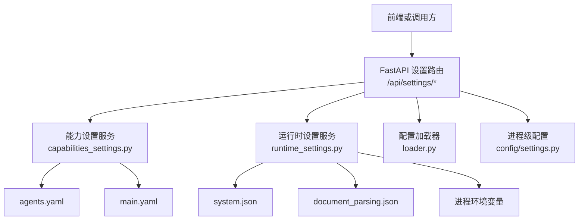

**图示来源**
- [deeptutor/api/routers/settings.py:957-975](file://deeptutor/api/routers/settings.py#L957-L975)
- [deeptutor/services/config/capabilities_settings.py:311-321](file://deeptutor/services/config/capabilities_settings.py#L311-L321)
- [deeptutor/services/config/runtime_settings.py:554-627](file://deeptutor/services/config/runtime_settings.py#L554-L627)
- [deeptutor/services/config/loader.py:111-148](file://deeptutor/services/config/loader.py#L111-L148)
- [deeptutor/config/settings.py:27-50](file://deeptutor/config/settings.py#L27-L50)

**章节来源**
- [deeptutor/api/routers/settings.py:1-120](file://deeptutor/api/routers/settings.py#L1-L120)
- [deeptutor/services/config/capabilities_settings.py:1-21](file://deeptutor/services/config/capabilities_settings.py#L1-L21)
- [deeptutor/services/config/runtime_settings.py:16-89](file://deeptutor/services/config/runtime_settings.py#L16-L89)
- [deeptutor/services/config/loader.py:19-27](file://deeptutor/services/config/loader.py#L19-L27)
- [deeptutor/config/settings.py:1-13](file://deeptutor/config/settings.py#L1-L13)

## 核心组件
- 设置路由模块：统一暴露 UI 设置、模型目录、网络、附件策略、文档解析、预设与配置档案等接口。
- 能力设置服务：将 UI 表单映射到 agents.yaml 与 main.yaml，提供 GET/PUT 能力参数。
- 运行时设置服务：管理 system.json、auth.json、integrations.json、document_parsing.json 等，并应用环境变量覆盖。
- 配置加载器：读取 YAML 配置、注入运行时路径、解析语言与能力参数。
- 进程级配置：通过 pydantic-settings 从环境变量加载 LLM 重试等全局配置。

**章节来源**
- [deeptutor/api/routers/settings.py:957-1117](file://deeptutor/api/routers/settings.py#L957-L1117)
- [deeptutor/services/config/capabilities_settings.py:311-446](file://deeptutor/services/config/capabilities_settings.py#L311-L446)
- [deeptutor/services/config/runtime_settings.py:554-763](file://deeptutor/services/config/runtime_settings.py#L554-L763)
- [deeptutor/services/config/loader.py:202-385](file://deeptutor/services/config/loader.py#L202-L385)
- [deeptutor/config/settings.py:19-50](file://deeptutor/config/settings.py#L19-L50)

## 架构总览
设置 API 的核心交互流程如下：

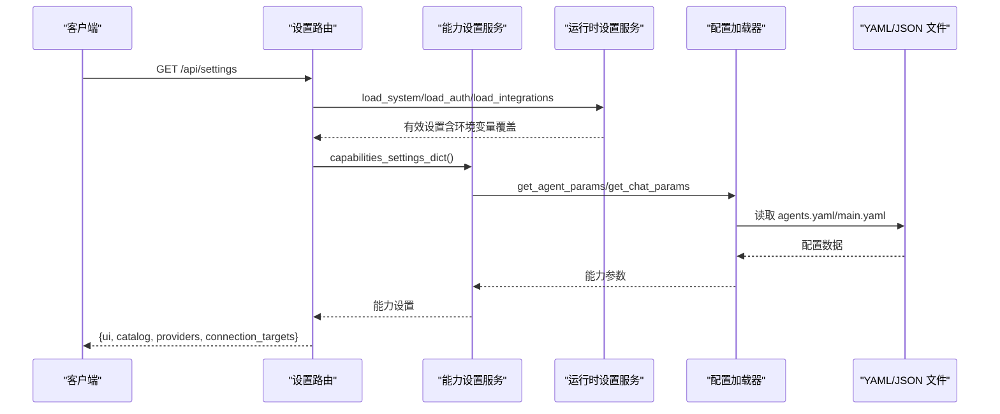

**图示来源**
- [deeptutor/api/routers/settings.py:957-975](file://deeptutor/api/routers/settings.py#L957-L975)
- [deeptutor/services/config/capabilities_settings.py:311-321](file://deeptutor/services/config/capabilities_settings.py#L311-L321)
- [deeptutor/services/config/loader.py:202-385](file://deeptutor/services/config/loader.py#L202-L385)
- [deeptutor/services/config/runtime_settings.py:554-627](file://deeptutor/services/config/runtime_settings.py#L554-L627)

## 详细组件分析

### 用户界面设置（UI Settings）
- 公开只读端点：GET /api/settings/ui（在认证前可用，仅返回非敏感 UI 偏好）。
- 读写端点：GET/PUT /api/settings（管理员可获取完整 UI + 模型目录；普通用户仅 UI）。
- 字段包括主题、语言、响应语言、侧边栏描述与导航顺序、代码块显示选项、内容字体缩放与行距、语音自动播放、数学朗读、聊天超时等。
- 写入采用原子更新，避免并发丢失。

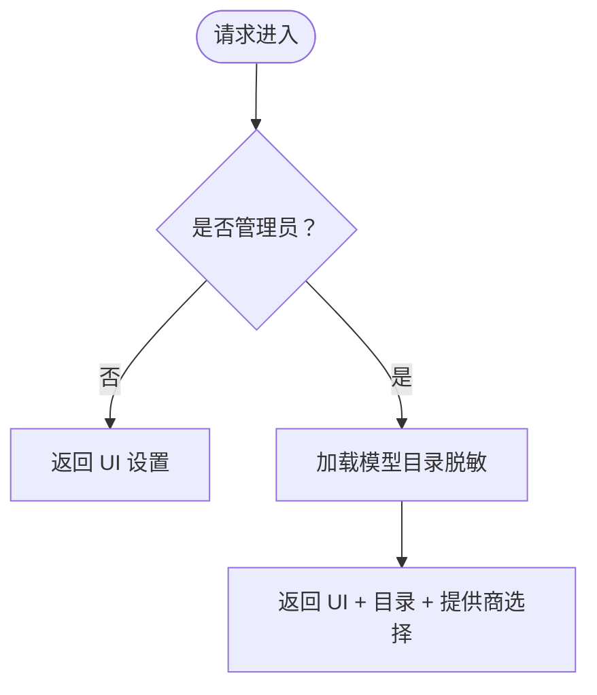

**图示来源**
- [deeptutor/api/routers/settings.py:957-975](file://deeptutor/api/routers/settings.py#L957-L975)

**章节来源**
- [deeptutor/api/routers/settings.py:146-243](file://deeptutor/api/routers/settings.py#L146-L243)
- [deeptutor/api/routers/settings.py:566-612](file://deeptutor/api/routers/settings.py#L566-L612)
- [deeptutor/api/routers/settings.py:957-975](file://deeptutor/api/routers/settings.py#L957-L975)

### 能力参数设置（Capabilities Settings）
- 端点：GET/PUT /api/capabilities/settings。
- 数据来源：
  - agents.yaml：LLM 参数（temperature、max_tokens）与分阶段预算。
  - main.yaml：运行时参数（如 solve 的 max_rounds/max_replans、research 的 researching.*、question 的 exploring.*）。
- 写回时按 schema 拆分至对应文件，未知键丢弃，数值经 coerce/clamp 保护。

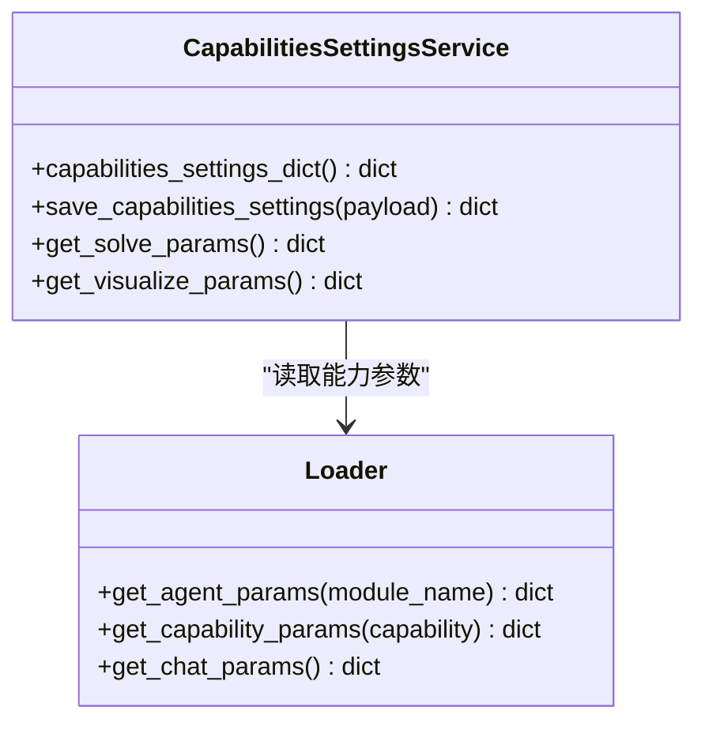

**图示来源**
- [deeptutor/services/config/capabilities_settings.py:311-446](file://deeptutor/services/config/capabilities_settings.py#L311-L446)
- [deeptutor/services/config/loader.py:202-385](file://deeptutor/services/config/loader.py#L202-L385)

**章节来源**
- [deeptutor/services/config/capabilities_settings.py:41-101](file://deeptutor/services/config/capabilities_settings.py#L41-L101)
- [deeptutor/services/config/capabilities_settings.py:188-237](file://deeptutor/services/config/capabilities_settings.py#L188-L237)
- [deeptutor/services/config/capabilities_settings.py:327-446](file://deeptutor/services/config/capabilities_settings.py#L327-L446)

### 运行时设置（System/Auth/Integrations/Document Parsing）
- 运行时设置服务提供 load/save 方法族，涵盖：
  - system.json：后端端口、前端端口、CORS、附件大小、安全守卫等。
  - auth.json：基础认证开关、用户名、密码哈希、Cookie 安全等。
  - integrations.json：PocketBase、Redis 转协调等集成配置。
  - document_parsing.json：多引擎解析配置（text_only/mineru/docling/markitdown/pymupdf4llm/liteparse/tika）。
- 支持环境变量覆盖，区分“由设置文件派生”和“外部部署覆盖”。

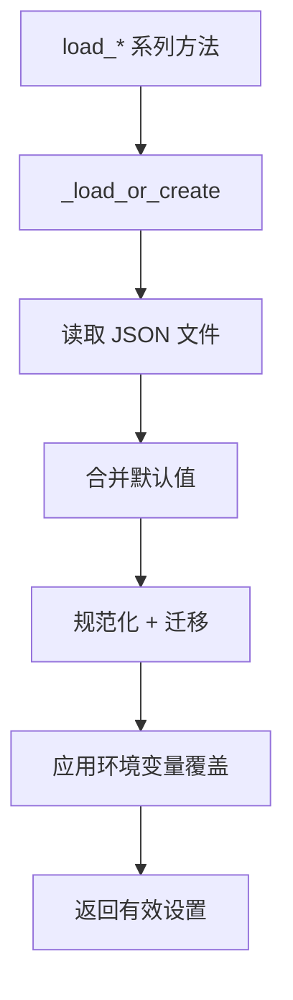

**图示来源**
- [deeptutor/services/config/runtime_settings.py:554-627](file://deeptutor/services/config/runtime_settings.py#L554-L627)
- [deeptutor/services/config/runtime_settings.py:862-878](file://deeptutor/services/config/runtime_settings.py#L862-L878)
- [deeptutor/services/config/runtime_settings.py:901-1010](file://deeptutor/services/config/runtime_settings.py#L901-L1010)

**章节来源**
- [deeptutor/services/config/runtime_settings.py:16-89](file://deeptutor/services/config/runtime_settings.py#L16-L89)
- [deeptutor/services/config/runtime_settings.py:554-763](file://deeptutor/services/config/runtime_settings.py#L554-L763)
- [deeptutor/services/config/runtime_settings.py:1189-1245](file://deeptutor/services/config/runtime_settings.py#L1189-L1245)

### 网络与安全设置
- GET/PUT /api/settings/network：读取与更新后端/前端端口、公共 API Base、CORS 源。
- GET/PUT /api/settings/chat-attachments：读取与更新聊天附件大小与字符预算，返回有效字节数与 WebSocket 帧上限。
- 安全守卫（security_guard）：速率限制、可信代理、白名单/黑名单等，可通过环境变量覆盖。

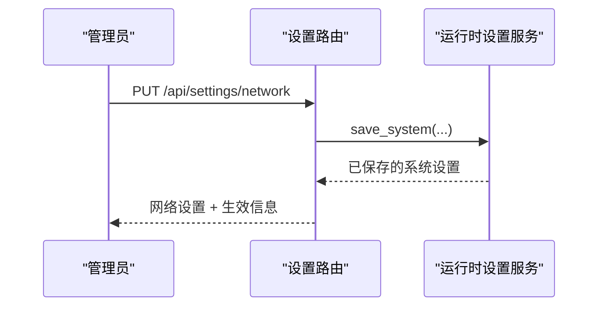

**图示来源**
- [deeptutor/api/routers/settings.py:1096-1117](file://deeptutor/api/routers/settings.py#L1096-L1117)
- [deeptutor/services/config/runtime_settings.py:1349-1434](file://deeptutor/services/config/runtime_settings.py#L1349-L1434)

**章节来源**
- [deeptutor/api/routers/settings.py:1120-1200](file://deeptutor/api/routers/settings.py#L1120-L1200)
- [deeptutor/services/config/runtime_settings.py:901-947](file://deeptutor/services/config/runtime_settings.py#L901-L947)

### 文档解析引擎设置
- GET/PUT /api/settings/document-parsing：切换活跃引擎、编辑各引擎切片、控制图片说明模型与图片标题。
- GET/POST /api/settings/document-parsing/test：引擎就绪性检查（含远程连通性）。
- GET/POST /api/settings/document-parsing/install 与 models/download：安装包与模型权重下载任务。
- GET /api/settings/mineru：MinerU 专用设置与本地 CLI 探测。

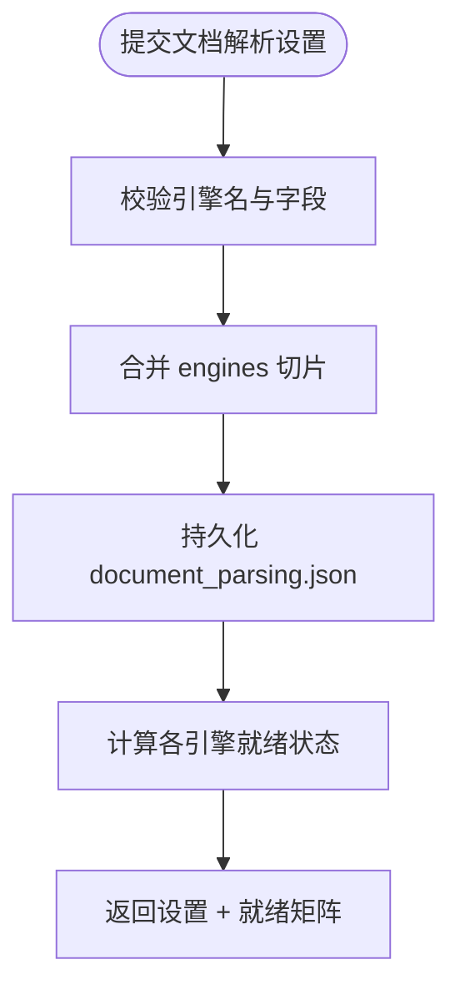

**图示来源**
- [deeptutor/api/routers/settings.py:1417-1463](file://deeptutor/api/routers/settings.py#L1417-L1463)
- [deeptutor/api/routers/settings.py:1466-1599](file://deeptutor/api/routers/settings.py#L1466-L1599)
- [deeptutor/services/config/runtime_settings.py:1189-1245](file://deeptutor/services/config/runtime_settings.py#L1189-L1245)

**章节来源**
- [deeptutor/api/routers/settings.py:1203-1281](file://deeptutor/api/routers/settings.py#L1203-L1281)
- [deeptutor/api/routers/settings.py:1284-1321](file://deeptutor/api/routers/settings.py#L1284-L1321)
- [deeptutor/services/config/runtime_settings.py:1247-1347](file://deeptutor/services/config/runtime_settings.py#L1247-L1347)

### 模型目录与提供商配置
- GET /api/settings/catalog：管理员可读模型目录（密钥脱敏）。
- 提供商选择与连接目标：GET /api/settings 返回 providers 与 connection_targets，用于前端下拉与预填。
- Codex OAuth 生命周期：start/status/complete/cancel/logout 以及 reasoning-effort 更新。
- CodeBuddy OAuth：status/start/cancel/logout。

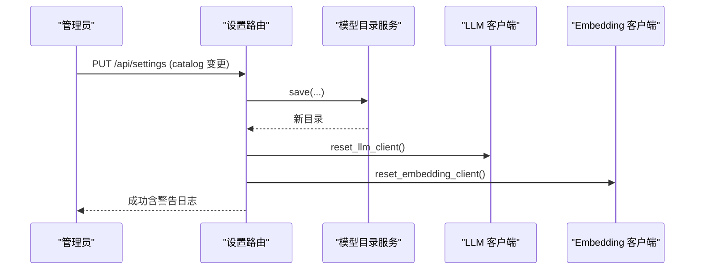

**图示来源**
- [deeptutor/api/routers/settings.py:510-563](file://deeptutor/api/routers/settings.py#L510-L563)
- [deeptutor/api/routers/settings.py:1090-1093](file://deeptutor/api/routers/settings.py#L1090-L1093)

**章节来源**
- [deeptutor/api/routers/settings.py:657-902](file://deeptutor/api/routers/settings.py#L657-L902)
- [deeptutor/api/routers/settings.py:978-1087](file://deeptutor/api/routers/settings.py#L978-L1087)

## 依赖关系分析
- 路由层依赖：
  - multi_user.context：当前用户身份与管理员判断。
  - services.config：模型目录、运行时设置、设置草稿、预设、能力设置、就绪性检查等。
  - services.llm/embedding：客户端重置以应用新目录。
  - services.settings.interface_settings：UI 设置默认值、语言与工具启用列表。
- 服务层依赖：
  - loader：YAML 配置加载、路径注入、能力参数读取。
  - runtime_settings：JSON 配置加载、规范化、环境变量覆盖、导出。
  - config_manager：main.yaml 读写（能力设置服务使用）。

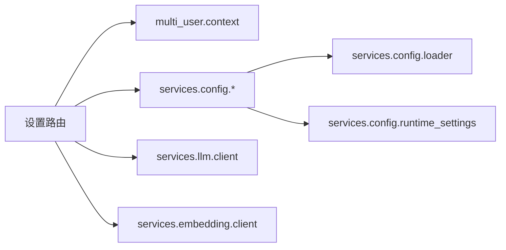

**图示来源**
- [deeptutor/api/routers/settings.py:25-90](file://deeptutor/api/routers/settings.py#L25-L90)
- [deeptutor/services/config/capabilities_settings.py:31-36](file://deeptutor/services/config/capabilities_settings.py#L31-L36)
- [deeptutor/services/config/runtime_settings.py:10-14](file://deeptutor/services/config/runtime_settings.py#L10-L14)

**章节来源**
- [deeptutor/api/routers/settings.py:25-90](file://deeptutor/api/routers/settings.py#L25-L90)
- [deeptutor/services/config/capabilities_settings.py:31-36](file://deeptutor/services/config/capabilities_settings.py#L31-L36)
- [deeptutor/services/config/runtime_settings.py:10-14](file://deeptutor/services/config/runtime_settings.py#L10-L14)

## 性能与热重载特性
- 热重载：
  - 附件策略与图片重注入数量在每次消息时重新读取，无需重启。
  - 模型目录 Apply 后重置 LLM/Embedding 客户端，使新配置立即生效。
- 限制与注意事项：
  - WebSocket 帧上限在进程启动时固定；增大附件总量后需重启后端才能允许更大上传。
  - 并行写入 UI 设置通过原子更新避免丢失。

**章节来源**
- [deeptutor/services/config/runtime_settings.py:1526-1578](file://deeptutor/services/config/runtime_settings.py#L1526-L1578)
- [deeptutor/api/routers/settings.py:510-563](file://deeptutor/api/routers/settings.py#L510-L563)
- [deeptutor/api/routers/settings.py:592-612](file://deeptutor/api/routers/settings.py#L592-L612)

## 配置验证、默认值与环境变量映射
- 验证：
  - Pydantic 模型对 UI 设置、网络设置、附件策略、文档解析等进行类型与范围校验。
  - 能力设置服务对 temperature、max_tokens、stage budgets、迭代次数等进行 coerce/clamp。
- 默认值：
  - DEFAULT_SYSTEM_SETTINGS、DEFAULT_AUTH_SETTINGS、DEFAULT_DOCUMENT_PARSING_SETTINGS 等定义默认结构。
  - loader 中 DEFAULT_CHAT_PARAMS、DEFAULT_QUESTION_PARAMS、DEFAULT_RESEARCH_PARAMS 等定义能力默认。
- 环境变量映射：
  - runtime_settings 中 _apply_*_process_overrides 将 DEEPTUTOR_*、BACKEND_PORT、AUTH_*、MINERU_*、DOCLING_*、TIKA_* 等映射到 JSON 设置。
  - config/settings.py 通过 pydantic-settings 从 LLM_RETRY_* 环境变量加载 LLM 重试配置。

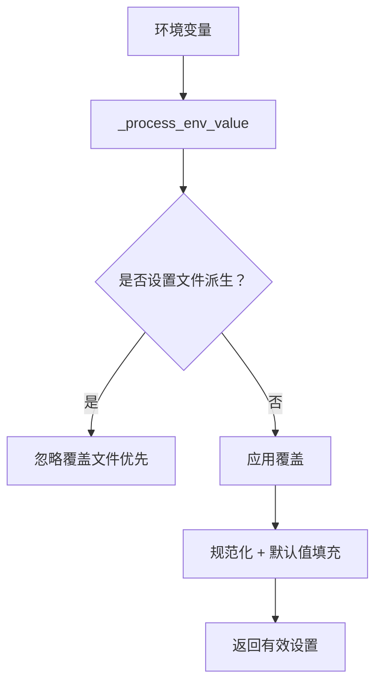

**图示来源**
- [deeptutor/services/config/runtime_settings.py:844-860](file://deeptutor/services/config/runtime_settings.py#L844-L860)
- [deeptutor/services/config/runtime_settings.py:901-1010](file://deeptutor/services/config/runtime_settings.py#L901-L1010)
- [deeptutor/config/settings.py:27-50](file://deeptutor/config/settings.py#L27-L50)

**章节来源**
- [deeptutor/services/config/runtime_settings.py:419-439](file://deeptutor/services/config/runtime_settings.py#L419-L439)
- [deeptutor/services/config/runtime_settings.py:844-860](file://deeptutor/services/config/runtime_settings.py#L844-L860)
- [deeptutor/services/config/runtime_settings.py:901-1010](file://deeptutor/services/config/runtime_settings.py#L901-L1010)
- [deeptutor/config/settings.py:19-50](file://deeptutor/config/settings.py#L19-L50)

## 批量操作、备份与恢复
- 批量操作：
  - PUT /api/capabilities/settings：一次性更新多个能力的 LLM 参数与运行时参数。
  - PUT /api/settings/document-parsing：批量更新 engines 切片与全局 image_caption/image_description_model。
- 备份与恢复：
  - GET /api/settings/profile：导出无凭据的有效设置档案。
  - POST /api/settings/profile/diff：预览导入档案的差异，不改变有效设置。
  - GET/POST /api/settings/presets：列出预设并将预设合并到未应用的设置草稿中。

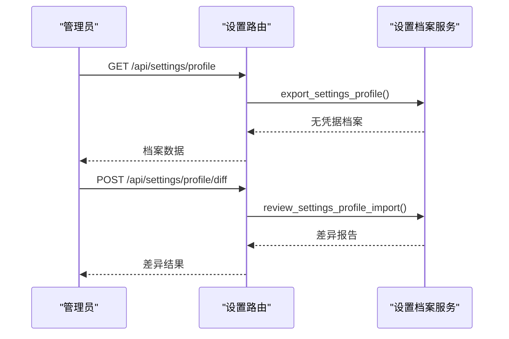

**图示来源**
- [deeptutor/api/routers/settings.py:1340-1356](file://deeptutor/api/routers/settings.py#L1340-L1356)
- [deeptutor/api/routers/settings.py:1359-1414](file://deeptutor/api/routers/settings.py#L1359-L1414)

**章节来源**
- [deeptutor/services/config/capabilities_settings.py:424-446](file://deeptutor/services/config/capabilities_settings.py#L424-L446)
- [deeptutor/api/routers/settings.py:1340-1414](file://deeptutor/api/routers/settings.py#L1340-L1414)

## 安全注意事项与最佳实践
- 权限控制：
  - 模型目录、网络、附件策略、文档解析等写操作要求管理员。
  - Codex OAuth 生命周期仅限个人用户，伙伴账户被拒绝。
- 密钥处理：
  - 模型目录与 MinerU/Docling 设置中的 api_token 在 GET 时脱敏或仅返回布尔标记。
  - 设置档案导出移除凭据与部署值。
- 环境变量优先级：
  - 外部部署环境变量优先于设置文件；但“由设置文件派生”的变量不被覆盖，保证文件权威。
- 建议：
  - 使用预设与草稿流程进行变更评审，再 Apply。
  - 谨慎调整附件大小与 WS 帧上限，必要时重启后端。
  - 在生产环境关闭不必要的网络边界（如版本检查），并通过受信任代理配置安全守卫。

**章节来源**
- [deeptutor/api/routers/settings.py:615-654](file://deeptutor/api/routers/settings.py#L615-L654)
- [deeptutor/api/routers/settings.py:1203-1281](file://deeptutor/api/routers/settings.py#L1203-L1281)
- [deeptutor/services/config/runtime_settings.py:816-842](file://deeptutor/services/config/runtime_settings.py#L816-L842)

## 故障排查指南
- 文件系统访问被拒：
  - Apply 模型目录时若权限不足，返回 503 并提示检查服务账户权限与文件锁定。
- 模型目录重复重置导致冷启动循环：
  - 通过上下文管理器仅在目录实际变化时重置客户端，避免冗余重置。
- 文档解析引擎不可用：
  - 使用 /api/settings/document-parsing/test 与 /api/settings/document-parsing/job/status 诊断安装与模型下载状态。
- 测试参考：
  - 单元测试覆盖 UI 设置合并、MinerU 本地模式探测、目录更新与 Codex 推理级别约束等场景。

**章节来源**
- [deeptutor/api/routers/settings.py:534-563](file://deeptutor/api/routers/settings.py#L534-L563)
- [deeptutor/api/routers/settings.py:1466-1599](file://deeptutor/api/routers/settings.py#L1466-L1599)
- [tests/api/test_settings_router.py:142-165](file://tests/api/test_settings_router.py#L142-L165)
- [tests/api/test_settings_router.py:565-596](file://tests/api/test_settings_router.py#L565-L596)

## 结论
DeepTutor 的设置管理 API 通过清晰的分层与严格的校验机制，提供了完整的系统配置、用户偏好、LLM 提供商与能力开关管理能力。其设计强调：
- 明确的职责分离：路由层负责鉴权与序列化，服务层负责持久化与规范化，加载器负责 YAML 与路径注入。
- 安全的默认值与环境变量覆盖：确保生产部署的可控性与灵活性。
- 热重载与兼容性：在不中断运行的前提下应用多数配置变更，并提供版本迁移与遗留兼容。
- 可审计与可恢复：通过设置档案与预设实现批量变更评审与恢复。

建议在运维与开发过程中遵循本文的最佳实践与安全注意事项，以确保系统的稳定性、安全性与可维护性。