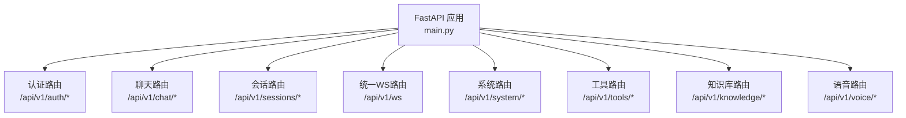
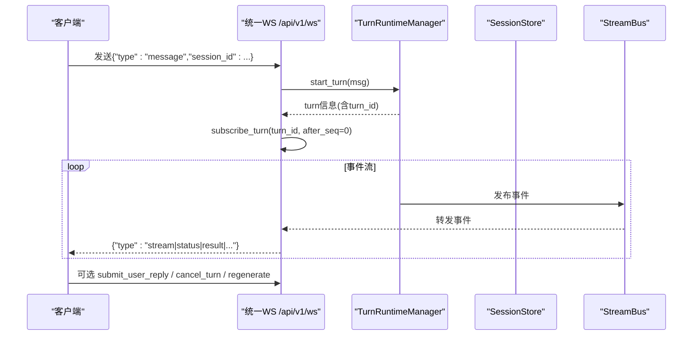
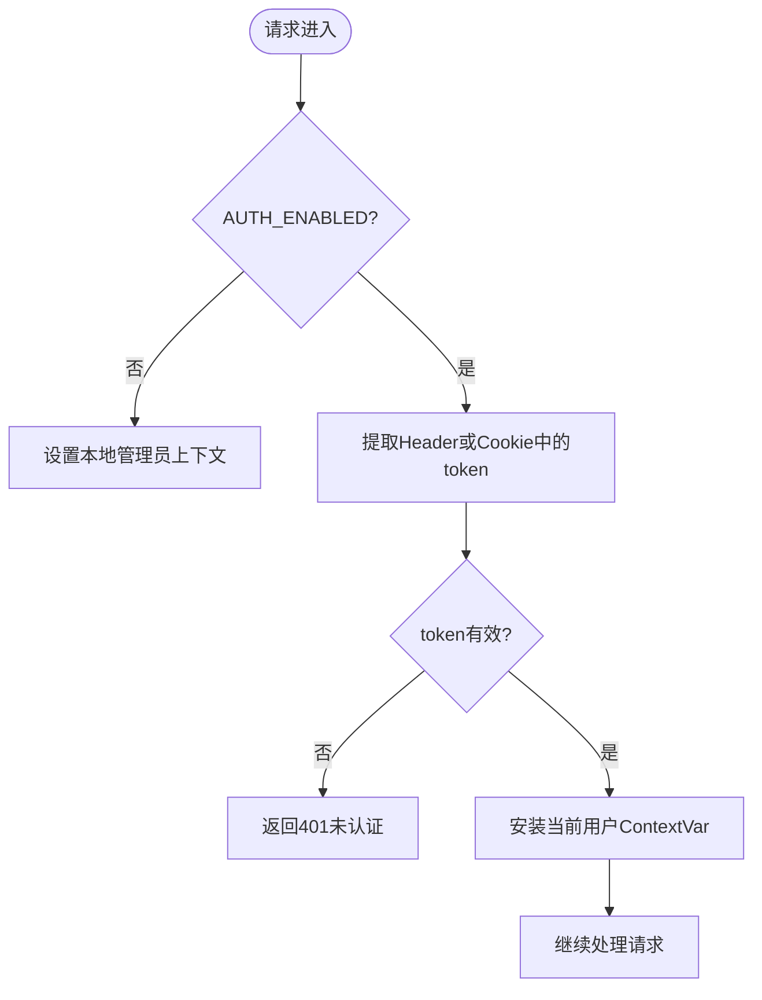
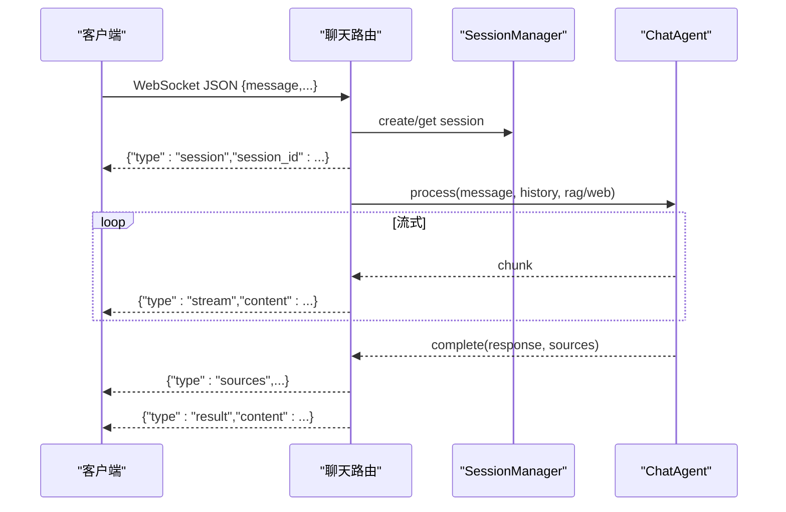
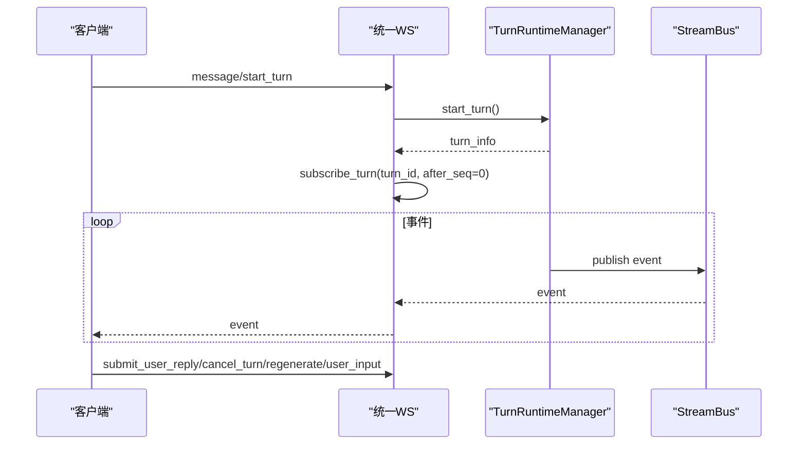
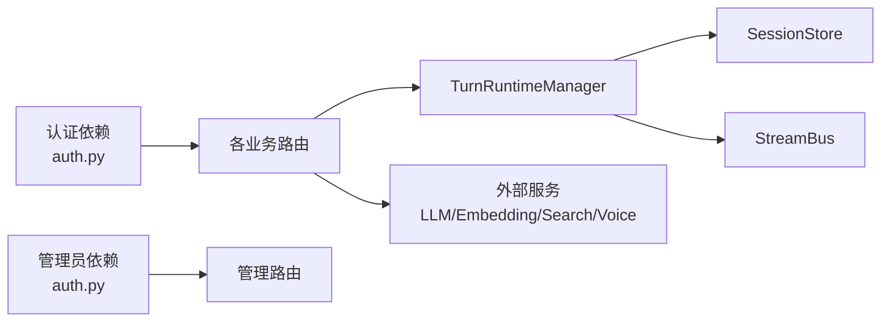

# API参考

<cite>
**本文引用的文件**
- [main.py](file://deeptutor/api/main.py)
- [auth.py](file://deeptutor/api/routers/auth.py)
- [chat.py](file://deeptutor/api/routers/chat.py)
- [sessions.py](file://deeptutor/api/routers/sessions.py)
- [unified_ws.py](file://deeptutor/api/routers/unified_ws.py)
- [system.py](file://deeptutor/api/routers/system.py)
- [tools.py](file://deeptutor/api/routers/tools.py)
- [knowledge.py](file://deeptutor/api/routers/knowledge.py)
- [voice.py](file://deeptutor/api/routers/voice.py)
- [errors.py](file://deeptutor/core/errors.py)
</cite>

## 目录
1. [简介](#简介)
2. [项目结构](#项目结构)
3. [核心组件](#核心组件)
4. [架构总览](#架构总览)
5. [详细组件分析](#详细组件分析)
6. [依赖关系分析](#依赖关系分析)
7. [性能考虑](#性能考虑)
8. [故障排查指南](#故障排查指南)
9. [结论](#结论)
10. [附录](#附录)

## 简介
本参考文档面向DeepTutor后端API，覆盖REST与WebSocket两类接口，说明认证授权、会话管理、流式响应、事件订阅、错误处理与重试策略、版本管理与兼容性、性能优化与最佳实践，以及客户端集成要点。所有端点均基于FastAPI路由组织，统一在应用启动时挂载并受CORS与访问日志中间件保护。

## 项目结构
- 应用入口与生命周期：应用实例创建、CORS配置、静态输出目录挂载、路由集中注册、启动/关闭钩子（LLM/事件总线/合作伙伴/定时任务/MCP连接等）。
- 路由模块：按功能划分，包括认证、聊天、会话、系统、工具、知识库、语音、统一WebSocket等。
- 多用户与安全：统一的认证依赖（HTTP Cookie或Bearer Token），WebSocket通过查询参数或Cookie鉴权；管理员权限控制用于敏感操作。
- 版本化：所有业务路由以“/api/v1”为前缀，便于未来演进与兼容。

**图表来源**
- [main.py:248-498](file://deeptutor/api/main.py#L248-L498)

**章节来源**
- [main.py:248-498](file://deeptutor/api/main.py#L248-L498)

## 核心组件
- 认证与授权
  - HTTP：支持Authorization: Bearer与Cookie（dt_token）两种方式；启用认证时未提供有效令牌返回401。
  - WebSocket：通过查询参数token或Cookie鉴权，失败则关闭连接（4001）。
  - 管理员：require_admin依赖限制部分管理接口仅admin可调用。
- 会话管理
  - REST：列出、获取、重命名、删除会话；消息级删除与测验结果记录。
  - 流式：聊天与统一WS均支持流式事件推送。
- 统一WebSocket
  - 单端点/api/v1/ws，支持turn级与session级事件订阅、重连恢复、取消执行、再生成、用户回复注入等。
- 系统与健康检查
  - 运行时拓扑、系统状态、LLM/Embeddings/Search连通性测试。
- 工具列表
  - 只读列出内置工具定义、提示词与开关状态，供设置页渲染。
- 知识库
  - 知识基线CRUD、文件上传、索引初始化、进度追踪、安全校验与大小限制。
- 语音
  - TTS文本转语音、STT语音转文本，封装外部提供商错误。

**章节来源**
- [auth.py:237-348](file://deeptutor/api/routers/auth.py#L237-L348)
- [sessions.py:80-231](file://deeptutor/api/routers/sessions.py#L80-L231)
- [unified_ws.py:44-325](file://deeptutor/api/routers/unified_ws.py#L44-L325)
- [system.py:30-323](file://deeptutor/api/routers/system.py#L30-L323)
- [tools.py:169-223](file://deeptutor/api/routers/tools.py#L169-L223)
- [knowledge.py:1-800](file://deeptutor/api/routers/knowledge.py#L1-L800)
- [voice.py:78-131](file://deeptutor/api/routers/voice.py#L78-L131)

## 架构总览
DeepTutor API采用分层设计：
- 接入层：FastAPI路由与中间件（CORS、访问日志）。
- 认证层：统一依赖解析JWT/Cookie，设置当前用户上下文。
- 业务层：各功能路由（聊天、会话、系统、工具、知识库、语音）。
- 服务层：会话存储、Turn运行期、RAG、LLM/Embedding/Search、语音提供商等。
- 基础设施：事件总线、定时任务、MCP、Partner、PocketBase等。

**图表来源**
- [unified_ws.py:113-134](file://deeptutor/api/routers/unified_ws.py#L113-L134)
- [unified_ws.py:79-100](file://deeptutor/api/routers/unified_ws.py#L79-L100)

## 详细组件分析

### 认证与授权（/api/v1/auth）
- 公开端点
  - GET /api/v1/auth/status：返回认证是否启用、当前请求是否已认证及用户基本信息。
  - POST /api/v1/auth/login：登录，成功设置Cookie（dt_token）。
  - POST /api/v1/auth/logout：清除Cookie。
  - POST /api/v1/auth/register：首次用户注册（受部署模式限制）。
  - GET /api/v1/auth/is_first_user：是否首个用户。
  - GET /api/v1/auth/openai-codex/callback：Codex OAuth回调。
- 受保护端点
  - GET /api/v1/auth/profile：当前用户资料。
  - PUT /api/v1/auth/profile：更新头像标记。
  - PUT /api/v1/auth/profile/avatar：上传头像（非PocketBase模式）。
  - DELETE /api/v1/auth/profile/avatar：删除头像。
  - GET /api/v1/auth/avatar/{user_id}：读取头像图片。
  - 管理端点：GET/POST /api/v1/auth/users、角色管理等（需admin）。
- 认证方式
  - HTTP：Authorization: Bearer <token> 或 Cookie dt_token。
  - WebSocket：query token 或 Cookie dt_token。
- 权限控制
  - require_auth：普通认证依赖。
  - require_admin：管理员依赖，非admin返回403。

**图表来源**
- [auth.py:237-284](file://deeptutor/api/routers/auth.py#L237-L284)

**章节来源**
- [auth.py:86-182](file://deeptutor/api/routers/auth.py#L86-L182)
- [auth.py:373-571](file://deeptutor/api/routers/auth.py#L373-L571)
- [auth.py:574-800](file://deeptutor/api/routers/auth.py#L574-L800)

### 聊天（/api/v1/chat）
- REST会话管理
  - GET /api/v1/chat/sessions：列出会话（默认不含消息）。
  - GET /api/v1/chat/sessions/{session_id}：获取会话详情。
  - DELETE /api/v1/chat/sessions/{session_id}：删除会话。
- WebSocket实时聊天
  - WS /api/v1/chat：接收消息，自动创建/复用会话，流式返回片段与最终结果，支持RAG与网页搜索状态上报。
  - 消息格式：包含language、message、session_id、history、kb_name、enable_rag、enable_web_search等字段。
  - 事件类型：session、status、stream、sources、result、error。

**图表来源**
- [chat.py:34-51](file://deeptutor/api/routers/chat.py#L34-L51)
- [chat.py:59-250](file://deeptutor/api/routers/chat.py#L59-L250)

**章节来源**
- [chat.py:34-51](file://deeptutor/api/routers/chat.py#L34-L51)
- [chat.py:59-250](file://deeptutor/api/routers/chat.py#L59-L250)

### 统一WebSocket（/api/v1/ws）
- 单端点统一交互，支持：
  - 开始新轮次：{"type":"message"|"start_turn", ...}
  - 订阅轮次：{"type":"subscribe_turn","turn_id":...,"after_seq":0}
  - 订阅会话：{"type":"subscribe_session","session_id":...,"after_seq":0}
  - 重连恢复：{"type":"resume_from","turn_id":...,"seq":...}
  - 取消订阅：{"type":"unsubscribe",...}
  - 取消执行：{"type":"cancel_turn","turn_id":...}
  - 提交用户回复：{"type":"submit_user_reply","turn_id":...,"text"|answers}
  - 重新生成：{"type":"regenerate","session_id":...,"overrides":{...}}
  - 用户输入：{"type":"user_input","turn_id":...,"content":...}
  - 心跳：{"type":"ping"} -> {"type":"pong"}
- 事件流：服务端通过TurnRuntimeManager订阅并转发事件至客户端，支持断线后按after_seq/seq恢复。

**图表来源**
- [unified_ws.py:44-325](file://deeptutor/api/routers/unified_ws.py#L44-L325)

**章节来源**
- [unified_ws.py:44-325](file://deeptutor/api/routers/unified_ws.py#L44-L325)

### 会话历史（/api/v1/sessions）
- GET /api/v1/sessions：分页列出会话。
- GET /api/v1/sessions/{session_id}：获取会话与消息（对超大事件负载进行截断）。
- PATCH /api/v1/sessions/{session_id}：重命名会话。
- DELETE /api/v1/sessions/{session_id}：删除会话（清理附件）。
- PUT /api/v1/sessions/{session_id}/branch-selection：保存分支选择偏好。
- DELETE /api/v1/sessions/{session_id}/messages/{message_id}：按消息ID删除回合（若正在运行返回冲突）。
- POST /api/v1/sessions/{session_id}/quiz-results：记录测验结果并写入会话。

**章节来源**
- [sessions.py:80-231](file://deeptutor/api/routers/sessions.py#L80-L231)

### 系统与健康（/api/v1/system）
- GET /api/v1/system/runtime-topology：描述主运行时拓扑与兼容路由。
- GET /api/v1/system/status：系统状态（后端、LLM、Embeddings、Search）。
- POST /api/v1/system/test/llm：测试LLM连通性。
- POST /api/v1/system/test/embeddings：测试Embeddings连通性。
- POST /api/v1/system/test/search：测试Search连通性。

**章节来源**
- [system.py:30-323](file://deeptutor/api/routers/system.py#L30-L323)

### 工具列表（/api/v1/tools）
- GET /api/v1/tools：列出内置工具定义、国际化提示、别名、开关状态与能力归属，供设置页面展示。

**章节来源**
- [tools.py:169-223](file://deeptutor/api/routers/tools.py#L169-L223)

### 知识库（/api/v1/knowledge）
- 提供知识基线的创建、列举、删除、链接文件夹、文件上传、初始化与进度追踪等能力。
- 关键特性：
  - 文件上传安全校验（扩展名、大小、Zip Slip防护）。
  - 异步任务与进度广播（task_id、阶段、百分比、日志）。
  - 提供者一致性校验与就绪检查（PageIndex/GraphRAG/LightRAG）。
  - 多用户读写权限控制与默认知识库别名解析。
- 注意：不同提供者对文件格式有差异限制，前端应依据返回的SupportedFileTypesInfo进行约束。

**章节来源**
- [knowledge.py:1-800](file://deeptutor/api/routers/knowledge.py#L1-L800)

### 语音（/api/v1/voice）
- POST /api/v1/voice/tts：文本转语音，返回音频流（自动将PCM包装为WAV）。
- POST /api/v1/voice/stt：语音转文本，支持语言参数，限制最大音频大小。

**章节来源**
- [voice.py:78-131](file://deeptutor/api/routers/voice.py#L78-L131)

## 依赖关系分析
- 路由依赖
  - 所有业务路由（除认证公开端点）通过Depends(require_auth)强制认证。
  - 管理路由通过Depends(require_admin)限制管理员。
- 运行时依赖
  - TurnRuntimeManager负责turn生命周期、事件分发与取消。
  - SessionStore持久化会话与消息。
  - StreamBus用于turn内用户输入与暂停恢复。
- 外部服务
  - LLM/Embedding/Search/语音提供商通过配置加载，健康检查接口可用于运维探测。

**图表来源**
- [main.py:372-498](file://deeptutor/api/main.py#L372-L498)
- [auth.py:237-348](file://deeptutor/api/routers/auth.py#L237-L348)

**章节来源**
- [main.py:372-498](file://deeptutor/api/main.py#L372-L498)
- [auth.py:237-348](file://deeptutor/api/routers/auth.py#L237-L348)

## 性能考虑
- 流式传输
  - 聊天与统一WS均采用流式事件推送，避免长轮询阻塞。
  - 统一WS使用safe_send确保单个不可序列化值不会污染整个通道。
- 大负载保护
  - 会话消息的事件负载进行截断，防止UI卡顿。
  - 知识库上传限制文件大小与压缩包大小，避免内存溢出。
- 并发与I/O
  - 知识库上传在独立线程执行，避免阻塞事件循环。
  - 启动时预初始化LLM客户端与事件总线，减少冷启动延迟。
- CORS与静态资源
  - 动态构建CORS白名单，生产环境严格模式；静态输出目录通过安全过滤暴露。

[本节为通用指导，不直接分析具体文件]

## 故障排查指南
- 常见错误码
  - 401：未认证或令牌无效（认证依赖抛出）。
  - 403：无管理员权限（require_admin抛出）。
  - 404：资源不存在（会话、头像、知识库等）。
  - 409：冲突（如删除正在运行的消息、用户名重复）。
  - 413：请求体过大（头像、音频上传）。
  - 415：不支持的媒体类型（头像格式）。
- 诊断步骤
  - 使用/api/v1/system/status与test/*接口验证后端与各服务连通性。
  - 通过统一WS的active_turn_info检查是否存在残留running状态。
  - 查看会话消息中的events与sources定位RAG/搜索来源。
  - 关注日志中“Configuration Drift Detected”提示，确保工具清单与注册表一致。
- 错误分类
  - 基础异常类：DeepTutorError及其子类（配置、验证、服务、LLM相关）。
  - 服务层错误：VoiceProviderError等由具体服务抛出，路由层转换为HTTP状态码。

**章节来源**
- [errors.py:10-58](file://deeptutor/core/errors.py#L10-L58)
- [system.py:61-323](file://deeptutor/api/routers/system.py#L61-L323)
- [knowledge.py:230-458](file://deeptutor/api/routers/knowledge.py#L230-L458)
- [voice.py:78-131](file://deeptutor/api/routers/voice.py#L78-L131)

## 结论
DeepTutor API以FastAPI为核心，提供统一的REST与WebSocket接口，具备完善的认证授权、会话与流式事件机制、健壮的错误处理与性能保护措施。通过/api/v1前缀实现版本化管理，便于向后兼容与渐进升级。建议客户端优先使用统一WS进行实时交互，并结合REST接口完成会话与资源管理。

[本节为总结性内容，不直接分析具体文件]

## 附录

### 端点速查表（节选）
- 认证
  - GET /api/v1/auth/status
  - POST /api/v1/auth/login
  - POST /api/v1/auth/logout
  - POST /api/v1/auth/register
  - GET /api/v1/auth/is_first_user
  - GET /api/v1/auth/openai-codex/callback
  - GET/PUT/DELETE /api/v1/auth/profile*
  - GET /api/v1/auth/avatar/{user_id}
  - 管理：/api/v1/auth/users 等（需admin）
- 聊天
  - GET/DELETE /api/v1/chat/sessions*
  - WS /api/v1/chat
- 会话
  - GET/PATCH/DELETE /api/v1/sessions*
  - PUT /api/v1/sessions/{id}/branch-selection
  - DELETE /api/v1/sessions/{id}/messages/{mid}
  - POST /api/v1/sessions/{id}/quiz-results
- 统一WS
  - WS /api/v1/ws（message/start_turn/subscribe_turn/subscribe_session/resume_from/unsubscribe/cancel_turn/submit_user_reply/regenerate/user_input/ping）
- 系统
  - GET /api/v1/system/runtime-topology
  - GET /api/v1/system/status
  - POST /api/v1/system/test/llm|embeddings|search
- 工具
  - GET /api/v1/tools
- 知识库
  - 详见knowledge路由（CRUD、上传、初始化、进度）
- 语音
  - POST /api/v1/voice/tts
  - POST /api/v1/voice/stt

[本节为概览，不直接分析具体文件]

### 认证与授权流程
- HTTP
  - 登录成功后设置Cookie dt_token；后续请求携带该Cookie或Authorization: Bearer。
  - 未启用认证时，所有请求视为本地管理员。
- WebSocket
  - 连接时附带token（query或Cookie），鉴权通过后accept；否则关闭连接。
- 管理员
  - 需要管理员角色的接口通过require_admin依赖校验。

**章节来源**
- [auth.py:237-348](file://deeptutor/api/routers/auth.py#L237-L348)
- [auth.py:436-491](file://deeptutor/api/routers/auth.py#L436-L491)

### 会话管理与流式响应
- 会话创建与获取：聊天WS自动创建或复用；REST提供查询与删除。
- 流式事件：聊天WS与统一WS均支持chunk流式推送，最终返回完整结果与来源。
- 事件订阅：统一WS支持turn/session级别订阅，支持after_seq断线恢复。

**章节来源**
- [chat.py:59-250](file://deeptutor/api/routers/chat.py#L59-L250)
- [unified_ws.py:79-134](file://deeptutor/api/routers/unified_ws.py#L79-L134)

### 错误处理与重试策略
- 错误分类：配置错误、验证错误、服务错误、LLM上下文错误等。
- 重试建议
  - 网络抖动：指数退避重试（例如1s、2s、4s...），上限次数与超时时间由客户端控制。
  - 429/5xx：结合速率限制与熔断策略，避免雪崩。
  - 认证过期：捕获401后刷新令牌并重试一次。
  - 流式中断：统一WS支持resume_from，客户端应在断开后按last seq恢复订阅。
- 诊断：使用系统健康检查接口与日志定位问题。

**章节来源**
- [errors.py:10-58](file://deeptutor/core/errors.py#L10-L58)
- [system.py:61-323](file://deeptutor/api/routers/system.py#L61-L323)

### 版本管理与向后兼容性
- 版本前缀：所有业务路由以/api/v1开头，便于未来引入v2并保持兼容。
- 兼容路由：系统拓扑接口明确标注兼容路由与隔离子系统，便于迁移。
- 建议：客户端固定使用/api/v1，避免硬编码内部路径；新增字段保持可选以避免破坏旧客户端。

**章节来源**
- [main.py:372-498](file://deeptutor/api/main.py#L372-L498)
- [system.py:30-58](file://deeptutor/api/routers/system.py#L30-L58)

### 客户端集成指南与SDK使用说明
- 推荐协议
  - 实时交互：优先使用统一WS /api/v1/ws，利用事件流与重连恢复。
  - 资源管理：使用REST接口进行会话、知识库、工具、语音等资源操作。
- 认证
  - 登录后保存Cookie或使用Authorization头；WebSocket连接时附带token。
- 事件处理
  - 订阅turn/session，处理stream/status/result/sources/error等事件。
  - 心跳：定期发送ping，维护连接活性。
- 错误与重试
  - 捕获401/403/404/409/413/415等状态码，按策略重试或提示用户。
  - 流式中断后使用resume_from恢复。
- 示例调用路径（以路径引用代替代码）
  - 登录：POST /api/v1/auth/login
  - 开始对话：WS /api/v1/ws 发送{"type":"message",...}
  - 订阅事件：WS /api/v1/ws 发送{"type":"subscribe_turn","turn_id":...}
  - 会话列表：GET /api/v1/sessions
  - 上传知识库文件：POST /api/v1/knowledge/*（根据实际路由）
  - 语音合成：POST /api/v1/voice/tts
  - 语音识别：POST /api/v1/voice/stt

[本节为通用指导，不直接分析具体文件]