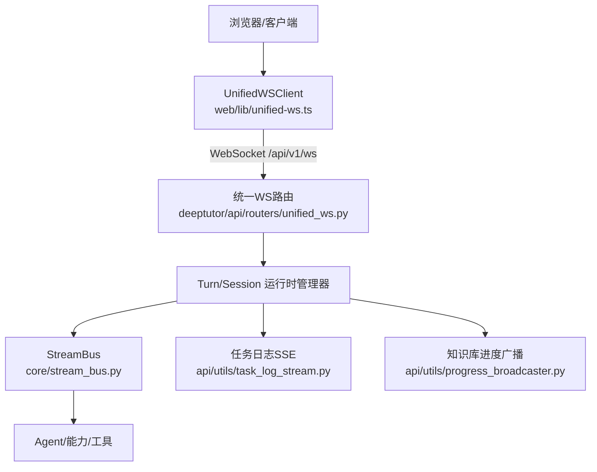
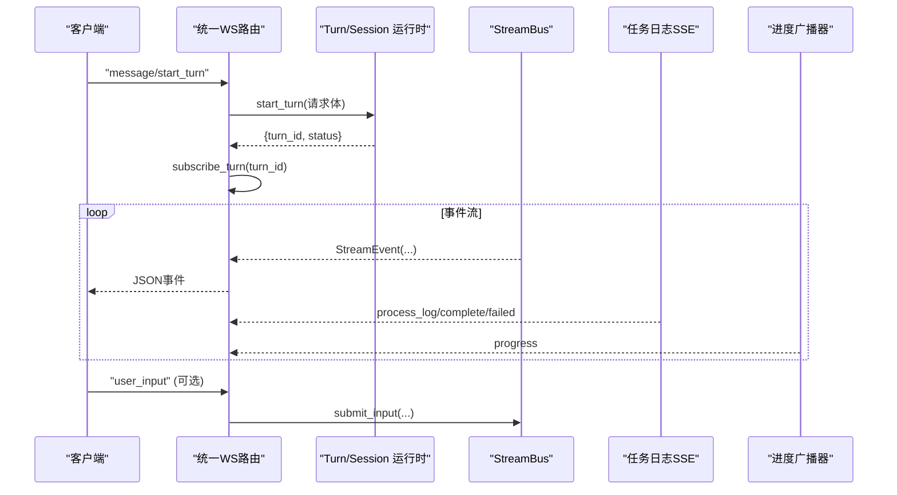
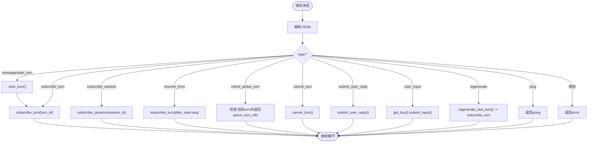
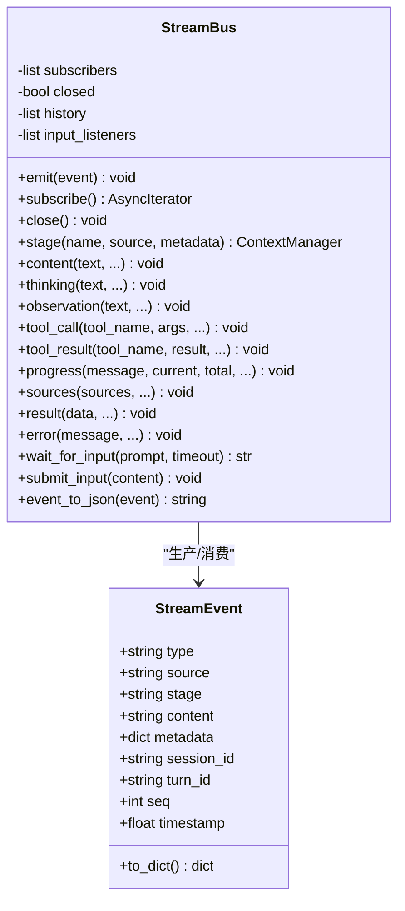
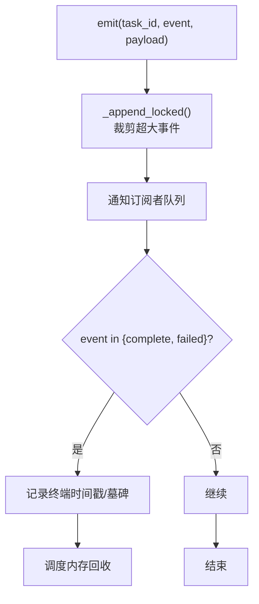
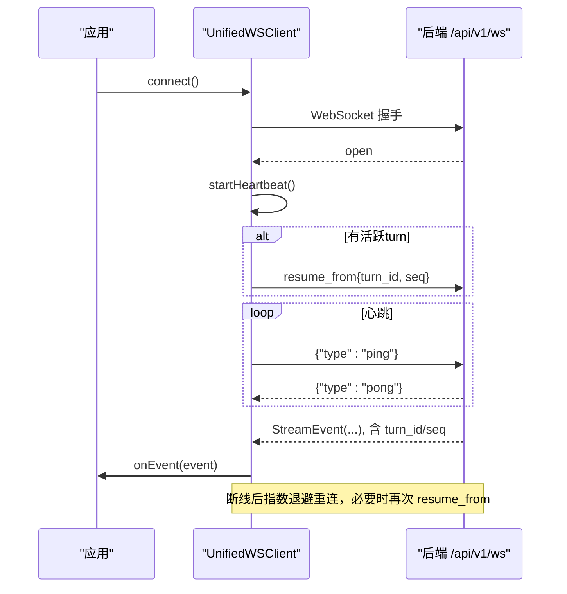
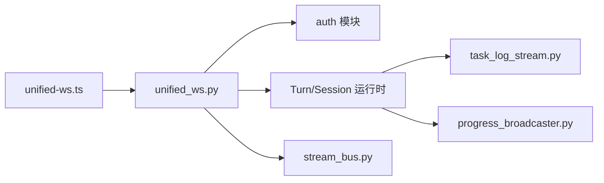

# WebSocket接口

<cite>
**本文引用的文件**
- [unified_ws.py](file://deeptutor/api/routers/unified_ws.py)
- [stream.py](file://deeptutor/core/stream.py)
- [stream_bus.py](file://deeptutor/core/stream_bus.py)
- [progress_broadcaster.py](file://deeptutor/api/utils/progress_broadcaster.py)
- [task_log_stream.py](file://deeptutor/api/utils/task_log_stream.py)
- [unified-ws.ts](file://web/lib/unified-ws.ts)
- [Dockerfile](file://Dockerfile)
</cite>

## 目录
1. [简介](#简介)
2. [项目结构](#项目结构)
3. [核心组件](#核心组件)
4. [架构总览](#架构总览)
5. [详细组件分析](#详细组件分析)
6. [依赖关系分析](#依赖关系分析)
7. [性能与并发](#性能与并发)
8. [故障排查指南](#故障排查指南)
9. [结论](#结论)
10. [附录：客户端集成示例](#附录客户端集成示例)

## 简介
本文件为 DeepTutor 的 WebSocket 接口完整技术文档，覆盖统一端点、消息协议、事件订阅机制、流式响应、进度更新、错误处理、重连策略、多路复用、并发控制与资源管理，以及调试与性能监控最佳实践。后端通过单一 WebSocket 端点提供“按轮次（turn）”和“按会话（session）”的实时事件推送；前端使用统一的客户端封装进行连接管理、心跳保活、断线重连与增量恢复。

## 项目结构
DeepTutor 将 WebSocket 能力集中在 API 层的统一路由中，并通过核心流总线与任务日志子系统对外暴露一致的流式事件模型。前端在 web 层提供类型化的客户端封装，负责连接生命周期、心跳、重连与状态恢复。

图表来源
- [unified_ws.py:44-325](file://deeptutor/api/routers/unified_ws.py#L44-L325)
- [unified-ws.ts:157-315](file://web/lib/unified-ws.ts#L157-L315)
- [stream_bus.py:31-326](file://deeptutor/core/stream_bus.py#L31-L326)
- [task_log_stream.py:24-336](file://deeptutor/api/utils/task_log_stream.py#L24-L336)
- [progress_broadcaster.py:14-74](file://deeptutor/api/utils/progress_broadcaster.py#L14-L74)

章节来源
- [unified_ws.py:1-325](file://deeptutor/api/routers/unified_ws.py#L1-L325)
- [unified-ws.ts:1-315](file://web/lib/unified-ws.ts#L1-L315)

## 核心组件
- 统一 WebSocket 路由：接收并分发客户端指令，创建/维护 turn/session 订阅，转发事件到客户端。
- 流事件协议：定义统一的流式事件类型与数据结构，贯穿工具、能力、插件与消费端。
- 流总线（StreamBus）：单 turn 内的异步事件总线，支持发布/订阅、阶段边界、等待用户输入等。
- 任务日志流：以 SSE 风格的事件缓冲与回放，支持任务级日志、完成/失败终态、内存回收。
- 进度广播器：按知识库维度向多个 WebSocket 连接广播进度事件。
- 前端客户端：封装连接、心跳、重连、增量恢复与消息序列化。

章节来源
- [stream.py:17-73](file://deeptutor/core/stream.py#L17-L73)
- [stream_bus.py:31-326](file://deeptutor/core/stream_bus.py#L31-L326)
- [task_log_stream.py:24-336](file://deeptutor/api/utils/task_log_stream.py#L24-L336)
- [progress_broadcaster.py:14-74](file://deeptutor/api/utils/progress_broadcaster.py#L14-L74)
- [unified-ws.ts:15-147](file://web/lib/unified-ws.ts#L15-L147)

## 架构总览
后端通过 FastAPI 的 WebSocket 路由统一接入，所有业务逻辑通过 Turn/Session 运行时管理器协调。事件从 Agent/能力/工具经 StreamBus 发出，由路由侧订阅并推送到客户端。任务日志与进度广播作为补充通道，分别用于长任务日志回放与跨连接进度同步。

图表来源
- [unified_ws.py:113-134](file://deeptutor/api/routers/unified_ws.py#L113-L134)
- [unified_ws.py:195-201](file://deeptutor/api/routers/unified_ws.py#L195-L201)
- [unified_ws.py:296-310](file://deeptutor/api/routers/unified_ws.py#L296-L310)
- [stream_bus.py:40-74](file://deeptutor/core/stream_bus.py#L40-L74)
- [task_log_stream.py:64-124](file://deeptutor/api/utils/task_log_stream.py#L64-L124)
- [progress_broadcaster.py:47-69](file://deeptutor/api/utils/progress_broadcaster.py#L47-L69)

## 详细组件分析

### 统一 WebSocket 路由（/api/v1/ws）
- 认证与会话：建立连接前执行鉴权，成功后接受连接。
- 安全发送：封装 safe_send，避免单个不可序列化值导致整个连接冻结。
- 订阅管理：按 turn_id 或 session_id 创建独立异步任务，支持取消与替换。
- 指令集：
  - message/start_turn：启动新轮次并自动订阅该 turn。
  - subscribe_turn/subscribe_session：订阅已有 turn 或当前活跃 session 的事件流，支持 after_seq 增量回放。
  - resume_from：断线后基于 turn_id 与 seq 恢复流。
  - check_active_turn：查询 session 是否仍有活跃 turn，清理陈旧运行标记。
  - cancel_turn：取消指定 turn。
  - submit_user_reply：提交用户回复，唤醒 wait_for_input。
  - user_input：直接投递到对应 turn 的 StreamBus。
  - regenerate：重新生成上一条用户消息，支持能力/工具/知识库/语言等覆盖参数。
  - ping/pong：心跳保活。

图表来源
- [unified_ws.py:102-312](file://deeptutor/api/routers/unified_ws.py#L102-L312)

章节来源
- [unified_ws.py:44-325](file://deeptutor/api/routers/unified_ws.py#L44-L325)

### 流事件协议与流总线
- 事件类型：包含 stage_start/stage_end、thinking、observation、content、tool_call、tool_result、progress、sources、result、error、session、session_meta、done、wait_for_input 等。
- 事件结构：type/source/stage/content/metadata/session_id/turn_id/seq/timestamp。
- StreamBus：单 turn 内 fan-out 的异步队列，支持历史回放、阶段上下文、等待用户输入与结果回调。
- 用户交互：wait_for_input 会阻塞能力执行直到前端通过 user_input/submit_user_reply 投递内容。

图表来源
- [stream.py:17-73](file://deeptutor/core/stream.py#L17-L73)
- [stream_bus.py:31-326](file://deeptutor/core/stream_bus.py#L31-L326)

章节来源
- [stream.py:1-73](file://deeptutor/core/stream.py#L1-L73)
- [stream_bus.py:1-326](file://deeptutor/core/stream_bus.py#L1-L326)

### 任务日志流（SSE 风格）
- 功能：为知识类任务提供事件缓冲、回放、终止状态持久化与内存回收。
- 特性：
  - 每任务最大事件数与字节上限，防止内存膨胀。
  - 完成/失败事件保留墓碑（tombstone），供后续订阅者快速感知终态。
  - 线程安全的 emit，异步队列推送给订阅者。
  - 捕获非传播日志，将其注入任务流。
- 输出：event/payload 形式的 SSE 片段，适合服务端流式传输。

图表来源
- [task_log_stream.py:64-124](file://deeptutor/api/utils/task_log_stream.py#L64-L124)
- [task_log_stream.py:149-188](file://deeptutor/api/utils/task_log_stream.py#L149-L188)
- [task_log_stream.py:190-235](file://deeptutor/api/utils/task_log_stream.py#L190-L235)

章节来源
- [task_log_stream.py:1-336](file://deeptutor/api/utils/task_log_stream.py#L1-L336)

### 进度广播器（按知识库维度）
- 功能：将知识库相关进度事件广播给所有已连接的 WebSocket。
- 特性：
  - 单例模式，按 kb_name 维护连接集合。
  - 广播时捕获异常并移除失效连接。
  - 提供连接计数查询。

章节来源
- [progress_broadcaster.py:14-74](file://deeptutor/api/utils/progress_broadcaster.py#L14-L74)

### 前端客户端（UnifiedWSClient）
- 功能：统一封装 WebSocket 连接、心跳、重连、增量恢复与消息序列化。
- 关键行为：
  - 连接 URL：wsUrl("/api/v1/ws")。
  - 心跳：每30秒发送 ping，若45秒未收到任何消息则主动关闭连接触发重连。
  - 重连：指数退避，最多5次尝试，成功后重置状态。
  - 增量恢复：保存 activeTurnId 与 lastSeq，重连后发送 resume_from。
  - 消息过滤：忽略 ping/pong 等系统帧，避免 UI 渲染异常。
  - 类型化消息：StartTurnMessage、SubscribeTurnMessage、ResumeTurnMessage、UnsubscribeMessage、CancelTurnMessage、RegenerateMessage、SubmitUserReplyMessage。

图表来源
- [unified-ws.ts:157-315](file://web/lib/unified-ws.ts#L157-L315)
- [unified_ws.py:136-142](file://deeptutor/api/routers/unified_ws.py#L136-L142)

章节来源
- [unified-ws.ts:1-315](file://web/lib/unified-ws.ts#L1-L315)

## 依赖关系分析
- 路由依赖：统一路由依赖认证模块、Turn/Session 运行时管理器、StreamBus。
- 事件源：Agent/能力/工具通过 StreamBus 产生事件，被路由侧消费并推送。
- 日志与进度：任务日志与进度广播作为横向支撑，不阻塞主流程。
- 前端依赖：客户端仅依赖 wsUrl 与统一消息类型，屏蔽底层细节。

图表来源
- [unified_ws.py:44-325](file://deeptutor/api/routers/unified_ws.py#L44-L325)
- [unified-ws.ts:1-315](file://web/lib/unified-ws.ts#L1-L315)

章节来源
- [unified_ws.py:1-325](file://deeptutor/api/routers/unified_ws.py#L1-L325)
- [unified-ws.ts:1-315](file://web/lib/unified-ws.ts#L1-L315)

## 性能与并发
- 多路复用：同一连接可并行订阅多个 turn 或一个 session，内部以 asyncio.Task 管理，支持取消与替换。
- 并发控制：每个订阅任务独立运行，safe_send 保证单连接串行写入，避免写竞争。
- 资源管理：
  - 任务日志流限制每任务事件数与字节上限，完成/失败后延迟清理，墓碑短期保留以便回放。
  - 进度广播器在发送失败时清理无效连接。
  - Docker 启动参数动态计算 --ws-max-size 与 --timeout-keep-alive，适配大附件与代理超时。
- 心跳与保活：前端心跳+后端 pong，结合超时检测避免僵尸连接。

章节来源
- [unified_ws.py:57-78](file://deeptutor/api/routers/unified_ws.py#L57-L78)
- [task_log_stream.py:24-31](file://deeptutor/api/utils/task_log_stream.py#L24-L31)
- [task_log_stream.py:149-188](file://deeptutor/api/utils/task_log_stream.py#L149-L188)
- [progress_broadcaster.py:47-69](file://deeptutor/api/utils/progress_broadcaster.py#L47-L69)
- [Dockerfile:273-293](file://Dockerfile#L273-L293)

## 故障排查指南
- 常见错误类型：
  - 未知消息类型：返回 error，检查客户端发送的消息结构。
  - 缺少必要字段：如 turn_id/session_id，检查必填参数。
  - 轮次不存在或已结束：cancel_turn/submit_user_reply 可能返回错误。
  - 无法找到 bus：user_input 时若无活跃 bus，返回错误。
- 诊断建议：
  - 启用前端控制台日志，关注 Unparseable WS message 警告。
  - 检查心跳是否正常，长时间无 pong 可能触发重连。
  - 查看任务日志流中的 complete/failed 事件，定位失败原因。
  - 使用 check_active_turn 清理陈旧 running 状态。
- 配置与部署：
  - 确认 uvicorn 的 --ws-max-size 与 --timeout-keep-alive 与前端代理一致，避免大消息或空闲连接被提前断开。

章节来源
- [unified_ws.py:105-109](file://deeptutor/api/routers/unified_ws.py#L105-L109)
- [unified_ws.py:160-193](file://deeptutor/api/routers/unified_ws.py#L160-L193)
- [unified_ws.py:212-223](file://deeptutor/api/routers/unified_ws.py#L212-L223)
- [unified_ws.py:296-310](file://deeptutor/api/routers/unified_ws.py#L296-L310)
- [unified-ws.ts:204-220](file://web/lib/unified-ws.ts#L204-L220)
- [Dockerfile:273-293](file://Dockerfile#L273-L293)

## 结论
DeepTutor 的 WebSocket 接口通过统一端点实现了高内聚、低耦合的实时通信能力。基于 StreamBus 的事件模型确保了多源事件的一致性与可观测性；任务日志与进度广播提供了完善的辅助通道；前端客户端封装了连接、心跳与重连，简化了集成复杂度。整体设计兼顾了可扩展性、可靠性与性能，适用于复杂的交互式学习场景。

## 附录：客户端集成示例
以下示例展示如何在前端集成 UnifiedWSClient，包括连接管理、重连策略与消息序列化。请根据实际业务调整事件处理逻辑。

- 初始化与连接
  - 实例化 UnifiedWSClient，传入 onEvent 回调与 onClose 回调。
  - 调用 connect() 建立连接，自动开始心跳。
- 启动轮次与订阅
  - 发送 message/start_turn 启动新轮次。
  - 服务器返回 turn_id 后，自动订阅该 turn 的事件流。
- 增量恢复
  - 保存 activeTurnId 与 lastSeq，重连后发送 resume_from。
- 用户交互
  - 当收到 wait_for_input 事件时，提示用户输入。
  - 通过 user_input 或 submit_user_reply 投递答案。
- 取消与清理
  - 需要时发送 cancel_turn 取消执行。
  - 页面卸载时调用 disconnect() 释放资源。

章节来源
- [unified-ws.ts:157-315](file://web/lib/unified-ws.ts#L157-L315)
- [unified_ws.py:113-134](file://deeptutor/api/routers/unified_ws.py#L113-L134)
- [unified_ws.py:195-201](file://deeptutor/api/routers/unified_ws.py#L195-L201)
- [unified_ws.py:296-310](file://deeptutor/api/routers/unified_ws.py#L296-L310)