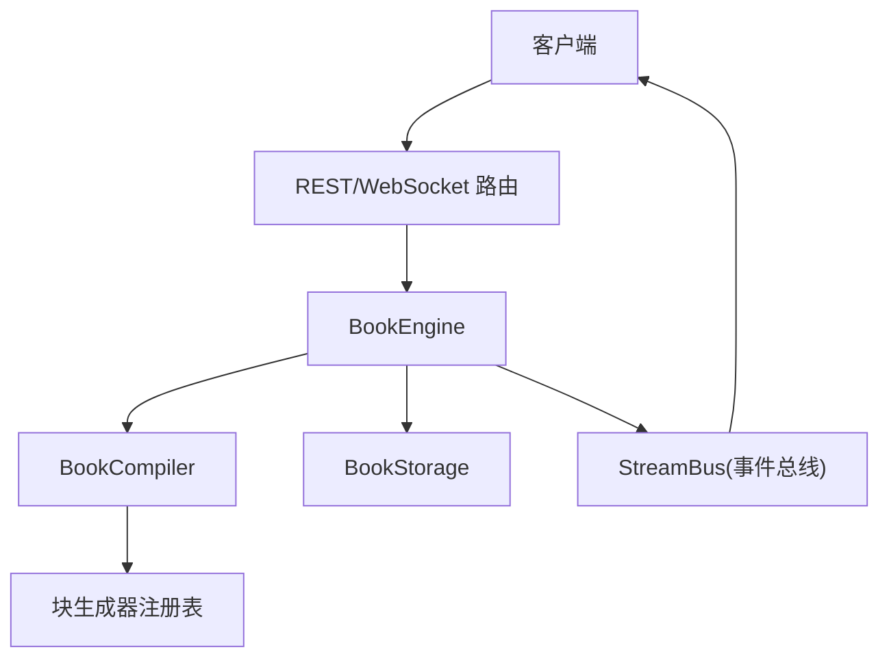
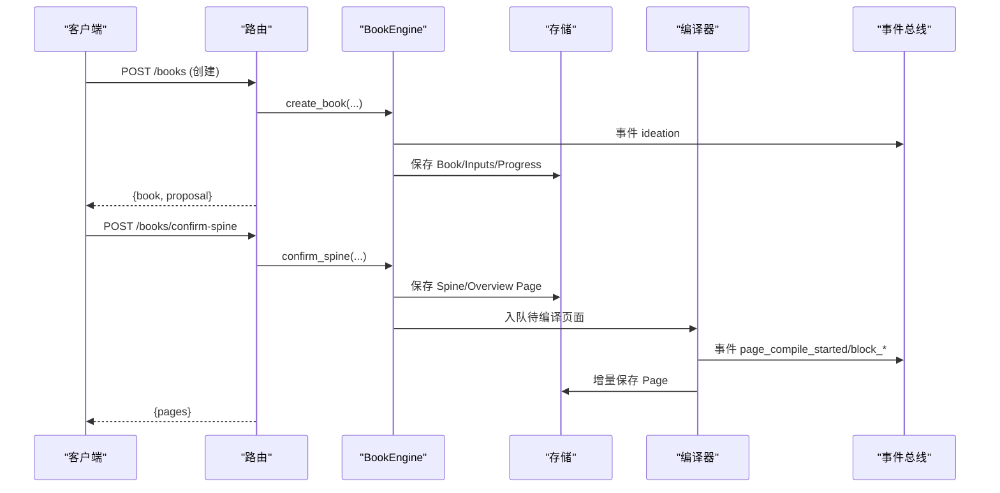
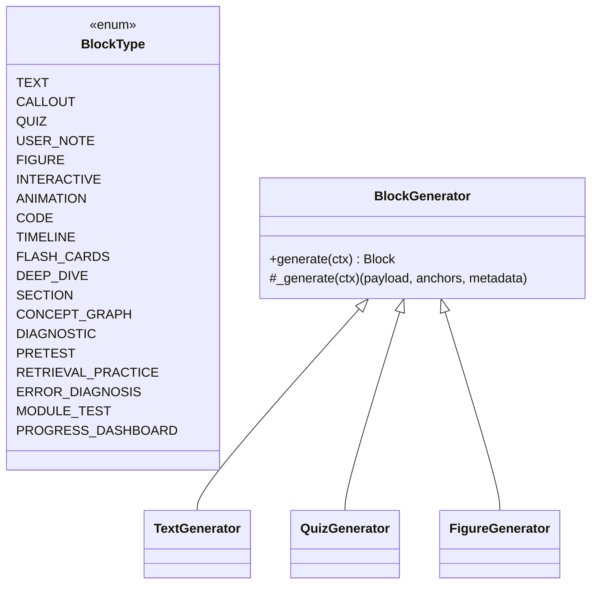
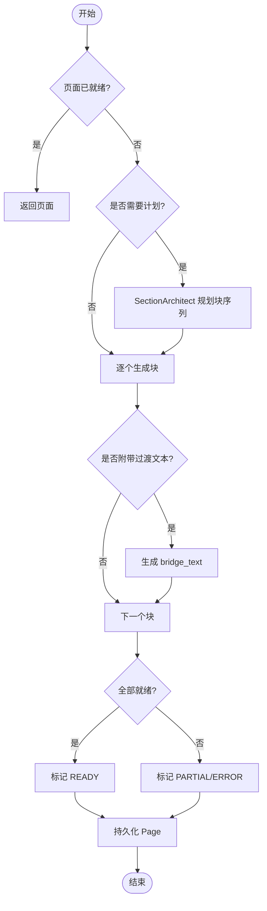
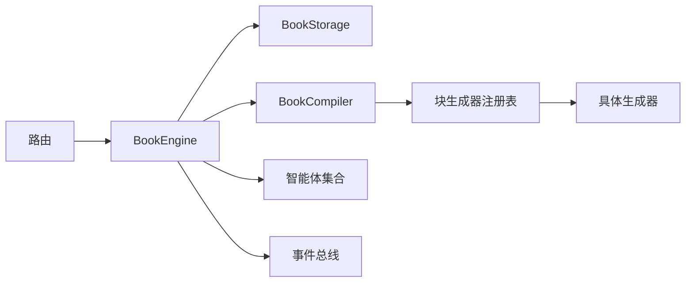

# 书籍引擎API

<cite>
**本文引用的文件**
- [deeptutor/api/routers/book.py](file://deeptutor/api/routers/book.py)
- [deeptutor/book/engine.py](file://deeptutor/book/engine.py)
- [deeptutor/book/models.py](file://deeptutor/book/models.py)
- [deeptutor/book/inputs.py](file://deeptutor/book/inputs.py)
- [deeptutor/book/compiler.py](file://deeptutor/book/compiler.py)
- [deeptutor/book/blocks/base.py](file://deeptutor/book/blocks/base.py)
- [deeptutor/book/blocks/text.py](file://deeptutor/book/blocks/text.py)
- [deeptutor/book/blocks/quiz.py](file://deeptutor/book/blocks/quiz.py)
- [deeptutor/book/blocks/figure.py](file://deeptutor/book/blocks/figure.py)
- [deeptutor/book/agents/page_planner.py](file://deeptutor/book/agents/page_planner.py)
- [deeptutor/book/storage.py](file://deeptutor/book/storage.py)
</cite>

## 目录
1. [简介](#简介)
2. [项目结构](#项目结构)
3. [核心组件](#核心组件)
4. [架构总览](#架构总览)
5. [详细组件分析](#详细组件分析)
6. [依赖关系分析](#依赖关系分析)
7. [性能与质量优化](#性能与质量优化)
8. [故障排查指南](#故障排查指南)
9. [结论](#结论)
10. [附录：端点清单与示例](#附录端点清单与示例)

## 简介
本文件为 DeepTutor 书籍引擎的完整 API 文档，覆盖书籍创建、章节规划、内容生成、块类型系统、模板渲染与多媒体嵌入、编译预览导出、智能体协作、版本管理、工作流自动化以及质量检查与性能优化实践。读者可据此快速集成 REST 与 WebSocket 接口，构建端到端的“从意图到成书”的自动化流程。

## 项目结构
- API 路由层：FastAPI 路由器暴露 REST 与 WebSocket 端点，负责请求校验、错误处理与事件转发。
- 引擎编排层：BookEngine 串联阶段化流程（构思→大纲→页面计划→块生成→状态聚合）。
- 编译器层：BookCompiler 驱动单页的块生成流水线，支持并发控制与增量持久化。
- 块系统：BlockType 枚举 + BlockGenerator 注册表 + 各类型生成器（文本、测验、图示、动画、代码等）。
- 数据模型：Book/Spine/Page/Block/Progress 等 Pydantic 模型定义。
- 输入融合：将用户意图、聊天记录、笔记本引用、知识基座等四源合并为结构化上下文。
- 存储层：按 book_id 分目录的 JSON 原子写入与日志追加。

图表来源
- [deeptutor/api/routers/book.py:143-473](file://deeptutor/api/routers/book.py#L143-L473)
- [deeptutor/book/engine.py:100-116](file://deeptutor/book/engine.py#L100-L116)
- [deeptutor/book/compiler.py:69-84](file://deeptutor/book/compiler.py#L69-L84)
- [deeptutor/book/blocks/base.py:164-223](file://deeptutor/book/blocks/base.py#L164-L223)
- [deeptutor/book/storage.py:65-103](file://deeptutor/book/storage.py#L65-L103)

章节来源
- [deeptutor/api/routers/book.py:143-473](file://deeptutor/api/routers/book.py#L143-L473)
- [deeptutor/book/engine.py:100-116](file://deeptutor/book/engine.py#L100-L116)
- [deeptutor/book/compiler.py:69-84](file://deeptutor/book/compiler.py#L69-L84)
- [deeptutor/book/blocks/base.py:164-223](file://deeptutor/book/blocks/base.py#L164-L223)
- [deeptutor/book/storage.py:65-103](file://deeptutor/book/storage.py#L65-L103)

## 核心组件
- BookEngine：进程级编排器，维护每本书的后台队列与工作线程，协调阶段化流程与事件流。
- BookCompiler：单页编译器，负责页面计划、块生成、桥接文本附加与状态聚合。
- SectionArchitect（原 PagePlanner）：基于 LLM 或静态模板为章节生成块序列。
- BlockGenerator 体系：统一抽象与注册表，支持文本、测验、图示、动画、代码、时间线、闪卡、深度探索、概念图、章节区块等。
- 输入融合：build_book_inputs 将多源输入整合为 IdeationContext。
- 存储：BookStorage 提供原子写入、分页管理与操作日志。

章节来源
- [deeptutor/book/engine.py:100-116](file://deeptutor/book/engine.py#L100-L116)
- [deeptutor/book/compiler.py:69-84](file://deeptutor/book/compiler.py#L69-L84)
- [deeptutor/book/agents/page_planner.py:256-365](file://deeptutor/book/agents/page_planner.py#L256-L365)
- [deeptutor/book/blocks/base.py:116-223](file://deeptutor/book/blocks/base.py#L116-L223)
- [deeptutor/book/inputs.py:308-363](file://deeptutor/book/inputs.py#L308-L363)
- [deeptutor/book/storage.py:65-103](file://deeptutor/book/storage.py#L65-L103)

## 架构总览
书籍引擎采用“阶段化+事件驱动”的架构：
- Stage 1 构思：收集输入并生成 BookProposal。
- Stage 2 大纲：并行探索来源，综合生成 Spine 与概念图。
- Stage 3 确认与建壳：注入导览章节，创建页面外壳并可选自动编译。
- Stage 4 编译：逐块生成，支持并发与增量持久化。
- Stage 5 进度：记录测验尝试与学习进度。

图表来源
- [deeptutor/api/routers/book.py:198-268](file://deeptutor/api/routers/book.py#L198-L268)
- [deeptutor/book/engine.py:200-273](file://deeptutor/book/engine.py#L200-L273)
- [deeptutor/book/engine.py:582-645](file://deeptutor/book/engine.py#L582-L645)
- [deeptutor/book/compiler.py:88-190](file://deeptutor/book/compiler.py#L88-L190)

## 详细组件分析

### REST 端点总览
- 健康检查：GET /health
- 书籍列表：GET /books
- 获取书籍详情：GET /books/{book_id}
- 获取大纲：GET /books/{book_id}/spine
- 获取页面：GET /books/{book_id}/pages/{page_id}
- 删除书籍：DELETE /books/{book_id}
- 创建书籍：POST /books
- 确认提案：POST /books/confirm-proposal
- 确认大纲：POST /books/confirm-spine
- 编译页面：POST /books/compile-page
- 重新生成块：POST /books/regenerate-block
- 插入块：POST /books/insert-block
- 删除块：POST /books/delete-block
- 移动块：POST /books/move-block
- 更改块类型：POST /books/change-block-type
- 深度探索子页：POST /books/deep-dive
- 测验尝试：POST /books/quiz-attempt
- 书籍健康：GET /books/{book_id}/health
- 刷新指纹：POST /books/{book_id}/refresh-fingerprints
- 补充弱项：POST /books/supplement
- 绑定页面聊天会话：POST /books/page-chat-session
- 重建书籍：POST /books/rebuild
- WebSocket 流：WS /ws

章节来源
- [deeptutor/api/routers/book.py:143-473](file://deeptutor/api/routers/book.py#L143-L473)

### 块类型系统与模板渲染
- 块类型：text、callout、quiz、user_note、figure、interactive、animation、code、timeline、flash_cards、deep_dive、section、concept_graph、diagnostic、pretest、retrieval_practice、error_diagnosis、module_test、progress_dashboard。
- 模板渲染：SectionArchitect 根据 ContentType 选择静态模板或调用 LLM 动态规划；每个块由对应 BlockGenerator 填充 payload。
- 桥接文本：编译器在块就绪后根据 transition_in 提示生成简短过渡段落，提升阅读连贯性。

图表来源
- [deeptutor/book/models.py:55-80](file://deeptutor/book/models.py#L55-L80)
- [deeptutor/book/blocks/base.py:116-161](file://deeptutor/book/blocks/base.py#L116-L161)
- [deeptutor/book/blocks/text.py:30-80](file://deeptutor/book/blocks/text.py#L30-L80)
- [deeptutor/book/blocks/quiz.py:14-66](file://deeptutor/book/blocks/quiz.py#L14-L66)
- [deeptutor/book/blocks/figure.py:25-118](file://deeptutor/book/blocks/figure.py#L25-L118)

章节来源
- [deeptutor/book/models.py:55-80](file://deeptutor/book/models.py#L55-L80)
- [deeptutor/book/blocks/base.py:116-223](file://deeptutor/book/blocks/base.py#L116-L223)
- [deeptutor/book/agents/page_planner.py:74-156](file://deeptutor/book/agents/page_planner.py#L74-L156)
- [deeptutor/book/compiler.py:251-301](file://deeptutor/book/compiler.py#L251-L301)

### 多媒体嵌入与可视化
- 图示块：FigureGenerator 调用可视化管线生成 SVG/Mermaid/ChartJS，并进行本地校验与修复。
- 交互块：InteractiveGenerator 用于 HTML 交互内容（由块系统扩展）。
- 动画块：AnimationGenerator 用于视频/动画内容（由块系统扩展）。
- 代码块：CodeGenerator 生成可执行示例或脚手架代码。
- 时间线与闪卡：TimelineGenerator、FlashCardsGenerator 分别生成历史脉络与记忆卡片。

章节来源
- [deeptutor/book/blocks/figure.py:25-118](file://deeptutor/book/blocks/figure.py#L25-L118)
- [deeptutor/book/blocks/base.py:190-223](file://deeptutor/book/blocks/base.py#L190-L223)

### 书籍编译、预览与导出
- 编译：通过 compile_page 触发单页编译，支持 force 强制重算；背景队列串行/并发处理未就绪页面。
- 预览：WebSocket 实时推送 block_started、block_ready/block_error、page_compiled 等事件，前端可即时渲染。
- 导出：存储层以 JSON 形式持久化 Book/Spine/Page，便于后续打包导出（如 PDF/DOCX 等外部工具消费）。

图表来源
- [deeptutor/book/compiler.py:88-190](file://deeptutor/book/compiler.py#L88-L190)
- [deeptutor/book/compiler.py:305-344](file://deeptutor/book/compiler.py#L305-L344)
- [deeptutor/book/compiler.py:348-366](file://deeptutor/book/compiler.py#L348-L366)

章节来源
- [deeptutor/book/engine.py:699-769](file://deeptutor/book/engine.py#L699-L769)
- [deeptutor/book/compiler.py:88-190](file://deeptutor/book/compiler.py#L88-L190)
- [deeptutor/book/storage.py:192-225](file://deeptutor/book/storage.py#L192-L225)

### 智能体协作与版本管理
- 智能体协作：
  - IdeationAgent：构思阶段生成提案。
  - SourceExplorer：并行探索来源，产出 ExplorationReport。
  - SpineSynthesizer：综合来源与提案生成 Spine 与概念图。
  - SectionArchitect：规划块序列（LLM 优先，静态模板兜底）。
  - 各 BlockGenerator：调用相应能力（如 QuestionCoordinator、VisualizePipeline）完成块内容。
- 版本管理：
  - Spine.version 字段跟踪大纲版本。
  - 每次关键操作通过 append_log 记录审计日志。
  - 支持 rebuild 保留 Spine 重建所有页面。

章节来源
- [deeptutor/book/engine.py:200-273](file://deeptutor/book/engine.py#L200-L273)
- [deeptutor/book/engine.py:281-394](file://deeptutor/book/engine.py#L281-L394)
- [deeptutor/book/agents/page_planner.py:256-365](file://deeptutor/book/agents/page_planner.py#L256-L365)
- [deeptutor/book/storage.py:236-242](file://deeptutor/book/storage.py#L236-L242)

### 工作流自动化机制
- 后台队列：每本书独立 asyncio.Queue，优先级策略优先处理当前打开页面，其余后台串行/并发处理。
- 事件流：BookStream 包装 StreamBus，统一输出 stage、content、metadata，供 WebSocket 广播。
- 自动编译：confirm_spine 时可选择 auto_compile=true 自动入队。

章节来源
- [deeptutor/book/engine.py:84-93](file://deeptutor/book/engine.py#L84-L93)
- [deeptutor/book/engine.py:773-800](file://deeptutor/book/engine.py#L773-L800)
- [deeptutor/api/routers/book.py:490-670](file://deeptutor/api/routers/book.py#L490-L670)

## 依赖关系分析
- API 路由依赖 BookEngine 提供的 create_book、confirm_proposal、confirm_spine、compile_page 等方法。
- BookEngine 依赖：
  - storage：BookStorage 进行持久化。
  - compiler：BookCompiler 驱动块生成。
  - agents：IdeationAgent、SourceExplorer、SpineSynthesizer、SectionArchitect。
  - streaming：BookStream 与 StreamBus 事件通道。
- 块生成器依赖各自领域服务（如 QuestionCoordinator、VisualizePipeline），并通过 BlockContext 共享上下文。

图表来源
- [deeptutor/api/routers/book.py:143-473](file://deeptutor/api/routers/book.py#L143-L473)
- [deeptutor/book/engine.py:100-116](file://deeptutor/book/engine.py#L100-L116)
- [deeptutor/book/compiler.py:69-84](file://deeptutor/book/compiler.py#L69-L84)
- [deeptutor/book/blocks/base.py:164-223](file://deeptutor/book/blocks/base.py#L164-L223)

章节来源
- [deeptutor/api/routers/book.py:143-473](file://deeptutor/api/routers/book.py#L143-L473)
- [deeptutor/book/engine.py:100-116](file://deeptutor/book/engine.py#L100-L116)
- [deeptutor/book/compiler.py:69-84](file://deeptutor/book/compiler.py#L69-L84)
- [deeptutor/book/blocks/base.py:164-223](file://deeptutor/book/blocks/base.py#L164-L223)

## 性能与质量优化
- 并发控制：CompilerOptions.block_concurrency 控制单页内块的并发度；Phase 1 默认顺序以保证稳定流式输出。
- 增量持久化：persist_after_each_block 确保每块完成后立即落盘，提高容错与恢复能力。
- 来源复用：ExplorationReport 缓存检索结果，避免重复 RAG 调用，降低延迟与成本。
- 桥接文本：transition_in 提示减少冗余过渡块，提升阅读流畅性与生成效率。
- 质量检查：
  - 可视化代码本地校验与一次修复重试，失败则标记错误并上报。
  - 块生成异常分类（JSON 解析、空响应、超时、限流、提供商错误等），便于监控与重试策略。
- 知识基座漂移检测：kb_fingerprints 与 stale_page_ids 辅助识别变更并选择性重编译。

章节来源
- [deeptutor/book/compiler.py:45-67](file://deeptutor/book/compiler.py#L45-L67)
- [deeptutor/book/compiler.py:226-249](file://deeptutor/book/compiler.py#L226-L249)
- [deeptutor/book/blocks/base.py:38-71](file://deeptutor/book/blocks/base.py#L38-L71)
- [deeptutor/book/blocks/figure.py:77-118](file://deeptutor/book/blocks/figure.py#L77-L118)
- [deeptutor/book/engine.py:245-258](file://deeptutor/book/engine.py#L245-L258)

## 故障排查指南
- 常见错误定位：
  - 块生成失败：查看 block.metadata.failure 中的 kind 与 message，区分 JSON 解析、空响应、超时、限流、提供商错误等。
  - 可视化失败：检查 figure 块的 review_notes 与 residual error，必要时触发 regenerate_block。
  - 页面状态异常：若 page.status=PARTIAL/ERROR，检查对应块错误信息并重试。
- 恢复与重试：
  - 使用 regenerate_block 针对特定块重新生成，可传入 params_override 调整参数。
  - 使用 change_block_type 切换块类型并重新生成。
  - 使用 rebuild_book 保留 Spine 重建所有页面。
- 健康检查：
  - GET /books/{book_id}/health 返回 kb_drift 与 log_health，辅助诊断知识基座漂移与日志健康。
  - POST /books/{book_id}/refresh-fingerprints 刷新指纹以更新漂移状态。

章节来源
- [deeptutor/book/blocks/base.py:38-71](file://deeptutor/book/blocks/base.py#L38-L71)
- [deeptutor/api/routers/book.py:285-378](file://deeptutor/api/routers/book.py#L285-L378)
- [deeptutor/api/routers/book.py:415-429](file://deeptutor/api/routers/book.py#L415-L429)

## 结论
DeepTutor 书籍引擎通过阶段化编排、事件驱动与可扩展的块系统，实现了从用户意图到高质量书籍内容的自动化生产。其 REST 与 WebSocket 接口覆盖了创建、规划、生成、预览、导出全流程，并内置了质量检查与性能优化机制，适合在生产环境中构建稳定的 AI 驱动内容平台。

## 附录：端点清单与示例

### REST 端点清单
- GET /health
- GET /books
- GET /books/{book_id}
- GET /books/{book_id}/spine
- GET /books/{book_id}/pages/{page_id}
- DELETE /books/{book_id}
- POST /books
- POST /books/confirm-proposal
- POST /books/confirm-spine
- POST /books/compile-page
- POST /books/regenerate-block
- POST /books/insert-block
- POST /books/delete-block
- POST /books/move-block
- POST /books/change-block-type
- POST /books/deep-dive
- POST /books/quiz-attempt
- GET /books/{book_id}/health
- POST /books/{book_id}/refresh-fingerprints
- POST /books/supplement
- POST /books/page-chat-session
- POST /books/rebuild
- WS /ws

章节来源
- [deeptutor/api/routers/book.py:143-473](file://deeptutor/api/routers/book.py#L143-L473)

### 典型工作流示例（文字步骤）
- 创建书籍：
  - 调用 POST /books，提交 user_intent、knowledge_bases、language 等。
  - 返回 book 与 proposal，进入构思阶段。
- 确认提案并生成大纲：
  - 调用 POST /books/confirm-proposal，可选编辑 proposal。
  - 返回 book 与 spine，进入大纲阶段。
- 确认大纲并创建页面：
  - 调用 POST /books/confirm-spine，设置 auto_compile=true。
  - 返回 pages 列表，进入编译阶段。
- 编译页面：
  - 调用 POST /books/compile-page，指定 page_id。
  - 通过 WS /ws 订阅事件，实时接收 block_started、block_ready/block_error、page_compiled。
- 再生成/替换块：
  - 调用 POST /books/regenerate-block 或 POST /books/change-block-type。
- 重建书籍：
  - 调用 POST /books/rebuild，保留 Spine 重建所有页面。

章节来源
- [deeptutor/api/routers/book.py:198-473](file://deeptutor/api/routers/book.py#L198-L473)
- [deeptutor/api/routers/book.py:490-670](file://deeptutor/api/routers/book.py#L490-L670)