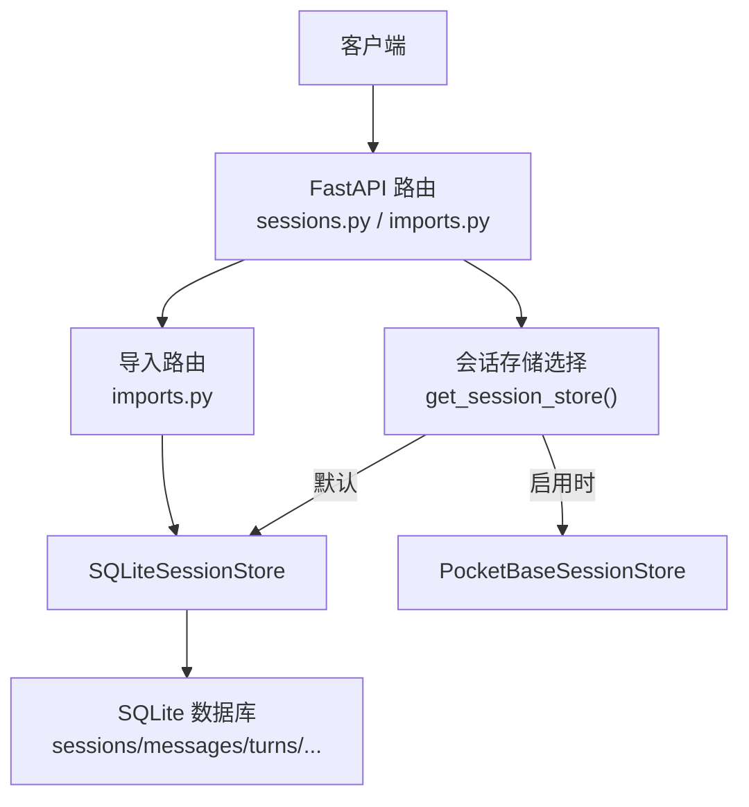
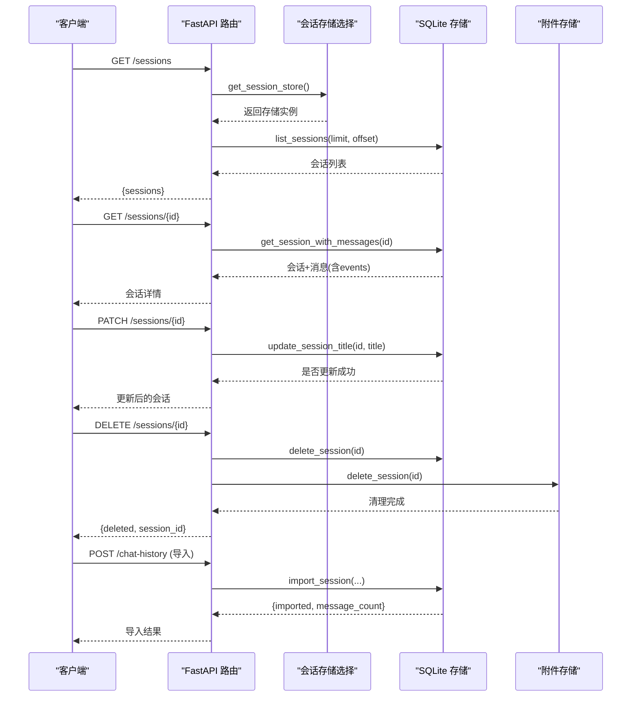
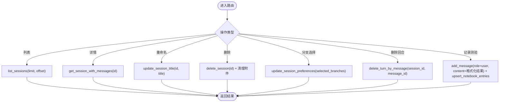
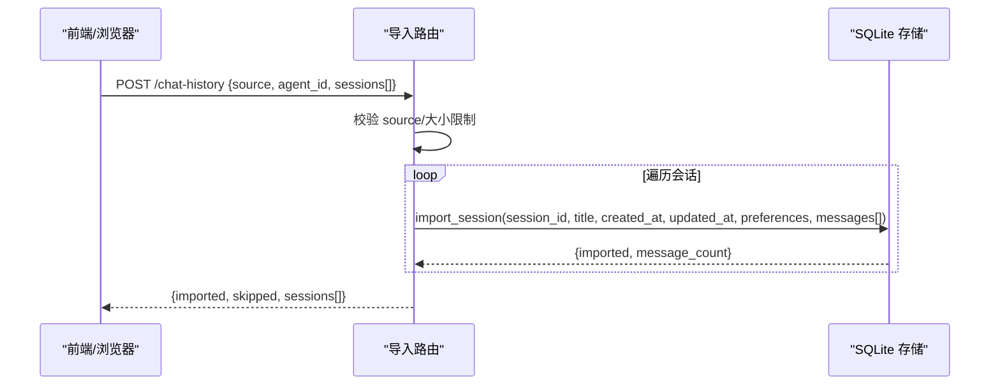
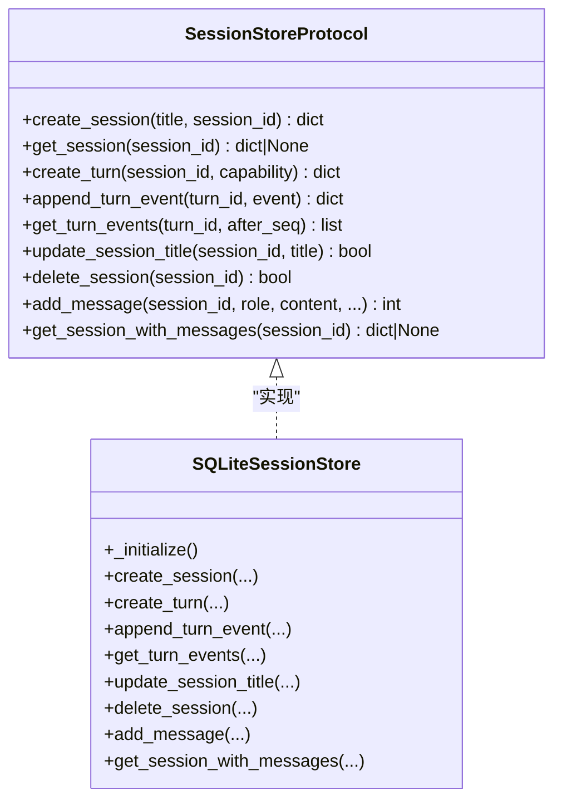
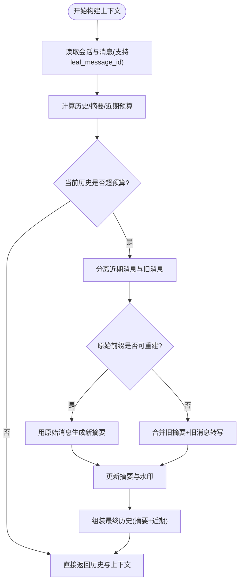
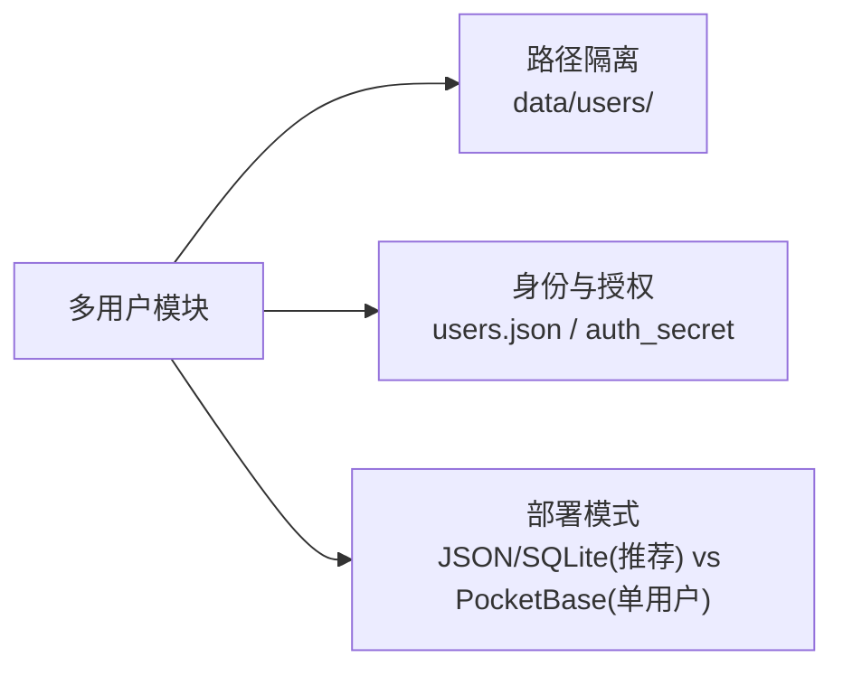
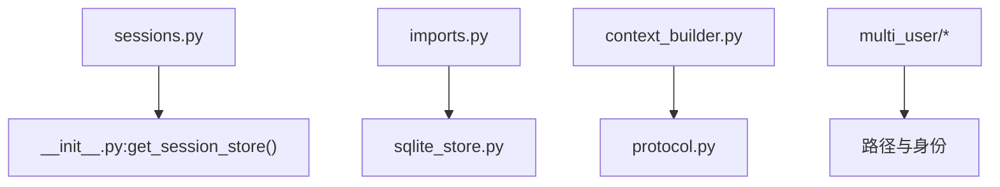

# 会话管理API

<cite>
**本文引用的文件**
- [deeptutor/api/routers/sessions.py](file://deeptutor/api/routers/sessions.py)
- [deeptutor/api/routers/imports.py](file://deeptutor/api/routers/imports.py)
- [deeptutor/services/session/__init__.py](file://deeptutor/services/session/__init__.py)
- [deeptutor/services/session/protocol.py](file://deeptutor/services/session/protocol.py)
- [deeptutor/services/session/sqlite_store.py](file://deeptutor/services/session/sqlite_store.py)
- [deeptutor/services/session/context_builder.py](file://deeptutor/services/session/context_builder.py)
- [deeptutor/multi_user/__init__.py](file://deeptutor/multi_user/__init__.py)
- [deeptutor/multi_user/identity.py](file://deeptutor/multi_user/identity.py)
- [tests/core/test_turn_event_store.py](file://tests/core/test_turn_event_store.py)
</cite>

## 目录
1. [简介](#简介)
2. [项目结构](#项目结构)
3. [核心组件](#核心组件)
4. [架构总览](#架构总览)
5. [详细组件分析](#详细组件分析)
6. [依赖关系分析](#依赖关系分析)
7. [性能考虑](#性能考虑)
8. [故障排查指南](#故障排查指南)
9. [结论](#结论)
10. [附录](#附录)

## 简介
本文件为 DeepTutor 的“会话管理”完整 API 文档，覆盖会话的创建、查询、更新、删除、导入导出、批量操作与迁移工具；解释会话状态管理、上下文构建与历史记录维护；说明多用户隔离、权限控制与数据安全；并提供优化与存储管理的最佳实践。

## 项目结构
- API 路由层：提供 REST 接口用于会话列表、详情、重命名、删除、分支选择、按消息删除回合、记录测验结果等；以及外部聊天历史导入接口。
- 服务层（Session Store）：通过统一协议抽象 SQLite 与 PocketBase 两种后端；默认使用 SQLite，支持可插拔切换。
- 上下文构建器：基于 LLM 配置动态计算预算，生成滚动摘要与最近对话片段，保证上下文窗口不溢出。
- 多用户与安全：可选多用户模式，默认 JSON/SQLite 路径隔离；PocketBase 模式当前为单用户部署限制。

**图表来源**
- [deeptutor/api/routers/sessions.py:80-163](file://deeptutor/api/routers/sessions.py#L80-L163)
- [deeptutor/api/routers/imports.py:74-146](file://deeptutor/api/routers/imports.py#L74-L146)
- [deeptutor/services/session/__init__.py:33-47](file://deeptutor/services/session/__init__.py#L33-L47)
- [deeptutor/services/session/sqlite_store.py:119-233](file://deeptutor/services/session/sqlite_store.py#L119-L233)

**章节来源**
- [deeptutor/api/routers/sessions.py:80-163](file://deeptutor/api/routers/sessions.py#L80-L163)
- [deeptutor/api/routers/imports.py:74-146](file://deeptutor/api/routers/imports.py#L74-L146)
- [deeptutor/services/session/__init__.py:33-47](file://deeptutor/services/session/__init__.py#L33-L47)

## 核心组件
- 会话存储协议：定义统一的会话 CRUD、回合事件、消息追加、摘要更新、偏好设置等接口，屏蔽底层实现差异。
- SQLite 会话存储：本地持久化 sessions、messages、turns、turn_events、notebook_entries 等表；支持导入会话、按消息删除回合、附件清理联动。
- 上下文构建器：根据 LLM 配置计算历史预算与摘要预算，自动压缩旧对话，输出稳定上下文文本与事件流。
- 导入路由：将外部 CLI 聊天历史（Claude Code/Codex）导入为可继续的会话，去重幂等，保留元数据与归属信息。

**章节来源**
- [deeptutor/services/session/protocol.py:14-83](file://deeptutor/services/session/protocol.py#L14-L83)
- [deeptutor/services/session/sqlite_store.py:96-233](file://deeptutor/services/session/sqlite_store.py#L96-L233)
- [deeptutor/services/session/context_builder.py:104-138](file://deeptutor/services/session/context_builder.py#L104-L138)
- [deeptutor/api/routers/imports.py:40-72](file://deeptutor/api/routers/imports.py#L40-L72)

## 架构总览
下图展示从请求到存储的端到端流程，包括会话列表、详情、重命名、删除、导入、按消息删除回合与测验结果记录。

**图表来源**
- [deeptutor/api/routers/sessions.py:80-163](file://deeptutor/api/routers/sessions.py#L80-L163)
- [deeptutor/api/routers/imports.py:74-136](file://deeptutor/api/routers/imports.py#L74-L136)
- [deeptutor/services/session/sqlite_store.py:449-454](file://deeptutor/services/session/sqlite_store.py#L449-L454)
- [deeptutor/services/session/sqlite_store.py:1023-1046](file://deeptutor/services/session/sqlite_store.py#L1023-L1046)

## 详细组件分析

### 会话 REST API（创建/查询/更新/删除）
- 列出会话：GET /sessions?limit=...&offset=...
- 获取会话详情：GET /sessions/{session_id}
- 重命名会话：PATCH /sessions/{session_id}
- 删除会话：DELETE /sessions/{session_id}
- 更新编辑分支选择：PUT /sessions/{session_id}/branch-selection
- 按消息删除回合：DELETE /sessions/{session_id}/messages/{message_id}
- 记录测验结果：POST /sessions/{session_id}/quiz-results

注意：
- 详情返回的消息中，tool_result/observation 等大负载会被截断以避免前端渲染压力。
- 删除会话会尝试清理附件存储中的相关资源。
- 按消息删除回合时会检测是否处于运行中，避免并发冲突。

**图表来源**
- [deeptutor/api/routers/sessions.py:80-231](file://deeptutor/api/routers/sessions.py#L80-L231)

**章节来源**
- [deeptutor/api/routers/sessions.py:80-231](file://deeptutor/api/routers/sessions.py#L80-L231)

### 会话导入与导出
- 导入聊天历史：POST /chat-history
  - 支持来源：claude_code、codex
  - 限制：单次最多 1000 个会话，每个会话最多 10000 条消息
  - 幂等：相同 external_id 重复导入不会重复创建
  - 元数据：source、agent_id、agent_name、source_cwd 等写入 preferences.import
- 列出已导入会话：GET /chat-history?limit=...&offset=...

**图表来源**
- [deeptutor/api/routers/imports.py:74-136](file://deeptutor/api/routers/imports.py#L74-L136)
- [deeptutor/services/session/sqlite_store.py:957-1046](file://deeptutor/services/session/sqlite_store.py#L957-L1046)

**章节来源**
- [deeptutor/api/routers/imports.py:40-146](file://deeptutor/api/routers/imports.py#L40-L146)
- [deeptutor/services/session/sqlite_store.py:957-1046](file://deeptutor/services/session/sqlite_store.py#L957-L1046)

### 会话状态管理与回合事件
- 会话状态：由 turns 表的 status 字段驱动（running/completed/failed/cancelled），列表接口返回最新状态。
- 回合事件：turn_events 表以 seq 顺序记录事件，支持增量拉取 after_seq。
- 测试验证：回合事件持久化、活跃回合追踪、消息元数据持久化。

**图表来源**
- [deeptutor/services/session/protocol.py:14-83](file://deeptutor/services/session/protocol.py#L14-L83)
- [deeptutor/services/session/sqlite_store.py:96-233](file://deeptutor/services/session/sqlite_store.py#L96-L233)

**章节来源**
- [tests/core/test_turn_event_store.py:8-85](file://tests/core/test_turn_event_store.py#L8-L85)
- [deeptutor/services/session/sqlite_store.py:538-579](file://deeptutor/services/session/sqlite_store.py#L538-L579)
- [deeptutor/services/session/sqlite_store.py:657-704](file://deeptutor/services/session/sqlite_store.py#L657-L704)

### 上下文构建与历史记录维护
- 预算计算：根据 LLM 配置的 context_window/max_tokens 计算历史预算与摘要预算。
- 摘要策略：对超出预算的旧消息进行压缩，生成滚动摘要并推进 watermark（summary_up_to_msg_id）。
- 分支安全：当切换到编辑分支时，若 watermark 不在当前祖先链上则丢弃旧摘要重建。
- 输出：返回 conversation_history、conversation_summary、context_text、token_count、budget 及事件流。

**图表来源**
- [deeptutor/services/session/context_builder.py:117-138](file://deeptutor/services/session/context_builder.py#L117-L138)
- [deeptutor/services/session/context_builder.py:348-467](file://deeptutor/services/session/context_builder.py#L348-L467)

**章节来源**
- [deeptutor/services/session/context_builder.py:104-138](file://deeptutor/services/session/context_builder.py#L104-L138)
- [deeptutor/services/session/context_builder.py:348-467](file://deeptutor/services/session/context_builder.py#L348-L467)

### 多用户隔离、权限控制与数据安全
- 多用户模式：默认 JSON/SQLite 路径隔离（data/users/<uid>/），账户与授权在 data/system/；JWT 认证。
- PocketBase 模式：当前为单用户部署限制（无角色过滤），不建议在多用户场景使用。
- 身份与密钥：用户存储、头像、角色、密钥文件均受保护；首次启动自动生成稳定密钥。

**图表来源**
- [deeptutor/multi_user/__init__.py:1-24](file://deeptutor/multi_user/__init__.py#L1-L24)
- [deeptutor/multi_user/identity.py:124-169](file://deeptutor/multi_user/identity.py#L124-L169)

**章节来源**
- [deeptutor/multi_user/__init__.py:1-24](file://deeptutor/multi_user/__init__.py#L1-L24)
- [deeptutor/multi_user/identity.py:124-169](file://deeptutor/multi_user/identity.py#L124-L169)

## 依赖关系分析
- API 路由依赖会话存储选择器，后者根据配置返回 SQLite 或 PocketBase 实现。
- 导入路由直接调用 SQLite 存储，确保幂等与元数据回填。
- 上下文构建器依赖会话存储协议，解耦具体存储实现。
- 多用户模块与存储层解耦，仅影响路径与访问策略。

**图表来源**
- [deeptutor/api/routers/sessions.py:13-15](file://deeptutor/api/routers/sessions.py#L13-L15)
- [deeptutor/api/routers/imports.py:22-25](file://deeptutor/api/routers/imports.py#L22-L25)
- [deeptutor/services/session/__init__.py:33-47](file://deeptutor/services/session/__init__.py#L33-L47)
- [deeptutor/services/session/context_builder.py:10-16](file://deeptutor/services/session/context_builder.py#L10-L16)

**章节来源**
- [deeptutor/api/routers/sessions.py:13-15](file://deeptutor/api/routers/sessions.py#L13-L15)
- [deeptutor/api/routers/imports.py:22-25](file://deeptutor/api/routers/imports.py#L22-L25)
- [deeptutor/services/session/__init__.py:33-47](file://deeptutor/services/session/__init__.py#L33-L47)
- [deeptutor/services/session/context_builder.py:10-16](file://deeptutor/services/session/context_builder.py#L10-L16)

## 性能考虑
- 事件载荷截断：对 tool_result/observation 的大内容在前端渲染路径进行截断，不影响模型输入。
- 批量事件写入：使用批处理插入 turn_events 减少事务提交次数，降低慢盘延迟导致的尾部放大。
- 索引优化：针对 messages、turns、turn_events、notebook_entries 建立常用查询索引。
- 预算自适应：根据 LLM 配置动态调整历史与摘要预算，避免上下文溢出。
- 导入限流：限制单次导入会话数与消息数，防止超大请求拖垮服务。

[本节为通用性能建议，无需特定文件引用]

## 故障排查指南
- 404 未找到：会话不存在或消息不存在时，路由返回 404。
- 409 冲突：尝试删除正在运行的回合对应的消息时，返回冲突提示。
- 导入失败：外部源不支持或请求过大将被拒绝；导入异常会记录日志并跳过该会话。
- 附件清理失败：删除会话后清理附件可能失败，需检查附件存储权限与路径。
- 摘要重建失败：上下文构建异常时降级为保留旧摘要与尽可能多的未摘要消息。

**章节来源**
- [deeptutor/api/routers/sessions.py:133-196](file://deeptutor/api/routers/sessions.py#L133-L196)
- [deeptutor/api/routers/imports.py:74-136](file://deeptutor/api/routers/imports.py#L74-L136)
- [deeptutor/services/session/context_builder.py:425-452](file://deeptutor/services/session/context_builder.py#L425-L452)

## 结论
DeepTutor 的会话管理以统一协议为核心，结合 SQLite 本地存储与可选远程后端，提供完整的会话生命周期管理能力。通过上下文构建器与预算机制，系统能在长对话中保持稳定的上下文质量；导入功能使外部聊天历史无缝融入学习空间；多用户模式保障数据隔离与权限控制。遵循本文的最佳实践，可在生产环境中获得高可用、可扩展且安全的会话管理服务。

## 附录
- 常见 API 示例（路径参考）：
  - 列出会话：GET /sessions?limit=50&offset=0
  - 获取会话详情：GET /sessions/{session_id}
  - 重命名会话：PATCH /sessions/{session_id} {title}
  - 删除会话：DELETE /sessions/{session_id}
  - 更新分支选择：PUT /sessions/{session_id}/branch-selection {selected_branches}
  - 按消息删除回合：DELETE /sessions/{session_id}/messages/{message_id}
  - 记录测验结果：POST /sessions/{session_id}/quiz-results {answers[], turn_id}
  - 导入聊天历史：POST /chat-history {source, agent_id, sessions[]}
  - 列出导入会话：GET /chat-history?limit=50&offset=0

[本节为操作指引，无需特定文件引用]