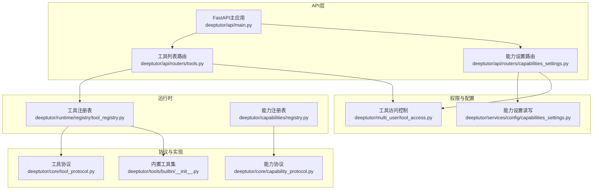
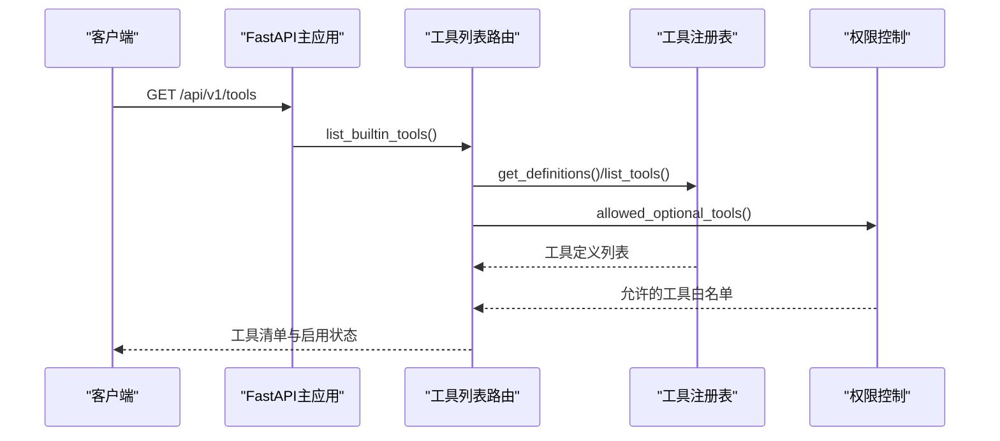
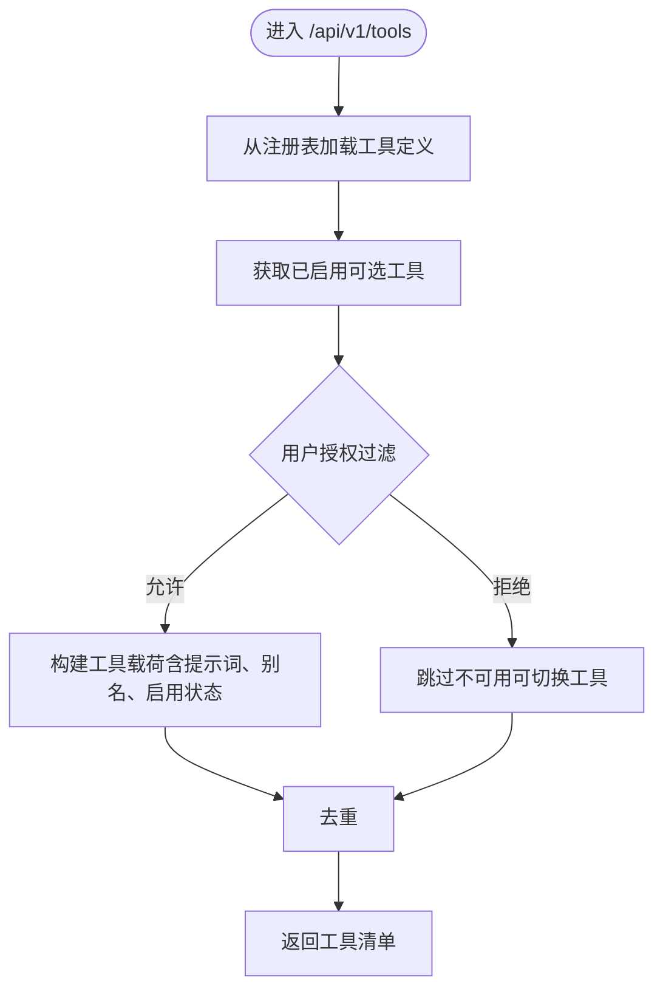
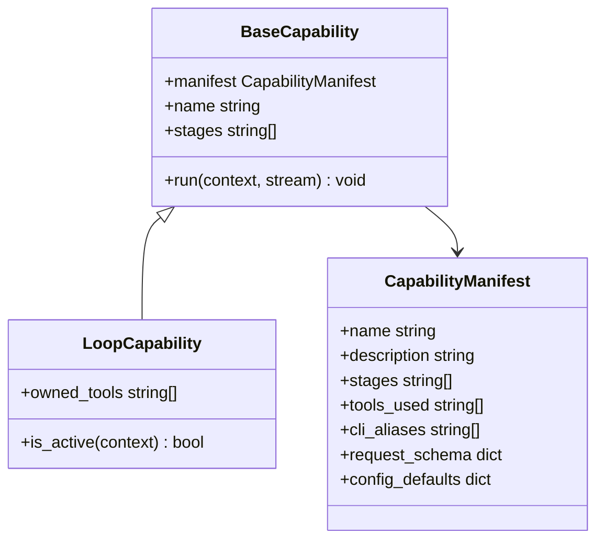
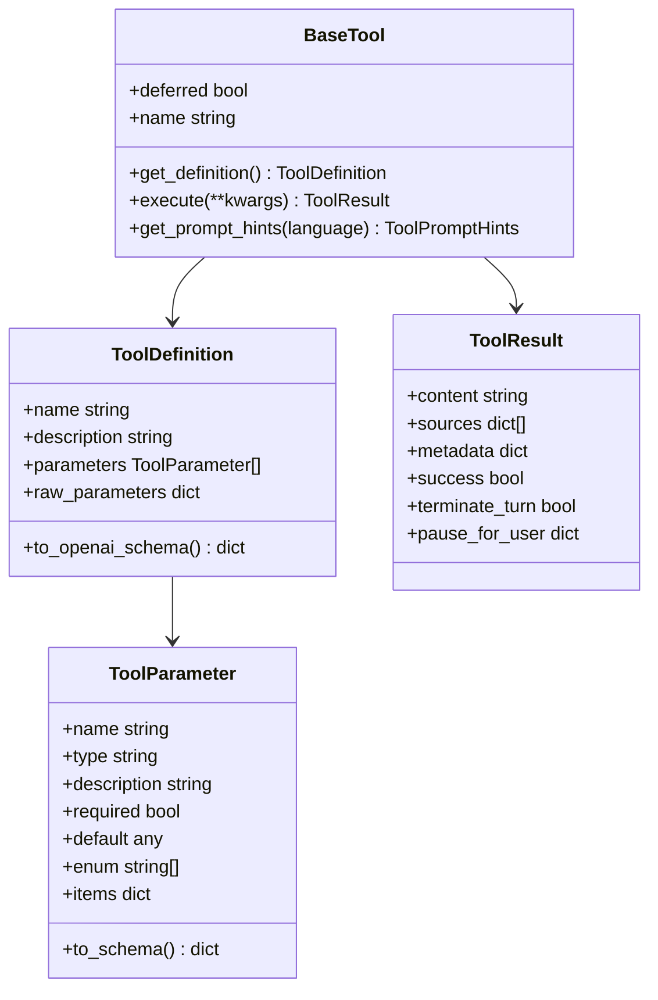
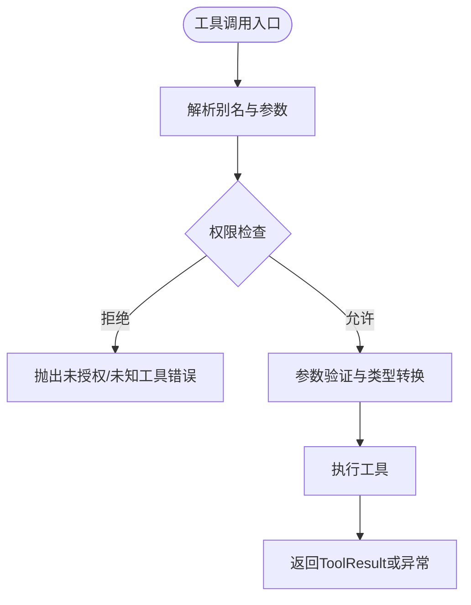
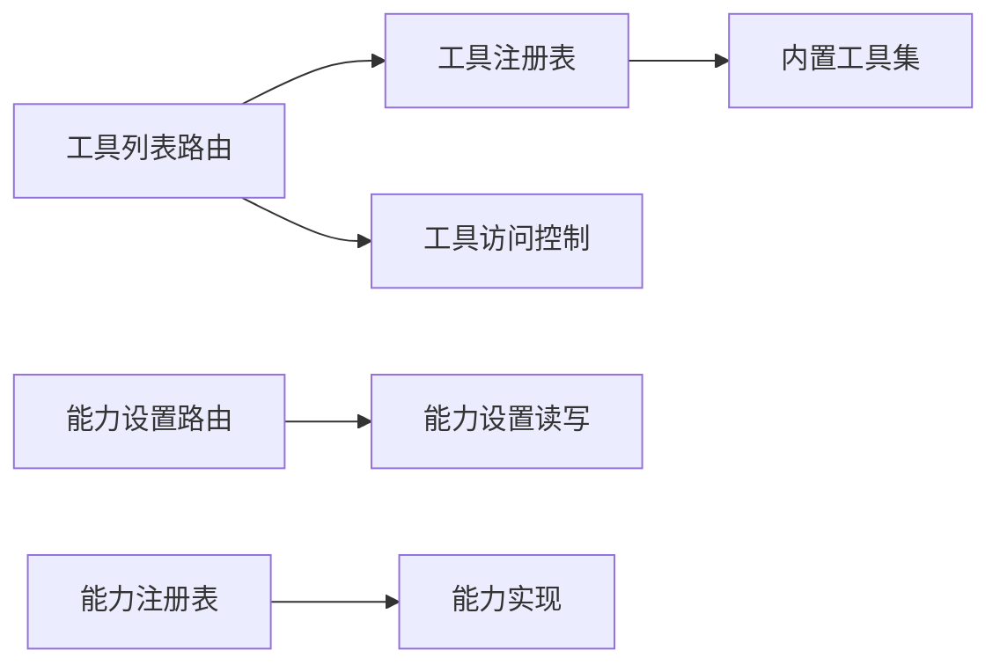

# 工具与能力API

<cite>
**本文引用的文件**
- [deeptutor/api/main.py](file://deeptutor/api/main.py)
- [deeptutor/api/routers/tools.py](file://deeptutor/api/routers/tools.py)
- [deeptutor/api/routers/capabilities_settings.py](file://deeptutor/api/routers/capabilities_settings.py)
- [deeptutor/core/tool_protocol.py](file://deeptutor/core/tool_protocol.py)
- [deeptutor/core/capability_protocol.py](file://deeptutor/core/capability_protocol.py)
- [deeptutor/runtime/registry/tool_registry.py](file://deeptutor/runtime/registry/tool_registry.py)
- [deeptutor/capabilities/registry.py](file://deeptutor/capabilities/registry.py)
- [deeptutor/tools/builtin/__init__.py](file://deeptutor/tools/builtin/__init__.py)
- [deeptutor/multi_user/tool_access.py](file://deeptutor/multi_user/tool_access.py)
- [deeptutor/services/config/capabilities_settings.py](file://deeptutor/services/config/capabilities_settings.py)
- [deeptutor/core/errors.py](file://deeptutor/core/errors.py)
</cite>

## 目录
1. [简介](#简介)
2. [项目结构](#项目结构)
3. [核心组件](#核心组件)
4. [架构总览](#架构总览)
5. [详细组件分析](#详细组件分析)
6. [依赖关系分析](#依赖关系分析)
7. [性能考量](#性能考量)
8. [故障排查指南](#故障排查指南)
9. [结论](#结论)
10. [附录](#附录)

## 简介
本文件面向DeepTutor的工具与能力系统，提供完整的API文档与实践指南。内容覆盖：
- 工具的注册、发现与执行（REST端点）
- 能力的配置、启用与动态加载机制
- 自定义工具开发、能力扩展与插件集成示例
- 权限控制、参数验证与错误处理机制
- 工具性能监控与能力优化的最佳实践

## 项目结构
DeepTutor将“工具”和“能力”分层设计：
- 工具层（Level 1）：所有工具实现BaseTool协议，统一描述定义、提示词与执行接口。
- 能力层（Level 2）：能力是面向用户的多步智能流程（如深度求解、研究等），通过能力协议编排工具与阶段。
- API层：FastAPI路由暴露工具列表、能力设置等REST接口；启动时进行一致性校验与服务初始化。
- 运行时：工具注册表集中管理工具生命周期；能力注册表维护能力集合与激活逻辑。
- 多租户与权限：按用户授权控制可选工具、MCP工具、CLI应用与执行权限。

**图表来源**
- [deeptutor/api/main.py:248-488](file://deeptutor/api/main.py#L248-L488)
- [deeptutor/api/routers/tools.py:169-223](file://deeptutor/api/routers/tools.py#L169-L223)
- [deeptutor/api/routers/capabilities_settings.py:27-39](file://deeptutor/api/routers/capabilities_settings.py#L27-L39)
- [deeptutor/runtime/registry/tool_registry.py:21-154](file://deeptutor/runtime/registry/tool_registry.py#L21-L154)
- [deeptutor/capabilities/registry.py:13-45](file://deeptutor/capabilities/registry.py#L13-L45)
- [deeptutor/core/tool_protocol.py:16-275](file://deeptutor/core/tool_protocol.py#L16-L275)
- [deeptutor/core/capability_protocol.py:20-69](file://deeptutor/core/capability_protocol.py#L20-L69)
- [deeptutor/tools/builtin/__init__.py:43-800](file://deeptutor/tools/builtin/__init__.py#L43-L800)
- [deeptutor/multi_user/tool_access.py:36-114](file://deeptutor/multi_user/tool_access.py#L36-L114)
- [deeptutor/services/config/capabilities_settings.py:297-456](file://deeptutor/services/config/capabilities_settings.py#L297-L456)

**章节来源**
- [deeptutor/api/main.py:248-488](file://deeptutor/api/main.py#L248-L488)

## 核心组件
- 工具协议（BaseTool、ToolDefinition、ToolParameter、ToolResult）：统一工具元数据、参数Schema、提示词与执行结果。
- 能力协议（BaseCapability、CapabilityManifest）：声明能力名称、阶段、使用工具、请求Schema与默认配置。
- 工具注册表（ToolRegistry）：加载内置工具、别名解析、定义与OpenAI Schema生成、执行调度。
- 能力注册表（LOOP_CAPABILITIES）：维护能力实例与激活判断，支持独占工具模式。
- 内置工具集：包含RAG、代码执行、网络搜索、论文检索、记忆读写等常用工具。
- 权限控制：按用户授权过滤可选工具、MCP工具、CLI应用与执行开关。
- 能力设置：统一的GET/PUT接口读写能力相关LLM参数与运行时参数。

**章节来源**
- [deeptutor/core/tool_protocol.py:16-275](file://deeptutor/core/tool_protocol.py#L16-L275)
- [deeptutor/core/capability_protocol.py:20-69](file://deeptutor/core/capability_protocol.py#L20-L69)
- [deeptutor/runtime/registry/tool_registry.py:21-154](file://deeptutor/runtime/registry/tool_registry.py#L21-L154)
- [deeptutor/capabilities/registry.py:13-45](file://deeptutor/capabilities/registry.py#L13-L45)
- [deeptutor/tools/builtin/__init__.py:43-800](file://deeptutor/tools/builtin/__init__.py#L43-L800)
- [deeptutor/multi_user/tool_access.py:36-114](file://deeptutor/multi_user/tool_access.py#L36-L114)
- [deeptutor/services/config/capabilities_settings.py:297-456](file://deeptutor/services/config/capabilities_settings.py#L297-L456)

## 架构总览
系统以FastAPI为入口，启动时完成配置校验、事件总线与外部服务初始化；随后挂载各路由模块。工具与能力在运行时通过注册表集中管理，API层仅负责暴露查询与设置接口。

**图表来源**
- [deeptutor/api/main.py:336-488](file://deeptutor/api/main.py#L336-L488)
- [deeptutor/api/routers/tools.py:169-223](file://deeptutor/api/routers/tools.py#L169-L223)
- [deeptutor/runtime/registry/tool_registry.py:93-127](file://deeptutor/runtime/registry/tool_registry.py#L93-L127)
- [deeptutor/multi_user/tool_access.py:44-53](file://deeptutor/multi_user/tool_access.py#L44-L53)

## 详细组件分析

### 工具注册、发现与执行（REST端点）
- 列出内置工具
  - 方法：GET
  - 路径：/api/v1/tools
  - 功能：返回所有内置工具的定义（名称、描述、参数）、双语提示词、别名、是否可切换、当前启用状态以及“即将推出”占位工具；同时返回已启用的可选工具列表。
  - 权限：需要认证（由主应用挂载时附加）。
  - 行为：从工具注册表获取定义，结合用户授权过滤可切换工具，去重后返回。

- 能力设置
  - 方法：GET/PUT
  - 路径：/api/v1/capabilities/settings
  - 功能：读取或保存能力相关的LLM参数（temperature、max_tokens）与运行时参数（如solve的max_rounds、max_replans等）。
  - 权限：需要认证。
  - 行为：合并默认值并持久化到agents.yaml与main配置；读取时返回完整Schema。

- 工具执行
  - 说明：工具执行通常由聊天/能力管道内部调用，不直接暴露为通用REST端点；但可通过注册表的execute接口在进程内调用。
  - 行为：解析别名、查找工具、执行并返回ToolResult。

**图表来源**
- [deeptutor/api/routers/tools.py:169-223](file://deeptutor/api/routers/tools.py#L169-L223)
- [deeptutor/runtime/registry/tool_registry.py:93-127](file://deeptutor/runtime/registry/tool_registry.py#L93-L127)
- [deeptutor/multi_user/tool_access.py:44-53](file://deeptutor/multi_user/tool_access.py#L44-L53)

**章节来源**
- [deeptutor/api/routers/tools.py:169-223](file://deeptutor/api/routers/tools.py#L169-L223)
- [deeptutor/api/routers/capabilities_settings.py:27-39](file://deeptutor/api/routers/capabilities_settings.py#L27-L39)
- [deeptutor/runtime/registry/tool_registry.py:128-142](file://deeptutor/runtime/registry/tool_registry.py#L128-L142)

### 能力的配置、启用与动态加载
- 能力注册表
  - 维护一组LoopCapability实例（如深度求解、掌握度、Obsidian、子代理、探索上下文）。
  - 根据上下文判断哪些能力在当前轮次激活，并支持“独占工具”模式（替换知识分类工具集）。

- 能力设置读写
  - GET /api/v1/capabilities/settings：返回合并后的能力Schema与默认值。
  - PUT /api/v1/capabilities/settings：将前端表单写入agents.yaml与main配置，并返回新状态。

- 动态加载
  - 能力在运行时通过注册表枚举并激活；工具通过注册表按需加载（包括延迟披露的deferred工具）。

**图表来源**
- [deeptutor/core/capability_protocol.py:20-69](file://deeptutor/core/capability_protocol.py#L20-L69)
- [deeptutor/capabilities/registry.py:13-45](file://deeptutor/capabilities/registry.py#L13-L45)

**章节来源**
- [deeptutor/capabilities/registry.py:13-45](file://deeptutor/capabilities/registry.py#L13-L45)
- [deeptutor/api/routers/capabilities_settings.py:27-39](file://deeptutor/api/routers/capabilities_settings.py#L27-L39)
- [deeptutor/services/config/capabilities_settings.py:297-456](file://deeptutor/services/config/capabilities_settings.py#L297-L456)

### 自定义工具开发、能力扩展与插件集成
- 自定义工具
  - 继承BaseTool，实现get_definition与execute；可选择设置deferred以实现延迟披露。
  - 通过ToolParameter声明参数Schema；ToolResult承载内容、来源、元数据与交互控制（终止轮次、暂停等待用户输入）。
  - 建议复用内置提示词加载器以提供双语指导。

- 能力扩展
  - 实现BaseCapability，声明manifest（名称、阶段、使用工具、请求Schema、默认配置），并在能力注册表中加入实例以参与激活。

- 插件集成
  - 工具注册表支持别名解析与延迟工具；MCP/CLI工具可作为外部提供者接入，受权限控制与白名单约束。

**图表来源**
- [deeptutor/core/tool_protocol.py:16-275](file://deeptutor/core/tool_protocol.py#L16-L275)

**章节来源**
- [deeptutor/core/tool_protocol.py:16-275](file://deeptutor/core/tool_protocol.py#L16-L275)
- [deeptutor/tools/builtin/__init__.py:43-800](file://deeptutor/tools/builtin/__init__.py#L43-L800)

### 权限控制、参数验证与错误处理
- 权限控制
  - 可选工具白名单：allowed_optional_tools()按用户授权过滤可切换工具。
  - MCP工具白名单：allowed_mcp_tools()对延迟工具进行拦截，非管理员默认拒绝。
  - CLI应用白名单：allowed_cli_apps()限制第三方应用运行。
  - 执行覆盖：exec_override()可在部署策略基础上按用户覆盖。

- 参数验证
  - 工具参数通过ToolParameter声明，支持枚举、数组items等；注册表生成OpenAI兼容Schema。
  - 能力设置通过coerce函数与范围限制保证YAML安全。

- 错误处理
  - 统一异常体系：DeepTutorError及其子类（ConfigurationError、ValidationError、ServiceError、LLMServiceError等）。
  - 启动时校验能力与工具引用一致性，避免漂移。

**图表来源**
- [deeptutor/runtime/registry/tool_registry.py:61-73](file://deeptutor/runtime/registry/tool_registry.py#L61-L73)
- [deeptutor/runtime/registry/tool_registry.py:128-142](file://deeptutor/runtime/registry/tool_registry.py#L128-L142)
- [deeptutor/multi_user/tool_access.py:44-114](file://deeptutor/multi_user/tool_access.py#L44-L114)
- [deeptutor/core/errors.py:10-58](file://deeptutor/core/errors.py#L10-L58)

**章节来源**
- [deeptutor/multi_user/tool_access.py:36-114](file://deeptutor/multi_user/tool_access.py#L36-L114)
- [deeptutor/core/errors.py:10-58](file://deeptutor/core/errors.py#L10-L58)
- [deeptutor/api/main.py:57-83](file://deeptutor/api/main.py#L57-L83)

## 依赖关系分析
- API层依赖：
  - tools路由依赖工具注册表与权限控制。
  - capabilities设置路由依赖配置读写模块。
- 运行时依赖：
  - 工具注册表依赖内置工具集与提示词组装。
  - 能力注册表依赖具体能力实现与上下文判定。
- 权限与配置：
  - 工具访问控制基于用户授权与全局策略。
  - 能力设置读写涉及agents.yaml与main配置文件的合并与持久化。

**图表来源**
- [deeptutor/api/routers/tools.py:169-223](file://deeptutor/api/routers/tools.py#L169-L223)
- [deeptutor/api/routers/capabilities_settings.py:27-39](file://deeptutor/api/routers/capabilities_settings.py#L27-L39)
- [deeptutor/runtime/registry/tool_registry.py:49-60](file://deeptutor/runtime/registry/tool_registry.py#L49-L60)
- [deeptutor/capabilities/registry.py:13-45](file://deeptutor/capabilities/registry.py#L13-L45)
- [deeptutor/services/config/capabilities_settings.py:297-456](file://deeptutor/services/config/capabilities_settings.py#L297-L456)

**章节来源**
- [deeptutor/api/routers/tools.py:169-223](file://deeptutor/api/routers/tools.py#L169-L223)
- [deeptutor/api/routers/capabilities_settings.py:27-39](file://deeptutor/api/routers/capabilities_settings.py#L27-L39)
- [deeptutor/runtime/registry/tool_registry.py:49-60](file://deeptutor/runtime/registry/tool_registry.py#L49-L60)
- [deeptutor/capabilities/registry.py:13-45](file://deeptutor/capabilities/registry.py#L13-L45)
- [deeptutor/services/config/capabilities_settings.py:297-456](file://deeptutor/services/config/capabilities_settings.py#L297-L456)

## 性能考量
- 工具延迟披露：通过BaseTool.deferred减少初始工具Schema体积，按需加载以提升首屏性能。
- 并行检索：RAG等工具支持并行调用，提升吞吐。
- 资源限制：代码执行工具通过沙箱限制超时与输出大小，防止资源滥用。
- 日志与访问记录：选择性访问日志仅记录非200响应，降低噪音。
- 配置校验：启动时校验能力与工具引用一致性，避免运行时漂移导致失败。

[本节为通用性能建议，无需特定文件来源]

## 故障排查指南
- 常见错误
  - 未知工具：当工具名不存在或未注册时抛出KeyError。
  - 参数缺失：工具执行前进行必要参数校验，缺失时返回明确错误信息。
  - 配置漂移：能力manifest中引用的工具未注册，启动时报错。
- 定位步骤
  - 检查工具注册表是否加载成功。
  - 核对用户授权白名单是否包含所需工具。
  - 查看能力设置是否正确写入并生效。
  - 关注启动日志中的配置校验结果。

**章节来源**
- [deeptutor/runtime/registry/tool_registry.py:128-142](file://deeptutor/runtime/registry/tool_registry.py#L128-L142)
- [deeptutor/api/main.py:57-83](file://deeptutor/api/main.py#L57-L83)
- [deeptutor/core/errors.py:10-58](file://deeptutor/core/errors.py#L10-L58)

## 结论
DeepTutor通过清晰的工具与能力分层、统一的协议与注册表机制，提供了可扩展、可配置、可授权的智能工具生态。API层简洁稳定，运行时灵活高效，配合完善的权限与错误处理，满足复杂场景下的工具编排与能力扩展需求。

[本节为总结性内容，无需特定文件来源]

## 附录
- REST端点速查
  - GET /api/v1/tools：列出内置工具与启用状态
  - GET /api/v1/capabilities/settings：读取能力设置
  - PUT /api/v1/capabilities/settings：保存能力设置
- 关键类与方法
  - BaseTool.get_definition/execute：工具定义与执行
  - ToolRegistry.execute：工具执行入口
  - BaseCapability.run：能力流水线执行
  - capabilities_settings_dict/save_capabilities_settings：能力设置读写

[本节为补充信息，无需特定文件来源]