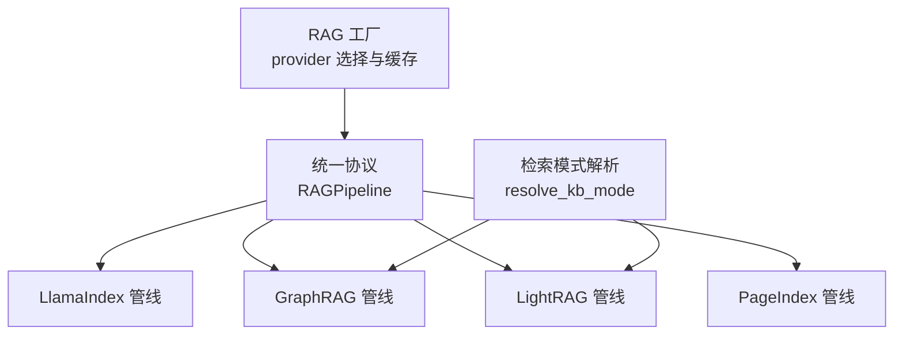
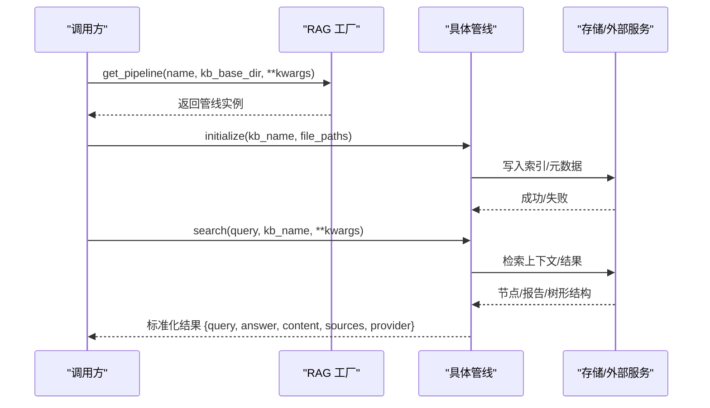
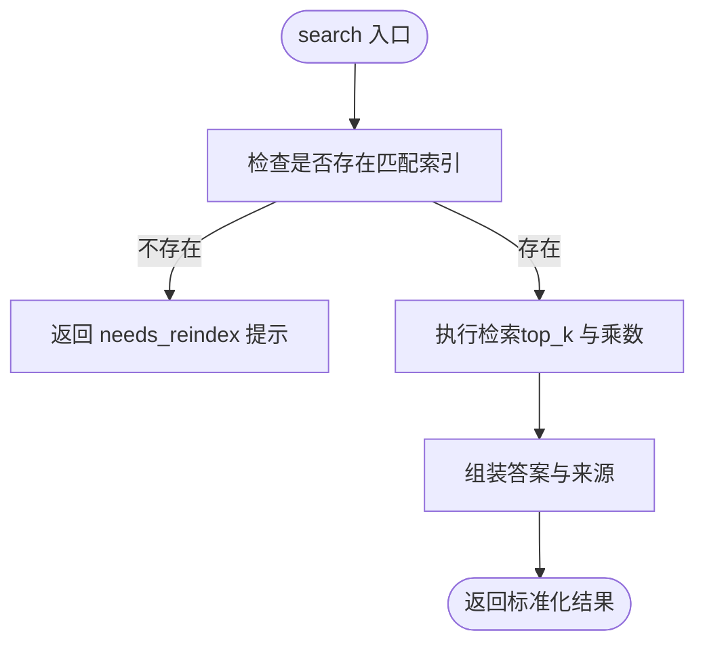
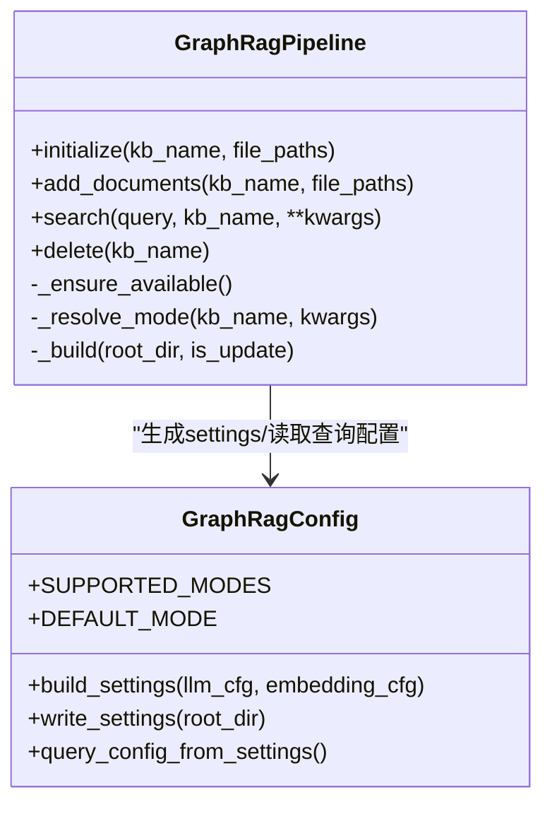
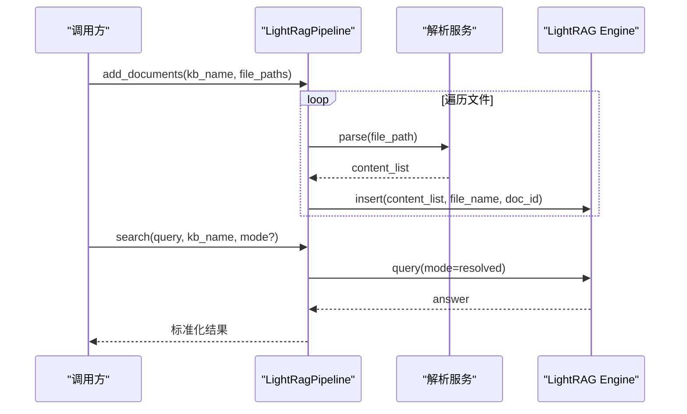
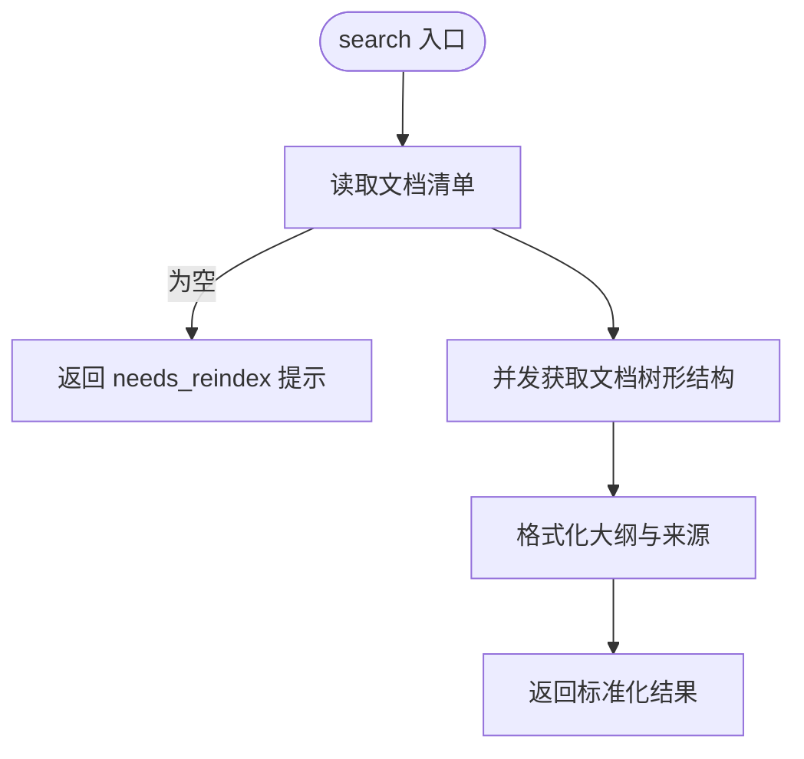
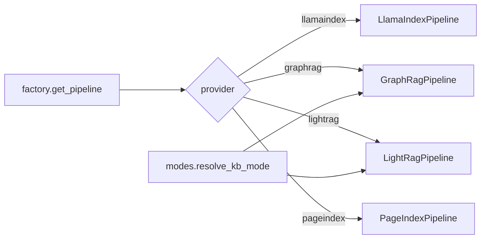

# RAG管道配置API

<cite>
**本文引用的文件**
- [factory.py](file://deeptutor/services/rag/factory.py)
- [base.py](file://deeptutor/services/rag/pipelines/base.py)
- [modes.py](file://deeptutor/services/rag/pipelines/modes.py)
- [llamaindex/config.py](file://deeptutor/services/rag/pipelines/llamaindex/config.py)
- [llamaindex/pipeline.py](file://deeptutor/services/rag/pipelines/llamaindex/pipeline.py)
- [graphrag/config.py](file://deeptutor/services/rag/pipelines/graphrag/config.py)
- [graphrag/pipeline.py](file://deeptutor/services/rag/pipelines/graphrag/pipeline.py)
- [lightrag/config.py](file://deeptutor/services/rag/pipelines/lightrag/config.py)
- [lightrag/pipeline.py](file://deeptutor/services/rag/pipelines/lightrag/pipeline.py)
- [pageindex/config.py](file://deeptutor/services/rag/pipelines/pageindex/config.py)
- [pageindex/pipeline.py](file://deeptutor/services/rag/pipelines/pageindex/pipeline.py)
</cite>

## 目录
1. [简介](#简介)
2. [项目结构](#项目结构)
3. [核心组件](#核心组件)
4. [架构总览](#架构总览)
5. [详细组件分析](#详细组件分析)
6. [依赖关系分析](#依赖关系分析)
7. [性能考量](#性能考量)
8. [故障排查指南](#故障排查指南)
9. [结论](#结论)
10. [附录](#附录)

## 简介
本文件为 DeepTutor RAG 管道的完整 API 文档，聚焦于检索引擎的配置与使用。内容覆盖 LlamaIndex、GraphRAG、LightRAG、PageIndex 等引擎的参数设置、性能调优选项、依赖要求；向量嵌入模型配置、相似度算法选择、检索策略定制；混合检索模式、重排序机制与缓存策略；以及引擎切换、版本管理与兼容性检查的实现细节。读者可据此完成从“选型—配置—索引—检索—排错”的全流程实践。

## 项目结构
DeepTutor 的 RAG 子系统采用“工厂 + 多实现”的分层设计：
- 工厂层负责按 provider 名称选择并实例化具体管线（LlamaIndex、GraphRAG、LightRAG、PageIndex 等）。
- 各管线实现统一遵循最小协议（initialize/add_documents/search/delete），便于替换与扩展。
- 共享能力包括：检索模式解析（modes）、版本管理（index_versioning）、KB 路径解析（kb_paths）等。

图表来源
- [factory.py:30-179](file://deeptutor/services/rag/factory.py#L30-L179)
- [base.py:16-41](file://deeptutor/services/rag/pipelines/base.py#L16-L41)
- [modes.py:19-45](file://deeptutor/services/rag/pipelines/modes.py#L19-L45)

章节来源
- [factory.py:1-179](file://deeptutor/services/rag/factory.py#L1-L179)
- [base.py:1-41](file://deeptutor/services/rag/pipelines/base.py#L1-L41)
- [modes.py:1-49](file://deeptutor/services/rag/pipelines/modes.py#L1-L49)

## 核心组件
- 统一协议 RAGPipeline：定义 initialize/add_documents/search/delete 四个异步方法，所有引擎必须实现该契约。
- 工厂 get_pipeline：根据 provider 名称返回对应管线实例，支持缓存与自定义参数注入。
- 模式解析 resolve_kb_mode：对 mode-aware 引擎（LightRAG、GraphRAG）提供统一的检索模式优先级解析。
- 配置模块：各引擎提供独立的配置读取与校验逻辑（如 LlamaIndex 的 RetrievalConfig、GraphRAG/LightRAG 的设置生成、PageIndex 的凭据加载）。

章节来源
- [base.py:16-41](file://deeptutor/services/rag/pipelines/base.py#L16-L41)
- [factory.py:163-179](file://deeptutor/services/rag/factory.py#L163-L179)
- [modes.py:19-45](file://deeptutor/services/rag/pipelines/modes.py#L19-L45)

## 架构总览
下图展示从调用方到具体引擎的调用链路与数据流。

图表来源
- [factory.py:163-179](file://deeptutor/services/rag/factory.py#L163-L179)
- [llamaindex/pipeline.py:75-177](file://deeptutor/services/rag/pipelines/llamaindex/pipeline.py#L75-L177)
- [graphrag/pipeline.py:73-173](file://deeptutor/services/rag/pipelines/graphrag/pipeline.py#L73-L173)
- [lightrag/pipeline.py:115-221](file://deeptutor/services/rag/pipelines/lightrag/pipeline.py#L115-L221)
- [pageindex/pipeline.py:79-231](file://deeptutor/services/rag/pipelines/pageindex/pipeline.py#L79-L231)

## 详细组件分析

### LlamaIndex 管线
- 职责
  - 本地向量检索，支持混合 BM25 融合（可选）。
  - 基于当前活跃嵌入签名进行索引版本管理。
  - 支持增量添加文档与删除知识库。
- 关键配置
  - 检索配置 RetrievalConfig：profile（vector/hybrid）、vector_top_k_multiplier、bm25_top_k_multiplier、fusion_num_queries。
  - 默认 top_k、分块大小与重叠由运行时设置决定。
- 依赖与环境
  - 可选 BM25 集成：未安装时自动回退到纯向量检索。
  - 需要活跃的嵌入模型以生成嵌入签名与构建索引。
- 检索策略
  - 混合检索：先分别召回候选，再融合排序。
  - 相似度算法：由底层向量库与 BM25 共同决定；可通过 profile 与乘数调整候选规模。
- 错误处理
  - 无匹配索引时返回 needs_reindex 提示。
  - 搜索异常封装为标准错误结果。

图表来源
- [llamaindex/pipeline.py:123-177](file://deeptutor/services/rag/pipelines/llamaindex/pipeline.py#L123-L177)
- [llamaindex/config.py:13-33](file://deeptutor/services/rag/pipelines/llamaindex/config.py#L13-L33)
- [llamaindex/config.py:58-82](file://deeptutor/services/rag/pipelines/llamaindex/config.py#L58-L82)

章节来源
- [llamaindex/pipeline.py:38-287](file://deeptutor/services/rag/pipelines/llamaindex/pipeline.py#L38-L287)
- [llamaindex/config.py:1-109](file://deeptutor/services/rag/pipelines/llamaindex/config.py#L1-L109)

### GraphRAG 管线
- 职责
  - 本地知识图谱检索（local/global/drift/basic）。
  - 通过生成 settings.yaml 桥接 DeepTutor 的 LLM/Embedding 配置。
- 关键配置
  - 查询配置：response_type、community_level、dynamic_community_selection。
  - 输入/输出/缓存/向量库维度等由 build_settings 自动生成。
- 依赖与环境
  - 可选依赖：需安装 graphrag 额外包。
  - 需要活跃的聊天模型与带已知维度的嵌入模型。
- 检索策略
  - 模式解析优先顺序：显式 mode > KB 配置 > 全局默认 > 引擎内置默认。
  - 将 GraphRAG 上下文映射为统一 sources 结构。
- 错误处理
  - 未安装或未配置时抛出明确错误类型。
  - 无索引时返回 needs_reindex 提示。

图表来源
- [graphrag/pipeline.py:36-193](file://deeptutor/services/rag/pipelines/graphrag/pipeline.py#L36-L193)
- [graphrag/config.py:78-192](file://deeptutor/services/rag/pipelines/graphrag/config.py#L78-L192)

章节来源
- [graphrag/pipeline.py:1-227](file://deeptutor/services/rag/pipelines/graphrag/pipeline.py#L1-L227)
- [graphrag/config.py:1-223](file://deeptutor/services/rag/pipelines/graphrag/config.py#L1-L223)

### LightRAG 管线
- 职责
  - 图+向量检索（naive/local/global/hybrid/mix），支持多模态（通过 RAG-Anything）。
  - 使用 DeepTutor 的统一 LLM/视觉/嵌入客户端作为后端。
- 关键配置
  - 查询参数：top_k、response_type（来自运行时设置）。
  - 模式解析：与 GraphRAG 一致，遵循 modes.resolve_kb_mode。
- 依赖与环境
  - 可选依赖：需安装 raganything（包含 LightRAG）。
  - 需要活跃的嵌入模型且具备已知维度。
- 检索策略
  - 通过 engine.query 传入 mode 执行检索。
  - 插入阶段复用解析服务，产出 content_list 后写入 LightRAG。
- 错误处理
  - 未安装或未配置时抛出明确错误类型。
  - 无索引时返回 needs_reindex 提示。

图表来源
- [lightrag/pipeline.py:75-111](file://deeptutor/services/rag/pipelines/lightrag/pipeline.py#L75-L111)
- [lightrag/pipeline.py:115-221](file://deeptutor/services/rag/pipelines/lightrag/pipeline.py#L115-L221)
- [lightrag/config.py:66-168](file://deeptutor/services/rag/pipelines/lightrag/config.py#L66-L168)

章节来源
- [lightrag/pipeline.py:1-245](file://deeptutor/services/rag/pipelines/lightrag/pipeline.py#L1-L245)
- [lightrag/config.py:1-183](file://deeptutor/services/rag/pipelines/lightrag/config.py#L1-L183)

### PageIndex 管线
- 职责
  - 托管式检索：上传文档至云端，程序化检索返回文档树形大纲（标题/页码/摘要）。
  - 深度检索由聊天代理通过 MCP 工具完成；search 用于结构化上下文。
- 关键配置
  - 凭据：api_key、api_base_url（默认 https://api.pageindex.ai）。
  - 支持的文件格式：PDF、Markdown、文本、Office 等。
- 依赖与环境
  - 需要配置有效的 API Key；否则检索会返回 not_configured 错误。
- 检索策略
  - 并发获取每个文档的树形结构，限制每文档字符数以控制上下文大小。
  - 将树形节点转换为统一 sources 结构。
- 错误处理
  - 未配置或网络异常时返回标准化错误结果。
  - 无索引文档时返回 needs_reindex 提示。

图表来源
- [pageindex/pipeline.py:162-231](file://deeptutor/services/rag/pipelines/pageindex/pipeline.py#L162-L231)
- [pageindex/config.py:25-49](file://deeptutor/services/rag/pipelines/pageindex/config.py#L25-L49)

章节来源
- [pageindex/pipeline.py:1-328](file://deeptutor/services/rag/pipelines/pageindex/pipeline.py#L1-L328)
- [pageindex/config.py:1-60](file://deeptutor/services/rag/pipelines/pageindex/config.py#L1-L60)

## 依赖关系分析
- 工厂层维护 provider 白名单与缓存键（kb_base_dir, provider），未知 provider 回退到默认。
- 版本管理：LlamaIndex 使用嵌入签名区分索引版本；GraphRAG/LightRAG/PageRAG 使用合成签名避免误判。
- 模式解析：mode-aware 引擎通过 resolve_kb_mode 统一解析优先级。

图表来源
- [factory.py:30-179](file://deeptutor/services/rag/factory.py#L30-L179)
- [modes.py:19-45](file://deeptutor/services/rag/pipelines/modes.py#L19-L45)

章节来源
- [factory.py:1-295](file://deeptutor/services/rag/factory.py#L1-L295)
- [modes.py:1-49](file://deeptutor/services/rag/pipelines/modes.py#L1-L49)

## 性能考量
- LlamaIndex
  - 混合检索可提升召回质量；通过 vector_top_k_multiplier 与 bm25_top_k_multiplier 调节候选规模。
  - 分块大小与重叠影响索引粒度与检索精度，建议根据文档长度与语义密度调参。
- GraphRAG
  - local 模式通常更经济；global/drift 模式涉及更大范围推理，适合复杂问答。
  - 向量库维度需与嵌入模型一致，避免维度不匹配导致检索失败。
- LightRAG
  - hybrid/mix 模式结合图与向量，适合跨实体关联问题；top_k 与 response_type 可调。
  - 多模态解析依赖解析服务，确保 content_list 有效。
- PageIndex
  - 并发获取文档树形结构，注意每文档字符上限以避免上下文过大。
  - 深度检索走 MCP 工具，适合交互式场景；search 仅返回结构化大纲。

[本节为通用指导，无需特定文件引用]

## 故障排查指南
- 常见错误类型
  - not_configured：缺少必要依赖或凭据（如 GraphRAG/LightRAG 未安装、PageIndex 未配置 API Key）。
  - retrieval_error：检索过程中发生异常（网络、模型、索引损坏等）。
  - needs_reindex：当前无可用索引或嵌入签名不匹配。
- 定位步骤
  - 确认 provider 是否可用：list_pipelines 返回 configured 状态。
  - 检查运行日志中的错误类型与消息，必要时开启调试日志。
  - 验证嵌入模型配置与维度是否与引擎期望一致。
  - 对于 GraphRAG/LightRAG，确认 settings 已正确生成且输出目录存在。
  - 对于 PageIndex，确认 API Key 与基础 URL 配置正确。

章节来源
- [graphrag/pipeline.py:137-183](file://deeptutor/services/rag/pipelines/graphrag/pipeline.py#L137-L183)
- [lightrag/pipeline.py:186-231](file://deeptutor/services/rag/pipelines/lightrag/pipeline.py#L186-L231)
- [pageindex/pipeline.py:162-231](file://deeptutor/services/rag/pipelines/pageindex/pipeline.py#L162-L231)

## 结论
DeepTutor 的 RAG 管道通过统一的协议与工厂层实现了多引擎的可插拔与可配置。LlamaIndex 提供开箱即用的本地向量检索与混合融合；GraphRAG 与 LightRAG 面向图与多模态场景；PageIndex 则提供托管式结构化检索。借助 modes 解析、版本管理与清晰的错误分类，用户可在不同业务需求下灵活切换与优化检索策略。

[本节为总结性内容，无需特定文件引用]

## 附录

### 引擎切换与版本管理
- 引擎切换
  - 通过 factory.get_pipeline(name, kb_base_dir, **kwargs) 指定 provider。
  - list_pipelines 可用于 UI 显示可用引擎及其配置状态。
- 版本管理
  - LlamaIndex：基于嵌入签名选择/重建索引；当活跃嵌入模型变化时，旧索引可能不匹配。
  - GraphRAG/LightRAG/PageRAG：使用合成签名避免误判；通过 index_versioning 管理版本目录。
- 兼容性检查
  - 各引擎在初始化/检索前进行可用性检查（is_graphrag_available/is_lightrag_available/is_pageindex_configured）。
  - 缺失依赖或配置时抛出明确异常，便于前端提示与修复。

章节来源
- [factory.py:182-275](file://deeptutor/services/rag/factory.py#L182-L275)
- [graphrag/config.py:55-75](file://deeptutor/services/rag/pipelines/graphrag/config.py#L55-L75)
- [lightrag/config.py:47-63](file://deeptutor/services/rag/pipelines/lightrag/config.py#L47-L63)
- [pageindex/config.py:25-49](file://deeptutor/services/rag/pipelines/pageindex/config.py#L25-L49)

### 向量嵌入模型配置
- LlamaIndex：使用当前活跃嵌入模型生成签名与索引；可通过运行时设置调整分块几何与 top_k。
- GraphRAG：settings.yaml 中 embedding_models 项需与 DeepTutor 的嵌入配置一致，并指定向量维度。
- LightRAG：embedding_func 包装 DeepTutor 嵌入客户端，需已知维度与最大 token 数。
- PageIndex：不涉及本地嵌入，但需 API Key 访问托管服务。

章节来源
- [llamaindex/config.py:58-95](file://deeptutor/services/rag/pipelines/llamaindex/config.py#L58-L95)
- [graphrag/config.py:116-192](file://deeptutor/services/rag/pipelines/graphrag/config.py#L116-L192)
- [lightrag/config.py:136-168](file://deeptutor/services/rag/pipelines/lightrag/config.py#L136-L168)

### 相似度算法与检索策略
- LlamaIndex：支持 vector 与 hybrid 两种 profile；hybrid 启用 BM25 与向量融合。
- GraphRAG：local/global/drift/basic 四种模式，适用于不同复杂度问题。
- LightRAG：naive/local/global/hybrid/mix 五种模式，mix 支持多模态增强。
- PageIndex：返回文档树形结构，适合结构化导航与浅层 grounding。

章节来源
- [llamaindex/config.py:8-33](file://deeptutor/services/rag/pipelines/llamaindex/config.py#L8-L33)
- [graphrag/config.py:41-75](file://deeptutor/services/rag/pipelines/graphrag/config.py#L41-L75)
- [lightrag/config.py:30-63](file://deeptutor/services/rag/pipelines/lightrag/config.py#L30-L63)

### 混合检索、重排序与缓存
- 混合检索：LlamaIndex 的 hybrid profile 同时使用 BM25 与向量召回，并通过融合策略排序。
- 重排序：由底层检索器与融合逻辑完成；可通过 top_k 与乘数调节候选规模。
- 缓存：GraphRAG 使用 JSON 缓存后端（cache.type=json），减少重复计算开销。

章节来源
- [llamaindex/config.py:13-33](file://deeptutor/services/rag/pipelines/llamaindex/config.py#L13-L33)
- [graphrag/config.py:170-192](file://deeptutor/services/rag/pipelines/graphrag/config.py#L170-L192)