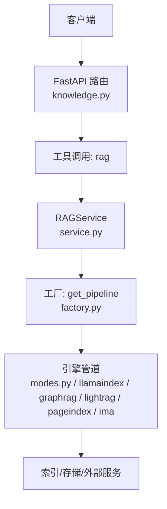
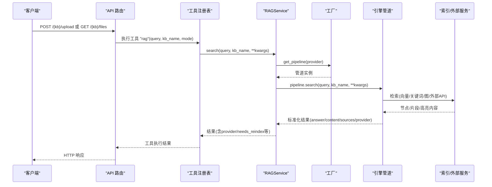
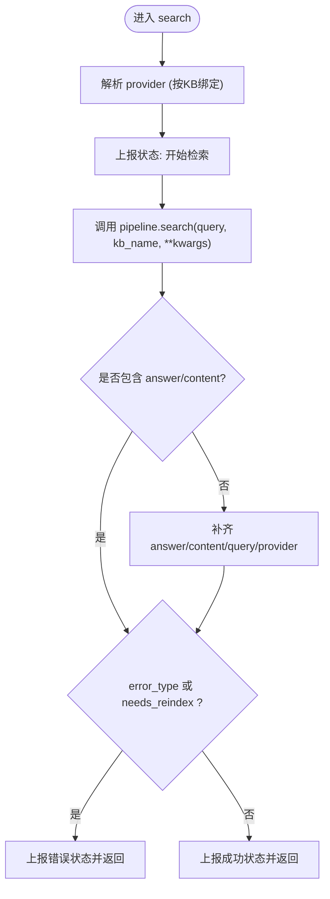
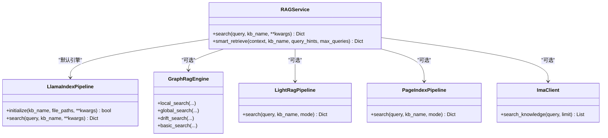
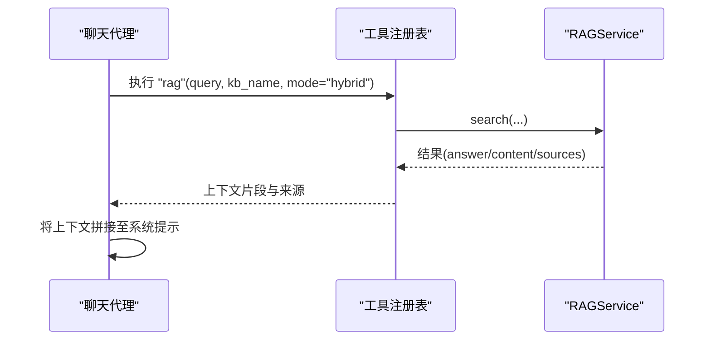
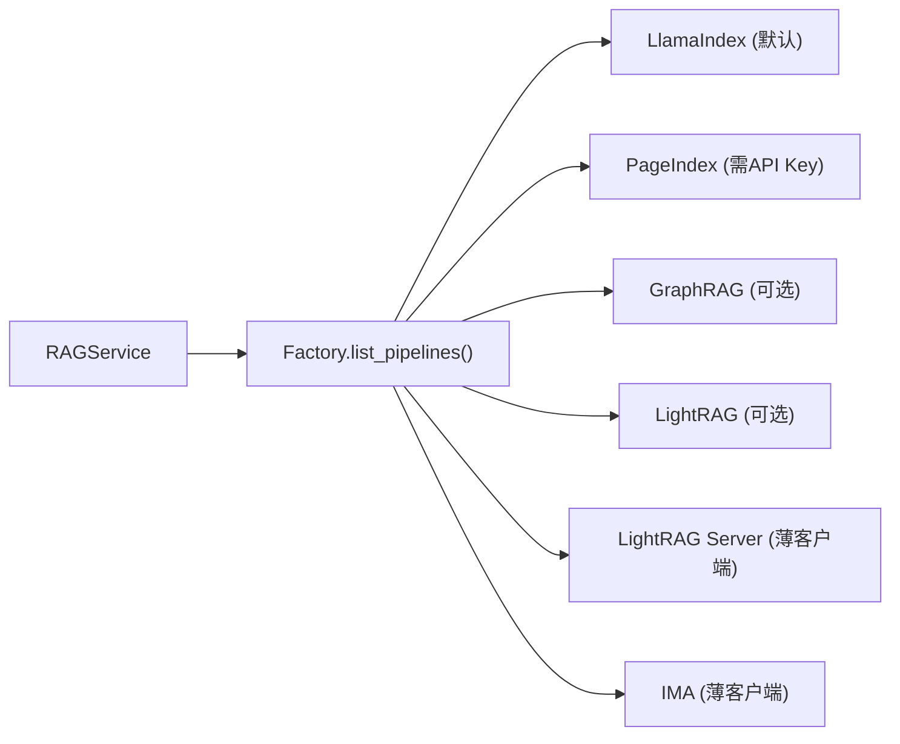

# 向量检索API

<cite>
**本文引用的文件**
- [deeptutor/api/routers/knowledge.py](file://deeptutor/api/routers/knowledge.py)
- [deeptutor/services/rag/service.py](file://deeptutor/services/rag/service.py)
- [deeptutor/services/rag/factory.py](file://deeptutor/services/rag/factory.py)
- [deeptutor/services/rag/pipelines/modes.py](file://deeptutor/services/rag/pipelines/modes.py)
- [deeptutor/services/rag/pipelines/llamaindex/pipeline.py](file://deeptutor/services/rag/pipelines/llamaindex/pipeline.py)
- [deeptutor/services/rag/pipelines/graphrag/engine.py](file://deeptutor/services/rag/pipelines/graphrag/engine.py)
- [deeptutor/services/rag/pipelines/ima/client.py](file://deeptutor/services/rag/pipelines/ima/client.py)
- [deeptutor/agents/chat/chat_agent.py](file://deeptutor/agents/chat/chat_agent.py)
- [deeptutor/agents/chat/agentic_pipeline.py](file://deeptutor/agents/chat/agentic_pipeline.py)
- [tests/api/test_knowledge_router.py](file://tests/api/test_knowledge_router.py)
</cite>

## 目录
1. [简介](#简介)
2. [项目结构](#项目结构)
3. [核心组件](#核心组件)
4. [架构总览](#架构总览)
5. [详细组件分析](#详细组件分析)
6. [依赖关系分析](#依赖关系分析)
7. [性能考量](#性能考量)
8. [故障排查指南](#故障排查指南)
9. [结论](#结论)
10. [附录：API端点与示例](#附录api端点与示例)

## 简介
本文件为 DeepTutor 向量检索的完整 API 文档，覆盖语义搜索、关键词匹配与混合检索的 RESTful 接口；解释查询构建、上下文增强与相关性评分的实现机制；对比不同检索引擎的性能并给出选择建议；说明结果过滤、分页处理与重排序能力；并提供检索质量评估、召回率优化与响应时间优化的最佳实践、查询示例与调优建议。

## 项目结构
DeepTutor 的检索能力由“API 路由层 + RAG 服务层 + 多引擎管道”构成：
- API 路由层：提供知识库管理、文件上传、任务流式日志等 REST 接口，并通过工具调用触发检索。
- RAG 服务层：统一封装检索入口，按知识库绑定解析具体引擎，标准化返回字段，注入事件与追踪。
- 引擎管道：支持 LlamaIndex（本地向量+BM25 混合）、GraphRAG（图检索）、LightRAG/LightRAG Server（图+向量/混合）、PageIndex（托管推理检索）、IMA（腾讯 IMA 开放 API）。

**图示来源**
- [deeptutor/api/routers/knowledge.py:2193-2269](file://deeptutor/api/routers/knowledge.py#L2193-L2269)
- [deeptutor/services/rag/service.py:84-169](file://deeptutor/services/rag/service.py#L84-L169)
- [deeptutor/services/rag/factory.py:120-179](file://deeptutor/services/rag/factory.py#L120-L179)

**章节来源**
- [deeptutor/api/routers/knowledge.py:2193-2269](file://deeptutor/api/routers/knowledge.py#L2193-L2269)
- [deeptutor/services/rag/service.py:84-169](file://deeptutor/services/rag/service.py#L84-L169)
- [deeptutor/services/rag/factory.py:120-179](file://deeptutor/services/rag/factory.py#L120-L179)

## 核心组件
- RAGService：统一检索入口，负责按知识库绑定解析引擎、标准化返回、事件上报与原始日志捕获。
- 工厂层：根据 provider 名称创建对应管道实例，并缓存；暴露可用引擎列表与模式信息。
- 模式解析：mode-aware 引擎（LightRAG、GraphRAG）通过 kb_config.json 与全局默认决定检索模式。
- 引擎实现：
  - LlamaIndexPipeline：本地向量检索，内置 BM25 融合，支持 top_k 控制与错误诊断。
  - GraphRagEngine：支持 local/global/drift/basic 多种图检索模式。
  - LightRAG/LightRAG Server：支持 naive/local/global/hybrid/mix 模式。
  - PageIndex：托管推理检索，需配置 API Key。
  - IMA：通过 OpenAPI 查询外部知识基，支持分页游标。

**章节来源**
- [deeptutor/services/rag/service.py:23-169](file://deeptutor/services/rag/service.py#L23-L169)
- [deeptutor/services/rag/factory.py:1-295](file://deeptutor/services/rag/factory.py#L1-L295)
- [deeptutor/services/rag/pipelines/modes.py:1-49](file://deeptutor/services/rag/pipelines/modes.py#L1-L49)
- [deeptutor/services/rag/pipelines/llamaindex/pipeline.py:123-177](file://deeptutor/services/rag/pipelines/llamaindex/pipeline.py#L123-L177)
- [deeptutor/services/rag/pipelines/graphrag/engine.py:147-181](file://deeptutor/services/rag/pipelines/graphrag/engine.py#L147-L181)
- [deeptutor/services/rag/pipelines/ima/client.py:109-140](file://deeptutor/services/rag/pipelines/ima/client.py#L109-L140)

## 架构总览
下图展示一次检索请求从 API 到引擎再到返回的完整流程，包括查询构建、上下文增强与结果标准化。

**图示来源**
- [deeptutor/api/routers/knowledge.py:2193-2269](file://deeptutor/api/routers/knowledge.py#L2193-L2269)
- [deeptutor/services/rag/service.py:84-169](file://deeptutor/services/rag/service.py#L84-L169)
- [deeptutor/services/rag/factory.py:120-179](file://deeptutor/services/rag/factory.py#L120-L179)

## 详细组件分析

### 检索服务（RAGService）
- 职责：按知识库绑定解析 provider；统一 search 入口；标准化 answer/content/provider；错误类型与 needs_reindex 标记；事件上报与原始日志捕获；智能检索 SmartRetriever 包装。
- 关键行为：
  - 若结果缺少 query/answer/content，自动补齐。
  - 当 error_type 或 needs_reindex 存在时，上报错误状态并直接返回。
  - 记录检索长度与提供者，便于前端展示与追踪。

**图示来源**
- [deeptutor/services/rag/service.py:84-169](file://deeptutor/services/rag/service.py#L84-L169)

**章节来源**
- [deeptutor/services/rag/service.py:84-169](file://deeptutor/services/rag/service.py#L84-L169)

### 引擎管道与模式解析
- LlamaIndexPipeline：
  - 读取当前 embedding 签名，定位版本化存储目录；若无匹配索引则提示需要重新索引。
  - 检索阶段使用 top_k 控制返回数量；异常时返回结构化错误（如无效嵌入向量、形状不匹配等）。
- GraphRagEngine：
  - 根据 resolved_mode 选择 local/global/drift/basic 四种检索路径。
- LightRAG/LightRAG Server：
  - 通过 modes.py 解析显式 mode、KB 配置、全局默认与内置默认，形成最终检索模式。
- IMA 客户端：
  - 基于 cursor 的分页检索，直到达到 limit 或服务端 is_end。

**图示来源**
- [deeptutor/services/rag/service.py:84-169](file://deeptutor/services/rag/service.py#L84-L169)
- [deeptutor/services/rag/pipelines/llamaindex/pipeline.py:123-177](file://deeptutor/services/rag/pipelines/llamaindex/pipeline.py#L123-L177)
- [deeptutor/services/rag/pipelines/graphrag/engine.py:147-181](file://deeptutor/services/rag/pipelines/graphrag/engine.py#L147-L181)
- [deeptutor/services/rag/pipelines/modes.py:19-45](file://deeptutor/services/rag/pipelines/modes.py#L19-L45)
- [deeptutor/services/rag/pipelines/ima/client.py:109-140](file://deeptutor/services/rag/pipelines/ima/client.py#L109-L140)

**章节来源**
- [deeptutor/services/rag/pipelines/llamaindex/pipeline.py:123-177](file://deeptutor/services/rag/pipelines/llamaindex/pipeline.py#L123-L177)
- [deeptutor/services/rag/pipelines/graphrag/engine.py:147-181](file://deeptutor/services/rag/pipelines/graphrag/engine.py#L147-L181)
- [deeptutor/services/rag/pipelines/modes.py:19-45](file://deeptutor/services/rag/pipelines/modes.py#L19-L45)
- [deeptutor/services/rag/pipelines/ima/client.py:109-140](file://deeptutor/services/rag/pipelines/ima/client.py#L109-L140)

### 查询构建与上下文增强
- 聊天代理在生成回答前会调用 rag 工具进行检索，并将检索到的内容作为上下文种子注入提示词；同时收集 sources 用于溯源。
- 智能检索 SmartRetriever 可基于上下文与查询提示生成多个子查询以提升召回。

**图示来源**
- [deeptutor/agents/chat/chat_agent.py:158-203](file://deeptutor/agents/chat/chat_agent.py#L158-L203)
- [deeptutor/agents/chat/agentic_pipeline.py:1132-1165](file://deeptutor/agents/chat/agentic_pipeline.py#L1132-L1165)
- [deeptutor/services/rag/service.py:84-169](file://deeptutor/services/rag/service.py#L84-L169)

**章节来源**
- [deeptutor/agents/chat/chat_agent.py:158-203](file://deeptutor/agents/chat/chat_agent.py#L158-L203)
- [deeptutor/agents/chat/agentic_pipeline.py:1132-1165](file://deeptutor/agents/chat/agentic_pipeline.py#L1132-L1165)

### 相关性评分与结果重排序
- LlamaIndexPipeline：通过向量相似度与 BM25 融合进行排序；top_k 控制返回数量。
- GraphRAG：不同模式（local/global/drift/basic）采用不同的相关性计算策略。
- LightRAG/LightRAG Server：naive/local/global/hybrid/mix 模式影响权重与融合方式。
- IMA：服务端返回高亮内容与排序，客户端遵循 limit 限制。

**章节来源**
- [deeptutor/services/rag/pipelines/llamaindex/pipeline.py:156-167](file://deeptutor/services/rag/pipelines/llamaindex/pipeline.py#L156-L167)
- [deeptutor/services/rag/pipelines/graphrag/engine.py:147-181](file://deeptutor/services/rag/pipelines/graphrag/engine.py#L147-L181)
- [deeptutor/services/rag/pipelines/modes.py:19-45](file://deeptutor/services/rag/pipelines/modes.py#L19-L45)
- [deeptutor/services/rag/pipelines/ima/client.py:109-140](file://deeptutor/services/rag/pipelines/ima/client.py#L109-L140)

## 依赖关系分析
- 引擎可用性：
  - LlamaIndex：开箱即用，无需额外密钥。
  - PageIndex：需要 API Key。
  - GraphRAG/LightRAG：可选本地依赖，安装后启用。
  - LightRAG Server/IMA：薄客户端，始终可用，连接参数按 KB 配置。
- 模式支持：
  - LlamaIndex：无显式模式字段（内部融合）。
  - LightRAG/GraphRAG：支持多种模式，可通过 modes.py 解析。
  - PageIndex/IMA：无模式字段。

**图示来源**
- [deeptutor/services/rag/factory.py:182-275](file://deeptutor/services/rag/factory.py#L182-L275)
- [tests/api/test_knowledge_router.py:134-164](file://tests/api/test_knowledge_router.py#L134-L164)

**章节来源**
- [deeptutor/services/rag/factory.py:182-275](file://deeptutor/services/rag/factory.py#L182-L275)
- [tests/api/test_knowledge_router.py:134-164](file://tests/api/test_knowledge_router.py#L134-L164)

## 性能考量
- 索引与检索分离：
  - 初始化阶段批量构建索引，支持进度回调与版本化存储，避免重复工作。
  - 检索阶段按签名定位存储目录，命中即读，未命中提示重新索引。
- 并发与阻塞：
  - 文件写入与 ZIP 解压在后台线程执行，避免阻塞事件循环。
  - 任务日志通过 SSE 流式输出，便于前端实时反馈。
- 模式选择：
  - 对图检索与混合检索，优先使用 hybrid/mix 以获得更好的召回与精度平衡。
  - 对轻量场景可使用 naive/local 降低延迟。
- 资源控制：
  - top_k 控制返回量，减少下游处理开销。
  - IMA 分页限制防止过度拉取。

[本节为通用指导，不直接分析具体文件]

## 故障排查指南
- 常见错误类型：
  - 无效嵌入向量/形状不匹配：需重新索引知识库以匹配当前嵌入模型。
  - 缺失索引：提示切换回已使用的嵌入模型或重新索引。
  - 引擎不可用：按需安装可选依赖或配置 API Key。
- 诊断要点：
  - 检查 KB 配置中的 rag_provider 与 search_mode。
  - 查看任务流式日志与原始日志捕获，定位底层错误。
  - 关注 needs_reindex 与 error_type 字段，按提示修复。

**章节来源**
- [deeptutor/services/rag/pipelines/llamaindex/pipeline.py:137-152](file://deeptutor/services/rag/pipelines/llamaindex/pipeline.py#L137-L152)
- [deeptutor/services/rag/pipelines/llamaindex/errors.py:30-59](file://deeptutor/services/rag/pipelines/llamaindex/errors.py#L30-L59)
- [deeptutor/api/routers/knowledge.py:2181-2190](file://deeptutor/api/routers/knowledge.py#L2181-L2190)

## 结论
DeepTutor 的向量检索体系通过统一服务层屏蔽多引擎差异，提供一致的检索接口与标准化返回；结合模式解析与上下文增强，满足语义搜索、关键词匹配与混合检索需求。通过合理的模式选择、top_k 控制与索引版本管理，可在召回率与响应时间之间取得良好平衡。生产环境建议优先使用 hybrid/mix 模式，并结合任务日志与错误类型快速定位问题。

[本节为总结性内容，不直接分析具体文件]

## 附录：API端点与示例

### REST 端点概览
- 知识库管理
  - POST /knowledge/create：创建知识库并初始化索引（支持文件上传与背景任务）。
  - POST /knowledge/{kb}/upload：向知识库上传文件并后台处理。
  - GET /knowledge/{kb}/files：列出原始文件与文件夹结构。
  - DELETE /knowledge/{kb}：删除知识库。
  - GET /knowledge/tasks/{task_id}/stream：流式获取任务日志。
- 检索入口
  - 通过工具调用 rag(query, kb_name, mode) 触发检索；REST 侧主要提供知识库管理与文件操作。

**章节来源**
- [deeptutor/api/routers/knowledge.py:2193-2269](file://deeptutor/api/routers/knowledge.py#L2193-L2269)
- [deeptutor/api/routers/knowledge.py:2272-2367](file://deeptutor/api/routers/knowledge.py#L2272-L2367)
- [deeptutor/api/routers/knowledge.py:2007-2043](file://deeptutor/api/routers/knowledge.py#L2007-L2043)
- [deeptutor/api/routers/knowledge.py:2165-2178](file://deeptutor/api/routers/knowledge.py#L2165-L2178)
- [deeptutor/api/routers/knowledge.py:2181-2190](file://deeptutor/api/routers/knowledge.py#L2181-L2190)

### 查询示例
- 语义搜索（混合模式）
  - 调用 rag 工具：query=“山东有什么特色？”, kb_name=“course”, mode=“hybrid”。
  - 期望返回：answer/content 包含相关段落，sources 包含来源片段。
- 关键词匹配（naive 模式）
  - 调用 rag 工具：query=“pancake”, kb_name=“course”, mode=“naive”。
  - 期望返回：精确匹配的片段，适合短词或术语检索。
- 图检索（GraphRAG）
  - 调用 rag 工具：query=“实体关系查询”, kb_name=“papers”, mode=“global” 或 “drift”。
  - 期望返回：基于图结构的聚合答案与上下文。

**章节来源**
- [deeptutor/agents/chat/chat_agent.py:180-203](file://deeptutor/agents/chat/chat_agent.py#L180-L203)
- [deeptutor/services/rag/pipelines/graphrag/engine.py:147-181](file://deeptutor/services/rag/pipelines/graphrag/engine.py#L147-L181)

### 结果过滤、分页与重排序
- 过滤：通过 top_k 控制返回数量；LLM 层可对结果做二次筛选。
- 分页：IMA 客户端基于 cursor 分页拉取，直至 is_end 或达到 limit。
- 重排序：引擎内部完成（向量相似度+BM25 融合；图检索模式），上层无需手动重排。

**章节来源**
- [deeptutor/services/rag/pipelines/llamaindex/pipeline.py:156-167](file://deeptutor/services/rag/pipelines/llamaindex/pipeline.py#L156-L167)
- [deeptutor/services/rag/pipelines/ima/client.py:109-140](file://deeptutor/services/rag/pipelines/ima/client.py#L109-L140)

### 性能调优建议
- 选择合适的模式：
  - 混合检索（hybrid/mix）通常兼顾召回与精度。
  - 轻量场景使用 naive/local 降低延迟。
- 控制 top_k：
  - 根据下游处理成本调整返回数量。
- 索引维护：
  - 确保索引与当前嵌入模型签名匹配，必要时重新索引。
- 监控与诊断：
  - 使用任务流式日志与原始日志捕获定位瓶颈与错误。

**章节来源**
- [deeptutor/services/rag/pipelines/modes.py:19-45](file://deeptutor/services/rag/pipelines/modes.py#L19-L45)
- [deeptutor/services/rag/pipelines/llamaindex/pipeline.py:137-152](file://deeptutor/services/rag/pipelines/llamaindex/pipeline.py#L137-L152)
- [deeptutor/api/routers/knowledge.py:2181-2190](file://deeptutor/api/routers/knowledge.py#L2181-L2190)