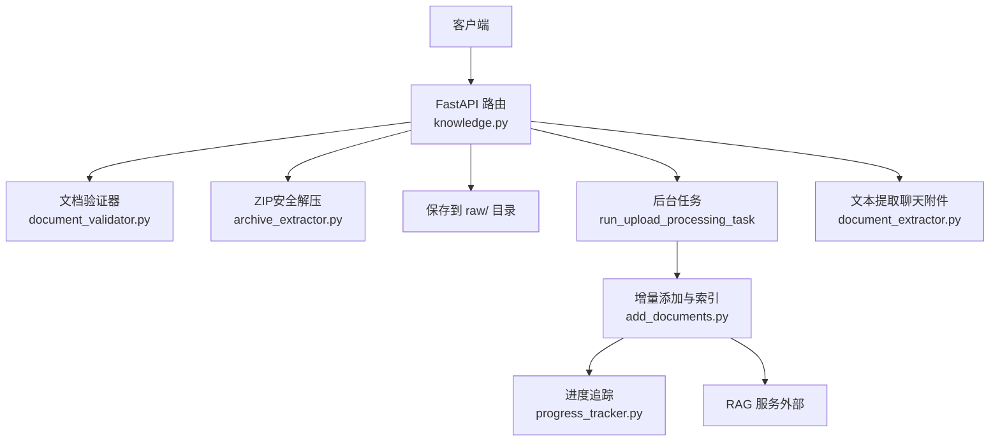
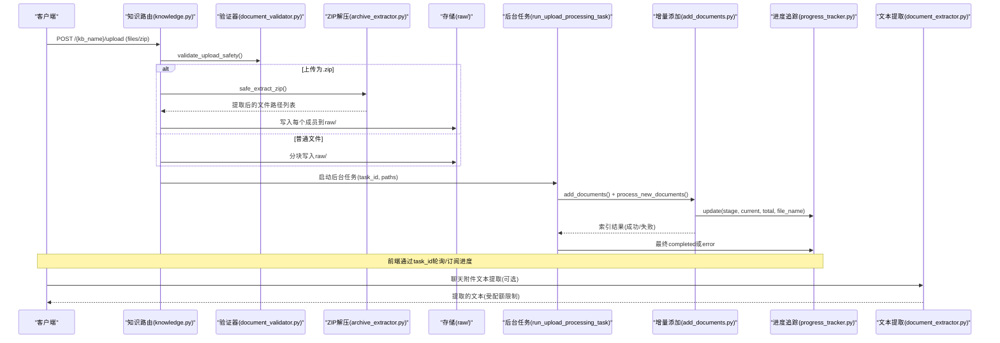
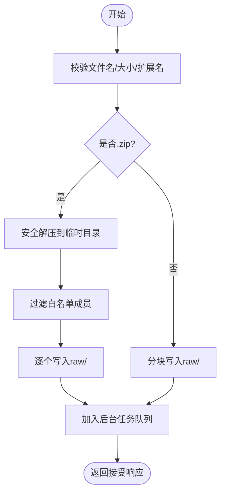
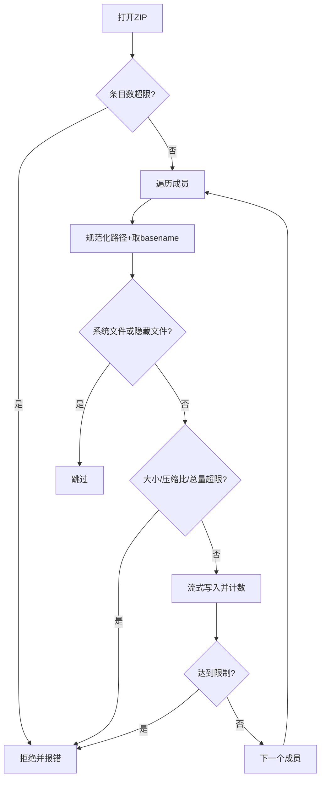
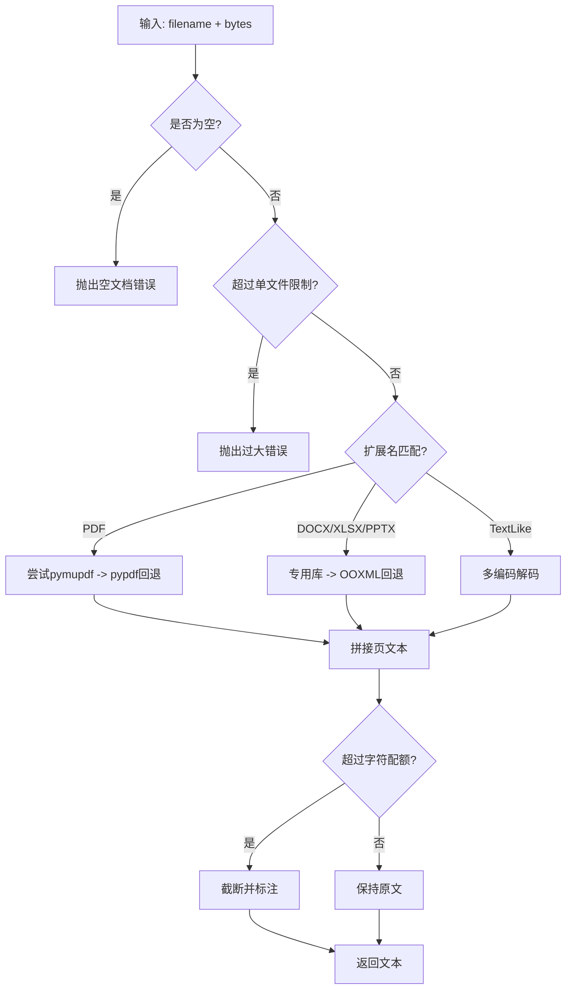
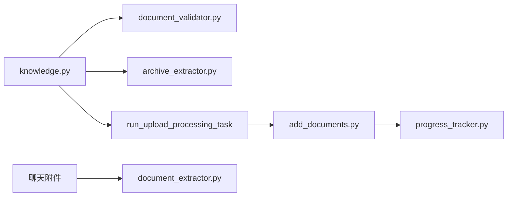

# 文档上传与处理API

<cite>
**本文引用的文件**
- [knowledge.py](file://deeptutor/api/routers/knowledge.py)
- [document_extractor.py](file://deeptutor/utils/document_extractor.py)
- [archive_extractor.py](file://deeptutor/utils/archive_extractor.py)
- [document_validator.py](file://deeptutor/utils/document_validator.py)
- [add_documents.py](file://deeptutor/knowledge/add_documents.py)
- [progress_tracker.py](file://deeptutor/knowledge/progress_tracker.py)
- [test_knowledge_zip_upload.py](file://tests/api/test_knowledge_zip_upload.py)
</cite>

## 目录
1. [简介](#简介)
2. [项目结构](#项目结构)
3. [核心组件](#核心组件)
4. [架构总览](#架构总览)
5. [详细组件分析](#详细组件分析)
6. [依赖关系分析](#依赖关系分析)
7. [性能考虑](#性能考虑)
8. [故障排查指南](#故障排查指南)
9. [结论](#结论)
10. [附录：端点与示例](#附录端点与示例)

## 简介
本文件面向DeepTutor的“文档上传与处理”能力，覆盖单文件与多文件批量上传、ZIP压缩包上传与自动解压、文档格式支持、大小限制、文本提取与内容校验、异步任务处理、进度跟踪与错误恢复，并提供完整的请求响应示例与错误处理指南。该能力以FastAPI路由为核心入口，结合安全解压、文档验证、文本提取与知识库索引等模块，形成端到端的上传处理流水线。

## 项目结构
围绕文档上传与处理的关键代码组织如下：
- API层：知识管理路由负责接收上传、校验、保存、触发后台处理与返回结果
- 工具层：文档验证器、ZIP安全解压、文档文本提取
- 知识入库层：增量添加与索引、进度追踪、状态持久化
- 测试层：针对ZIP上传的安全性与行为进行断言

**图示来源**
- [knowledge.py:230-486](file://deeptutor/api/routers/knowledge.py#L230-L486)
- [archive_extractor.py:67-170](file://deeptutor/utils/archive_extractor.py#L67-L170)
- [document_validator.py:58-118](file://deeptutor/utils/document_validator.py#L58-L118)
- [add_documents.py:216-297](file://deeptutor/knowledge/add_documents.py#L216-L297)
- [progress_tracker.py:133-211](file://deeptutor/knowledge/progress_tracker.py#L133-L211)
- [document_extractor.py:151-197](file://deeptutor/utils/document_extractor.py#L151-L197)

**章节来源**
- [knowledge.py:230-486](file://deeptutor/api/routers/knowledge.py#L230-L486)
- [document_validator.py:58-118](file://deeptutor/utils/document_validator.py#L58-L118)
- [archive_extractor.py:67-170](file://deeptutor/utils/archive_extractor.py#L67-L170)
- [add_documents.py:216-297](file://deeptutor/knowledge/add_documents.py#L216-L297)
- [progress_tracker.py:133-211](file://deeptutor/knowledge/progress_tracker.py#L133-L211)
- [document_extractor.py:151-197](file://deeptutor/utils/document_extractor.py#L151-L197)

## 核心组件
- 文档验证器：统一校验文件名安全、扩展名白名单、MIME类型、文件大小上限，并输出安全文件名
- ZIP安全解压：防Zip Slip、zip bomb、嵌套归档；按扩展名白名单过滤；逐条目流式写入并限制解压后大小
- 文档文本提取：对PDF、DOCX、XLSX、PPTX及文本类格式进行解析，支持可选库优先与回退策略，限制每文件与总字符数
- 增量添加与索引：将文件暂存至raw目录，去重与哈希记录，调用RAG服务完成索引，更新元数据与进度
- 进度追踪：阶段化进度、百分比、当前/总数、错误信息、任务ID、事件广播与本地快照持久化
- 路由与后台任务：接收上传、校验、保存、触发后台任务，使用线程池避免阻塞事件循环

**章节来源**
- [document_validator.py:58-118](file://deeptutor/utils/document_validator.py#L58-L118)
- [archive_extractor.py:32-170](file://deeptutor/utils/archive_extractor.py#L32-L170)
- [document_extractor.py:48-197](file://deeptutor/utils/document_extractor.py#L48-L197)
- [add_documents.py:144-297](file://deeptutor/knowledge/add_documents.py#L144-L297)
- [progress_tracker.py:24-211](file://deeptutor/knowledge/progress_tracker.py#L24-L211)
- [knowledge.py:230-486](file://deeptutor/api/routers/knowledge.py#L230-L486)

## 架构总览
下图展示从客户端上传到后台索引完成的完整流程，包括ZIP解压、安全校验、文本提取（用于聊天附件预览）、增量索引与进度推送。

**图示来源**
- [knowledge.py:230-486](file://deeptutor/api/routers/knowledge.py#L230-L486)
- [knowledge.py:843-990](file://deeptutor/api/routers/knowledge.py#L843-L990)
- [archive_extractor.py:67-170](file://deeptutor/utils/archive_extractor.py#L67-L170)
- [document_validator.py:58-118](file://deeptutor/utils/document_validator.py#L58-L118)
- [add_documents.py:216-297](file://deeptutor/knowledge/add_documents.py#L216-L297)
- [progress_tracker.py:133-211](file://deeptutor/knowledge/progress_tracker.py#L133-L211)
- [document_extractor.py:151-197](file://deeptutor/utils/document_extractor.py#L151-L197)

## 详细组件分析

### 上传路由与批量处理
- 单文件与多文件上传：路由接收多个文件，逐个进行安全校验与保存；支持相对路径保留文件夹结构
- ZIP上传：识别.zip后走安全解压流程，仅提取白名单内的成员，不持久化压缩包本身
- 线程池执行：文件写入与ZIP解压在后台线程执行，避免阻塞事件循环
- 重复检测与冲突：同一批内重复文件名会被拒绝；raw目录中同名文件会基于哈希判断是否跳过
- 提供者格式约束：特定引擎（如PageIndex）会在上传前检查扩展名集合

**图示来源**
- [knowledge.py:335-486](file://deeptutor/api/routers/knowledge.py#L335-L486)
- [knowledge.py:230-289](file://deeptutor/api/routers/knowledge.py#L230-L289)
- [test_knowledge_zip_upload.py:39-96](file://tests/api/test_knowledge_zip_upload.py#L39-L96)

**章节来源**
- [knowledge.py:335-486](file://deeptutor/api/routers/knowledge.py#L335-L486)
- [knowledge.py:230-289](file://deeptutor/api/routers/knowledge.py#L230-L289)
- [test_knowledge_zip_upload.py:39-96](file://tests/api/test_knowledge_zip_upload.py#L39-L96)

### ZIP安全解压
- 防Zip Slip：成员路径被扁平化为安全basename，拒绝包含“..”或绝对路径的成员
- Zip Bomb防护：限制条目数量、压缩比、单条目与总解压大小，超限直接拒绝
- 白名单过滤：仅允许配置扩展名的成员被提取，.zip递归禁止
- 流式写入：逐块读取并写入，超过限制时立即终止并清理部分文件

**图示来源**
- [archive_extractor.py:67-170](file://deeptutor/utils/archive_extractor.py#L67-L170)

**章节来源**
- [archive_extractor.py:67-170](file://deeptutor/utils/archive_extractor.py#L67-L170)

### 文档验证与安全
- 扩展名白名单：PDF、DOCX、TXT、MD、HTML、XML、JSON、CSV、XLSX、XLS、PPTX、PPT等
- MIME校验：默认策略下对猜测的MIME类型进行校验，防止伪装
- 文件名清洗：去除控制字符、替换危险字符、Unicode归一化
- 大小限制：全局最大文件大小由验证器定义

**章节来源**
- [document_validator.py:13-118](file://deeptutor/utils/document_validator.py#L13-L118)

### 文档文本提取（聊天附件）
- 支持格式：二进制Office（PDF、DOCX、XLSX、PPTX）与文本类（代码、标记、配置等）
- 解析策略：优先使用专用库（如pymupdf、python-docx、openpyxl、pptx），失败则回退到OOXML原始解析
- 配额限制：每文件最大字节数、每转总字节数、每文件最大字符数、总字符数限制
- 空内容与损坏处理：空文档、加密PDF、损坏文件均抛出明确异常

**图示来源**
- [document_extractor.py:151-197](file://deeptutor/utils/document_extractor.py#L151-L197)
- [document_extractor.py:216-402](file://deeptutor/utils/document_extractor.py#L216-L402)

**章节来源**
- [document_extractor.py:48-197](file://deeptutor/utils/document_extractor.py#L48-L197)
- [document_extractor.py:216-402](file://deeptutor/utils/document_extractor.py#L216-L402)

### 增量添加与索引
- 暂存与去重：计算文件哈希，跳过已索引或同名校验失败的文件
- 异步索引：调用RAG服务对暂存文件进行索引，逐文件更新进度
- 元数据更新：记录最后索引时间、计数、动作来源（如upload）
- 错误聚合：收集失败项并汇总摘要，便于前端展示

**章节来源**
- [add_documents.py:216-297](file://deeptutor/knowledge/add_documents.py#L216-L297)
- [add_documents.py:339-431](file://deeptutor/knowledge/add_documents.py#L339-L431)

### 进度追踪与任务状态
- 阶段枚举：初始化、处理文档、处理单个文件、完成、错误
- 进度字段：stage、message、current、total、percent、file_name、error、task_id、indexed_count、index_changed、index_action
- 持久化：写入KB本地.progress.json与集中配置，支持页面重载恢复
- 事件广播：通过任务流管理器向订阅者推送进度与日志

**章节来源**
- [progress_tracker.py:24-211](file://deeptutor/knowledge/progress_tracker.py#L24-L211)
- [knowledge.py:843-990](file://deeptutor/api/routers/knowledge.py#L843-L990)

## 依赖关系分析
- 路由依赖验证器与解压器，确保上传安全
- 后台任务依赖增量添加器与进度追踪器，保证可观测性
- 文本提取器独立于上传流程，服务于聊天附件场景
- 测试用例验证ZIP上传行为，确保只提取支持成员且不持久化压缩包

**图示来源**
- [knowledge.py:230-486](file://deeptutor/api/routers/knowledge.py#L230-L486)
- [knowledge.py:843-990](file://deeptutor/api/routers/knowledge.py#L843-L990)
- [add_documents.py:216-297](file://deeptutor/knowledge/add_documents.py#L216-L297)
- [progress_tracker.py:133-211](file://deeptutor/knowledge/progress_tracker.py#L133-L211)
- [document_extractor.py:151-197](file://deeptutor/utils/document_extractor.py#L151-L197)

**章节来源**
- [knowledge.py:230-486](file://deeptutor/api/routers/knowledge.py#L230-L486)
- [knowledge.py:843-990](file://deeptutor/api/routers/knowledge.py#L843-L990)
- [add_documents.py:216-297](file://deeptutor/knowledge/add_documents.py#L216-L297)
- [progress_tracker.py:133-211](file://deeptutor/knowledge/progress_tracker.py#L133-L211)
- [document_extractor.py:151-197](file://deeptutor/utils/document_extractor.py#L151-L197)

## 性能考虑
- 事件循环保护：大文件写入与ZIP解压在后台线程执行，避免阻塞其他请求
- 流式写入：分块读取与写入，降低内存峰值
- 配额限制：对单文件与总字符数进行限制，防止超大内容影响LLM上下文
- 去重与缓存：基于哈希跳过重复文件，减少重复索引开销
- 回退解析：当主解析库不可用时自动回退，提升鲁棒性

[本节提供通用指导，无需具体文件引用]

## 故障排查指南
- 上传失败（400）：常见原因包括扩展名不支持、文件名不安全、文件过大、ZIP无效或缺少支持成员
- 索引失败（后台任务错误）：查看任务日志与进度中的错误消息，定位具体失败文件与原因
- ZIP解压异常：确认压缩比与条目数未超限，检查是否存在Zip Slip或嵌套归档
- 文本提取失败：检查文件格式头（PDF/Office）是否匹配、是否加密、是否损坏
- 进度卡住：检查任务流管理器是否正常广播，确认任务ID有效且进程存活

**章节来源**
- [knowledge.py:230-289](file://deeptutor/api/routers/knowledge.py#L230-L289)
- [knowledge.py:843-990](file://deeptutor/api/routers/knowledge.py#L843-L990)
- [document_extractor.py:151-197](file://deeptutor/utils/document_extractor.py#L151-L197)
- [archive_extractor.py:67-170](file://deeptutor/utils/archive_extractor.py#L67-L170)

## 结论
DeepTutor的文档上传与处理API通过严格的安全校验、安全的ZIP解压、灵活的文本提取与可靠的后台索引流程，实现了从上传到可用的端到端能力。配合进度追踪与错误恢复机制，用户可获得清晰的任务状态与问题定位信息。建议在生产环境中合理配置配额与白名单，并结合监控与日志进行持续优化。

[本节为总结性内容，无需具体文件引用]

## 附录：端点与示例

### 支持的文档格式与大小限制
- 支持扩展名：PDF、DOCX、TXT、MD、HTML、XML、JSON、CSV、XLSX、XLS、PPTX、PPT等（以路由暴露的扩展集为准）
- 最大文件大小：由验证器定义的全局上限（例如200MB级别）
- 聊天附件额外限制：每文件与总字符数配额，可在运行时设置中调整

**章节来源**
- [knowledge.py:1366-1379](file://deeptutor/api/routers/knowledge.py#L1366-L1379)
- [document_validator.py:13-118](file://deeptutor/utils/document_validator.py#L13-L118)
- [document_extractor.py:48-86](file://deeptutor/utils/document_extractor.py#L48-L86)

### 单文件与多文件批量上传
- 方法：POST
- 路径：/{kb_name}/upload
- 参数：multipart/form-data，字段名为files；可选rel_paths用于保留文件夹结构
- 行为：逐个校验与保存；若为.zip则安全解压并仅提取白名单成员；随后触发后台任务

请求示例（表单字段）
- files: 一个或多个文件
- rel_paths: 可选，与files顺序对应的相对路径（如folder/sub/file.txt）

响应示例（接受后立即返回）
- { "status": "accepted", "task_id": "<任务ID>", "message": "上传已接受，后台正在处理" }

**章节来源**
- [knowledge.py:335-486](file://deeptutor/api/routers/knowledge.py#L335-L486)
- [knowledge.py:843-990](file://deeptutor/api/routers/knowledge.py#L843-L990)

### ZIP压缩包上传与自动解压
- 行为：识别.zip后，安全解压到临时目录，过滤白名单成员，逐个写入raw/，不持久化压缩包本身
- 安全：防Zip Slip、zip bomb、嵌套归档；限制条目数、压缩比与总大小

请求示例
- files: bundle.zip

响应示例
- { "status": "accepted", "task_id": "<任务ID>", "message": "ZIP已解压并排队处理" }

**章节来源**
- [knowledge.py:230-289](file://deeptutor/api/routers/knowledge.py#L230-L289)
- [test_knowledge_zip_upload.py:39-96](file://tests/api/test_knowledge_zip_upload.py#L39-L96)

### 进度跟踪与任务查询
- 任务ID：上传接受响应中返回
- 进度获取：通过任务流管理器或KB状态接口轮询/订阅
- 进度字段：stage、message、current、total、percent、file_name、error、task_id、indexed_count、index_changed、index_action

请求示例
- GET /{kb_name}/progress?task_id=<任务ID>

响应示例
- { "stage": "processing_file", "message": "正在索引 notes.pdf", "current": 2, "total": 5, "percent": 40, "file_name": "notes.pdf", "task_id": "<任务ID>" }

**章节来源**
- [progress_tracker.py:133-211](file://deeptutor/knowledge/progress_tracker.py#L133-L211)
- [knowledge.py:843-990](file://deeptutor/api/routers/knowledge.py#L843-L990)

### 错误处理指南
- 400 错误：扩展名不支持、文件名不安全、文件过大、ZIP无效或缺少支持成员
- 409 错误：知识库为只读连接或需要重新索引
- 500 错误：服务器内部错误（如RAG服务不可用）

常见错误消息示例
- “文件类型不受支持：.exe”
- “文件过大：超过最大限制”
- “无效的ZIP归档”
- “归档包含的支持文件为空”

**章节来源**
- [knowledge.py:230-289](file://deeptutor/api/routers/knowledge.py#L230-L289)
- [knowledge.py:843-990](file://deeptutor/api/routers/knowledge.py#L843-L990)
- [document_validator.py:58-118](file://deeptutor/utils/document_validator.py#L58-L118)

### 聊天附件文本提取（可选）
- 用途：将用户上传的文档内容转换为纯文本，嵌入到聊天上下文中
- 限制：每文件与总字符数配额，超出将被截断并提示
- 回退：主解析库失败时自动回退到备用方案

请求示例（聊天消息携带附件）
- attachments: [{ type: "document", filename: "report.pdf", base64: "..." }]

响应示例（消息中包含提取文本）
- { "effective_user_message": "[File: report.pdf]\\n--- Page 1 ---\\n...（已截断）" }

**章节来源**
- [document_extractor.py:151-197](file://deeptutor/utils/document_extractor.py#L151-L197)
- [document_extractor.py:600-705](file://deeptutor/utils/document_extractor.py#L600-L705)