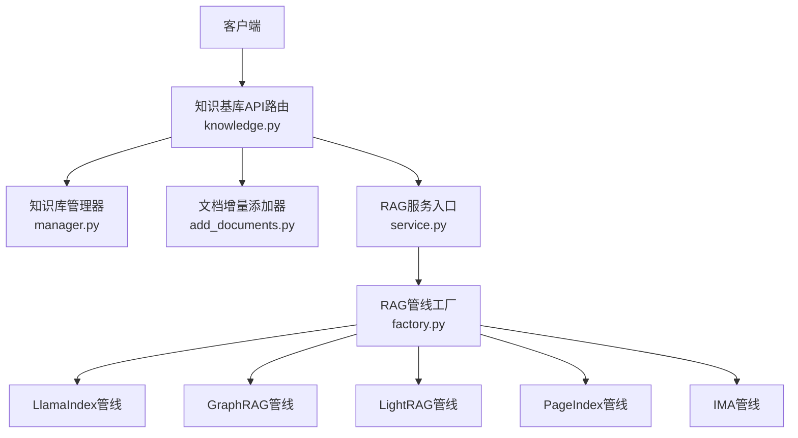
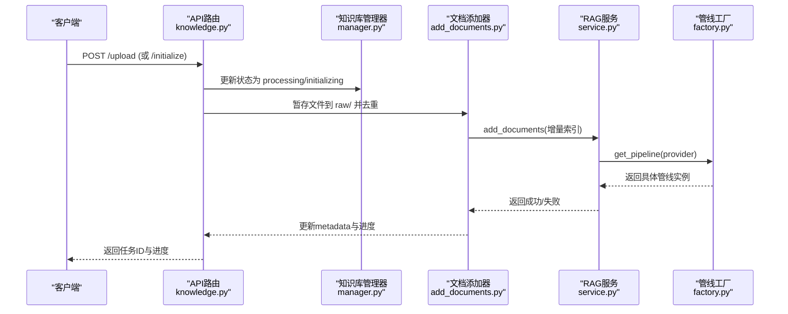
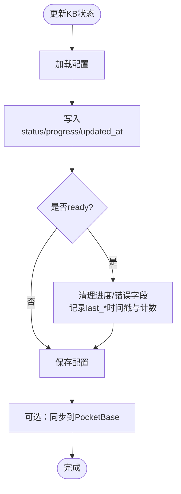
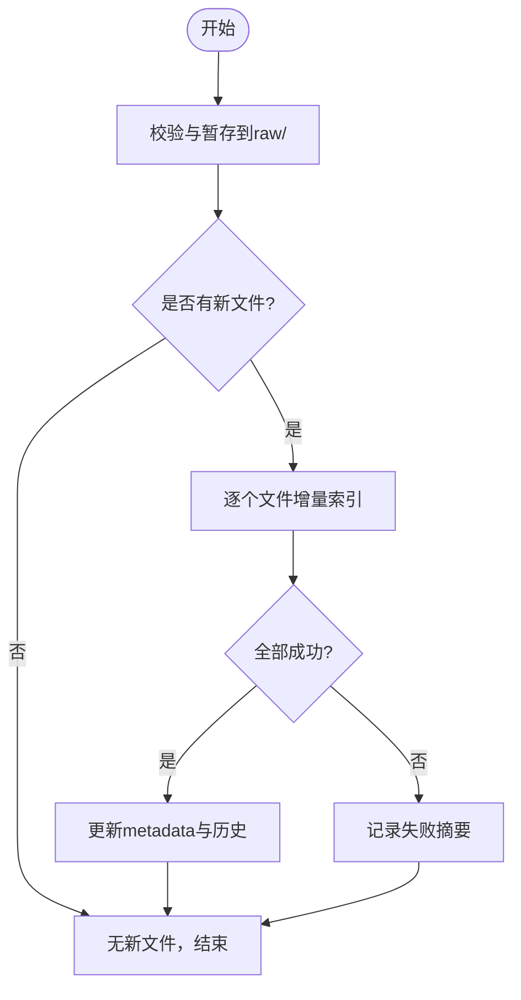
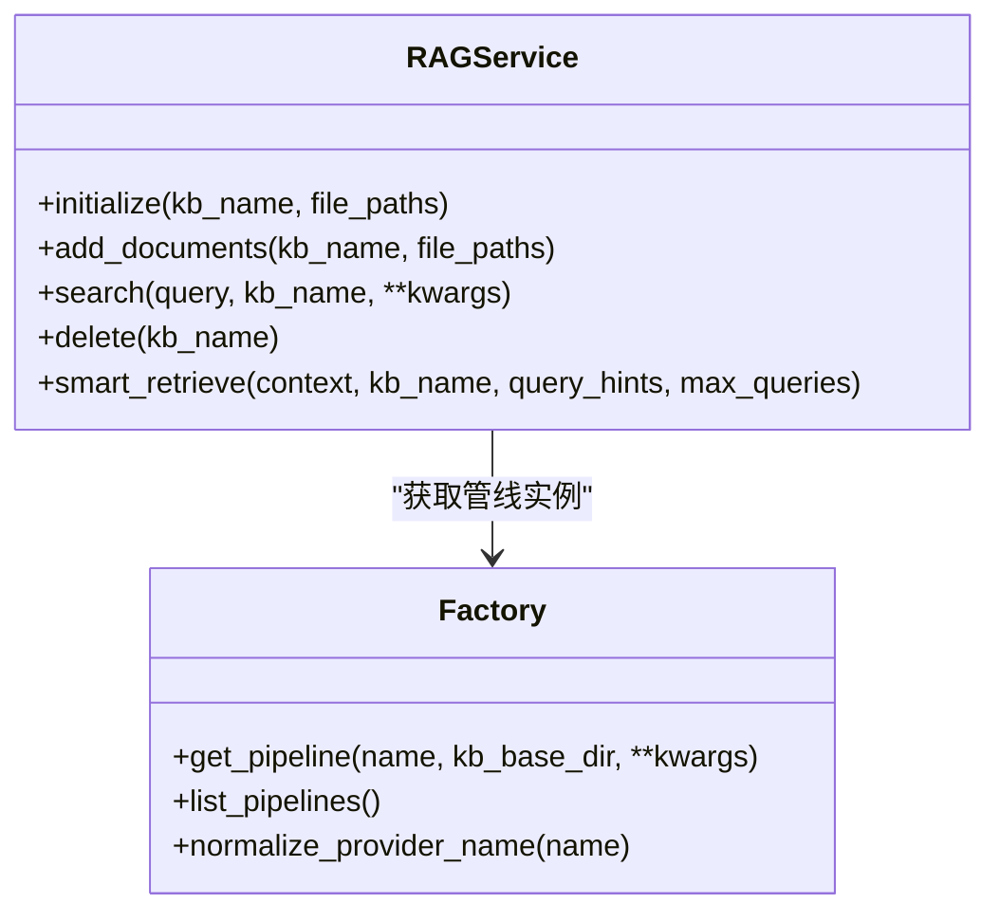
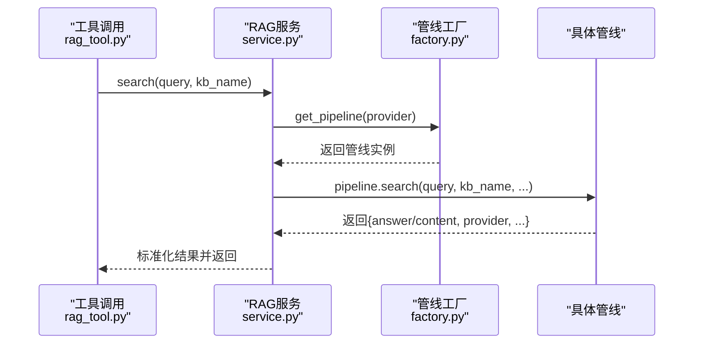

# 知识库API

<cite>
**本文引用的文件**
- [deeptutor/api/routers/knowledge.py](file://deeptutor/api/routers/knowledge.py)
- [deeptutor/knowledge/manager.py](file://deeptutor/knowledge/manager.py)
- [deeptutor/knowledge/add_documents.py](file://deeptutor/knowledge/add_documents.py)
- [deeptutor/services/rag/factory.py](file://deeptutor/services/rag/factory.py)
- [deeptutor/services/rag/service.py](file://deeptutor/services/rag/service.py)
- [deeptutor/tools/rag_tool.py](file://deeptutor/tools/rag_tool.py)
</cite>

## 目录
1. [简介](#简介)
2. [项目结构](#项目结构)
3. [核心组件](#核心组件)
4. [架构总览](#架构总览)
5. [详细组件分析](#详细组件分析)
6. [依赖关系分析](#依赖关系分析)
7. [性能与缓存最佳实践](#性能与缓存最佳实践)
8. [故障排查指南](#故障排查指南)
9. [结论](#结论)
10. [附录：RESTful端点清单](#附录restful端点清单)

## 简介
本文件为 DeepTutor 知识库管理的完整 API 文档，覆盖知识库的创建、配置、索引、检索、文档上传与批量处理、版本管理，以及多引擎 RAG（LlamaIndex、GraphRAG、LightRAG）的配置与使用。同时说明向量检索、语义搜索与混合检索的实现方式，并提供性能调优与缓存策略建议。

## 项目结构
DeepTutor 的知识库能力由“API路由层 + 知识库管理器 + RAG服务工厂”构成：
- API路由层：提供 RESTful 接口，负责鉴权、参数校验、任务编排与进度广播。
- 知识库管理器：维护 kb_config.json、状态、默认库、连接型库（Obsidian/Linked）、自动发现与清理。
- RAG服务工厂：按 KB 绑定的 provider 选择具体管线（LlamaIndex、GraphRAG、LightRAG、PageIndex、IMA等），并统一封装初始化、增量索引、检索与删除。

图表来源
- [deeptutor/api/routers/knowledge.py:1-120](file://deeptutor/api/routers/knowledge.py#L1-L120)
- [deeptutor/knowledge/manager.py:244-350](file://deeptutor/knowledge/manager.py#L244-L350)
- [deeptutor/services/rag/factory.py:120-180](file://deeptutor/services/rag/factory.py#L120-L180)
- [deeptutor/services/rag/service.py:23-82](file://deeptutor/services/rag/service.py#L23-L82)

章节来源
- [deeptutor/api/routers/knowledge.py:1-120](file://deeptutor/api/routers/knowledge.py#L1-L120)
- [deeptutor/knowledge/manager.py:244-350](file://deeptutor/knowledge/manager.py#L244-L350)
- [deeptutor/services/rag/factory.py:1-180](file://deeptutor/services/rag/factory.py#L1-L180)
- [deeptutor/services/rag/service.py:1-82](file://deeptutor/services/rag/service.py#L1-L82)

## 核心组件
- 知识库管理器（KnowledgeBaseManager）
  - 职责：加载/保存 kb_config.json；列出/注册/删除知识库；设置默认库；同步到 PocketBase；探测孤儿条目；自动发现本地有效知识库；维护索引版本与嵌入指纹对齐。
  - 关键方法：update_kb_status、list_knowledge_bases、register_obsidian_vault、register_linked_kb、get_default、set_default。
- 文档增量添加器（DocumentAdder）
  - 职责：校验与暂存文件至 raw/；去重（基于内容哈希）；调用 RAGService 进行增量索引；更新 metadata.json 与历史；失败统计与摘要。
  - 关键流程：add_documents -> process_new_documents -> update_metadata。
- RAG服务（RAGService）
  - 职责：根据 KB 绑定解析 provider；初始化/增量索引/检索/删除；统一日志捕获与事件上报；智能检索（SmartRetriever）。
- RAG管线工厂（Factory）
  - 职责：按 provider 名称返回对应管线实例；支持 LlamaIndex、GraphRAG、LightRAG、PageIndex、IMA、LightRAG Server；提供 list_pipelines、preflight、模型选项等。

章节来源
- [deeptutor/knowledge/manager.py:244-490](file://deeptutor/knowledge/manager.py#L244-L490)
- [deeptutor/knowledge/add_documents.py:144-337](file://deeptutor/knowledge/add_documents.py#L144-L337)
- [deeptutor/services/rag/service.py:23-169](file://deeptutor/services/rag/service.py#L23-L169)
- [deeptutor/services/rag/factory.py:120-180](file://deeptutor/services/rag/factory.py#L120-L180)

## 架构总览
知识库 API 通过 FastAPI 路由暴露端点，内部协调管理器与 RAG 服务完成生命周期操作。上传与索引在后台任务中执行，并通过任务流管理器与进度追踪器向前端推送实时状态。

图表来源
- [deeptutor/api/routers/knowledge.py:843-990](file://deeptutor/api/routers/knowledge.py#L843-L990)
- [deeptutor/knowledge/add_documents.py:258-337](file://deeptutor/knowledge/add_documents.py#L258-L337)
- [deeptutor/services/rag/service.py:68-82](file://deeptutor/services/rag/service.py#L68-L82)
- [deeptutor/services/rag/factory.py:163-180](file://deeptutor/services/rag/factory.py#L163-L180)

## 详细组件分析

### 知识库管理器（KnowledgeBaseManager）
- 配置持久化：使用原子写入避免并发读脏数据；加载时做迁移与规范化（未知provider归并为默认并标记 needs_reindex）。
- 状态更新：update_kb_status 记录 status、progress、时间戳、最后索引计数与动作；ready 时清理进度字段并记录 last_completed_at/last_indexed_at。
- 列表与清理：list_knowledge_bases 会剔除无目录的孤儿条目（带宽限时间），并自动发现未注册的本地有效知识库。
- 连接型库：支持 Obsidian vault 与外部已构建索引的 linked 类型，不触发本地索引流程。

图表来源
- [deeptutor/knowledge/manager.py:381-490](file://deeptutor/knowledge/manager.py#L381-L490)

章节来源
- [deeptutor/knowledge/manager.py:244-490](file://deeptutor/knowledge/manager.py#L244-L490)

### 文档增量添加（DocumentAdder）
- 暂存与去重：计算文件哈希，跳过重复；若已在 raw/ 下则原地索引以保留目录结构。
- 增量索引：通过 RAGService.add_documents 调用绑定 provider 的管线；逐文件更新进度与失败汇总。
- 元数据更新：记录 rag_provider、needs_reindex、last_updated、last_indexed_* 与 update_history。

图表来源
- [deeptutor/knowledge/add_documents.py:216-337](file://deeptutor/knowledge/add_documents.py#L216-L337)

章节来源
- [deeptutor/knowledge/add_documents.py:144-337](file://deeptutor/knowledge/add_documents.py#L144-L337)

### RAG服务与管线工厂
- 服务层：统一 resolve provider（可显式覆盖），封装 initialize/add/search/delete/smart_retrieve；捕获底层日志并转发为工具事件；对 LlamaIndex/GraphRAG/LightRAG 等管线透明。
- 工厂层：按 provider 名称返回对应管线；支持模式切换（如 GraphRAG 的 global/local/drift/basic；LightRAG 的 naive/local/global/hybrid/mix）；提供 preflight 检查与模型选项。

图表来源
- [deeptutor/services/rag/service.py:23-169](file://deeptutor/services/rag/service.py#L23-L169)
- [deeptutor/services/rag/factory.py:120-180](file://deeptutor/services/rag/factory.py#L120-L180)

章节来源
- [deeptutor/services/rag/service.py:23-169](file://deeptutor/services/rag/service.py#L23-L169)
- [deeptutor/services/rag/factory.py:1-180](file://deeptutor/services/rag/factory.py#L1-L180)

### 检索流程（语义/向量/混合）
- 语义检索：通过 RAGService.search 将查询交由绑定 provider 的管线执行；不同管线内部实现语义/向量/混合融合（例如 LlamaIndex 支持 BM25+向量融合）。
- 智能检索：RAGService.smart_retrieve 基于上下文生成多个查询提示，聚合结果。
- 工具侧：tools.rag_tool.rag_search 作为聊天管线中的工具调用入口，强制传入 kb_name，走 RAGService.search。

图表来源
- [deeptutor/tools/rag_tool.py:15-51](file://deeptutor/tools/rag_tool.py#L15-L51)
- [deeptutor/services/rag/service.py:84-169](file://deeptutor/services/rag/service.py#L84-L169)
- [deeptutor/services/rag/factory.py:163-180](file://deeptutor/services/rag/factory.py#L163-L180)

章节来源
- [deeptutor/tools/rag_tool.py:15-51](file://deeptutor/tools/rag_tool.py#L15-L51)
- [deeptutor/services/rag/service.py:84-169](file://deeptutor/services/rag/service.py#L84-L169)

## 依赖关系分析
- 路由层依赖：
  - 知识库管理器：用于状态、列表、默认库、连接型库注册。
  - 文档添加器：用于上传后的增量索引。
  - RAG服务与工厂：用于初始化、检索、删除与管线选择。
  - 进度与任务流：用于后台任务的状态广播与日志采集。
- 管理器依赖：
  - 索引探针与版本管理：用于检测就绪索引、嵌入签名匹配与版本列表。
  - 文件路由：用于统计支持的文档类型。
- 服务层依赖：
  - 路径服务与运行时根：确定 kb_base_dir。
  - 模型目录服务：提供可用模型选项。

章节来源
- [deeptutor/api/routers/knowledge.py:1-120](file://deeptutor/api/routers/knowledge.py#L1-L120)
- [deeptutor/knowledge/manager.py:244-350](file://deeptutor/knowledge/manager.py#L244-L350)
- [deeptutor/services/rag/service.py:23-82](file://deeptutor/services/rag/service.py#L23-L82)
- [deeptutor/services/rag/factory.py:182-275](file://deeptutor/services/rag/factory.py#L182-L275)

## 性能与缓存最佳实践
- 索引与检索
  - 优先使用增量索引（add_documents）而非全量重建，减少重复计算与IO。
  - 合理设置分块大小与重叠（LlamaIndex 可通过配置调整 chunk_size/chunk_overlap），平衡召回与延迟。
  - 对高频查询启用缓存策略（应用层或下游管线缓存），降低重复检索开销。
- 资源隔离
  - 大文件上传与解压在独立线程执行，避免阻塞事件循环；批量上传时注意文件大小限制与ZIP炸弹防护。
- 版本与兼容性
  - 当嵌入模型维度或签名变化时，系统会标记 needs_reindex；确保在切换后重新索引以避免检索质量下降。
- 多引擎选择
  - LlamaIndex：适合本地向量检索与混合检索，开箱即用。
  - GraphRAG：适合复杂关系推理，但索引阶段LLM消耗较高，需评估成本。
  - LightRAG：图+向量检索，支持多种模式，索引较重，适合需要结构化关系的场景。
  - PageIndex/IMA/LightRAG Server：托管或外部服务，无需本地索引，适合集中化管理或跨进程部署。

[本节为通用指导，不直接分析具体文件]

## 故障排查指南
- 常见错误与定位
  - 提供者不可用：创建/使用 KB 前需预检（preflight），确认包安装、API Key、模型可用性。
  - 连接型库只读：Obsidian/Linked 类型不支持上传与重索引，需改为本地索引库。
  - 旧版索引格式：legacy rag_storage 需先重索引才能增量添加。
  - 上传失败：检查文件扩展名、大小限制、ZIP有效性；查看任务日志与进度。
- 诊断步骤
  - 使用 /health 检查服务状态与基础目录。
  - 使用 /rag-pipelines/{provider}/preflight 检查环境准备情况。
  - 查看任务流日志与进度（task_id 关联），定位失败文件与错误信息。
  - 核对 KB 配置与 provider 绑定，必要时触发 reindex。

章节来源
- [deeptutor/api/routers/knowledge.py:590-670](file://deeptutor/api/routers/knowledge.py#L590-L670)
- [deeptutor/api/routers/knowledge.py:1244-1257](file://deeptutor/api/routers/knowledge.py#L1244-L1257)
- [deeptutor/knowledge/add_documents.py:113-141](file://deeptutor/knowledge/add_documents.py#L113-L141)

## 结论
DeepTutor 的知识库 API 提供了从创建、配置、索引到检索的完整闭环，支持多引擎 RAG 与连接型库，具备完善的进度追踪、版本管理与错误恢复机制。通过合理的增量索引、分块策略与缓存设计，可在保证检索质量的同时提升系统性能与可扩展性。

[本节为总结，不直接分析具体文件]

## 附录：RESTful端点清单
以下端点均位于 knowledge.py 路由下，使用前请确保已正确配置 RAG 提供者与模型。

- 健康检查
  - GET /health
  - 用途：检查服务状态、配置与知识库数量。

- RAG提供者与模式
  - GET /rag-providers
  - PUT /rag-providers/{provider}/mode
  - 用途：获取可用提供者及默认检索模式；设置某引擎的全局默认模式。

- 管线配置
  - GET/PUT /rag-pipelines/pageindex/config
  - GET/PUT /rag-pipelines/llamaindex/config
  - GET/PUT /rag-pipelines/graphrag/config
  - GET/PUT /rag-pipelines/lightrag/config
  - 用途：读取/更新各引擎的配置项（如 top_k、chunk 几何、响应风格等）。

- 预检与模型选项
  - GET /rag-pipelines/{provider}/preflight
  - GET /rag-pipelines/model-options
  - PUT /rag-pipelines/active-model
  - 用途：检查提供者环境；列出可用模型；切换全局活跃模型。

- 文件支持与配置
  - GET /supported-file-types
  - GET /configs
  - GET /{kb_name}/config
  - PUT /{kb_name}/config
  - POST /configs/sync
  - 用途：获取支持的文件类型；读取/更新知识库配置；从 metadata 同步配置。

- 默认库与连接型库
  - GET /default
  - PUT /default/{kb_name}
  - POST /connect-obsidian
  - POST /probe-folder
  - POST /connect-folder
  - 用途：设置默认库；连接 Obsidian 仓库；探测/挂载外部索引文件夹。

- 上传与索引（后台任务）
  - 上传与初始化流程通过路由内的后台任务执行，返回 task_id 与进度；内部调用 DocumentAdder 与 RAGService 完成增量索引与状态更新。
  - 典型流程：POST 上传 -> 后台任务 run_upload_processing_task -> 暂存/去重/增量索引 -> 更新状态与进度。

- 工具侧检索
  - tools.rag_tool.rag_search：供聊天管线调用，执行检索并返回答案与上下文。

章节来源
- [deeptutor/api/routers/knowledge.py:993-1599](file://deeptutor/api/routers/knowledge.py#L993-L1599)
- [deeptutor/tools/rag_tool.py:15-51](file://deeptutor/tools/rag_tool.py#L15-L51)