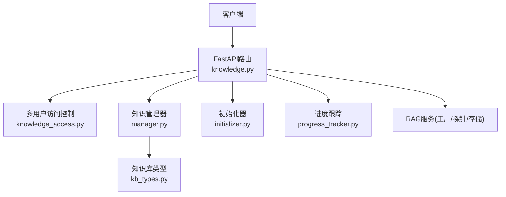
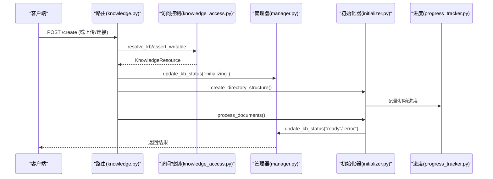
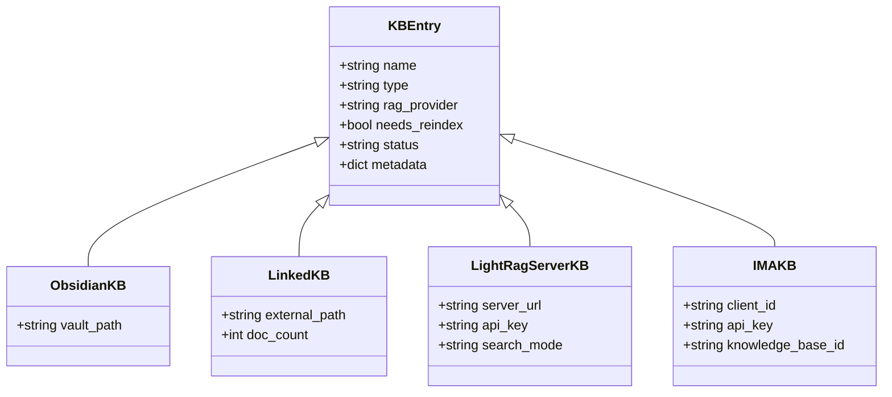
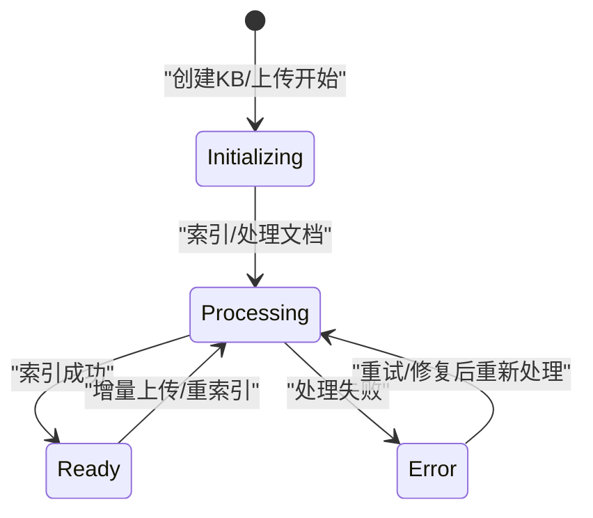
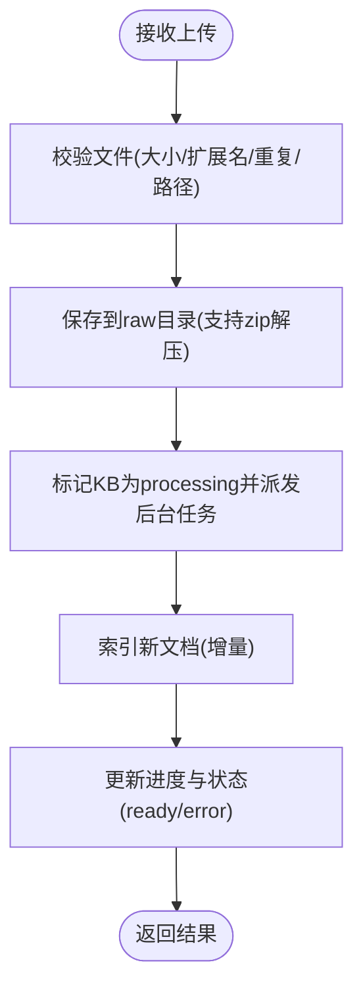
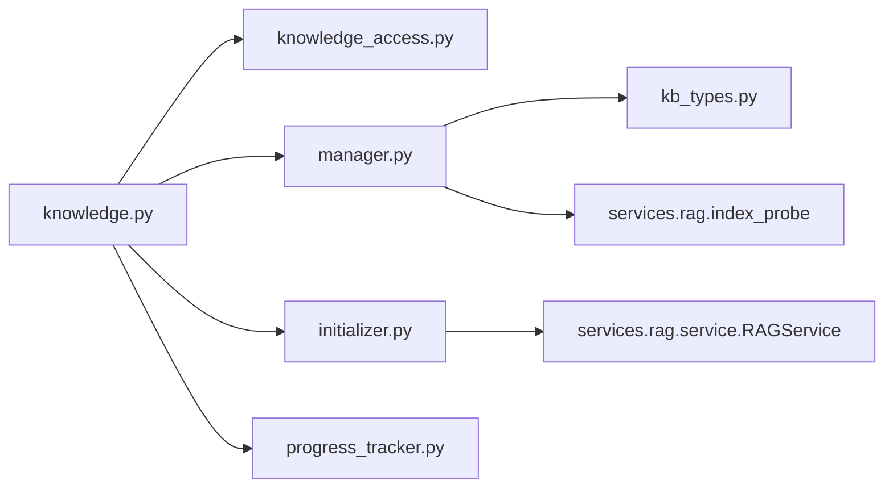

# 知识库管理API

<cite>
**本文引用的文件**
- [knowledge.py](file://deeptutor/api/routers/knowledge.py)
- [manager.py](file://deeptutor/knowledge/manager.py)
- [kb_types.py](file://deeptutor/knowledge/kb_types.py)
- [initializer.py](file://deeptutor/knowledge/initializer.py)
- [progress_tracker.py](file://deeptutor/knowledge/progress_tracker.py)
- [knowledge_access.py](file://deeptutor/multi_user/knowledge_access.py)
- [models.py](file://deeptutor/multi_user/models.py)
</cite>

## 目录
1. [简介](#简介)
2. [项目结构](#项目结构)
3. [核心组件](#核心组件)
4. [架构总览](#架构总览)
5. [详细组件分析](#详细组件分析)
6. [依赖关系分析](#依赖关系分析)
7. [性能考虑](#性能考虑)
8. [故障排查指南](#故障排查指南)
9. [结论](#结论)
10. [附录：RESTful端点清单与示例](#附录restful端点清单与示例)

## 简介
本文件为DeepTutor知识库管理的完整API文档，覆盖知识库的创建、删除、更新、查询等CRUD操作，以及生命周期状态转换（初始化、就绪、处理中）、配置与元数据管理、统计信息、多用户权限控制、错误处理与验证规则、最佳实践。所有端点均基于FastAPI路由实现，并通过知识管理器与RAG服务完成索引与检索能力。

## 项目结构
知识库相关代码主要分布在以下模块：
- API层：FastAPI路由定义与请求校验
- 管理层：知识库注册、状态更新、列表与详情
- 类型与连接：知识库类型判别（本地索引、外部连接、子代理等）
- 初始化器：创建目录结构、拷贝文档、调用RAG服务进行索引
- 进度跟踪：持久化进度并广播到前端
- 多用户访问控制：资源解析、可见性、读写守卫

图表来源
- [knowledge.py:993-1009](file://deeptutor/api/routers/knowledge.py#L993-L1009)
- [knowledge_access.py:69-151](file://deeptutor/multi_user/knowledge_access.py#L69-L151)
- [manager.py:244-350](file://deeptutor/knowledge/manager.py#L244-L350)
- [kb_types.py:46-116](file://deeptutor/knowledge/kb_types.py#L46-L116)

章节来源
- [knowledge.py:993-1009](file://deeptutor/api/routers/knowledge.py#L993-L1009)
- [knowledge_access.py:69-151](file://deeptutor/multi_user/knowledge_access.py#L69-L151)
- [manager.py:244-350](file://deeptutor/knowledge/manager.py#L244-L350)
- [kb_types.py:46-116](file://deeptutor/knowledge/kb_types.py#L46-L116)

## 核心组件
- FastAPI路由层：提供健康检查、RAG提供者与配置、默认知识库、连接外部源（Obsidian、文件夹、LightRAG服务器、IMA）、上传与增量索引、列表与详情等端点。
- 知识管理器：负责配置加载与保存、状态更新、列表扫描与自动注册、默认库设置、连接型知识库注册（Obsidian、Linked、LightRAG Server、IMA）。
- 初始化器：创建KB目录结构、拷贝文档、调用RAG服务执行索引，并在成功或失败时更新状态与进度。
- 进度跟踪：将阶段、消息、百分比、任务ID等写入持久化文件，并通过任务流管理器广播给前端。
- 多用户访问控制：根据当前用户角色与授权，解析KB引用、限制写操作、合并管理员分配的知识库列表。

章节来源
- [knowledge.py:1382-1456](file://deeptutor/api/routers/knowledge.py#L1382-L1456)
- [manager.py:381-490](file://deeptutor/knowledge/manager.py#L381-L490)
- [initializer.py:26-129](file://deeptutor/knowledge/initializer.py#L26-L129)
- [progress_tracker.py:24-132](file://deeptutor/knowledge/progress_tracker.py#L24-L132)
- [knowledge_access.py:69-151](file://deeptutor/multi_user/knowledge_access.py#L69-L151)

## 架构总览
知识库的生命周期由API路由触发，经由管理器与初始化器协同完成：
- 创建流程：创建目录结构 → 注册到配置（initializing）→ 拷贝文档 → 调用RAG服务索引 → 更新状态为ready或error
- 增量上传：校验文件 → 保存到raw → 后台任务索引新文档 → 更新进度与状态
- 连接外部源：探测可用性 → 注册指针型KB（obsidian/linked/lightrag_server/ima），不执行本地索引
- 列表与详情：按当前用户可见范围聚合本地与分配的管理员知识库，返回统计与元数据

图表来源
- [knowledge.py:200-228](file://deeptutor/api/routers/knowledge.py#L200-L228)
- [initializer.py:50-129](file://deeptutor/knowledge/initializer.py#L50-L129)
- [progress_tracker.py:79-132](file://deeptutor/knowledge/progress_tracker.py#L79-L132)
- [manager.py:381-490](file://deeptutor/knowledge/manager.py#L381-L490)

## 详细组件分析

### 知识库类型与连接模型
- 本地索引型KB：默认行为，包含raw与版本化索引目录，支持嵌入与检索。
- 连接型KB：指针类型，不复制也不重建索引，直接读取外部资源：
  - obsidian：指向Markdown仓库，能力层直接导航文件
  - linked：指向已构建的引擎索引目录，按绑定provider检索
  - lightrag_server：指向外部LightRAG实例，通过HTTP查询
  - ima：指向腾讯IMA知识库，通过OpenAPI检索
  - subagent：指向可驱动的子代理后端

图表来源
- [kb_types.py:46-116](file://deeptutor/knowledge/kb_types.py#L46-L116)
- [manager.py:691-777](file://deeptutor/knowledge/manager.py#L691-L777)

章节来源
- [kb_types.py:46-116](file://deeptutor/knowledge/kb_types.py#L46-L116)
- [manager.py:691-777](file://deeptutor/knowledge/manager.py#L691-L777)

### 生命周期状态转换
- initializing：创建目录结构并注册到配置后进入该状态
- processing：上传或索引过程中，进度跟踪器将阶段映射为processing
- ready：索引成功且索引可用，清理进度字段，记录最后完成时间
- error：索引或上传失败，记录错误信息与时间戳

图表来源
- [progress_tracker.py:87-100](file://deeptutor/knowledge/progress_tracker.py#L87-L100)
- [manager.py:443-466](file://deeptutor/knowledge/manager.py#L443-L466)

章节来源
- [progress_tracker.py:87-100](file://deeptutor/knowledge/progress_tracker.py#L87-L100)
- [manager.py:443-466](file://deeptutor/knowledge/manager.py#L443-L466)

### 上传与增量索引流程
- 文件校验：大小、扩展名、重复名、路径安全（防穿越）
- 保存策略：zip解压、分块写入、可选同步至PocketBase
- 后台任务：标记为processing → 索引新文档 → 更新进度与状态 → 完成或失败

图表来源
- [knowledge.py:335-458](file://deeptutor/api/routers/knowledge.py#L335-L458)
- [knowledge.py:501-552](file://deeptutor/api/routers/knowledge.py#L501-L552)
- [knowledge.py:900-990](file://deeptutor/api/routers/knowledge.py#L900-L990)

章节来源
- [knowledge.py:335-458](file://deeptutor/api/routers/knowledge.py#L335-L458)
- [knowledge.py:501-552](file://deeptutor/api/routers/knowledge.py#L501-L552)
- [knowledge.py:900-990](file://deeptutor/api/routers/knowledge.py#L900-L990)

### 连接外部源（Obsidian/文件夹/LightRAG服务器/IMA）
- 探测：验证路径可达、索引就绪、嵌入兼容或远程服务连通
- 注册：以指针形式记录到配置，不复制数据，不执行本地索引
- 使用：检索时按绑定provider直接读取外部资源

章节来源
- [knowledge.py:1509-1692](file://deeptutor/api/routers/knowledge.py#L1509-L1692)
- [manager.py:691-777](file://deeptutor/knowledge/manager.py#L691-L777)

### 多用户权限与访问控制
- 资源解析：根据前缀区分admin/user作用域，支持别名（default/current/selected等）
- 写保护：管理员分配的知识库对用户只读；非管理员不可写admin空间
- 可见性：普通用户列表包含自身知识库与已分配的管理员知识库（若可用）

章节来源
- [knowledge_access.py:69-151](file://deeptutor/multi_user/knowledge_access.py#L69-L151)
- [knowledge_access.py:171-216](file://deeptutor/multi_user/knowledge_access.py#L171-L216)
- [models.py:67-84](file://deeptutor/multi_user/models.py#L67-L84)

## 依赖关系分析
- 路由层依赖访问控制、管理器、初始化器、进度跟踪与RAG服务
- 管理器依赖类型判别、索引探针、原子写入与PocketBase同步
- 初始化器依赖RAG服务与文件路由，负责目录结构与索引流程
- 进度跟踪依赖管理器与任务流管理器，用于持久化与广播

图表来源
- [knowledge.py:1382-1456](file://deeptutor/api/routers/knowledge.py#L1382-L1456)
- [manager.py:244-350](file://deeptutor/knowledge/manager.py#L244-L350)
- [initializer.py:144-223](file://deeptutor/knowledge/initializer.py#L144-L223)

章节来源
- [knowledge.py:1382-1456](file://deeptutor/api/routers/knowledge.py#L1382-L1456)
- [manager.py:244-350](file://deeptutor/knowledge/manager.py#L244-L350)
- [initializer.py:144-223](file://deeptutor/knowledge/initializer.py#L144-L223)

## 性能考虑
- 上传处理在独立线程执行，避免阻塞事件循环
- 配置保存采用原子写入，减少并发竞争
- 列表接口对异常KB进行降级处理，保证整体可用性
- 进度跟踪持久化与广播，便于前端恢复与实时展示

[本节为通用指导，无需具体文件分析]

## 故障排查指南
- 常见错误码
  - 400：参数校验失败、不支持的文件类型、未配置的外部服务（如PageIndex API Key）
  - 403：路径穿越或访问被拒绝
  - 404：知识库不存在或未配置默认库
  - 409：连接型KB只读、需要重索引、已有就绪索引不允许静默切换provider
  - 500：内部错误（日志中包含堆栈）
- 定位方法
  - 查看任务日志与进度快照（.progress.json）
  - 检查RAG提供者配置与可用性（预检端点）
  - 确认多用户授权与资源前缀（user:kb:/admin:kb:）

章节来源
- [knowledge.py:590-645](file://deeptutor/api/routers/knowledge.py#L590-L645)
- [knowledge.py:1409-1456](file://deeptutor/api/routers/knowledge.py#L1409-L1456)
- [knowledge.py:1776-1945](file://deeptutor/api/routers/knowledge.py#L1776-L1945)

## 结论
DeepTutor知识库管理API提供了完整的CRUD与连接能力，结合多用户访问控制与健壮的生命周期管理，满足多场景下的知识检索需求。建议在生产环境中启用RAG提供者预检、合理设置文件大小限制与超时，并结合任务日志与进度快照进行监控与排障。

[本节为总结，无需具体文件分析]

## 附录：RESTful端点清单与示例

说明：
- 基础路径以路由所在模块为准，实际使用前缀请参照应用挂载方式
- 请求体与响应体字段参考各端点实现中的Pydantic模型与返回值
- 多用户环境请使用user:kb:<name>或admin:kb:<name>作为KB引用

- 健康检查
  - GET /health
  - 用途：服务健康与KB计数
  - 响应：status、config_file、base_dir、knowledge_bases_count

- RAG提供者与模式
  - GET /rag-providers
  - PUT /rag-providers/{provider}/mode
  - 用途：列出可用提供者与设置默认检索模式

- 管道配置
  - GET/PUT /rag-pipelines/pageindex/config
  - GET/PUT /rag-pipelines/llamaindex/config
  - GET/PUT /rag-pipelines/graphrag/config
  - GET/PUT /rag-pipelines/lightrag/config
  - 用途：读取与更新各引擎的配置项

- 预检与连接外部源
  - POST /probe-folder
  - POST /connect-folder
  - POST /probe-lightrag-server
  - POST /connect-lightrag-server
  - POST /probe-ima
  - POST /connect-ima
  - POST /connect-obsidian
  - 用途：探测外部资源可用性并注册指针型KB

- 知识库配置与默认库
  - GET /configs
  - GET /{kb_name}/config
  - PUT /{kb_name}/config
  - POST /configs/sync
  - GET /default
  - PUT /default/{kb_name}
  - 用途：获取/更新KB配置、同步配置、设置默认库

- 列表与详情
  - GET /list
  - GET /{kb_name}
  - 用途：列出所有可见KB及详情，含统计、元数据、状态与进度

- 文件类型与上传
  - GET /supported-file-types
  - POST /upload（批量上传与增量索引）
  - 用途：查询支持的文件类型与扩展名，上传文件并触发索引

- 其他
  - GET /rag-pipelines/{provider}/preflight
  - GET /rag-pipelines/model-options
  - PUT /rag-pipelines/active-model
  - 用途：提供者预检、模型选项与激活模型

章节来源
- [knowledge.py:993-1009](file://deeptutor/api/routers/knowledge.py#L993-L1009)
- [knowledge.py:1012-1065](file://deeptutor/api/routers/knowledge.py#L1012-L1065)
- [knowledge.py:1087-1229](file://deeptutor/api/routers/knowledge.py#L1087-L1229)
- [knowledge.py:1366-1456](file://deeptutor/api/routers/knowledge.py#L1366-L1456)
- [knowledge.py:1473-1692](file://deeptutor/api/routers/knowledge.py#L1473-L1692)
- [knowledge.py:1708-1773](file://deeptutor/api/routers/knowledge.py#L1708-L1773)
- [knowledge.py:1776-1945](file://deeptutor/api/routers/knowledge.py#L1776-L1945)