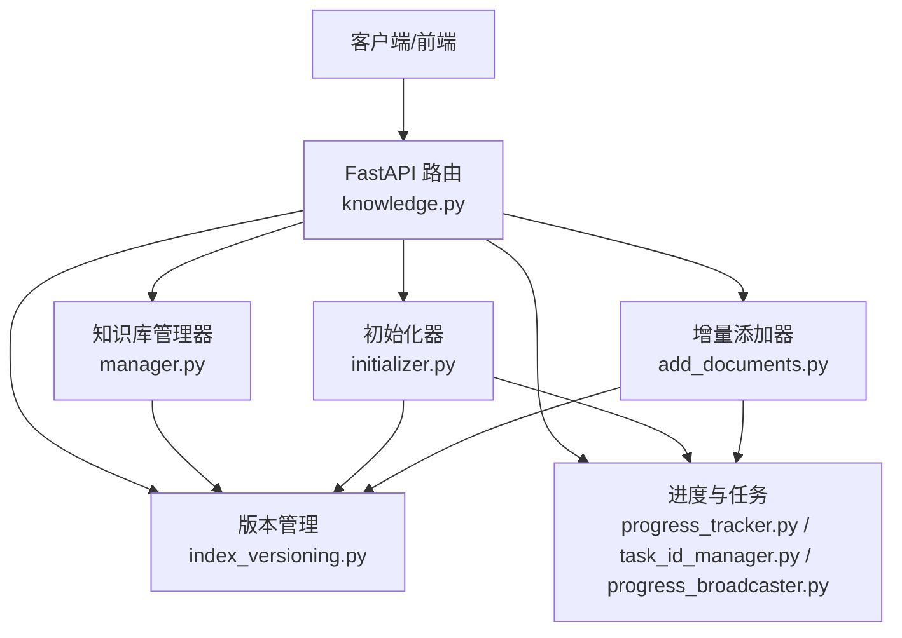
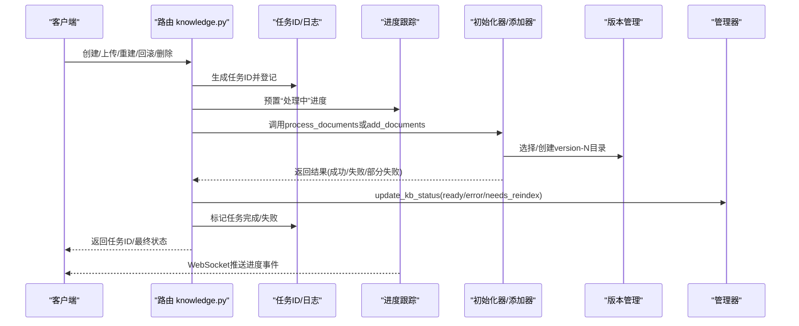
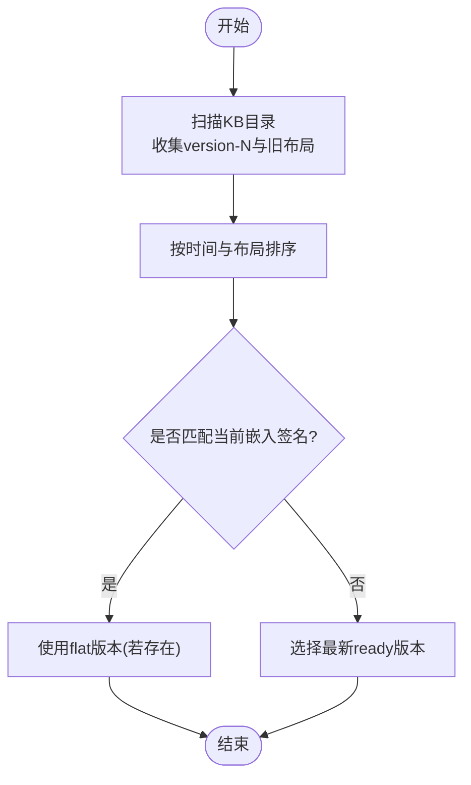
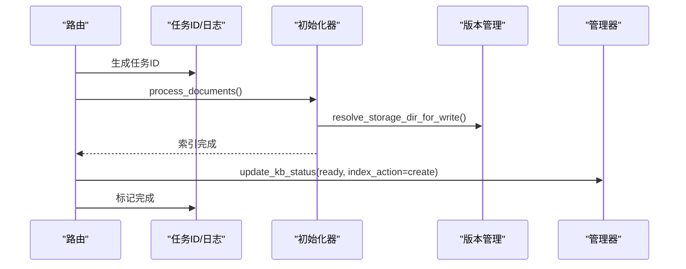
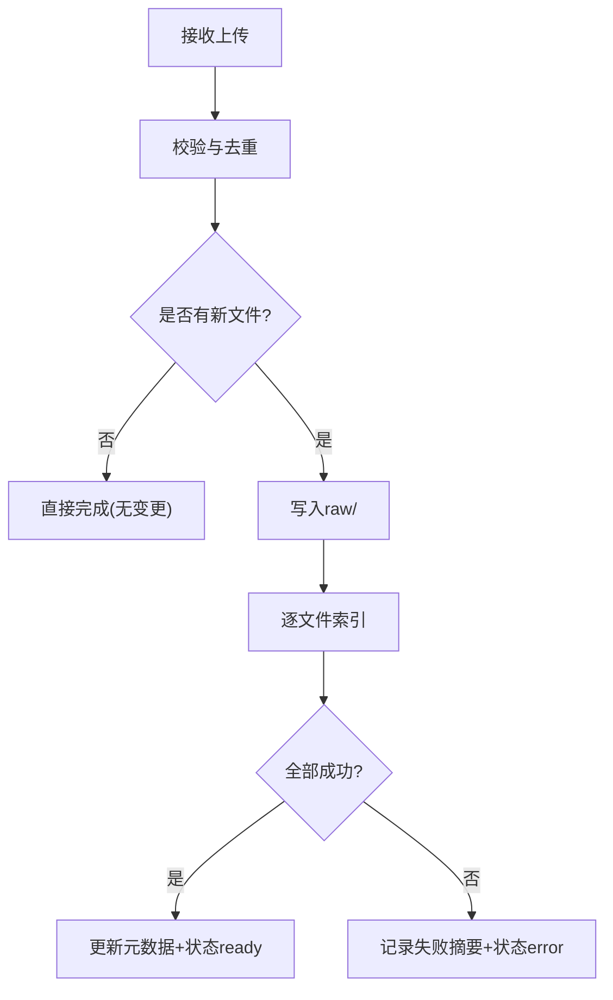
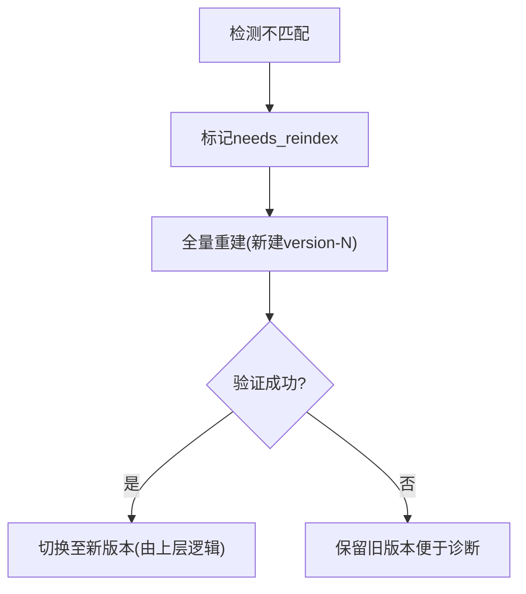
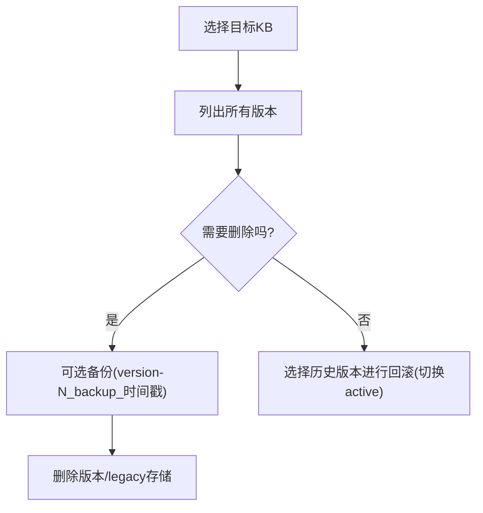
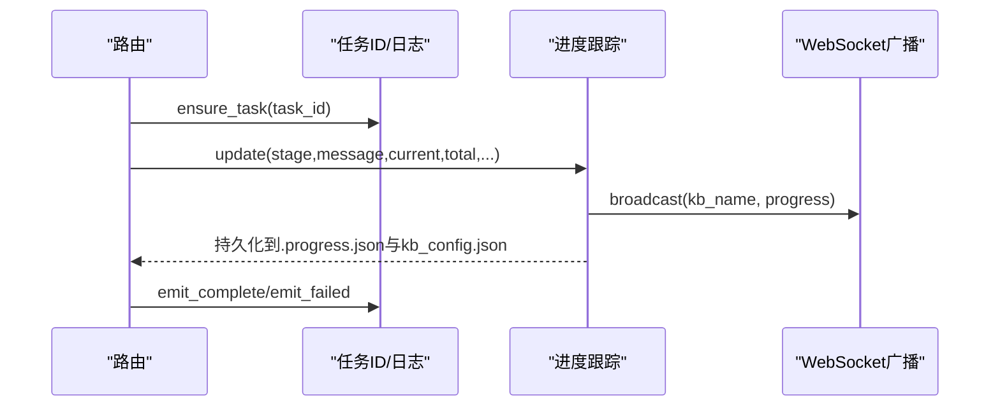
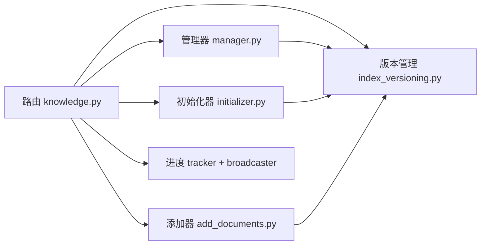

# 知识索引版本管理API

<cite>
**本文引用的文件**
- [knowledge.py](file://deeptutor/api/routers/knowledge.py)
- [manager.py](file://deeptutor/knowledge/manager.py)
- [initializer.py](file://deeptutor/knowledge/initializer.py)
- [add_documents.py](file://deeptutor/knowledge/add_documents.py)
- [manifest.py](file://deeptutor/knowledge/manifest.py)
- [progress_tracker.py](file://deeptutor/knowledge/progress_tracker.py)
- [index_versioning.py](file://deeptutor/services/rag/index_versioning.py)
- [task_id_manager.py](file://deeptutor/api/utils/task_id_manager.py)
- [progress_broadcaster.py](file://deeptutor/api/utils/progress_broadcaster.py)
</cite>

## 目录
1. [简介](#简介)
2. [项目结构](#项目结构)
3. [核心组件](#核心组件)
4. [架构总览](#架构总览)
5. [详细组件分析](#详细组件分析)
6. [依赖关系分析](#依赖关系分析)
7. [性能与并发](#性能与并发)
8. [故障排除指南](#故障排除指南)
9. [结论](#结论)
10. [附录：API参考](#附录api参考)

## 简介
本文件面向DeepTutor的知识索引版本管理API，覆盖索引的创建、增量更新、全量重建、回滚与删除等版本控制能力；解释增量索引、全量重建与并发处理机制；提供状态监控、进度跟踪与错误恢复示例；说明版本兼容性检查、迁移策略与数据一致性保证；并给出性能优化、存储管理与备份恢复的最佳实践及完整流程。

## 项目结构
围绕知识索引版本管理的代码主要分布在以下模块：
- API路由层：负责对外暴露接口、鉴权、参数校验、任务编排与进度广播
- 知识库管理器：维护kb_config.json、清理孤儿、自动注册、状态同步与版本清单
- 初始化器：创建目录结构、复制文档、调用RAG服务完成全量索引
- 增量添加器：将新文件入队raw/并通过RAG服务增量索引，记录哈希与元数据
- 版本管理：以扁平version-N目录组织每版嵌入索引，支持向后兼容旧布局
- 进度与任务：统一的任务ID、日志流、WebSocket进度广播与持久化快照

**图示来源**
- [knowledge.py:843-991](file://deeptutor/api/routers/knowledge.py#L843-L991)
- [manager.py:244-490](file://deeptutor/knowledge/manager.py#L244-L490)
- [initializer.py:26-223](file://deeptutor/knowledge/initializer.py#L26-L223)
- [add_documents.py:144-337](file://deeptutor/knowledge/add_documents.py#L144-L337)
- [index_versioning.py:168-327](file://deeptutor/services/rag/index_versioning.py#L168-L327)
- [progress_tracker.py:34-211](file://deeptutor/knowledge/progress_tracker.py#L34-L211)
- [task_id_manager.py:14-121](file://deeptutor/api/utils/task_id_manager.py#L14-L121)
- [progress_broadcaster.py:14-74](file://deeptutor/api/utils/progress_broadcaster.py#L14-L74)

**章节来源**
- [knowledge.py:843-991](file://deeptutor/api/routers/knowledge.py#L843-L991)
- [manager.py:244-490](file://deeptutor/knowledge/manager.py#L244-L490)
- [initializer.py:26-223](file://deeptutor/knowledge/initializer.py#L26-L223)
- [add_documents.py:144-337](file://deeptutor/knowledge/add_documents.py#L144-L337)
- [index_versioning.py:168-327](file://deeptutor/services/rag/index_versioning.py#L168-L327)
- [progress_tracker.py:34-211](file://deeptutor/knowledge/progress_tracker.py#L34-L211)
- [task_id_manager.py:14-121](file://deeptutor/api/utils/task_id_manager.py#L14-L121)
- [progress_broadcaster.py:14-74](file://deeptutor/api/utils/progress_broadcaster.py#L14-L74)

## 核心组件
- 知识库管理器（KnowledgeBaseManager）
  - 职责：加载/保存配置、列出/自动注册KB、清理孤儿、更新状态与进度、同步到外部系统、计算/缓存索引版本列表与嵌入签名
  - 关键能力：update_kb_status、list_knowledge_bases、_reconcile_embedding_flags、_auto_register_kb
- 初始化器（KnowledgeBaseInitializer）
  - 职责：创建KB目录结构、复制文档、调用RAG服务进行全量索引、更新元数据与状态
- 增量添加器（DocumentAdder）
  - 职责：校验与暂存文件到raw/、去重与冲突处理、通过RAG服务增量索引、记录哈希与更新metadata.json
- 版本管理（index_versioning）
  - 职责：扁平version-N布局、读写meta.json、查找匹配版本、决定读/写/重建路径、兼容旧布局
- 进度与任务（ProgressTracker / TaskIDManager / ProgressBroadcaster）
  - 职责：生成唯一任务ID、持久化进度快照、写入kb_config.json、通过WebSocket广播进度、捕获任务日志

**章节来源**
- [manager.py:244-490](file://deeptutor/knowledge/manager.py#L244-L490)
- [initializer.py:26-223](file://deeptutor/knowledge/initializer.py#L26-L223)
- [add_documents.py:144-337](file://deeptutor/knowledge/add_documents.py#L144-L337)
- [index_versioning.py:168-327](file://deeptutor/services/rag/index_versioning.py#L168-L327)
- [progress_tracker.py:34-211](file://deeptutor/knowledge/progress_tracker.py#L34-L211)
- [task_id_manager.py:14-121](file://deeptutor/api/utils/task_id_manager.py#L14-L121)
- [progress_broadcaster.py:14-74](file://deeptutor/api/utils/progress_broadcaster.py#L14-L74)

## 架构总览
下图展示从请求进入路由到后台任务执行、版本落盘与进度反馈的端到端流程。

**图示来源**
- [knowledge.py:752-841](file://deeptutor/api/routers/knowledge.py#L752-L841)
- [knowledge.py:843-991](file://deeptutor/api/routers/knowledge.py#L843-L991)
- [initializer.py:144-223](file://deeptutor/knowledge/initializer.py#L144-L223)
- [add_documents.py:258-337](file://deeptutor/knowledge/add_documents.py#L258-L337)
- [index_versioning.py:263-327](file://deeptutor/services/rag/index_versioning.py#L263-L327)
- [manager.py:381-490](file://deeptutor/knowledge/manager.py#L381-L490)
- [progress_tracker.py:79-211](file://deeptutor/knowledge/progress_tracker.py#L79-L211)
- [task_id_manager.py:33-83](file://deeptutor/api/utils/task_id_manager.py#L33-L83)

## 详细组件分析

### 版本布局与兼容性
- 扁平版本目录：每个embedding配置对应一个version-N目录，包含docstore、vector store、meta.json等
- 兼容旧布局：保留index_versions/<signature>/llamaindex_storage与根级llamaindex_storage的可读性
- 版本发现与排序：按时间、布局优先级与版本号排序，优先返回flat布局
- 匹配与选择：根据当前嵌入签名查找ready版本；读取时优先匹配，写入时复用或新建flat版本；全量重建强制新建新版本避免覆盖

**图示来源**
- [index_versioning.py:168-237](file://deeptutor/services/rag/index_versioning.py#L168-L237)
- [index_versioning.py:280-327](file://deeptutor/services/rag/index_versioning.py#L280-L327)

**章节来源**
- [index_versioning.py:168-327](file://deeptutor/services/rag/index_versioning.py#L168-L327)

### 索引创建（全量）
- 入口：路由调用run_initialization_task，创建任务ID，设置“处理中”进度
- 初始化：创建目录结构、复制文档、调用RAGService.initialize进行全量索引
- 版本落盘：通过版本管理写入meta.json并创建新的version-N
- 完成：更新KB状态为ready，记录最后索引时间、动作与数量

**图示来源**
- [knowledge.py:752-841](file://deeptutor/api/routers/knowledge.py#L752-L841)
- [initializer.py:144-223](file://deeptutor/knowledge/initializer.py#L144-L223)
- [index_versioning.py:263-327](file://deeptutor/services/rag/index_versioning.py#L263-L327)
- [manager.py:381-490](file://deeptutor/knowledge/manager.py#L381-L490)

**章节来源**
- [knowledge.py:752-841](file://deeptutor/api/routers/knowledge.py#L752-L841)
- [initializer.py:144-223](file://deeptutor/knowledge/initializer.py#L144-L223)

### 增量索引
- 入口：路由调用run_upload_processing_task，预置进度
- 暂存：DocumentAdder.add_documents校验、去重、复制到raw/（保持目录结构）
- 索引：逐文件调用RAGService.add_documents，成功后异步记录哈希
- 元数据：更新metadata.json（provider、last_indexed_at、history等）
- 状态：成功则ready，部分失败则error并附带失败摘要

**图示来源**
- [knowledge.py:843-991](file://deeptutor/api/routers/knowledge.py#L843-L991)
- [add_documents.py:216-337](file://deeptutor/knowledge/add_documents.py#L216-L337)

**章节来源**
- [knowledge.py:843-991](file://deeptutor/api/routers/knowledge.py#L843-L991)
- [add_documents.py:216-337](file://deeptutor/knowledge/add_documents.py#L216-L337)

### 全量重建与迁移
- 触发：当嵌入模型/维度变化或provider变更导致不匹配时，标记needs_reindex
- 重建：resolve_storage_dir_for_rebuild创建新的version-N，完成后替换引用（由上层流程切换）
- 迁移：对旧布局只读兼容，新写入一律走flat布局，逐步收敛

**图示来源**
- [manager.py:128-241](file://deeptutor/knowledge/manager.py#L128-L241)
- [index_versioning.py:315-327](file://deeptutor/services/rag/index_versioning.py#L315-L327)

**章节来源**
- [manager.py:128-241](file://deeptutor/knowledge/manager.py#L128-L241)
- [index_versioning.py:315-327](file://deeptutor/services/rag/index_versioning.py#L315-L327)

### 回滚与删除
- 回滚：通过版本清单定位历史版本，结合上层逻辑切换到旧版本（例如在UI中选择历史版本作为active）
- 删除：清理KB下的版本目录与legacy存储，可选先备份再删除

**图示来源**
- [manager.py:1437-1472](file://deeptutor/knowledge/manager.py#L1437-L1472)
- [index_versioning.py:168-190](file://deeptutor/services/rag/index_versioning.py#L168-L190)

**章节来源**
- [manager.py:1437-1472](file://deeptutor/knowledge/manager.py#L1437-L1472)
- [index_versioning.py:168-190](file://deeptutor/services/rag/index_versioning.py#L168-L190)

### 进度监控、任务追踪与错误恢复
- 任务ID：TaskIDManager生成唯一ID，维护运行态与完成态元数据，定期清理
- 进度快照：ProgressTracker持久化.kb/.progress.json与kb_config.json，支持页面刷新后恢复
- 实时广播：ProgressBroadcaster通过WebSocket向订阅者推送进度事件
- 日志捕获：capture_task_logs将后台任务日志输出到任务流，便于排查

**图示来源**
- [task_id_manager.py:33-83](file://deeptutor/api/utils/task_id_manager.py#L33-L83)
- [progress_tracker.py:79-211](file://deeptutor/knowledge/progress_tracker.py#L79-L211)
- [progress_broadcaster.py:28-74](file://deeptutor/api/utils/progress_broadcaster.py#L28-L74)
- [knowledge.py:578-587](file://deeptutor/api/routers/knowledge.py#L578-L587)

**章节来源**
- [task_id_manager.py:33-83](file://deeptutor/api/utils/task_id_manager.py#L33-L83)
- [progress_tracker.py:79-211](file://deeptutor/knowledge/progress_tracker.py#L79-L211)
- [progress_broadcaster.py:28-74](file://deeptutor/api/utils/progress_broadcaster.py#L28-L74)
- [knowledge.py:578-587](file://deeptutor/api/routers/knowledge.py#L578-L587)

## 依赖关系分析
- 路由层依赖：
  - 管理器：状态与配置、版本清单、默认库、权限与资源解析
  - 初始化器/添加器：具体索引实现
  - 版本管理：版本发现、匹配、读写路径决策
  - 进度与任务：任务ID、日志、WebSocket广播
- 管理器依赖：
  - 版本管理：inspect/list/find/resolve
  - 嵌入签名：用于判断是否需要重建
  - 文件IO：原子写入配置
- 初始化器/添加器依赖：
  - RAG服务：initialize/add_documents
  - 版本管理：写入meta.json与选择存储目录
  - 进度跟踪：阶段更新与持久化

**图示来源**
- [knowledge.py:843-991](file://deeptutor/api/routers/knowledge.py#L843-L991)
- [manager.py:244-490](file://deeptutor/knowledge/manager.py#L244-L490)
- [initializer.py:26-223](file://deeptutor/knowledge/initializer.py#L26-L223)
- [add_documents.py:144-337](file://deeptutor/knowledge/add_documents.py#L144-L337)
- [index_versioning.py:168-327](file://deeptutor/services/rag/index_versioning.py#L168-L327)
- [progress_tracker.py:34-211](file://deeptutor/knowledge/progress_tracker.py#L34-L211)
- [progress_broadcaster.py:14-74](file://deeptutor/api/utils/progress_broadcaster.py#L14-L74)

**章节来源**
- [knowledge.py:843-991](file://deeptutor/api/routers/knowledge.py#L843-L991)
- [manager.py:244-490](file://deeptutor/knowledge/manager.py#L244-L490)
- [initializer.py:26-223](file://deeptutor/knowledge/initializer.py#L26-L223)
- [add_documents.py:144-337](file://deeptutor/knowledge/add_documents.py#L144-L337)
- [index_versioning.py:168-327](file://deeptutor/services/rag/index_versioning.py#L168-L327)
- [progress_tracker.py:34-211](file://deeptutor/knowledge/progress_tracker.py#L34-L211)
- [progress_broadcaster.py:14-74](file://deeptutor/api/utils/progress_broadcaster.py#L14-L74)

## 性能与并发
- 并发安全
  - 配置写入：atomic_write_json确保并发读者始终看到完整前/后版本
  - 文件锁：跨平台共享读锁保护配置读取
  - 任务隔离：每个操作分配独立task_id，互不干扰
- 阻塞规避
  - 大文件写入与zip解压：通过线程池执行，避免阻塞事件循环
  - 哈希计算：在后台线程中进行，减少主循环占用
- 增量优化
  - 内容去重：基于SHA256与metadata.json中的file_hashes跳过重复
  - 仅索引新增：逐文件增量索引，降低整体耗时
- 存储与清理
  - 扁平版本：便于快速枚举与对比，减少嵌套开销
  - 孤儿清理：自动移除无目录的注册项，避免僵尸条目
  - 备份可选：删除前可创建带时间戳的备份目录

[本节为通用指导，无需特定文件来源]

## 故障排除指南
- 常见错误与定位
  - 初始化失败：查看任务日志与堆栈，确认RAG服务可用性与配置
  - 增量索引部分失败：关注failure_summary，定位具体文件与原因
  - 嵌入不匹配：根据needs_reindex提示执行全量重建
  - 连接型KB不可写：禁止对Obsidian/linked KB进行上传与重建
- 恢复步骤
  - 回滚：选择历史ready版本作为active
  - 重建：重新执行全量索引，确保新版本ready
  - 清理：必要时备份后删除异常版本目录
- 监控手段
  - 进度快照：.progress.json与kb_config.json
  - 任务流：通过task_id查询日志与状态
  - WebSocket：实时订阅进度事件

**章节来源**
- [knowledge.py:811-841](file://deeptutor/api/routers/knowledge.py#L811-L841)
- [knowledge.py:977-991](file://deeptutor/api/routers/knowledge.py#L977-L991)
- [add_documents.py:299-337](file://deeptutor/knowledge/add_documents.py#L299-L337)
- [manager.py:515-600](file://deeptutor/knowledge/manager.py#L515-L600)
- [progress_tracker.py:213-245](file://deeptutor/knowledge/progress_tracker.py#L213-L245)

## 结论
DeepTutor的知识索引版本管理以扁平version-N为核心，结合管理器、初始化器、增量添加器与统一的进度/任务体系，提供了稳健的创建、增量、重建、回滚与删除能力。通过嵌入签名匹配、兼容旧布局与原子写入，保证了版本一致性与可恢复性。配合WebSocket进度与任务日志，实现了端到端的可观测性。建议在生产环境启用备份策略、限制并发与文件大小、合理配置RAG引擎与嵌入模型，以获得最佳性能与稳定性。

[本节为总结，无需特定文件来源]

## 附录：API参考
以下为与版本管理密切相关的API要点（以行为导向描述，不包含具体代码片段）：
- 健康检查与提供者信息
  - 获取健康状态、基础目录、KB计数
  - 列举可用RAG提供者及其模式
- 配置与模式
  - 获取/更新各引擎（LlamaIndex、GraphRAG、LightRAG、PageIndex）的配置
  - 设置全局检索模式与活动模型
- 知识库管理
  - 获取/设置默认知识库
  - 连接Obsidian仓库或链接外部已构建索引（只读）
  - 探测文件夹是否可链接
- 文件与上传
  - 获取支持的文件类型与大小限制
  - 上传文件并触发增量索引（后台任务，返回task_id）
- 进度与任务
  - 通过task_id查询任务状态与日志
  - 通过WebSocket订阅进度事件

[本节为概览，无需特定文件来源]