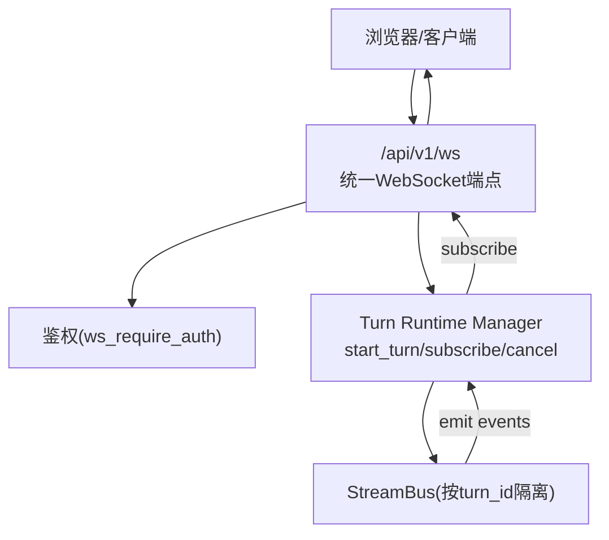
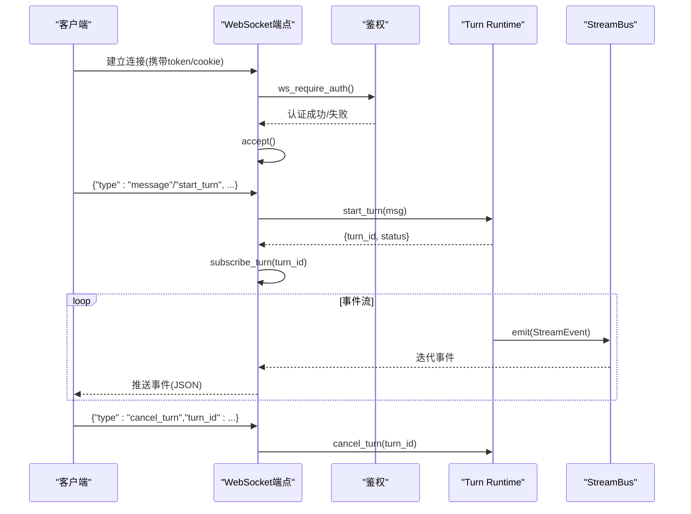
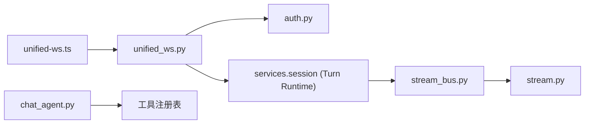

# WebSocket实时聊天

<cite>
**本文引用的文件**
- [unified_ws.py](file://deeptutor/api/routers/unified_ws.py)
- [auth.py](file://deeptutor/api/routers/auth.py)
- [stream.py](file://deeptutor/core/stream.py)
- [stream_bus.py](file://deeptutor/core/stream_bus.py)
- [chat_agent.py](file://deeptutor/agents/chat/chat_agent.py)
- [session_manager.py](file://deeptutor/agents/chat/session_manager.py)
- [unified-ws.ts](file://web/lib/unified-ws.ts)
</cite>

## 目录
1. [简介](#简介)
2. [项目结构](#项目结构)
3. [核心组件](#核心组件)
4. [架构总览](#架构总览)
5. [详细组件分析](#详细组件分析)
6. [依赖关系分析](#依赖关系分析)
7. [性能考虑](#性能考虑)
8. [故障排查指南](#故障排查指南)
9. [结论](#结论)
10. [附录：消息协议与客户端示例](#附录消息协议与客户端示例)

## 简介
本文件为 DeepTutor 的 WebSocket 实时聊天 API 文档，覆盖连接建立、认证流程、消息协议、流式传输机制（含 chunk、状态更新、完成信号）、高级功能集成（语言切换、知识库查询、网络搜索）以及客户端连接示例与错误处理策略。后端通过单一 WebSocket 端点统一处理会话轮次（turn）的启动、订阅、恢复、取消与用户交互；前端提供统一的 WS 客户端封装，支持心跳、断线重连与续传。

## 项目结构
- 后端入口：FastAPI 路由 /api/v1/ws 暴露统一 WebSocket 端点，负责鉴权、消息分发与事件转发。
- 流式总线：StreamBus 作为 turn 级别的事件通道，工具/能力将事件推送到总线，WS 订阅者消费。
- 会话管理：SessionManager 负责聊天会话的持久化与历史维护。
- 前端客户端：unified-ws.ts 提供类型化的 WS 客户端，封装心跳、重连、续传等逻辑。

图表来源
- [unified_ws.py:44-100](file://deeptutor/api/routers/unified_ws.py#L44-L100)
- [stream_bus.py:31-68](file://deeptutor/core/stream_bus.py#L31-L68)

章节来源
- [unified_ws.py:44-325](file://deeptutor/api/routers/unified_ws.py#L44-L325)
- [unified-ws.ts:157-315](file://web/lib/unified-ws.ts#L157-L315)

## 核心组件
- 统一 WebSocket 端点：处理消息路由、鉴权、订阅管理与安全发送。
- 流式事件协议：定义 StreamEventType 枚举与 StreamEvent 数据类，所有事件统一序列化输出。
- 流式总线：按 turn 隔离的事件通道，支持 emit/subscribe/close/wait_for_input/submit_input。
- 会话管理器：创建/更新/读取聊天会话，维护消息历史与设置。
- 聊天代理：构建上下文（RAG/网页搜索）、组装消息、流式生成响应。
- 前端客户端：统一 WS 客户端，实现心跳、重连、续传与事件过滤。

章节来源
- [unified_ws.py:44-325](file://deeptutor/api/routers/unified_ws.py#L44-L325)
- [stream.py:17-73](file://deeptutor/core/stream.py#L17-L73)
- [stream_bus.py:31-326](file://deeptutor/core/stream_bus.py#L31-L326)
- [session_manager.py:20-180](file://deeptutor/agents/chat/session_manager.py#L20-L180)
- [chat_agent.py:21-435](file://deeptutor/agents/chat/chat_agent.py#L21-L435)
- [unified-ws.ts:15-146](file://web/lib/unified-ws.ts#L15-L146)

## 架构总览
后端通过单一 WebSocket 端点统一接入，所有消息以 JSON 形式传输。客户端在连接后通过不同 type 的消息控制会话生命周期与事件订阅。服务端根据消息类型调用 Turn Runtime Manager 启动或订阅 turn，并通过 StreamBus 将事件推送给客户端。

图表来源
- [unified_ws.py:44-134](file://deeptutor/api/routers/unified_ws.py#L44-L134)
- [stream_bus.py:40-68](file://deeptutor/core/stream_bus.py#L40-L68)

## 详细组件分析

### 统一 WebSocket 端点
- 连接与鉴权：在 accept 前调用 ws_require_auth，从 query 参数或 cookie 中解析 token，校验失败则关闭连接。
- 消息路由：支持 message/start_turn、subscribe_turn、subscribe_session、resume_from、unsubscribe、cancel_turn、submit_user_reply、regenerate、check_active_turn、user_input、ping。
- 安全发送：safe_send 使用 ensure_ascii=False 并捕获异常，避免单个不可序列化值导致整个连接冻结。
- 订阅管理：每个 turn/session 的订阅以异步任务维护，支持 after_seq 续传与取消。

章节来源
- [unified_ws.py:44-325](file://deeptutor/api/routers/unified_ws.py#L44-L325)

### 鉴权流程
- HTTP：require_auth 从 Authorization 头或 dt_token Cookie 提取 token，校验并安装当前用户 ContextVar。
- WebSocket：ws_require_auth 在 accept 前执行，从 query 或 cookie 取 token，失败返回 ws_auth_failed 并关闭连接。
- 多用户模式：当 AUTH_ENABLED=false 时，自动注入本地管理员身份，保持行为一致。

章节来源
- [auth.py:237-324](file://deeptutor/api/routers/auth.py#L237-L324)

### 流式事件协议
- 事件类型：stage_start、stage_end、thinking、observation、content、tool_call、tool_result、progress、sources、result、error、session、session_meta、done、wait_for_input。
- 事件结构：包含 type、source、stage、content、metadata、session_id、turn_id、seq、timestamp。
- 序列化：StreamBus.event_to_json 将事件序列化为单行 JSON（NDJSON）。

章节来源
- [stream.py:17-73](file://deeptutor/core/stream.py#L17-L73)
- [stream_bus.py:302-306](file://deeptutor/core/stream_bus.py#L302-L306)

### 流式总线（StreamBus）
- 生产者接口：content、thinking、observation、tool_call、tool_result、progress、sources、result、error、wait_for_input。
- 消费者接口：subscribe 异步迭代事件，支持历史回放与关闭通知。
- 用户输入：wait_for_input 暂停执行等待前端提交；submit_input 由 WS 层投递到对应 turn 的 bus。

章节来源
- [stream_bus.py:31-326](file://deeptutor/core/stream_bus.py#L31-L326)

### 会话管理（SessionManager）
- 会话创建：默认标题与设置（如 kb_name、enable_rag、enable_web_search）。
- 消息追加：记录 user/assistant 消息及 sources。
- 列表摘要：包含 session_id、title、message_count、settings、时间戳与最后消息预览。

章节来源
- [session_manager.py:20-180](file://deeptutor/agents/chat/session_manager.py#L20-L180)

### 聊天代理（ChatAgent）
- 上下文检索：支持 RAG（知识库）与 Web Search，聚合 context 与 sources。
- 消息构建：系统提示词附加语言指令，拼接历史与当前消息。
- 流式生成：通过 BaseAgent.stream_llm 分块产出内容，并在完成时返回完整响应与 sources。

章节来源
- [chat_agent.py:158-228](file://deeptutor/agents/chat/chat_agent.py#L158-L228)
- [chat_agent.py:230-310](file://deeptutor/agents/chat/chat_agent.py#L230-L310)
- [chat_agent.py:365-431](file://deeptutor/agents/chat/chat_agent.py#L365-L431)

### 前端客户端（UnifiedWSClient）
- 连接与心跳：每30秒发送 ping，超过45秒无接收则主动断开并重连。
- 断线重连：指数退避最多5次，成功后通过 resume_from 续传。
- 事件过滤：忽略 ping/pong，不渲染为用户可见事件。
- 类型定义：StartTurnMessage、SubscribeTurnMessage、ResumeTurnMessage、CancelTurnMessage、RegenerateMessage、SubmitUserReplyMessage 等。

章节来源
- [unified-ws.ts:15-146](file://web/lib/unified-ws.ts#L15-L146)
- [unified-ws.ts:157-315](file://web/lib/unified-ws.ts#L157-L315)

## 依赖关系分析
- unified_ws.py 依赖 auth.py 进行鉴权，依赖 services.session 获取 Turn Runtime Manager。
- stream_bus.py 依赖 stream.py 的事件类型与数据结构。
- chat_agent.py 依赖工具注册表执行 RAG/Web Search，依赖 BaseAgent 的流式 LLM 调用。
- unified-ws.ts 在前端封装 WS 通信，与服务端消息协议保持一致。

图表来源
- [unified_ws.py:44-134](file://deeptutor/api/routers/unified_ws.py#L44-L134)
- [stream_bus.py:31-68](file://deeptutor/core/stream_bus.py#L31-L68)
- [chat_agent.py:158-228](file://deeptutor/agents/chat/chat_agent.py#L158-L228)
- [unified-ws.ts:157-315](file://web/lib/unified-ws.ts#L157-L315)

章节来源
- [unified_ws.py:44-325](file://deeptutor/api/routers/unified_ws.py#L44-L325)
- [stream_bus.py:31-326](file://deeptutor/core/stream_bus.py#L31-L326)
- [chat_agent.py:21-435](file://deeptutor/agents/chat/chat_agent.py#L21-L435)
- [unified-ws.ts:15-315](file://web/lib/unified-ws.ts#L15-L315)

## 性能考虑
- 安全发送：safe_send 使用 default=str 防止不可序列化对象阻塞连接。
- 事件回放：StreamBus.subscribe 在注册时快照历史长度，避免重复事件。
- 心跳与重连：前端定期 ping，超时检测避免僵尸连接；重连采用指数退避降低服务器压力。
- 订阅管理：每个 turn/session 独立任务，支持取消与清理，避免资源泄漏。

[本节为通用指导，无需特定文件引用]

## 故障排查指南
- 连接失败：检查 ws_require_auth 是否成功，确认 token 有效且未被拒绝。
- 事件丢失：确认 after_seq 是否正确传递，确保客户端维护 lastSeq。
- 用户输入未生效：检查 user_input 消息中的 turn_id 是否存在活跃 bus，以及 submit_input 是否被调用。
- 未知类型：服务端对未知 msg.type 返回 error，检查客户端发送的消息结构。

章节来源
- [unified_ws.py:102-312](file://deeptutor/api/routers/unified_ws.py#L102-L312)
- [auth.py:294-324](file://deeptutor/api/routers/auth.py#L294-L324)
- [stream_bus.py:262-298](file://deeptutor/core/stream_bus.py#L262-L298)

## 结论
DeepTutor 的 WebSocket 实时聊天通过统一端点与标准化事件协议，实现了高内聚、可扩展的实时对话能力。结合 StreamBus 的 turn 级隔离、前端客户端的心跳与重连机制，提供了稳定可靠的流式体验。高级功能（语言切换、知识库、网络搜索）通过 ChatAgent 的工具注册表无缝集成。

[本节为总结性内容，无需特定文件引用]

## 附录：消息协议与客户端示例

### 连接建立与认证
- 连接地址：/api/v1/ws
- 认证方式：query 参数 token 或 Cookie dt_token；AUTH_ENABLED=false 时自动注入本地管理员。
- 连接成功后，客户端可立即发送消息或订阅现有 turn。

章节来源
- [unified_ws.py:44-53](file://deeptutor/api/routers/unified_ws.py#L44-L53)
- [auth.py:294-324](file://deeptutor/api/routers/auth.py#L294-L324)

### 客户端消息类型
- message/start_turn：启动新轮次，携带 content、tools、capability、knowledge_bases、language、config、attachments 等。
- subscribe_turn：订阅指定 turn 的事件，支持 after_seq 续传。
- subscribe_session：订阅会话当前轮次的事件。
- resume_from：重连后恢复指定 turn 的事件流。
- unsubscribe：取消订阅 turn 或 session。
- cancel_turn：取消运行中的 turn。
- submit_user_reply：提交用户回复（text 或 answers），用于 ask_user 暂停恢复。
- regenerate：重新生成上次用户消息，支持 overrides。
- check_active_turn：查询会话是否有活动 turn。
- user_input：向 turn 的 StreamBus 提交输入。
- ping：心跳，服务端回 pong。

章节来源
- [unified_ws.py:113-312](file://deeptutor/api/routers/unified_ws.py#L113-L312)
- [unified-ws.ts:52-146](file://web/lib/unified-ws.ts#L52-L146)

### 服务端事件类型
- stage_start/stage_end：阶段开始/结束。
- thinking/observation：思考与观察信息。
- content：流式内容片段（chunk）。
- tool_call/tool_result：工具调用与结果。
- progress：进度更新（current/total）。
- sources：来源引用（RAG/Web）。
- result：最终结果。
- error：错误信息。
- session/session_meta：会话元信息。
- done：完成信号。
- wait_for_input：等待用户输入。

章节来源
- [stream.py:17-73](file://deeptutor/core/stream.py#L17-L73)
- [stream_bus.py:78-243](file://deeptutor/core/stream_bus.py#L78-L243)

### 流式传输机制
- chunk：content 事件携带增量文本，客户端应累积渲染。
- 状态更新：progress、thinking、tool_call 等事件提供过程反馈。
- 完成信号：done 或 result 事件表示轮次结束。
- 续传：after_seq 与 seq 字段保证断线后可恢复事件流。

章节来源
- [unified_ws.py:79-100](file://deeptutor/api/routers/unified_ws.py#L79-L100)
- [stream_bus.py:48-68](file://deeptutor/core/stream_bus.py#L48-L68)

### 高级功能集成
- 语言切换：start_turn 中 language 字段影响系统提示词与输出语言。
- 知识库查询：knowledge_bases 与 enable_rag 启用 RAG 检索，sources 中包含 kb_name 与内容摘要。
- 网络搜索：enable_web_search 启用网页搜索，sources 中包含引用链接。

章节来源
- [chat_agent.py:158-228](file://deeptutor/agents/chat/chat_agent.py#L158-L228)
- [chat_agent.py:230-310](file://deeptutor/agents/chat/chat_agent.py#L230-L310)

### 客户端连接示例（概念性步骤）
- 建立 WebSocket 连接到 /api/v1/ws。
- 发送 message/start_turn 携带用户内容与配置。
- 订阅 turn 或会话事件，处理 content/thinking/progress 等事件。
- 收到 done/result 后结束渲染，保存 sources。
- 若断线，使用 resume_from 续传 lastSeq。

章节来源
- [unified-ws.ts:183-201](file://web/lib/unified-ws.ts#L183-L201)
- [unified-ws.ts:236-242](file://web/lib/unified-ws.ts#L236-L242)

### 错误处理策略
- 无效 JSON：服务端返回 error 类型事件。
- 缺少必填字段：返回 error 并提示缺失字段。
- 未知消息类型：返回 error 并列出未知类型。
- 认证失败：连接关闭（code 4001）。
- 用户输入错误：turn 不存在或不在等待输入状态，返回 error。

章节来源
- [unified_ws.py:102-312](file://deeptutor/api/routers/unified_ws.py#L102-L312)
- [auth.py:294-324](file://deeptutor/api/routers/auth.py#L294-L324)