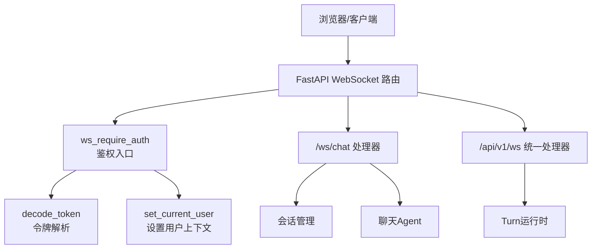
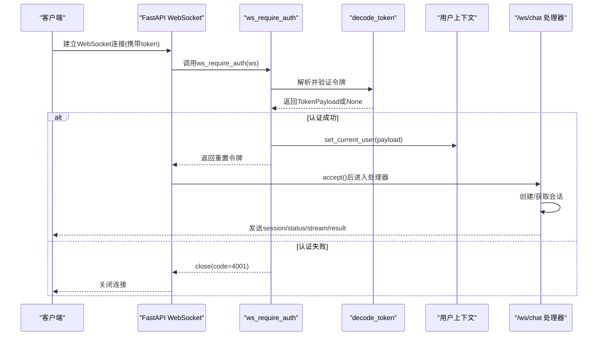
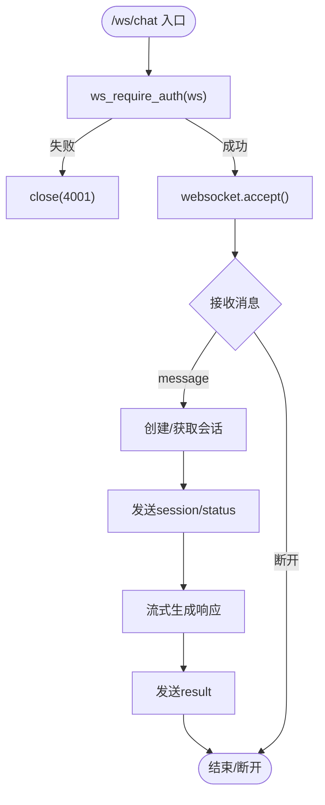
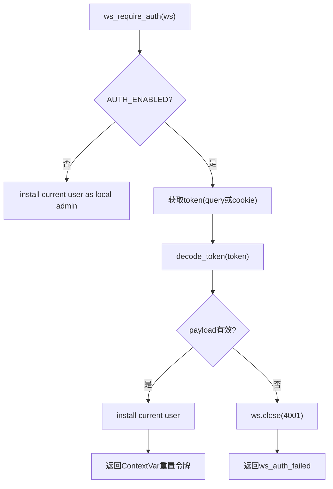
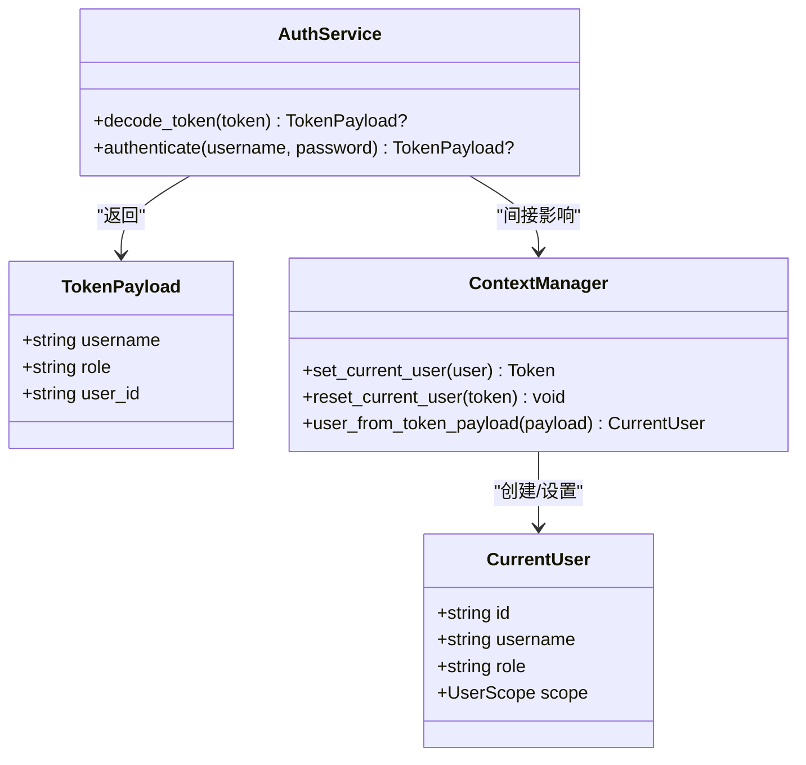
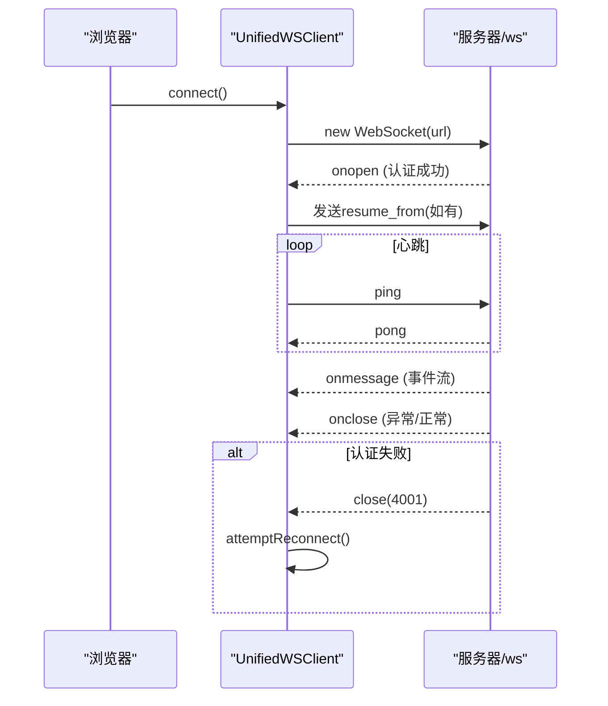
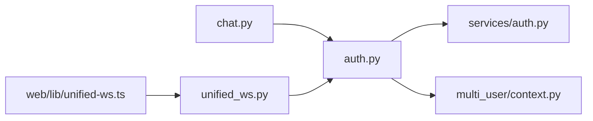

# WebSocket连接与认证

<cite>
**本文引用的文件**
- [deeptutor/api/routers/chat.py](file://deeptutor/api/routers/chat.py)
- [deeptutor/api/routers/unified_ws.py](file://deeptutor/api/routers/unified_ws.py)
- [deeptutor/api/routers/auth.py](file://deeptutor/api/routers/auth.py)
- [deeptutor/services/auth.py](file://deeptutor/services/auth.py)
- [deeptutor/multi_user/context.py](file://deeptutor/multi_user/context.py)
- [web/lib/unified-ws.ts](file://web/lib/unified-ws.ts)
</cite>

## 目录
1. [简介](#简介)
2. [项目结构](#项目结构)
3. [核心组件](#核心组件)
4. [架构总览](#架构总览)
5. [详细组件分析](#详细组件分析)
6. [依赖关系分析](#依赖关系分析)
7. [性能考虑](#性能考虑)
8. [故障排查指南](#故障排查指南)
9. [结论](#结论)
10. [附录](#附录)

## 简介
本文件聚焦于DeepTutor后端WebSocket端点/ws/chat的连接建立与认证机制，详细说明：
- WebSocket端点/ws/chat的完整连接流程（握手、鉴权、会话初始化）
- ws_require_auth函数的工作原理（令牌来源、JWT解析、用户上下文设置）
- 客户端如何建立WebSocket连接并处理认证响应
- 连接错误处理策略（认证失败、连接超时、网络异常）

## 项目结构
与WebSocket连接和认证相关的核心代码分布在以下模块：
- 路由层：chat.py提供/ws/chat端点；unified_ws.py提供统一的/api/v1/ws端点
- 认证层：auth.py提供ws_require_auth、require_auth等鉴权能力
- 服务层：services/auth.py提供decode_token等令牌验证逻辑
- 多用户上下文：multi_user/context.py维护当前用户上下文变量
- 前端客户端：web/lib/unified-ws.ts提供统一WebSocket客户端实现

图表来源
- [deeptutor/api/routers/chat.py:59-70](file://deeptutor/api/routers/chat.py#L59-L70)
- [deeptutor/api/routers/unified_ws.py:44-53](file://deeptutor/api/routers/unified_ws.py#L44-L53)
- [deeptutor/api/routers/auth.py:294-324](file://deeptutor/api/routers/auth.py#L294-L324)
- [deeptutor/services/auth.py:238-280](file://deeptutor/services/auth.py#L238-L280)
- [deeptutor/multi_user/context.py:14-19](file://deeptutor/multi_user/context.py#L14-L19)

章节来源
- [deeptutor/api/routers/chat.py:59-70](file://deeptutor/api/routers/chat.py#L59-L70)
- [deeptutor/api/routers/unified_ws.py:44-53](file://deeptutor/api/routers/unified_ws.py#L44-L53)
- [deeptutor/api/routers/auth.py:294-324](file://deeptutor/api/routers/auth.py#L294-L324)
- [deeptutor/services/auth.py:238-280](file://deeptutor/services/auth.py#L238-L280)
- [deeptutor/multi_user/context.py:14-19](file://deeptutor/multi_user/context.py#L14-L19)

## 核心组件
- WebSocket端点/ws/chat：负责接收聊天消息、创建或复用会话、流式返回结果
- 统一WebSocket端点/api/v1/ws：支持turn-based执行、事件订阅、重连续传
- 认证中间件ws_require_auth：在accept之前完成鉴权，设置当前用户上下文
- 令牌解码decode_token：支持标准JWT与PocketBase两种模式
- 用户上下文：通过ContextVar在当前异步任务中维护当前用户身份

章节来源
- [deeptutor/api/routers/chat.py:59-250](file://deeptutor/api/routers/chat.py#L59-L250)
- [deeptutor/api/routers/unified_ws.py:44-325](file://deeptutor/api/routers/unified_ws.py#L44-L325)
- [deeptutor/api/routers/auth.py:294-324](file://deeptutor/api/routers/auth.py#L294-L324)
- [deeptutor/services/auth.py:238-280](file://deeptutor/services/auth.py#L238-L280)
- [deeptutor/multi_user/context.py:14-19](file://deeptutor/multi_user/context.py#L14-L19)

## 架构总览
下图展示了从客户端连接到服务端处理的完整时序，包括认证、会话创建、流式响应。

图表来源
- [deeptutor/api/routers/chat.py:59-70](file://deeptutor/api/routers/chat.py#L59-L70)
- [deeptutor/api/routers/auth.py:294-324](file://deeptutor/api/routers/auth.py#L294-L324)
- [deeptutor/services/auth.py:238-280](file://deeptutor/services/auth.py#L238-L280)
- [deeptutor/multi_user/context.py:14-19](file://deeptutor/multi_user/context.py#L14-L19)

## 详细组件分析

### /ws/chat 端点连接流程
- 入口：@router.websocket("/chat")
- 认证：调用ws_require_auth(websocket)，若失败则直接返回（连接已关闭）
- 接受连接：await websocket.accept()
- 会话管理：根据session_id创建或获取会话，首次消息触发会话创建
- 流式处理：向客户端发送status、stream、result等事件
- 资源清理：finally中reset_current_user(user_token)

图表来源
- [deeptutor/api/routers/chat.py:59-250](file://deeptutor/api/routers/chat.py#L59-L250)

章节来源
- [deeptutor/api/routers/chat.py:59-250](file://deeptutor/api/routers/chat.py#L59-L250)

### ws_require_auth 工作原理
- 令牌来源：优先从query参数token获取，其次从cookie dt_token获取
- 令牌解析：调用decode_token进行校验（支持标准JWT与PocketBase）
- 用户上下文：成功后调用_install_current_user设置当前用户
- 失败处理：未通过时调用ws.close(code=4001)并返回ws_auth_failed哨兵
- 使用约定：必须在ws.accept()之前调用，并在finally中reset_current_user

图表来源
- [deeptutor/api/routers/auth.py:294-324](file://deeptutor/api/routers/auth.py#L294-L324)
- [deeptutor/services/auth.py:238-280](file://deeptutor/services/auth.py#L238-L280)

章节来源
- [deeptutor/api/routers/auth.py:294-324](file://deeptutor/api/routers/auth.py#L294-L324)
- [deeptutor/services/auth.py:238-280](file://deeptutor/services/auth.py#L238-L280)

### 令牌验证与用户上下文管理
- decode_token：
  - PocketBase模式：调用validate_pb_token并缓存结果
  - 标准JWT模式：使用AUTH_SECRET本地解码，提取username、role、user_id
- 用户上下文：
  - set_current_user将CurrentUser写入ContextVar
  - reset_current_user在连接结束时清理上下文
  - user_from_token_payload将TokenPayload转换为CurrentUser对象

图表来源
- [deeptutor/services/auth.py:238-280](file://deeptutor/services/auth.py#L238-L280)
- [deeptutor/multi_user/context.py:14-45](file://deeptutor/multi_user/context.py#L14-L45)

章节来源
- [deeptutor/services/auth.py:238-280](file://deeptutor/services/auth.py#L238-L280)
- [deeptutor/multi_user/context.py:14-45](file://deeptutor/multi_user/context.py#L14-L45)

### 客户端连接示例与认证响应处理
- 连接URL：wsUrl("/api/v1/ws")，实际路径由代理配置决定
- 心跳机制：每30秒发送ping，45秒无响应则主动关闭连接
- 重连策略：指数退避重试，最多5次，记录active_turn_id和last_seq用于续传
- 认证处理：
  - 服务器在握手阶段完成认证，失败时关闭连接（code 4001）
  - 客户端需确保携带有效的dt_token cookie或查询参数token
  - onclose事件中检测非预期关闭并触发重连

图表来源
- [web/lib/unified-ws.ts:183-314](file://web/lib/unified-ws.ts#L183-L314)
- [deeptutor/api/routers/unified_ws.py:44-53](file://deeptutor/api/routers/unified_ws.py#L44-L53)

章节来源
- [web/lib/unified-ws.ts:183-314](file://web/lib/unified-ws.ts#L183-L314)
- [deeptutor/api/routers/unified_ws.py:44-53](file://deeptutor/api/routers/unified_ws.py#L44-L53)

## 依赖关系分析
- chat.py依赖auth.py的ws_require_auth进行鉴权
- auth.py依赖services/auth.py的decode_token进行令牌验证
- 所有WebSocket端点都依赖multi_user/context.py的用户上下文管理
- 前端unified-ws.ts与服务端unified_ws.py形成完整的客户端-服务端协议

图表来源
- [deeptutor/api/routers/chat.py:61-64](file://deeptutor/api/routers/chat.py#L61-L64)
- [deeptutor/api/routers/unified_ws.py:46-49](file://deeptutor/api/routers/unified_ws.py#L46-L49)
- [deeptutor/api/routers/auth.py:294-324](file://deeptutor/api/routers/auth.py#L294-L324)

章节来源
- [deeptutor/api/routers/chat.py:61-64](file://deeptutor/api/routers/chat.py#L61-L64)
- [deeptutor/api/routers/unified_ws.py:46-49](file://deeptutor/api/routers/unified_ws.py#L46-L49)
- [deeptutor/api/routers/auth.py:294-324](file://deeptutor/api/routers/auth.py#L294-L324)

## 性能考虑
- 令牌验证：decode_token在PocketBase模式下有60秒内存缓存，减少网络请求
- 用户上下文：使用ContextVar避免线程切换导致的上下文丢失问题
- 心跳机制：客户端30秒ping间隔，45秒超时检测，平衡连接保活与资源消耗
- 重连策略：指数退避避免雪崩效应，限制最大重试次数防止无限重试

[本节为通用性能讨论，不直接分析具体文件]

## 故障排查指南
- 认证失败：
  - 检查WebSocket连接是否携带有效的token（query参数或cookie）
  - 确认decode_token能正确解析令牌
  - 查看服务器日志中的4001关闭码
- 连接超时：
  - 客户端心跳检测45秒无响应会主动关闭连接
  - 检查网络连通性和代理配置
- 网络异常：
  - 客户端onerror事件记录错误信息
  - onclose事件中触发重连逻辑
  - 检查服务器端WebSocketDisconnect异常处理

章节来源
- [deeptutor/api/routers/auth.py:318-324](file://deeptutor/api/routers/auth.py#L318-L324)
- [web/lib/unified-ws.ts:223-233](file://web/lib/unified-ws.ts#L223-L233)
- [web/lib/unified-ws.ts:286-300](file://web/lib/unified-ws.ts#L286-L300)

## 结论
DeepTutor的WebSocket认证机制通过ws_require_auth在连接建立前完成身份验证，结合JWT令牌解析和用户上下文管理，确保了连接的安全性和用户隔离。客户端实现了健壮的心跳检测和重连机制，能够有效处理网络异常和连接中断。整体架构清晰，职责分离明确，便于维护和扩展。

[本节为总结性内容，不直接分析具体文件]

## 附录
- 相关端点：
  - /ws/chat：轻量级聊天WebSocket端点
  - /api/v1/ws：统一的turn-based执行端点
- 认证模式：
  - 标准JWT模式：使用AUTH_SECRET本地验证
  - PocketBase模式：远程验证并缓存结果
- 错误码：
  - 4001：认证失败
  - 4003/4004：其他业务错误（合作伙伴场景）

[本节为补充信息，不直接分析具体文件]