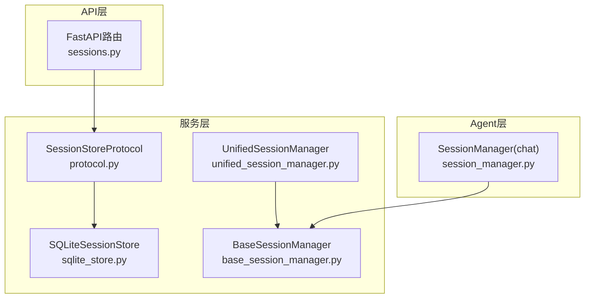
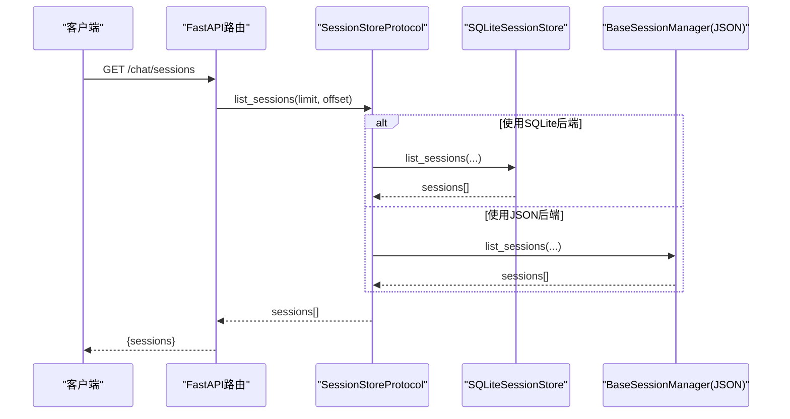
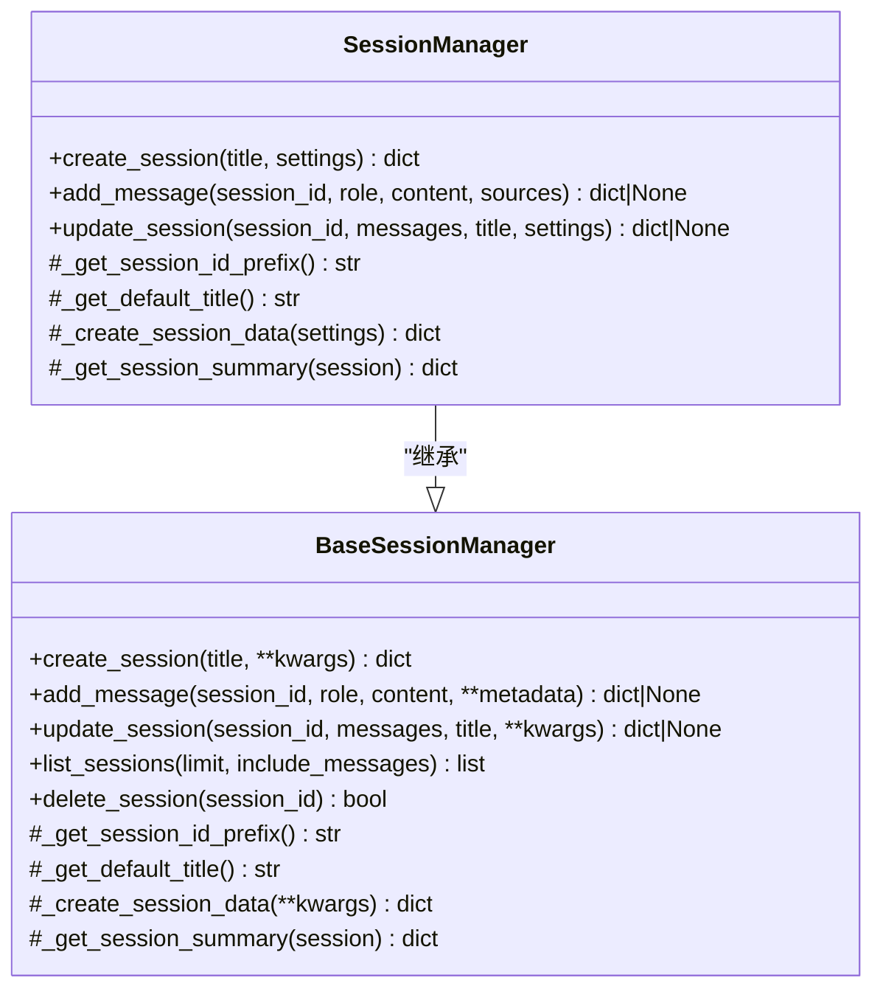
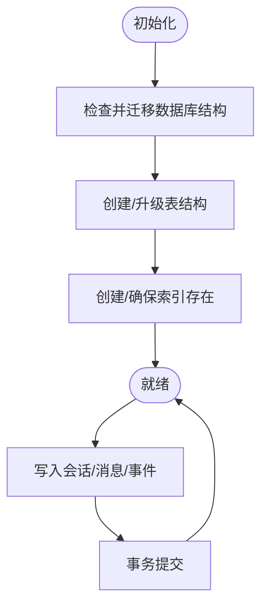
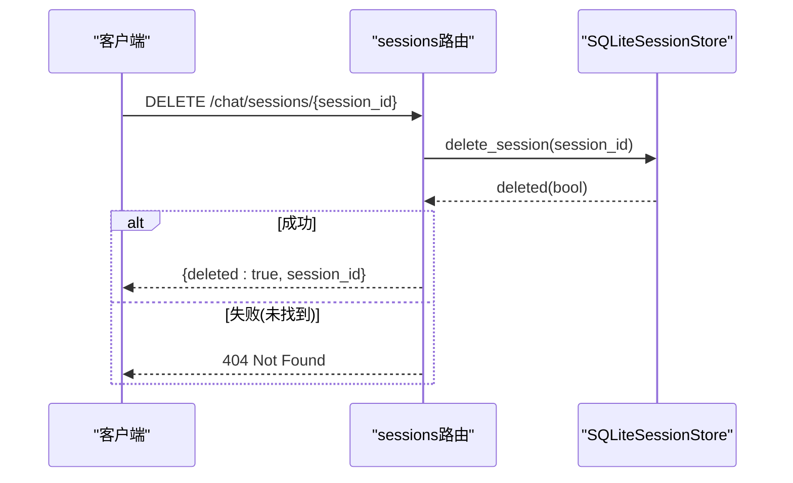
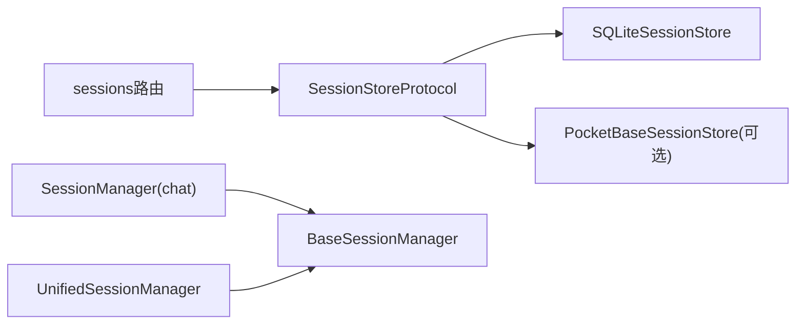

# 会话管理机制

<cite>
**本文引用的文件**
- [deeptutor/agents/chat/session_manager.py](file://deeptutor/agents/chat/session_manager.py)
- [deeptutor/services/session/base_session_manager.py](file://deeptutor/services/session/base_session_manager.py)
- [deeptutor/services/session/unified_session_manager.py](file://deeptutor/services/session/unified_session_manager.py)
- [deeptutor/services/session/sqlite_store.py](file://deeptutor/services/session/sqlite_store.py)
- [deeptutor/services/session/__init__.py](file://deeptutor/services/session/__init__.py)
- [deeptutor/services/session/protocol.py](file://deeptutor/services/session/protocol.py)
- [deeptutor/api/routers/sessions.py](file://deeptutor/api/routers/sessions.py)
</cite>

## 目录
1. [简介](#简介)
2. [项目结构](#项目结构)
3. [核心组件](#核心组件)
4. [架构总览](#架构总览)
5. [详细组件分析](#详细组件分析)
6. [依赖关系分析](#依赖关系分析)
7. [性能与内存管理](#性能与内存管理)
8. [故障排查指南](#故障排查指南)
9. [结论](#结论)
10. [附录：REST API 文档](#附录rest-api-文档)

## 简介
本文件面向DeepTutor的“会话管理系统”，聚焦SessionManager类的设计模式与实现原理，覆盖会话创建、更新、删除、查询等关键操作；解释会话数据结构（session_id、messages数组、settings配置等）；提供REST API接口说明（/chat/sessions列表获取、/chat/sessions/{id}详情查询与删除）；并阐述会话持久化机制、内存管理策略以及会话状态同步与冲突解决的处理方案。

## 项目结构
会话管理由“Agent层”、“服务层”和“API层”组成：
- Agent层：SessionManager（聊天场景）继承通用基类，封装聊天会话的领域逻辑。
- 服务层：BaseSessionManager提供统一的JSON文件存储能力；SQLiteSessionStore提供高性能、可伸缩的SQLite持久化；统一管理器UnifiedSessionManager支持多模式会话聚合。
- API层：FastAPI路由暴露会话管理的HTTP接口，调用服务层进行CRUD。

图表来源
- [deeptutor/api/routers/sessions.py:80-163](file://deeptutor/api/routers/sessions.py#L80-L163)
- [deeptutor/services/session/protocol.py:14-83](file://deeptutor/services/session/protocol.py#L14-L83)
- [deeptutor/services/session/sqlite_store.py:96-106](file://deeptutor/services/session/sqlite_store.py#L96-L106)
- [deeptutor/services/session/base_session_manager.py:23-83](file://deeptutor/services/session/base_session_manager.py#L23-L83)
- [deeptutor/agents/chat/session_manager.py:20-37](file://deeptutor/agents/chat/session_manager.py#L20-L37)

章节来源
- [deeptutor/api/routers/sessions.py:80-163](file://deeptutor/api/routers/sessions.py#L80-L163)
- [deeptutor/services/session/__init__.py:33-47](file://deeptutor/services/session/__init__.py#L33-L47)

## 核心组件
- SessionManager（聊天）：面向聊天场景的会话管理器，继承BaseSessionManager，定义聊天会话的数据结构与摘要展示。
- BaseSessionManager：抽象基类，提供跨模块一致的JSON文件存储、会话CRUD、消息追加、自动排序与数量限制等通用能力。
- SQLiteSessionStore：基于SQLite的统一会话存储，提供会话、消息、轮次（turn）、事件、笔记条目等表结构，支持迁移、并发锁、批量写入与索引优化。
- UnifiedSessionManager：统一会话管理器，将多种模式（chat/deep_solve/deep_question等）合并到单一文件存储，便于统一管理。
- SessionStoreProtocol：定义后端存储的协议接口，使上层代码对具体存储实现解耦。

章节来源
- [deeptutor/agents/chat/session_manager.py:20-164](file://deeptutor/agents/chat/session_manager.py#L20-L164)
- [deeptutor/services/session/base_session_manager.py:23-257](file://deeptutor/services/session/base_session_manager.py#L23-L257)
- [deeptutor/services/session/sqlite_store.py:96-281](file://deeptutor/services/session/sqlite_store.py#L96-L281)
- [deeptutor/services/session/unified_session_manager.py:16-66](file://deeptutor/services/session/unified_session_manager.py#L16-L66)
- [deeptutor/services/session/protocol.py:14-83](file://deeptutor/services/session/protocol.py#L14-L83)

## 架构总览
系统采用分层与协议解耦设计：
- API路由通过get_session_store()选择后端（默认SQLite，可选PocketBase），调用协议方法完成会话操作。
- SQLiteSessionStore负责数据持久化，包含会话、消息、轮次、事件、笔记等表，并提供异步封装与事务控制。
- BaseSessionManager为轻量级JSON文件存储，适合简单场景或向后兼容。
- SessionManager与UnifiedSessionManager在Agent层封装业务语义，屏蔽底层差异。

图表来源
- [deeptutor/api/routers/sessions.py:80-87](file://deeptutor/api/routers/sessions.py#L80-L87)
- [deeptutor/services/session/__init__.py:33-47](file://deeptutor/services/session/__init__.py#L33-L47)
- [deeptutor/services/session/sqlite_store.py:449-454](file://deeptutor/services/session/sqlite_store.py#L449-L454)
- [deeptutor/services/session/base_session_manager.py:215-225](file://deeptutor/services/session/base_session_manager.py#L215-L225)

## 详细组件分析

### SessionManager（聊天）
- 职责：定义聊天会话的ID前缀、默认标题、会话数据构造与摘要展示；提供create/add/update等方法委托给基类。
- 数据结构要点：
  - session_id：唯一标识，带“chat_”前缀。
  - title：会话标题，首条用户消息截取作为默认标题。
  - messages：消息数组，每条含role、content、timestamp及可选sources等元数据。
  - settings：RAG/Web Search等配置，用于记录会话上下文。
  - created_at/updated_at：时间戳。
- 设计模式：模板方法（继承BaseSessionManager），子类仅定制必要行为。

图表来源
- [deeptutor/services/session/base_session_manager.py:23-83](file://deeptutor/services/session/base_session_manager.py#L23-L83)
- [deeptutor/services/session/base_session_manager.py:115-225](file://deeptutor/services/session/base_session_manager.py#L115-L225)
- [deeptutor/agents/chat/session_manager.py:20-164](file://deeptutor/agents/chat/session_manager.py#L20-L164)

章节来源
- [deeptutor/agents/chat/session_manager.py:20-164](file://deeptutor/agents/chat/session_manager.py#L20-L164)
- [deeptutor/services/session/base_session_manager.py:115-225](file://deeptutor/services/session/base_session_manager.py#L115-L225)

### SQLiteSessionStore（持久化）
- 职责：以SQLite数据库持久化会话、消息、轮次、事件、笔记条目；提供异步封装、事务控制、索引优化与历史迁移。
- 关键表结构：
  - sessions：会话基本信息（id、title、created_at、updated_at、compressed_summary、summary_up_to_msg_id、preferences_json）。
  - messages：消息（id、session_id、role、content、capability、events_json、attachments_json、metadata_json、created_at、parent_message_id）。
  - turns：轮次（id、session_id、capability、status、error、created_at、updated_at、finished_at）。
  - turn_events：轮次事件（id、turn_id、seq、type、source、stage、content、metadata_json、timestamp、created_at）。
  - notebook_entries/notebook_categories：问答与分类。
- 并发与一致性：
  - 使用asyncio.Lock串行化SQLite访问，避免并发写冲突。
  - 每个连接使用事务上下文，异常回滚，确保一致性。
- 迁移与兼容性：
  - 启动时检查并添加缺失列（如preferences_json、metadata_json、parent_message_id），并对旧数据进行回填。
  - 支持从旧路径迁移数据库文件。

图表来源
- [deeptutor/services/session/sqlite_store.py:119-281](file://deeptutor/services/session/sqlite_store.py#L119-L281)
- [deeptutor/services/session/sqlite_store.py:402-417](file://deeptutor/services/session/sqlite_store.py#L402-L417)

章节来源
- [deeptutor/services/session/sqlite_store.py:96-281](file://deeptutor/services/session/sqlite_store.py#L96-L281)

### UnifiedSessionManager（统一会话）
- 职责：将不同模式的会话（chat、deep_solve、deep_question等）统一存储于一个文件，便于集中管理与展示。
- 数据结构要点：
  - mode：会话模式。
  - enabled_tools/knowledge_bases：工具与知识库配置。
  - messages：消息数组。
  - metadata：能力相关扩展字段。
- 设计模式：同样继承BaseSessionManager，复用通用CRUD与文件存储逻辑。

章节来源
- [deeptutor/services/session/unified_session_manager.py:16-66](file://deeptutor/services/session/unified_session_manager.py#L16-L66)

### API路由（/chat/sessions）
- 列表获取：GET /chat/sessions?limit=...&offset=...
- 详情查询：GET /chat/sessions/{session_id}
- 重命名：PATCH /chat/sessions/{session_id}
- 删除：DELETE /chat/sessions/{session_id}
- 分支选择更新：PUT /chat/sessions/{session_id}/branch-selection
- 按消息删除轮次：DELETE /chat/sessions/{session_id}/messages/{message_id}
- 记录测验结果：POST /chat/sessions/{session_id}/quiz-results

图表来源
- [deeptutor/api/routers/sessions.py:153-163](file://deeptutor/api/routers/sessions.py#L153-L163)
- [deeptutor/services/session/sqlite_store.py:449-454](file://deeptutor/services/session/sqlite_store.py#L449-L454)

章节来源
- [deeptutor/api/routers/sessions.py:80-231](file://deeptutor/api/routers/sessions.py#L80-L231)

## 依赖关系分析
- API路由依赖SessionStoreProtocol，实际后端由get_session_store()决定（默认SQLite，可选PocketBase）。
- SQLiteSessionStore依赖path_service获取数据库路径，并通过asyncio.Lock保证并发安全。
- BaseSessionManager依赖path_service获取会话文件路径，使用JSON文件持久化。
- SessionManager与UnifiedSessionManager均依赖BaseSessionManager，实现领域特定逻辑。

图表来源
- [deeptutor/services/session/__init__.py:33-47](file://deeptutor/services/session/__init__.py#L33-L47)
- [deeptutor/services/session/protocol.py:14-83](file://deeptutor/services/session/protocol.py#L14-L83)
- [deeptutor/services/session/base_session_manager.py:46-55](file://deeptutor/services/session/base_session_manager.py#L46-L55)

章节来源
- [deeptutor/services/session/__init__.py:33-47](file://deeptutor/services/session/__init__.py#L33-L47)
- [deeptutor/services/session/protocol.py:14-83](file://deeptutor/services/session/protocol.py#L14-L83)

## 性能与内存管理
- 批量写入：SQLiteSessionStore提供append_turn_events批量插入，减少多次fsync带来的延迟。
- 索引优化：为messages、turns、turn_events、notebook_entries等建立合适索引，提升查询性能。
- 并发控制：使用asyncio.Lock串行化SQLite操作，避免并发写冲突。
- 内存与体积控制：
  - 列表返回时对tool_result/observation等大payload进行截断，避免前端渲染压力。
  - 会话数量上限（MAX_SESSIONS）防止JSON文件无限增长。
  - 压缩摘要字段（compressed_summary）与摘要进度（summary_up_to_msg_id）用于大会话的上下文构建。
- 迁移与兼容性：启动时自动检测并补齐缺失列，回填历史数据，确保新旧版本兼容。

章节来源
- [deeptutor/services/session/sqlite_store.py:706-771](file://deeptutor/services/session/sqlite_store.py#L706-L771)
- [deeptutor/services/session/sqlite_store.py:119-281](file://deeptutor/services/session/sqlite_store.py#L119-L281)
- [deeptutor/api/routers/sessions.py:90-131](file://deeptutor/api/routers/sessions.py#L90-L131)
- [deeptutor/services/session/base_session_manager.py:41-42](file://deeptutor/services/session/base_session_manager.py#L41-L42)

## 故障排查指南
- 404未找到：当请求的session_id不存在时，路由返回404。检查传入ID是否正确，确认会话是否已被删除。
- 409冲突：删除正在运行的轮次对应的消息时会返回409，需等待轮次结束或取消后再操作。
- 附件清理失败：删除会话后尝试清理附件可能抛出异常，日志中会记录异常信息，不影响主流程。
- 数据库迁移失败：若旧数据库无法移动到目标路径，将保留原位置并使用新路径空库初始化，需手动迁移数据。

章节来源
- [deeptutor/api/routers/sessions.py:133-163](file://deeptutor/api/routers/sessions.py#L133-L163)
- [deeptutor/api/routers/sessions.py:180-196](file://deeptutor/api/routers/sessions.py#L180-L196)
- [deeptutor/services/session/sqlite_store.py:107-117](file://deeptutor/services/session/sqlite_store.py#L107-L117)

## 结论
DeepTutor的会话管理系统通过分层设计与协议解耦，实现了灵活可扩展的会话管理能力。SessionManager专注于聊天领域的会话语义，BaseSessionManager提供通用的JSON文件存储能力，SQLiteSessionStore提供高性能持久化与并发安全。API路由清晰暴露了会话管理的常用操作，配合批量写入、索引优化与内存控制，满足高吞吐与大会话场景的需求。同时，系统具备完善的迁移与兼容性处理，保障长期演进。

## 附录：REST API 文档
以下接口基于FastAPI路由实现，调用服务层完成会话CRUD。

- 列表获取
  - 方法：GET
  - 路径：/chat/sessions
  - 参数：limit（默认50，范围1-200）、offset（默认0，>=0）
  - 响应：{sessions: [...]}

- 详情查询
  - 方法：GET
  - 路径：/chat/sessions/{session_id}
  - 响应：会话对象（包含messages等），若不存在返回404

- 重命名
  - 方法：PATCH
  - 路径：/chat/sessions/{session_id}
  - 请求体：{title: string}
  - 响应：{session: ...}

- 删除
  - 方法：DELETE
  - 路径：/chat/sessions/{session_id}
  - 响应：{deleted: true, session_id}

- 分支选择更新
  - 方法：PUT
  - 路径：/chat/sessions/{session_id}/branch-selection
  - 请求体：{selected_branches: {parent_message_id: child_id}}
  - 响应：{selected_branches: {...}}

- 按消息删除轮次
  - 方法：DELETE
  - 路径：/chat/sessions/{session_id}/messages/{message_id}
  - 响应：删除结果（包含attachment_ids清理情况）

- 记录测验结果
  - 方法：POST
  - 路径：/chat/sessions/{session_id}/quiz-results
  - 请求体：{answers: [...], turn_id: string}
  - 响应：{recorded: true, session_id, answer_count, notebook_count, content}

章节来源
- [deeptutor/api/routers/sessions.py:80-231](file://deeptutor/api/routers/sessions.py#L80-L231)