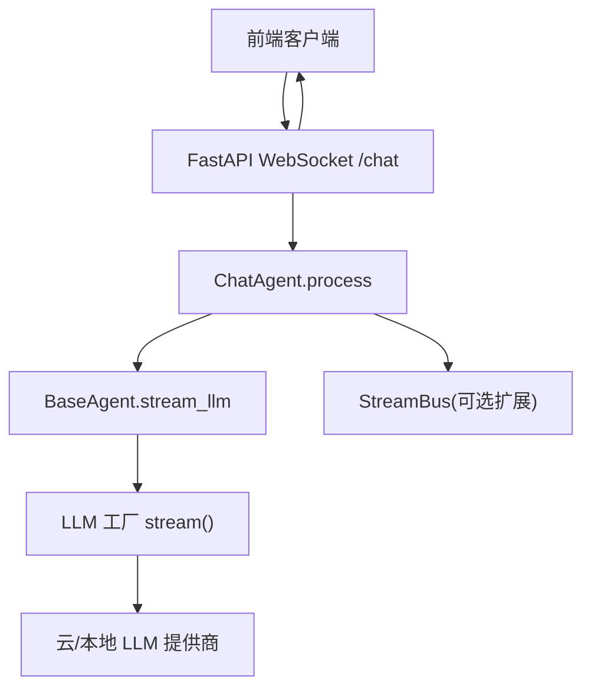
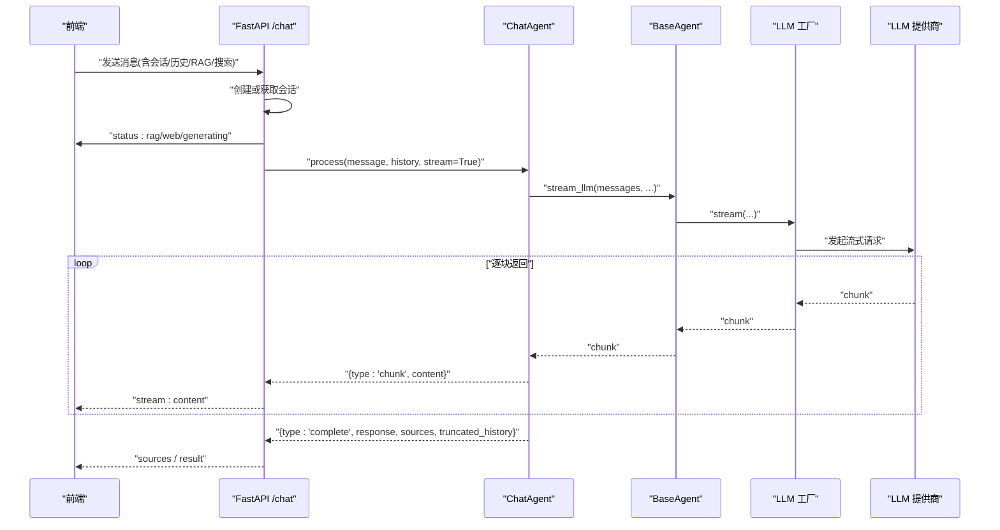
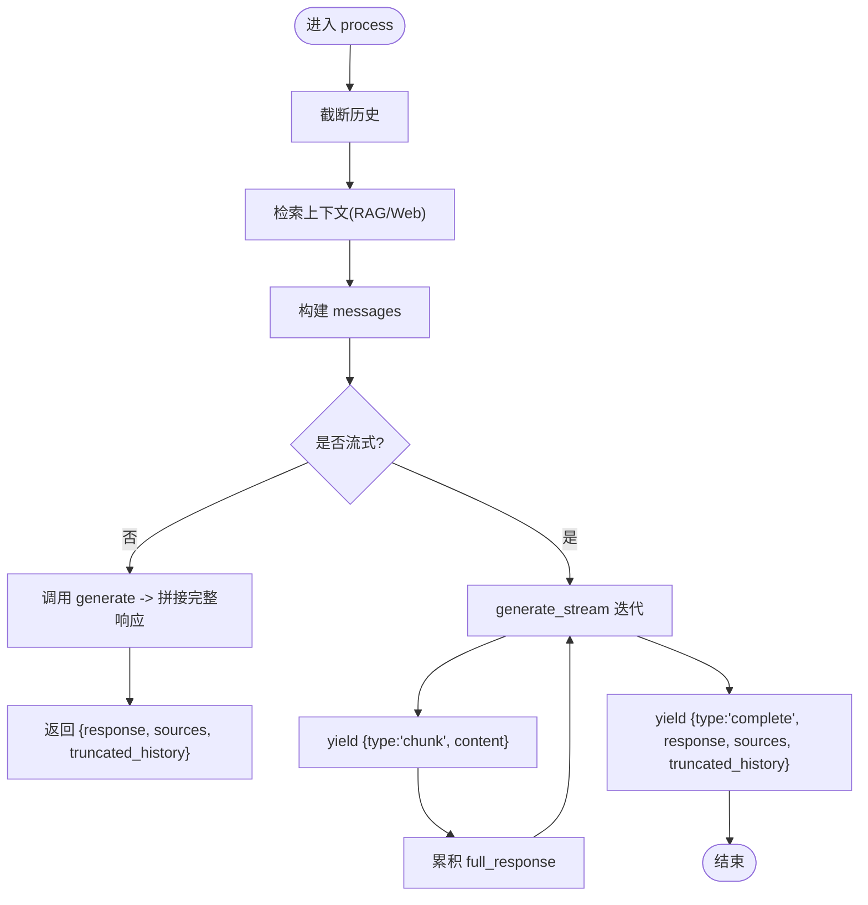
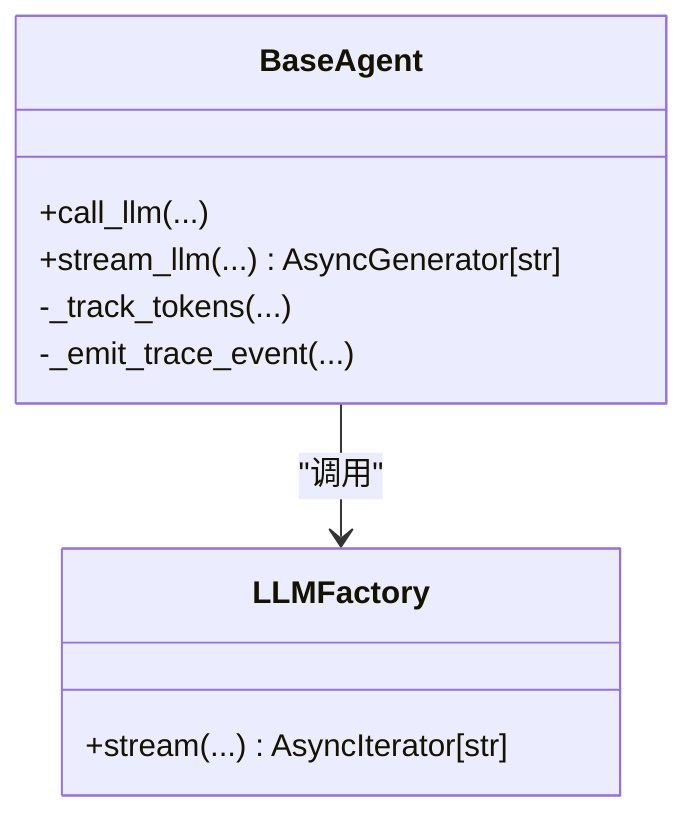
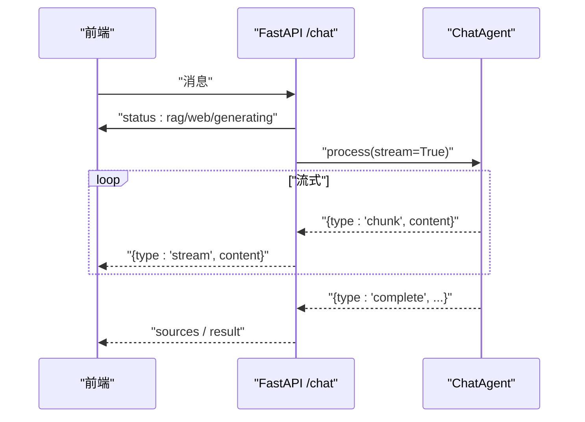
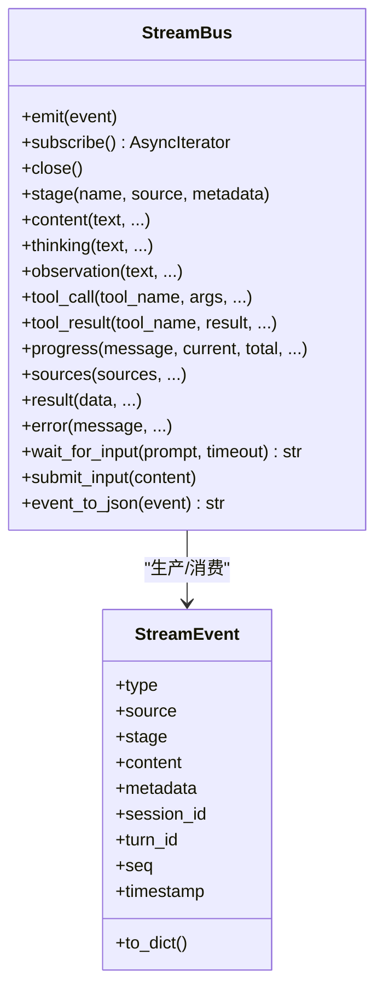
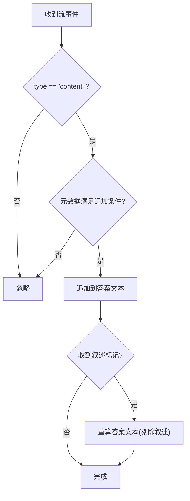
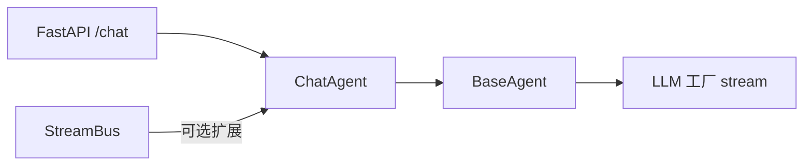

# 流式响应处理

<cite>
**本文引用的文件**
- [chat_agent.py](file://deeptutor/agents/chat/chat_agent.py)
- [base_agent.py](file://deeptutor/agents/base_agent.py)
- [chat.py](file://deeptutor/api/routers/chat.py)
- [stream.py](file://deeptutor/core/stream.py)
- [stream_bus.py](file://deeptutor/core/stream_bus.py)
- [llm_init.py](file://deeptutor/services/llm/__init__.py)
- [stream.ts](file://web/lib/stream.ts)
</cite>

## 目录
1. [简介](#简介)
2. [项目结构](#项目结构)
3. [核心组件](#核心组件)
4. [架构总览](#架构总览)
5. [详细组件分析](#详细组件分析)
6. [依赖关系分析](#依赖关系分析)
7. [性能考量](#性能考量)
8. [故障排查指南](#故障排查指南)
9. [结论](#结论)
10. [附录](#附录)

## 简介
本技术文档聚焦于 DeepTutor 的流式响应处理机制，重点解析 ChatAgent.process 方法的异步生成器实现，说明 chunk 数据的产生、传输与消费过程；总结背压控制、缓冲区管理与内存使用优化策略；提供前端流式渲染的实现要点与用户体验优化建议；并阐述错误处理与重试机制，以及与 SSE（Server-Sent Events）的兼容性考虑。

## 项目结构
围绕流式响应的关键代码分布在以下模块：
- Agent 层：ChatAgent 负责对话流程编排与流式输出封装；BaseAgent 提供统一的 LLM 流式调用接口。
- API 层：WebSocket 路由将客户端请求转发至 Agent，并将流式事件推送给前端。
- 核心流协议：StreamEvent/StreamBus 定义统一的事件格式与发布订阅通道。
- LLM 服务：工厂函数 stream 提供跨提供商的流式能力与重试。
- 前端：流式事件过滤与增量渲染逻辑。

图表来源
- [chat.py:59-250](file://deeptutor/api/routers/chat.py#L59-L250)
- [chat_agent.py:365-431](file://deeptutor/agents/chat/chat_agent.py#L365-L431)
- [base_agent.py:511-670](file://deeptutor/agents/base_agent.py#L511-L670)
- [llm_init.py:84-94](file://deeptutor/services/llm/__init__.py#L84-L94)

章节来源
- [chat.py:59-250](file://deeptutor/api/routers/chat.py#L59-L250)
- [chat_agent.py:365-431](file://deeptutor/agents/chat/chat_agent.py#L365-L431)
- [base_agent.py:511-670](file://deeptutor/agents/base_agent.py#L511-L670)
- [llm_init.py:84-94](file://deeptutor/services/llm/__init__.py#L84-L94)

## 核心组件
- ChatAgent.process：根据参数决定是否启用 RAG/Web 搜索，构建消息，并在开启流式模式时返回异步生成器，逐块产出“chunk”与最终“complete”。
- BaseAgent.stream_llm：统一封装 LLM 流式调用，透传配置与附件，记录追踪事件，并在完成后统计 token 用量。
- API WebSocket：接收消息、维护会话、向客户端发送状态提示、流式内容、来源与结果。
- StreamEvent/StreamBus：统一事件模型与异步广播通道，支持阶段、进度、工具调用等事件类型。
- LLM 工厂 stream：跨提供商的流式入口，内置重试与能力检测。
- 前端流式处理：基于事件元数据过滤叙述性片段，仅追加用户可见的最终回答内容。

章节来源
- [chat_agent.py:365-431](file://deeptutor/agents/chat/chat_agent.py#L365-L431)
- [base_agent.py:511-670](file://deeptutor/agents/base_agent.py#L511-L670)
- [chat.py:59-250](file://deeptutor/api/routers/chat.py#L59-L250)
- [stream.py:17-73](file://deeptutor/core/stream.py#L17-L73)
- [stream_bus.py:31-326](file://deeptutor/core/stream_bus.py#L31-L326)
- [llm_init.py:84-94](file://deeptutor/services/llm/__init__.py#L84-L94)
- [stream.ts:15-75](file://web/lib/stream.ts#L15-L75)

## 架构总览
下图展示了从前端到 LLM 的完整流式链路，包括状态提示、流式内容与最终结果的传递路径。

图表来源
- [chat.py:97-230](file://deeptutor/api/routers/chat.py#L97-L230)
- [chat_agent.py:408-423](file://deeptutor/agents/chat/chat_agent.py#L408-L423)
- [base_agent.py:610-633](file://deeptutor/agents/base_agent.py#L610-L633)
- [llm_init.py:84-94](file://deeptutor/services/llm/__init__.py#L84-L94)

## 详细组件分析

### ChatAgent.process 流式生成器
- 输入：消息、历史、知识库名、是否启用 RAG/Web 搜索、是否流式、附件。
- 处理：
  - 截断历史以控制上下文长度。
  - 检索上下文（RAG/Web），收集来源。
  - 构建 messages（系统提示+历史+当前消息）。
  - 若开启流式：内部定义异步生成器，迭代 generate_stream 产出 chunk，并在结束时产出 complete 包。
- 输出：
  - 非流式：包含 response、sources、truncated_history 的字典。
  - 流式：异步生成器，依次产出 {type:"chunk", content} 与 {type:"complete", ...}。

图表来源
- [chat_agent.py:365-431](file://deeptutor/agents/chat/chat_agent.py#L365-L431)

章节来源
- [chat_agent.py:365-431](file://deeptutor/agents/chat/chat_agent.py#L365-L431)

### BaseAgent.stream_llm 统一流式接口
- 职责：
  - 组装参数（temperature、max_tokens、response_format、附件多模态转换）。
  - 通过 LLM 工厂 stream 发起流式请求。
  - 对每个 chunk 发出追踪事件，并在结束后统计 token 用量与耗时。
- 异常：捕获并上报追踪事件后向上抛出，便于上层统一处理。

图表来源
- [base_agent.py:511-670](file://deeptutor/agents/base_agent.py#L511-L670)
- [llm_init.py:84-94](file://deeptutor/services/llm/__init__.py#L84-L94)

章节来源
- [base_agent.py:511-670](file://deeptutor/agents/base_agent.py#L511-L670)
- [llm_init.py:84-94](file://deeptutor/services/llm/__init__.py#L84-L94)

### API WebSocket 流式转发
- 会话管理：创建/获取会话，持久化用户与助手消息。
- 状态提示：在 RAG/Web 搜索与生成阶段向前端发送 status。
- 流式转发：遍历 Agent 的异步生成器，将 chunk 以 {type:"stream", content} 形式推送；完成后发送 sources 与 result。
- 错误处理：捕获异常并发送 error 事件。

图表来源
- [chat.py:97-230](file://deeptutor/api/routers/chat.py#L97-L230)
- [chat_agent.py:408-423](file://deeptutor/agents/chat/chat_agent.py#L408-L423)

章节来源
- [chat.py:97-230](file://deeptutor/api/routers/chat.py#L97-L230)
- [chat_agent.py:408-423](file://deeptutor/agents/chat/chat_agent.py#L408-L423)

### 流事件协议与总线（StreamEvent/StreamBus）
- StreamEvent：定义统一事件类型（如 content、tool_call、progress、error 等）及字段（source、stage、metadata、时间戳等）。
- StreamBus：单轮次内的异步事件广播，支持 replay 历史、阶段上下文、等待用户输入与输入提交。
- 用途：为 CLI、WebSocket、JSON 写入等消费者提供一致的事件源。

图表来源
- [stream.py:17-73](file://deeptutor/core/stream.py#L17-L73)
- [stream_bus.py:31-326](file://deeptutor/core/stream_bus.py#L31-L326)

章节来源
- [stream.py:17-73](file://deeptutor/core/stream.py#L17-L73)
- [stream_bus.py:31-326](file://deeptutor/core/stream_bus.py#L31-L326)

### 前端流式渲染与体验优化
- 事件过滤：仅当类型为 content 且满足特定元数据条件时才追加到答案文本，避免叙述性片段污染最终回答。
- 重算机制：当收到“叙述标记”时，重新计算答案文本，剔除已标记为叙述的段落。
- 增量更新：按 chunk 增量渲染，减少重绘开销，提升流畅度。

图表来源
- [stream.ts:15-75](file://web/lib/stream.ts#L15-L75)

章节来源
- [stream.ts:15-75](file://web/lib/stream.ts#L15-L75)

## 依赖关系分析
- ChatAgent 依赖 BaseAgent 的统一 LLM 接口，确保不同提供商行为一致。
- API WebSocket 依赖 ChatAgent 的 process 方法，承担会话与事件转发职责。
- LLM 工厂 stream 屏蔽底层提供商差异，提供重试与能力检测。
- StreamEvent/StreamBus 为更复杂的智能体循环提供统一事件通道（可扩展至其他模块）。

图表来源
- [chat_agent.py:365-431](file://deeptutor/agents/chat/chat_agent.py#L365-L431)
- [base_agent.py:511-670](file://deeptutor/agents/base_agent.py#L511-L670)
- [chat.py:97-230](file://deeptutor/api/routers/chat.py#L97-L230)
- [llm_init.py:84-94](file://deeptutor/services/llm/__init__.py#L84-L94)
- [stream_bus.py:31-326](file://deeptutor/core/stream_bus.py#L31-L326)

章节来源
- [chat_agent.py:365-431](file://deeptutor/agents/chat/chat_agent.py#L365-L431)
- [base_agent.py:511-670](file://deeptutor/agents/base_agent.py#L511-L670)
- [chat.py:97-230](file://deeptutor/api/routers/chat.py#L97-L230)
- [llm_init.py:84-94](file://deeptutor/services/llm/__init__.py#L84-L94)
- [stream_bus.py:31-326](file://deeptutor/core/stream_bus.py#L31-L326)

## 性能考量
- 背压控制
  - 后端：WebSocket 逐条 send_json，由框架与网络栈进行缓冲与流控；Agent 侧通过异步生成器按需产出 chunk，避免一次性堆积。
  - 前端：增量渲染，仅在必要时重算答案文本，降低 CPU 与 DOM 压力。
- 缓冲区管理
  - 历史截断：ChatAgent 根据 token 上限裁剪历史，防止上下文过大导致延迟与成本上升。
  - 事件回放：StreamBus 在订阅时回放历史事件，保证新消费者不丢事件，同时避免重复投递。
- 内存使用优化
  - 流式拼接：BaseAgent 在流式过程中累积 full_response 用于统计与追踪，但主要内存占用来自 chunk 的即时处理与丢弃。
  - 附件多模态：仅在需要时转换消息，避免不必要的对象创建。
- 重试与超时
  - LLM 工厂提供默认最大重试次数、退避策略与超时控制，增强稳定性。
  - 可在 BaseAgent 中通过 get_max_retries 调整重试策略。

[本节为通用性能指导，不直接分析具体文件]

## 故障排查指南
- 常见问题定位
  - 无流式内容：检查 WebSocket 是否正确发送 status 与 stream 事件；确认 Agent 是否返回异步生成器。
  - 内容被过滤：检查前端事件过滤逻辑，确认元数据是否符合追加条件。
  - 错误中断：查看后端日志与 error 事件；确认 LLM 提供商是否返回异常或连接断开。
- 错误与重试
  - BaseAgent 在流式过程中捕获异常并上报追踪事件，随后抛出异常供上层处理。
  - LLM 工厂内置重试机制，可结合业务需求调整重试次数与退避策略。
- 调试建议
  - 启用详细日志，关注 llm_call 的 streaming 事件与 duration。
  - 使用 StreamBus 的阶段上下文与进度事件辅助定位瓶颈。

章节来源
- [base_agent.py:610-670](file://deeptutor/agents/base_agent.py#L610-L670)
- [chat.py:232-243](file://deeptutor/api/routers/chat.py#L232-L243)
- [llm_init.py:84-94](file://deeptutor/services/llm/__init__.py#L84-L94)

## 结论
DeepTutor 的流式响应机制以 ChatAgent.process 为核心，结合 BaseAgent 的统一 LLM 接口与 LLM 工厂的跨提供商能力，实现了高效、稳定、可扩展的实时文本流式传输。通过历史截断、事件回放、增量渲染与重试机制，系统在性能与可靠性之间取得良好平衡。前端基于事件元数据的精细过滤与重算，确保了用户体验的一致性与流畅性。

[本节为总结性内容，不直接分析具体文件]

## 附录

### SSE 兼容性考虑
- 协议差异
  - WebSocket：全双工、自定义消息协议；本项目采用 JSON 事件（如 type: stream/content/result/error）。
  - SSE：单向文本流，标准事件格式（data/event/id/retry 等）。
- 兼容策略
  - 若需暴露 SSE 接口，可将 JSON 事件序列化为标准 SSE 行（例如 data: {...}），并按需添加 event 与 id。
  - 注意 SSE 不支持二进制与双向通信，适用于只读流场景。
  - 对于需要交互的场景（如 wait_for_input），仍建议使用 WebSocket。
- 实现建议
  - 在 API 层新增 SSE 路由，复用 ChatAgent.process 的异步生成器，逐块转换为 SSE 事件。
  - 保持事件语义一致（chunk/complete/sources/result/error），便于前端统一处理。

[本节为概念性说明，不直接分析具体文件]