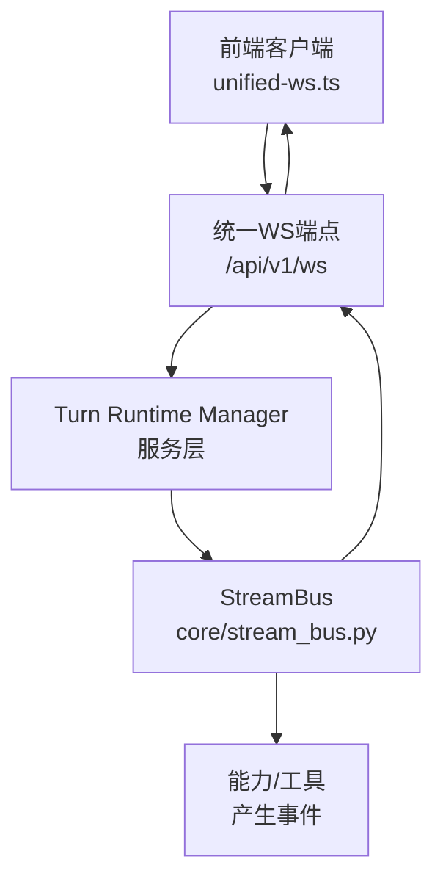
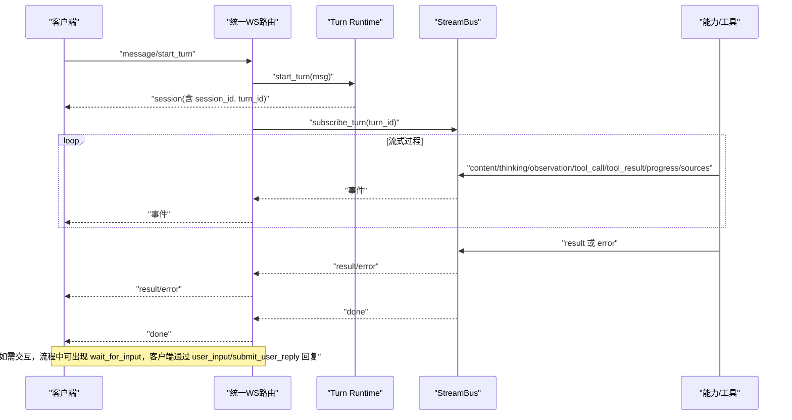
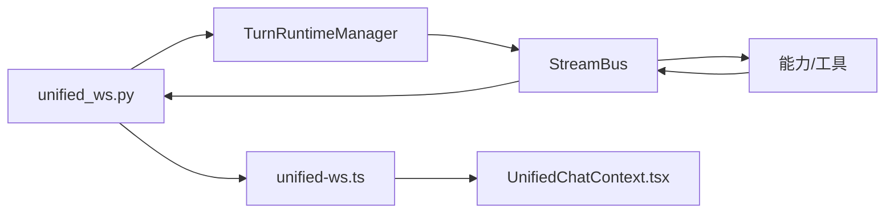

# 消息协议定义

<cite>
**本文引用的文件**
- [unified_ws.py](file://deeptutor/api/routers/unified_ws.py)
- [stream.py](file://deeptutor/core/stream.py)
- [stream_bus.py](file://deeptutor/core/stream_bus.py)
- [unified-ws.ts](file://web/lib/unified-ws.ts)
- [UnifiedChatContext.tsx](file://web/context/UnifiedChatContext.tsx)
- [test_stream_bus.py](file://tests/core/test_stream_bus.py)
</cite>

## 目录
1. [简介](#简介)
2. [项目结构](#项目结构)
3. [核心组件](#核心组件)
4. [架构总览](#架构总览)
5. [详细组件分析](#详细组件分析)
6. [依赖关系分析](#依赖关系分析)
7. [性能考量](#性能考量)
8. [故障排查指南](#故障排查指南)
9. [结论](#结论)
10. [附录：消息类型与字段规范](#附录消息类型与字段规范)

## 简介
本文件为 DeepTutor 统一 WebSocket 端点 /api/v1/ws 的“消息协议规范”。该协议用于客户端与后端在单次对话轮次（turn）内的流式交互，覆盖从会话建立、流式内容、进度状态、最终结果、来源引用到错误信息的完整生命周期。协议以统一的 StreamEvent 格式承载事件，并通过统一的 WS 路由进行转发与订阅管理。

## 项目结构
- 后端统一 WS 路由负责接收客户端指令、启动或恢复 turn、订阅并转发事件。
- 核心流式事件模型定义在 stream.py，包含所有事件类型与通用字段。
- 流总线 stream_bus.py 提供 emit/subscribe 能力，供各能力/工具产生事件。
- 前端 unified-ws.ts 实现连接、心跳、重连、resume_from 等机制，并解析服务端推送的事件。
- 前端 UnifiedChatContext.tsx 将事件映射到 UI 状态（如阶段切换、完成态、标题更新）。

图表来源
- [unified_ws.py:44-325](file://deeptutor/api/routers/unified_ws.py#L44-L325)
- [stream_bus.py:31-299](file://deeptutor/core/stream_bus.py#L31-L299)
- [unified-ws.ts:157-315](file://web/lib/unified-ws.ts#L157-L315)

章节来源
- [unified_ws.py:1-325](file://deeptutor/api/routers/unified_ws.py#L1-L325)
- [unified-ws.ts:1-315](file://web/lib/unified-ws.ts#L1-L315)

## 核心组件
- 统一 WS 路由：处理 message/start_turn、subscribe_turn/session、resume_from、unsubscribe、cancel_turn、submit_user_reply、regenerate、user_input、check_active_turn 等客户端指令；向客户端推送事件。
- 流事件模型：定义 StreamEventType 枚举与 StreamEvent 数据类，包含 type/source/stage/content/metadata/session_id/turn_id/seq/timestamp 等字段。
- 流总线：提供 stage/content/thinking/observation/tool_call/tool_result/progress/sources/result/error/wait_for_input 等便捷方法，以及 subscribe/emit/close。
- 前端客户端：维护连接、心跳、断线重连、resume_from 续流、事件过滤（忽略 ping/pong）、turn_id/seq 追踪。

章节来源
- [stream.py:17-73](file://deeptutor/core/stream.py#L17-L73)
- [stream_bus.py:76-299](file://deeptutor/core/stream_bus.py#L76-L299)
- [unified_ws.py:102-313](file://deeptutor/api/routers/unified_ws.py#L102-L313)
- [unified-ws.ts:15-43](file://web/lib/unified-ws.ts#L15-L43)

## 架构总览
下图展示一次典型对话的生命周期：客户端发起 start_turn，后端创建 turn 并订阅事件流；过程中持续推送 content/progress/sources/result/error 等事件；完成后发送 done；若需要用户输入则暂停并等待 submit_user_reply/user_input。

图表来源
- [unified_ws.py:113-134](file://deeptutor/api/routers/unified_ws.py#L113-L134)
- [stream_bus.py:106-243](file://deeptutor/core/stream_bus.py#L106-L243)
- [unified-ws.ts:183-221](file://web/lib/unified-ws.ts#L183-L221)

## 详细组件分析

### 统一 WS 路由（服务端入口）
- 支持的客户端消息类型：message/start_turn、subscribe_turn、subscribe_session、resume_from、unsubscribe、cancel_turn、submit_user_reply、regenerate、user_input、check_active_turn、ping。
- 对 message/start_turn：调用 runtime.start_turn，成功后自动订阅对应 turn 的事件流。
- 对 resume_from：根据 turn_id 和 seq 续流，避免重连后丢事件。
- 对 check_active_turn：返回 active_turn_info，清理陈旧 running 行。
- 对 cancel_turn：取消运行中的 turn。
- 对 submit_user_reply/user_input：将用户回复注入当前 turn 的 bus，使能力继续执行。
- 错误处理：非法 JSON、未知 type、缺失参数等会返回 type=error 的事件。

章节来源
- [unified_ws.py:7-29](file://deeptutor/api/routers/unified_ws.py#L7-L29)
- [unified_ws.py:102-313](file://deeptutor/api/routers/unified_ws.py#L102-L313)

### 流事件模型与总线
- 事件类型：stage_start、stage_end、thinking、observation、content、tool_call、tool_result、progress、sources、result、error、session、session_meta、done、wait_for_input。
- 通用字段：type、source、stage、content、metadata、session_id、turn_id、seq、timestamp。
- 便捷方法：
  - content(text): 流式文本片段
  - progress(message, current, total): 进度
  - sources(list): 来源引用
  - result(data): 最终结果
  - error(message): 错误信息
  - wait_for_input(prompt): 暂停等待用户输入
- 订阅与历史：subscribe() 异步迭代事件；内部维护 _history 支持 after_seq 续流。

章节来源
- [stream.py:17-73](file://deeptutor/core/stream.py#L17-L73)
- [stream_bus.py:76-299](file://deeptutor/core/stream_bus.py#L76-L299)
- [test_stream_bus.py:176-230](file://tests/core/test_stream_bus.py#L176-L230)

### 前端客户端
- 连接与心跳：每 30s 发送 ping，45s 无响应则关闭并重连；重连指数退避，最多 5 次。
- 续流：重连后发送 resume_from(turn_id, seq)，从上次 seq 继续。
- 事件过滤：忽略 type=ping/pong，不渲染为聊天事件。
- 状态追踪：维护 activeTurnId 与 lastSeq，用于后续续流。
- 事件处理：将事件透传给 onEvent 回调，由上层上下文处理阶段、完成态、标题等。

章节来源
- [unified-ws.ts:157-315](file://web/lib/unified-ws.ts#L157-L315)
- [unified-ws.ts:183-221](file://web/lib/unified-ws.ts#L183-L221)
- [UnifiedChatContext.tsx:1078-1145](file://web/context/UnifiedChatContext.tsx#L1078-L1145)

## 依赖关系分析
- unified_ws.py 依赖 services.session 的 TurnRuntimeManager 来启动/取消/查询 turn，并通过其 store 管理活跃 turn。
- TurnRuntimeManager 使用 StreamBus 作为事件通道，能力/工具通过 bus 产生事件。
- 前端 unified-ws.ts 仅依赖 wsUrl 构造地址，并对事件做轻量解析与过滤。
- 前端 UnifiedChatContext.tsx 消费事件，驱动 UI 状态（阶段、完成、标题刷新等）。

图表来源
- [unified_ws.py:113-134](file://deeptutor/api/routers/unified_ws.py#L113-L134)
- [stream_bus.py:31-299](file://deeptutor/core/stream_bus.py#L31-L299)
- [unified-ws.ts:183-221](file://web/lib/unified-ws.ts#L183-L221)
- [UnifiedChatContext.tsx:1078-1145](file://web/context/UnifiedChatContext.tsx#L1078-L1145)

章节来源
- [unified_ws.py:113-134](file://deeptutor/api/routers/unified_ws.py#L113-L134)
- [stream_bus.py:31-299](file://deeptutor/core/stream_bus.py#L31-L299)
- [unified-ws.ts:183-221](file://web/lib/unified-ws.ts#L183-L221)
- [UnifiedChatContext.tsx:1078-1145](file://web/context/UnifiedChatContext.tsx#L1078-L1145)

## 性能考量
- 事件序列化：后端 safe_send 使用 ensure_ascii=False 与 default=str，避免不可序列化值阻塞流。
- 心跳与重连：前端 30s ping、45s 超时检测，指数退避重连，降低长时任务中断影响。
- 续流：after_seq/seq 机制减少重连后的重复事件与丢失风险。
- 批量与增量：content 采用增量推送，适合大段文本实时渲染。
- 资源释放：unsubscribe/cancel_turn 及时释放订阅与执行资源。

[本节为通用指导，无需具体文件引用]

## 故障排查指南
- 未知消息类型：后端会返回 type=error 且 content 提示未知 type。检查客户端发送的 type 是否受支持。
- 缺少必填字段：如 turn_id/session_id 为空，后端返回 error 提示缺失。确保请求体包含必要字段。
- 无法找到活跃 bus：当 turn 已结束或不存在时，user_input 会返回错误。确认 turn 处于等待输入状态。
- 重连后未续流：确认前端已发送 resume_from 并携带正确的 turn_id 与 seq。
- 长时间无响应：检查心跳与网络连通性；必要时主动断开并重连。

章节来源
- [unified_ws.py:102-313](file://deeptutor/api/routers/unified_ws.py#L102-L313)
- [unified-ws.ts:204-221](file://web/lib/unified-ws.ts#L204-L221)

## 结论
DeepTutor 的统一 WS 协议以 StreamEvent 为核心，围绕 turn 的生命周期提供稳定、可续流的流式通信。通过标准化的事件类型与字段，前后端可以高效协作，实现从会话建立、流式输出、进度反馈、来源引用、最终结果到错误处理的完整闭环。

[本节为总结，无需具体文件引用]

## 附录：消息类型与字段规范

以下按协议语义分类说明所有支持的消息类型。每条均给出必需/可选字段、数据类型与发送时机。

### 一、客户端 → 服务端（控制消息）
- message/start_turn
  - 作用：开始一个新的对话轮次。
  - 字段：
    - type: "message" | "start_turn"（必需）
    - content: string（必需）
    - tools?: string[]（可选）
    - capability?: string | null（可选）
    - knowledge_bases?: string[]（可选）
    - session_id?: string | null（可选）
    - attachments?: array（可选）
    - language?: string（可选）
    - config?: object（可选）
    - notebook_references?: array（可选）
    - history_references?: string[]（可选）
    - question_notebook_references?: number[]（可选）
    - book_references?: array（可选）
    - persona?: string（可选）
    - llm_selection?: object | null（可选）
    - parent_message_id?: number | null（可选）
  - 时机：对话开始时。
  - 参考：[unified-ws.ts:52-84](file://web/lib/unified-ws.ts#L52-L84), [unified_ws.py:113-134](file://deeptutor/api/routers/unified_ws.py#L113-L134)

- subscribe_turn
  - 作用：订阅某个 turn 的事件流，支持 after_seq 续流。
  - 字段：
    - type: "subscribe_turn"（必需）
    - turn_id: string（必需）
    - after_seq?: number（可选）
  - 时机：重连后或需要拉取历史事件时。
  - 参考：[unified-ws.ts:86-90](file://web/lib/unified-ws.ts#L86-L90), [unified_ws.py:144-150](file://deeptutor/api/routers/unified_ws.py#L144-L150)

- subscribe_session
  - 作用：订阅某 session 的活跃 turn 事件流。
  - 字段：
    - type: "subscribe_session"（必需）
    - session_id: string（必需）
    - after_seq?: number（可选）
  - 时机：进入会话页或需要监听会话内事件时。
  - 参考：[unified-ws.ts:92-96](file://web/lib/unified-ws.ts#L92-L96), [unified_ws.py:152-158](file://deeptutor/api/routers/unified_ws.py#L152-L158)

- resume_from
  - 作用：重连后从指定 seq 续流。
  - 字段：
    - type: "resume_from"（必需）
    - turn_id: string（必需）
    - seq?: number（可选）
  - 时机：WebSocket 重新打开后。
  - 参考：[unified-ws.ts:98-102](file://web/lib/unified-ws.ts#L98-L102), [unified_ws.py:195-201](file://deeptutor/api/routers/unified_ws.py#L195-L201)

- unsubscribe
  - 作用：取消订阅 turn 或 session。
  - 字段：
    - type: "unsubscribe"（必需）
    - turn_id?: string（可选）
    - session_id?: string（可选）
  - 时机：离开页面或不再需要事件时。
  - 参考：[unified-ws.ts:104-108](file://web/lib/unified-ws.ts#L104-L108), [unified_ws.py:203-210](file://deeptutor/api/routers/unified_ws.py#L203-L210)

- cancel_turn
  - 作用：取消正在运行的 turn。
  - 字段：
    - type: "cancel_turn"（必需）
    - turn_id: string（必需）
  - 时机：用户主动停止或超时。
  - 参考：[unified-ws.ts:110-113](file://web/lib/unified-ws.ts#L110-L113), [unified_ws.py:212-223](file://deeptutor/api/routers/unified_ws.py#L212-L223)

- submit_user_reply
  - 作用：提交用户在 ask_user 暂停时的回答，使 turn 继续。
  - 字段：
    - type: "submit_user_reply"（必需）
    - turn_id: string（必需）
    - text?: string（可选，兼容旧版单问答）
    - answers?: array<{questionId: string; text: string}>（可选，新版多问答）
  - 时机：收到 wait_for_input 或 tool_result 中包含 ask_user 问题时。
  - 参考：[unified-ws.ts:121-136](file://web/lib/unified-ws.ts#L121-L136), [unified_ws.py:225-259](file://deeptutor/api/routers/unified_ws.py#L225-L259)

- regenerate
  - 作用：以新 turn 重新生成上一次用户消息的结果。
  - 字段：
    - type: "regenerate"（必需）
    - session_id: string（必需）
    - overrides?: object（可选）
  - 时机：用户点击“重新生成”时。
  - 参考：[unified_ws.py:261-294](file://deeptutor/api/routers/unified_ws.py#L261-L294)

- user_input
  - 作用：将用户输入投递到当前 turn 的 StreamBus，用于 resolve wait_for_input。
  - 字段：
    - type: "user_input"（必需）
    - turn_id: string（必需）
    - content: string（必需）
  - 时机：能力发出 wait_for_input 后。
  - 参考：[unified_ws.py:296-310](file://deeptutor/api/routers/unified_ws.py#L296-L310)

- check_active_turn
  - 作用：查询 session 是否存在活跃 turn，并清理陈旧 running 行。
  - 字段：
    - type: "check_active_turn"（必需）
    - session_id: string（必需）
  - 时机：进入会话或初始化时。
  - 参考：[unified_ws.py:160-193](file://deeptutor/api/routers/unified_ws.py#L160-L193)

- ping
  - 作用：心跳探测。
  - 字段：
    - type: "ping"（必需）
  - 时机：前端周期性发送。
  - 参考：[unified-ws.ts:259-275](file://web/lib/unified-ws.ts#L259-L275), [unified_ws.py:136-142](file://deeptutor/api/routers/unified_ws.py#L136-L142)

### 二、服务端 → 客户端（事件消息）
所有事件均为 JSON 对象，遵循统一结构：
- 公共字段
  - type: string（必需）— 事件类型
  - source: string（可选）— 事件来源（能力/工具名）
  - stage: string（可选）— 当前阶段（如 planning/responding）
  - content: string（可选）— 人类可读文本
  - metadata: object（可选）— 结构化数据
  - session_id: string（可选）— 会话标识
  - turn_id: string（可选）— 轮次标识
  - seq: number（可选）— 事件序号，用于续流
  - timestamp: number（必需）— 时间戳

- 事件类型与用途
  - session
    - 作用：通知新的 session/turn 绑定信息。
    - 关键字段：metadata.session_id, metadata.turn_id
    - 时机：start_turn 成功后立即推送。
    - 参考：[stream.py:17-34](file://deeptutor/core/stream.py#L17-L34), [unified_ws.py:113-134](file://deeptutor/api/routers/unified_ws.py#L113-L134)

  - session_meta
    - 作用：会话元数据更新（例如 LLM 生成的标题）。
    - 关键字段：metadata.title
    - 时机：turn 结束后或后台异步生成标题时。
    - 参考：[UnifiedChatContext.tsx:1102-1120](file://web/context/UnifiedChatContext.tsx#L1102-L1120)

  - stage_start / stage_end
    - 作用：标记阶段开始/结束（如 planning、responding）。
    - 关键字段：stage
    - 时机：能力内部阶段切换时。
    - 参考：[stream_bus.py:78-104](file://deeptutor/core/stream_bus.py#L78-L104)

  - thinking
    - 作用：思考过程文本（可用于调试或显示“思考中”）。
    - 关键字段：content
    - 时机：能力推理过程中。
    - 参考：[stream_bus.py:123-138](file://deeptutor/core/stream_bus.py#L123-L138)

  - observation
    - 作用：观察/中间结果（如工具返回摘要）。
    - 关键字段：content
    - 时机：工具调用或检索后。
    - 参考：[stream_bus.py:140-155](file://deeptutor/core/stream_bus.py#L140-L155)

  - content
    - 作用：流式文本增量（最终呈现给用户的主要文本）。
    - 关键字段：content
    - 时机：LLM 或能力逐步产出文本时。
    - 参考：[stream_bus.py:106-121](file://deeptutor/core/stream_bus.py#L106-L121)

  - tool_call / tool_result
    - 作用：工具调用与结果（用于追踪与调试）。
    - 关键字段：content（工具名/结果），metadata（参数/工具名）
    - 时机：调用工具时与返回结果时。
    - 参考：[stream_bus.py:157-191](file://deeptutor/core/stream_bus.py#L157-L191)

  - progress
    - 作用：进度状态（如步骤进度）。
    - 关键字段：content（消息），metadata.current, metadata.total
    - 时机：长任务分步推进时。
    - 参考：[stream_bus.py:193-213](file://deeptutor/core/stream_bus.py#L193-L213), [test_stream_bus.py:176-179](file://tests/core/test_stream_bus.py#L176-L179)

  - sources
    - 作用：来源引用（如检索到的文档链接）。
    - 关键字段：metadata.sources（数组）
    - 时机：检索/引用生成时。
    - 参考：[stream_bus.py:215-229](file://deeptutor/core/stream_bus.py#L215-L229), [test_stream_bus.py:183-189](file://tests/core/test_stream_bus.py#L183-L189)

  - result
    - 作用：最终结果（非文本的结构化数据）。
    - 关键字段：metadata（任意键值对）
    - 时机：能力完成计算或生成时。
    - 参考：[stream_bus.py:231-243](file://deeptutor/core/stream_bus.py#L231-L243), [test_stream_bus.py:192-199](file://tests/core/test_stream_bus.py#L192-L199)

  - error
    - 作用：错误信息（包括业务错误与系统错误）。
    - 关键字段：content（错误消息），metadata（可能包含 status/turn_terminal 等）
    - 时机：任何异常或拒绝场景。
    - 参考：[stream_bus.py:245-260](file://deeptutor/core/stream_bus.py#L245-L260), [unified_ws.py:119-132](file://deeptutor/api/routers/unified_ws.py#L119-L132)

  - wait_for_input
    - 作用：暂停 turn，等待用户输入（ask_user）。
    - 关键字段：content（问题提示）
    - 时机：能力需要用户回答时。
    - 参考：[stream_bus.py:262-293](file://deeptutor/core/stream_bus.py#L262-L293)

  - done
    - 作用：turn 结束标志（包含 status）。
    - 关键字段：metadata.status（completed/failed/rejected 等）
    - 时机：turn 正常结束或失败结束时。
    - 参考：[UnifiedChatContext.tsx:1122-1145](file://web/context/UnifiedChatContext.tsx#L1122-L1145)

- 示例与解析建议
  - 解析顺序：先识别 type，再读取 metadata 与 content；对于 content 增量需累积渲染。
  - 续流策略：记录 lastSeq，重连后发送 resume_from(turn_id, seq)。
  - 阶段渲染：stage_start/stage_end 用于显示“规划中/回答中”等状态。
  - 进度条：progress 的 current/total 用于进度指示。
  - 引用展示：sources.metadata.sources 数组用于展示来源卡片。
  - 结果处理：result.metadata 中的结构化数据用于落库或展示。
  - 错误处理：error.content 提示用户；metadata.status 决定 UI 行为（如重试/终止）。

[本节为协议规范汇总，结合多处源码验证]