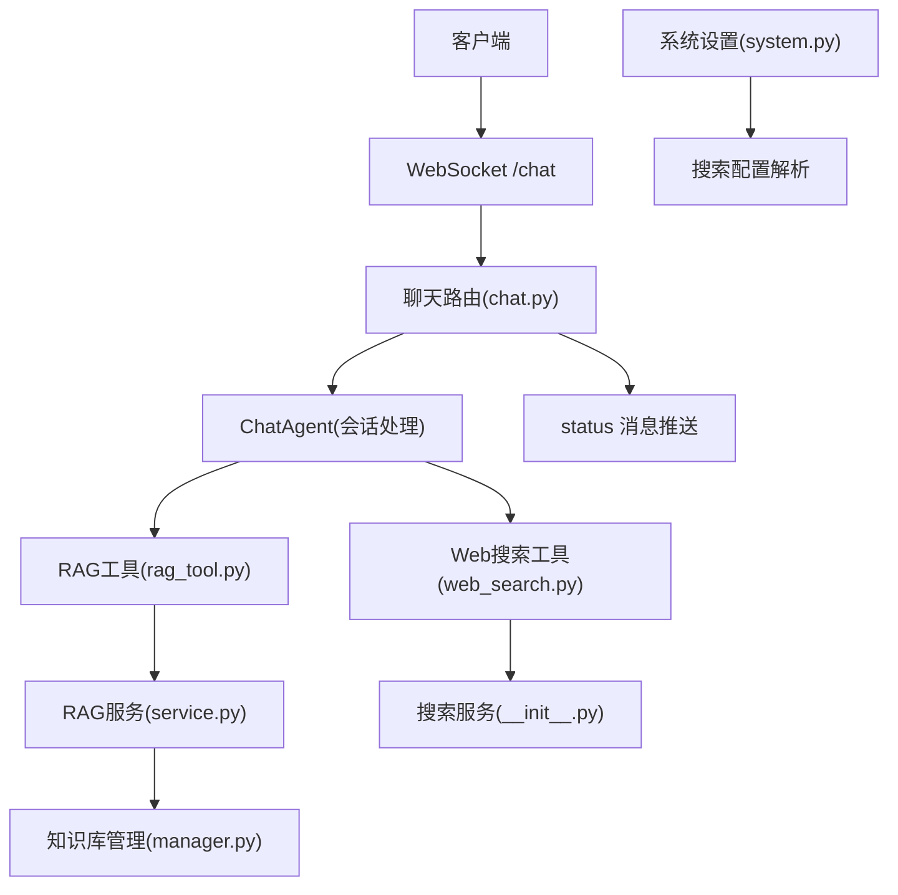
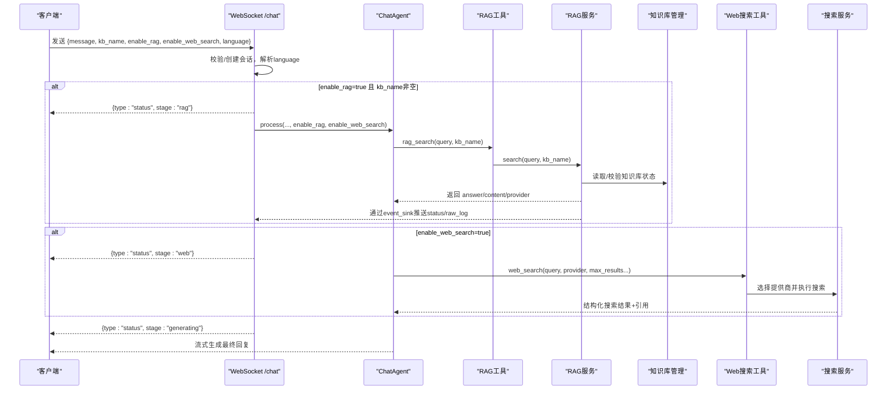
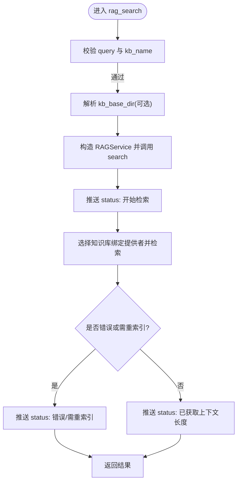
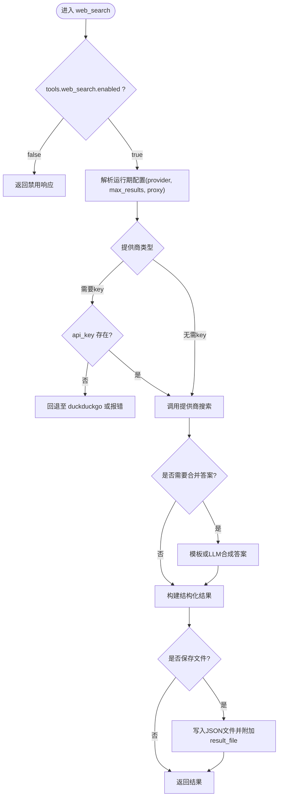
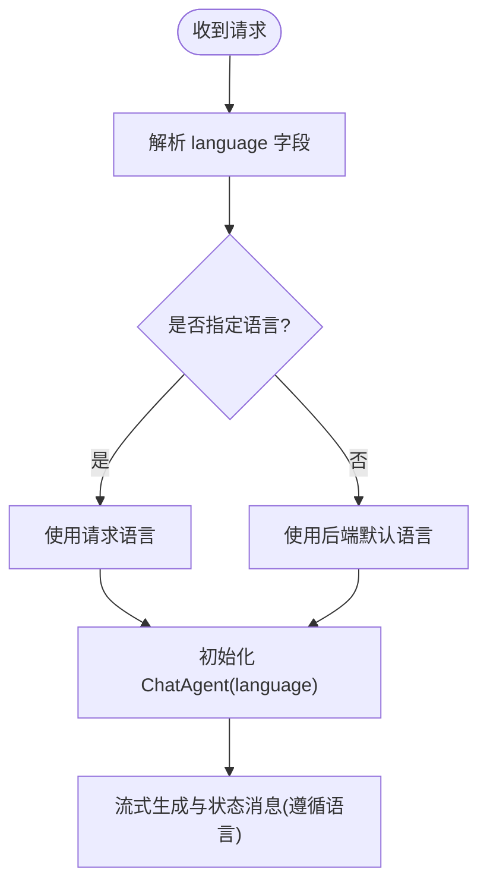
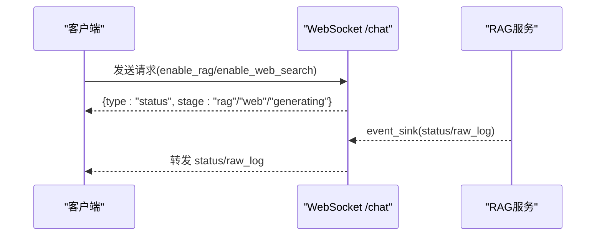
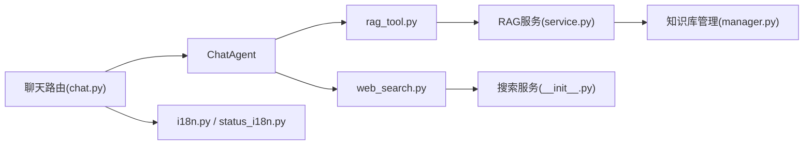

# 高级功能集成

<cite>
**本文引用的文件**
- [rag_tool.py](file://deeptutor/tools/rag_tool.py)
- [service.py](file://deeptutor/services/rag/service.py)
- [manager.py](file://deeptutor/knowledge/manager.py)
- [web_search.py](file://deeptutor/tools/web_search.py)
- [__init__.py（搜索服务）](file://deeptutor/services/search/__init__.py)
- [chat.py](file://deeptutor/api/routers/chat.py)
- [i18n.py](file://deeptutor/core/i18n.py)
- [status_i18n.py](file://deeptutor/i18n/status_i18n.py)
- [system.py](file://deeptutor/api/routers/system.py)
</cite>

## 目录
1. [简介](#简介)
2. [项目结构](#项目结构)
3. [核心组件](#核心组件)
4. [架构总览](#架构总览)
5. [详细组件分析](#详细组件分析)
6. [依赖关系分析](#依赖关系分析)
7. [性能考虑](#性能考虑)
8. [故障排查指南](#故障排查指南)
9. [结论](#结论)
10. [附录：API调用示例与错误处理](#附录api调用示例与错误处理)

## 简介
本文件面向需要在 DeepTutor 中启用并集成“知识库检索（RAG）”“网络搜索”“语言切换”以及“状态反馈”的高级用户与集成开发者。内容涵盖：
- RAG 的启用方式、kb_name 参数使用与查询流程
- 网络搜索 enable_web_search 标志的使用与结果处理
- 中英文动态切换的实现要点
- 通过 status 消息向客户端报告执行阶段的机制
- 完整的 API 调用示例与错误处理策略

## 项目结构
围绕本次目标，关键代码分布在以下模块：
- 工具层：RAG 工具入口、Web Search 工具入口
- 服务层：统一 RAG 服务、搜索服务
- 知识管理：知识库注册、状态与版本管理
- API 路由：聊天 WebSocket 端点（含能力开关与状态推送）、系统配置端点（搜索状态）
- 国际化：运行时 i18n 与能力状态文案

**图表来源**
- [chat.py:59-198](file://deeptutor/api/routers/chat.py#L59-L198)
- [rag_tool.py:15-51](file://deeptutor/tools/rag_tool.py#L15-L51)
- [service.py:84-169](file://deeptutor/services/rag/service.py#L84-L169)
- [manager.py:381-489](file://deeptutor/knowledge/manager.py#L381-L489)
- [__init__.py（搜索服务）:73-170](file://deeptutor/services/search/__init__.py#L73-L170)
- [system.py:103-129](file://deeptutor/api/routers/system.py#L103-L129)

**章节来源**
- [chat.py:59-198](file://deeptutor/api/routers/chat.py#L59-L198)
- [rag_tool.py:15-51](file://deeptutor/tools/rag_tool.py#L15-L51)
- [service.py:84-169](file://deeptutor/services/rag/service.py#L84-L169)
- [manager.py:381-489](file://deeptutor/knowledge/manager.py#L381-L489)
- [__init__.py（搜索服务）:73-170](file://deeptutor/services/search/__init__.py#L73-L170)
- [system.py:103-129](file://deeptutor/api/routers/system.py#L103-L129)

## 核心组件
- RAG 工具与服务：提供 rag_search、initialize、delete 等能力；统一选择知识库绑定提供者；在查询过程中通过 event_sink 推送 status 与 raw_log 事件。
- 知识库管理：负责知识库注册、状态更新、索引版本探测与同步。
- 网络搜索：支持多提供商（brave/tavily/jina/searxng/duckduckgo/perplexity），自动合并答案或走 LLM 合成；可被禁用或回退。
- 语言切换：基于请求 language 字段与后端默认语言，决定响应语言；能力状态文案可通过 StatusI18n 本地化。
- 状态反馈：在聊天路由中发送 type=status 的消息，标注 stage（如 rag/web/generating），并在 RAG 服务内部持续推送阶段信息。

**章节来源**
- [rag_tool.py:15-51](file://deeptutor/tools/rag_tool.py#L15-L51)
- [service.py:84-169](file://deeptutor/services/rag/service.py#L84-L169)
- [manager.py:381-489](file://deeptutor/knowledge/manager.py#L381-L489)
- [__init__.py（搜索服务）:73-170](file://deeptutor/services/search/__init__.py#L73-L170)
- [i18n.py:8-13,113-130:8-13](file://deeptutor/core/i18n.py#L8-L13)
- [status_i18n.py:23-57](file://deeptutor/i18n/status_i18n.py#L23-L57)
- [chat.py:73-86,162-186:73-86](file://deeptutor/api/routers/chat.py#L73-L86)

## 架构总览
下图展示一次包含 RAG 与网络搜索的对话请求从客户端到后端服务的完整调用链，以及状态消息的回传路径。

**图表来源**
- [chat.py:73-198](file://deeptutor/api/routers/chat.py#L73-L198)
- [rag_tool.py:15-51](file://deeptutor/tools/rag_tool.py#L15-L51)
- [service.py:84-169](file://deeptutor/services/rag/service.py#L84-L169)
- [__init__.py（搜索服务）:73-170](file://deeptutor/services/search/__init__.py#L73-L170)

## 详细组件分析

### RAG 知识库检索（RAG）
- 启用方式
  - 在聊天请求中设置 enable_rag=true 并提供 kb_name。
  - 若未显式提供 kb_base_dir，将按当前用户上下文解析资源路径。
- kb_name 的作用
  - 必须为非空字符串；用于定位具体知识库。
  - 在多用户模式下，会进行访问权限校验，不可访问则报错。
- 查询流程
  - 工具层 rag_search 校验参数后，构造 RAGService 并调用 search。
  - 服务层根据知识库绑定选择对应 pipeline，执行检索并标准化结果（answer/content/provider）。
  - 检索期间通过 event_sink 推送 status 与 raw_log 事件，便于前端显示进度与调试。
- 状态反馈
  - 开始检索时推送 status(stage=rag)。
  - 检索成功/失败均推送 status，包含 provider、kb_name、trace_layer 等元数据。
  - 需要重新索引时，会在结果中标记 needs_reindex。

**图表来源**
- [rag_tool.py:15-51](file://deeptutor/tools/rag_tool.py#L15-L51)
- [service.py:84-169](file://deeptutor/services/rag/service.py#L84-L169)

**章节来源**
- [rag_tool.py:15-51](file://deeptutor/tools/rag_tool.py#L15-L51)
- [service.py:84-169](file://deeptutor/services/rag/service.py#L84-L169)
- [manager.py:381-489](file://deeptutor/knowledge/manager.py#L381-L489)

### 网络搜索集成
- 启用方式
  - 在聊天请求中设置 enable_web_search=true。
  - 搜索行为受配置控制：若 tools.web_search.enabled=false，则直接返回禁用提示。
- 提供商与配置
  - 支持 brave/tavily/jina/searxng/duckduckgo/perplexity 等。
  - 缺少必要凭据时会尝试回退（例如 duckduckgo），或抛出明确错误（如 perplexity/serper 缺 api_key）。
  - 最大结果数可从模型目录或 main.yaml 的 tools.web_search.max_results 解析。
- 结果处理
  - 对不支持自带答案的提供商，自动进行答案合并（模板或 LLM 合成）。
  - 返回结构化结果：query、answer、citations、search_results、provider 等。
  - 可选择输出 JSON 文件路径。

**图表来源**
- [__init__.py（搜索服务）:73-170](file://deeptutor/services/search/__init__.py#L73-L170)

**章节来源**
- [__init__.py（搜索服务）:73-170](file://deeptutor/services/search/__init__.py#L73-L170)
- [web_search.py:1-69](file://deeptutor/tools/web_search.py#L1-L69)
- [system.py:103-129](file://deeptutor/api/routers/system.py#L103-L129)

### 语言切换（中英文）
- 请求侧
  - 客户端可在聊天请求中携带 language 字段（如 "zh"、"en" 或带地区后缀）。
  - 服务端优先使用该语言；否则回退到后端默认语言。
- 响应侧
  - 聊天路由根据 language 初始化 ChatAgent，影响后续提示与输出语言。
  - 能力状态文案可通过 StatusI18n 加载对应语言的 YAML 文案。
- 运行时 i18n
  - 后端 i18n 工具 current_language/t 可用于错误消息与 UI 文本的本地化。

**图表来源**
- [chat.py:73-86](file://deeptutor/api/routers/chat.py#L73-L86)
- [i18n.py:8-13,113-130:8-13](file://deeptutor/core/i18n.py#L8-L13)
- [status_i18n.py:23-57](file://deeptutor/i18n/status_i18n.py#L23-L57)

**章节来源**
- [chat.py:73-86](file://deeptutor/api/routers/chat.py#L73-L86)
- [i18n.py:8-13,113-130:8-13](file://deeptutor/core/i18n.py#L8-L13)
- [status_i18n.py:23-57](file://deeptutor/i18n/status_i18n.py#L23-L57)

### 状态反馈机制（status 消息）
- 聊天路由
  - 在开启 RAG 时发送 {type:"status", stage:"rag"}。
  - 在开启网络搜索时发送 {type:"status", stage:"web"}。
  - 在生成回复前发送 {type:"status", stage:"generating"}。
- RAG 服务
  - 在检索各阶段通过 event_sink 推送 status 与 raw_log，包含 provider、kb_name、trace_layer、error_type、needs_reindex 等元数据。
- 系统设置
  - 提供搜索配置状态（configured/disabled/not_configured/unsupported/deprecated）以便前端展示。

**图表来源**
- [chat.py:162-186](file://deeptutor/api/routers/chat.py#L162-L186)
- [service.py:92-148](file://deeptutor/services/rag/service.py#L92-L148)
- [system.py:103-129](file://deeptutor/api/routers/system.py#L103-L129)

**章节来源**
- [chat.py:162-186](file://deeptutor/api/routers/chat.py#L162-L186)
- [service.py:92-148](file://deeptutor/services/rag/service.py#L92-L148)
- [system.py:103-129](file://deeptutor/api/routers/system.py#L103-L129)

## 依赖关系分析
- 聊天路由依赖 ChatAgent 与 SessionManager，负责会话生命周期与能力开关。
- RAG 工具依赖 RAGService，后者再依赖知识库管理与各提供者流水线。
- 网络搜索工具依赖搜索服务，后者负责提供商选择、凭据注入、结果合并与输出。
- 国际化模块为状态与提示提供多语言支持。

**图表来源**
- [chat.py:59-198](file://deeptutor/api/routers/chat.py#L59-L198)
- [rag_tool.py:15-51](file://deeptutor/tools/rag_tool.py#L15-L51)
- [service.py:84-169](file://deeptutor/services/rag/service.py#L84-L169)
- [manager.py:381-489](file://deeptutor/knowledge/manager.py#L381-L489)
- [__init__.py（搜索服务）:73-170](file://deeptutor/services/search/__init__.py#L73-L170)
- [i18n.py:8-13,113-130:8-13](file://deeptutor/core/i18n.py#L8-L13)
- [status_i18n.py:23-57](file://deeptutor/i18n/status_i18n.py#L23-L57)

**章节来源**
- [chat.py:59-198](file://deeptutor/api/routers/chat.py#L59-L198)
- [rag_tool.py:15-51](file://deeptutor/tools/rag_tool.py#L15-L51)
- [service.py:84-169](file://deeptutor/services/rag/service.py#L84-L169)
- [manager.py:381-489](file://deeptutor/knowledge/manager.py#L381-L489)
- [__init__.py（搜索服务）:73-170](file://deeptutor/services/search/__init__.py#L73-L170)
- [i18n.py:8-13,113-130:8-13](file://deeptutor/core/i18n.py#L8-L13)
- [status_i18n.py:23-57](file://deeptutor/i18n/status_i18n.py#L23-L57)

## 性能考虑
- RAG 检索
  - 避免重复索引：当知识库状态为 ready 且嵌入签名匹配时，可直接检索。
  - 日志过滤：RAG 服务捕获底层日志并过滤噪音，减少不必要的传输。
- 网络搜索
  - 合理设置 max_results，避免过多结果导致合并成本上升。
  - 对不需要答案的提供商，使用模板合并更快；需要高质量答案时可启用 LLM 合成。
- 语言切换
  - 语言解析轻量，主要影响提示与文案；注意在长会话中保持语言一致性。

[本节为通用指导，不直接分析具体文件]

## 故障排查指南
- RAG 相关
  - 错误：kb_name 为空或未授权访问。检查传入的 kb_name 与多用户访问权限。
  - 错误：needs_reindex=true。表示索引与当前嵌入配置不匹配，需重建索引。
  - 错误：provider 不可用或未知。检查知识库绑定的提供者是否可用。
- 网络搜索相关
  - 错误：提供商缺失 api_key。为 brave/tavily/jina/perplexity/serper 配置对应密钥。
  - 错误：searxng 缺少 base_url。请提供有效的自托管实例地址。
  - 错误：搜索被禁用。检查 tools.web_search.enabled 配置。
- 语言相关
  - 现象：响应语言不符合预期。确认请求中的 language 字段与后端默认语言设置。
- 状态消息
  - 现象：前端未收到 status。检查 WebSocket 连接与消息转发逻辑。

**章节来源**
- [rag_tool.py:15-51](file://deeptutor/tools/rag_tool.py#L15-L51)
- [service.py:122-148](file://deeptutor/services/rag/service.py#L122-L148)
- [__init__.py（搜索服务）:88-127](file://deeptutor/services/search/__init__.py#L88-L127)
- [chat.py:73-86](file://deeptutor/api/routers/chat.py#L73-L86)

## 结论
通过聊天路由的能力开关与 RAG/搜索服务的协同，DeepTutor 提供了灵活的知识增强与联网检索能力。结合语言切换与完善的 status 反馈机制，可实现端到端的可观测体验。建议在生产环境中：
- 明确配置知识库与搜索提供商的凭据与限制
- 合理使用 max_results 与合并策略
- 利用 status 消息提升用户体验与问题定位效率

[本节为总结性内容，不直接分析具体文件]

## 附录：API调用示例与错误处理

### WebSocket 聊天（/chat）
- 请求体字段
  - message: 必填，用户消息
  - session_id: 可选，会话ID；不存在则创建新会话
  - kb_name: 可选，知识库名称（启用 RAG 时使用）
  - enable_rag: 布尔，是否启用 RAG
  - enable_web_search: 布尔，是否启用网络搜索
  - language: 可选，语言（如 "zh"、"en"）
  - history: 可选，历史消息数组
- 响应
  - 先返回 {type:"session", session_id}
  - 随后可能返回多个 {type:"status", stage:...} 消息
  - 最终返回流式生成的回复内容

**章节来源**
- [chat.py:59-198](file://deeptutor/api/routers/chat.py#L59-L198)

### RAG 工具调用（rag_search）
- 输入
  - query: 非空字符串
  - kb_name: 非空字符串，指向可访问的知识库
  - provider: 可选，覆盖知识库绑定的提供者
  - kb_base_dir: 可选，显式指定知识库根目录
- 输出
  - 包含 answer/content、provider、可能的 error_type 与 needs_reindex
- 常见错误
  - query 或 kb_name 为空：抛出值错误
  - 知识库不可访问：抛出值错误

**章节来源**
- [rag_tool.py:15-51](file://deeptutor/tools/rag_tool.py#L15-L51)

### 网络搜索工具调用（web_search）
- 输入
  - query: 搜索查询
  - provider: 可选，指定提供商（默认从运行期配置解析）
  - output_dir: 可选，保存结果为 JSON 文件
  - consolidation_llm_model: 可选，启用 LLM 合成答案
- 输出
  - 结构化结果：query、answer、citations、search_results、provider
  - 若保存文件，附加 result_file
- 常见错误
  - 提供商不支持或缺失凭据：抛出值错误或回退
  - 搜索被禁用：返回禁用响应

**章节来源**
- [__init__.py（搜索服务）:73-170](file://deeptutor/services/search/__init__.py#L73-L170)
- [web_search.py:1-69](file://deeptutor/tools/web_search.py#L1-L69)

### 系统设置（搜索状态）
- 用途
  - 查询当前搜索提供商的配置状态（configured/disabled/not_configured/unsupported/deprecated）
- 典型场景
  - 前端根据状态提示用户配置 API Key 或切换提供商

**章节来源**
- [system.py:103-129](file://deeptutor/api/routers/system.py#L103-L129)