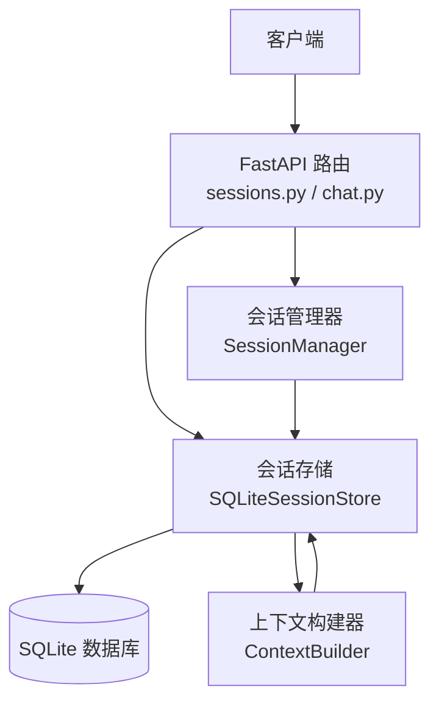
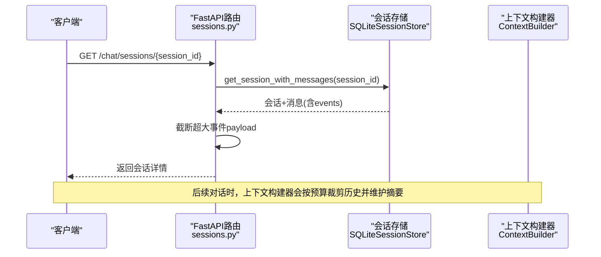
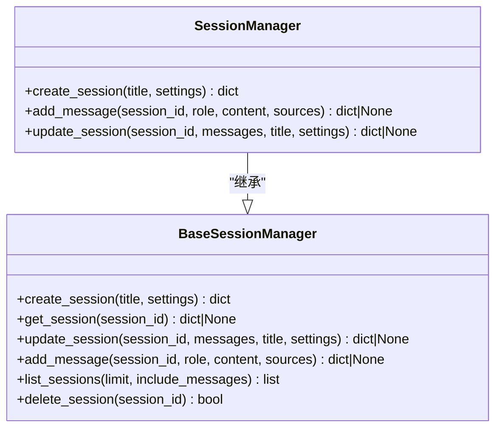
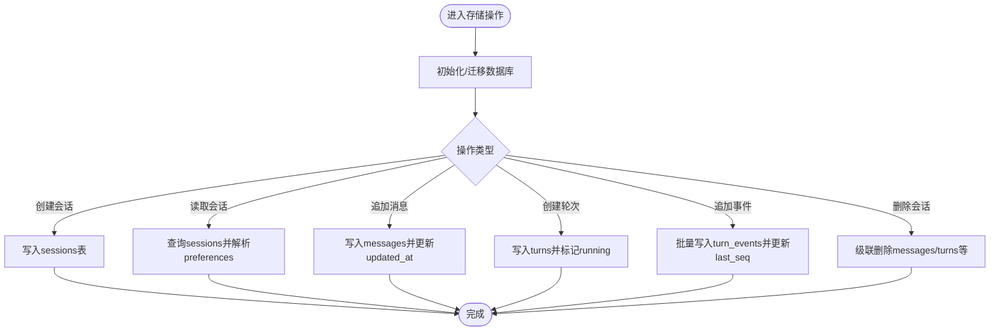
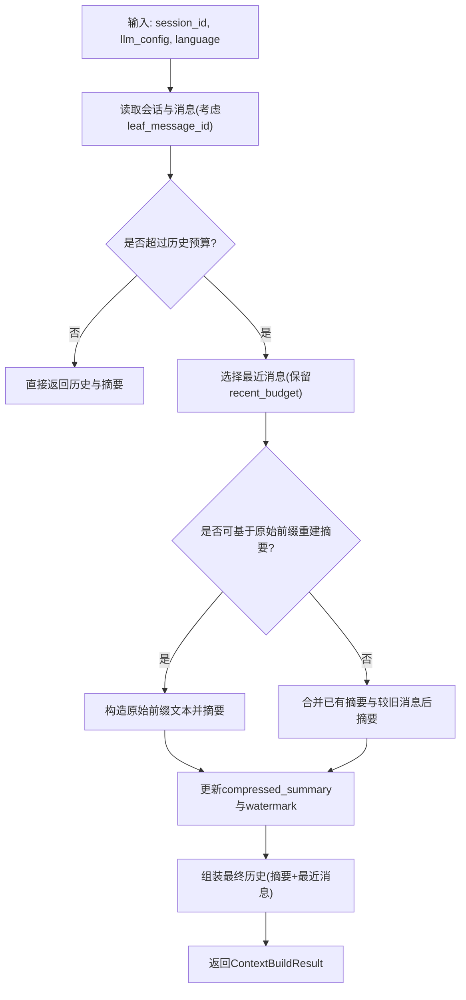
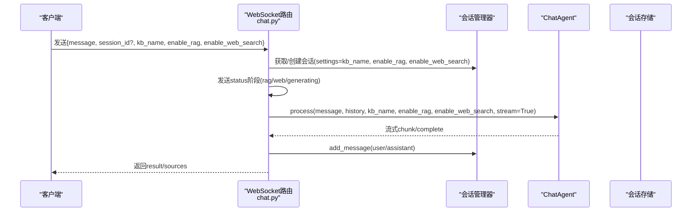
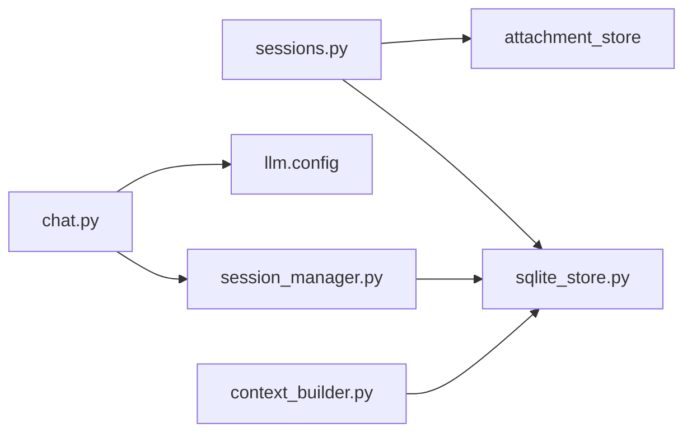

# 会话管理

<cite>
**本文引用的文件**
- [deeptutor/api/routers/sessions.py](file://deeptutor/api/routers/sessions.py)
- [deeptutor/api/routers/chat.py](file://deeptutor/api/routers/chat.py)
- [deeptutor/agents/chat/session_manager.py](file://deeptutor/agents/chat/session_manager.py)
- [deeptutor/services/session/__init__.py](file://deeptutor/services/session/__init__.py)
- [deeptutor/services/session/sqlite_store.py](file://deeptutor/services/session/sqlite_store.py)
- [deeptutor/services/session/context_builder.py](file://deeptutor/services/session/context_builder.py)
- [tests/api/test_sessions_truncation.py](file://tests/api/test_sessions_truncation.py)
</cite>

## 目录
1. [简介](#简介)
2. [项目结构](#项目结构)
3. [核心组件](#核心组件)
4. [架构总览](#架构总览)
5. [详细组件分析](#详细组件分析)
6. [依赖关系分析](#依赖关系分析)
7. [性能考量](#性能考量)
8. [故障排查指南](#故障排查指南)
9. [结论](#结论)
10. [附录：RESTful API 参考](#附录restful-api-参考)

## 简介
本文件面向DeepTutor的聊天会话管理，提供完整的API文档与实现说明。内容覆盖：
- 会话的创建、获取、列表与删除
- 会话生命周期管理：状态跟踪、消息历史存储、上下文保持机制
- RESTful端点参考：GET /chat/sessions、GET /chat/sessions/{session_id}、DELETE /chat/sessions/{session_id}等
- 会话配置选项：知识库关联（kb_name）、RAG启用（enable_rag）、Web搜索开关（enable_web_search）
- 使用示例与最佳实践建议

## 项目结构
会话管理由“API路由层 + 会话管理器 + 持久化存储 + 上下文构建”组成：
- API路由层：暴露REST接口与WebSocket入口
- 会话管理器：封装会话CRUD与消息追加
- 持久化存储：SQLite统一会话存储，支持Turn事件、笔记条目、分支编辑等
- 上下文构建：按LLM上下文窗口预算裁剪历史并维护滚动摘要

**图表来源**
- [deeptutor/api/routers/sessions.py:80-163](file://deeptutor/api/routers/sessions.py#L80-L163)
- [deeptutor/api/routers/chat.py:34-51](file://deeptutor/api/routers/chat.py#L34-L51)
- [deeptutor/agents/chat/session_manager.py:20-164](file://deeptutor/agents/chat/session_manager.py#L20-L164)
- [deeptutor/services/session/sqlite_store.py:96-281](file://deeptutor/services/session/sqlite_store.py#L96-L281)
- [deeptutor/services/session/context_builder.py:104-467](file://deeptutor/services/session/context_builder.py#L104-L467)

**章节来源**
- [deeptutor/api/routers/sessions.py:80-163](file://deeptutor/api/routers/sessions.py#L80-L163)
- [deeptutor/api/routers/chat.py:34-51](file://deeptutor/api/routers/chat.py#L34-L51)
- [deeptutor/agents/chat/session_manager.py:20-164](file://deeptutor/agents/chat/session_manager.py#L20-L164)
- [deeptutor/services/session/sqlite_store.py:96-281](file://deeptutor/services/session/sqlite_store.py#L96-L281)
- [deeptutor/services/session/context_builder.py:104-467](file://deeptutor/services/session/context_builder.py#L104-L467)

## 核心组件
- 会话管理器（SessionManager）
  - 负责会话创建、更新、消息追加、列表与删除
  - 默认标题与ID前缀可定制；支持在settings中保存RAG/Web搜索等配置
- 会话存储（SQLiteSessionStore）
  - 统一持久化会话、消息、Turn事件、笔记条目
  - 支持会话状态（idle/running/completed/failed/cancelled）、活跃Turn查询、消息分支（parent_message_id）
  - 自动迁移旧库结构，保证兼容性
- 上下文构建器（ContextBuilder）
  - 根据LLM上下文窗口预算选择最近消息，必要时生成滚动摘要
  - 支持分支编辑场景下的祖先路径上下文构建
- API路由（sessions.py, chat.py）
  - 暴露REST接口与WebSocket聊天入口
  - 对超大事件负载进行截断，避免前端渲染压力

**章节来源**
- [deeptutor/agents/chat/session_manager.py:20-164](file://deeptutor/agents/chat/session_manager.py#L20-L164)
- [deeptutor/services/session/sqlite_store.py:96-281](file://deeptutor/services/session/sqlite_store.py#L96-L281)
- [deeptutor/services/session/context_builder.py:104-467](file://deeptutor/services/session/context_builder.py#L104-L467)
- [deeptutor/api/routers/sessions.py:80-163](file://deeptutor/api/routers/sessions.py#L80-L163)
- [deeptutor/api/routers/chat.py:34-51](file://deeptutor/api/routers/chat.py#L34-L51)

## 架构总览
下图展示从请求到响应的主要调用链，包括会话CRUD与上下文构建：

**图表来源**
- [deeptutor/api/routers/sessions.py:133-140](file://deeptutor/api/routers/sessions.py#L133-L140)
- [deeptutor/services/session/sqlite_store.py:456-512](file://deeptutor/services/session/sqlite_store.py#L456-L512)
- [deeptutor/services/session/context_builder.py:348-467](file://deeptutor/services/session/context_builder.py#L348-L467)

## 详细组件分析

### 会话管理器（SessionManager）
- 职责
  - 创建会话：支持传入title与settings（kb_name、enable_rag、enable_web_search）
  - 追加消息：记录user/assistant消息，首次用户消息可自动生成标题
  - 更新会话：批量替换消息或更新标题/settings
  - 列出/删除会话：限制最大会话数，按时间倒序排列
- 数据模型
  - session_id、title、messages、settings、created_at、updated_at
- 关键行为
  - 默认标题为“New Chat”，ID前缀为“chat_”
  - 通过BaseSessionManager统一JSON存储逻辑（兼容旧格式）

**图表来源**
- [deeptutor/agents/chat/session_manager.py:20-164](file://deeptutor/agents/chat/session_manager.py#L20-L164)
- [deeptutor/services/session/base_session_manager.py:23-257](file://deeptutor/services/session/base_session_manager.py#L23-L257)

**章节来源**
- [deeptutor/agents/chat/session_manager.py:20-164](file://deeptutor/agents/chat/session_manager.py#L20-L164)
- [deeptutor/services/session/base_session_manager.py:23-257](file://deeptutor/services/session/base_session_manager.py#L23-L257)

### SQLite会话存储（SQLiteSessionStore）
- 表结构
  - sessions：会话元信息、压缩摘要、偏好设置
  - messages：消息内容、能力标识、事件、附件、元数据、父子关系（parent_message_id）
  - turns：轮次状态（running/completed/failed/cancelled）、错误信息、时间戳
  - turn_events：轮次内事件流（type/source/stage/content/metadata/timestamp）
  - notebook_entries/notebook_categories：问答记录与分类
- 关键方法
  - create_session/get_session/update_summary
  - create_turn/get_active_turn/update_turn_status
  - append_turn_event(s)/get_turn_events
  - get_session_with_messages/list_sessions/delete_session
- 特性
  - 自动迁移旧库字段（preferences_json、metadata_json、parent_message_id等）
  - 索引优化：按session_id、updated_at、parent_message_id等
  - 并发安全：异步锁保护SQLite访问

**图表来源**
- [deeptutor/services/session/sqlite_store.py:119-281](file://deeptutor/services/session/sqlite_store.py#L119-L281)
- [deeptutor/services/session/sqlite_store.py:419-579](file://deeptutor/services/session/sqlite_store.py#L419-L579)
- [deeptutor/services/session/sqlite_store.py:639-771](file://deeptutor/services/session/sqlite_store.py#L639-L771)

**章节来源**
- [deeptutor/services/session/sqlite_store.py:119-281](file://deeptutor/services/session/sqlite_store.py#L119-L281)
- [deeptutor/services/session/sqlite_store.py:419-579](file://deeptutor/services/session/sqlite_store.py#L419-L579)
- [deeptutor/services/session/sqlite_store.py:639-771](file://deeptutor/services/session/sqlite_store.py#L639-L771)

### 上下文构建器（ContextBuilder）
- 目标
  - 基于LLM上下文窗口预算，选择最近的对话消息，必要时生成滚动摘要
  - 支持分支编辑：仅包含所选消息的祖先路径
- 算法要点
  - 计算历史预算与摘要预算（比例可调）
  - 若当前历史超出预算，则选择最近消息，并对更早部分进行摘要
  - 反漂移策略：当原始前缀仍适合重建时，直接基于原始消息重新摘要，避免“摘要的摘要”丢失细节
  - 输出：conversation_history、conversation_summary、context_text、token_count、budget
- 事件追踪
  - 将摘要过程以StreamEvent形式输出，便于前端进度展示

**图表来源**
- [deeptutor/services/session/context_builder.py:104-467](file://deeptutor/services/session/context_builder.py#L104-L467)

**章节来源**
- [deeptutor/services/session/context_builder.py:104-467](file://deeptutor/services/session/context_builder.py#L104-L467)

### API路由层（sessions.py, chat.py）
- REST端点
  - GET /chat/sessions：分页列出会话（limit/offset）
  - GET /chat/sessions/{session_id}：获取会话详情（含消息与events），并对超大事件负载进行截断
  - DELETE /chat/sessions/{session_id}：删除会话及附件
  - PATCH /chat/sessions/{session_id}：重命名会话
  - PUT /chat/sessions/{session_id}/branch-selection：更新分支选择偏好
  - DELETE /chat/sessions/{session_id}/messages/{message_id}：按消息删除轮次（运行中拒绝）
  - POST /chat/sessions/{session_id}/quiz-results：记录测验结果并写入笔记条目
- WebSocket聊天
  - /chat：接收消息，创建/复用会话，发送RAG/Web搜索状态，流式返回响应，最后持久化助手回复

**图表来源**
- [deeptutor/api/routers/chat.py:59-250](file://deeptutor/api/routers/chat.py#L59-L250)
- [deeptutor/agents/chat/session_manager.py:94-164](file://deeptutor/agents/chat/session_manager.py#L94-L164)

**章节来源**
- [deeptutor/api/routers/sessions.py:80-231](file://deeptutor/api/routers/sessions.py#L80-L231)
- [deeptutor/api/routers/chat.py:34-250](file://deeptutor/api/routers/chat.py#L34-L250)

## 依赖关系分析
- 路由层依赖
  - sessions.py依赖会话存储（get_session_store/get_sqlite_session_store）与附件存储
  - chat.py依赖会话管理器与LLM配置
- 存储层依赖
  - SQLiteSessionStore依赖路径服务，负责数据库初始化与迁移
  - ContextBuilder依赖SessionStoreProtocol，读取会话与消息，更新摘要
- 外部集成
  - 可通过PocketBase后端替代SQLite（get_session_store动态选择）

**图表来源**
- [deeptutor/api/routers/sessions.py:13-14](file://deeptutor/api/routers/sessions.py#L13-L14)
- [deeptutor/api/routers/chat.py:13-16](file://deeptutor/api/routers/chat.py#L13-L16)
- [deeptutor/services/session/__init__.py:33-47](file://deeptutor/services/session/__init__.py#L33-L47)

**章节来源**
- [deeptutor/api/routers/sessions.py:13-14](file://deeptutor/api/routers/sessions.py#L13-L14)
- [deeptutor/api/routers/chat.py:13-16](file://deeptutor/api/routers/chat.py#L13-L16)
- [deeptutor/services/session/__init__.py:33-47](file://deeptutor/services/session/__init__.py#L33-L47)

## 性能考量
- 事件负载截断：对tool_result/observation等大payload进行上限截断，避免前端渲染卡顿
- 批量写入：append_turn_events使用executemany减少事务开销
- 索引优化：针对session_id、updated_at、parent_message_id建立索引，提升查询效率
- 上下文预算：按LLM上下文窗口比例分配历史与摘要预算，控制token消耗
- 并发安全：异步锁保护SQLite访问，避免竞争条件

**章节来源**
- [deeptutor/api/routers/sessions.py:90-131](file://deeptutor/api/routers/sessions.py#L90-L131)
- [deeptutor/services/session/sqlite_store.py:706-771](file://deeptutor/services/session/sqlite_store.py#L706-L771)
- [deeptutor/services/session/sqlite_store.py:150-175](file://deeptutor/services/session/sqlite_store.py#L150-L175)
- [deeptutor/services/session/context_builder.py:117-137](file://deeptutor/services/session/context_builder.py#L117-L137)

## 故障排查指南
- 404未找到
  - 获取/重命名/删除会话时，若session_id不存在，返回404
- 409冲突
  - 删除正在运行的轮次对应的消息时，返回409提示不可删除
- 400参数错误
  - 提交测验结果为空时，返回400
- 附件清理失败
  - 删除会话时附件清理异常会被捕获并记录日志，不影响主流程
- 事件负载过大
  - 通过截断与_truncated标记提示前端处理

**章节来源**
- [deeptutor/api/routers/sessions.py:133-196](file://deeptutor/api/routers/sessions.py#L133-L196)
- [tests/api/test_sessions_truncation.py:20-85](file://tests/api/test_sessions_truncation.py#L20-L85)

## 结论
DeepTutor的会话管理采用清晰的分层设计：API路由层提供REST与WebSocket接口，会话管理器封装业务逻辑，SQLite存储确保可靠持久化，上下文构建器保障长对话的上下文质量与成本可控。通过RAG与Web搜索开关、会话偏好设置与分支编辑支持，系统既满足灵活交互又兼顾性能与稳定性。

## 附录：RESTful API 参考

### 通用约定
- 基础路径：/chat
- 认证：如需鉴权，请参考各自路由的认证要求（例如WebSocket需鉴权）
- 错误码：400/404/409/500等，具体见各端点

### GET /chat/sessions
- 功能：列出会话（分页）
- 查询参数
  - limit: 整数，范围1-200，默认50
  - offset: 整数，>=0，默认0
- 响应体
  - sessions: 数组，元素包含session_id、title、message_count、settings、created_at、updated_at、last_message预览
- 错误
  - 无特殊错误

**章节来源**
- [deeptutor/api/routers/sessions.py:80-87](file://deeptutor/api/routers/sessions.py#L80-L87)

### GET /chat/sessions/{session_id}
- 功能：获取会话详情（含消息与事件）
- 路径参数
  - session_id: 字符串
- 响应体
  - 会话对象，包含messages数组（每个消息含events列表）
  - 对tool_result/observation等事件的content与tool_metadata字段进行截断，并标记_truncated
- 错误
  - 404：会话不存在

**章节来源**
- [deeptutor/api/routers/sessions.py:133-140](file://deeptutor/api/routers/sessions.py#L133-L140)
- [deeptutor/api/routers/sessions.py:100-131](file://deeptutor/api/routers/sessions.py#L100-L131)

### DELETE /chat/sessions/{session_id}
- 功能：删除会话及其附件
- 路径参数
  - session_id: 字符串
- 响应体
  - deleted: 布尔
  - session_id: 字符串
- 错误
  - 404：会话不存在

**章节来源**
- [deeptutor/api/routers/sessions.py:153-163](file://deeptutor/api/routers/sessions.py#L153-L163)

### PATCH /chat/sessions/{session_id}
- 功能：重命名会话
- 路径参数
  - session_id: 字符串
- 请求体
  - title: 字符串，长度1-100
- 响应体
  - session: 更新后的会话对象
- 错误
  - 404：会话不存在

**章节来源**
- [deeptutor/api/routers/sessions.py:143-150](file://deeptutor/api/routers/sessions.py#L143-L150)

### PUT /chat/sessions/{session_id}/branch-selection
- 功能：更新分支选择偏好（selected_branches）
- 路径参数
  - session_id: 字符串
- 请求体
  - selected_branches: 字典，键为父消息ID，值为子消息ID
- 响应体
  - selected_branches: 提交的字典
- 错误
  - 404：会话不存在

**章节来源**
- [deeptutor/api/routers/sessions.py:166-177](file://deeptutor/api/routers/sessions.py#L166-L177)

### DELETE /chat/sessions/{session_id}/messages/{message_id}
- 功能：按消息删除对应轮次
- 路径参数
  - session_id: 字符串
  - message_id: 整数
- 响应体
  - was_running: 布尔（若轮次仍在运行则拒绝）
  - deleted: 布尔
  - attachment_ids: 已删除的附件ID列表
- 错误
  - 409：轮次运行中
  - 404：消息不存在

**章节来源**
- [deeptutor/api/routers/sessions.py:180-196](file://deeptutor/api/routers/sessions.py#L180-L196)

### POST /chat/sessions/{session_id}/quiz-results
- 功能：记录测验结果并写入笔记条目
- 路径参数
  - session_id: 字符串
- 请求体
  - answers: 数组，每项包含question_id、question、question_type、options、user_answer、correct_answer、explanation、difficulty、is_correct
  - turn_id: 字符串
- 响应体
  - recorded: 布尔
  - session_id: 字符串
  - answer_count: 整数
  - notebook_count: 整数
  - content: 生成的汇总消息文本
- 错误
  - 400：answers为空
  - 404：会话不存在

**章节来源**
- [deeptutor/api/routers/sessions.py:199-231](file://deeptutor/api/routers/sessions.py#L199-L231)

### WebSocket /chat
- 功能：实时聊天，支持RAG与Web搜索状态推送
- 请求消息字段
  - message: 必填
  - session_id: 可选（存在则复用，否则创建新会话）
  - history: 可选（显式历史，否则使用会话历史）
  - kb_name: 字符串（知识库名称）
  - enable_rag: 布尔（是否启用RAG）
  - enable_web_search: 布尔（是否启用Web搜索）
  - language: 语言偏好（zh/en）
- 响应消息类型
  - session：返回session_id
  - status：stage为rag/web/generating
  - stream：流式内容片段
  - sources：rag/web来源
  - result：完整响应
  - error：错误信息
- 错误
  - 消息为空时返回error
  - 处理异常时返回error

**章节来源**
- [deeptutor/api/routers/chat.py:59-250](file://deeptutor/api/routers/chat.py#L59-L250)

### 会话配置选项
- kb_name：关联的知识库名称（用于RAG检索）
- enable_rag：是否启用RAG
- enable_web_search：是否启用Web搜索
- 这些配置在创建会话时通过settings传入，并在后续对话中沿用

**章节来源**
- [deeptutor/api/routers/chat.py:84-121](file://deeptutor/api/routers/chat.py#L84-L121)
- [deeptutor/agents/chat/session_manager.py:50-66](file://deeptutor/agents/chat/session_manager.py#L50-L66)

### 使用示例与最佳实践
- 创建会话
  - 通过WebSocket发送message与配置（kb_name、enable_rag、enable_web_search），服务端自动创建会话并返回session_id
- 获取会话列表
  - 使用GET /chat/sessions，合理设置limit/offset进行分页
- 获取会话详情
  - 使用GET /chat/sessions/{session_id}，注意大事件已被截断，前端可根据_truncated判断
- 删除会话
  - 使用DELETE /chat/sessions/{session_id}，确保不再需要该会话的历史与附件
- 最佳实践
  - 合理设置enable_rag与enable_web_search，避免不必要的检索开销
  - 对于长对话，利用上下文构建器的摘要机制，控制token消耗
  - 删除轮次前检查was_running，避免并发冲突
  - 关注错误码与日志，快速定位问题

[无需来源：本节为概念性指导]