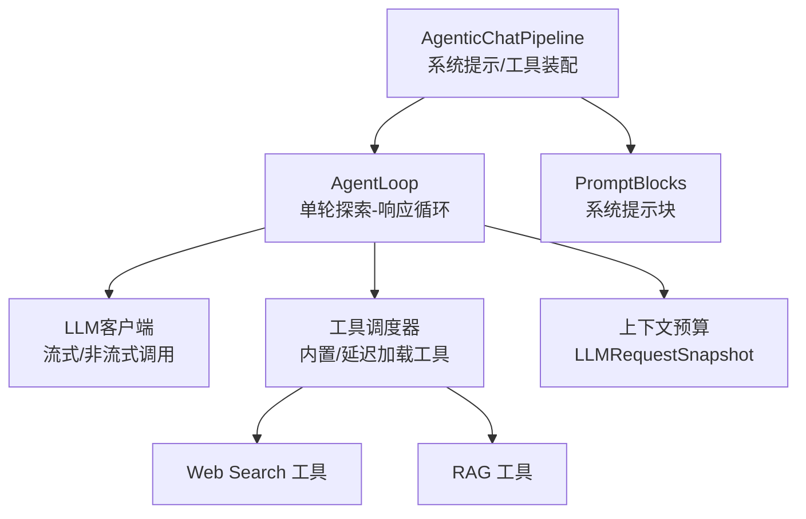
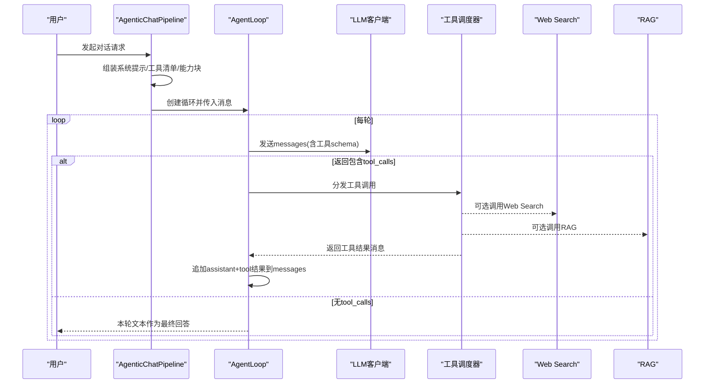
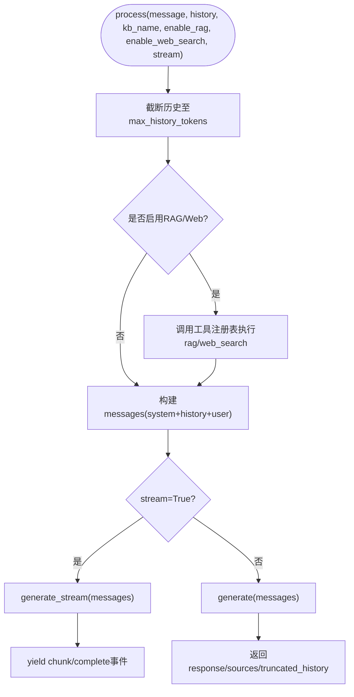
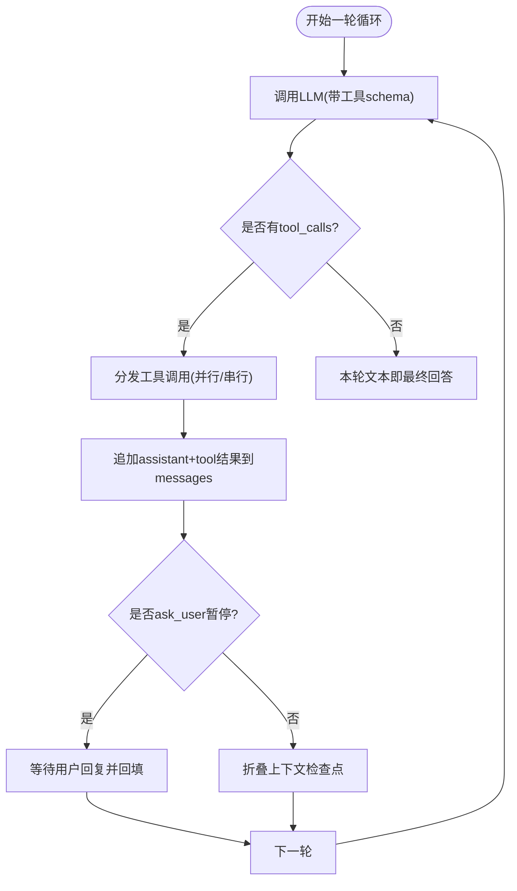
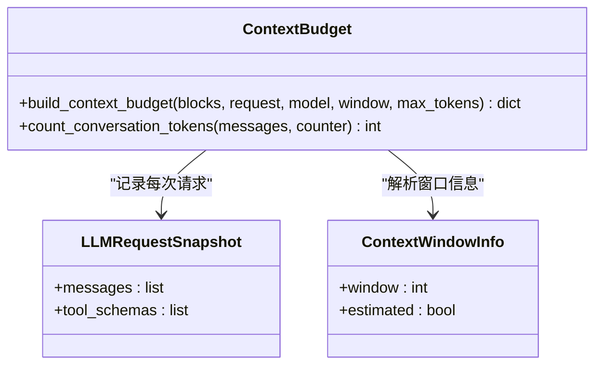
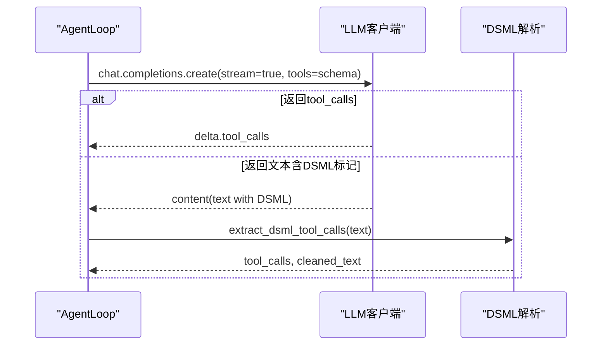
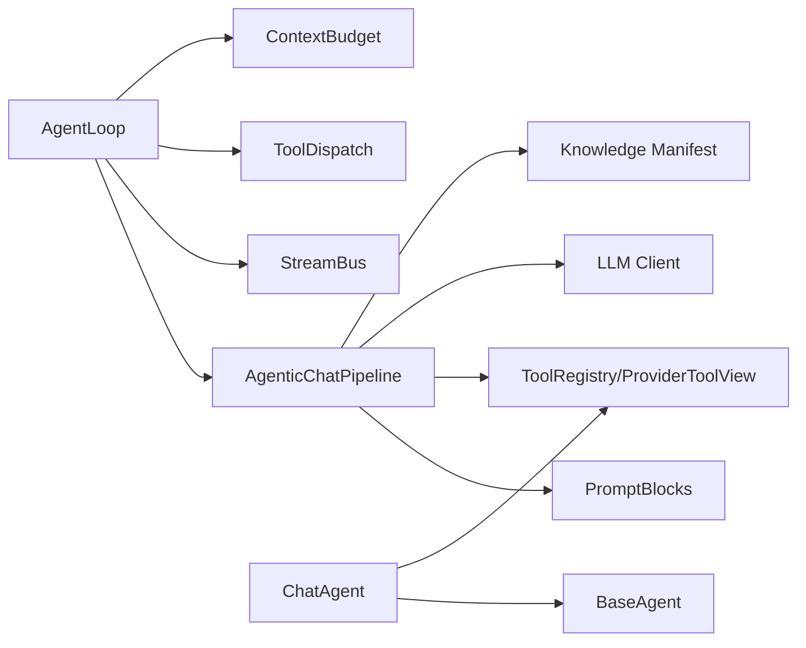

# 智能体集成

<cite>
**本文引用的文件**
- [chat_agent.py](file://deeptutor/agents/chat/chat_agent.py)
- [agent_loop.py](file://deeptutor/agents/chat/agent_loop.py)
- [agentic_pipeline.py](file://deeptutor/agents/chat/agentic_pipeline.py)
- [context_budget.py](file://deeptutor/agents/chat/context_budget.py)
- [dsml_tool_calls.py](file://deeptutor/agents/chat/dsml_tool_calls.py)
- [prompt_blocks.py](file://deeptutor/agents/chat/prompt_blocks.py)
- [base_agent.py](file://deeptutor/agents/base_agent.py)
- [web_search.py](file://deeptutor/tools/web_search.py)
- [rag_tool.py](file://deeptutor/tools/rag_tool.py)
</cite>

## 目录
1. [简介](#简介)
2. [项目结构](#项目结构)
3. [核心组件](#核心组件)
4. [架构总览](#架构总览)
5. [详细组件分析](#详细组件分析)
6. [依赖关系分析](#依赖关系分析)
7. [性能考虑](#性能考虑)
8. [故障排除指南](#故障排除指南)
9. [结论](#结论)

## 简介
本文件面向DeepTutor的聊天智能体集成，聚焦ChatAgent类与“探索-响应”单循环智能体机制。文档说明：
- ChatAgent的配置与使用（语言、模型、工具调用）
- 智能体循环机制（探索阶段与响应阶段的处理流程）
- 上下文预算控制、工具调用管理、多轮对话处理
- 与知识库系统、网络搜索工具和外部服务的集成方式
- 性能优化建议与故障排除指南

## 项目结构
围绕聊天智能体的关键模块位于 agents/chat 下，配合基础能力与工具层：
- chat_agent.py：轻量级多轮对话代理，提供历史截断、RAG/Web检索、流式生成等能力
- agent_loop.py：单轮“探索-响应”智能体循环，统一处理LLM调用、工具调度、用户交互暂停与强制结束
- agentic_pipeline.py：组装系统提示、工具清单、能力块、消息构建与执行策略
- context_budget.py：按请求快照统计上下文窗口占用，输出分段明细
- dsml_tool_calls.py：兼容部分后端以文本形式返回的工具调用标记解析
- prompt_blocks.py：结构化拼装系统提示块，支持语言指令注入
- base_agent.py：统一LLM配置、参数、追踪与流式接口
- tools/web_search.py、tools/rag_tool.py：网络搜索与知识库检索工具入口

**图表来源**
- [agentic_pipeline.py:185-346](file://deeptutor/agents/chat/agentic_pipeline.py#L185-L346)
- [agent_loop.py:151-228](file://deeptutor/agents/chat/agent_loop.py#L151-L228)
- [context_budget.py:54-64](file://deeptutor/agents/chat/context_budget.py#L54-L64)
- [prompt_blocks.py:12-55](file://deeptutor/agents/chat/prompt_blocks.py#L12-L55)

**章节来源**
- [agentic_pipeline.py:185-346](file://deeptutor/agents/chat/agentic_pipeline.py#L185-L346)
- [agent_loop.py:151-228](file://deeptutor/agents/chat/agent_loop.py#L151-L228)

## 核心组件
- ChatAgent：轻量多轮对话代理，负责历史截断、上下文检索（RAG/Web）、消息构建与流式/非流式生成
- AgenticChatPipeline：将系统提示、工具清单、能力块与用户消息组装为一次完整的对话；决定启用哪些工具与是否原生工具调用
- AgentLoop：单轮智能体循环，反复调用LLM并分发工具调用，直到无工具调用则结束（最终回答）
- ContextBudget：记录每次真实LLM请求的消息与工具schema，计算上下文窗口占用与分段
- PromptBlocks：模块化拼装系统提示，支持语言指令注入与能力块扩展
- BaseAgent：统一LLM配置、参数、追踪与流式接口，供ChatAgent复用

**章节来源**
- [chat_agent.py:21-66](file://deeptutor/agents/chat/chat_agent.py#L21-L66)
- [agentic_pipeline.py:185-269](file://deeptutor/agents/chat/agentic_pipeline.py#L185-L269)
- [agent_loop.py:151-228](file://deeptutor/agents/chat/agent_loop.py#L151-L228)
- [context_budget.py:54-64](file://deeptutor/agents/chat/context_budget.py#L54-L64)
- [prompt_blocks.py:12-55](file://deeptutor/agents/chat/prompt_blocks.py#L12-L55)
- [base_agent.py:32-145](file://deeptutor/agents/base_agent.py#L32-L145)

## 架构总览
聊天智能体采用“单轮单循环”的设计：一次用户请求进入后，Pipeline先准备系统提示与工具清单，然后启动AgentLoop进行多轮LLM调用与工具调度；当某轮没有工具调用时，该轮文本即为用户可见的最终答案。

**图表来源**
- [agentic_pipeline.py:326-346](file://deeptutor/agents/chat/agentic_pipeline.py#L326-L346)
- [agent_loop.py:234-357](file://deeptutor/agents/chat/agent_loop.py#L234-L357)
- [web_search.py:1-69](file://deeptutor/tools/web_search.py#L1-L69)
- [rag_tool.py:15-51](file://deeptutor/tools/rag_tool.py#L15-L51)

## 详细组件分析

### ChatAgent：配置与使用
- 语言设置：构造时可指定language（默认中文），用于语言指令注入与提示模板选择
- 模型配置：继承BaseAgent，自动从统一LLM配置获取model、api_key、base_url、binding等；可通过get_model/get_temperature/get_max_tokens读取
- 工具调用：通过工具注册表执行rag与web_search，并将结果拼接为上下文；支持附件（多模态）输入
- 多轮对话：维护history并进行token限制截断；构建messages数组（system + history + user）
- 流式/非流式：generate_stream与generate分别对应流式与非流式响应

**图表来源**
- [chat_agent.py:365-431](file://deeptutor/agents/chat/chat_agent.py#L365-L431)
- [chat_agent.py:158-228](file://deeptutor/agents/chat/chat_agent.py#L158-L228)
- [chat_agent.py:230-270](file://deeptutor/agents/chat/chat_agent.py#L230-L270)

**章节来源**
- [chat_agent.py:21-66](file://deeptutor/agents/chat/chat_agent.py#L21-L66)
- [chat_agent.py:67-134](file://deeptutor/agents/chat/chat_agent.py#L67-L134)
- [chat_agent.py:158-228](file://deeptutor/agents/chat/chat_agent.py#L158-L228)
- [chat_agent.py:230-270](file://deeptutor/agents/chat/chat_agent.py#L230-L270)
- [chat_agent.py:272-363](file://deeptutor/agents/chat/chat_agent.py#L272-L363)
- [chat_agent.py:365-431](file://deeptutor/agents/chat/chat_agent.py#L365-L431)

### 智能体循环机制：探索阶段与响应阶段
- 单轮单循环：一轮=一次LLM调用+工具分发；若本轮有工具调用则为“叙述”，继续下一轮；若无工具调用则为“完成”，其文本即最终答案
- 探索阶段：循环内反复调用LLM，收集工具结果并追加到messages，必要时插入“上下文检查点”摘要以保持窗口稳定
- 响应阶段：当预算耗尽或错误时，强制进行一次无工具的“收尾”调用，确保给出可用回答
- 用户交互暂停：遇到ask_user工具会暂停等待用户回复，恢复后继续协议内流程

**图表来源**
- [agent_loop.py:234-357](file://deeptutor/agents/chat/agent_loop.py#L234-L357)
- [agent_loop.py:359-419](file://deeptutor/agents/chat/agent_loop.py#L359-L419)

**章节来源**
- [agent_loop.py:151-228](file://deeptutor/agents/chat/agent_loop.py#L151-L228)
- [agent_loop.py:234-357](file://deeptutor/agents/chat/agent_loop.py#L234-L357)
- [agent_loop.py:359-419](file://deeptutor/agents/chat/agent_loop.py#L359-L419)

### 上下文预算控制
- 请求快照：每次LLM调用前记录messages与tool_schemas（LLMRequestSnapshot），避免后续append导致读数漂移
- 分段统计：将系统提示块、工具schema、对话消息等分块统计token，输出window、used_tokens、free_tokens及segments
- 窗口保护：在循环中根据有效上下文窗口比例进行保护，防止溢出

**图表来源**
- [context_budget.py:54-64](file://deeptutor/agents/chat/context_budget.py#L54-L64)
- [context_budget.py:74-99](file://deeptutor/agents/chat/context_budget.py#L74-L99)
- [context_budget.py:135-212](file://deeptutor/agents/chat/context_budget.py#L135-L212)

**章节来源**
- [context_budget.py:54-64](file://deeptutor/agents/chat/context_budget.py#L54-L64)
- [context_budget.py:135-212](file://deeptutor/agents/chat/context_budget.py#L135-L212)

### 工具调用管理与兼容性
- 工具清单：Pipeline根据上下文与权限组合启用工具，生成OpenAI schema；对特定工具（如rag、notebook）动态注入枚举与必填项
- DSML兼容：某些后端以文本形式返回工具调用标记，AgentLoop在流结束后尝试解析为结构化tool_calls，保证正常调度
- 降级策略：若后端不支持stream_options或工具schema，自动移除相关参数重试；图像输入不被支持时降级为纯文本

**图表来源**
- [agent_loop.py:438-637](file://deeptutor/agents/chat/agent_loop.py#L438-L637)
- [dsml_tool_calls.py:67-110](file://deeptutor/agents/chat/dsml_tool_calls.py#L67-L110)

**章节来源**
- [agentic_pipeline.py:699-738](file://deeptutor/agents/chat/agentic_pipeline.py#L699-L738)
- [agent_loop.py:438-637](file://deeptutor/agents/chat/agent_loop.py#L438-L637)
- [dsml_tool_calls.py:67-110](file://deeptutor/agents/chat/dsml_tool_calls.py#L67-L110)

### 多轮对话处理
- 历史截断：基于token计数从新到旧保留最近消息，超出限制丢弃更早内容
- 消息构建：system提示包含语言指令与上下文模板；history与当前user消息依次追加
- 附件处理：多模态附件在消息构建阶段转换为provider兼容格式

**章节来源**
- [chat_agent.py:67-134](file://deeptutor/agents/chat/chat_agent.py#L67-L134)
- [chat_agent.py:230-270](file://deeptutor/agents/chat/chat_agent.py#L230-L270)
- [agentic_pipeline.py:374-415](file://deeptutor/agents/chat/agentic_pipeline.py#L374-L415)

### 与知识库、网络搜索与外部服务集成
- 知识库（RAG）：通过工具注册表执行rag工具，传入kb_name与query，返回合成答案与引用片段
- 网络搜索：通过工具注册表执行web_search，返回答案与引用列表，支持多种提供商（brave/tavily/jina/searxng/duckduckgo/perplexity）
- 外部服务：通过延迟加载工具视图（ProviderToolView）与工具注册表，结合权限与资源授权动态挂载工具

**章节来源**
- [chat_agent.py:158-228](file://deeptutor/agents/chat/chat_agent.py#L158-L228)
- [web_search.py:1-69](file://deeptutor/tools/web_search.py#L1-L69)
- [rag_tool.py:15-51](file://deeptutor/tools/rag_tool.py#L15-L51)
- [agentic_pipeline.py:473-505](file://deeptutor/agents/chat/agentic_pipeline.py#L473-L505)

## 依赖关系分析
- AgenticChatPipeline依赖：
  - PromptBlocks：系统提示块组装
  - ToolRegistry/ProviderToolView：工具清单与权限视图
  - LLM Client：OpenAI兼容客户端
  - Knowledge Manifest：知识库提示注记
- AgentLoop依赖：
  - Pipeline：提示与工具配置
  - StreamBus：进度、思考、内容流事件
  - ToolDispatch：工具分发与结果聚合
  - ContextBudget：上下文预算快照与统计
- ChatAgent依赖：
  - BaseAgent：统一LLM接口与追踪
  - ToolRegistry：RAG/Web工具执行
  - PromptManager：语言指令注入

**图表来源**
- [agentic_pipeline.py:185-346](file://deeptutor/agents/chat/agentic_pipeline.py#L185-L346)
- [agent_loop.py:151-228](file://deeptutor/agents/chat/agent_loop.py#L151-L228)
- [chat_agent.py:21-66](file://deeptutor/agents/chat/chat_agent.py#L21-L66)

**章节来源**
- [agentic_pipeline.py:185-346](file://deeptutor/agents/chat/agentic_pipeline.py#L185-L346)
- [agent_loop.py:151-228](file://deeptutor/agents/chat/agent_loop.py#L151-L228)
- [chat_agent.py:21-66](file://deeptutor/agents/chat/chat_agent.py#L21-L66)

## 性能考虑
- 流式输出：优先使用流式接口降低首字延迟，减少内存占用
- 历史截断：合理设置max_history_tokens，避免过长历史影响响应质量与成本
- 工具调用批量化：尽量合并工具调用，减少往返次数；注意并发上限与幂等性
- 上下文窗口保护：利用ContextBudget监控窗口使用，及时插入检查点摘要，避免溢出
- 降级策略：针对不支持的特性（如stream_options、工具schema、图像输入）自动降级，提高鲁棒性
- 缓存与复用：系统提示与工具清单在一次turn内保持稳定，避免重复渲染

[本节为通用指导，不直接分析具体文件]

## 故障排除指南
- 工具调用未执行：检查后端是否返回DSML标记；确认AgentLoop已解析并转为tool_calls
- 工具不可用：确认工具清单已正确装配，权限与资源授权满足要求；查看ProviderToolView的拒绝消息
- 上下文溢出：观察ContextBudget的used_tokens与free_tokens，调整历史长度或增加窗口上限
- 流式异常：若stream_options不被支持，自动移除并重试；若工具schema被拒绝，移除tools并重试
- 网络搜索失败：检查search provider配置与API密钥；确认provider状态为configured且未被弃用
- RAG失败：确认kb_name可访问且已索引；检查RAG服务状态与提供者配置

**章节来源**
- [agent_loop.py:639-689](file://deeptutor/agents/chat/agent_loop.py#L639-L689)
- [context_budget.py:135-212](file://deeptutor/agents/chat/context_budget.py#L135-L212)
- [web_search.py:1-69](file://deeptutor/tools/web_search.py#L1-L69)
- [rag_tool.py:15-51](file://deeptutor/tools/rag_tool.py#L15-L51)

## 结论
DeepTutor的聊天智能体采用清晰的“单轮单循环”设计，将系统提示、工具清单与能力块解耦装配，并通过AgentLoop实现稳健的多轮探索与响应。ChatAgent提供便捷的多轮对话与上下文检索能力，配合ContextBudget与PromptBlocks保障上下文稳定与提示一致性。通过工具注册表与延迟加载视图，系统灵活集成知识库、网络搜索与外部服务，同时具备完善的降级与容错机制。在生产环境中，建议关注流式输出、历史截断、工具批量化与上下文预算监控，以获得最佳性能与稳定性。