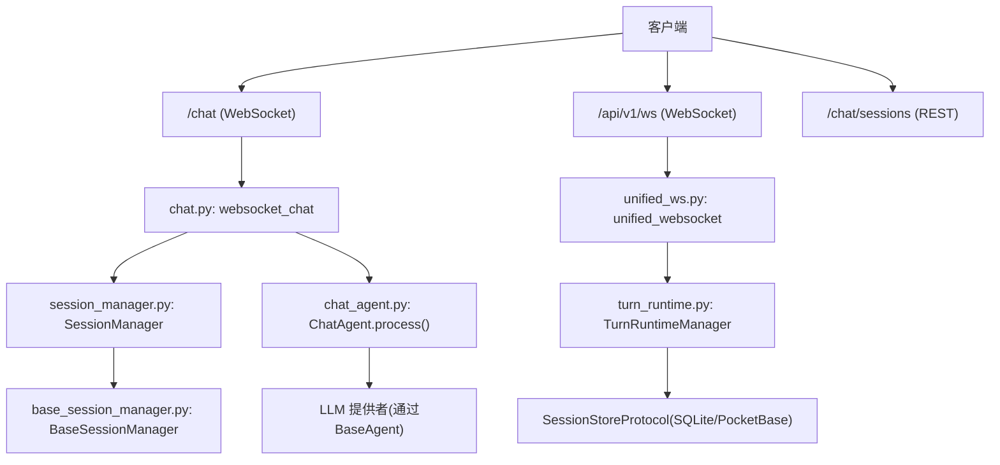
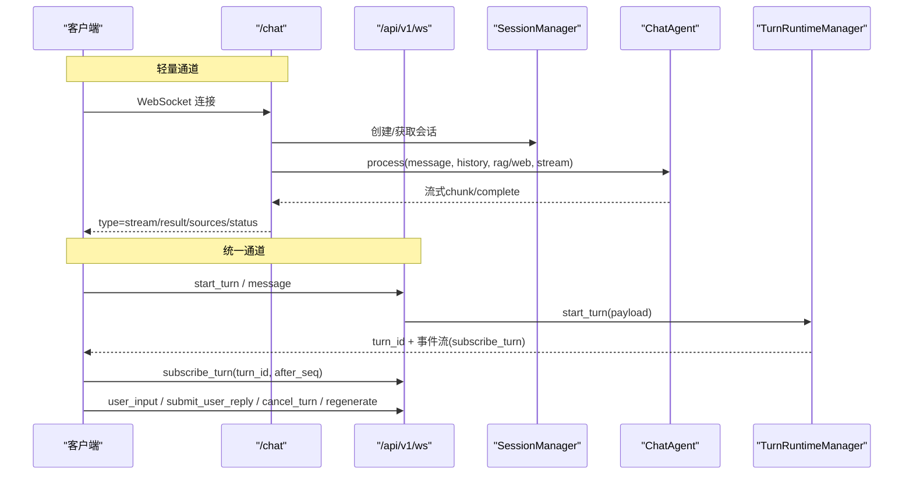
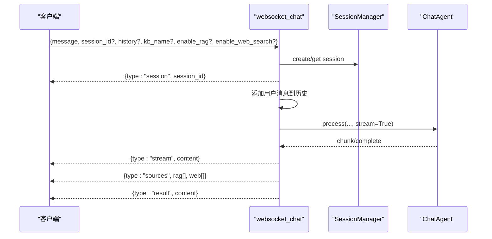
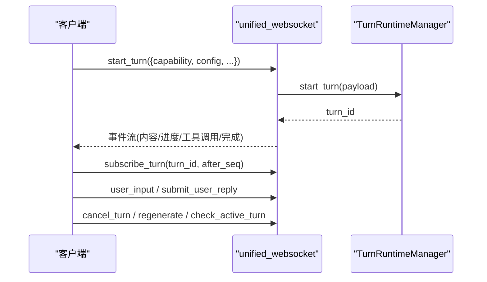
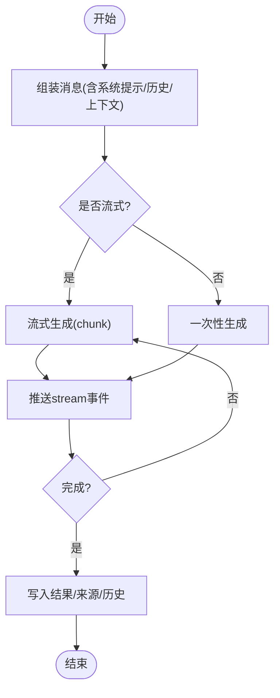
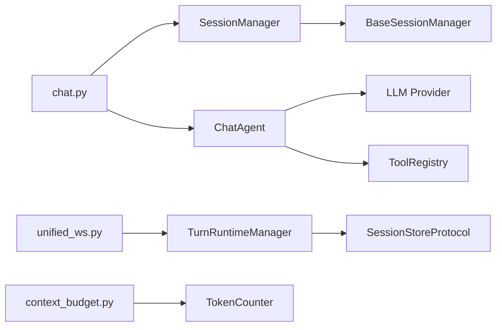

# 聊天API

<cite>
**本文引用的文件**
- [deeptutor/api/routers/chat.py](file://deeptutor/api/routers/chat.py)
- [deeptutor/api/routers/unified_ws.py](file://deeptutor/api/routers/unified_ws.py)
- [deeptutor/agents/chat/chat_agent.py](file://deeptutor/agents/chat/chat_agent.py)
- [deeptutor/agents/chat/session_manager.py](file://deeptutor/agents/chat/session_manager.py)
- [deeptutor/services/session/base_session_manager.py](file://deeptutor/services/session/base_session_manager.py)
- [deeptutor/services/session/turn_runtime.py](file://deeptutor/services/session/turn_runtime.py)
- [deeptutor/agents/chat/context_budget.py](file://deeptutor/agents/chat/context_budget.py)
- [deeptutor/core/errors.py](file://deeptutor/core/errors.py)
</cite>

## 目录
1. [简介](#简介)
2. [项目结构](#项目结构)
3. [核心组件](#核心组件)
4. [架构总览](#架构总览)
5. [详细组件分析](#详细组件分析)
6. [依赖关系分析](#依赖关系分析)
7. [性能考量](#性能考量)
8. [故障排查指南](#故障排查指南)
9. [结论](#结论)
10. [附录](#附录)

## 简介
本文件为 DeepTutor 聊天功能的完整 API 文档，覆盖：
- RESTful 会话管理端点（创建、查询、删除）
- WebSocket 实时对话与统一轮次执行（/chat 与 /api/v1/ws）
- 消息发送/接收、流式响应、上下文管理与预算控制
- 工具调用、知识库检索与多轮对话流程
- 事件订阅、进度更新与重连恢复机制
- 错误处理策略与性能优化建议

## 项目结构
聊天功能由“API路由层 + Agent层 + 会话服务层”组成：
- API路由层：暴露REST和WebSocket接口，负责鉴权、参数解析、事件转发
- Agent层：ChatAgent 实现对话编排、RAG/网页搜索、历史截断、流式生成
- 会话服务层：BaseSessionManager/TurnRuntimeManager 提供持久化与会话生命周期管理

图表来源
- [deeptutor/api/routers/chat.py:34-250](file://deeptutor/api/routers/chat.py#L34-L250)
- [deeptutor/api/routers/unified_ws.py:44-325](file://deeptutor/api/routers/unified_ws.py#L44-L325)
- [deeptutor/agents/chat/session_manager.py:20-180](file://deeptutor/agents/chat/session_manager.py#L20-L180)
- [deeptutor/agents/chat/chat_agent.py:21-435](file://deeptutor/agents/chat/chat_agent.py#L21-L435)
- [deeptutor/services/session/base_session_manager.py:23-257](file://deeptutor/services/session/base_session_manager.py#L23-L257)
- [deeptutor/services/session/turn_runtime.py:594-800](file://deeptutor/services/session/turn_runtime.py#L594-L800)

章节来源
- [deeptutor/api/routers/chat.py:34-250](file://deeptutor/api/routers/chat.py#L34-L250)
- [deeptutor/api/routers/unified_ws.py:44-325](file://deeptutor/api/routers/unified_ws.py#L44-L325)

## 核心组件
- 会话管理器（SessionManager/BaseSessionManager）：负责会话的创建、读取、更新、删除与消息追加；支持按模块隔离存储路径与最大会话数限制。
- 聊天代理（ChatAgent）：封装历史截断、上下文检索（RAG/网页搜索）、消息组装、流式/非流式生成。
- 统一轮次运行时（TurnRuntimeManager）：统一管理“轮次”的生命周期、事件订阅、重连恢复、取消与再生成。
- 上下文预算（context_budget）：统计一次请求在模型上下文窗口中的占用分布，辅助前端展示与策略调整。

章节来源
- [deeptutor/agents/chat/session_manager.py:20-180](file://deeptutor/agents/chat/session_manager.py#L20-L180)
- [deeptutor/services/session/base_session_manager.py:23-257](file://deeptutor/services/session/base_session_manager.py#L23-L257)
- [deeptutor/agents/chat/chat_agent.py:21-435](file://deeptutor/agents/chat/chat_agent.py#L21-L435)
- [deeptutor/services/session/turn_runtime.py:594-800](file://deeptutor/services/session/turn_runtime.py#L594-L800)
- [deeptutor/agents/chat/context_budget.py:135-212](file://deeptutor/agents/chat/context_budget.py#L135-L212)

## 架构总览
聊天交互存在两条通道：
- 轻量通道 /chat：基于简单消息协议，适合快速集成；内部使用 ChatAgent 直接处理。
- 统一通道 /api/v1/ws：面向复杂场景，支持轮次级事件流、订阅、重连、取消、再生成等能力。

图表来源
- [deeptutor/api/routers/chat.py:59-250](file://deeptutor/api/routers/chat.py#L59-L250)
- [deeptutor/api/routers/unified_ws.py:44-325](file://deeptutor/api/routers/unified_ws.py#L44-L325)
- [deeptutor/agents/chat/chat_agent.py:365-435](file://deeptutor/agents/chat/chat_agent.py#L365-L435)
- [deeptutor/services/session/turn_runtime.py:655-800](file://deeptutor/services/session/turn_runtime.py#L655-L800)

## 详细组件分析

### REST 会话管理端点
- GET /chat/sessions?limit=20
  - 返回最近会话列表（默认不包含消息体）
- GET /chat/sessions/{session_id}
  - 返回指定会话详情
- DELETE /chat/sessions/{session_id}
  - 删除会话，成功返回状态信息

行为说明
- 会话ID前缀为 chat_，自动维护时间戳与标题
- 列表默认只返回摘要（message_count、last_message预览等）
- 删除失败返回404

章节来源
- [deeptutor/api/routers/chat.py:34-52](file://deeptutor/api/routers/chat.py#L34-L52)
- [deeptutor/agents/chat/session_manager.py:94-164](file://deeptutor/agents/chat/session_manager.py#L94-L164)
- [deeptutor/services/session/base_session_manager.py:115-237](file://deeptutor/services/session/base_session_manager.py#L115-L237)

### WebSocket 轻量通道 /chat
协议要点
- 认证：ws_require_auth 校验用户身份
- 输入字段：message、session_id、history、kb_name、enable_rag、enable_web_search、language
- 输出事件：
  - session：首次建立会话并返回 session_id
  - status：阶段提示（rag/web/generating）
  - stream：流式内容片段
  - sources：知识来源（rag/web）
  - result：最终结果
  - error：错误信息

处理流程
- 若未传 session_id，则创建新会话；否则复用或创建
- 可选启用 RAG 与 Web Search，并在流式过程中推送阶段状态
- 将用户消息写入会话历史，完成后写入助手回复及来源

图表来源
- [deeptutor/api/routers/chat.py:59-250](file://deeptutor/api/routers/chat.py#L59-L250)
- [deeptutor/agents/chat/chat_agent.py:365-435](file://deeptutor/agents/chat/chat_agent.py#L365-L435)

章节来源
- [deeptutor/api/routers/chat.py:59-250](file://deeptutor/api/routers/chat.py#L59-L250)

### 统一轮次通道 /api/v1/ws
支持的客户端消息类型
- message/start_turn：发起一轮新的执行
- subscribe_turn：订阅某轮次的事件流（支持 after_seq）
- subscribe_session：订阅会话当前活跃轮次的事件流
- resume_from：重连后从指定 seq 继续
- unsubscribe：取消订阅
- cancel_turn：取消运行中的轮次
- submit_user_reply：提交 ask_user 暂停的用户回复
- regenerate：重新生成上一轮用户消息（可带 overrides）
- check_active_turn：检查会话是否有活动轮次
- user_input：向 StreamBus 投递用户输入（用于 wait_for_input）

关键特性
- 安全发送：safe_send 保证异常不阻塞流
- 心跳：ping/pong
- 去重与清理：stop_subscription 管理任务生命周期
- 错误上报：统一的 error 事件，包含 stage/metadata/turn_terminal 等

图表来源
- [deeptutor/api/routers/unified_ws.py:44-325](file://deeptutor/api/routers/unified_ws.py#L44-L325)
- [deeptutor/services/session/turn_runtime.py:655-800](file://deeptutor/services/session/turn_runtime.py#L655-L800)

章节来源
- [deeptutor/api/routers/unified_ws.py:44-325](file://deeptutor/api/routers/unified_ws.py#L44-L325)

### 会话生命周期与消息历史
- 会话创建：自动生成唯一ID、标题、时间戳；支持设置（如 kb_name、enable_rag、enable_web_search）
- 消息追加：记录 role、content、timestamp，可选 metadata（如 sources）
- 列表与详情：支持摘要模式与全量模式；按最新优先排序
- 删除与清空：支持单条删除与全部清空

章节来源
- [deeptutor/agents/chat/session_manager.py:20-180](file://deeptutor/agents/chat/session_manager.py#L20-L180)
- [deeptutor/services/session/base_session_manager.py:115-237](file://deeptutor/services/session/base_session_manager.py#L115-L237)

### 上下文预算控制
- 目标：统计一次请求中各部分对上下文窗口的占用（system_prompt、tool_schemas、messages 等），并提供剩余空间估算
- 能力：
  - 构建预算报告（segments、used_tokens、free_tokens、window_estimated）
  - 检测 token 计数器来源（tiktoken/cl100k_base 或启发式）
  - 结合模型配置与实际消息计算占用
- 用途：前端展示上下文使用情况、辅助策略（如裁剪工具结果、压缩历史）

章节来源
- [deeptutor/agents/chat/context_budget.py:135-212](file://deeptutor/agents/chat/context_budget.py#L135-L212)

### 流式响应与事件系统
- ChatAgent.generate_stream：通过 BaseAgent.stream_llm 产生流式文本片段
- agent_loop：将流式内容拆分为思考段与回答段，同时处理工具调用增量
- TurnRuntimeManager：将事件标准化为统一格式，支持订阅与回放

图表来源
- [deeptutor/agents/chat/chat_agent.py:272-435](file://deeptutor/agents/chat/chat_agent.py#L272-L435)
- [deeptutor/api/routers/chat.py:188-230](file://deeptutor/api/routers/chat.py#L188-L230)

章节来源
- [deeptutor/agents/chat/chat_agent.py:272-435](file://deeptutor/agents/chat/chat_agent.py#L272-L435)
- [deeptutor/api/routers/chat.py:188-230](file://deeptutor/api/routers/chat.py#L188-L230)

### 工具调用、知识库查询与多轮对话
- 工具调用：通过工具注册表执行（如 rag、web_search），结果以 sources 形式回传
- 知识库查询：当 enable_rag=true 且提供 kb_name 时，执行混合检索并注入上下文
- 多轮对话：历史消息会被截断至 token 上限，确保上下文可控

章节来源
- [deeptutor/agents/chat/chat_agent.py:158-228](file://deeptutor/agents/chat/chat_agent.py#L158-L228)
- [deeptutor/agents/chat/chat_agent.py:89-134](file://deeptutor/agents/chat/chat_agent.py#L89-L134)

## 依赖关系分析
- chat.py 依赖：
  - SessionManager（会话持久化）
  - ChatAgent（对话逻辑）
  - LLM 配置（api_key/base_url/version）
- unified_ws.py 依赖：
  - TurnRuntimeManager（轮次执行与事件分发）
  - StreamBus（用户输入注入）
- context_budget.py 依赖：
  - PromptBlock、LLMRequestSnapshot、TokenCounter
- base_session_manager.py 依赖：
  - 路径服务（多用户隔离）
  - JSON 文件存储

图表来源
- [deeptutor/api/routers/chat.py:13-20](file://deeptutor/api/routers/chat.py#L13-L20)
- [deeptutor/api/routers/unified_ws.py:80-100](file://deeptutor/api/routers/unified_ws.py#L80-L100)
- [deeptutor/agents/chat/context_budget.py:22-26](file://deeptutor/agents/chat/context_budget.py#L22-L26)
- [deeptutor/services/session/base_session_manager.py:46-55](file://deeptutor/services/session/base_session_manager.py#L46-L55)

章节来源
- [deeptutor/api/routers/chat.py:13-20](file://deeptutor/api/routers/chat.py#L13-L20)
- [deeptutor/api/routers/unified_ws.py:80-100](file://deeptutor/api/routers/unified_ws.py#L80-L100)
- [deeptutor/agents/chat/context_budget.py:22-26](file://deeptutor/agents/chat/context_budget.py#L22-L26)
- [deeptutor/services/session/base_session_manager.py:46-55](file://deeptutor/services/session/base_session_manager.py#L46-L55)

## 性能考量
- 历史截断：ChatAgent.truncate_history 按 token 上限保留最近消息，避免上下文溢出
- 上下文守卫：AgenticPipeline 在接近窗口限制时对工具结果进行裁剪，减少冗余
- 流式传输：优先使用流式响应降低首包延迟，提高用户体验
- 订阅管理：unified_ws 使用任务队列与 after_seq 实现高效回放与重连
- 预算可视化：context_budget 帮助前端感知上下文压力，指导裁剪策略

章节来源
- [deeptutor/agents/chat/chat_agent.py:89-134](file://deeptutor/agents/chat/chat_agent.py#L89-L134)
- [deeptutor/agents/chat/agentic_pipeline.py:1232-1270](file://deeptutor/agents/chat/agentic_pipeline.py#L1232-L1270)
- [deeptutor/api/routers/unified_ws.py:79-100](file://deeptutor/api/routers/unified_ws.py#L79-L100)
- [deeptutor/agents/chat/context_budget.py:135-212](file://deeptutor/agents/chat/context_budget.py#L135-L212)

## 故障排查指南
常见错误与处理
- 会话不存在：GET/DELETE 返回404
- 消息为空：/chat 返回 error 事件
- 无效JSON：/api/v1/ws 返回 error 事件
- 轮次不存在或不可用：cancel_turn/regenerate 返回错误事件
- LLM 服务异常：捕获并转为 error 事件，必要时降级重试（如移除 tools/stream_options）

错误分类
- DeepTutorError：应用基础异常
- ConfigurationError/EnvironmentConfigError：配置与环境问题
- ValidationError：输入校验失败
- ServiceError/LLMServiceError：服务层异常
- LLMContextError：上下文窗口超限

章节来源
- [deeptutor/api/routers/chat.py:88-90](file://deeptutor/api/routers/chat.py#L88-L90)
- [deeptutor/api/routers/unified_ws.py:104-110](file://deeptutor/api/routers/unified_ws.py#L104-L110)
- [deeptutor/core/errors.py:10-58](file://deeptutor/core/errors.py#L10-L58)

## 结论
DeepTutor 聊天API提供了两套通道以满足不同集成需求：轻量 /chat 适合快速接入，统一 /api/v1/ws 提供完整的轮次生命周期管理与事件流能力。通过会话管理、上下文预算与流式响应，系统在可扩展性与性能之间取得平衡。建议在生产环境开启上下文预算监控与历史截断策略，并结合订阅/重连机制提升鲁棒性。

## 附录

### REST 端点速查
- GET /chat/sessions?limit=20
- GET /chat/sessions/{session_id}
- DELETE /chat/sessions/{session_id}

章节来源
- [deeptutor/api/routers/chat.py:34-52](file://deeptutor/api/routers/chat.py#L34-L52)

### WebSocket 协议速查
- /chat
  - 入参：message、session_id、history、kb_name、enable_rag、enable_web_search、language
  - 出参：session/status/stream/sources/result/error
- /api/v1/ws
  - 入参：start_turn/message、subscribe_turn、subscribe_session、resume_from、unsubscribe、cancel_turn、submit_user_reply、regenerate、check_active_turn、user_input
  - 出参：统一事件流（content/progress/tool_call/completion/error等）

章节来源
- [deeptutor/api/routers/chat.py:59-250](file://deeptutor/api/routers/chat.py#L59-L250)
- [deeptutor/api/routers/unified_ws.py:44-325](file://deeptutor/api/routers/unified_ws.py#L44-L325)

### 示例：工具调用与知识库查询
- 启用 RAG：传入 kb_name 与 enable_rag=true，服务端会检索知识库并将结果作为上下文注入
- 启用网页搜索：enable_web_search=true，搜索结果与引用作为 sources 返回
- 多轮对话：携带 history 或使用已有 session_id，服务端会自动维护历史与截断

章节来源
- [deeptutor/agents/chat/chat_agent.py:158-228](file://deeptutor/agents/chat/chat_agent.py#L158-L228)
- [deeptutor/api/routers/chat.py:162-198](file://deeptutor/api/routers/chat.py#L162-L198)