# 认证API

<cite>
**本文引用的文件**
- [deeptutor/api/routers/auth.py](file://deeptutor/api/routers/auth.py)
- [deeptutor/services/auth.py](file://deeptutor/services/auth.py)
- [deeptutor/multi_user/context.py](file://deeptutor/multi_user/context.py)
- [deeptutor/multi_user/models.py](file://deeptutor/multi_user/models.py)
- [deeptutor/services/codex_auth/service.py](file://deeptutor/services/codex_auth/service.py)
</cite>

## 目录
1. [简介](#简介)
2. [项目结构](#项目结构)
3. [核心组件](#核心组件)
4. [架构总览](#架构总览)
5. [详细组件分析](#详细组件分析)
6. [依赖关系分析](#依赖关系分析)
7. [性能考虑](#性能考虑)
8. [故障排查指南](#故障排查指南)
9. [结论](#结论)
10. [附录：端点清单与示例](#附录端点清单与示例)

## 简介
本文件为 DeepTutor 认证系统的完整 API 文档，覆盖用户注册、登录、登出、状态查询、个人资料管理、管理员用户管理等 RESTful 端点；说明 JWT 令牌与 Cookie 会话机制、权限验证流程、OAuth（OpenAI Codex）集成与多租户身份隔离；并提供请求/响应示例、错误处理与常见问题的解决方案。

## 项目结构
认证相关代码主要分布在以下模块：
- API 路由层：deeptutor/api/routers/auth.py
- 认证服务层：deeptutor/services/auth.py
- 多用户上下文与模型：deeptutor/multi_user/context.py、deeptutor/multi_user/models.py
- OAuth（Codex）集成：deeptutor/services/codex_auth/service.py

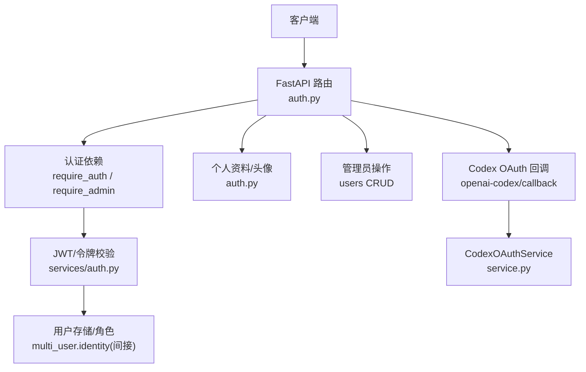

图表来源
- [deeptutor/api/routers/auth.py:237-348](file://deeptutor/api/routers/auth.py#L237-L348)
- [deeptutor/services/auth.py:220-280](file://deeptutor/services/auth.py#L220-L280)
- [deeptutor/services/codex_auth/service.py:237-330](file://deeptutor/services/codex_auth/service.py#L237-L330)

章节来源
- [deeptutor/api/routers/auth.py:1-872](file://deeptutor/api/routers/auth.py#L1-L872)
- [deeptutor/services/auth.py:1-379](file://deeptutor/services/auth.py#L1-L379)
- [deeptutor/multi_user/context.py:1-46](file://deeptutor/multi_user/context.py#L1-L46)
- [deeptutor/multi_user/models.py:1-84](file://deeptutor/multi_user/models.py#L1-L84)
- [deeptutor/services/codex_auth/service.py:1-800](file://deeptutor/services/codex_auth/service.py#L1-L800)

## 核心组件
- 认证依赖与守卫
  - require_auth：从 Authorization: Bearer 或 Cookie dt_token 提取并校验令牌；未启用认证时回退为本地管理员身份。
  - require_admin：在 require_auth 基础上要求 admin 角色。
  - ws_require_auth：WebSocket 连接前鉴权，支持通过 query 或 cookie 传 token。
- 令牌与密码
  - create_token/decode_token：HS256 签名 JWT；PocketBase 模式下委托外部服务校验。
  - hash_password/verify_password：bcrypt 哈希与校验。
- 用户存储与资料
  - add_user/list_users/delete_user/set_role/set_avatar/get_user_info：基于 multi_user.identity 的持久化能力。
  - 头像上传：仅接受 PNG/JPEG/WebP，按魔数校验，限制大小，避免 SVG 以规避存储型 XSS。
- 多租户上下文
  - set_current_user/get_current_user/user_from_token_payload：将当前用户写入 ContextVar，供后续资源访问控制使用。
- OAuth（Codex）
  - start_login/receive_callback/logout/refresh_models/public_status：完成授权码流程、刷新令牌、同步模型目录、清理状态。

章节来源
- [deeptutor/api/routers/auth.py:237-348](file://deeptutor/api/routers/auth.py#L237-L348)
- [deeptutor/services/auth.py:82-97](file://deeptutor/services/auth.py#L82-L97)
- [deeptutor/services/auth.py:220-280](file://deeptutor/services/auth.py#L220-L280)
- [deeptutor/multi_user/context.py:14-46](file://deeptutor/multi_user/context.py#L14-L46)
- [deeptutor/services/codex_auth/service.py:237-574](file://deeptutor/services/codex_auth/service.py#L237-L574)

## 架构总览
下图展示一次受保护 API 请求的认证与授权流程，以及 WebSocket 的连接鉴权路径。

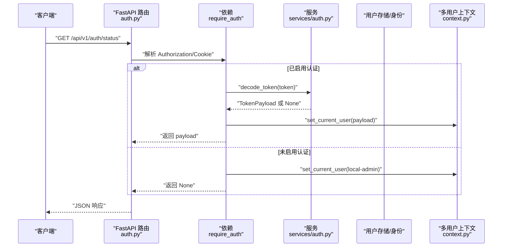

图表来源
- [deeptutor/api/routers/auth.py:237-284](file://deeptutor/api/routers/auth.py#L237-L284)
- [deeptutor/services/auth.py:238-280](file://deeptutor/services/auth.py#L238-L280)
- [deeptutor/multi_user/context.py:14-46](file://deeptutor/multi_user/context.py#L14-L46)

## 详细组件分析

### 认证依赖与守卫
- 令牌来源优先级：Authorization: Bearer > Cookie(dt_token)。
- 未启用认证时的行为：自动注入本地管理员身份，便于开发调试。
- WebSocket 鉴权：必须在 accept() 之前调用，失败则关闭连接。

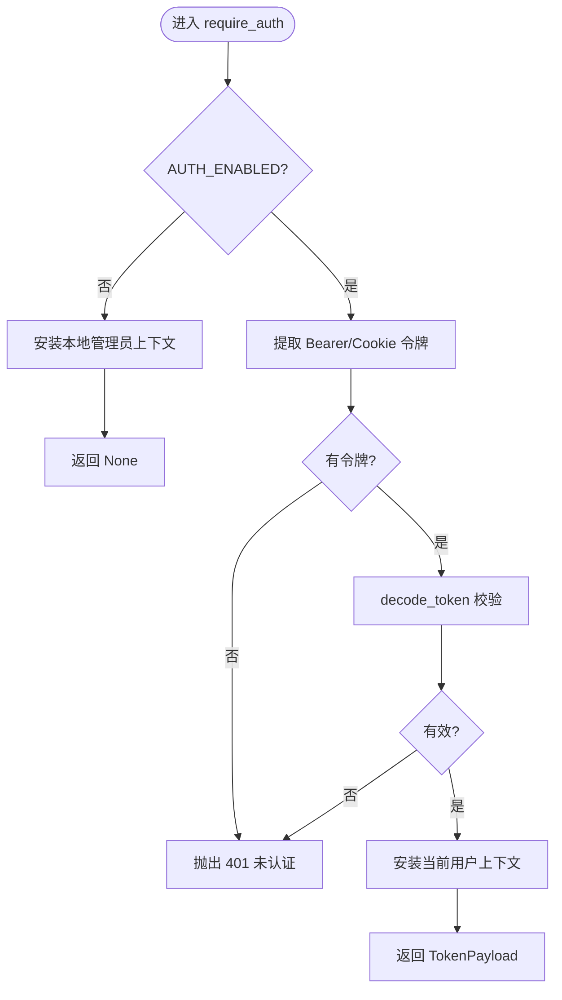

图表来源
- [deeptutor/api/routers/auth.py:237-284](file://deeptutor/api/routers/auth.py#L237-L284)
- [deeptutor/services/auth.py:238-280](file://deeptutor/services/auth.py#L238-L280)

章节来源
- [deeptutor/api/routers/auth.py:237-348](file://deeptutor/api/routers/auth.py#L237-L348)

### 用户注册
- 公开注册仅在“首个用户”存在前可用；之后需由管理员创建。
- PocketBase 模式：首次注册后关闭自注册，后续由管理员在 PB 控制台创建。
- 用户名格式：支持邮箱或纯用户名（内置模式）；密码至少 8 位。

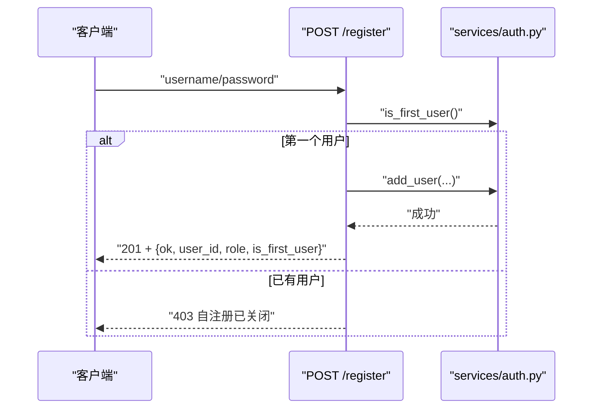

图表来源
- [deeptutor/api/routers/auth.py:494-565](file://deeptutor/api/routers/auth.py#L494-L565)
- [deeptutor/services/auth.py:134-152](file://deeptutor/services/auth.py#L134-L152)

章节来源
- [deeptutor/api/routers/auth.py:494-565](file://deeptutor/api/routers/auth.py#L494-L565)

### 用户登录
- 支持两种后端：
  - 内置模式：校验 bcrypt 密码，签发 JWT，设置 Cookie。
  - PocketBase 模式：调用 PB 登录，设置 PB 原始令牌到 Cookie。
- 未启用认证：直接返回“无需登录”。

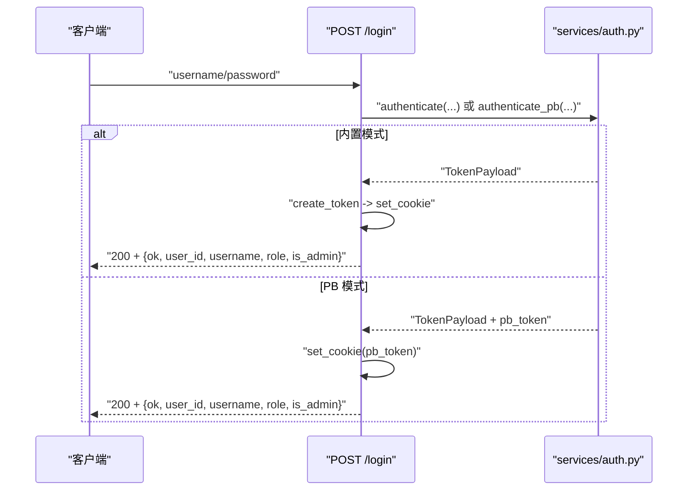

图表来源
- [deeptutor/api/routers/auth.py:436-480](file://deeptutor/api/routers/auth.py#L436-L480)
- [deeptutor/services/auth.py:288-318](file://deeptutor/services/auth.py#L288-L318)
- [deeptutor/services/auth.py:350-379](file://deeptutor/services/auth.py#L350-L379)

章节来源
- [deeptutor/api/routers/auth.py:436-480](file://deeptutor/api/routers/auth.py#L436-L480)
- [deeptutor/services/auth.py:288-318](file://deeptutor/services/auth.py#L288-L318)
- [deeptutor/services/auth.py:350-379](file://deeptutor/services/auth.py#L350-L379)

### 用户登出
- 删除 Cookie（与登录时相同的 SameSite/Secure 属性），确保浏览器正确清除。

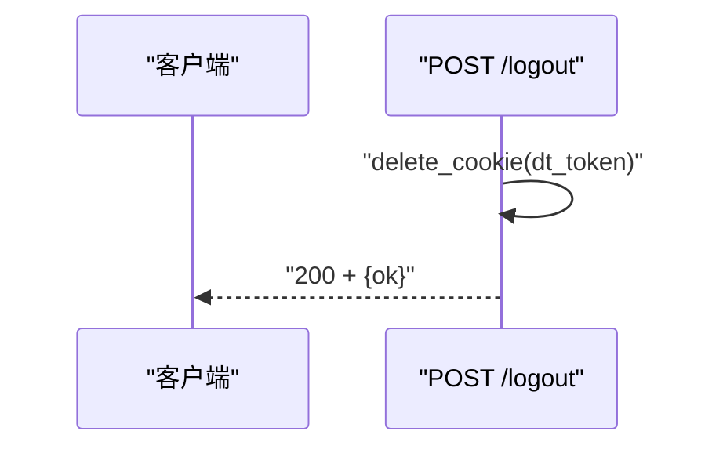

图表来源
- [deeptutor/api/routers/auth.py:483-491](file://deeptutor/api/routers/auth.py#L483-L491)

章节来源
- [deeptutor/api/routers/auth.py:483-491](file://deeptutor/api/routers/auth.py#L483-L491)

### 认证状态查询
- GET /status：返回是否启用认证、当前是否已认证、用户信息与管理员标志。

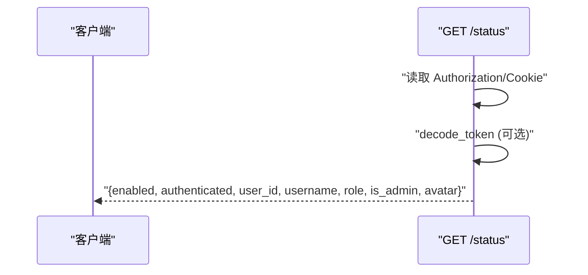

图表来源
- [deeptutor/api/routers/auth.py:402-433](file://deeptutor/api/routers/auth.py#L402-L433)
- [deeptutor/services/auth.py:238-280](file://deeptutor/services/auth.py#L238-L280)

章节来源
- [deeptutor/api/routers/auth.py:402-433](file://deeptutor/api/routers/auth.py#L402-L433)

### 个人资料与头像
- GET/PUT /profile：获取或更新头像标记（icon:<name>:<color> 或清空）。
- PUT /profile/avatar：上传头像图片（PNG/JPEG/WebP），服务端按魔数校验，限制大小，生成 img:<version> 标记用于缓存破坏。
- DELETE /profile/avatar：移除头像文件并清空标记。
- GET /avatar/{user_id}：提供受保护的头像静态资源访问。

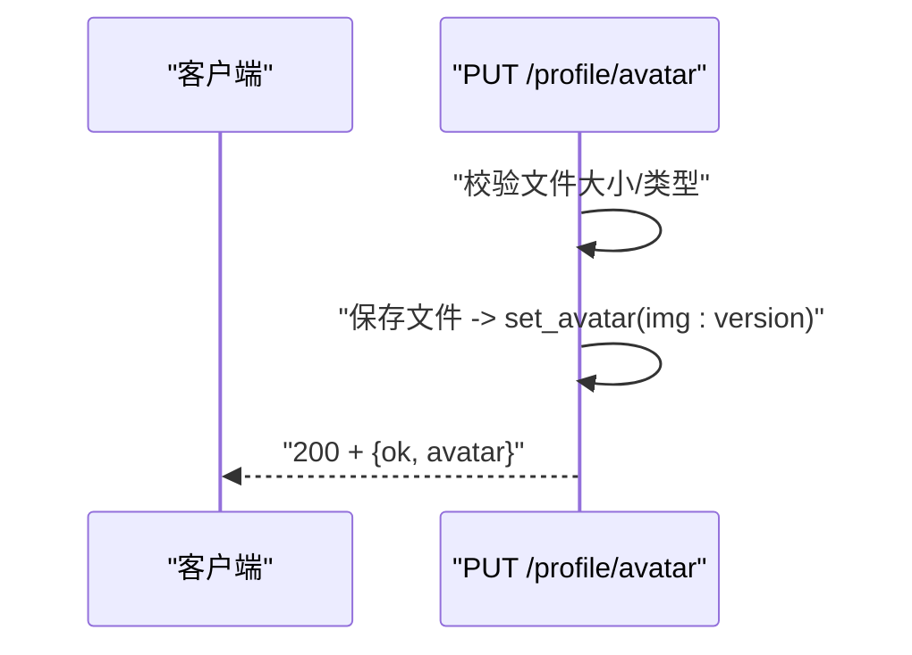

图表来源
- [deeptutor/api/routers/auth.py:628-704](file://deeptutor/api/routers/auth.py#L628-L704)
- [deeptutor/api/routers/auth.py:707-744](file://deeptutor/api/routers/auth.py#L707-L744)

章节来源
- [deeptutor/api/routers/auth.py:609-744](file://deeptutor/api/routers/auth.py#L609-L744)

### 管理员用户管理
- GET /users：列出所有用户（需 admin）。
- POST /users：管理员创建新用户（默认 user 角色）。
- PUT /users/{username}/role：修改角色（admin/user）。
- DELETE /users/{username}：删除用户（禁止删除自己）。

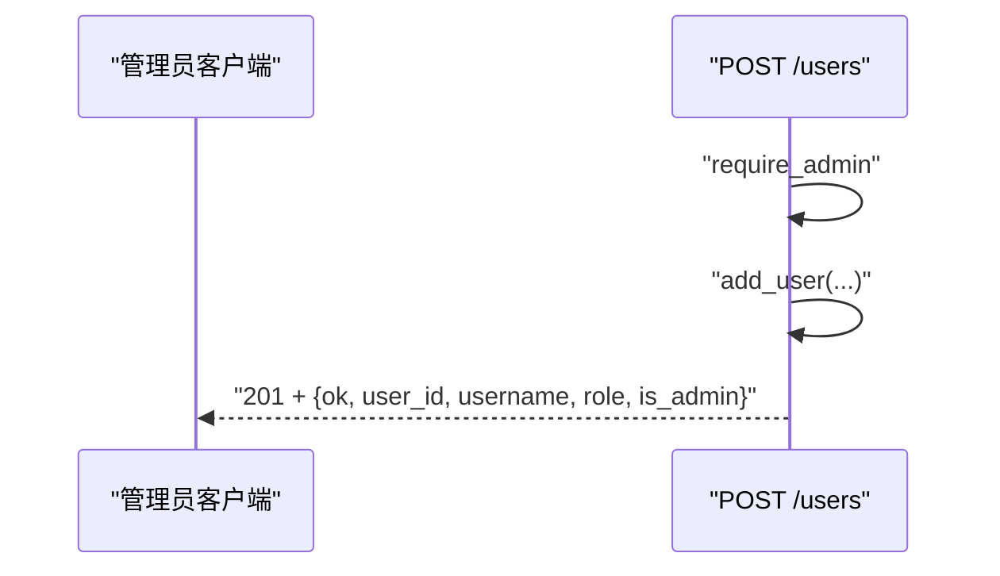

图表来源
- [deeptutor/api/routers/auth.py:752-819](file://deeptutor/api/routers/auth.py#L752-L819)
- [deeptutor/api/routers/auth.py:822-872](file://deeptutor/api/routers/auth.py#L822-L872)

章节来源
- [deeptutor/api/routers/auth.py:752-872](file://deeptutor/api/routers/auth.py#L752-L872)

### OAuth（OpenAI Codex）集成
- 回调入口：GET /openai-codex/callback，接收第三方授权回调并转发给服务层。
- 服务层：CodexOAuthService 负责启动登录、交换授权码、刷新令牌、同步模型目录、登出清理等。

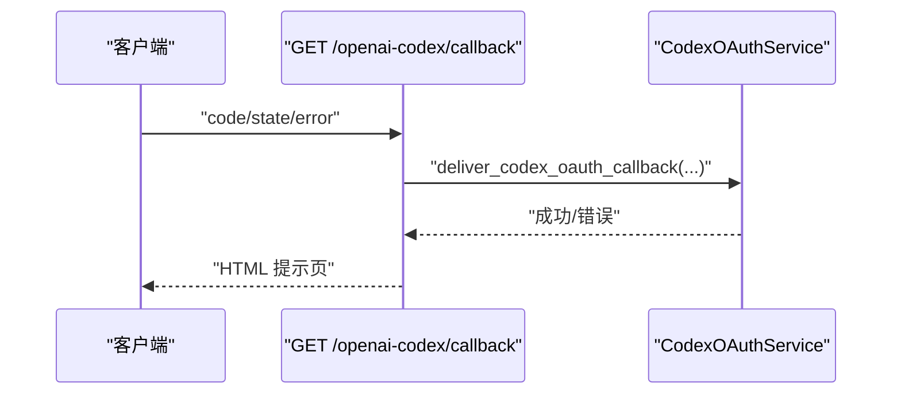

图表来源
- [deeptutor/api/routers/auth.py:373-399](file://deeptutor/api/routers/auth.py#L373-L399)
- [deeptutor/services/codex_auth/service.py:237-330](file://deeptutor/services/codex_auth/service.py#L237-L330)

章节来源
- [deeptutor/api/routers/auth.py:373-399](file://deeptutor/api/routers/auth.py#L373-L399)
- [deeptutor/services/codex_auth/service.py:237-574](file://deeptutor/services/codex_auth/service.py#L237-L574)

## 依赖关系分析
- 路由层依赖认证依赖与业务服务，职责单一，专注参数校验与响应组装。
- 服务层封装令牌、密码、用户存储与第三方集成细节，降低耦合。
- 多用户上下文通过 ContextVar 传递当前用户，保证并发安全与跨层一致性。

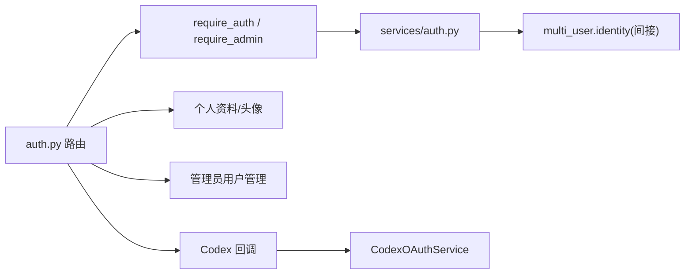

图表来源
- [deeptutor/api/routers/auth.py:237-348](file://deeptutor/api/routers/auth.py#L237-L348)
- [deeptutor/services/auth.py:220-280](file://deeptutor/services/auth.py#L220-L280)
- [deeptutor/services/codex_auth/service.py:237-330](file://deeptutor/services/codex_auth/service.py#L237-L330)

章节来源
- [deeptutor/api/routers/auth.py:237-348](file://deeptutor/api/routers/auth.py#L237-L348)
- [deeptutor/services/auth.py:220-280](file://deeptutor/services/auth.py#L220-L280)
- [deeptutor/services/codex_auth/service.py:237-330](file://deeptutor/services/codex_auth/service.py#L237-L330)

## 性能考虑
- 令牌校验：标准模式为本地解码，零网络开销；PocketBase 模式对令牌校验结果进行短时内存缓存，减少外部调用。
- 头像上传：服务端按魔数识别格式，避免依赖不可信的文件名/Content-Type；限制最大体积，防止大文件攻击。
- 会话 Cookie：SameSite/Secure 根据部署环境动态配置，兼顾开发与生产安全。

[本节为通用指导，不直接分析具体文件]

## 故障排查指南
- 401 未认证
  - 检查是否携带 Authorization: Bearer 或 Cookie dt_token。
  - 确认令牌未过期且签名有效。
- 403 禁止访问
  - 非管理员尝试访问管理员接口。
  - 自注册已关闭（已有管理员）。
- 409 冲突
  - 用户名重复。
  - 首次注册后再次尝试自注册。
- 413/415 头像上传失败
  - 超过大小限制或格式不支持（仅 PNG/JPEG/WebP）。
- OAuth 回调失败
  - state 不匹配或授权被拒绝；检查回调端口与重定向地址。

章节来源
- [deeptutor/api/routers/auth.py:267-284](file://deeptutor/api/routers/auth.py#L267-L284)
- [deeptutor/api/routers/auth.py:494-565](file://deeptutor/api/routers/auth.py#L494-L565)
- [deeptutor/api/routers/auth.py:675-704](file://deeptutor/api/routers/auth.py#L675-L704)
- [deeptutor/services/codex_auth/service.py:308-330](file://deeptutor/services/codex_auth/service.py#L308-L330)

## 结论
DeepTutor 认证系统采用“路由层 + 服务层 + 多用户上下文”的分层设计，既支持内置 JWT 认证，也兼容 PocketBase 与 OpenAI Codex OAuth。通过严格的输入校验、安全的 Cookie 策略与细粒度的权限守卫，满足多租户与第三方集成的需求。建议在生产环境启用 HTTPS、合理配置令牌有效期，并定期轮换密钥。

[本节为总结性内容，不直接分析具体文件]

## 附录：端点清单与示例

- 公共端点
  - GET /api/v1/auth/status
    - 作用：查询认证开关与当前认证状态
    - 成功响应字段：enabled, authenticated, user_id, username, role, is_admin, avatar
  - POST /api/v1/auth/register
    - 作用：首次注册用户（自注册）
    - 请求体：username, password
    - 成功响应字段：ok, user_id, username, role, is_first_user, is_admin
  - GET /api/v1/auth/is_first_user
    - 作用：判断是否为首用户
    - 响应字段：is_first_user
  - GET /openai-codex/callback
    - 作用：接收第三方 OAuth 回调

- 需要认证的端点
  - POST /api/v1/auth/login
    - 作用：登录并设置 Cookie
    - 请求体：username, password
    - 成功响应字段：ok, user_id, username, role, is_admin
  - POST /api/v1/auth/logout
    - 作用：删除 Cookie
    - 成功响应字段：ok
  - GET /api/v1/auth/profile
    - 作用：获取当前用户资料
    - 响应字段：id, username, role, created_at, disabled, avatar
  - PUT /api/v1/auth/profile
    - 作用：更新头像标记（icon:<name>:<color> 或空）
    - 请求体：avatar
    - 成功响应字段：ok, avatar
  - PUT /api/v1/auth/profile/avatar
    - 作用：上传头像图片（PNG/JPEG/WebP，≤1MB）
    - 成功响应字段：ok, avatar（img:<version>）
  - DELETE /api/v1/auth/profile/avatar
    - 作用：删除头像并清空标记
    - 成功响应字段：ok, avatar（空）
  - GET /api/v1/auth/avatar/{user_id}
    - 作用：获取头像文件（需认证）

- 管理员端点
  - GET /api/v1/auth/users
    - 作用：列出所有用户
    - 响应：数组 UserInfo
  - POST /api/v1/auth/users
    - 作用：创建新用户（默认 user）
    - 请求体：username, password
    - 成功响应字段：ok, user_id, username, role, is_admin
  - PUT /api/v1/auth/users/{username}/role
    - 作用：修改角色（admin/user）
    - 请求体：role
    - 成功响应字段：ok, username, role
  - DELETE /api/v1/auth/users/{username}
    - 作用：删除用户（不可删除自己）
    - 成功响应字段：ok

- 错误处理要点
  - 401：未认证或令牌无效
  - 403：权限不足或自注册已关闭
  - 409：用户名冲突
  - 413/415：头像上传过大或格式不支持
  - 404：用户不存在或头像不存在

- 安全最佳实践
  - 生产环境启用 HTTPS，确保 Cookie Secure=True 与 SameSite=None。
  - 合理设置令牌有效期（TOKEN_EXPIRE_HOURS），定期轮换密钥。
  - 头像仅接受 PNG/JPEG/WebP，禁用 SVG，避免存储型 XSS。
  - 使用 require_admin 保护管理接口，避免越权。
  - 多租户场景下，利用 CurrentUser 与 scope 隔离资源访问。

章节来源
- [deeptutor/api/routers/auth.py:86-182](file://deeptutor/api/routers/auth.py#L86-L182)
- [deeptutor/api/routers/auth.py:402-491](file://deeptutor/api/routers/auth.py#L402-L491)
- [deeptutor/api/routers/auth.py:599-744](file://deeptutor/api/routers/auth.py#L599-L744)
- [deeptutor/api/routers/auth.py:752-872](file://deeptutor/api/routers/auth.py#L752-L872)
- [deeptutor/services/auth.py:220-280](file://deeptutor/services/auth.py#L220-L280)
- [deeptutor/services/codex_auth/service.py:237-574](file://deeptutor/services/codex_auth/service.py#L237-L574)