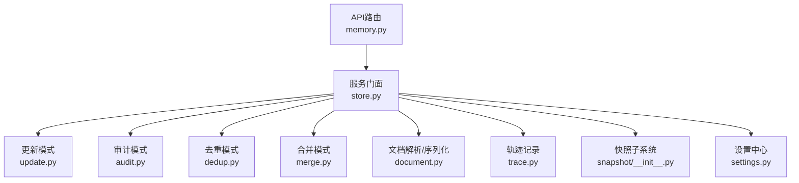
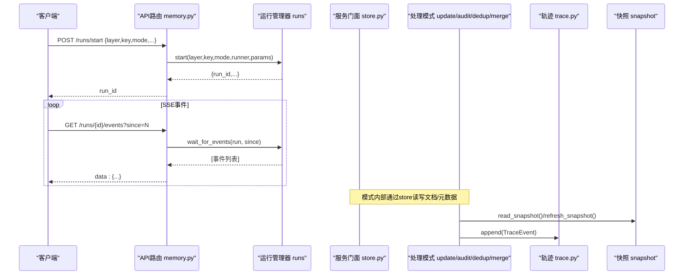
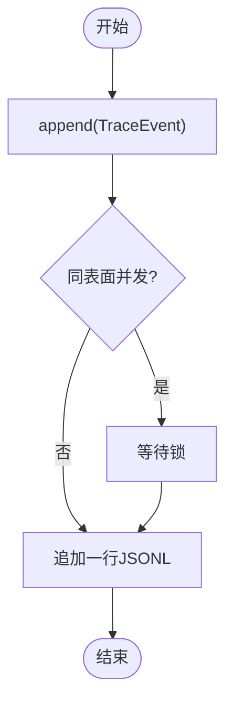
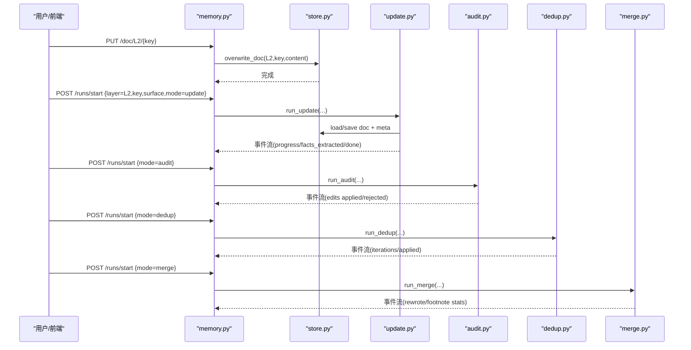
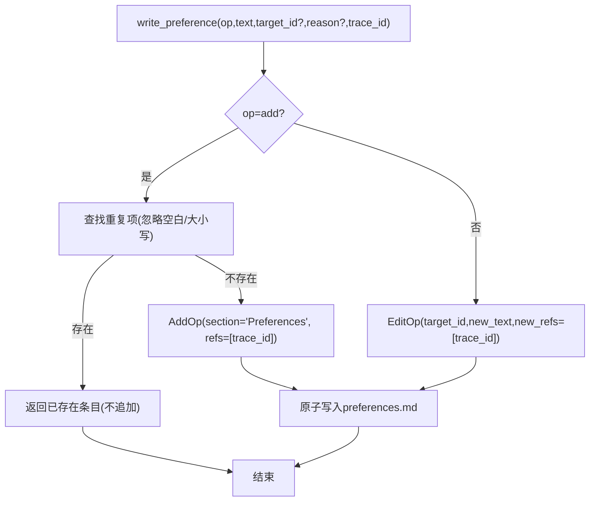
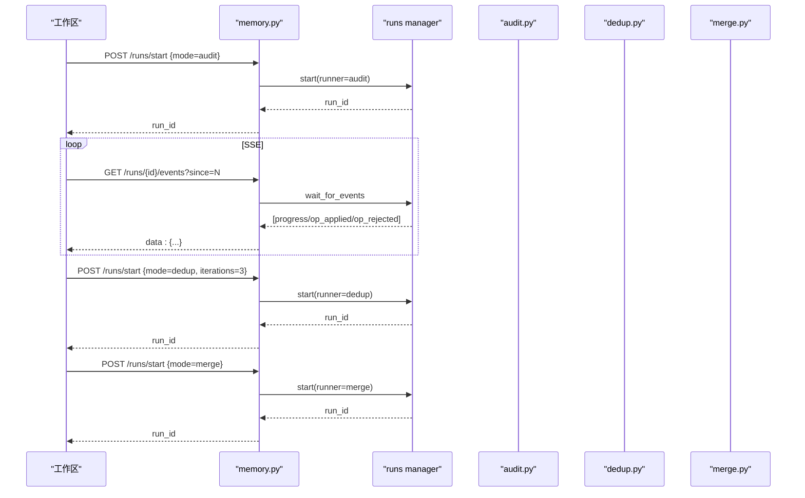
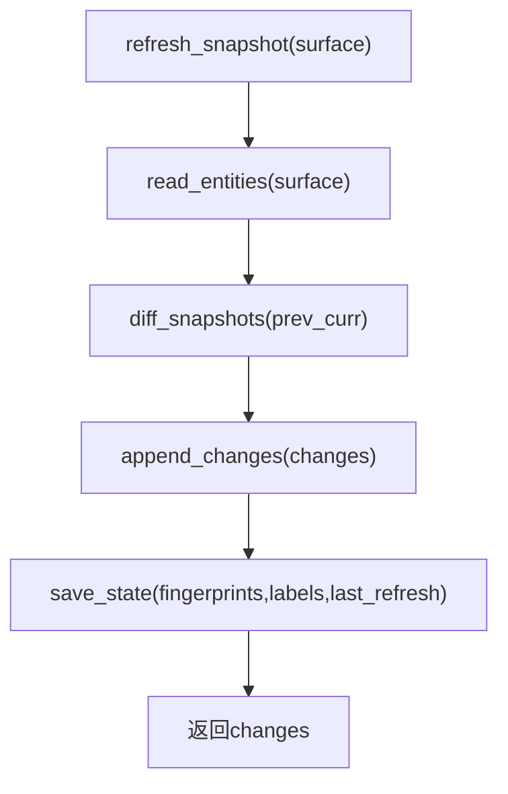
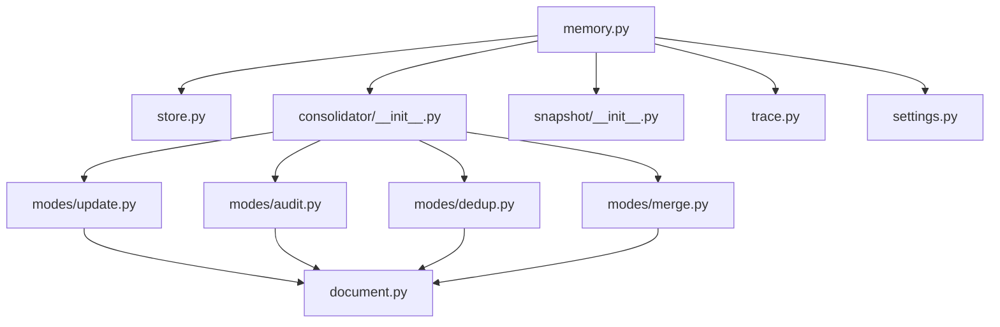

# 记忆系统API

<cite>
**本文引用的文件**
- [deeptutor/api/routers/memory.py](file://deeptutor/api/routers/memory.py)
- [deeptutor/services/memory/__init__.py](file://deeptutor/services/memory/__init__.py)
- [deeptutor/services/memory/store.py](file://deeptutor/services/memory/store.py)
- [deeptutor/services/memory/document.py](file://deeptutor/services/memory/document.py)
- [deeptutor/services/memory/consolidator/__init__.py](file://deeptutor/services/memory/consolidator/__init__.py)
- [deeptutor/services/memory/consolidator/modes/update.py](file://deeptutor/services/memory/consolidator/modes/update.py)
- [deeptutor/services/memory/consolidator/modes/audit.py](file://deeptutor/services/memory/consolidator/modes/audit.py)
- [deeptutor/services/memory/consolidator/modes/dedup.py](file://deeptutor/services/memory/consolidator/modes/dedup.py)
- [deeptutor/services/memory/consolidator/modes/merge.py](file://deeptutor/services/memory/consolidator/modes/merge.py)
- [deeptutor/services/memory/snapshot/__init__.py](file://deeptutor/services/memory/snapshot/__init__.py)
- [deeptutor/services/memory/trace.py](file://deeptutor/services/memory/trace.py)
- [deeptutor/services/memory/settings.py](file://deeptutor/services/memory/settings.py)
</cite>

## 目录
1. [简介](#简介)
2. [项目结构](#项目结构)
3. [核心组件](#核心组件)
4. [架构总览](#架构总览)
5. [详细组件分析](#详细组件分析)
6. [依赖关系分析](#依赖关系分析)
7. [性能与优化](#性能与优化)
8. [故障排查指南](#故障排查指南)
9. [结论](#结论)
10. [附录：API参考](#附录api参考)

## 简介
本文件为 DeepTutor 记忆系统的完整 API 文档，覆盖三层记忆（L1痕迹层、L2表面层、L3综合层）的CRUD操作、记忆图可视化、关系查询与证据追踪、记忆合并/去重/审计流程、持久化与快照管理、版本控制机制，以及性能调优最佳实践。读者可据此快速集成工作区、编排长任务、回放事件流并实现可追溯的记忆治理。

## 项目结构
记忆系统由“API路由层 + 服务门面 + 三大处理模式 + 存储与快照”组成：
- API路由层：暴露REST/SSE接口，负责参数校验、运行期调度与事件流转发
- 服务门面：统一封装读/写、概览、迁移、原子写入等能力
- 处理模式：更新（增量抽取）、审计（行级校对）、去重（迭代合并删除）、合并（无LLM规范化）
- 存储与快照：L1追加式JSONL轨迹、L2/L3 Markdown文档、元数据与变更日志

图表来源
- [deeptutor/api/routers/memory.py:1-786](file://deeptutor/api/routers/memory.py#L1-L786)
- [deeptutor/services/memory/store.py:1-460](file://deeptutor/services/memory/store.py#L1-L460)
- [deeptutor/services/memory/consolidator/modes/update.py:1-707](file://deeptutor/services/memory/consolidator/modes/update.py#L1-L707)
- [deeptutor/services/memory/consolidator/modes/audit.py:1-485](file://deeptutor/services/memory/consolidator/modes/audit.py#L1-L485)
- [deeptutor/services/memory/consolidator/modes/dedup.py:1-229](file://deeptutor/services/memory/consolidator/modes/dedup.py#L1-L229)
- [deeptutor/services/memory/consolidator/modes/merge.py:1-228](file://deeptutor/services/memory/consolidator/modes/merge.py#L1-L228)
- [deeptutor/services/memory/document.py:1-236](file://deeptutor/services/memory/document.py#L1-L236)
- [deeptutor/services/memory/trace.py:1-154](file://deeptutor/services/memory/trace.py#L1-L154)
- [deeptutor/services/memory/snapshot/__init__.py:1-101](file://deeptutor/services/memory/snapshot/__init__.py#L1-L101)
- [deeptutor/services/memory/settings.py:1-199](file://deeptutor/services/memory/settings.py#L1-L199)

章节来源
- [deeptutor/services/memory/__init__.py:1-43](file://deeptutor/services/memory/__init__.py#L1-L43)

## 核心组件
- 服务门面 MemoryStore：提供 L1 emit、L2/L3 读写、批量ops应用、偏好写入、概览统计、v1迁移等能力；通过路径隔离实现用户级隔离
- 文档模型 Document/Entry：Markdown片段+脚注引用，支持新旧格式互转与稳定序列化
- 处理模式：
  - 更新 run_update：按预算分块、增量抽取事实、校验引用、原子落盘
  - 审计 run_audit：行号视图+证据标注、LLM建议编辑、逐块应用与回写
  - 去重 run_dedup：迭代调用LLM进行替换/删除，早停收敛
  - 合并 run_merge：无LLM重构，折叠重复脚注、迁移旧引用
- 轨迹 trace：每表面每日追加JSONL，带锁串行写入，支持分页回溯
- 快照 snapshot：从工作区读取实体、计算差异、持久化状态与变更日志
- 设置 settings：集中配置预算、分块、自动触发策略等，支持安全裁剪与类型转换

章节来源
- [deeptutor/services/memory/store.py:1-460](file://deeptutor/services/memory/store.py#L1-L460)
- [deeptutor/services/memory/document.py:1-236](file://deeptutor/services/memory/document.py#L1-L236)
- [deeptutor/services/memory/consolidator/modes/update.py:1-707](file://deeptutor/services/memory/consolidator/modes/update.py#L1-L707)
- [deeptutor/services/memory/consolidator/modes/audit.py:1-485](file://deeptutor/services/memory/consolidator/modes/audit.py#L1-L485)
- [deeptutor/services/memory/consolidator/modes/dedup.py:1-229](file://deeptutor/services/memory/consolidator/modes/dedup.py#L1-L229)
- [deeptutor/services/memory/consolidator/modes/merge.py:1-228](file://deeptutor/services/memory/consolidator/modes/merge.py#L1-L228)
- [deeptutor/services/memory/trace.py:1-154](file://deeptutor/services/memory/trace.py#L1-L154)
- [deeptutor/services/memory/snapshot/__init__.py:1-101](file://deeptutor/services/memory/snapshot/__init__.py#L1-L101)
- [deeptutor/services/memory/settings.py:1-199](file://deeptutor/services/memory/settings.py#L1-L199)

## 架构总览
记忆系统采用“请求-运行-事件流”的解耦架构：
- 客户端通过 /runs/start 启动长任务（update/audit/dedup/merge），返回run_id
- 服务端以 runs manager 持有运行上下文，SSE 推送事件（进度、错误、结果）
- 各模式通过 store 门面访问文档与元数据，使用 document 模块保证一致性
- 快照子系统维护L1实体的当前态与变更历史，供审计与可视化
- 设置中心驱动行为（预算、分块、自动触发）

图表来源
- [deeptutor/api/routers/memory.py:308-453](file://deeptutor/api/routers/memory.py#L308-L453)
- [deeptutor/services/memory/consolidator/modes/update.py:80-135](file://deeptutor/services/memory/consolidator/modes/update.py#L80-L135)
- [deeptutor/services/memory/consolidator/modes/audit.py:75-124](file://deeptutor/services/memory/consolidator/modes/audit.py#L75-L124)
- [deeptutor/services/memory/consolidator/modes/dedup.py:52-85](file://deeptutor/services/memory/consolidator/modes/dedup.py#L52-L85)
- [deeptutor/services/memory/trace.py:66-87](file://deeptutor/services/memory/trace.py#L66-L87)
- [deeptutor/services/memory/snapshot/__init__.py:28-67](file://deeptutor/services/memory/snapshot/__init__.py#L28-L67)

## 详细组件分析

### L1 痕迹层（Trace）
- 职责：以追加式JSONL记录原始事件，按表面/日切分，支持按时间或ID回溯
- 关键能力：
  - 追加事件：append(event)，线程安全、异常吞掉不影响上游
  - 回溯：iter_since(surface, since)、iter_by_ids(ids)
  - 计数与最新时间戳：count_since、latest_ts
- 与上层交互：
  - 更新/审计/去重/合并模式在关键阶段emit事件
  - API提供 /trace/{surface} 分页浏览与按日清理

图表来源
- [deeptutor/services/memory/trace.py:66-87](file://deeptutor/services/memory/trace.py#L66-L87)

章节来源
- [deeptutor/services/memory/trace.py:1-154](file://deeptutor/services/memory/trace.py#L1-L154)

### L2 表面层（Surface）
- 职责：将L1事件聚合为可读的Markdown文档，按表面组织（如聊天、笔记等）
- CRUD：
  - 读取：GET /doc/L2/{key}、/doc/L2/{key}/lines
  - 写入：PUT /doc/L2/{key}（用户编辑保存）
  - 删除条目：DELETE /doc/L2/{key}/entry/{entry_id}
  - 重置：POST /doc/L2/{key}/reset（清空文档与元数据）
- 更新/审计/去重/合并：
  - 更新：增量抽取新实体，分块调用LLM，校验引用后追加
  - 审计：行号视图+证据标注，LLM建议编辑，逐块应用
  - 去重：迭代调用LLM进行替换/删除，早停收敛
  - 合并：无LLM重构，折叠重复脚注、迁移旧引用

图表来源
- [deeptutor/api/routers/memory.py:140-219](file://deeptutor/api/routers/memory.py#L140-L219)
- [deeptutor/api/routers/memory.py:308-453](file://deeptutor/api/routers/memory.py#L308-L453)
- [deeptutor/services/memory/consolidator/modes/update.py:140-357](file://deeptutor/services/memory/consolidator/modes/update.py#L140-L357)
- [deeptutor/services/memory/consolidator/modes/audit.py:129-261](file://deeptutor/services/memory/consolidator/modes/audit.py#L129-L261)
- [deeptutor/services/memory/consolidator/modes/dedup.py:87-198](file://deeptutor/services/memory/consolidator/modes/dedup.py#L87-L198)
- [deeptutor/services/memory/consolidator/modes/merge.py:62-151](file://deeptutor/services/memory/consolidator/modes/merge.py#L62-L151)

章节来源
- [deeptutor/api/routers/memory.py:140-219](file://deeptutor/api/routers/memory.py#L140-L219)
- [deeptutor/services/memory/store.py:81-121](file://deeptutor/services/memory/store.py#L81-L121)
- [deeptutor/services/memory/document.py:105-232](file://deeptutor/services/memory/document.py#L105-L232)

### L3 综合层（Summary/Profile/Scope/Preferences）
- 职责：对L2文档进行高层综合，生成近期摘要、用户画像、知识范围与偏好
- CRUD：
  - 读取：GET /doc/L3/{slot}、/doc/L3/{slot}/lines
  - 写入：PUT /doc/L3/{slot}（preferences除外，由工具直接写入）
  - 删除条目：DELETE /doc/L3/{slot}/entry/{entry_id}
  - 重置：POST /doc/L3/{slot}/reset
- 更新/审计/去重/合并：与L2类似，但偏好项不自动合并，且L3引用指向L2文件而非具体条目
- 偏好写入：write_preference(add/edit) 防重、幂等、关联trace_id

图表来源
- [deeptutor/services/memory/store.py:194-257](file://deeptutor/services/memory/store.py#L194-L257)

章节来源
- [deeptutor/services/memory/store.py:194-257](file://deeptutor/services/memory/store.py#L194-L257)
- [deeptutor/services/memory/consolidator/modes/update.py:363-586](file://deeptutor/services/memory/consolidator/modes/update.py#L363-L586)

### 记忆图可视化、关系查询与证据追踪
- 关系查询：
  - 解析器：/resolve_entry/{entry_id} 将L3脚注跳转至对应L2表面与锚点
  - 概览：/overview 返回所有文档状态与L1积压数
- 证据追踪：
  - 轨迹浏览：/trace/{surface}?limit&offset 分页查看L1事件
  - 按日清理：/trace/{surface}/day/{date} 删除指定日期轨迹
  - 全量清理：/trace/{surface} 删除某表面全部轨迹
- 可视化：
  - 行号视图：/doc/{layer}/{key}/lines 用于审计/去重界面显示一致的行号
  - 快照变更：/snapshot/{surface}/changes 展示工作区变化历史

图表来源
- [deeptutor/api/routers/memory.py:95-121](file://deeptutor/api/routers/memory.py#L95-L121)
- [deeptutor/api/routers/memory.py:680-722](file://deeptutor/api/routers/memory.py#L680-L722)
- [deeptutor/api/routers/memory.py:574-608](file://deeptutor/api/routers/memory.py#L574-L608)

章节来源
- [deeptutor/api/routers/memory.py:84-92](file://deeptutor/api/routers/memory.py#L84-L92)
- [deeptutor/api/routers/memory.py:95-121](file://deeptutor/api/routers/memory.py#L95-L121)
- [deeptutor/api/routers/memory.py:680-722](file://deeptutor/api/routers/memory.py#L680-L722)
- [deeptutor/api/routers/memory.py:574-608](file://deeptutor/api/routers/memory.py#L574-L608)

### 记忆合并、去重与审计示例
- 合并（无LLM）：
  - 触发：/runs/start {mode=merge} 或自动触发（auto_after_update/audit/dedup）
  - 效果：折叠重复脚注、迁移旧L3引用、规范化排版
- 去重（迭代）：
  - 触发：/runs/start {mode=dedup, iterations=N}
  - 效果：多次调用LLM进行替换/删除，早停收敛
- 审计（行级校对）：
  - 触发：/runs/start {mode=audit}
  - 效果：基于证据标注的建议编辑，逐块应用并回写

图表来源
- [deeptutor/api/routers/memory.py:308-453](file://deeptutor/api/routers/memory.py#L308-L453)
- [deeptutor/services/memory/consolidator/modes/audit.py:75-124](file://deeptutor/services/memory/consolidator/modes/audit.py#L75-L124)
- [deeptutor/services/memory/consolidator/modes/dedup.py:52-85](file://deeptutor/services/memory/consolidator/modes/dedup.py#L52-L85)
- [deeptutor/services/memory/consolidator/modes/merge.py:62-151](file://deeptutor/services/memory/consolidator/modes/merge.py#L62-L151)

章节来源
- [deeptutor/services/memory/consolidator/modes/audit.py:75-124](file://deeptutor/services/memory/consolidator/modes/audit.py#L75-L124)
- [deeptutor/services/memory/consolidator/modes/dedup.py:52-85](file://deeptutor/services/memory/consolidator/modes/dedup.py#L52-L85)
- [deeptutor/services/memory/consolidator/modes/merge.py:62-151](file://deeptutor/services/memory/consolidator/modes/merge.py#L62-L151)

### 持久化、快照管理与版本控制
- 持久化：
  - 原子写入：临时文件+replace，避免部分写入
  - 文档与元数据分离：*.md 与 *.meta.json
  - 偏好写入：幂等防重，关联trace_id
- 快照管理：
  - 读取当前实体：read_snapshot
  - 刷新并记录差异：refresh_snapshot（写入state.json与changes.jsonl）
  - 变更历史：read_changes（分页、倒序）
  - 当前状态：current_state（含last_refresh）
- 版本控制：
  - v1迁移：migrate_v1_if_needed 将旧文件备份到 backup/<ts>/
  - 表面重命名：migrate_partner_surface_if_needed 将tutorbot→partner
  - 撤销：/runs/{id}/undo 恢复最近一次写入事件

图表来源
- [deeptutor/services/memory/snapshot/__init__.py:55-67](file://deeptutor/services/memory/snapshot/__init__.py#L55-L67)
- [deeptutor/services/memory/store.py:330-425](file://deeptutor/services/memory/store.py#L330-L425)
- [deeptutor/api/routers/memory.py:728-785](file://deeptutor/api/routers/memory.py#L728-L785)

章节来源
- [deeptutor/services/memory/store.py:330-425](file://deeptutor/services/memory/store.py#L330-L425)
- [deeptutor/services/memory/snapshot/__init__.py:28-83](file://deeptutor/services/memory/snapshot/__init__.py#L28-L83)
- [deeptutor/api/routers/memory.py:728-785](file://deeptutor/api/routers/memory.py#L728-L785)

## 依赖关系分析
- 路由层依赖：
  - 运行管理器：start/get/cancel/undo/list_for
  - 服务门面：read_raw/overwrite_doc/delete_entry/apply_ops_payload/overview
  - 设置中心：load/save memory settings
  - 快照：read_snapshot/refresh_snapshot/current_state/read_changes/clear_changes
  - 轨迹：iter_since/count_since
- 模式层依赖：
  - 更新/审计/去重/合并均依赖 document.parse/serialize、line_doc、chunker、references
  - 通过 settings 获取预算、分块、自动触发策略
  - 通过 model_selection.runtime 激活/重置LLM选择

图表来源
- [deeptutor/api/routers/memory.py:1-786](file://deeptutor/api/routers/memory.py#L1-L786)
- [deeptutor/services/memory/consolidator/__init__.py:1-63](file://deeptutor/services/memory/consolidator/__init__.py#L1-L63)
- [deeptutor/services/memory/document.py:1-236](file://deeptutor/services/memory/document.py#L1-L236)

章节来源
- [deeptutor/api/routers/memory.py:1-786](file://deeptutor/api/routers/memory.py#L1-L786)
- [deeptutor/services/memory/consolidator/__init__.py:1-63](file://deeptutor/services/memory/consolidator/__init__.py#L1-L63)

## 性能与优化
- 分块与预算：
  - 通过 chunking.overlap_ratio/min_chunk_chars/max_chunk_chars/boundary 控制分块粒度
  - update/audit 的 l2_budget/l3_budget 限制单次处理的token预算
- 自动触发：
  - dedup.auto_after_update、merge.auto_after_update/audit/dedup 减少人工干预
- 引用校验：
  - reference.enforce_required/drop_invalid_refs 确保引用有效，降低无效事实写入
- 并发与锁：
  - 轨迹追加按表面加锁，避免交错写入
  - 文档写入使用原子替换，避免部分写入
- 早停与收敛：
  - 去重模式在无编辑时提前终止，节省调用成本
- 建议：
  - 合理设置预算与分块边界，平衡质量与成本
  - 开启自动合并/去重以减少碎片化
  - 定期清理轨迹与快照变更，控制磁盘占用

[本节为通用指导，无需特定文件来源]

## 故障排查指南
- 常见错误：
  - 未知表面/槽位：404/400，检查 layer/key 是否合法
  - 运行冲突：409，取消活跃运行后再操作
  - 偏好写入限制：405，preferences仅通过工具写入
  - 轨迹/快照清理失败：500，检查文件系统权限
- 诊断步骤：
  - 查看运行事件流：/runs/{id}/events?since=N
  - 检查概览与积压：/overview
  - 浏览轨迹：/trace/{surface}?limit&offset
  - 查看快照差异：/snapshot/{surface}/changes
  - 重置文档：/doc/{layer}/{key}/reset（谨慎使用）

章节来源
- [deeptutor/api/routers/memory.py:62-78](file://deeptutor/api/routers/memory.py#L62-L78)
- [deeptutor/api/routers/memory.py:308-453](file://deeptutor/api/routers/memory.py#L308-L453)
- [deeptutor/api/routers/memory.py:680-722](file://deeptutor/api/routers/memory.py#L680-L722)
- [deeptutor/api/routers/memory.py:728-785](file://deeptutor/api/routers/memory.py#L728-L785)

## 结论
DeepTutor 记忆系统通过清晰的三层结构与统一的门面接口，提供了完整的CRUD、可视化、证据追踪与自动化治理流程。结合快照与版本迁移，系统具备高可靠性与可运维性。通过合理的设置与性能调优，可在保证质量的同时控制成本。

[本节为总结，无需特定文件来源]

## 附录：API参考
- 概览与备份
  - GET /overview：返回所有文档状态与备份目录
  - GET /backup：列出v1迁移备份目录
- 文档读写
  - GET /doc/{layer}/{key}：读取原始内容
  - GET /doc/{layer}/{key}/lines：行号视图（审计/去重界面）
  - PUT /doc/{layer}/{key}：用户编辑保存
  - DELETE /doc/{layer}/{key}/entry/{entry_id}：删除条目
  - POST /doc/{layer}/{key}/reset：重置文档与元数据
  - POST /doc/{layer}/{key}/apply：原子应用预览后的ops
- 运行管理
  - POST /runs/start：启动update/audit/dedup/merge，返回run_id
  - GET /runs/{id}：查询运行状态
  - GET /runs/{id}/events?since=N：SSE事件流
  - POST /runs/{id}/cancel：取消运行
  - POST /runs/{id}/undo：撤销最近写入
  - GET /runs：列出活跃/近期运行（可按layer/key过滤）
- 轨迹浏览器
  - GET /trace/{surface}?limit&offset：分页浏览L1事件
  - DELETE /trace/{surface}：删除某表面全部轨迹
  - DELETE /trace/{surface}/day/{date}：删除指定日期轨迹
- 快照管理
  - GET /snapshot/{surface}：当前实体与待提交差异
  - POST /snapshot/{surface}/refresh：刷新并记录差异
  - GET /snapshot/{surface}/changes：变更历史（分页）
  - DELETE /snapshot/{surface}/changes：清空变更历史
- 设置
  - GET /settings：读取memory子树配置
  - PUT /settings：保存memory子树配置
- 关系解析
  - GET /resolve_entry/{entry_id}：根据entry_id定位L2表面与锚点

章节来源
- [deeptutor/api/routers/memory.py:84-92](file://deeptutor/api/routers/memory.py#L84-L92)
- [deeptutor/api/routers/memory.py:95-121](file://deeptutor/api/routers/memory.py#L95-L121)
- [deeptutor/api/routers/memory.py:140-219](file://deeptutor/api/routers/memory.py#L140-L219)
- [deeptutor/api/routers/memory.py:308-453](file://deeptutor/api/routers/memory.py#L308-L453)
- [deeptutor/api/routers/memory.py:574-608](file://deeptutor/api/routers/memory.py#L574-L608)
- [deeptutor/api/routers/memory.py:614-631](file://deeptutor/api/routers/memory.py#L614-L631)
- [deeptutor/api/routers/memory.py:649-674](file://deeptutor/api/routers/memory.py#L649-L674)
- [deeptutor/api/routers/memory.py:680-722](file://deeptutor/api/routers/memory.py#L680-L722)
- [deeptutor/api/routers/memory.py:728-785](file://deeptutor/api/routers/memory.py#L728-L785)