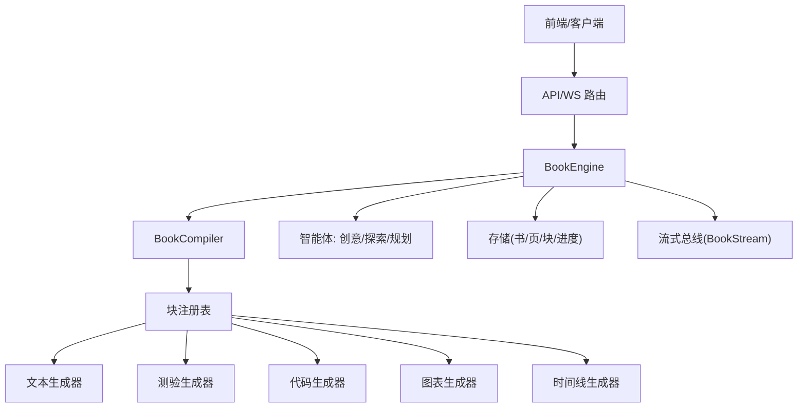
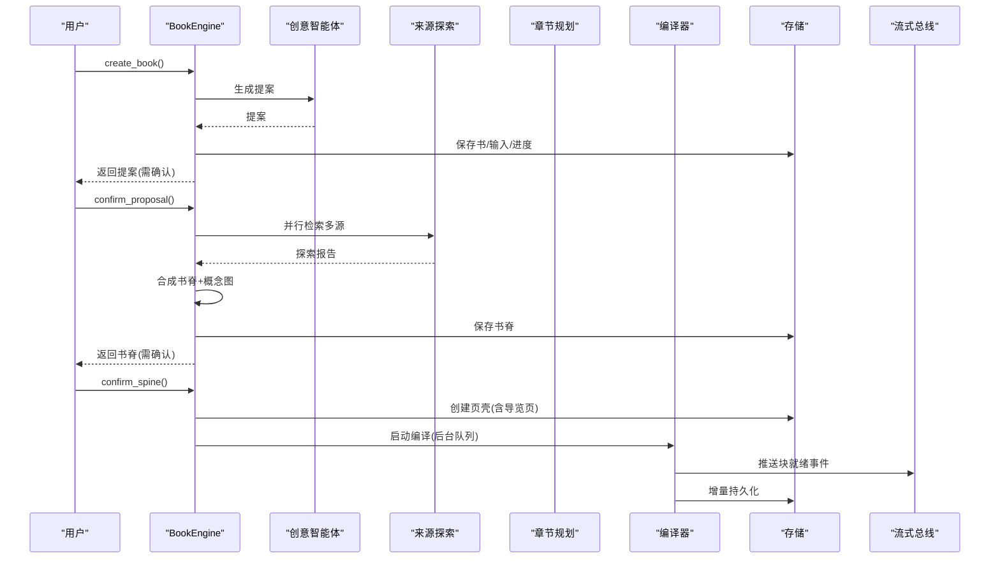
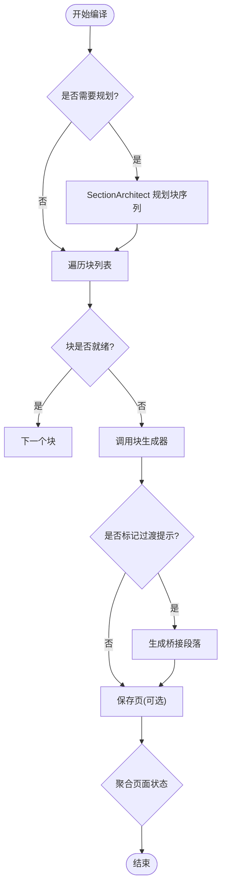
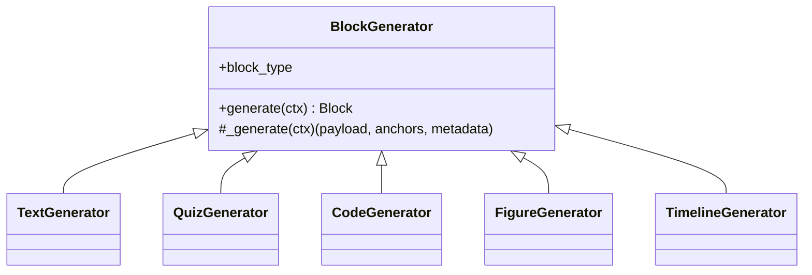
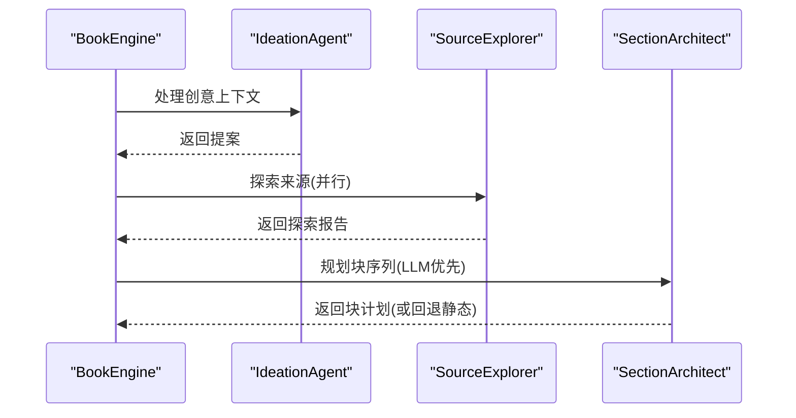
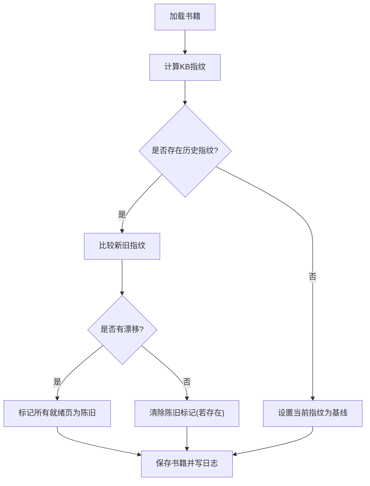
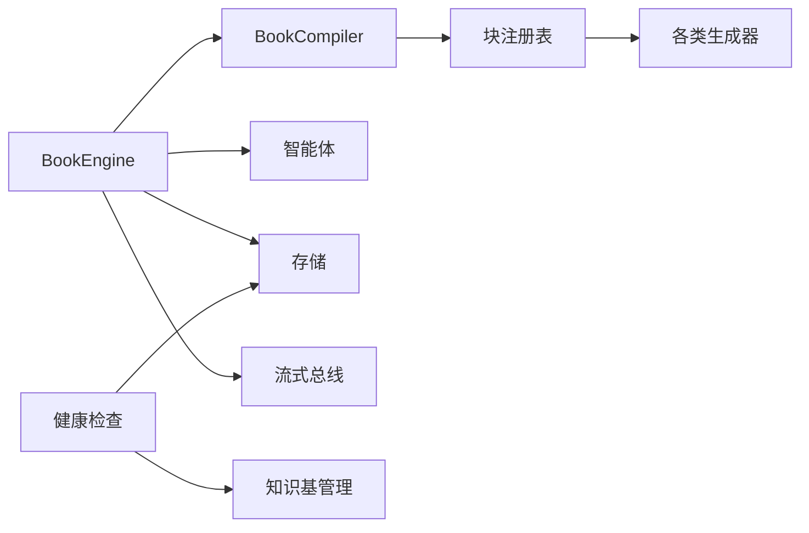

# 书籍引擎

<cite>
**本文引用的文件**
- [engine.py](file://deeptutor/book/engine.py)
- [compiler.py](file://deeptutor/book/compiler.py)
- [models.py](file://deeptutor/book/models.py)
- [base.py](file://deeptutor/book/blocks/base.py)
- [ideation_agent.py](file://deeptutor/book/agents/ideation_agent.py)
- [page_planner.py](file://deeptutor/book/agents/page_planner.py)
- [source_explorer.py](file://deeptutor/book/agents/source_explorer.py)
- [text.py](file://deeptutor/book/blocks/text.py)
- [quiz.py](file://deeptutor/book/blocks/quiz.py)
- [code.py](file://deeptutor/book/blocks/code.py)
- [timeline.py](file://deeptutor/book/blocks/timeline.py)
- [figure.py](file://deeptutor/book/blocks/figure.py)
- [kb_health.py](file://deeptutor/book/kb_health.py)
</cite>

## 目录
1. [简介](#简介)
2. [项目结构](#项目结构)
3. [核心组件](#核心组件)
4. [架构总览](#架构总览)
5. [详细组件分析](#详细组件分析)
6. [依赖关系分析](#依赖关系分析)
7. [性能考虑](#性能考虑)
8. [故障排查指南](#故障排查指南)
9. [结论](#结论)
10. [附录](#附录)

## 简介
本文件系统化阐述 DeepTutor“活体书籍”引擎：以“章节规划—内容生成—块类型系统—智能体协作—健康检查—渲染预览导出—自定义扩展”为主线，解释从创意到可交互学习内容的完整生产流水线。引擎将用户意图、知识库、笔记与问答等来源转化为结构化“书脊（Spine）”，再逐页生成由多种“块（Block）”组成的页面，并通过流式事件向前端推送进度与结果。

## 项目结构
- 编排层：BookEngine 负责生命周期管理、阶段推进、后台队列与流式事件广播。
- 编译层：BookCompiler 负责按页规划与块生成，支持顺序/并发执行与增量持久化。
- 数据模型：统一描述 Book/Spine/Page/Block 等实体与状态机。
- 智能体层：创意生成（IdeationAgent）、来源探索（SourceExplorer）、章节规划（SectionArchitect）。
- 块生成器：文本、图表、测验、时间线、代码、动画、交互式、闪卡、深潜、概念图、章节段等。
- 健康检查：知识基漂移检测与日志健康扫描。

**图示来源**
- [engine.py:100-116](file://deeptutor/book/engine.py#L100-L116)
- [compiler.py:69-84](file://deeptutor/book/compiler.py#L69-L84)
- [base.py:164-223](file://deeptutor/book/blocks/base.py#L164-L223)

**章节来源**
- [engine.py:1-120](file://deeptutor/book/engine.py#L1-L120)
- [compiler.py:1-84](file://deeptutor/book/compiler.py#L1-L84)
- [models.py:29-91](file://deeptutor/book/models.py#L29-L91)

## 核心组件
- BookEngine：进程级编排器，维护每本书的运行时队列、工作线程与流式通道；提供创建书、确认提案、确认书脊、编译单页、重建全书等接口。
- BookCompiler：按页驱动“规划→生成→持久化→聚合状态”的流水线，支持块级并发与桥接文本自动附加。
- 数据模型：定义 BlockType、ContentType、PageStatus、BlockStatus 等枚举，以及 Book/Spine/Page/Block/Progress 等持久化结构。
- 块生成器体系：基于抽象基类与注册表机制，实现可扩展的块类型生态。

**章节来源**
- [engine.py:100-116](file://deeptutor/book/engine.py#L100-L116)
- [compiler.py:69-84](file://deeptutor/book/compiler.py#L69-L84)
- [models.py:29-91](file://deeptutor/book/models.py#L29-L91)
- [base.py:116-162](file://deeptutor/book/blocks/base.py#L116-L162)

## 架构总览
“活体书籍”的生命周期分为多阶段：
- 阶段1 创意：收集输入并生成书籍提案。
- 阶段2 书脊：并行来源探索 + 综合生成章节树与概念图。
- 阶段2.5 导览页：自动注入“如何阅读本书”的确定性概览页。
- 阶段3 确认书脊：为每个章节创建待编译的页壳。
- 阶段3-4 编译：逐页规划与块生成，支持后台队列与流式输出。
- 阶段5 进度与健康：记录学习进度、测验尝试，检测知识基漂移与日志异常。

**图示来源**
- [engine.py:200-394](file://deeptutor/book/engine.py#L200-L394)
- [engine.py:582-645](file://deeptutor/book/engine.py#L582-L645)
- [compiler.py:88-190](file://deeptutor/book/compiler.py#L88-L190)

**章节来源**
- [engine.py:200-394](file://deeptutor/book/engine.py#L200-L394)
- [engine.py:582-645](file://deeptutor/book/engine.py#L582-L645)
- [compiler.py:88-190](file://deeptutor/book/compiler.py#L88-L190)

## 详细组件分析

### 章节规划与内容生成
- 章节规划：SectionArchitect 优先使用 LLM 生成块序列，失败时回退到静态模板；Phase 1 仅输出文本/提示/测验/章节段等基础块，Phase 2+ 启用更多可视化与交互块。
- 内容生成：BookCompiler 按规划顺序调用对应块生成器，支持并发控制、增量持久化、错误分类与桥接文本自动附加。

**图示来源**
- [compiler.py:88-190](file://deeptutor/book/compiler.py#L88-L190)
- [compiler.py:305-344](file://deeptutor/book/compiler.py#L305-L344)
- [page_planner.py:256-348](file://deeptutor/book/agents/page_planner.py#L256-L348)

**章节来源**
- [compiler.py:88-190](file://deeptutor/book/compiler.py#L88-L190)
- [page_planner.py:256-348](file://deeptutor/book/agents/page_planner.py#L256-L348)

### 块类型系统与实现
- 文本块：根据角色与目标产出 Markdown 正文，可选 RAG 增强与上下文衔接。
- 图表块：调用可视化管线生成 SVG/Mermaid/ChartJS，并进行本地校验与修复。
- 测验块：委托问题生成协调器产出题目与解析，支持难度与题型参数。
- 时间线块：生成结构化事件列表用于垂直时间轴展示。
- 代码块：生成可运行代码片段与说明，包含安全校验与元数据。
- 其他块：动画、交互式、闪卡、深潜、概念图、章节段等，均遵循统一生成器接口。

**图示来源**
- [base.py:116-162](file://deeptutor/book/blocks/base.py#L116-L162)
- [text.py:30-80](file://deeptutor/book/blocks/text.py#L30-L80)
- [quiz.py:14-66](file://deeptutor/book/blocks/quiz.py#L14-L66)
- [code.py:21-65](file://deeptutor/book/blocks/code.py#L21-L65)
- [figure.py:25-118](file://deeptutor/book/blocks/figure.py#L25-L118)
- [timeline.py:19-62](file://deeptutor/book/blocks/timeline.py#L19-L62)

**章节来源**
- [base.py:116-162](file://deeptutor/book/blocks/base.py#L116-L162)
- [text.py:30-80](file://deeptutor/book/blocks/text.py#L30-L80)
- [quiz.py:14-66](file://deeptutor/book/blocks/quiz.py#L14-L66)
- [code.py:21-65](file://deeptutor/book/blocks/code.py#L21-L65)
- [figure.py:25-118](file://deeptutor/book/blocks/figure.py#L25-L118)
- [timeline.py:19-62](file://deeptutor/book/blocks/timeline.py#L19-L62)

### 智能体协作机制
- 创意生成：IdeationAgent 基于四源输入生成书籍提案（标题、描述、范围、层级、估计章节数、理由），并以 JSON 形式稳定输出。
- 来源探索：SourceExplorer 设计查询、并行检索 KB/笔记/聊天/问答，去重裁剪后汇总摘要、候选概念与覆盖统计，供后续阶段复用。
- 章节规划：SectionArchitect 在 LLM 可用时动态规划块序列，否则回退到静态模板，保证章节长文不丢失。

**图示来源**
- [ideation_agent.py:20-67](file://deeptutor/book/agents/ideation_agent.py#L20-L67)
- [source_explorer.py:131-175](file://deeptutor/book/agents/source_explorer.py#L131-L175)
- [page_planner.py:276-348](file://deeptutor/book/agents/page_planner.py#L276-L348)

**章节来源**
- [ideation_agent.py:20-67](file://deeptutor/book/agents/ideation_agent.py#L20-L67)
- [source_explorer.py:131-175](file://deeptutor/book/agents/source_explorer.py#L131-L175)
- [page_planner.py:276-348](file://deeptutor/book/agents/page_planner.py#L276-L348)

### 书籍健康检查与维护
- 知识基漂移检测：计算当前 KB 指纹并与历史快照对比，标记新增/删除/变更的知识基，并将相关已就绪页面标为陈旧。
- 日志健康扫描：解析 per-book 日志，统计条目、错误、块失败次数与重复失败模式，辅助维护面板。
- 刷新指纹：首次编译成功后捕获基线指纹，避免误报。

**图示来源**
- [kb_health.py:102-152](file://deeptutor/book/kb_health.py#L102-L152)
- [kb_health.py:155-222](file://deeptutor/book/kb_health.py#L155-L222)
- [kb_health.py:255-296](file://deeptutor/book/kb_health.py#L255-L296)

**章节来源**
- [kb_health.py:102-152](file://deeptutor/book/kb_health.py#L102-L152)
- [kb_health.py:155-222](file://deeptutor/book/kb_health.py#L155-L222)
- [kb_health.py:255-296](file://deeptutor/book/kb_health.py#L255-L296)

### 渲染、预览与导出
- 渲染：前端根据 Block 的 payload 与 render_type 原生渲染（Markdown、Mermaid/SVG/ChartJS、代码、测验、时间线等）。
- 预览：编译过程中通过 BookStream 推送 block_started/block_ready/block_error 等细粒度事件，支持实时预览。
- 导出：页面与块的结构化 JSON 可直接作为导出基础，结合前端组件能力转换为 PDF/HTML 等格式（具体导出逻辑由前端/技能模块实现）。

**章节来源**
- [compiler.py:194-249](file://deeptutor/book/compiler.py#L194-L249)
- [models.py:326-381](file://deeptutor/book/models.py#L326-L381)

### 自定义块类型的开发指南
- 步骤：
  1) 新建生成器类继承 BlockGenerator，声明 block_type。
  2) 实现 _generate(ctx)，返回 (payload, source_anchors, metadata)。
  3) 在注册表中注册（或通过默认构建流程自动注册）。
  4) 在 SectionArchitect 的允许类型中登记（如需 LLM 参与规划）。
  5) 在前端实现对应渲染组件以消费 payload。
- 注意事项：
  - 使用 GenerationFailure 表达可重试/不可重试错误。
  - 合理使用 transition_in 触发桥接文本，提升连贯性。
  - 控制 token 与温度，确保稳定性与一致性。

**章节来源**
- [base.py:116-162](file://deeptutor/book/blocks/base.py#L116-L162)
- [base.py:164-223](file://deeptutor/book/blocks/base.py#L164-L223)
- [page_planner.py:205-216](file://deeptutor/book/agents/page_planner.py#L205-L216)

## 依赖关系分析
- BookEngine 依赖 BookCompiler、各智能体与存储/流式总线。
- BookCompiler 依赖 SectionArchitect、块注册表与存储。
- 块生成器依赖统一的 LLM 服务、RAG 工具与可视化管线。
- 健康检查依赖知识基管理与文件系统指纹。

**图示来源**
- [engine.py:100-116](file://deeptutor/book/engine.py#L100-L116)
- [compiler.py:69-84](file://deeptutor/book/compiler.py#L69-L84)
- [base.py:164-223](file://deeptutor/book/blocks/base.py#L164-L223)
- [kb_health.py:44-73](file://deeptutor/book/kb_health.py#L44-L73)

**章节来源**
- [engine.py:100-116](file://deeptutor/book/engine.py#L100-L116)
- [compiler.py:69-84](file://deeptutor/book/compiler.py#L69-L84)
- [base.py:164-223](file://deeptutor/book/blocks/base.py#L164-L223)
- [kb_health.py:44-73](file://deeptutor/book/kb_health.py#L44-L73)

## 性能考虑
- 并发控制：编译器支持 block_concurrency 配置，Phase 1 默认串行以保证流序，Phase 2+ 可提升并发加速编译。
- 增量持久化：persist_after_each_block 可在每个块完成后落盘，提高恢复能力与前端实时性。
- 来源复用：ExplorationReport 缓存检索结果，避免重复 RAG 调用，降低延迟与成本。
- 确定性概览：导览页采用确定性渲染，跳过 LLM，减少不必要开销。
- 错误分类：生成器错误被归类为可重试/不可重试，便于重试策略与监控告警。

**章节来源**
- [compiler.py:45-67](file://deeptutor/book/compiler.py#L45-L67)
- [compiler.py:133-166](file://deeptutor/book/compiler.py#L133-L166)
- [source_explorer.py:148-175](file://deeptutor/book/agents/source_explorer.py#L148-L175)
- [engine.py:398-579](file://deeptutor/book/engine.py#L398-L579)
- [base.py:34-71](file://deeptutor/book/blocks/base.py#L34-L71)

## 故障排查指南
- 常见问题定位：
  - 块生成失败：查看 block_error 事件与 block.metadata.failure，识别 JSON 解析、空响应、超时、限流、提供商错误等。
  - 页面未就绪：检查 PageStatus 与块就绪比例，必要时强制重新编译。
  - 知识基漂移：使用健康检查接口获取漂移报告，更新或重建受影响页面。
  - 日志重复失败：扫描 log.md 中的重复失败签名，定位根因。
- 建议操作：
  - 调整 block_concurrency 与 phase 以平衡速度与稳定性。
  - 禁用 LLM 规划或使用静态模板进行回归测试。
  - 刷新 KB 指纹并清理陈旧标记。

**章节来源**
- [base.py:34-71](file://deeptutor/book/blocks/base.py#L34-L71)
- [compiler.py:194-249](file://deeptutor/book/compiler.py#L194-L249)
- [kb_health.py:102-152](file://deeptutor/book/kb_health.py#L102-L152)
- [kb_health.py:255-296](file://deeptutor/book/kb_health.py#L255-L296)

## 结论
DeepTutor 书籍引擎通过“智能体协作 + 块类型系统 + 流式编译 + 健康检查”的架构，实现了从创意到可交互学习内容的自动化生产。其分层设计保证了可扩展性与可维护性，同时兼顾了性能与用户体验。借助健康检查与错误分类，系统具备自我诊断与自愈能力，适合持续演进与规模化应用。

## 附录
- 最佳实践
  - 明确学习目标与内容类型，选择合适的 ContentType 以获得更优的块序列。
  - 合理配置 knowledge_bases 与语言，提升生成质量与本地化体验。
  - 在 Phase 1 先验证结构与文本，再开启可视化与交互块以提升稳定性。
  - 利用 transition_in 与桥接文本增强章节内连贯性。
- 性能优化建议
  - 对大章节分块规划，控制单次 LLM 调用规模。
  - 使用 ExplorationReport 复用检索结果，减少重复调用。
  - 按需开启并发与持久化，权衡吞吐与可靠性。
- 创建交互式学习内容的完整流程
  1) 调用 create_book 提交意图与来源，获得提案。
  2) 确认提案后进入 confirm_proposal，完成来源探索与书脊生成。
  3) 确认书脊后进入 confirm_spine，自动生成导览页与章节页壳。
  4) 触发 compile_page 或后台队列编译，实时接收块就绪事件。
  5) 使用健康检查维护书籍新鲜度，必要时 rebuild_book 重建。
  6) 前端渲染块内容，导出为所需格式。