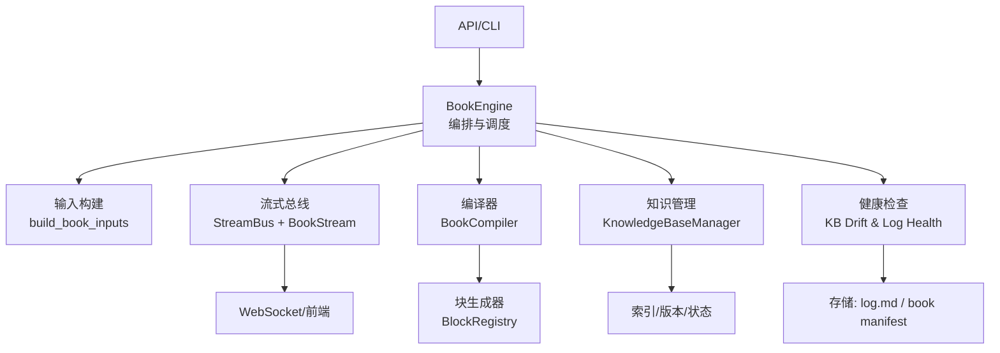
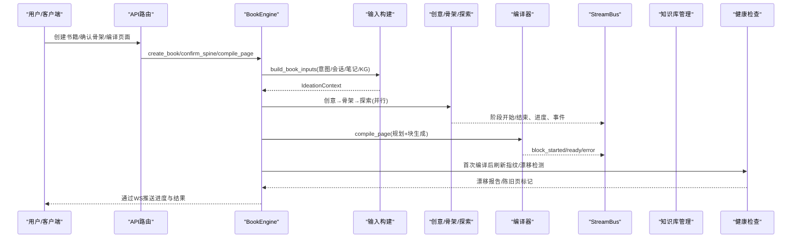
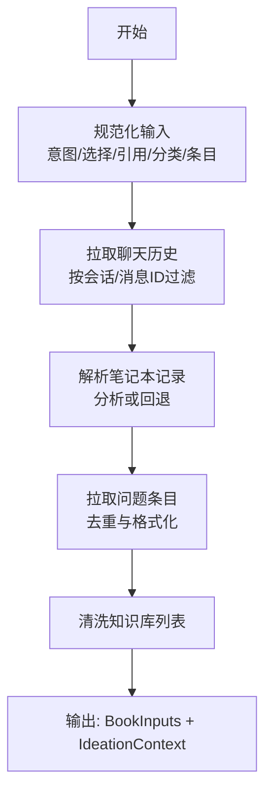
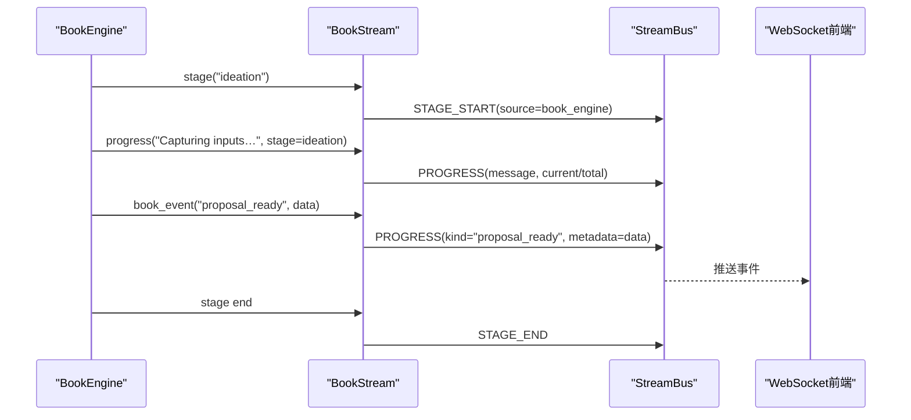
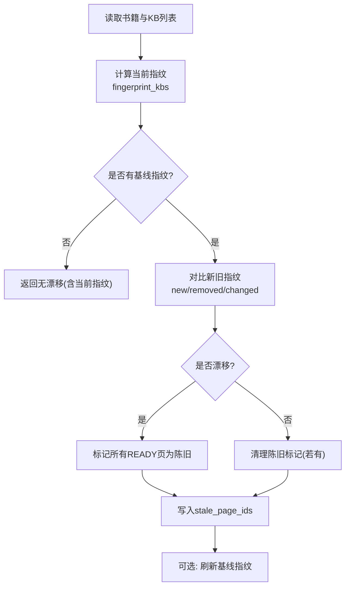
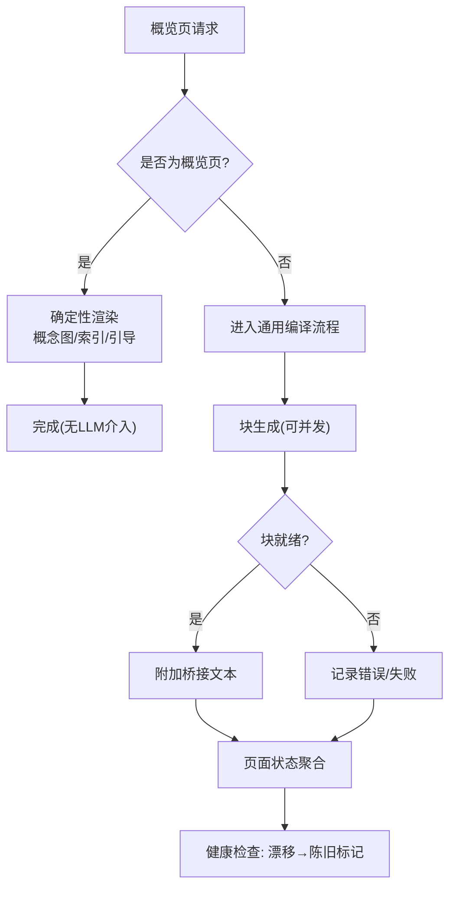
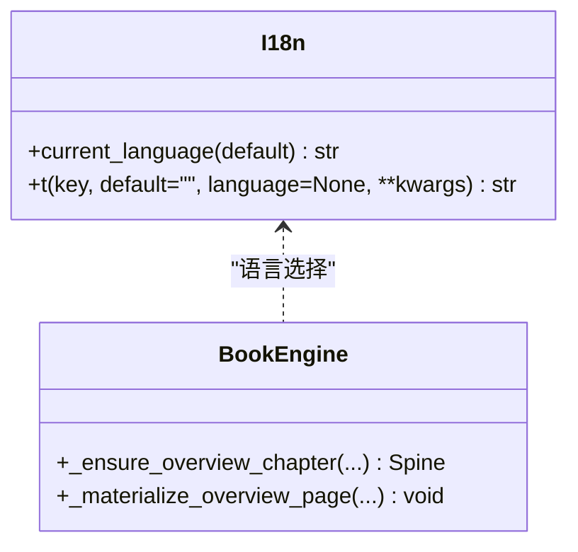
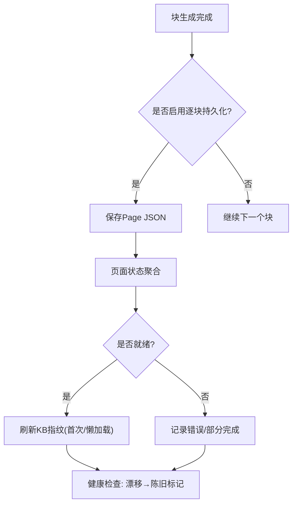
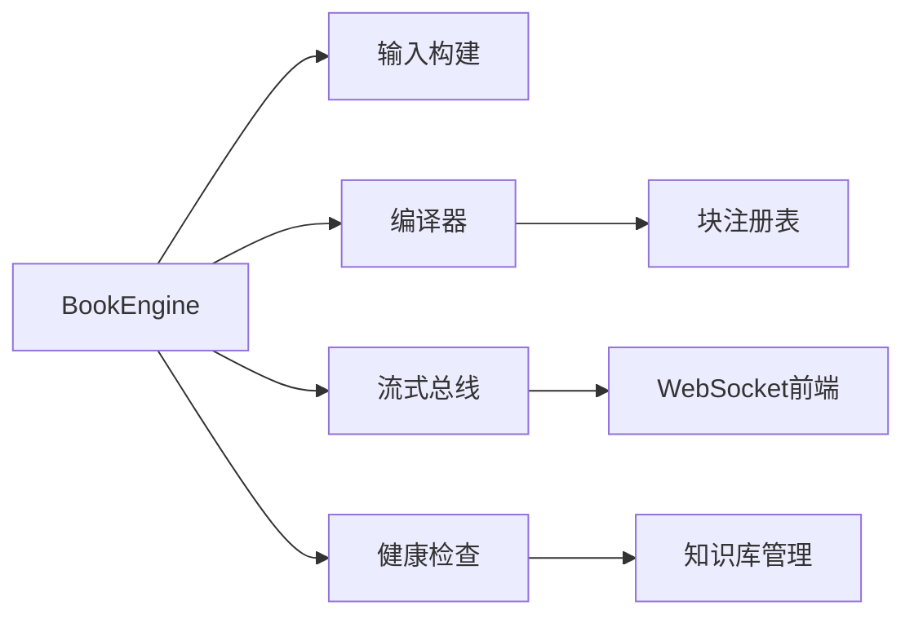

# 内容生成

<cite>
**本文引用的文件**
- [engine.py](file://deeptutor/book/engine.py)
- [inputs.py](file://deeptutor/book/inputs.py)
- [kb_health.py](file://deeptutor/book/kb_health.py)
- [streaming.py](file://deeptutor/book/streaming.py)
- [compiler.py](file://deeptutor/book/compiler.py)
- [stream_bus.py](file://deeptutor/core/stream_bus.py)
- [manager.py](file://deeptutor/knowledge/manager.py)
- [progress_broadcaster.py](file://deeptutor/api/utils/progress_broadcaster.py)
- [settings.py](file://deeptutor/config/settings.py)
- [i18n.py](file://deeptutor/core/i18n.py)
</cite>

## 目录
1. [简介](#简介)
2. [项目结构](#项目结构)
3. [核心组件](#核心组件)
4. [架构总览](#架构总览)
5. [详细组件分析](#详细组件分析)
6. [依赖关系分析](#依赖关系分析)
7. [性能考虑](#性能考虑)
8. [故障排除指南](#故障排除指南)
9. [结论](#结论)
10. [附录](#附录)

## 简介
本文件面向DeepTutor内容生成系统，聚焦“书引擎（Book Engine）”的端到端流程：从用户意图解析、上下文信息收集与知识库集成，到流式处理机制（进度跟踪、事件广播、实时反馈），再到知识健康检查（指纹识别、变更检测、漂移警告）、内容生成的质量控制（事实核查、一致性验证、幻觉检测）、多语言支持与本地化策略、内容缓存与增量更新机制，以及配置选项与性能调优、质量评估与故障排除方法。文档以代码为依据，提供可追溯的章节来源与图示来源，帮助读者快速理解并落地使用。

## 项目结构
内容生成由“书引擎”驱动，围绕“输入构建—大纲合成—页面规划—块生成—持久化—流式反馈—健康检查”的主线组织。关键模块如下：
- 输入构建：将用户意图、聊天历史、笔记本引用、问题条目与知识库列表融合为结构化上下文。
- 流式总线：统一的异步事件通道，承载进度、思考、工具调用、结果等事件。
- 书引擎编排：按阶段推进创意、探索、骨架、概览、编译等步骤，维护每本书的后台队列与状态。
- 编译器：按页规划与块生成，支持并发度控制与增量持久化。
- 知识管理：多类型知识库注册、索引版本管理与状态同步。
- 健康检查：基于文件指纹的知识库漂移检测与日志健康扫描。
- 本地化：后端消息的多语言渲染。
- 配置：LLM重试等运行时参数。

**图示来源**
- [engine.py:100-116](file://deeptutor/book/engine.py#L100-L116)
- [inputs.py:308-359](file://deeptutor/book/inputs.py#L308-L359)
- [stream_bus.py:31-75](file://deeptutor/core/stream_bus.py#L31-L75)
- [compiler.py:69-190](file://deeptutor/book/compiler.py#L69-L190)
- [manager.py:244-341](file://deeptutor/knowledge/manager.py#L244-L341)
- [kb_health.py:102-173](file://deeptutor/book/kb_health.py#L102-L173)

**章节来源**
- [engine.py:100-116](file://deeptutor/book/engine.py#L100-L116)
- [inputs.py:308-359](file://deeptutor/book/inputs.py#L308-L359)
- [stream_bus.py:31-75](file://deeptutor/core/stream_bus.py#L31-L75)
- [compiler.py:69-190](file://deeptutor/book/compiler.py#L69-L190)
- [manager.py:244-341](file://deeptutor/knowledge/manager.py#L244-L341)
- [kb_health.py:102-173](file://deeptutor/book/kb_health.py#L102-L173)

## 核心组件
- 书引擎（BookEngine）：对外入口，负责创建书籍提案、确认骨架、注入概览章节、页面编译与后台队列调度。
- 输入构建（build_book_inputs）：聚合四类输入源，输出结构化上下文供创意阶段使用。
- 流式总线（StreamBus/BookStream）：统一事件通道，封装阶段、进度、内容、思考、工具调用、错误等事件。
- 编译器（BookCompiler）：页面规划与块生成，支持并发度、逐块持久化与桥接文本。
- 知识管理（KnowledgeBaseManager）：多类型知识库注册、自动发现、状态同步与索引版本管理。
- 健康检查（kb_health）：基于raw文件指纹的漂移检测与log.md健康扫描。
- 本地化（i18n）：后端消息中英双语渲染。
- 配置（settings）：LLM重试等运行参数。

**章节来源**
- [engine.py:100-116](file://deeptutor/book/engine.py#L100-L116)
- [inputs.py:308-359](file://deeptutor/book/inputs.py#L308-L359)
- [streaming.py:33-118](file://deeptutor/book/streaming.py#L33-L118)
- [compiler.py:69-190](file://deeptutor/book/compiler.py#L69-L190)
- [manager.py:244-341](file://deeptutor/knowledge/manager.py#L244-L341)
- [kb_health.py:102-173](file://deeptutor/book/kb_health.py#L102-L173)
- [i18n.py:8-13](file://deeptutor/core/i18n.py#L8-L13)
- [settings.py:19-50](file://deeptutor/config/settings.py#L19-L50)

## 架构总览
下图展示内容生成的主流程与关键交互：

**图示来源**
- [engine.py:200-273](file://deeptutor/book/engine.py#L200-L273)
- [engine.py:281-394](file://deeptutor/book/engine.py#L281-L394)
- [engine.py:699-769](file://deeptutor/book/engine.py#L699-L769)
- [inputs.py:308-359](file://deeptutor/book/inputs.py#L308-L359)
- [streaming.py:33-118](file://deeptutor/book/streaming.py#L33-L118)
- [compiler.py:88-190](file://deeptutor/book/compiler.py#L88-L190)
- [kb_health.py:155-173](file://deeptutor/book/kb_health.py#L155-L173)

## 详细组件分析

### 输入构建过程：用户意图解析、上下文收集与知识库集成
- 目标：将用户意图、聊天历史、笔记本记录、问题条目与知识库列表整合为结构化上下文，用于后续创意与骨架生成。
- 关键点：
  - 聊天历史：按会话或消息ID拉取，限制每会话条数，过滤无效角色与空内容，排序时间戳。
  - 笔记本上下文：根据引用解析记录，优先使用分析代理生成摘要；失败时回退为标题/摘要列表。
  - 问题条目：按分类或ID拉取，去重并格式化。
  - 知识库列表：清洗并保留有效名称。
  - 输出：BookInputs与IdeationContext，后者提供可读的提示段。

**图示来源**
- [inputs.py:91-146](file://deeptutor/book/inputs.py#L91-L146)
- [inputs.py:176-214](file://deeptutor/book/inputs.py#L176-L214)
- [inputs.py:225-282](file://deeptutor/book/inputs.py#L225-L282)
- [inputs.py:308-359](file://deeptutor/book/inputs.py#L308-L359)

**章节来源**
- [inputs.py:91-146](file://deeptutor/book/inputs.py#L91-L146)
- [inputs.py:176-214](file://deeptutor/book/inputs.py#L176-L214)
- [inputs.py:225-282](file://deeptutor/book/inputs.py#L225-L282)
- [inputs.py:308-359](file://deeptutor/book/inputs.py#L308-L359)

### 流式处理机制：进度跟踪、事件广播与实时反馈
- 设计：通过StreamBus统一事件通道，BookStream封装book_engine来源与阶段常量，提供content/thinking/progress/result/error/book_event等方法。
- 特性：
  - 阶段上下文：stage()作为上下文管理器，自动发出阶段开始/结束事件。
  - 进度与结果：progress携带current/total，result携带最终数据。
  - 自定义事件：book_event以PROGRESS通道广播，前端按kind区分（proposal_ready/spine_ready/page_planned/block_ready等）。
  - 订阅与回放：subscribe支持历史回放，确保新订阅者不丢事件。

**图示来源**
- [streaming.py:33-118](file://deeptutor/book/streaming.py#L33-L118)
- [stream_bus.py:78-104](file://deeptutor/core/stream_bus.py#L78-L104)
- [stream_bus.py:193-213](file://deeptutor/core/stream_bus.py#L193-L213)
- [stream_bus.py:231-243](file://deeptutor/core/stream_bus.py#L231-L243)

**章节来源**
- [streaming.py:33-118](file://deeptutor/book/streaming.py#L33-L118)
- [stream_bus.py:31-75](file://deeptutor/core/stream_bus.py#L31-L75)
- [stream_bus.py:78-104](file://deeptutor/core/stream_bus.py#L78-L104)
- [stream_bus.py:193-213](file://deeptutor/core/stream_bus.py#L193-L213)
- [stream_bus.py:231-243](file://deeptutor/core/stream_bus.py#L231-L243)

### 知识健康检查：指纹识别、变更检测与漂移警告
- 指纹识别：对知识库raw目录下的文件计算“文件名:修改时间:大小”令牌，汇总后哈希得到确定性指纹；缺失目录返回空串。
- 漂移检测：比较当前指纹与书中保存的基线指纹，识别新增/移除/变更的知识库；若存在漂移，将所有READY页标记为陈旧。
- 刷新与自愈：首次编译成功后刷新指纹；若无基线且无漂移则捕获基线；漂移清除后清空陈旧标记。
- 日志健康：解析log.md统计条目、错误、重复失败，辅助维护看板。

**图示来源**
- [kb_health.py:35-72](file://deeptutor/book/kb_health.py#L35-L72)
- [kb_health.py:102-152](file://deeptutor/book/kb_health.py#L102-L152)
- [kb_health.py:155-222](file://deeptutor/book/kb_health.py#L155-L222)
- [kb_health.py:255-296](file://deeptutor/book/kb_health.py#L255-L296)

**章节来源**
- [kb_health.py:35-72](file://deeptutor/book/kb_health.py#L35-L72)
- [kb_health.py:102-152](file://deeptutor/book/kb_health.py#L102-L152)
- [kb_health.py:155-222](file://deeptutor/book/kb_health.py#L155-L222)
- [kb_health.py:255-296](file://deeptutor/book/kb_health.py#L255-L296)

### 内容生成的质量控制：事实核查、一致性验证与幻觉检测
- 事实核查与一致性：
  - 概览页采用确定性渲染（概念图Mermaid、章节索引、引导文本），避免LLM重写导致的不一致与幻觉。
  - 编译器在块就绪后附加“桥接文本”，增强段落连贯性，减少跳跃导致的语义不一致。
  - 健康检查将知识库变更反映到陈旧页标记，提示重新编译以保证内容与最新知识一致。
- 幻觉检测与缓解：
  - 概览页强制跳过通用LLM编译路径，防止覆盖手写的“如何阅读本书”与章节索引。
  - 探索阶段失败时回退到仅基于提案的骨架生成，降低外部检索不稳定带来的风险。
  - 块生成失败时记录错误与失败原因，便于定位与修复。

**图示来源**
- [engine.py:398-578](file://deeptutor/book/engine.py#L398-L578)
- [engine.py:699-769](file://deeptutor/book/engine.py#L699-L769)
- [compiler.py:194-249](file://deeptutor/book/compiler.py#L194-L249)
- [kb_health.py:102-152](file://deeptutor/book/kb_health.py#L102-L152)

**章节来源**
- [engine.py:398-578](file://deeptutor/book/engine.py#L398-L578)
- [engine.py:699-769](file://deeptutor/book/engine.py#L699-L769)
- [compiler.py:194-249](file://deeptutor/book/compiler.py#L194-L249)
- [kb_health.py:102-152](file://deeptutor/book/kb_health.py#L102-L152)

### 多语言支持与本地化策略
- 后端消息：i18n模块提供当前语言解析与t(key, **kwargs)函数，支持en/zh双语，默认英文回退。
- 书引擎：概览页标题、学习目标、说明文案根据language动态选择中/英。
- 提示与界面：前端与后端通过统一语言键渲染用户可见文本，保证一致性。

**图示来源**
- [i18n.py:8-13](file://deeptutor/core/i18n.py#L8-L13)
- [i18n.py:113-130](file://deeptutor/core/i18n.py#L113-L130)
- [engine.py:418-450](file://deeptutor/book/engine.py#L418-L450)

**章节来源**
- [i18n.py:8-13](file://deeptutor/core/i18n.py#L8-L13)
- [i18n.py:113-130](file://deeptutor/core/i18n.py#L113-L130)
- [engine.py:418-450](file://deeptutor/book/engine.py#L418-L450)

### 内容缓存与增量更新机制
- 页面级增量：
  - 编译器支持逐块持久化（persist_after_each_block），每次块完成后立即落盘，提升中断恢复能力。
  - 并发编译可通过block_concurrency提高吞吐，同时保持规划顺序的前驱指针以维持连贯性。
- 知识级增量：
  - 健康检查基于文件指纹检测知识库变更，标记陈旧页，触发按需重建。
  - 首次编译成功或健康检查无漂移时刷新基线指纹，避免误报。
- 概览页缓存：概览页采用确定性渲染，无需LLM，天然具备“缓存即结果”的特性。

**图示来源**
- [compiler.py:45-67](file://deeptutor/book/compiler.py#L45-L67)
- [compiler.py:118-175](file://deeptutor/book/compiler.py#L118-L175)
- [engine.py:755-769](file://deeptutor/book/engine.py#L755-L769)
- [kb_health.py:155-173](file://deeptutor/book/kb_health.py#L155-L173)

**章节来源**
- [compiler.py:45-67](file://deeptutor/book/compiler.py#L45-L67)
- [compiler.py:118-175](file://deeptutor/book/compiler.py#L118-L175)
- [engine.py:755-769](file://deeptutor/book/engine.py#L755-L769)
- [kb_health.py:155-173](file://deeptutor/book/kb_health.py#L155-L173)

### 配置选项与性能调优指南
- 编译器选项（CompilerOptions）：
  - phase：控制生成阶段（如Phase 1仅文本/注释/测验块）。
  - rag_enabled：是否允许块生成器调用RAG工具。
  - block_concurrency：单页内块并发度（Phase 1建议1以保持顺序；后期可提高吞吐）。
  - persist_after_each_block：是否每块完成后持久化。
  - architect_llm_enabled：是否允许SectionArchitect使用LLM进行规划。
- LLM重试配置（settings）：
  - max_retries：最大重试次数。
  - base_delay：基础延迟秒数。
  - exponential_backoff：是否指数退避。
- 实践建议：
  - 高吞吐场景：提高block_concurrency，关闭逐块持久化以减少IO。
  - 稳定性优先：phase=1、rag_enabled=False、architect_llm_enabled=False可降低不确定性。
  - 大页面：分阶段编译，先Phase 1替换占位，再Phase N生成复杂块。

**章节来源**
- [compiler.py:45-67](file://deeptutor/book/compiler.py#L45-L67)
- [settings.py:19-50](file://deeptutor/config/settings.py#L19-L50)

## 依赖关系分析
- 组件耦合：
  - BookEngine依赖输入构建、编译器、流式总线、健康检查与存储。
  - 编译器依赖块注册表与规划器，并通过BookStream与前端交互。
  - 健康检查依赖知识库管理器的文件系统表示。
- 直接/间接依赖：
  - 输入构建依赖会话存储、笔记本管理、分析代理。
  - 流式总线被API层与前端消费，形成松耦合的事件驱动架构。
- 外部集成点：
  - 知识库提供者（多种RAG后端）、PocketBase同步、MCP工具等。

**图示来源**
- [engine.py:100-116](file://deeptutor/book/engine.py#L100-L116)
- [compiler.py:69-84](file://deeptutor/book/compiler.py#L69-L84)
- [kb_health.py:102-152](file://deeptutor/book/kb_health.py#L102-L152)
- [manager.py:244-341](file://deeptutor/knowledge/manager.py#L244-L341)

**章节来源**
- [engine.py:100-116](file://deeptutor/book/engine.py#L100-L116)
- [compiler.py:69-84](file://deeptutor/book/compiler.py#L69-L84)
- [kb_health.py:102-152](file://deeptutor/book/kb_health.py#L102-L152)
- [manager.py:244-341](file://deeptutor/knowledge/manager.py#L244-L341)

## 性能考虑
- 并发与顺序权衡：block_concurrency提升吞吐但需关注块间依赖；Phase 1建议顺序执行。
- IO优化：逐块持久化保障恢复但增加磁盘写；大批量编译时可临时关闭。
- 网络与LLM：RAG与LLM调用可能成为瓶颈，可通过rag_enabled与architect_llm_enabled控制。
- 内存与任务：后台队列与worker管理避免阻塞；必要时取消旧worker并重建。

[本节为通用指导，不直接分析具体文件]

## 故障排除指南
- 常见问题：
  - 概览页被覆盖：确认未对概览页执行force编译；概览页应走确定性渲染路径。
  - 知识库漂移误报：检查基线指纹是否已捕获；首次编译成功后会刷新。
  - 块生成失败：查看block_error事件中的failure与payload_keys，定位具体块类型与错误。
  - 进度不更新：确认StreamBus订阅正常，BookStream阶段与事件是否正确发出。
- 诊断手段：
  - 健康检查：scan_log_health统计重复失败，mark_drift_on_book标记陈旧页。
  - 日志：book log.md包含compile_page/page_compiled等条目，便于回溯。
  - 前端：监听book_event的kind字段，区分proposal_ready/spine_ready/page_planned/block_ready等。

**章节来源**
- [engine.py:699-769](file://deeptutor/book/engine.py#L699-L769)
- [kb_health.py:102-152](file://deeptutor/book/kb_health.py#L102-L152)
- [kb_health.py:255-296](file://deeptutor/book/kb_health.py#L255-L296)
- [streaming.py:94-118](file://deeptutor/book/streaming.py#L94-L118)

## 结论
DeepTutor内容生成系统以“书引擎”为核心，通过输入构建、流式事件、编译器与健康检查形成闭环。系统在概览页采用确定性渲染保障一致性，在健康检查层面实现知识库变更感知与陈旧页标记，结合流式总线提供实时反馈。通过可调的编译器选项与LLM重试配置，可在稳定性与性能之间取得平衡。多语言支持与本地化策略确保跨语言体验一致。

[本节为总结，不直接分析具体文件]

## 附录
- 术语：
  - 书引擎（BookEngine）：内容生成编排器。
  - 流式总线（StreamBus）：异步事件通道。
  - 健康检查（KB Drift & Log Health）：知识库变更与日志健康扫描。
  - 编译器（BookCompiler）：页面规划与块生成器。
- 参考路径：
  - 输入构建：[inputs.py:308-359](file://deeptutor/book/inputs.py#L308-L359)
  - 流式事件：[streaming.py:33-118](file://deeptutor/book/streaming.py#L33-L118)
  - 健康检查：[kb_health.py:102-173](file://deeptutor/book/kb_health.py#L102-L173)
  - 编译器选项：[compiler.py:45-67](file://deeptutor/book/compiler.py#L45-L67)
  - 本地化：[i18n.py:8-13](file://deeptutor/core/i18n.py#L8-L13)
  - 配置：[settings.py:19-50](file://deeptutor/config/settings.py#L19-L50)