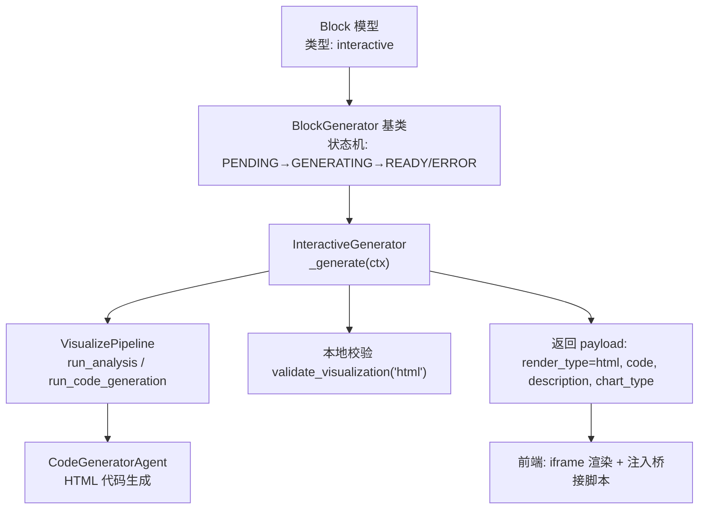
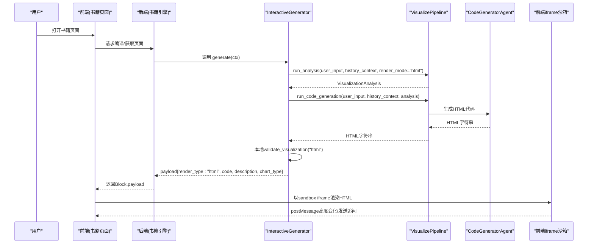
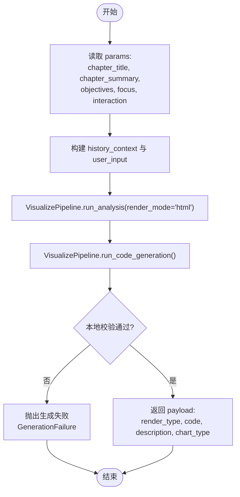
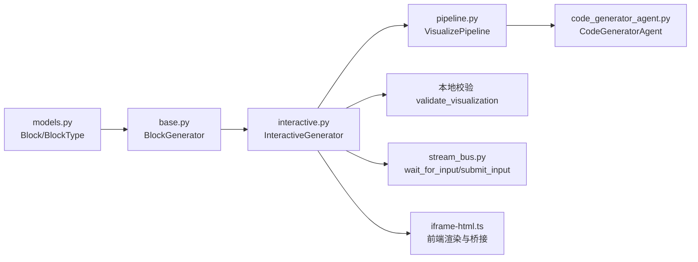

# 交互块

<cite>
**本文引用的文件**
- [interactive.py](file://deeptutor/book/blocks/interactive.py)
- [base.py](file://deeptutor/book/blocks/base.py)
- [models.py](file://deeptutor/book/models.py)
- [pipeline.py](file://deeptutor/agents/visualize/pipeline.py)
- [code_generator_agent.py](file://deeptutor/agents/visualize/agents/code_generator_agent.py)
- [iframe-html.ts](file://web/lib/iframe-html.ts)
- [ask_user.py](file://deeptutor/tools/ask_user.py)
- [stream_bus.py](file://deeptutor/core/stream_bus.py)
- [test_ask_user.py](file://tests/tools/test_ask_user.py)
</cite>

## 目录
1. [简介](#简介)
2. [项目结构](#项目结构)
3. [核心组件](#核心组件)
4. [架构总览](#架构总览)
5. [详细组件分析](#详细组件分析)
6. [依赖关系分析](#依赖关系分析)
7. [性能考虑](#性能考虑)
8. [故障排查指南](#故障排查指南)
9. [结论](#结论)
10. [附录：使用示例与最佳实践](#附录使用示例与最佳实践)

## 简介
本文件聚焦 DeepTutor 的“交互块”能力，围绕后端生成器 InteractiveGenerator 的实现原理、参数定义、前后端同步与实时反馈机制、数据验证与错误处理策略进行系统化说明。同时给出多种交互模式（表单输入、滑块控制、选择器、自定义组件）在 HTML 交互页面中的落地方式，并提供调查问卷、实验模拟、个性化设置等典型场景的使用方案。

## 项目结构
交互块位于书籍引擎的“区块（Block）”体系内，由 Block 模型描述，通过 BlockGenerator 抽象基类派生具体生成器。InteractiveGenerator 负责将章节上下文与用户意图转化为可执行的 HTML 交互页面，并在前端以沙箱 iframe 安全渲染。

图表来源
- [models.py:326-345](file://deeptutor/book/models.py#L326-L345)
- [base.py:116-155](file://deeptutor/book/blocks/base.py#L116-L155)
- [interactive.py:25-97](file://deeptutor/book/blocks/interactive.py#L25-L97)
- [pipeline.py:47-88](file://deeptutor/agents/visualize/pipeline.py#L47-L88)
- [code_generator_agent.py:61-94](file://deeptutor/agents/visualize/agents/code_generator_agent.py#L61-L94)
- [iframe-html.ts:1-121](file://web/lib/iframe-html.ts#L1-L121)

章节来源
- [models.py:326-345](file://deeptutor/book/models.py#L326-L345)
- [base.py:116-155](file://deeptutor/book/blocks/base.py#L116-L155)
- [interactive.py:25-97](file://deeptutor/book/blocks/interactive.py#L25-L97)

## 核心组件
- Block 与 BlockType
  - Block 是书籍页面的原子内容单元，包含 type、params、payload、status、metadata 等字段。
  - BlockType.INTERACTIVE 标识交互块，其 payload 承载 HTML 文档及元信息。
- BlockGenerator 与状态管理
  - generate() 统一封装生命周期：设置 GENERATING → 执行 _generate() → 成功置 READY 或失败置 ERROR，并记录 failure 元数据。
- InteractiveGenerator
  - 从 ctx.block.params 读取 chapter_title、chapter_summary、objectives、focus、interaction 等配置，构造提示词，调用 VisualizePipeline 生成 HTML，并通过本地校验后返回 payload。
- VisualizePipeline 与 CodeGeneratorAgent
  - Pipeline 提供 run_analysis、run_code_generation、run_repair 三阶段；Agent 负责根据分析结果生成 HTML 代码，并对 HTML 做特殊兼容处理。
- 前端 iframe 渲染与桥接
  - 前端对生成的 HTML 注入 KaTeX、安全清洗、注入桥接脚本，使交互页可通过 postMessage 与宿主通信（如发送追问、自适应高度）。

章节来源
- [models.py:326-345](file://deeptutor/book/models.py#L326-L345)
- [base.py:116-155](file://deeptutor/book/blocks/base.py#L116-L155)
- [interactive.py:25-97](file://deeptutor/book/blocks/interactive.py#L25-L97)
- [pipeline.py:47-88](file://deeptutor/agents/visualize/pipeline.py#L47-L88)
- [code_generator_agent.py:61-94](file://deeptutor/agents/visualize/agents/code_generator_agent.py#L61-L94)
- [iframe-html.ts:1-121](file://web/lib/iframe-html.ts#L1-L121)

## 架构总览
交互块的端到端流程如下：

图表来源
- [interactive.py:25-97](file://deeptutor/book/blocks/interactive.py#L25-L97)
- [pipeline.py:47-88](file://deeptutor/agents/visualize/pipeline.py#L47-L88)
- [code_generator_agent.py:61-94](file://deeptutor/agents/visualize/agents/code_generator_agent.py#L61-L94)
- [iframe-html.ts:1-121](file://web/lib/iframe-html.ts#L1-L121)

## 详细组件分析

### InteractiveGenerator 实现原理
- 输入解析
  - 从 ctx.block.params 提取 chapter_title、chapter_summary、objectives、focus、interaction。
  - 组装 history_context（章节摘要+学习目标），以及 user_input（构建交互页面的指令）。
- 生成流程
  - 通过 VisualizePipeline 的分析阶段确定可视化目标与数据结构。
  - 进入代码生成阶段产出完整 HTML 文档。
  - 使用本地 validate_visualization 对 HTML 进行确定性校验，不通过则抛出 GenerationFailure，交由上层重试。
- 输出结构
  - payload.render_type = "html"
  - payload.code.language = "html", payload.code.content = HTML字符串
  - payload.description、payload.chart_type 用于前端展示与语义标注

图表来源
- [interactive.py:25-97](file://deeptutor/book/blocks/interactive.py#L25-L97)
- [pipeline.py:47-88](file://deeptutor/agents/visualize/pipeline.py#L47-L88)

章节来源
- [interactive.py:25-97](file://deeptutor/book/blocks/interactive.py#L25-L97)

### 参数定义与配置
- Block.params（交互块）
  - chapter_title: 章节标题（用于提示词与页面标题）
  - chapter_summary: 章节摘要（作为历史上下文）
  - objectives: 学习目标列表（作为历史上下文）
  - focus: 聚焦主题（用于限定交互范围）
  - interaction: 交互风格（如 "interactive"）
- Block.payload（交互块）
  - render_type: "html"
  - code: { language: "html", content: HTML字符串 }
  - description: 可视化描述
  - chart_type: 图表类型（若适用）
- 其他相关模型
  - Block.status: PENDING → GENERATING → READY/ERROR
  - Block.metadata.failure: 分类化错误元数据（json_parse、timeout、rate_limit 等）

章节来源
- [models.py:326-345](file://deeptutor/book/models.py#L326-L345)
- [base.py:34-71](file://deeptutor/book/blocks/base.py#L34-L71)
- [interactive.py:25-97](file://deeptutor/book/blocks/interactive.py#L25-L97)

### 用户输入处理、状态管理与动态响应机制
- 用户输入处理
  - 交互块本身生成的是静态 HTML，但可在页面中嵌入表单、滑块、选择器等控件，并通过 JavaScript 捕获事件。
  - 前端为 iframe 注入桥接脚本，支持 window.sendPrompt(text) 向宿主发送追问，便于将交互结果转为聊天消息继续对话。
- 状态管理
  - 后端通过 Block.status 管理生成状态；前端通过 Block.payload 渲染交互页面。
  - 前端通过 ResizeObserver 监听 iframe 内容高度变化，自动调整容器尺寸，避免裁剪。
- 动态响应机制
  - 交互页面内部可使用 JS 实现局部更新（如滑块拖动刷新图表），无需全量刷新。
  - 如需与后端交互，可通过 postMessage 触发宿主侧逻辑（例如发起新的生成任务或查询）。

章节来源
- [iframe-html.ts:1-121](file://web/lib/iframe-html.ts#L1-L121)

### 多种交互模式的支持
- 表单输入
  - 在 HTML 中使用 <form>、<input>、<textarea> 等元素收集文本输入，提交时可通过 sendPrompt 将内容转发到聊天框。
- 滑块控制
  - 使用 <input type="range"> 或第三方库（如 Chart.js）实现滑块驱动的数据可视化更新。
- 选择器
  - 使用 <select>、<button>、复选框等实现选项切换，结合 JS 动态渲染不同视图。
- 自定义组件
  - 允许引入受信任 CDN 的库（Chart.js、d3 等），在单文件 HTML 中实现复杂交互。
  - 遵循规则：仅允许指定 CDN；KaTeX 已自动注入；避免固定 body 高度；使用 max-width: 100% 和 box-sizing: border-box。

章节来源
- [code_generator_agent.py:61-94](file://deeptutor/agents/visualize/agents/code_generator_agent.py#L61-L94)
- [iframe-html.ts:1-121](file://web/lib/iframe-html.ts#L1-L121)

### 前后端同步与实时反馈机制
- 前端桥接
  - 注入脚本提供 window.sendPrompt(text)，用于将交互动作转换为后续问题。
  - 通过 postMessage 上报高度，宿主自动调整 iframe 尺寸。
- 后端流式事件（通用能力）
  - stream_bus 提供 wait_for_input/submit_input，用于在能力执行中暂停并等待前端输入，适合需要强交互的流程（如问答引导）。
  - 虽然交互块主要产出静态 HTML，但在更复杂的场景中可与该机制配合，实现“生成-询问-再生成”的闭环。

章节来源
- [iframe-html.ts:1-121](file://web/lib/iframe-html.ts#L1-L121)
- [stream_bus.py:262-298](file://deeptutor/core/stream_bus.py#L262-L298)

### 交互数据的验证与错误处理策略
- 后端本地校验
  - 对生成的 HTML 执行 validate_visualization("html")，失败则抛出 GenerationFailure，交由 BookEngine 重试。
- 错误分类与元数据
  - base.py 将异常分类为 json_parse、empty_response、timeout、rate_limit、provider_error、generator_error，并写入 block.metadata.failure。
- 前端安全加固
  - sanitizeIframeHtml 移除 javascript: URL 与危险 target，保留脚本以支持交互。
  - injectKaTeX 确保数学公式渲染。
  - 注入桥接脚本，限制跨域通信通道。

章节来源
- [interactive.py:77-83](file://deeptutor/book/blocks/interactive.py#L77-L83)
- [base.py:34-71](file://deeptutor/book/blocks/base.py#L34-L71)
- [iframe-html.ts:67-121](file://web/lib/iframe-html.ts#L67-L121)

## 依赖关系分析

图表来源
- [models.py:326-345](file://deeptutor/book/models.py#L326-L345)
- [base.py:116-155](file://deeptutor/book/blocks/base.py#L116-L155)
- [interactive.py:25-97](file://deeptutor/book/blocks/interactive.py#L25-L97)
- [pipeline.py:47-88](file://deeptutor/agents/visualize/pipeline.py#L47-L88)
- [code_generator_agent.py:61-94](file://deeptutor/agents/visualize/agents/code_generator_agent.py#L61-L94)
- [stream_bus.py:262-298](file://deeptutor/core/stream_bus.py#L262-L298)
- [iframe-html.ts:1-121](file://web/lib/iframe-html.ts#L1-L121)

章节来源
- [models.py:326-345](file://deeptutor/book/models.py#L326-L345)
- [base.py:116-155](file://deeptutor/book/blocks/base.py#L116-L155)
- [interactive.py:25-97](file://deeptutor/book/blocks/interactive.py#L25-L97)
- [pipeline.py:47-88](file://deeptutor/agents/visualize/pipeline.py#L47-L88)
- [code_generator_agent.py:61-94](file://deeptutor/agents/visualize/agents/code_generator_agent.py#L61-L94)
- [stream_bus.py:262-298](file://deeptutor/core/stream_bus.py#L262-L298)
- [iframe-html.ts:1-121](file://web/lib/iframe-html.ts#L1-L121)

## 性能考虑
- 单次生成成本
  - 交互块需两次 LLM 调用（分析与代码生成），应尽量减少不必要的重试。
- 本地校验优先
  - 通过 validate_visualization 尽早拦截无效 HTML，避免回退到修复流程。
- 前端渲染优化
  - 避免固定高度，使用自适应布局；仅在必要时重新计算高度。
- 缓存与复用
  - 对于相同参数的交互块，可考虑缓存 HTML 以减少重复生成。

[本节为通用指导，不直接分析具体文件]

## 故障排查指南
- 生成失败
  - 检查 block.metadata.failure 的分类与消息，定位是否为 JSON 解析、超时、速率限制或提供者错误。
- HTML 校验失败
  - 确认是否触发了本地校验失败；必要时查看上游分析结果与提示词约束。
- 前端渲染异常
  - 检查是否被安全清洗移除了危险属性；确认 KaTeX 注入与桥接脚本是否生效。
- 交互无响应
  - 确认 sendPrompt 是否正确调用；检查 postMessage 是否被浏览器策略拦截。

章节来源
- [base.py:34-71](file://deeptutor/book/blocks/base.py#L34-L71)
- [interactive.py:77-83](file://deeptutor/book/blocks/interactive.py#L77-L83)
- [iframe-html.ts:67-121](file://web/lib/iframe-html.ts#L67-L121)

## 结论
DeepTutor 的交互块通过 InteractiveGenerator 将章节上下文与用户意图转化为安全的 HTML 交互页面，借助 VisualizePipeline 的两阶段生成与本地校验，确保质量与稳定性。前端以沙箱 iframe 渲染并注入桥接脚本，实现与宿主的轻量通信与自适应布局。结合表单、滑块、选择器与自定义组件，可灵活支撑调查问卷、实验模拟、个性化设置等多种教学场景。

[本节为总结性内容，不直接分析具体文件]

## 附录：使用示例与最佳实践

### 调查问卷
- 后端
  - 使用 Block.params 传入 chapter_title、objectives、focus，生成包含问卷题型的 HTML。
  - 利用 ask_user 工具的结构化提问能力（questions、options、multi_select、allow_free_text）在前端呈现标准问答题型。
- 前端
  - 在交互页面中收集答案，通过 sendPrompt 将汇总结果发送到聊天框，或触发新的生成任务。
- 参考
  - AskUserPayload 结构与 to_dict 输出、多选项与自由文本支持、去重与别名兼容。

章节来源
- [ask_user.py:77-232](file://deeptutor/tools/ask_user.py#L77-L232)
- [test_ask_user.py:263-346](file://tests/tools/test_ask_user.py#L263-L346)

### 实验模拟
- 后端
  - 通过 focus 限定实验变量范围，interaction 指定“交互式演示”。
  - 生成包含滑块、按钮、图表的 HTML，使用 Chart.js/d3 实现数据可视化。
- 前端
  - 利用滑块改变参数，实时更新图表；通过 ResizeObserver 自适应高度。
  - 点击“下一步”或“重置”时，调用 sendPrompt 推进学习路径。

章节来源
- [code_generator_agent.py:61-94](file://deeptutor/agents/visualize/agents/code_generator_agent.py#L61-L94)
- [iframe-html.ts:1-121](file://web/lib/iframe-html.ts#L1-L121)

### 个性化设置
- 后端
  - 使用 objectives 与 chapter_summary 定制交互内容；focus 控制个性化维度（如难度、领域）。
- 前端
  - 提供选择器（语言、主题、显示密度），保存至 localStorage 或通过 sendPrompt 持久化。
  - 根据用户偏好动态调整交互页面内容与样式。

章节来源
- [interactive.py:25-97](file://deeptutor/book/blocks/interactive.py#L25-L97)
- [iframe-html.ts:1-121](file://web/lib/iframe-html.ts#L1-L121)

### 最佳实践清单
- 明确 Block.params 的关键字段，确保提示词充分表达教学目标。
- 优先使用受信任 CDN 与 KaTeX，避免外部资源加载失败。
- 使用本地校验尽早发现问题，减少重试次数。
- 在交互页面中保持轻量与自包含，避免过度依赖宿主环境。
- 通过 sendPrompt 将关键交互结果转化为后续对话，形成闭环。

[本节为通用指导，不直接分析具体文件]