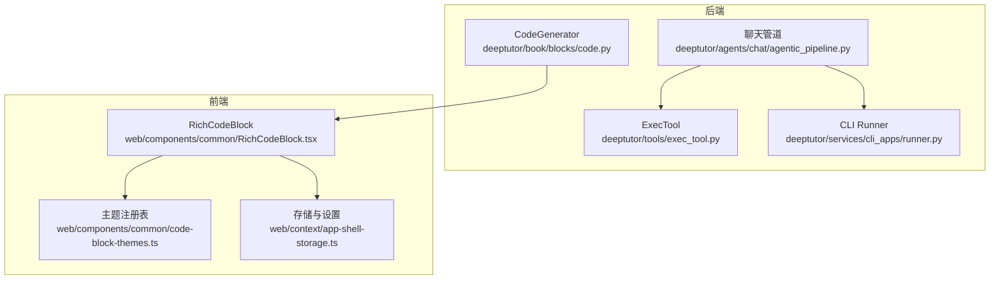
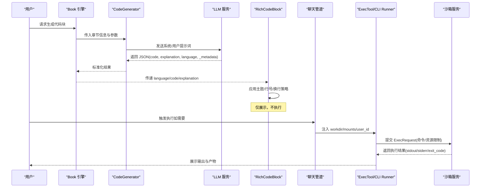
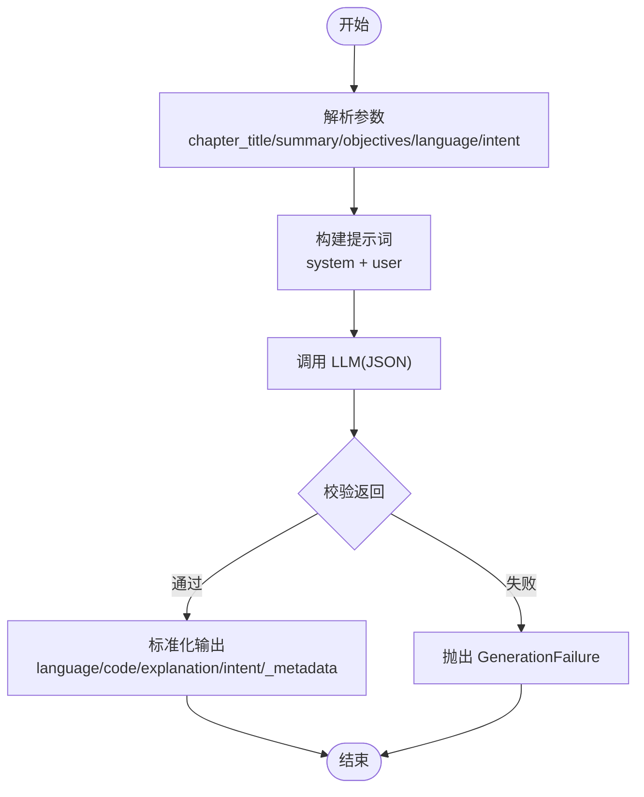
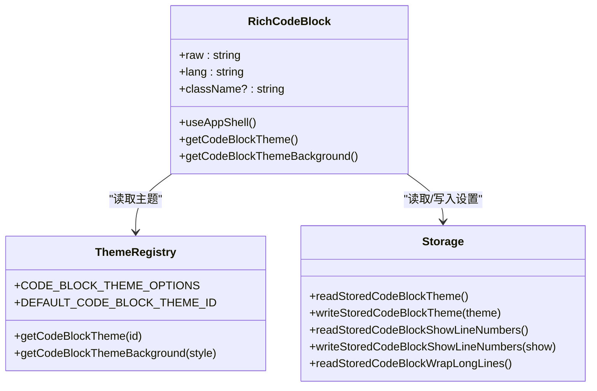
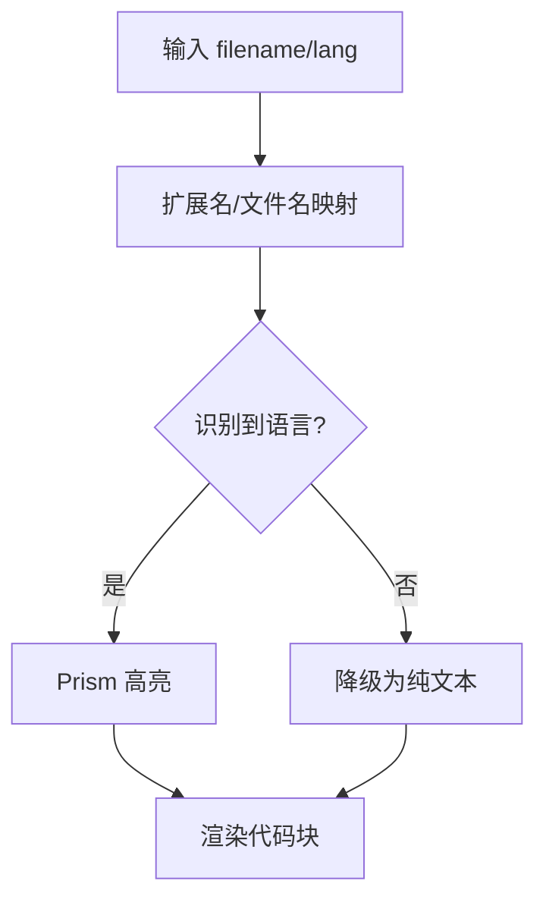
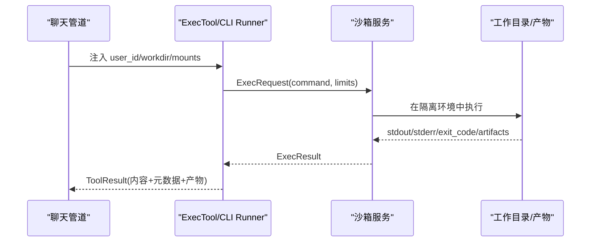
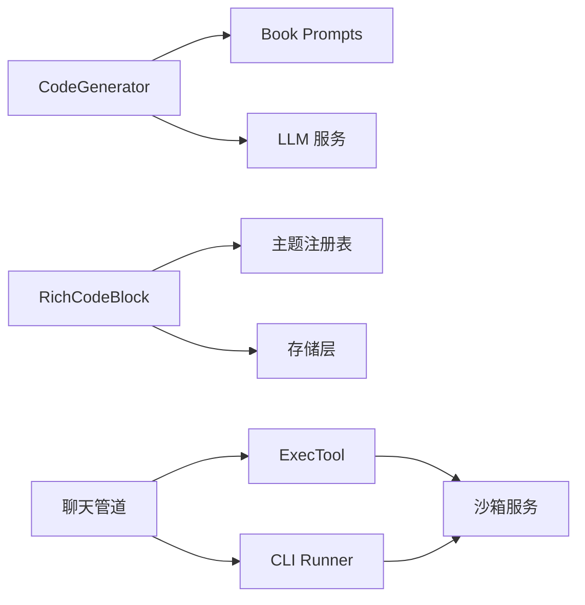

# 代码块

<cite>
**本文引用的文件**
- [code.py](file://deeptutor/book/blocks/code.py)
- [RichCodeBlock.tsx](file://web/components/common/RichCodeBlock.tsx)
- [code-block-themes.ts](file://web/components/common/code-block-themes.ts)
- [app-shell-storage.ts](file://web/context/app-shell-storage.ts)
- [exec_tool.py](file://deeptutor/tools/exec_tool.py)
- [runner.py](file://deeptutor/services/cli_apps/runner.py)
- [agentic_pipeline.py](file://deeptutor/agents/chat/agentic_pipeline.py)
- [test_builtin_tools.py](file://tests/core/test_builtin_tools.py)
- [rich-code-block.test.ts](file://web/tests/rich-code-block.test.ts)
- [markdown-renderer-code-fallback.test.ts](file://web/tests/markdown-renderer-code-fallback.test.ts)
- [settings-context-ui-sync.test.ts](file://web/tests/settings-context-ui-sync.test.ts)
- [code-languages.ts](file://web/lib/code-languages.ts)
</cite>

## 目录
1. [简介](#简介)
2. [项目结构](#项目结构)
3. [核心组件](#核心组件)
4. [架构总览](#架构总览)
5. [详细组件分析](#详细组件分析)
6. [依赖关系分析](#依赖关系分析)
7. [性能考量](#性能考量)
8. [故障排查指南](#故障排查指南)
9. [结论](#结论)
10. [附录](#附录)

## 简介
本章节面向 DeepTutor 的“代码块”能力，系统性说明后端代码生成、前端高亮渲染与可选的沙箱执行机制。内容覆盖：
- CodeGenerator 的实现机制（参数解析、提示词组装、LLM 调用、结果校验）
- 代码高亮与主题、行号、换行策略等前端配置
- 多语言语法支持（Python、JavaScript、SQL 等）
- 沙箱执行的安全隔离与输出处理
- 使用示例与常见场景

## 项目结构
DeepTutor 的代码块由“后端生成 + 前端渲染 + 可选执行”三部分构成：
- 后端生成：book/blocks/code.py 中的 CodeGenerator 负责根据章节信息、目标语言与意图生成可运行代码与解释
- 前端渲染：web/components/common/RichCodeBlock.tsx 基于 react-syntax-highlighter 实现高亮、主题、行号与换行控制；主题注册表在 code-block-themes.ts；用户偏好通过 app-shell-storage.ts 持久化
- 可选执行：tools/exec_tool.py 提供沙箱命令执行；CLI 应用 runner.py 封装 CLI 工具执行；聊天管道 agentic_pipeline.py 注入工作目录与挂载点；测试用例验证 Python 代码执行路径

**图表来源**
- [code.py:21-65](file://deeptutor/book/blocks/code.py#L21-L65)
- [RichCodeBlock.tsx:34-113](file://web/components/common/RichCodeBlock.tsx#L34-L113)
- [code-block-themes.ts:121-183](file://web/components/common/code-block-themes.ts#L121-L183)
- [app-shell-storage.ts:202-292](file://web/context/app-shell-storage.ts#L202-L292)
- [exec_tool.py:49-153](file://deeptutor/tools/exec_tool.py#L49-L153)
- [runner.py:37-88](file://deeptutor/services/cli_apps/runner.py#L37-L88)
- [agentic_pipeline.py:943-967](file://deeptutor/agents/chat/agentic_pipeline.py#L943-L967)

**章节来源**
- [code.py:21-65](file://deeptutor/book/blocks/code.py#L21-L65)
- [RichCodeBlock.tsx:34-113](file://web/components/common/RichCodeBlock.tsx#L34-L113)
- [code-block-themes.ts:121-183](file://web/components/common/code-block-themes.ts#L121-L183)
- [app-shell-storage.ts:202-292](file://web/context/app-shell-storage.ts#L202-L292)
- [exec_tool.py:49-153](file://deeptutor/tools/exec_tool.py#L49-L153)
- [runner.py:37-88](file://deeptutor/services/cli_apps/runner.py#L37-L88)
- [agentic_pipeline.py:943-967](file://deeptutor/agents/chat/agentic_pipeline.py#L943-L967)

## 核心组件
- CodeGenerator（后端代码生成器）
  - 读取 block.params 中的 chapter_title、chapter_summary、objectives、language、intent
  - 加载本地化提示词，构造 user/system prompt
  - 调用统一 LLM 服务返回 JSON（包含 code、explanation、language、_metadata）
  - 对返回内容进行安全校验（禁止 think 标签泄露），失败时抛出 GenerationFailure
  - 输出标准化字段：language、code、explanation、intent、_metadata
- RichCodeBlock（前端代码块渲染）
  - 从 AppShellContext 读取 codeBlockTheme、codeBlockShowLineNumbers、codeBlockWrapLongLines
  - 使用 react-syntax-highlighter 进行语法高亮，支持主题切换、行号显示、长行换行/滚动
  - 非代码语言（text/plain/none）降级为纯文本展示
- 主题与设置
  - 主题注册表集中管理 Prism 样式对象，提供默认主题与背景色提取
  - 用户偏好通过 localStorage 持久化，并在设置同步时受后端值覆盖
- 沙箱执行
  - ExecTool 将命令限制在沙箱中执行，内置危险命令黑名单
  - CLI Runner 以最小环境运行第三方 CLI，限制超时与输出大小
  - 聊天管道为 exec 与 CLI 工具注入用户 ID、工作目录与只读/读写挂载

**章节来源**
- [code.py:21-65](file://deeptutor/book/blocks/code.py#L21-L65)
- [RichCodeBlock.tsx:34-113](file://web/components/common/RichCodeBlock.tsx#L34-L113)
- [code-block-themes.ts:185-211](file://web/components/common/code-block-themes.ts#L185-L211)
- [app-shell-storage.ts:202-292](file://web/context/app-shell-storage.ts#L202-L292)
- [exec_tool.py:30-153](file://deeptutor/tools/exec_tool.py#L30-L153)
- [runner.py:37-124](file://deeptutor/services/cli_apps/runner.py#L37-L124)
- [agentic_pipeline.py:943-967](file://deeptutor/agents/chat/agentic_pipeline.py#L943-L967)

## 架构总览
下图展示了从“代码块生成”到“前端渲染”，再到“可选执行”的端到端流程。

**图表来源**
- [code.py:21-65](file://deeptutor/book/blocks/code.py#L21-L65)
- [RichCodeBlock.tsx:34-113](file://web/components/common/RichCodeBlock.tsx#L34-L113)
- [exec_tool.py:80-153](file://deeptutor/tools/exec_tool.py#L80-L153)
- [runner.py:37-88](file://deeptutor/services/cli_apps/runner.py#L37-L88)
- [agentic_pipeline.py:943-967](file://deeptutor/agents/chat/agentic_pipeline.py#L943-L967)

## 详细组件分析

### CodeGenerator（后端代码生成器）
- 参数解析
  - chapter_title、chapter_summary、objectives：来自 block.params 或上下文
  - language：默认 python，可从参数覆盖
  - intent：默认 demonstrate，用于指导生成目的（演示/练习/调试等）
- 提示词与 LLM 调用
  - 加载本地化 prompts（en/zh），拼接 system 与 user 模板
  - 调用 llm_json，限制 max_tokens 与 temperature，确保结构化输出
- 结果校验与输出
  - 校验 code 非空且不含 think 标签（防提示词泄露）
  - 输出标准化字段：language、code、explanation、intent、_metadata

**图表来源**
- [code.py:21-65](file://deeptutor/book/blocks/code.py#L21-L65)

**章节来源**
- [code.py:21-65](file://deeptutor/book/blocks/code.py#L21-L65)

### RichCodeBlock（前端高亮与展示）
- 高亮与主题
  - 通过 getCodeBlockTheme 获取 Prism 样式对象，getCodeBlockThemeBackground 提取背景色
  - 非代码语言（text/plain/none）直接以纯文本呈现
- 显示选项
  - codeBlockShowLineNumbers：是否显示行号
  - codeBlockWrapLongLines：是否自动换行；关闭时保留水平滚动
- 样式细节
  - 自定义字体族、字号、行高、内边距
  - 当同时启用行号与换行时，修正每行容器的 display 以避免长 token 溢出

**图表来源**
- [RichCodeBlock.tsx:34-113](file://web/components/common/RichCodeBlock.tsx#L34-L113)
- [code-block-themes.ts:121-183](file://web/components/common/code-block-themes.ts#L121-L183)
- [app-shell-storage.ts:202-292](file://web/context/app-shell-storage.ts#L202-L292)

**章节来源**
- [RichCodeBlock.tsx:34-113](file://web/components/common/RichCodeBlock.tsx#L34-L113)
- [code-block-themes.ts:185-211](file://web/components/common/code-block-themes.ts#L185-L211)
- [app-shell-storage.ts:202-292](file://web/context/app-shell-storage.ts#L202-L292)

### 多语言语法支持
- 前端语言映射
  - 通过扩展名与特殊文件名映射到 Prism 语言（如 .py→python、.js→javascript、.sql→sql）
  - 未知语言回退为纯文本或通用标记
- 后端语言选择
  - CodeGenerator 默认 python，可通过参数指定其他语言；前端按 language 字段高亮

**图表来源**
- [code-languages.ts:39-180](file://web/lib/code-languages.ts#L39-L180)
- [RichCodeBlock.tsx:45-52](file://web/components/common/RichCodeBlock.tsx#L45-L52)

**章节来源**
- [code-languages.ts:39-180](file://web/lib/code-languages.ts#L39-L180)
- [RichCodeBlock.tsx:45-52](file://web/components/common/RichCodeBlock.tsx#L45-L52)

### 代码执行沙箱机制
- 安全边界
  - ExecTool 内置危险命令正则黑名单（删除、格式化磁盘、关机、用户管理等）
  - 所有命令通过沙箱服务执行，限制超时与输出大小
- 工作目录与挂载
  - 聊天管道为 exec 与 CLI 工具注入用户 ID、工作目录与只读/读写挂载
  - CLI Runner 以最小环境变量运行第三方 CLI，避免宿主环境泄漏
- 结果处理
  - 收集公开产物并渲染为工具结果，附带退出码、超时标志、错误信息与产物清单

**图表来源**
- [exec_tool.py:80-153](file://deeptutor/tools/exec_tool.py#L80-L153)
- [runner.py:37-88](file://deeptutor/services/cli_apps/runner.py#L37-L88)
- [agentic_pipeline.py:943-967](file://deeptutor/agents/chat/agentic_pipeline.py#L943-L967)

**章节来源**
- [exec_tool.py:30-153](file://deeptutor/tools/exec_tool.py#L30-L153)
- [runner.py:37-124](file://deeptutor/services/cli_apps/runner.py#L37-L124)
- [agentic_pipeline.py:943-967](file://deeptutor/agents/chat/agentic_pipeline.py#L943-L967)
- [test_builtin_tools.py:228-260](file://tests/core/test_builtin_tools.py#L228-L260)

### 输出处理与结果展示
- 后端
  - 执行结果经 render(limits.max_output_chars) 截断过长输出
  - 产物集合被收集并以表格形式附加到结果中
- 前端
  - 代码块根据主题与设置渲染背景色与文字色
  - 非富模式（SimpleMarkdownRenderer）保持静态兼容，不消费主题注册表

**章节来源**
- [exec_tool.py:118-153](file://deeptutor/tools/exec_tool.py#L118-L153)
- [RichCodeBlock.tsx:47-51](file://web/components/common/RichCodeBlock.tsx#L47-L51)
- [markdown-renderer-code-fallback.test.ts:15-37](file://web/tests/markdown-renderer-code-fallback.test.ts#L15-L37)

## 依赖关系分析
- 模块耦合
  - CodeGenerator 依赖 book prompts 与 LLM 服务
  - RichCodeBlock 依赖 AppShellContext、主题注册表与存储层
  - ExecTool 依赖沙箱服务与工作目录产物收集
  - 聊天管道作为装配层，注入执行上下文
- 外部依赖
  - react-syntax-highlighter（高亮）
  - Prism 主题（多风格）
  - 沙箱服务（隔离执行）

**图表来源**
- [code.py:21-65](file://deeptutor/book/blocks/code.py#L21-L65)
- [RichCodeBlock.tsx:34-113](file://web/components/common/RichCodeBlock.tsx#L34-L113)
- [exec_tool.py:80-153](file://deeptutor/tools/exec_tool.py#L80-L153)
- [runner.py:37-88](file://deeptutor/services/cli_apps/runner.py#L37-L88)
- [agentic_pipeline.py:943-967](file://deeptutor/agents/chat/agentic_pipeline.py#L943-L967)

**章节来源**
- [code.py:21-65](file://deeptutor/book/blocks/code.py#L21-L65)
- [RichCodeBlock.tsx:34-113](file://web/components/common/RichCodeBlock.tsx#L34-L113)
- [exec_tool.py:80-153](file://deeptutor/tools/exec_tool.py#L80-L153)
- [runner.py:37-88](file://deeptutor/services/cli_apps/runner.py#L37-L88)
- [agentic_pipeline.py:943-967](file://deeptutor/agents/chat/agentic_pipeline.py#L943-L967)

## 性能考量
- 高亮渲染
  - 主题对象按需导入，减少包体积
  - 长行换行与行号同时开启时需调整每行容器布局，避免重排开销
- 执行限制
  - 超时上限与输出字符上限防止长时间占用与内存膨胀
  - 产物收集仅在存在工作目录时进行，降低不必要开销

[本节为通用指导，无需特定文件引用]

## 故障排查指南
- 代码块未高亮或显示为“unknown language”
  - 检查 lang 是否为 text/plain/none 等非代码语言
  - 确认前端语言映射是否识别到扩展名或特殊文件名
- 主题不生效或背景色异常
  - 确认 readStoredCodeBlockTheme 返回值有效
  - 检查 getCodeBlockThemeBackground 是否能提取 backgroundColor/background
- 行号与换行冲突导致溢出
  - 当同时启用 showLineNumbers 与 wrapLongLines 时，需确保 lineProps 的 display:block 修复布局
- 执行被拒绝
  - 命令命中黑名单将被阻止，返回 sandbox.command_blocked
  - 检查工作目录与挂载是否正确注入
- 输出过长或被截断
  - 注意 max_output_chars 限制，必要时拆分任务或导出产物

**章节来源**
- [rich-code-block.test.ts:75-155](file://web/tests/rich-code-block.test.ts#L75-L155)
- [code-block-themes.ts:185-211](file://web/components/common/code-block-themes.ts#L185-L211)
- [exec_tool.py:80-91](file://deeptutor/tools/exec_tool.py#L80-L91)
- [runner.py:37-88](file://deeptutor/services/cli_apps/runner.py#L37-L88)

## 结论
DeepTutor 的代码块能力通过“后端生成 + 前端高亮 + 可选沙箱执行”的清晰分层，实现了安全、可定制、易用的代码演示与执行体验。CodeGenerator 保证生成质量与安全边界；RichCodeBlock 提供丰富的主题与显示选项；沙箱机制确保执行过程可控与隔离。结合完善的测试与设置同步，整体方案兼顾了可读性、可维护性与安全性。

[本节为总结性内容，无需特定文件引用]

## 附录
- 使用示例与场景
  - 代码演示：在书稿中插入代码块，指定 language=python 或 javascript，自动生成代码与解释
  - 在线编辑与执行：在聊天中调用 exec 工具，在沙箱中运行数据处理脚本，查看输出与产物
  - 结果展示：代码块高亮显示，执行结果以文本与附件形式呈现，便于对比与归档
- 配置项速查
  - 前端设置键
    - deeptutor.codeBlockTheme：主题 ID（如 oneDark、dracula）
    - deeptutor.codeBlockShowLineNumbers：是否显示行号（true/false）
    - deeptutor.codeBlockWrapLongLines：是否自动换行（true/false）
  - 后端参数（block.params）
    - chapter_title、chapter_summary、objectives：章节上下文
    - language：默认 python，可覆盖
    - intent：默认 demonstrate，指导生成目的

**章节来源**
- [app-shell-storage.ts:202-292](file://web/context/app-shell-storage.ts#L202-L292)
- [settings-context-ui-sync.test.ts:140-274](file://web/tests/settings-context-ui-sync.test.ts#L140-L274)
- [code.py:21-65](file://deeptutor/book/blocks/code.py#L21-L65)