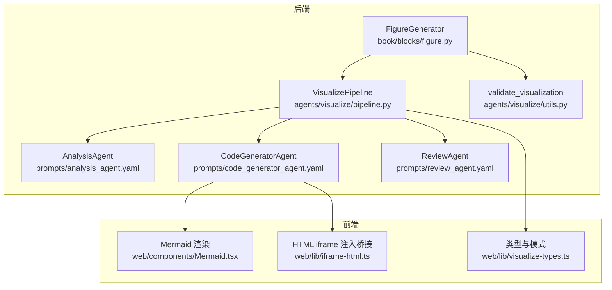
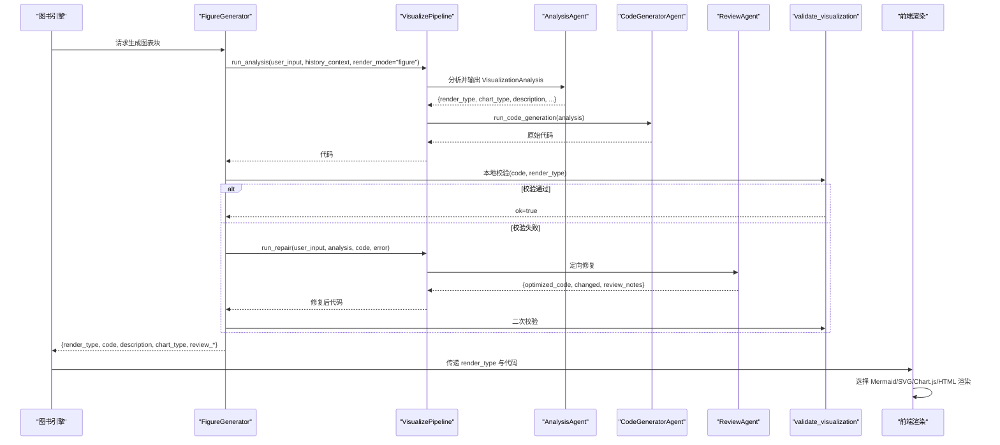
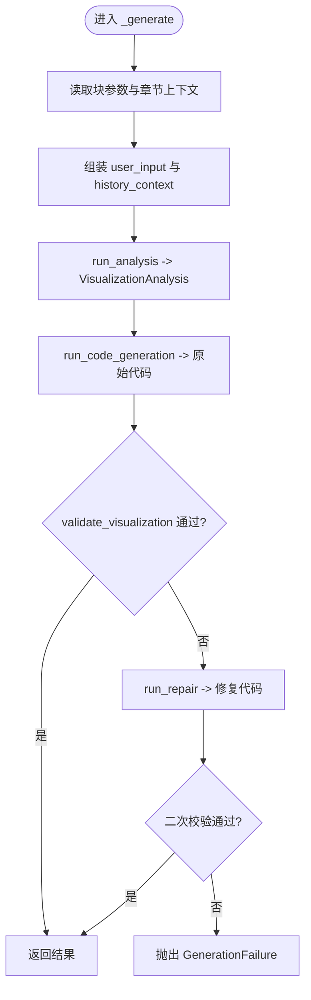
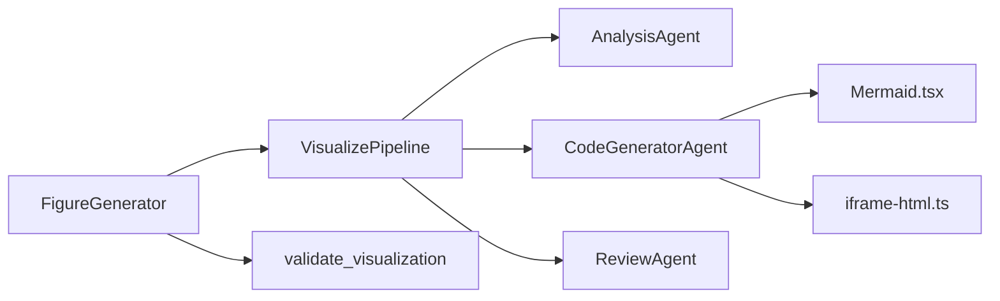

# 图表块

<cite>
**本文引用的文件**
- [figure.py](file://deeptutor/book/blocks/figure.py)
- [pipeline.py](file://deeptutor/agents/visualize/pipeline.py)
- [models.py](file://deeptutor/agents/visualize/models.py)
- [utils.py](file://deeptutor/agents/visualize/utils.py)
- [analysis_agent.yaml](file://deeptutor/agents/visualize/prompts/en/analysis_agent.yaml)
- [code_generator_agent.yaml](file://deeptutor/agents/visualize/prompts/en/code_generator_agent.yaml)
- [review_agent.yaml](file://deeptutor/agents/visualize/prompts/en/review_agent.yaml)
- [Mermaid.tsx](file://web/components/Mermaid.tsx)
- [iframe-html.ts](file://web/lib/iframe-html.ts)
- [visualize-types.ts](file://web/lib/visualize-types.ts)
- [page_planner.yaml](file://deeptutor/book/prompts/zh/page_planner.yaml)
</cite>

## 目录
1. [简介](#简介)
2. [项目结构](#项目结构)
3. [核心组件](#核心组件)
4. [架构总览](#架构总览)
5. [详细组件分析](#详细组件分析)
6. [依赖关系分析](#依赖关系分析)
7. [性能与缓存](#性能与缓存)
8. [故障排查指南](#故障排查指南)
9. [结论](#结论)
10. [附录：使用示例与配置项](#附录使用示例与配置项)

## 简介
本章节面向 DeepTutor 的“图表块”能力，系统性说明 FigureGenerator 的实现原理、数据流与渲染链路，覆盖图像生成、格式校验与修复、前端渲染（SVG、Chart.js、Mermaid、HTML）以及响应式与可访问性支持。文档同时给出图表块的参数定义、支持的图像格式与处理能力、响应式布局策略，并提供静态图片展示、动态图表生成和数据可视化的使用示例与配置方法。

## 项目结构
图表块位于图书引擎的 blocks 层，通过可视化管线（VisualizePipeline）调用分析、代码生成与审查三个阶段的智能体，最终产出可渲染的代码片段；前端根据 render_type 选择对应渲染器进行展示。

**图示来源**
- [figure.py:25-118](file://deeptutor/book/blocks/figure.py#L25-L118)
- [pipeline.py:13-88](file://deeptutor/agents/visualize/pipeline.py#L13-L88)
- [analysis_agent.yaml:1-25](file://deeptutor/agents/visualize/prompts/en/analysis_agent.yaml#L1-L25)
- [code_generator_agent.yaml:33-51](file://deeptutor/agents/visualize/prompts/en/code_generator_agent.yaml#L33-L51)
- [review_agent.yaml:1-38](file://deeptutor/agents/visualize/prompts/en/review_agent.yaml#L1-L38)
- [utils.py:112-143](file://deeptutor/agents/visualize/utils.py#L112-L143)
- [Mermaid.tsx:79-179](file://web/components/Mermaid.tsx#L79-L179)
- [iframe-html.ts:85-121](file://web/lib/iframe-html.ts#L85-L121)
- [visualize-types.ts:4-44](file://web/lib/visualize-types.ts#L4-L44)

**章节来源**
- [figure.py:25-118](file://deeptutor/book/blocks/figure.py#L25-L118)
- [pipeline.py:13-88](file://deeptutor/agents/visualize/pipeline.py#L13-L88)

## 核心组件
- FigureGenerator：图表块生成器，负责组装上下文、驱动可视化管线、执行本地校验并在失败时触发一次修复。
- VisualizePipeline：编排分析、代码生成与审查三个阶段，统一对外接口。
- AnalysisAgent：基于提示词与约束，输出结构化可视化简报（render_type、chart_type、描述等）。
- CodeGeneratorAgent：按 render_type 生成 SVG/Chart.js/Mermaid/HTML 代码，并对输出做根标签裁剪与清理。
- ReviewAgent：在本地校验失败时进行一次定向修复，返回优化后的代码与变更说明。
- validate_visualization：轻量、确定性的本地校验（如 SVG 必须包含 viewBox、XML 合法等），避免不必要的 LLM 调用。
- 前端渲染：Mermaid 组件、HTML iframe 注入桥接、类型与模式定义，确保主题一致、响应式与可访问性。

**章节来源**
- [figure.py:25-118](file://deeptutor/book/blocks/figure.py#L25-L118)
- [pipeline.py:13-88](file://deeptutor/agents/visualize/pipeline.py#L13-L88)
- [models.py:34-120](file://deeptutor/agents/visualize/models.py#L34-L120)
- [utils.py:112-143](file://deeptutor/agents/visualize/utils.py#L112-L143)
- [Mermaid.tsx:79-179](file://web/components/Mermaid.tsx#L79-L179)
- [iframe-html.ts:85-121](file://web/lib/iframe-html.ts#L85-L121)
- [visualize-types.ts:4-44](file://web/lib/visualize-types.ts#L4-L44)

## 架构总览
下图展示了从“图表块”到“前端渲染”的端到端流程，包括分析、生成、校验与修复的关键节点。

**图示来源**
- [figure.py:28-118](file://deeptutor/book/blocks/figure.py#L28-L118)
- [pipeline.py:47-88](file://deeptutor/agents/visualize/pipeline.py#L47-L88)
- [utils.py:112-143](file://deeptutor/agents/visualize/utils.py#L112-L143)
- [Mermaid.tsx:79-179](file://web/components/Mermaid.tsx#L79-L179)
- [iframe-html.ts:85-121](file://web/lib/iframe-html.ts#L85-L121)

## 详细组件分析

### FigureGenerator（图表块生成器）
- 职责：读取块参数与章节上下文，构造用户输入与历史背景，调用可视化管线完成分析与生成，执行本地校验并在失败时触发一次修复，最后返回渲染所需的数据。
- 关键行为：
  - 解析参数：chapter_title、chapter_summary、objectives、variant、focus。
  - 构建 user_input 与 history_context，限制 render_mode 为 figure，避免回退到交互 HTML。
  - 调用 pipeline.run_analysis 与 pipeline.run_code_generation。
  - 使用 validate_visualization 进行确定性校验；失败则调用 pipeline.run_repair 一次修复。
  - 返回 render_type、code(language/content)、description、chart_type 及 review 元信息。

**图示来源**
- [figure.py:28-118](file://deeptutor/book/blocks/figure.py#L28-L118)
- [utils.py:112-143](file://deeptutor/agents/visualize/utils.py#L112-L143)

**章节来源**
- [figure.py:28-118](file://deeptutor/book/blocks/figure.py#L28-L118)

### VisualizePipeline（可视化管线）
- 职责：封装分析、生成、修复三阶段，统一对外 API，支持 trace 回调。
- 关键方法：
  - run_analysis：调用 AnalysisAgent，受 render_mode 约束（figure 模式下强制安全类型）。
  - run_code_generation：调用 CodeGeneratorAgent，按 render_type 生成代码。
  - run_repair：调用 ReviewAgent，针对具体错误进行最小化修复。

**章节来源**
- [pipeline.py:13-88](file://deeptutor/agents/visualize/pipeline.py#L13-L88)

### 模型与提示词（Analysis/Code/Review）
- VisualizationAnalysis：定义 render_type、chart_type、描述、视觉元素、理由、视觉流派等字段；对未知枚举值进行降级处理，保证鲁棒性。
- 分析提示词：明确六种 render_type 的选择优先级，优先静态图（svg/chartjs/mermaid），仅在需要交互时使用 html，动画需显式意图。
- 代码生成提示词：对 SVG 输出有严格规范（根标签、viewBox、单 svg、XML 合法性、主题类名等）。
- 审查提示词：针对具体错误进行最小改动修复，保持原意与内容不变。

**章节来源**
- [models.py:34-120](file://deeptutor/agents/visualize/models.py#L34-L120)
- [analysis_agent.yaml:1-25](file://deeptutor/agents/visualize/prompts/en/analysis_agent.yaml#L1-L25)
- [code_generator_agent.yaml:33-51](file://deeptutor/agents/visualize/prompts/en/code_generator_agent.yaml#L33-L51)
- [review_agent.yaml:1-38](file://deeptutor/agents/visualize/prompts/en/review_agent.yaml#L1-L38)

### 本地校验（validate_visualization）
- 目标：快速判断代码是否可渲染，避免不必要的 LLM 调用。
- 规则要点（以 SVG 为例）：
  - 非空检查。
  - 必须包含根 <svg> 且 XML 合法。
  - 必须设置 camelCase 的 viewBox，否则视为无效（影响响应式缩放）。
- 其他类型：Chart.js 要求 JSON 结构完整；Mermaid 要求语法关键字与节点命名正确。

**章节来源**
- [utils.py:112-143](file://deeptutor/agents/visualize/utils.py#L112-L143)

### 前端渲染与响应式
- Mermaid 组件：
  - 动态加载 mermaid，应用主题变量，监听主题变化重渲染。
  - 防抖稳定后再渲染，避免频繁重建。
  - 错误态提供源码查看与友好提示。
- HTML iframe：
  - 注入桥接脚本，实现子页面与宿主 postMessage 通信（高度自适应、发送 prompt）。
  - 注入 KaTeX 与内容清洗，保障安全与数学公式显示。
- 类型与模式：
  - 定义文本渲染类型（svg/chartjs/mermaid/html）与 Manim 类型（manim_video/manim_image）。
  - 提供默认配置与汇总显示逻辑。

**章节来源**
- [Mermaid.tsx:79-179](file://web/components/Mermaid.tsx#L79-L179)
- [iframe-html.ts:85-121](file://web/lib/iframe-html.ts#L85-L121)
- [visualize-types.ts:4-44](file://web/lib/visualize-types.ts#L4-L44)

## 依赖关系分析
- 模块耦合：
  - FigureGenerator 依赖 VisualizePipeline 与本地校验 utils，低耦合、高内聚。
  - Pipeline 聚合三个 Agent，屏蔽内部复杂度。
  - 前端组件仅消费 render_type 与代码，解耦后端生成细节。
- 外部依赖：
  - Mermaid 库用于流程图/时序图等渲染。
  - Chart.js 用于标准图表（由前端按需引入）。
  - HTML 渲染通过 iframe 隔离，注入桥接与 KaTeX。

**图示来源**
- [figure.py:25-118](file://deeptutor/book/blocks/figure.py#L25-L118)
- [pipeline.py:13-88](file://deeptutor/agents/visualize/pipeline.py#L13-L88)
- [Mermaid.tsx:79-179](file://web/components/Mermaid.tsx#L79-L179)
- [iframe-html.ts:85-121](file://web/lib/iframe-html.ts#L85-L121)

**章节来源**
- [figure.py:25-118](file://deeptutor/book/blocks/figure.py#L25-L118)
- [pipeline.py:13-88](file://deeptutor/agents/visualize/pipeline.py#L13-L88)

## 性能与缓存
- 本地校验优先：通过 validate_visualization 在 LLM 之外完成大部分有效性检查，减少昂贵调用次数。
- 单次修复策略：仅在首次校验失败时触发一次 repair，控制成本与延迟。
- 前端懒加载与去抖：Mermaid 动态导入与 DEBOUNCE_MS 降低重复渲染开销。
- 主题切换重渲染：通过主题 token 增量更新，避免全量重建。
- 缓存机制说明：当前仓库未实现服务端或客户端的图表代码缓存；如需提升重复渲染性能，可在前端增加基于 render_type+content 的内存缓存或在服务端增加基于参数的结果缓存。

[本节为通用指导，不直接分析具体文件]

## 故障排查指南
- 常见错误与定位：
  - SVG 缺少 viewBox 或非合法 XML：由 validate_visualization 捕获，触发 repair；若仍失败，检查生成的 SVG 根标签与属性。
  - Mermaid 渲染失败：前端组件会显示错误信息与源码，确认语法关键字与节点命名是否正确。
  - HTML 交互异常：检查 iframe 桥接是否注入成功，postMessage 通信是否正常。
- 建议步骤：
  - 查看 review_notes 与错误消息，定位具体问题。
  - 在本地复现，逐步缩小问题范围（先验证 render_type 与代码结构，再验证交互逻辑）。
  - 必要时调整 variant/focus 以引导更合适的生成策略。

**章节来源**
- [utils.py:112-143](file://deeptutor/agents/visualize/utils.py#L112-L143)
- [Mermaid.tsx:139-179](file://web/components/Mermaid.tsx#L139-L179)
- [iframe-html.ts:85-121](file://web/lib/iframe-html.ts#L85-L121)

## 结论
DeepTutor 的图表块通过“分析—生成—校验—修复”的流水线，结合严格的本地校验与前端多渲染器适配，实现了高质量、可扩展的静态图表生成与展示。其设计在保证性能与成本的同时，兼顾了响应式布局与可访问性，适用于教学场景中的概念图、流程图、数据图表与交互式学习页面。

[本节为总结性内容，不直接分析具体文件]

## 附录：使用示例与配置项

### 图表块参数定义
- 基础参数（来自 block.params）：
  - chapter_title：章节标题，用于生成上下文。
  - chapter_summary：章节摘要，辅助理解核心关系。
  - objectives：学习目标列表，帮助聚焦重点。
  - variant：图表变体，如 diagram、comparison、flowchart、mindmap、illustration、schematic。
  - focus：希望突出的重点，用于细化生成意图。
- 运行时参数（由管线与前端使用）：
  - render_mode：auto / svg / chartjs / mermaid / html / manim_video / manim_image。
  - quality：当 render_mode 为 manim_video/manim_image 时生效（low/medium/high）。
  - style_hint：风格提示，影响生成样式。

**章节来源**
- [figure.py:31-36](file://deeptutor/book/blocks/figure.py#L31-L36)
- [visualize-types.ts:11-33](file://web/lib/visualize-types.ts#L11-L33)
- [page_planner.yaml:11-15](file://deeptutor/book/prompts/zh/page_planner.yaml#L11-L15)

### 支持的图像格式与处理能力
- SVG：矢量图，内联渲染，继承主题与字体，支持交互；要求根标签与 viewBox 正确。
- Chart.js：标准统计图表（柱状、折线、饼图、雷达等），JSON 配置需完整。
- Mermaid：结构化图（流程图、时序图、类图、状态图、ERD、甘特、思维导图等）。
- HTML：自包含交互页面，通过 iframe 隔离运行，注入桥接与 KaTeX。
- Manim：视频或分镜图（需显式意图），由独立管线处理。

**章节来源**
- [models.py:12-19](file://deeptutor/agents/visualize/models.py#L12-L19)
- [analysis_agent.yaml:5-25](file://deeptutor/agents/visualize/prompts/en/analysis_agent.yaml#L5-L25)
- [code_generator_agent.yaml:33-51](file://deeptutor/agents/visualize/prompts/en/code_generator_agent.yaml#L33-L51)

### 响应式布局与自适应显示
- SVG：通过 viewBox 实现响应式缩放，避免固定宽高导致变形。
- Mermaid：启用 useMaxWidth，跟随容器宽度自适应。
- HTML：iframe 通过 ResizeObserver 上报内容高度，宿主自动撑开容器。
- 主题一致性：Mermaid 从 CSS 变量读取主题色，随主题切换刷新。

**章节来源**
- [utils.py:135-143](file://deeptutor/agents/visualize/utils.py#L135-L143)
- [Mermaid.tsx:51-63](file://web/components/Mermaid.tsx#L51-L63)
- [iframe-html.ts:94-103](file://web/lib/iframe-html.ts#L94-L103)

### 可访问性与屏幕阅读器兼容
- 语义化标签与替代文本：建议在块参数中提供 alt_text 与 caption，便于屏幕阅读器朗读。
- 主题与对比度：SVG/Mermaid 使用主题变量，确保在不同主题下具备良好可读性。
- 键盘可达性：交互 HTML 应遵循无障碍最佳实践（焦点管理、ARIA 属性等）。

[本节为通用指导，不直接分析具体文件]

### 使用示例与配置方法
- 静态图片展示（SVG）：
  - 设置 variant=illustration/schematic，focus 指明核心关系。
  - 确保生成 SVG 包含 viewBox，前端内联渲染。
- 动态图表生成（Chart.js）：
  - 设置 variant=chart，focus 指定数据类型与维度。
  - 前端按 chart_type 渲染标准图表。
- 数据可视化（Mermaid）：
  - 设置 variant=flowchart/mindmap，focus 强调结构与流程。
  - 前端使用 Mermaid 组件渲染，支持主题切换。
- 交互学习页面（HTML）：
  - 设置 render_mode=html，focus 描述交互目标。
  - 前端通过 iframe 隔离运行，注入桥接与 KaTeX。

**章节来源**
- [page_planner.yaml:11-15](file://deeptutor/book/prompts/zh/page_planner.yaml#L11-L15)
- [visualize-types.ts:4-44](file://web/lib/visualize-types.ts#L4-L44)
- [Mermaid.tsx:79-179](file://web/components/Mermaid.tsx#L79-L179)
- [iframe-html.ts:85-121](file://web/lib/iframe-html.ts#L85-L121)